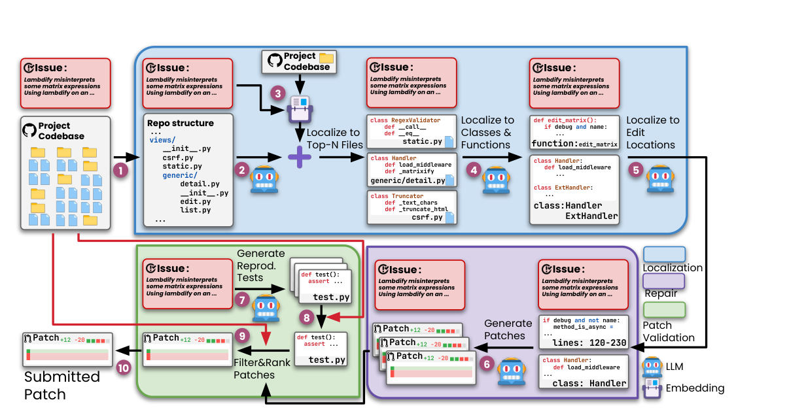
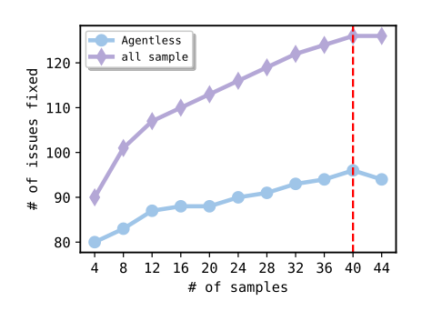

# Agentless — LLM に次の手を決めさせず、固定の 3 段階で GitHub のイシューを解く

> 原典: [[translations/2024-agentless]] ・ `raw/papers/Agentless _        _      _Demystifying LLM-based Software Engineering Agents.md`
> 著者・年: Chunqiu Steven Xia, Yinlin Deng, Soren Dunn, Lingming Zhang（University of Illinois Urbana-Champaign）・2024-07（v2 は 2024-10）・arXiv:2407.01489

## 一言まとめ

「SWE エージェントに、本当に自律的なループと凝ったツールは要るのか？」を問い、**位置の特定 → 修復 → パッチの検証という固定の 3 段階**で LLM を呼ぶだけの手順（エージェントレス）を作った論文。GPT-4o で SWE-bench Lite **32.0%（1 件 0.70 ドル）**と当時のオープンソースのエージェントをすべて上回り、Verified でも 38.8% を出した。OpenAI が GPT-4o・o1 の SWE-bench の成績を示す既定の手法に採用し、Kimi K2 も「Agentless」設定での評価を報告している。

## 背景と問題意識

2024 年前半の SWE エージェント（SWE-agent・OpenDevin・AutoCodeRover など → [[coding-agents]]）は、LLM にツールを持たせ、**観測→思考→行動のループ**（→ [[agent-loop]]）を何十ターンも自分で回させる作りだった。著者らは、当時の LLM の能力ではこの作りに 3 つの限界があると指摘する。

1. **ツールの設計・使用が難しい**。実際の操作を API 呼び出しに対応づける抽象化の層は、入出力の形式を慎重に設計しないと誤用を招き、ループの後のターンまで響いて無駄な問い合わせが増える（SWE-agent が ACI＝エージェント向けのツール設計に力を注いだのはこの問題への回答である → [[agent-computer-interface]]）。
2. **意思決定を制御できない**。次に何をするかをエージェントに任せると、行動空間が広いので混乱して無駄な探索をしやすい。30〜40 ターンもかかると、どこで判断を誤ったかのデバッグも難しい。
3. **自己反省が弱い**。誤った情報を取り除けないので、1 つの誤ったステップが後のすべての判断に増幅される（→ [[self-reflection]]）。

そこで著者らは、**LLM には「各段階の小さな仕事」だけをさせ、手順そのものは人間が決めて固定する**方向を試した。Anthropic の Building Effective Agents（[[summaries/2024-building-effective-agents]]）の用語でいえば、agent（LLM が手順を決める）ではなく **workflow**（事前に決めたコードパスで LLM を呼ぶ）にあたる。

## 提案手法 — 固定の 3 段階

<figure>

<figcaption>図1（再掲）: Agentless の全体像。青が位置の特定（リポジトリ構造 → ファイル → クラス・関数 → 編集位置）、紫が修復（候補パッチの生成）、緑がパッチの検証（再現テストの生成と、テストによる絞り込み・順位づけ）。どの段階でも LLM は「次に何をするか」を決めない。</figcaption>
</figure>

### 1. 位置の特定 — 段階的に文脈を絞る

リポジトリには数千行のファイルが何百もあるのに、直すべきなのは数行か数個の関数である。そこで粗い単位から細かい単位へ 3 段階で絞り込む。

1. **ファイル**：リポジトリの構造を `tree` コマンドのような木の形で LLM に見せ、怪しいファイルの上位 3 件を挙げさせる。並行して、**埋め込み検索**（embedding, テキストを意味を保った数値ベクトルに変えて類似度で探す方法）でもファイルを探し、両方を合わせる。
2. **クラス・関数**：各ファイルを**スケルトン形式**（クラスと関数の宣言の見出し・シグネチャ・コメントだけを残した圧縮表現）で一度に見せ、調べるべきクラスと関数を挙げさせる。
3. **編集位置**：選ばれたクラス・関数のコードを見せ、行番号・関数・クラスの単位で編集位置を確定させる。この段階だけ**4 回サンプリングして編集位置の候補を 4 組**作る。

### 2. 修復 — 候補パッチを 40 本作る

編集位置の前後 ±10 行をイシューの記述とともに見せ、**Search/Replace 形式**（「この部分を探して、これに置き換える」という単純な diff 形式。ファイル全体を書き直させないので安く、ハルシネーションも減る）でパッチを書かせる。編集位置 4 組 × 10 本（貪欲デコーディング 1 本＋温度 0.8 のサンプル 9 本）で、**1 イシューあたり 40 本の候補パッチ**になる。

### 3. パッチの検証 — 40 本から 1 本を選ぶ

ここが「生成して選ぶ」の中心である。現実の設定では、イシューが立った直後なのでバグを再現するテストはまだない。そこで次の順に絞り込む。

1. **再現テストを LLM に書かせる**。バグが再現すれば `Issue reproduced`、直っていれば `Issue resolved` を出力するテストを 40 本作り、元のコードで実際に `Issue reproduced` を出したものだけを残し、正規化して最も多く出現したものを採用する。
2. **回帰テスト**：元のコードで通る既存のテストを集め、イシューの修正で変わりうるテストを LLM に除外させたうえで、全候補パッチに回す。**失敗数が最も少ないパッチ**だけを残す。
3. **再現テスト**で `Issue resolved` を出すパッチだけを残す（1 本も残らなければ回帰テストの結果だけで選ぶ）。
4. **多数決**：残ったパッチを抽象構文木で正規化し（空白・コメント・docstring の違いを消す）、**最も多く出現したパッチ**を提出する。

モデルはすべて GPT-4o（gpt-4o-2024-05-13）。著者ら自身、「使った技法はどれも単独では革命的ではなく、既存の技法を組み合わせただけ」と書いている。

## 実験結果と知見

**表**: SWE-bench Lite（300 問）での主な比較（原典の表 1 から抜粋）

| 手法 | モデル | 解決率 | 1 件あたりの費用 | トークン |
|---|---|---|---|---|
| CodeStory Aide（クローズド、首位） | GPT-4o＋Claude 3.5 Sonnet | 43.0% | — | — |
| **Agentless** | GPT-4o | **32.0%** | **$0.70** | 7.8 万 |
| AutoCodeRover-v2（オープン、次点） | GPT-4o | 30.7% | — | — |
| Moatless | Claude 3.5 Sonnet | 26.7% | $0.17 | — |
| SWE-agent | Claude 3.5 Sonnet | 23.0% | $1.62 | 52.1 万 |
| SWE-agent | GPT-4o | 18.3% | $2.53 | 49.8 万 |
| RAG（検索して一発でパッチ） | Claude 3 Opus | 4.3% | $0.25 | — |

同じ GPT-4o で比べると、SWE-agent の 18.3%（$2.53）に対して Agentless は 32.0%（$0.70）である。Verified（500 問）では 38.8%（194 問）で、オープンソースでは 2 位、GPT-4o を使う手法の中では最高だった。

### 生成して選ぶ — 選び方が成績を決める

**表**: パッチの選び方による違い（原典の表 4）

| 選び方 | 解決数（300 問中） | 追加費用 |
|---|---|---|
| 多数決だけ | 77（25.7%） | $0.00 |
| ＋回帰テスト | 81（27.0%） | $0.01 |
| ＋再現テスト | **96（32.0%）** | $0.25 |

<figure>

<figcaption>図6（再掲）: 候補パッチの本数と解決数。下の線が実際に 1 本を選んだときの解決数（40 本で 96 件、44 本では 94 件に下がる）、上の線が「40 本のどれかが正解だった」イシューの数（126 件＝42.0%）。</figcaption>
</figure>

- **40 本の候補のどれかが正解だったイシューは 126 件（42.0%）あるのに、実際に選べたのは 96 件（32.0%）**。約 10 ポイントが「よい候補は出ているのに選べていない」部分である。これは、K 本中に正解があるか（Pass@K）と、選んだ 1 本が正解か（Best@K）の差そのもので、後の SWE-Gym（[[summaries/2024-swe-gym]]）が学習した検証器で 42.8% 対 32.0% と同じ構図を示している（→ [[test-time-compute]]）。
- **候補を増やしても約 40 本で頭打ち**になる。多数決で選ぶので、後から足したサンプルは先に多数派になったパッチを覆しにくい。
- **再現テストが最も効く**が、その質は高くない。213 件で `Issue reproduced` を出すテストが作れたが、正解パッチを当てて `Issue resolved` を出したのは 94 件だけだった。イシューの記述だけでは、直ったかを判定できるテストを書くのに情報が足りないことが多い。それでも効くのは、回帰テストを先に通すことを必須にしているので、誤った再現テストが誤ったパッチを選ぶ危険が小さいからである。
- **編集位置の候補を分けて修復するのが効く**。編集位置の 4 組を 1 組にまとめて 40 本作ると 85 件、貪欲な 1 組で 40 本作ると 88 件、4 組それぞれで 10 本ずつ作ると 96 件だった（表 3）。位置の候補が違えば、見せる文脈も違い、別のイシューが解ける。

### 文脈を絞ると精度も費用も良くなる

位置の特定のアブレーション（表 2）は、[[context-engineering]] の「長い文脈は精度を下げる」を裏づける。

- クラス・関数を選ぶ段で、**ファイル全体を見せると正解を含む率が 53.7%（$0.15）、スケルトンだと 58.3%（$0.02）**。安いほうが精度も高い。
- ファイルから一気に編集位置へ飛ぶと 47.0%（$0.18）で、段階を踏む既定（50.7%、$0.06）より悪い。
- ファイルの特定は、LLM へのプロンプトだけで 78.7%、埋め込みだけで 67.7%、両方を合わせると 81.7%。埋め込みの前に LLM に無関係なフォルダを除かせると、精度も費用も良くなる。

### どんなイシューで手続き型が負けるか

著者ら自身の分析（図 9）が、手続き型の限界を示している。**イシューに位置の手がかり（ファイル名・スタックトレース・キーワード）が一切ない問題では、クローズドソースのエージェント型ツールが Agentless より良かった**。コード検索のツールを自分で使って探し回れるエージェントのほうが、手がかりのない難しい問題に強い。逆に、イシューに再現可能なコード例が含まれる問題では、ほかの手法は軒並み成績が下がったのに、再現テストを書く Agentless は高いままだった。

### SWE-bench Lite の問題の質

300 問を人手で分類すると、**正解パッチがイシューにそのまま書いてある問題が 4.3%**、解決の手順が書いてある問題が 9.7%、**解くのに必要な情報が足りない問題が 10.0%**（例: テストが特定の関数名やエラーメッセージを要求するのに、イシューに書いていない）、**誤った解決策が書いてある問題が 5.0%** あった。これらを除いた 249 問を **SWE-bench Lite-S** とした。順位はほぼ変わらなかったが、OpenAI が同じ問題意識で人手検証済みの SWE-bench Verified（500 問）を作っており、著者らはそれを自分たちの方向の追認としている（→ [[agent-evaluation]]）。

## 限界・批判的視点

- **「エージェントは要らない」は 2024 年半ばのモデルについての結論である**。本論文の表 6 自体に、Claude 3.5 Sonnet（20241022）を使うクローズドソースの「Tools」が Verified 49.0% を出した結果が載っており、Agentless の 38.8% を上回る。同じモデル・同じ 49% を、Anthropic はワークフローを持たない最小構成のエージェント（プロンプト 1 つとツール 2 つ）で出したと報告している（[[summaries/2025-swe-bench-sonnet]]）。その後のモデルでは、エージェント型が SWE-bench の主流になった。**手順を固定する利点は、モデルが弱いときほど大きい**——SWE-Effi（[[summaries/2025-swe-effi]]）の「弱いモデルには手順を固定したほうが安定する」と同じ読み方ができる。
- **安いのはトークンであって、計算全体ではない**。1 イシューあたり候補パッチ 40 本と再現テスト 40 本を作り、全テストを何度も回す。SWE-Effi の再測定では、Agentless は解決率首位の一方で CPU 時間が最も重い部類（平均 728 秒）だった（→ [[agent-cost-efficiency]]）。テストを実行できる環境があることも前提になる。
- **手順を固定すると、手がかりのない問題に弱い**。上記のとおり、位置の手がかりがないイシューではエージェント型に負ける。手順の外にある種類の問題には汎化しにくい。
- **比較の条件がそろっていない**。ベースラインの数字はリーダーボードや各論文の自己申告をそのまま使っており、モデルも費用の算出方法もまちまちである。上位のクローズドソースの手法は軌跡を公開しておらず、検証できない。
- **汚染の可能性を排除できない**。SWE-bench の正解パッチが GPT-4o の訓練データに入っている可能性を著者ら自身が認めている（SWE-bench 論文の「カットオフ前後で差がない」という結果を根拠に挙げるにとどまる）。また、SWE-bench が提供する回帰テストの一覧（PASS_TO_PASS）をそのまま使うと 98 件まで上がると脚注で述べており、評価に使う情報をどこまで手順に入れてよいかで数字が動く。
- **再現テストの質が低い**。正しく判定できるテストは 300 問中 94 件だけで、イシューの記述が曖昧なときは役に立たない。

## 実装・運用上の示唆

- **まず手順を固定した版を作り、ベースラインにする**。どの段で何が落ちているかを段ごとに測れるので、改善点が見えやすい（本論文の表 2〜4 はそのまま段ごとの診断になっている）。エージェント型に進むのは、手順の外の問題で負けていると分かってからでよい（[[summaries/2024-building-effective-agents]] の「まず単純に」と同じ）。
- **文脈は段階的に絞る**。ファイル全体を渡すより、構造 → スケルトン → 該当コードと絞るほうが、安くて正確である。
- **候補を複数作り、テストで選ぶ**。1 本目の精度を上げるより、候補を増やして選ぶほうが伸びることがある。選び方は「回帰テストを先に通す → 再現テスト → 正規化して多数決」の順で、誤った再現テストに引きずられないよう回帰テストを必須にする。
- **上限（K 本中に正解がある率）と実際の差を測る**。差が大きければ、生成ではなく選び方（検証器）を改善する。
- **編集は Search/Replace 形式にする**。ファイル全体を書き直させない。

## 用語と略称

- **LLM** = Large Language Model（大規模言語モデル）
- **SWE** = Software Engineering（ソフトウェアエンジニアリング）
- **ACI** = Agent-Computer Interface（エージェントとコンピュータのインターフェース。エージェント向けのツール設計）
- **FL** = Fault Localization（欠陥の位置特定）。SBFL（Spectrum-Based FL, 失敗するテストが通る箇所を怪しいとみなす）・MBFL（Mutation-Based FL, コードを少し変えたときのテスト結果の変化で判断する）・IR ベース（Information Retrieval, バグ報告とコードの文字列の類似度で探す）がある
- **APR** = Automated Program Repair（自動プログラム修復）
- **NMT** = Neural Machine Translation（ニューラル機械翻訳）
- **RAG** = Retrieval-Augmented Generation（検索拡張生成。ここでは BM25 で関連ファイルを検索して一発でパッチを書かせるベースライン）
- **BM25**：単語の出現頻度にもとづく古典的な検索の順位づけ手法
- **AST** = Abstract Syntax Tree（抽象構文木。コードの構造を木で表したもの。パッチの正規化に使う）
- **再現テスト**（reproduction test）：イシューのバグを再現し、修正後に直ったことを確かめるテスト
- **回帰テスト**（regression test）：修正で既存の機能が壊れていないかを確かめる既存のテスト
- **Pass@K / Best@K**：K 本中に正解があるか／選んだ 1 本が正解か
- **workflow / agent**：事前に決めた手順で LLM を呼ぶ構成／LLM が自分で手順を決める構成（Building Effective Agents の区別）

## 関連ページ

- [[coding-agents]] — 手続き型とエージェント型の 2 つの流儀（本論文が手続き型の一次資料）
- [[test-time-compute]] — 候補を複数作って選ぶ並列スケーリング
- [[agent-frameworks]] — workflow と agent の使い分け
- [[agent-evaluation]] — SWE-bench Lite の問題の質と Lite-S・Verified
- [[agent-computer-interface]] — Search/Replace 形式とスケルトン形式（ツールを作り込まない側の設計）
- [[context-engineering]] — 文脈を段階的に絞ると精度も上がる
- [[agent-cost-efficiency]] — トークンは安いが CPU 時間は重い
- [[agent-training]] — 手順の決まった足場と訓練の相性、RL で使われた軽量版（Agentless-Mini）
- [[summaries/2024-swe-agent]] — 対照的な立場（ツールを作り込むエージェント型）
- [[summaries/2025-swe-effi]] — Agentless を含む 5 つの足場の費用対効果の再測定
- [[summaries/2025-swe-bench-sonnet]] — 最小構成のエージェントで Agentless を上回った例
- [[summaries/2024-swe-gym]] — 学習した検証器で同じ「上限と選べた数の差」を示した研究
- [[summaries/2024-building-effective-agents]] — workflow と agent の区別
- [[summaries/2023-swe-bench]] — 評価に使う SWE-bench
- [[summaries/2025-kimi-k2]] — 「Agentless」設定を評価の条件の 1 つとして使ったモデルレポート
- [[summaries/2026-swe-bench-verified-retired]] — 本論文が Lite で見つけた「イシューに書いていない関数名をテストが要求する」欠陥が、Verified にも残っていたという監査
- [[summaries/2024-error-bars-evals]] — 32.0% 対 30.7%（300 問）のような差が誤差の範囲かを判断する、標準誤差と対応のある比較
- [[summaries/2025-swe-rebench]] — Agentless の固定手順の考え方を、インストール手順の自動生成に応用した例
