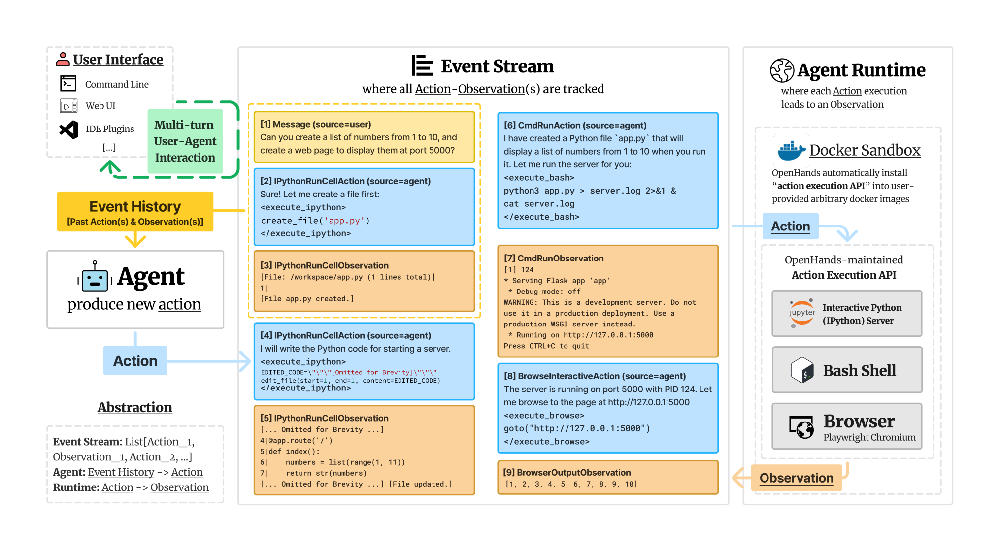

# OpenHands：コードを書いて実行するエージェントを作り、動かし、測るためのオープンな基盤

> 原典: [[translations/2024-openhands]] ・ `raw/papers/OpenHands_ An Open Platform for AI Software Developers as Generalist Agents.md`
> 著者・年・会議: Xingyao Wang ほか 24 名（UIUC, CMU, Yale, UC Berkeley, Alibaba, All Hands AI など）・arXiv:2407.16741（v1: 2024-07、v3 が最新）・ICLR 2025。旧称は OpenDevin。`raw/` のクリップは表がすべて 1 行に崩れ、脚注とコードの一覧も欠けていたので、翻訳と本ページは arXiv の HTML 版 v3 にもとづく。

## 一言まとめ

人間の開発者と同じように**コードを書き、コマンドラインを使い、ウェブを閲覧する** AI エージェントを作るための、オープンソースのプラットフォームの論文である。エージェントと実行環境とユーザー画面を、**行動と観測の時系列（イベントストリーム）1 本でつなぐ**設計、Docker のサンドボックスで行動を実行するランタイム、15 のベンチマークを回せる評価の仕組みを示した。同じ汎用エージェント（CodeActAgent）が、ソフトウェア工学・ウェブ・その他の質問応答で、それぞれの専門エージェントに近い成績を出すことも報告している。

## 背景と問題意識

2024 年前半には、GitHub のイシューを解く SWE-agent（[[summaries/2024-swe-agent]]）や AutoCodeRover、商用の Devin など、コーディングエージェントが次々に出ていた（→ [[coding-agents]]）。一方で、研究者が自分のエージェントを作って比べようとすると、次のものを毎回自前で用意する必要があった。

- エージェントがコードを実行しても手元のマシンを壊さない**隔離された実行環境**（サンドボックス, sandbox。危険な操作を隔離環境に閉じ込める仕組み）
- ファイル編集や検索などの**道具**（ツール）
- 人間が途中で口を挟める**画面**
- SWE-bench や WebArena などの**評価用ベンチマークの実行環境**

LangChain・AutoGen・MetaGPT などの汎用フレームワーク（→ [[agent-frameworks]]）は道具の部品やマルチエージェントの会話を提供していたが、サンドボックス・ブラウザ・評価までを一式で備えたものはなかった、と著者らは整理している（表 1）。また著者らは、**ソフトウェアこそ人間が世界に働きかける最も強力な手段**なので、エージェントにもソフトウェアを書いて動かす手段を与えるべきだと考えた。

## 提案手法 / 主張

<figure>

<figcaption>図2（再掲）: OpenHands の構成。左がエージェント（過去の行動と観測の履歴を読み、次の行動を出す）、中央がイベントストリーム（ユーザーの依頼 [1]、Python の実行 [2]、その結果 [3]、bash の実行 [6]、ブラウザの操作 [8] などがすべて時系列で記録される）、右がランタイム（Docker のサンドボックスの中で IPython サーバ・bash シェル・ブラウザが行動を実行し、観測を返す）。</figcaption>
</figure>

### 1. イベントストリーム: 全員が同じ履歴を読み書きする

OpenHands の中心は **行動（action）と観測（observation）を時系列に並べたイベントストリーム**である。エージェントの行動、ランタイムの実行結果、ユーザーの指示やフィードバックが、すべて同じストリームに書き込まれる。エージェントの仕事は「これまでのストリームを読み、次の行動を 1 つ返す」ことだけで、Python のクラスでいえば `step(state)` という関数 1 つを書けばよい（翻訳の図 3）。これは、観測 → 思考 → 行動を繰り返す [[agent-loop]] を、データ構造として固定したものと読める。

この形の利点は、**エージェント・ランタイム・画面を互いに知らずに差し替えられる**ことである。画面はストリームを表示するだけなので、どのエージェントにも使える。ユーザーはエージェントが作業している途中でいつでも割り込み、追加の指示を出せる（HITL, Human-in-the-Loop, 人間が途中で承認・介入する運用）。状態にはストリームのほかに、LLM 呼び出しの累積コストなども入る。

### 2. 行動をコードにする（CodeAct）

行動の種類は少ない。中核は次の 3 つである。

- **IPythonRunCellAction**: 任意の Python コードを実行する
- **CmdRunAction**: 任意の bash コマンドを実行する
- **BrowserInteractiveAction**: ブラウザを操作する（BrowserGym の `click('51')` `fill('237', '...')` のような専用の言語で書く）

これは同じ著者の CodeAct（行動を JSON の関数呼び出しではなく実行可能なコードとして出させる考え方）を引き継いだ設計である。JSON の関数呼び出し（function calling → [[tool-use-and-function-calling]]）では、あらかじめ定義した道具しか呼べない。コードを行動にすれば、道具がなくても Python で書けばよく、**エージェントが必要な道具を自分で作る**こともできる。逆に、Python 関数として道具を定義しておけば、JSON の関数呼び出しのエージェントにもそのまま渡せる。

### 3. ランタイム: Docker のサンドボックスと行動実行 API

タスクごとに Docker コンテナを 1 つ立ち上げ、すべての行動をその中で実行する。コンテナの中では「行動実行 API」という REST サーバが動いていて、bash シェル、Jupyter の IPython サーバ、Playwright で動かす Chromium ブラウザを持つ。ユーザーが作業させたいフォルダはコンテナにマウントされる。ブラウザの観測として HTML、DOM、アクセシビリティツリー（画面上の要素を読み上げ用に構造化したもの）、スクリーンショット、開いているタブが返る。

ユーザーが指定した**任意の Docker イメージ**に行動実行 API を後から入れる仕組みがあるので、SWE-bench のように問題ごとに環境が違う評価でも同じエージェントを動かせる。ビルドしたイメージには、中身のハッシュによるタグと「OpenHands の版 × 元のイメージ」のタグの 2 つを付け、同じ中身なら作り直さずに再利用する（付録 F）。

### 4. AgentSkills: 道具を Python 関数として配る

SWE-agent が示した ACI（Agent-Computer Interface, エージェント向けに作り直した道具 → [[agent-computer-interface]]）の考え方を、**どのエージェントからも使える Python のライブラリ**として配る。関数は IPython に自動で読み込まれ、エージェントは Python のコードとして呼ぶ。収録の基準は明快で、**LLM がコードを直接書いて簡単にはできないもの**（指定した行の置き換えなど）と、**外部のモデルを呼ぶもの**（音声認識、画像の読み取りなど）だけを入れる。LLM がすでに使い方を知っている pandas の CSV 読み込みのようなものは、道具にしない。v0.6 の時点では、ファイルを開く・スクロールする・行を指定して編集する・ディレクトリやファイルを検索する、と、PDF・Word・LaTeX・音声・画像・動画・PowerPoint を読む関数がある。

### 5. 委任と AgentHub

`AgentDelegateAction` で、あるエージェントが別のエージェントにサブタスクを任せられる（→ [[multi-agent-systems]]）。例えば、ブラウザ操作が得意でない CodeActAgent は、ウェブの操作を専門の BrowsingAgent に任せる。コミュニティが作ったエージェントは AgentHub に集められ、既定の汎用エージェントの CodeActAgent、ゼロショットのプロンプトだけで動く BrowsingAgent、グラフ構造のマルチエージェントの GPTSwarm、特定の用途向けのプロンプトだけを差し替える「マイクロエージェント」などがある。

### 6. 評価とテストの仕組み

15 のベンチマーク（表 2）を OpenHands の上で回せるようにした。加えて、エージェント開発のための**結合テスト**（integration test, 部品をつないだ全体の動作を確かめるテスト）の仕組みを持つ。LLM の呼び出しを横取りし、プロンプトが完全一致したら保存しておいた応答を返す（モック化）ことで、毎回同じ結果になり、費用もかからない。プロンプトを変えたときだけ実際の LLM で応答を作り直す。SWE-bench Lite を gpt-4o で 1 回回すと約 600 ドルかかるので、コードの変更のたびに全評価を回すことはできない、という事情による（付録 E）。

## 実験結果と知見

ベースラインは「ベンチマークの内容に合わせた手作業のプロンプト調整をしていない、オープンで再現可能なもの」に限っている（→ [[agent-evaluation]]）。

**表**: 主な結果（原典の表 3〜6 から抜粋。成功率 %、括弧内は 1 問あたりの平均コスト $）

| ベンチマーク | OpenHands のエージェントとモデル | 成績 | 比較対象 |
|---|---|---|---|
| SWE-bench Lite（300 問） | CodeActAgent v1.8・claude-3.5-sonnet | 26.0（1.10） | Agentless・gpt-4o 27.3、Moatless・claude-3.5-sonnet 26.7、SWE-agent・gpt-4 18.0（1.67） |
| 同 | CodeActAgent v1.8・gpt-4o | 22.0（1.72） | |
| HumanEvalFix（164 問） | CodeActAgent v1.5・gpt-4o（0-shot） | 79.3（0.14） | SWE-agent・gpt-4-turbo（1-shot）87.7、StarCoder2-15B 48.6 |
| WebArena（812 問） | BrowsingAgent・claude-3.5-sonnet | 15.5（0.10） | WebArena の元のエージェント・gpt-4-turbo 14.4、Auto Eval & Refine 20.2 |
| 同 | CodeActAgent から BrowsingAgent に委任・claude-3.5-sonnet | 15.3 | |
| GPQA diamond（198 問） | CodeActAgent v1.8・claude-3.5-sonnet | 52.0（0.065） | gpt-4 の few-shot CoT 38.8、専門家の人間 81.3 |
| GAIA L1 validation（53 問） | GPTSwarm・gpt-4o | 32.1（0.050） | AutoGPT・gpt-4-turbo 13.2 |
| AgentBench OS（144 問） | CodeActAgent v1.5・gpt-4o | 57.6 | 元のベースライン・gpt-4 42.4 |

- **1 つの汎用エージェントで、専門エージェントに近い成績**。著者らが強調するのは、同じ CodeActAgent が**システムプロンプトを変えずに** SWE-bench・WebArena（委任経由）・GPQA で、それぞれの分野向けに作られたエージェントに近いか上回る成績を出した点である。
- **道具を使えると知識問題でも伸びる**。GPQA（大学院レベルの難問）で、Python の計算とウェブ検索を使える CodeActAgent は gpt-4o で 53.1%（diamond）と、gpt-4 の few-shot CoT（38.8%）や検索つきの gpt-4（38.8%）を上回った（付録 G）。gpt-4o は 1 問 0.054 ドル、gpt-4-turbo は 0.501 ドルで、同程度の成績でコストが約 9 倍違う。
- **コストの記録**。SWE-bench Lite で claude-3.5-sonnet は 1 問 1.10 ドル、gpt-4o は 1.72 ドル、gpt-4o-mini は 0.01 ドル（成績 7.0%）。SWE-bench 全体（2,294 問）は 1 問 3 ドルの見積もりで 6,900 ドルになるので、既定では Lite で評価したと書いている（→ [[agent-cost-efficiency]]）。
- **弱いモデルでは崩れる**。gpt-3.5-turbo で動かした CodeActAgent は ToolQA で 2.3%（ReAct の 36.8% より低い）、MINT のコードで 5.2%、AgentBench で 11.8% だった。強いモデルで 1 本のエージェントが何でもこなせるのは、モデルの力に頼った結果でもある（本 wiki の読み）。

### なぜ重要か

この論文の価値は個々の成績よりも、**「エージェント＝履歴を読んで次の行動を返す関数」「環境＝行動を受け取って観測を返す Docker コンテナ」という切り分けを、研究者が共有できる実装にした**ことにある。後の研究の多くは、この形をそのまま使っている。本 wiki の原典でも、SWE-Gym（[[summaries/2024-swe-gym]]）は OpenHands の CodeActAgent で軌跡を集め、R2E-Gym（[[summaries/2025-r2e-gym]]）は OpenHands をもとに最小限の足場を作り、SWE-rebench の公開軌跡は OpenHands で集められている（[[summaries/2026-swe-prime]]）。SWE-agent が「道具の形」を設計変数にしたのに対し、OpenHands は**道具・実行環境・評価を部品として差し替えられる層**を作った。[[harness-engineering]] でいう「ハーネス」を、オープンな基盤として切り出したものと位置づけられる。

## 限界・批判的視点

- **比較の条件がそろっていない**。表のベースラインは、モデル（gpt-4・gpt-4-turbo・gpt-4o・claude-3.5-sonnet）も、エージェントの版（CodeActAgent v1.5 と v1.8）も行ごとに違う。SWE-bench Lite の 26.0% と Agentless の 27.3% は使ったモデルが違い、どちらが良い足場かはこの表からは言えない。著者ら自身も「すべての分野で最高性能ではない」と書いている。
- **「同じエージェントで全分野」の範囲は限られる**。WebArena の数字は BrowsingAgent への委任経由で、GAIA は CodeActAgent ではなく GPTSwarm の結果である。システムプロンプトを変えずに比べられているのは、主に SWE-bench・GPQA・WebArena（委任）である。
- **問題数が小さいベンチマークがある**。GAIA は L1 の validation の 53 問だけで、成功率 32% の標準誤差は約 6.4 ポイントになる（本 wiki の計算。√(0.32×0.68/53)。→ [[summaries/2024-error-bars-evals]]）。GPQA diamond の 198 問でも約 3.5 ポイントである。試行の回数やばらつきは報告されていない。
- **表 1 の比較は著者らによる自己評価**。各フレームワークの ✔／✗ の判定基準は 1 行の説明だけで、比べた時点の版も書かれていない。OpenHands だけが全項目 ✔ になる表なので、割り引いて読む必要がある（→ [[agent-frameworks]]）。
- **数値の小さな食い違い**。gpt-4o-mini の SWE-bench Lite が表 3 で 6.3%、表 4 で 7.0%。GPQA の専門家の人間が表 6 で 81.3%、表 7 で 81.2%（翻訳の訳注に記録）。
- **安全性の評価はない**。Docker による隔離は手元のマシンを守るが、エージェントは**ウェブを自由に閲覧でき、読んだページの内容がそのまま次の判断に入る**。外部の文章に埋め込まれた指示でエージェントを乗っ取る prompt injection（→ [[agent-safety-and-guardrails]]）への耐性は論じられていない。倫理声明も「評価を可能にする」「人間とエージェントの相互作用を促す」という一般論にとどまる。
- **数字は 2024 年半ばのもの**。使ったモデルは gpt-4o-2024-05-13 や claude-3.5-sonnet-20240620 で、GitHub のスター数（32K）や貢献者数も執筆時点の値である。後の世代のモデルでは成績が大きく違う。例えば R2E-Gym の表では、OpenHands と Claude 3.5 Sonnet（v2）の組み合わせが SWE-bench Verified で 53.0% とされている（[[summaries/2025-r2e-gym]]）。
- **長いファイルの編集が苦手**と著者ら自身が付録 A に書いている。後の研究も、OpenHands が SWE-Effi の比較で弱いモデルと組むと大きく崩れ（[[summaries/2025-swe-effi]]）、LLM による履歴の要約が観測のマスキングより得とは限らない（[[summaries/2025-complexity-trap]]）ことを示している。

## 実装・運用上の示唆

- **エージェントの中身を「履歴 → 次の行動」の関数に閉じ込める**。実行・表示・記録をイベントストリームの側に寄せると、エージェントを差し替えても画面やログの仕組みはそのまま使える。軌跡をそのまま保存できるので、後から評価や訓練データに回しやすい（→ [[agent-observability]]）。
- **行動を任意コードにするなら、隔離は必須**。Docker のコンテナ 1 つを 1 タスクに割り当て、作業フォルダだけをマウントする。ただしネットワークを開けるなら、閲覧した内容に指示が紛れ込む前提で権限を絞る。
- **道具は「LLM が自分で書けないもの」だけを足す**。AgentSkills の基準は、道具を増やしすぎてプロンプトが膨らむのを防ぐ実用的な線引きになる（→ [[agent-computer-interface]]）。
- **プロンプトを変えるたびに LLM をモック化した結合テストを回す**。保存したプロンプトと応答の組を回帰テストとして使い、プロンプトの変更が別の機能を壊していないかを安く確かめる。全ベンチマークの評価は節目だけにする。
- **評価には 1 問あたりのコストも並べる**。この論文の表は成功率とコストを同じ表に載せており、同程度の成績で 9 倍のコスト差が見える。

## 用語と略称

- **OpenHands / OpenDevin**: 本論文のプラットフォーム。旧称が OpenDevin（商用のコーディングエージェント Devin に触発された）。
- **LLM**（Large Language Model）: 大規模言語モデル。
- **イベントストリーム**（event stream）: エージェントの行動と環境からの観測、ユーザーの発言を時系列に並べた履歴。
- **CodeAct**: 行動を JSON の関数呼び出しではなく実行可能なコード（Python や bash）として出させるエージェントの設計。
- **CodeActAgent**: CodeAct にもとづく OpenHands の既定の汎用エージェント。
- **ランタイム**（runtime）: 行動を実際に実行して観測を返す実行環境。OpenHands では Docker コンテナ。
- **サンドボックス**（sandbox）: 危険な操作を外部から隔離した環境に閉じ込める仕組み。
- **ACI**（Agent-Computer Interface）: エージェント向けに設計し直した道具とその形（→ [[agent-computer-interface]]）。
- **AgentSkills**: OpenHands の、Python 関数として配る道具のライブラリ。
- **BrowserGym**: ブラウザ操作の行動（クリック・入力・移動など）を定義したライブラリ。
- **HITL**（Human-in-the-Loop）: 人間が途中で承認・介入する運用。
- **REST API**: HTTP で操作を受け付けるサーバの形式。
- **結合テスト**（integration test）: 部品をつないだ全体の動作を確かめるテスト。
- **モック化**（mocking）: 本物の部品（ここでは LLM）の代わりに、決まった応答を返す偽物を使うこと。
- **SWE-bench Lite**: SWE-bench（[[summaries/2023-swe-bench]]）から選んだ 300 問の部分集合。
- **WebArena / MiniWoB++**: ウェブ操作のベンチマーク（→ [[computer-use-agents]]）。
- **GAIA / GPQA**: 道具を使う汎用アシスタントの課題 / 大学院レベルの難しい選択式問題のベンチマーク。
- **CoT**（Chain-of-Thought）: 思考過程を明示的に出力させて推論精度を上げる手法（→ [[reasoning-and-planning]]）。

## 関連ページ

- [[coding-agents]] — エージェント型の足場としての OpenHands の位置
- [[agent-frameworks]] — フレームワークの比較と、イベントストリームという抽象化
- [[tool-use-and-function-calling]] — 行動を JSON の関数呼び出しにするか、コードにするか
- [[agent-computer-interface]] — AgentSkills と、道具を足す基準
- [[agent-evaluation]] — 15 のベンチマークの統合、LLM をモック化した結合テスト
- [[agent-safety-and-guardrails]] — Docker による隔離と、論じられていない prompt injection
- [[multi-agent-systems]] — エージェントの委任（AgentDelegateAction）
- [[summaries/2024-swe-agent]] — OpenHands が編集の道具と手本の軌跡を取り入れた先行研究
- [[summaries/2024-swe-gym]] — OpenHands の CodeActAgent で軌跡を集めて訓練した研究
- [[summaries/2025-r2e-gym]] — OpenHands をもとに最小限の足場を作った研究
- [[summaries/2025-swe-effi]] — OpenHands を含む足場をモデルごとに比べた研究
- [[summaries/2025-complexity-trap]] — OpenHands が使う LLM による履歴の要約と、観測のマスキングの比較
- [[summaries/2024-agentless]] — 同時期の、ツールもループも持たない手続き型の対極
