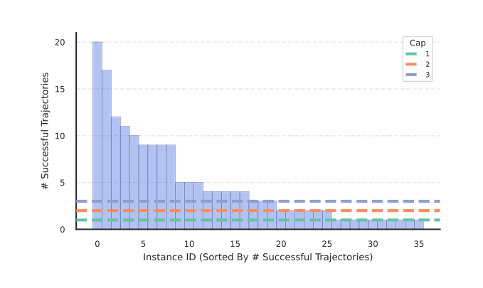
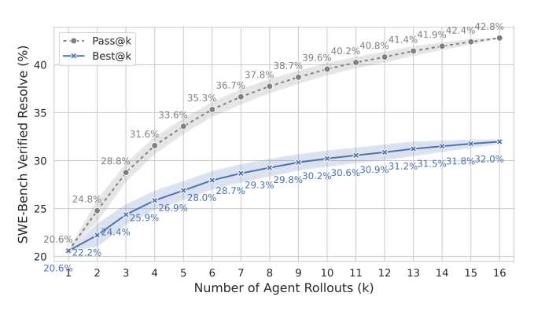

# SWE-Gym — 実行できる環境つきの訓練データで、SWE エージェントと検証器を育てる

> 原典: [[translations/2024-swe-gym]] ・ `raw/papers/Training Software Engineering Agents and Verifiers with SWE-Gym.md`
> 著者・年・会議: Jiayi Pan, Xingyao Wang ほか（UC Berkeley・UIUC・CMU・Apple）・2024-12・ICML 2025。Xingyao Wang と Graham Neubig は OpenHands の開発者でもある。

## 一言まとめ

GitHub の実際のイシュー 2,438 件に、**依存関係を入れ終えた実行環境（Docker イメージ）とテスト**を付けた、SWE エージェントのための最初の公開「訓練環境」を作った論文。強いモデル（GPT-4o・Claude 3.5 Sonnet）が解けた軌跡**わずか 491 本**で Qwen2.5-Coder-32B をファインチューニングすると、SWE-bench Verified の解決率は 7.0% → 20.6% になり、同じ環境で採点データを集めて訓練した**検証器で 16 本から 1 本を選ぶと 32.0%** まで伸びた。

## 背景と問題意識

数学の推論やチャットでは、**正解つきの問題集（MATH・GSM8K）や人間の選好データ**があったので、SFT（教師ありファインチューニング, 正解例をまねさせる学習）や強化学習でモデルそのものを鍛えられた（→ [[reinforcement-learning-from-human-feedback]]）。ところが SWE エージェントの進歩は、論文の時点（2024 年末）ではほぼ**プロプライエタリなモデルへのプロンプトと足場の工夫**——ツールの設計（[[agent-computer-interface]]）や作り込んだワークフロー——によるものだった。オープンなモデルそのものを鍛える材料がなかったからである。

足りなかったのは「**エージェントが実際にコードを動かして試せる環境**」である。

- SWE-bench（→ [[summaries/2023-swe-bench]]）の訓練用分割（19,008 件）には正解パッチしかなく、テストを実行できる環境がない。だから「エージェントのパッチが正しいか」を自動で採点できず、報酬が作れない。
- R2E は合成の指示で現実のイシューから遠く、HumanEval・APPS はリポジトリと無関係な単独の関数の問題である。
- 実行環境を作るのが難しい理由は、Python に共通のインストール方法がなく、**古いイシューほど古いバージョンの依存関係を要求する**からである。

## 提案手法 — 環境を作り、その上で 3 つのことを試す

### SWE-Gym という環境

| 分割 | 中身 |
|---|---|
| **SWE-Gym** | 11 リポジトリ・2,438 件。実行環境とテストつき。pandas（737 件）・MONAI・moto・mypy など、SWE-bench と**重ならない**リポジトリから選んだ（汚染を避けるため） |
| **SWE-Gym Lite** | 230 件。SWE-bench Lite と同じ基準で、1 ファイルの修正で済む簡単なタスクに絞った |
| **SWE-Gym Raw** | 358 リポジトリ・66,894 件。実行環境なし（イシューと正解パッチだけ）。データ合成の研究用 |

作り方は半手作業である。インスタンスをバージョン番号ごとにまとめ、そのイシューが立った時点の `requirements.txt` や CI（継続的インテグレーション）のスクリプトを読んで依存関係を手で設定し、**正解パッチを当てると元のコードより多くのテストが通る**ことを確かめた。これに約 200 人時と 1 万 CPU コア時間がかかり、Docker イメージは合計 6 TB（1 件平均 2.6 GB）になった。SWE-bench より、正解パッチあたりの編集行数・ファイル数が多く（69.8 行・2.5 ファイル）、実際にモデルの解決率も SWE-Gym のほうが低い。

### 1. 強いモデルの成功軌跡で SFT する（OpenHands）

足場は OpenHands の CodeActAgent（ReAct 型の汎用プロンプトで、bash とファイルエディタを持つ）。GPT-4o と Claude 3.5 Sonnet に SWE-Gym を解かせ、**テストに通った軌跡 491 本**（平均 19 ターン・約 1.9 万トークン）だけを集めて、Qwen2.5-Coder-Instruct（7B・14B・32B）をファインチューニングした。成功したものだけを残してまねさせるこの方法は**棄却サンプリングファインチューニング**（rejection sampling fine-tuning, filtered behavior cloning とも）と呼ばれ、論文はこれを素朴なベースラインと位置づける。

### 2. 自分の成功軌跡で自己改善する（Moatless Tools）

Moatless Tools は、「位置を特定 → 編集」のような**決まった手順の中でモデルに小さな判断だけをさせる**足場である（ホライズン＝1 タスクに要する手数が短くなる）。この上で、教師モデルを使わず**自分自身が解けた軌跡**で訓練を繰り返した。

ここで見つかったのが**簡単なタスクへの偏り**である。温度 1.0 で 30 回ずつ解かせると、簡単なタスクは何十回も成功し、難しいタスクは 1 回も成功しない。成功軌跡を全部使うと、訓練データが簡単なタスクの軌跡で埋まってしまう。そこで**1 タスクあたりの軌跡数に上限（cap）を設ける**と、上限 2 が最もよかった（7B で 9.7%。上限なしの 9.3% より少ない軌跡で上回った）。

<figure>

<figcaption>図3（再掲）: 7B モデルに SWE-Gym Lite を 30 回ずつ解かせたときの、インスタンスごとの成功回数。少数の簡単なタスクに成功が集中する（ロングテール）。インスタンスごとの上限はこの偏りを減らすが、訓練に使える軌跡の総数も減らす。</figcaption>
</figure>

### 3. 検証器を訓練して、複数の候補から選ぶ

SWE-Gym ではテストで成否が分かるので、**成功・失敗のラベルが付いた軌跡**が副産物としてたまる。これで**検証器**（verifier, 出力の正しさを判定するモデル）を訓練する。種類は ORM（Outcome-supervised Reward Model, 途中ではなく最終結果だけを見て成功確率を出す報酬モデル）で、軌跡全体を読ませて「YES／NO」を答えさせ、次のトークンが YES になる確率を成功確率として使う。

推論時には同じ問題を K 回解かせ、**検証器のスコアが最も高い 1 本を提出する**。これは推論時に計算を増やして精度を上げる [[test-time-compute]] の一種で、評価指標は 2 つある。

- **Pass@K**：K 本の中に 1 本でも正解があるか。「選び方が完璧なら到達できる上限」。
- **Best@K**：検証器が選んだ 1 本が正解か。実際に提出できる成績。

## 実験結果と知見

**表**: 主な結果（解決率 %）

| 設定 | SWE-bench Lite | SWE-bench Verified |
|---|---|---|
| Qwen2.5-Coder-32B（素、OpenHands） | 3.0 | 7.0 |
| ＋ 491 本で SFT | 15.3 | 20.6 |
| ＋ 検証器で 16 本から選ぶ（Best@16） | — | **32.0**（Pass@16 は 42.8） |
| Moatless・32B（素 → 自己改善 2 回） | 19.0 → 19.7 | — |
| Moatless・32B ＋ 検証器（8 本から） | **26.3** | — |
| Moatless・7B（素 → 自己改善 2 回 → ＋検証器） | 7.0 → 10.0 → 13.3 | — |

- **SFT でループが減る**。素の 32B でも約 30% の軌跡が「最後の 3 ターンでまったく同じ行動を繰り返す」ループに陥っていたが、ファインチューニング後はおおむね減り、何も編集しない「空パッチ」も減った。
- **自己改善は汎用の足場ではうまくいかなかった**。ファインチューニング後の 32B に自分で解かせた成功軌跡 868 本を加えて訓練し直すと、Lite で **15.3% → 8.7% に下がった**。Moatless のような手数の短い足場でも 32B は 19.0 → 19.7 と伸び悩んだ。著者らは PPO（Proximal Policy Optimization, 代表的な方策最適化）のような本格的な強化学習が要ると考えている。
- **検証器はデータの混ぜ方が効く**。強いモデルの軌跡（オフポリシー）と自分の軌跡（オンポリシー）を混ぜ、成功と失敗を同数にしたものが最もよかった。強いモデルの軌跡だけだと 22% 前後で頭打ちになり、失敗例を 2 倍にすると検証器が慎重になりすぎる。また、検証器の訓練は全パラメータより LoRA（Low-Rank Adaptation, 小さな追加行列だけを学習する手法 → [[parameter-efficient-fine-tuning]]）のほうがよかった（Best@8 で 29.8% 対 27.2%）。正則化として効いたと著者らは推測している。
- **検証器も大きいほうが伸び続ける**。7B の検証器は 4 本を超えると頭打ちになるが、32B の検証器は 8 本でも伸び続けた。
- **訓練データを増やすと伸び、飽和の兆しがない**。491 本の 25%・50%・100% で訓練すると解決率は単調に上がった。重複を除いて 1 タスク 1 本にしても、リポジトリ単位で増やしても傾向は同じで、**タスクの数や多様性ではなく、軌跡をサンプリングする計算量が律速**だと結論している。

<figure>

<figcaption>図4（再掲）: SWE-bench Verified での推論時スケーリング。Pass@k（青）は k=16 で 42.8% まで上がるが、検証器が選ぶ Best@k は 32.0% にとどまる。この差が「よい候補は出ているのに選べていない」部分である。</figcaption>
</figure>

## 限界・批判的視点

- **出発点は結局、強いプロプライエタリなモデルの蒸留**である。教師なしの自己改善は、汎用の足場では悪化し、決まった手順の足場でも頭打ちだった。「教師に頼らずに鍛える」部分は、のちの RL 論文（→ [[summaries/2025-swe-rl-long-context]]）が DAPO で解いた課題として残っている。
- **規模が小さい**。11 リポジトリ・Python のみで、訓練軌跡は 491 本。並行研究（Nebius の 2 本の連続したブログ記事、Badertdinov ら・Golubev ら 2024。後者は [[summaries/2025-swe-rl-long-context]] と同じ著者群）は自動セットアップで 6,415 件を集め、80,036 本の軌跡・72B モデルで 40.6% を出している。SWE-Gym は「手作業で構成して依存関係の難しいタスクも捨てない」ことで偏りを避けたと主張するが、その代わりに数が増やせない。
- **Best@K は K 回分の計算を払う**。Verified 32.0% は 16 本の軌跡を走らせて得た値で、1 本だけの 20.6% と同じ予算の比較ではない（→ [[agent-cost-efficiency]]）。
- **検証器の訓練データは「32k トークンに収まる軌跡」だけ**。長い軌跡を判定できるかは分からない。
- **細かな不整合**：本文に「7B と 34B のモデルだけで行い」とあるが、表と前後の文は 32B であり、32B の誤記とみられる（翻訳では原文のまま残した）。

## 実装・運用上の示唆

- **SFT のデータは成功軌跡だけでも、数百本でかなり効く**。素のオープンモデルが 7% しか解けなくても、強いモデルの成功例 491 本で 3 倍になる。
- **自分の成功軌跡を集めるときは、タスクごとに本数の上限を設ける**。簡単なタスクばかり学ぶのを防ぐ。上限 2 が目安。
- **テストで採点できる環境があるなら、失敗した軌跡も捨てない**。検証器の負例になる。成功と失敗の数をそろえ、強いモデルと自分の軌跡を混ぜる。
- **Pass@K と Best@K の差を見る**。差が大きければ、エージェントより検証器（選び方）を改善するほうが効く。
- **足場によって効く訓練が違う**。手順の決まった足場は素のモデルでも点が高いが、訓練で伸びにくい。汎用の足場は素では弱いが、SFT でよく伸びる。

## 用語と略称

- **SWE** = Software Engineering（ソフトウェアエンジニアリング）
- **SFT** = Supervised Fine-Tuning（教師ありファインチューニング）
- **棄却サンプリングファインチューニング**（Rejection Sampling Fine-Tuning, RFT）：方策に解かせ、報酬がしきい値を超えた（成功した）軌跡だけを集めて SFT する方法
- **オンポリシー／オフポリシー**：訓練中のモデル自身が生成したデータか、別のモデル（ここでは GPT-4o・Claude）が生成したデータか
- **ORM** = Outcome-supervised Reward Model（結果監督の報酬モデル）
- **Pass@K / Best@K**：K 本中に正解があるか／検証器が選んだ 1 本が正解か
- **空パッチ**（Empty Patch）：リポジトリを一切編集せずに終わった軌跡
- **LoRA** = Low-Rank Adaptation
- **PPO** = Proximal Policy Optimization
- **CI** = Continuous Integration（継続的インテグレーション）

## 関連ページ

- [[agent-training]] — エージェントを訓練で育てる方法の概念ページ（本 ingest で新設）
- [[agent-environments]] — 訓練環境としての SWE-Gym
- [[coding-agents]] — OpenHands・Moatless など SWE エージェントの足場
- [[test-time-compute]] — 検証器で候補から選ぶ推論時スケーリング
- [[agent-evaluation]] — SWE-bench Lite / Verified と Pass@K
- [[agent-cost-efficiency]] — Best@K の計算コスト
- [[summaries/2023-swe-bench]] — 評価に使う SWE-bench
- [[summaries/2024-swe-agent]] — エージェントのためのツール設計（ACI）
- [[summaries/2025-swe-rl-long-context]] — 同じ課題を DAPO の多ターン RL で進めた後続の研究（並行研究と同じ著者群）
- [[summaries/2024-agentless]] — テストと多数決で 40 本の候補から選ぶ手続き型。上限 42.0% と選べた 32.0% という、検証器と同じ構図の差を示した
- [[summaries/2025-swe-smith]] — タスクを先に集める SWE-Gym とは逆に、環境を先に作ってバグを合成した後続（5 万件・295 GB。1 タスク 3 本の上限も踏襲）
- [[summaries/2026-swe-lego]] — 同じ ORM 型の生成型検証器が、回帰型より候補を増やしたときに伸び続けることを示した後続
- [[summaries/2025-swe-rebench]] — 付録で並行研究とした自動収集の方式を、全自動・2 万件規模に広げた後続（環境を作れたのはリポジトリの 31%）
- [[summaries/2025-kimi-dev]] — 本データセットを訓練に使い、固定手順の足場ではなく固定手順の訓練でモデルを鍛えてからエージェントに移した研究
