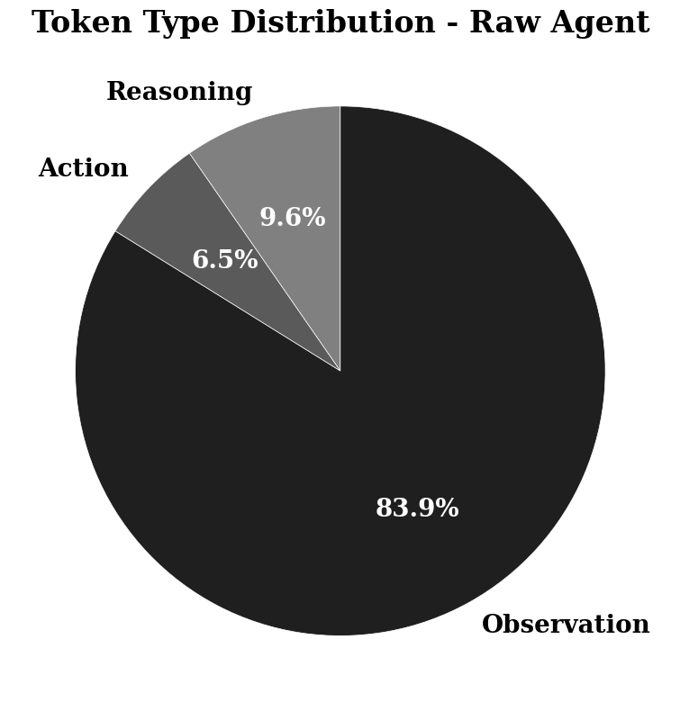
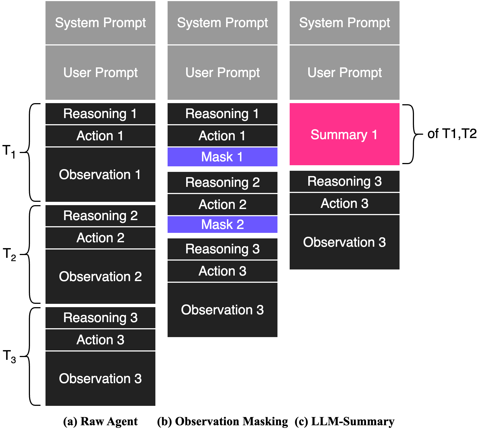
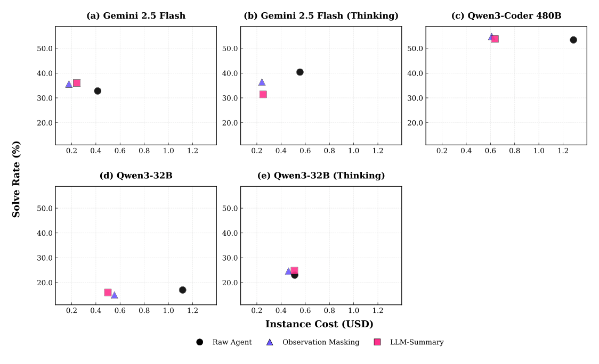
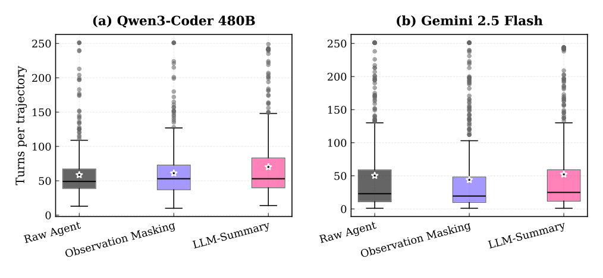
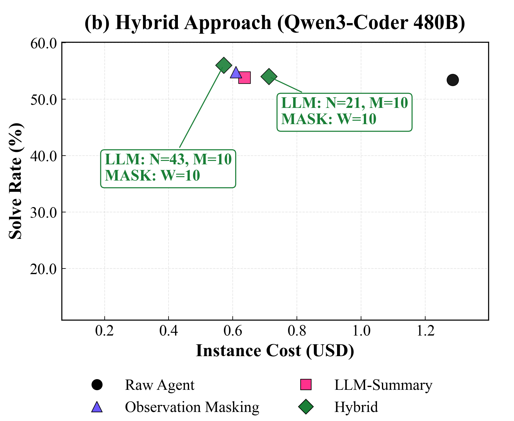

# The Complexity Trap — 古い観測を消すだけで、LLM による要約と同じくらい安く、同じくらい解ける

> 原典: [[translations/2025-complexity-trap]] ・ `raw/papers/The Complexity Trap_ Simple Observation Masking Is as Efficient as LLM Summarization for Agent Context Management.md`
> 著者・年・会議: Tobias Lindenbauer, Igor Slinko, Ludwig Felder, Egor Bogomolov, Yaroslav Zharov（JetBrains Research・ミュンヘン工科大学）・2025・arXiv:2508.21433（v3, 2025-10-27）・DL4C ワークショップ（NeurIPS 2025 と同時開催）
> 底本の版: `raw/` のクリップは v1 相当。翻訳と本ページは**ユーザーの指示で最新の v3** に基づく（v3 で OpenHands での確認と混合方式が加わった。差分は翻訳冒頭の訳注を参照）

## 一言まとめ

SWE エージェントの履歴が伸びすぎる問題に対し、**古いツール出力を「Previous 8 lines omitted for brevity.」のような置き換え文に差し替えるだけの観測のマスキング（observation masking）**と、**LLM に古いターンを要約させる LLM による要約（LLM-Summary）**を、SWE-bench Verified の 500 問・5 つのモデルの構成で正面から比べた論文。どちらも素のエージェントよりコストを約 50% 以上減らし、解決率は落とさない。そして**要約は、単純なマスキングを一貫して上回ることも、有意に上回ることもなかった**。要約には「軌跡を長引かせる」副作用があることも見つけ、マスキングを先に使って要約を最後の手段に回す混合方式で、さらに 7〜11% 安くした。

## 背景と問題意識

エージェントは [[agent-loop]]（観測→思考→行動を繰り返す実行ループ）の各ターンで、ツールの出力（観測）を履歴に足していく。履歴を毎回まるごとモデルに渡すと、入力トークンはターンごとに増え、トークン課金ではコストが膨らむ。長いコンテキストではモデルが中ほどの情報を使えなくなる（lost in the middle → [[summaries/2023-lost-in-the-middle]]）。この悪循環は SWE-Effi が **Token Snowball** と名づけたものと同じである（→ [[summaries/2025-swe-effi]]、[[agent-cost-efficiency]]）。

コーディングでは、この問題がとくに大きい。ファイル全体の表示、再帰的なディレクトリ一覧、長いテストログなど、1 回の行動で数千トークンの観測が返ってくるからである。著者らの予備実験では、**SWE-agent の 1 ターンのトークンの約 84% が観測**だった（図 1）。

<figure>

<figcaption>図1（再掲）: SE エージェントの 1 ターンのトークンの内訳。環境の観測が約 84% を占め、推論と行動はわずかである。</figcaption>
</figure>

現場の対処は 2 系統に分かれていた。SWE-agent（→ [[summaries/2024-swe-agent]]）や SWE-Search は**古い観測を省く**。OpenHands や Cursor は**LLM に履歴を要約させる**。Claude Code の auto-compact も後者の系統にあたる（→ [[summaries/2026-dive-into-claude-code]]）。業界は後者の洗練された方向に進んでいたが、**「要約という複雑さに見合う効果があるのか」を、同じ条件で比べた研究はなかった**。本論文はそこを測る。

## 提案手法 / 主張

### 比べた 3 つの戦略

<figure>

<figcaption>図3（再掲）: 比べたコンテキスト管理の戦略。(a) 素のエージェントは行動と観測の対ごとに履歴が伸びる。(b) LLM による要約は古いターンを 1 つの要約に畳み、直近の数ターンを残す。(c) 観測のマスキングは、直近 M ターンより古い観測だけを置き換え文に差し替える。</figcaption>
</figure>

| 戦略 | 何をするか | 何が残るか | パラメータ（主実験） |
|---|---|---|---|
| 素のエージェント（Raw Agent） | 何もしない。履歴をすべて渡す | すべて | — |
| 観測のマスキング（Observation Masking） | 直近 M ターンより古い**観測だけ**を置き換え文に替える | **推論と行動の履歴はすべて残る** | M = 10 |
| LLM による要約（LLM-Summary） | 別の LLM 呼び出しで、古いターンを前回の要約と合わせて 1 つの要約に畳む | 要約 ＋ 直近 M ターン | N = 21（一度に畳むターン数）、M = 10 |

要点は 2 つの違いにある。

- **マスキングは観測だけを消し、エージェント自身の推論と行動の跡は消さない。** 並行研究（Xiao ら）の「Delete」はターンを丸ごと消すので、推論の連続性まで断ち切る。マスキングは、観測がトークンの 84% を占めるという偏りを利用している。
- **要約はコンテキストの長さに上限を作るが、マスキングは伸びる速さを遅らせるだけである。** マスキングでも推論と行動は残り続けるので、軌跡が十分に長ければいずれ溢れる。理屈の上では、長い軌跡ほど要約が有利になるはずだった。

要約のプロンプトは OpenHands のものを SE タスク向けに削った版で、USER_CONTEXT・COMPLETED・PENDING・CODE_STATE・TESTS・CHANGES・DEPS・VERSION_CONTROL_STATUS の欄を埋めさせる（全文は翻訳の付録 E、図 11）。比較を公平にするため、著者らは要約を OpenHands から SWE-agent に移植し、**同じ足場の中で戦略だけを入れ替えた**。

### 実験の設定

- **足場**: SWE-agent（主）、OpenHands v0.43.0（一般性の確認）
- **ベンチマーク**: SWE-bench Verified（500 問）。ターン上限は 250 と長めにとる（要約の利点が出る長い軌跡を観察するため）
- **モデル（5 構成）**: Qwen3-32B（思考なし／あり、YaRN で 122K）、Qwen3-Coder-480B-A35B（FP8, 256K）、Gemini 2.5 Flash（思考なし／あり。思考の予算は 0 と 800 トークン）
- **温度**: エージェント 0.8、要約役 0
- **コスト**: Gemini は API が返した額。Qwen は自前の vLLM（H200 × 8）で動かし、トークン数に Alibaba の公式 API 価格を掛けて事後に計算した

## 実験結果と知見

### 主結果

**表1（抜粋）**: SWE-bench Verified 上の SWE-agent。解決率（%）／1 インスタンスあたりのコスト（$）。† は素のエージェントとの差が有意（対応のあるブートストラップ、p < 0.05）。

| モデル | 素のエージェント | 観測のマスキング | LLM による要約 |
|---|---|---|---|
| Qwen3-32B | 17.0 / 1.12 | 15.0 / 0.55† | 16.0 / 0.50† |
| Qwen3-32B（思考あり） | 23.0 / 0.51 | 24.6 / 0.46 | 24.8 / 0.51 |
| Qwen3-Coder 480B | 53.4 / 1.29 | **54.8 / 0.61†** | 53.8 / 0.64† |
| Gemini 2.5 Flash | 32.8 / 0.41 | 35.6 / **0.18†** | **36.0** / 0.24† |
| Gemini 2.5 Flash（思考あり） | **40.4** / 0.56 | 36.4† / **0.24†** | 31.4† / 0.25† |

<figure>

<figcaption>図2（再掲）: 5 つの構成での解決率（縦軸、上ほど良い）と 1 軌跡あたりの平均コスト（横軸、左ほど良い）。素のエージェント（●）、LLM による要約（■）、観測のマスキング（▲）。マスキングがほぼ一貫して左上の効率のフロンティアにいる。</figcaption>
</figure>

読み取れることは 3 つある。

1. **どちらのコンテキスト管理でもコストが大きく下がる。** Qwen3-32B（思考あり）を除く 4 構成で、コストは 41〜57% 減り、差はすべて有意だった。解決率は 5 構成中 3 構成で素のエージェントより上がった。**ある長さを超えると、コンテキストは資産ではなく負債になる**という lost in the middle の主張と合う。
2. **最安は 5 構成中 4 つでマスキングだった。** 最強モデルの Qwen3-Coder 480B では、マスキングが素のエージェントより 52.7% 安く、解決率も 1.4 ポイント高い。要約との差は 1 件 0.03 ドルだが、500 問では 15 ドルになる。
3. **解決率の差はほとんど有意ではない。** 付録 C の対応のあるブートストラップ（B = 10,000）では、解決率の差が有意だったのは Gemini 2.5 Flash（思考あり）だけで、そこでは**両方の戦略が素のエージェントより悪かった**（要約は −9.0 ポイント）。「要約がマスキングより良い」と言える構成は 1 つもなかった。この検定の考え方は [[summaries/2024-error-bars-evals]] の「同じ問題の上で差をとる」と同じである。

Qwen3-32B（思考あり）だけコストが減らなかった理由は、付録 B で説明されている。この構成は軌跡が短く、中央値は 15 ターンだった。要約は最初の要約までに N + M = 31 ターンかかるので、ほとんど一度も発動しない。マスキングは 10 ターンを過ぎると観測を消し始めるので、約 10% は減った。**どの戦略にもウォームアップ期間があり、それより短い軌跡ではコストが減らない**。

### 軌跡の伸長と失敗の信号

要約がマスキングより高くつく理由の 1 つは、**要約を使うと軌跡そのものが長くなる**ことだった。著者らはこれを軌跡の伸長（trajectory elongation）と呼ぶ。

- Gemini 2.5 Flash: 平均ターン数は要約 52、素のエージェント 50、マスキング 44（要約はマスキングより 15% 長い）
- Qwen3-Coder 480B: 要約は素のエージェントより 15%、マスキングより 13% 長い

<figure>

<figcaption>図4（再掲）: 戦略ごとの軌跡の長さ（ターン数）の分布。星印は平均。LLM による要約が一貫して長い軌跡につながっている。</figcaption>
</figure>

著者らの解釈では、要約は**本来ならエージェントに打ち切りを促すはずの失敗の信号を覆い隠し、エージェントに続けるよう促す信号として働く**。要約で 1 ターンあたりの入力を減らしても、ターン数が増えれば節約が相殺される。これは [[summaries/2025-manus-context-engineering]] の「失敗の痕跡は消さない」と同じ方向の観察で、[[agent-cost-efficiency]] の「最も高くつくのは失敗である」の具体例にもなっている。

### 要約そのもののコスト

要約の呼び出しは 1 件あたりの総コストの最大 7.2% を占めた（表 2）。しかも割高である。要約する区間は毎回違うので、**プロンプトキャッシュ（同じ先頭部分の計算結果を再利用して入力単価を下げる仕組み）が要約用のシステムプロンプトにしか当たらない**。Gemini のように、キャッシュに当たると最大 10 倍安い API では、この差が大きい。

**表2**: 1 インスタンスあたりの要約の呼び出しのコスト。

| モデル | 要約のコスト（$） | 総コストに占める比率（%） |
| --- | --- | --- |
| Qwen3-32B | 0.0143 | 2.86 |
| Qwen3-32B（思考あり） | 0.0033 | 0.65 |
| Qwen3-Coder 480B | 0.0439 | 7.20 |
| Gemini 2.5 Flash | 0.0161 | 6.71 |
| Gemini 2.5 Flash（思考あり） | 0.0131 | 5.24 |

要約のコストを差し引くと、多くの構成でマスキングとの差はほぼ消える。つまり、**要約がマスキングより高い理由は「軌跡の伸長」と「要約の呼び出し代」の 2 つで説明できる**。

### OpenHands での確認と窓の大きさ

Gemini 2.5 Flash で、OpenHands の上でも SWE-bench Verified の 50 問で確かめた（図 5a）。**SWE-agent で最適だった M = 10 をそのまま使うと、マスキングの解決率は 30% に落ちた**（素のエージェントは 40%、要約は 42%）。M = 58 に広げると、要約と同程度の解決率（約 44%）とコストに戻った。

理由は足場の実装の違いにあると著者らは見ている。SWE-agent は構文エラーで再試行したターンを履歴から自動で消すが、OpenHands はそれを残す。同じ 10 ターンでも、OpenHands のほうが中身のある観測が少ない。**M は「何ターン残すか」ではなく、実質的には「どれだけの有用な情報を残すか」の代理変数**であり、足場ごとに調整が要る。

### 混合方式

上の 2 つの副作用（伸長と呼び出し代）から、**要約はなるべく遅らせたい**。しかし N を大きくすると、要約が始まるまでの長いウォームアップ期間を、素のエージェントのまま高い単価で走ることになる。そこで著者らは、**ターンを溜める間はマスキングで観測を消し、溜まったら要約で上限を作る**混合方式を作った。

- 設定: N = 43、M = W = 10（W はマスキングの窓）。N = 43 は、マスキングした状態で溜まるコンテキストが、素のエージェントの 21 ターン分（約 30K トークン）とほぼ同じになる値である
- 要約するときは、**マスクしていない元のターン**を要約役に渡す
- 結果（Qwen3-Coder 480B、SWE-bench Verified の 50 問、図 5b）: **マスキング単独より 7%、要約単独より 11% 安く、解決率は素のエージェントより 2.6 ポイント高い**。全 500 問に換算すると、マスキングより 20 ドル、要約より 35 ドル安くなる見込みである
- 対照として N = 21 をそのまま流用した素朴な混合は、**かえって高くついた**。要約が頻繁に走り、そのたびに KV キャッシュ（生成済みトークンの中間状態を再利用する仕組み）の再利用が崩れるうえ、要約の呼び出し代も重なるからである

<figure>

<figcaption>図5b（再掲）: Qwen3-Coder 480B・SWE-bench Verified の 50 問での混合方式。N = 43 の混合方式が最も左上（安く、よく解ける）にある。N = 21 の素朴な混合は、マスキング単独より高い。</figcaption>
</figure>

### 付録の追加実験

- **マスキングの窓 M**（GPT-4.1-mini、Verified の 150 問）: M = 10 が最も良く、M = 20 に広げるとかえって下がる（図 10）。残しすぎても効かない
- **要約の設定**: 直近のターンを残す（M > 0）ほうが良く、OpenHands の既定の「畳む半分・残す半分」より、**一度に多く畳む（N > M）ほうが解決率が高い**（図 6）
- **批評つきの要約**（D.3）: 要約と同時に「行き詰まっていないか」「ループしていないか」などの反省を書かせ、Reflexion（→ [[self-reflection]]）を 1 本の試行の中でやる形にした。**解決率は上がらず、コストは約 25% 増え、軌跡はさらに約 13% 伸びた**。批評が「次に試すこと」を示すので、エージェントが打ち切らずに探索を続けたと著者らは解釈している

## 限界・批判的視点

- **SE の領域に限った結果である。** 観測が冗長で長いことはマスキングに有利な条件で、著者ら自身も、観測が短い領域には一般化しないかもしれないと書いている。並行研究（Tang ら）がディープリサーチやコンピュータ使用のエージェントでもマスキングで好成績を挙げている点が、一般化の傍証として引かれている。
- **どの戦略も固定のヒューリスティックで発動する。** マスキングは「N ターン前」という古さだけで消し、内容の関連性を見ない（変更済みのファイルの古い内容をいつまでも残す、など）。要約も固定のターン数で発動し、作業の区切りを見ない。関連性や区切りで発動を決める方式は比べていない。
- **要約の実装は 1 種類だけである。** OpenHands 形式のプロンプトに準じた 1 種類で、Claude Code の 5 層 compaction のような、安い層から順に当てる多段構成（→ [[summaries/2026-dive-into-claude-code]]）は検討していない。「要約は不要」ではなく、「**要約だけに頼るのは割に合わない**」と読むべきである。
- **一般性の確認とアブレーションは小規模である。** OpenHands と混合方式は 50 問、付録のアブレーションは 150 問で、1 回ずつの実行が多い。主実験でも解決率の差の多くは信頼区間に収まっており、「解決率は同等」という主張は「差を検出できなかった」という意味でもある。
- **コストの計算方法がモデルで違う。** Qwen の費用は API 価格からの事後計算で、Qwen3-32B の価格はキャッシュの有無を区別しないため、コストが高めに出ている（付録 A）。キャッシュを考えた単価では、戦略間の差の大きさが変わりうる。
- **版による違い。** クリップ（v1）の要旨は Qwen3-Coder の素のエージェントを 53.8% としていたが、表では 53.4% だった。v3 では要旨からこの数字が消えている。付録 B には解決されていない参照（「??」）が PDF にも残る。

## 実装・運用上の示唆

- **まず観測を消す。** 履歴の圧縮を作るなら、LLM による要約より先に「古いツール出力を置き換え文にする」を入れる。実装はほぼ文字列の置換で、要約の呼び出しも要らず、キャッシュも崩れにくい。[[summaries/2025-effective-context-engineering]] が「最も安全で最も軽い形の compaction」と呼んだツール結果の消去と同じ考え方で、本論文はそれを数字で裏づけた。
- **推論と行動の跡は残す。** 消すのは観測だけにする。ターンを丸ごと消すと、エージェントが自分の過去の判断を追えなくなる。
- **窓の大きさは足場ごとに測る。** 再試行やエラーのターンを履歴に残す足場では、同じ M でも残る情報が減る。M = 10 は SWE-agent での値にすぎない。
- **要約は最後の手段にし、遅らせる。** 要約を入れるなら、マスキングと組み合わせ、畳む間隔 N を大きくとる。間隔が短いと、呼び出し代とキャッシュの再利用の崩れで、かえって高くつく。Claude Code の「安い層から順に当て、auto-compact は最後」という遅延劣化の設計と同じ結論に、実験の側から達している。
- **要約に失敗の信号が残るかを点検する。** 要約が「順調」に見える文章になり、繰り返した失敗を消していないか。要約のプロンプトに、試して失敗したことと、その回数を残す欄を設けることも考えられる（本論文では試していない）。
- **ウォームアップより短い軌跡には効かない。** 平均のターン数が短いタスクでは、要約はほとんど発動しない。戦略を選ぶ前に、自分のタスクの軌跡の長さの分布を見る。

## 用語と略称

- **LLM**（Large Language Model）: 大規模言語モデル
- **SE**（Software Engineering）: ソフトウェアエンジニアリング
- **SWE-bench Verified**: 実際の GitHub のイシューを、テストが通るかで判定するベンチマーク SWE-bench から、人手で 500 問を選び直した版（→ [[agent-evaluation]]）。SWE-bench Lite-50 / Verified-50 は、その 50 問の部分集合
- **観測のマスキング（observation masking）**: 一定ターンより古いツール出力を、短い置き換え文（placeholder）に差し替える方式
- **LLM による要約（LLM-Summary）**: 別の LLM 呼び出しで、古いターンを要約に畳む方式。compaction（コンパクション）の一種
- **移動窓（rolling window）**: 直近の一定数のターンだけを残し、それより古いものを処理する窓
- **軌跡（trajectory）**: エージェントがたどった推論・行動・観測の列
- **軌跡の伸長（trajectory elongation）**: 要約を使うとターン数が増え、コストの節約が相殺される現象
- **ReAct / CodeAct**: 推論と行動を交互に出すエージェントの枠組み（→ [[reasoning-and-planning]]）。CodeAct は行動をコードとして出す変種
- **YaRN**（Yet another RoPE extensioN）: 位置符号化を内挿して、コンテキスト長を訓練時より伸ばす手法（→ [[positional-encoding]]）
- **FP8**: 8 ビット浮動小数点で重みを持つ量子化の形式（→ [[model-quantization]]）
- **KV cache**（Key-Value cache）: 生成済みトークンの中間状態を保存し、次の計算で再利用する仕組み
- **プロンプトキャッシュ**: 同じ先頭部分を持つプロンプトの計算結果を再利用し、入力の単価を下げる API の機能
- **CUA**（Computer-Use Agent）: 画面を見てマウスやキーボードを操作するエージェント（→ [[computer-use-agents]]）
- **ブートストラップ（paired bootstrap）**: 同じ問題の上での差を、問題を復元抽出し直して何度も計算し、差のばらつきを見積もる方法

## 関連ページ

- [[context-engineering]] — 本論文の主題。観測のマスキングと要約の比較、混合方式、遅延劣化との関係
- [[agent-cost-efficiency]] — コストの半減、要約の呼び出し代、キャッシュ、ウォームアップ期間
- [[agent-memory]] — 要約による履歴の畳み込み（MemGPT の再帰的な要約）と、その副作用
- [[coding-agents]] ・ [[agent-computer-interface]] — SWE-agent の観測の折り畳み、足場ごとに違う窓の大きさ
- [[self-reflection]] — 批評つきの要約が効かなかった結果
- [[agent-evaluation]] — SWE-bench Verified、解決率の差の検定
- [[summaries/2024-swe-agent]] — 観測を畳む設計の出どころ
- [[summaries/2026-dive-into-claude-code]] — 5 層 compaction と遅延劣化。本論文の混合方式と同じ方向
- [[summaries/2025-manus-context-engineering]] — 「失敗の痕跡は消さない」。軌跡の伸長の説明と合う
- [[summaries/2025-effective-context-engineering]] — ツール結果の消去を「最も軽い compaction」と呼んだ記事
- [[summaries/2023-lost-in-the-middle]] — 長いコンテキストが負債になる根拠
- [[summaries/2025-swe-effi]] — Token Snowball と、失敗した試行が高くつくこと
- [[summaries/2024-error-bars-evals]] — 対応のある差の検定
- [[summaries/2024-openhands]] — LLM による履歴の要約を使う足場の 1 つ、OpenHands の原論文
- [[summaries/2026-swe-mem]] — 圧縮の時機と区間をモデルに選ばせる記憶の道具を訓練した後続研究。本論文が限界に挙げた「固定のヒューリスティックで発動する」点への答え
- [[summaries/2026-swe-master]] — 固定間隔の要約によるコンテキスト管理を SWE で試し、強いモデルでは入力トークンを減らしたが小さいモデルでは効かなかった報告
