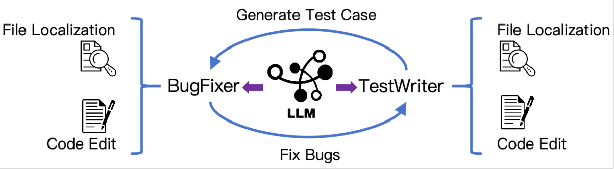
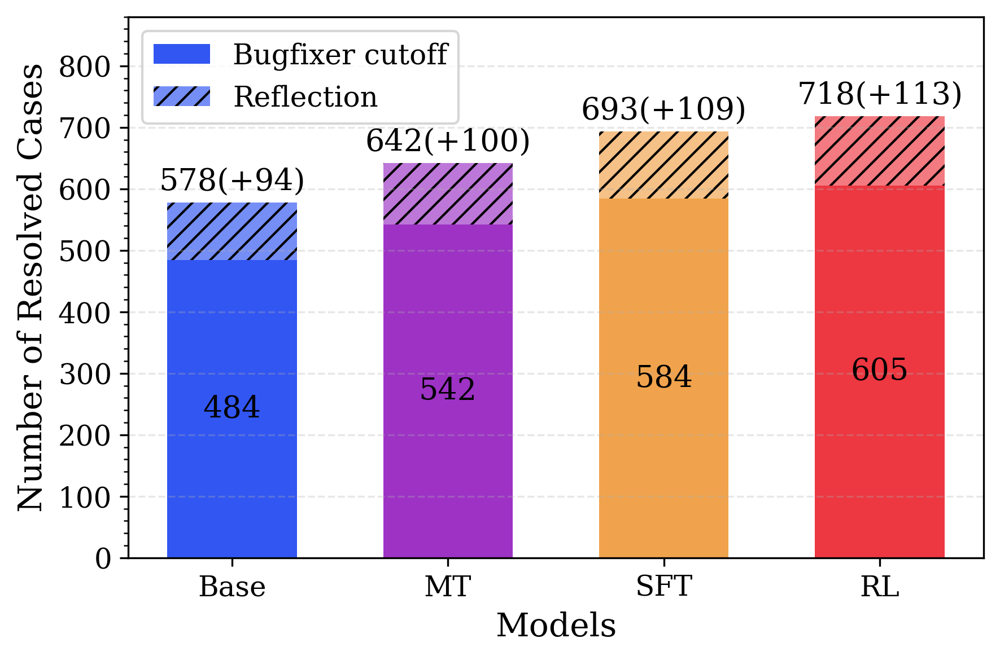

# Kimi-Dev：Agentless で鍛えた技能を土台に、少ない軌跡で SWE エージェントを作る

> 原典: [[translations/2025-kimi-dev]] ・ `raw/papers/Kimi-Dev_ Agentless Training as Skill Prior for SWE-Agents.md`
> 著者・年: Zonghan Yang・Shengjie Wang（同等の貢献）ほか 21 名・Moonshot AI（清華大学・北京大学などの兼務者を含む）・arXiv:2509.23045（v1: 2025-09、v3: 2025-12）。68 ページ。`raw/` のクリップは欠落のある古い版なので、翻訳と本ページは v3 にもとづく。

## 一言まとめ

コード修正の解き方を「決まった手順（Agentless）」の形で徹底的に訓練した 72B モデル Kimi-Dev を作り、SWE-bench Verified で 60.4%（固定手順の方式で最高）を出した。さらに、そのモデルを公開の軌跡 5,016 本で軽く追加学習するだけで、自由に動くエージェントとしても 48.6%（Claude 3.5 Sonnet と同等）になることを示し、**固定手順の訓練はエージェントの出発点として役立つ**と主張した。

## 背景と問題意識

GitHub のイシューを直すコーディングエージェント（→ [[coding-agents]]）の作り方には 2 つの流儀がある。

- **エージェント型**（SWE-agent、OpenHands など）: LLM がツールを選び、実行結果を見ながら何十ターンも自分で進め、いつ止めるかも自分で決める。自由度が高く上限も高いが、**訓練が難しい**。報酬は最後にテストが通ったかどうかしかなく（まばらな報酬）、数十ステップのどの行動が良かったのかを割り当てにくい（信用の割り当て）。強化学習（RL, Reinforcement Learning, 試行錯誤の結果に報酬を与えて行動を強める学習）は軌跡が長くなると不安定になり、汎用のモデルから始めるとツールをうまく使えなかったりループに陥ったりする。
- **手続き型**（Agentless → [[summaries/2024-agentless]]）: 「直す場所を探す → 直す → テストで選ぶ」という手順を人間が固定し、LLM には各段の 1 回きりの仕事だけをさせる。各段の正誤を機械的に判定できるので、RLVR（Reinforcement Learning with Verifiable Rewards, 正誤を自動判定できる報酬で行う強化学習）で訓練しやすい。ただし柔軟性がなく、何度も試行錯誤が要る問題に弱い。

本 wiki でもこの 2 つは対比されてきた。SWE-Effi（[[summaries/2025-swe-effi]]）は「弱いモデルには手順を固定したほうが安定し、強いモデルには制御を渡したほうが伸びる」と示し、SWE-Gym（[[summaries/2024-swe-gym]]）は「手順の決まった足場は素のモデルを助けるが、訓練で伸ばす余地も狭める」と示した。著者らはこの二者択一の見方に異を唱える。**Agentless の訓練は完成品ではなく、エージェントに必要な基礎の技能を身につけさせる段階**だと見る。基礎の技能とはバグのある場所の特定、コードの書き換え、自己反省（→ [[self-reflection]]）と検証で、著者らはこれを **skill prior**（スキル事前分布。追加学習の出発点としてモデルがあらかじめ持っている技能）と呼ぶ。

## 提案手法 / 主張

### 1. Agentless の訓練レシピ

<figure>

<figcaption>図1（再掲）: Kimi-Dev の Agentless の枠組み。BugFixer と TestWriter の 2 つの役が、どちらも「ファイルの特定」と「コードの編集」の 2 つの技能で動く。</figcaption>
</figure>

**2 つの役。** イシューの解決を、パッチを書く **BugFixer** と、バグを再現する単体テストを書く **TestWriter** の協働として組み立てる。どちらも (i) 関係するファイルを特定し、(ii) コードを編集する、の 2 段で動く。TestWriter の良いテストとは、修正前のコードでは落ち、修正後は通るテストである。

**中間訓練（mid-training）。** 事前学習とファインチューニングの間に、目的の分野のデータで追加の学習を行う段階である。Qwen2.5-72B-Base に、GitHub の PR から作った約 1,500 億トークンを学習させる。内訳は次のとおり。

- Agentless の形式に直した PR の最終差分（約 500 億トークン）。プロンプトは本番と同じ 4 種類のテンプレートを使い、ファイル特定の答えは正解パッチが変えたファイルにする。
- PR のコミットの並び（約 200 億トークン）。コミットメッセージを「推論」、コードの変更を「行動」とみなせるので、エージェントの軌跡に近い形になる。
- 合成データ（約 200 億トークン、学習中は 4 倍に水増し）。1 つは、ファイル特定を正しく当てた推論の軌跡（約 100 億トークン）。もう 1 つは、実行環境なしで「ファイルを見る・検索する」ツールだけを持つエージェントの軌跡を作り、誤ったファイルを開いて「このファイルは変更不要だと気づいた」と言わせる反省の場面を人為的に入れたもの（約 100 億トークン）である。

SWE-bench のリポジトリは除外して汚染を避けたとしている。

**コールドスタート。** DeepSeek-R1（→ [[summaries/2025-deepseek-r1]]）に BugFixer と TestWriter を演じさせた長い推論の軌跡で SFT（Supervised Fine-Tuning, お手本をまねる追加学習）を行い、長い CoT（Chain-of-Thought, 考える過程を書き出してから答える方式 → [[reasoning-and-planning]]）を引き出す。題材は SWE-Gym と SWE-bench-extra（[[summaries/2025-swe-rebench]] の前身のデータセット）である。

**強化学習。** ファイル特定はこの時点で十分強いので、RL は**コード編集の段だけ**に絞る。アルゴリズムは Kimi k1.5 の方策勾配法（REINFORCE を基に、同じ問題の複数回の平均報酬を基準にする点は GRPO と同じ → [[reinforcement-learning-from-human-feedback]]）で、工夫は 3 つある。

- **報酬は実行結果だけ**（0 か 1）。書式や過程には報酬を与えない。BugFixer は正解のテストを全部通せば 1、TestWriter は「正解の修正なしで落ち、修正を当てると通る」テストを書けば 1。
- **解ける見込みのある問題から始める**。16 回試して 1 度も解けない問題は最初は外し（初期 1,200 問）、成功率が上がったら 100 ステップごとに、外していた問題を 500 問ずつ戻す（カリキュラム学習）。
- **後半は成功例を混ぜる**。伸びが鈍った終盤には、最近の反復で成功した例を現在のバッチに加え、収束を速める。

環境は Kubernetes 上のサンドボックスで、1 万を超えるインスタンスを同時に動かせる。Docker 環境は SWE-Gym（2,356）、SWE-bench-extra（3,846。6,380 件から自動構築）、R2E-Gym-Lite（3,671）から集めた。

**テスト時のセルフプレイ。** 本番では 1 問ごとにパッチを 40 本、テストを 40 本作る。修正前のコードで落ちないテストは捨て、残りの各テストに各パッチを当てて実行し、「落ちていたテストを通した割合」と「通っていたテストを壊さなかった割合」の和が最大のパッチを選ぶ。自分で書いたテストで自分のパッチを選ぶので、セルフプレイと呼んでいる。テスト時に計算を増やして精度を上げる手法の一種である（→ [[test-time-compute]]）。

### 2. Agentless のモデルからエージェントへ

SWE-Agent の足場（Anthropic の Claude 3.5 Sonnet 用の構成 → [[summaries/2025-swe-bench-sonnet]]）は、システムプロンプトで「(i) リポジトリを調べる → (ii) テストスクリプトでエラーを再現する → (iii) コードを直す → (iv) テストを再実行する → (v) 境界のケースを確かめる」という 5 段を示すが、順序は強制しない。エージェントは自由に戻ったりやり直したりできる。

Kimi-Dev をこの足場で動かすため、SWE-smith（[[summaries/2025-swe-smith]]）が公開した Claude 3.7 Sonnet の軌跡 5,016 本で SFT する。追加の RL も、現実の環境での軌跡集めもしない。

**どの段階が効いているかを測る実験。** 次の 4 つのモデルを「出発点（prior）」として、エージェントの軌跡での SFT の量を 0（そのまま評価）から 5,016 本まで振り、SWE-bench Verified で比べる。

- **Base**: 元の Qwen2.5-72B
- **MT**: 中間訓練の後
- **SFT**: コールドスタートの後
- **RL**: RL の後（= Kimi-Dev）

## 実験結果と知見

**Agentless として：60.4%。** 40 本 × 40 本のセルフプレイで SWE-bench Verified の 60.4% を解き、同じ形式の DeepSeek-R1-0528（57.6%）や SWE-SWISS（58.2%）を上回った。パッチとテストが 1 本ずつなら 48.0% で、3 本ずつのセルフプレイで、すでにパッチ 40 本の多数決を上回る。それでも、正解のテストで選んだ場合の上限（pass@N）には届かず、TestWriter にまだ伸びしろがある。中間訓練は 500 億 → 1,000 億 → 1,500 億トークンと増やすほど成績が上がり、RL では成績と応答の長さが一緒に伸びた。

**エージェントとして：48.6%。** 5,016 本の SFT だけで、SWE-Agent の足場で 1 回の試行の解決率（pass@1）が 48.6% になった。同じデータで訓練した SWE-agent-LM-32B（40.2%）を上回り、Claude 3.5 Sonnet（49%）と並ぶ。10 回試せば 74.0% で、Agentless で 30 回試したとき（73.8%）を上回る。著者らはこれを、エージェント型のほうが上限が高い証拠としている。

<figure>

<figcaption>図5（再掲）: 4 つの出発点（Base・MT・SFT・RL）を、エージェントの軌跡での SFT の量（横軸。左端の 0 はそのまま評価、2²¹ は 1 回だけの勾配更新、右端の 1.5×2²⁸ は 5,016 本すべて）を変えて追加学習したときの SWE-bench Verified の成績（pass@1〜3）。データが少ないほど RL・SFT と Base の差が大きい。</figcaption>
</figure>

**少ないデータで差が出る。** 図 5 から読み取れることは 3 つある。

- **RL の出発点は、ほぼすべての量で最も成績がよい**。著者らは「Base の最高の pass@1 に、RL は 2²³ トークンで届く。Base は 1.5×2²⁸ トークン（約 48 倍）を要する」と書いている。
- **MT（中間訓練のみ）は、データがほとんどない設定では SFT・RL に大きく遅れる**が、200 本（2²⁴）あたりで並ぶ。
- **SFT と RL はほぼ同じ**だが、2 点違う。そのまま評価した場合は SFT のほうがよい。RL は Agentless の入出力の形式に過適合しているためと著者らは見ている。一方、200 本の SFT では SFT の出発点だけが大きく落ちた。

**長いターンを使えるようになる。** 5,016 本で SFT したあと、許すターン数を変えて比べると、RL の出発点は 70 ターンを超えても解ける問題が増え続けた。SFT・MT・Base はそれぞれ約 70・60・50 ターンで頭打ちになった。著者らは、長い CoT の中で鍛えた反省の癖が、多ターンの試行錯誤に移ったと解釈している。

<figure>

<figcaption>図6 右（再掲）: 各出発点から作ったエージェントについて、「最初の修正（段階 3）を終えた時点でそのまま提出した場合の解決数」（下の濃い部分、BugFixer の技能）と、「その後のテストの再実行ややり直しで増えた解決数」（斜線部、反省の技能）。500 問 × 3 回の合計。Base 484（+94）から RL 605（+113）へ、どちらも増えている。</figcaption>
</figure>

**技能ごとに分けて見る。** 軌跡の各ターンが 5 段のどれに当たるかを Kimi-K2（→ [[summaries/2025-kimi-k2]]）に判定させ、上の図のように 2 つの技能を分けて数えた。最初の修正の時点での解決数（BugFixer の技能）も、その後の反省による上積みも、Base → MT → SFT → RL の順に増えた。ただし著者ら自身、後者には途中でテストを書く過程も混ざっており、粗い分析だと断っている。

**エージェントとしての RL を続けても、差は残る（v3 で追加）。** プロプライエタリなモデルの軌跡のまねの影響を減らすため、エージェントの軌跡での更新を 1 回だけにした SFT・RL の出発点に、エージェント型のまま end-to-end の RL を 300 ステップかけた。RL の出発点のほうが pass@1・3・5 のすべてでわずかに高かった（pass@1 は 40% 前後と 37% 前後）。MT の出発点は、8 回試して 1 度でも解ける問題が 6,202 問中 260 問しか残らず、10 ステップで 2% 未満に崩れた。RL で育てたエージェントの軌跡は、Claude の軌跡をまねたもの（手順に「Step 1〜5」と番号を振り、推論は短い）と違い、リポジトリの探索に多くのターンを使い、編集の前に長く考えていた（付録 G.3）。

**付録の事例から分かること。**

- **TestWriter の偽陽性**（付録 E.2）。RL 中に、網羅性の足りないテスト（2 か所確かめるべきところを 1 か所だけ確かめる、など）でも報酬を得てしまう例があった。TestWriter の成績の伸びは、実力の伸びをそのまま表していない。
- **教えていない「並列の統合」ができた**（付録 F）。複数のパッチ候補をプロンプトに並べて「違いを分析し、新しいパッチを作れ」と頼むと、候補の数が増えるほど成績が上がった。この能力のための訓練はしていない。
- **手順の固定が裏目に出る例**（付録 G.2、sympy__sympy-20590）。原因は表に出ていない親クラスにあった。Agentless の 40 回はすべて `symbol.py` などの誤ったファイルを直した。エージェント型では、どの出発点も最初の修正は失敗し、再現スクリプトの再実行で失敗に気づいた。そこからクラス階層をたどって原因の `Printable` にたどり着いたのは、RL の出発点のエージェントだけだった。
- **他のベンチマーク**（付録 G.4）。SWE-bench-Live（毎月更新される 300 問）と SWE-bench Multilingual（9 言語・300 問）でも、データが少ないときは SFT・RL の出発点が Base より強い。データを増やすと差は縮む。

## 限界・批判的視点

- **評価はほぼ SWE-bench Verified だけ。** 汚染への対策は「中間訓練から SWE-bench のリポジトリを除いた」ことにとどまり、元の Qwen2.5 の事前学習や、教師にした DeepSeek-R1・Claude 3.7 の軌跡を通じた混入は確かめていない。Verified は 2026-02 に、テストの欠陥と主要モデルの正解の記憶を理由に OpenAI が報告をやめたベンチマークである（[[summaries/2026-swe-bench-verified-retired]]）。また、2025-09 より前に配られた Verified の Docker イメージでは `git log` で正解を覗けた（[[summaries/2026-swe-lego]]）。本論文がどの版の環境を使ったかは書かれていない。汚染のない評価（SWE-bench-Live）は付録の図だけで、本文に数値がない。
- **60.4% と 48.6% は計算量が大きく違う。** 60.4% は 1 問あたりパッチ 40 本とテスト 40 本を作り、最大 1,600 通りの組み合わせを実行して選んだ数字である。48.6% はエージェントの 1 回の試行の数字である。「Agentless で最高」と「エージェントで Claude 3.5 Sonnet と同等」は、別の条件の比較として読む必要がある。
- **5,016 本では、出発点の差はかなり縮む。** 図 5 の右端（5,016 本すべて）での pass@1 を読むと、RL 48.6%、SFT 約 48%、MT 約 46%、Base 約 36% である（本 wiki の図からの読み取り）。中間訓練だけで差の大半が説明でき、コールドスタートと RL の上積みは 2〜3 ポイントにとどまる。出発点の効き目が大きいのは、エージェントのデータが少ないときである。
- **本文の主張と図が食い違う箇所がある。** 「RL の出発点は 2²³ トークンで Base の最高の pass@1 に届く」とあるが、図 5 から読む限り、2²³ での RL の pass@1 は約 33% で、Base の最高（約 36%）にわずかに届いていない。pass@2・3 なら上回る（本 wiki の図からの読み取り）。
- **誤差の扱いがない。** ほとんどの比較が 1 回の実行（pass@1 は温度 0）で、誤差の幅を示していない。図 7 の end-to-end RL の差（2〜3 ポイント）も、5 回の最小〜最大の帯が重なる範囲にある（→ [[summaries/2024-error-bars-evals]]）。
- **「最小限の教師」でも出発点は蒸留。** 中間訓練の合成データは Qwen2.5-72B-Instruct、コールドスタートは DeepSeek-R1、エージェントの SFT は Claude 3.7 Sonnet の出力に頼っている。end-to-end RL の比較ではエージェントの軌跡での更新を 1 回に絞って模倣の影響を減らしているが、ゼロではない。
- **エージェントとしての 48.6% は 2025-09 時点の最上位ではない。** 表 2 では、Devstral-Small（24B、53.6%）や gpt-oss-20b（60.7%）のほうが小さいモデルで高い。本論文の価値は到達点より、「固定手順の訓練がエージェントの出発点として効く」という分析のほうにある。
- **TestWriter の報酬は抜け穴を持つ。** 偽陽性の例は、自動で作った検証器が報酬を甘くしうることを示している（→ [[agent-training]] の検証器の議論）。

## 実装・運用上の示唆

- **エージェントを訓練する前に、手続き型の小さな課題で基礎の技能を鍛える。** ファイルの特定やパッチの作成は 1 ターンで正誤を判定できるので、RL が安定する。エージェント用の軌跡が少ししかないときほど、この下ごしらえが効く。
- **RL は「解ける見込みのある問題」から始め、難しい問題を少しずつ戻す。** 一度も解けない問題は勾配を生まない。成功率に応じて問題を足すカリキュラムは、[[summaries/2025-swe-rl-long-context]] の「成功率 2/3 超と 0 の問題を外す」と同じ発想である。
- **自分で書いたテストで候補を選ぶのは安くて効く。** パッチとテストが 3 本ずつでも、パッチ 40 本の多数決を上回った。ただし、テストの網羅性が足りないと誤ったパッチを通すので、テストを書く側の質も見る。
- **コミットの並びはエージェントの軌跡の代わりになる。** コミットメッセージを推論、差分を行動とみなすと、実行環境のない大量の PR からもエージェント風のデータが作れる。
- **評価ではターン数の上限を十分にとる。** 出発点によって伸びが止まるターン数が違うので、上限が低いと差が見えない（→ [[agent-evaluation]]）。

## 用語と略称

- **LLM（Large Language Model）**: 大規模言語モデル。
- **SWE（Software Engineering）**: ソフトウェアエンジニアリング。ここでは実際のリポジトリでイシューを直す作業を指す。
- **Agentless**: エージェントに自由に行動させず、決まった手順で LLM を呼ぶ方式（→ [[summaries/2024-agentless]]）。
- **SWE-Agent / エージェント型**: LLM がツールを選びながら多ターンで進める方式。
- **skill prior（スキル事前分布）**: 追加学習の出発点としてモデルがあらかじめ持つ技能。本論文では追加学習の出発点になるモデルそのものも「prior」と呼んでいる。
- **mid-training（中間訓練）**: 事前学習のあと、目的の分野のデータでさらに学習する段階。
- **cold start（コールドスタート）**: RL の前に、少量のお手本で長い推論などの振る舞いを引き出す SFT。
- **SFT（Supervised Fine-Tuning）**: 教師ありファインチューニング。
- **RL（Reinforcement Learning）**: 強化学習。
- **RLVR（Reinforcement Learning with Verifiable Rewards）**: 正誤を機械的に判定できる報酬で行う強化学習。
- **GRPO（Group Relative Policy Optimization）**: 同じ問題の複数回の回答の平均報酬を基準にして、価値関数のモデルなしで学習する方策最適化の手法。
- **REINFORCE**: 報酬の大きさに応じて、その行動の確率を上げる基本的な方策勾配法。
- **CoT（Chain-of-Thought）**: 考える過程を書き出してから答える方式。
- **信用の割り当て（credit assignment）**: 最後にしか報酬がないとき、どの行動が結果に効いたかを決める問題。
- **pass@k**: k 回試したうち 1 回でも正解した問題の割合。
- **fail-to-pass / pass-to-pass**: 修正前に落ちて修正後に通るテスト／修正の前後とも通るテスト。
- **セルフプレイ（self-play）**: ここでは、同じモデルが書いたテストで同じモデルが書いたパッチを選ぶこと。
- **偽陽性（false positive）**: 誤ったパッチを正しいと判定してしまうこと。
- **Kubernetes**: 多数のコンテナを自動で配置・管理するための基盤ソフトウェア。

## 関連ページ

- [[coding-agents]] — 手続き型とエージェント型の 2 つの流儀
- [[agent-training]] — 中間訓練・コールドスタート・RL の段取りと、出発点（初期化）の重要さ
- [[agent-evaluation]] — SWE-bench Verified の汚染と、ターン数の上限
- [[test-time-compute]] — テスト時のセルフプレイと並列の統合
- [[self-reflection]] — 長い CoT の反省が多ターンのやり直しに移るという主張
- [[reinforcement-learning-from-human-feedback]] — 結果だけを報酬にする RLVR と、GRPO 型の基準
- [[summaries/2024-agentless]] — 本論文が訓練の型に使った手続き型の方式
- [[summaries/2025-swe-effi]] — 「弱いモデルは手順を固定、強いモデルは自由に」という足場の相性
- [[summaries/2024-swe-gym]] — 手順の決まった足場は訓練で伸びにくいという先行の観察と、訓練データの出どころ
- [[summaries/2025-swe-smith]] — エージェントの SFT に使った 5,016 本の軌跡
- [[summaries/2025-swe-rebench]] — 訓練データの SWE-bench-extra の後継データセット
- [[summaries/2025-swe-rl-long-context]] — 同じ Qwen2.5-72B から、エージェント型のまま RFT と多ターン RL で 39.0% にした別の道
- [[summaries/2025-deepseek-r1]] — コールドスタートの教師に使った推論モデル
- [[summaries/2025-kimi-k2]] — 同じ Moonshot のモデル。軌跡の段階の判定に使った
- [[summaries/2026-swe-bench-verified-retired]] — 評価に使った Verified の汚染とテストの欠陥
- [[summaries/2026-swe-lego]] — 同時期の SFT 中心の SWE モデルと、Git の履歴から正解が読めた問題
