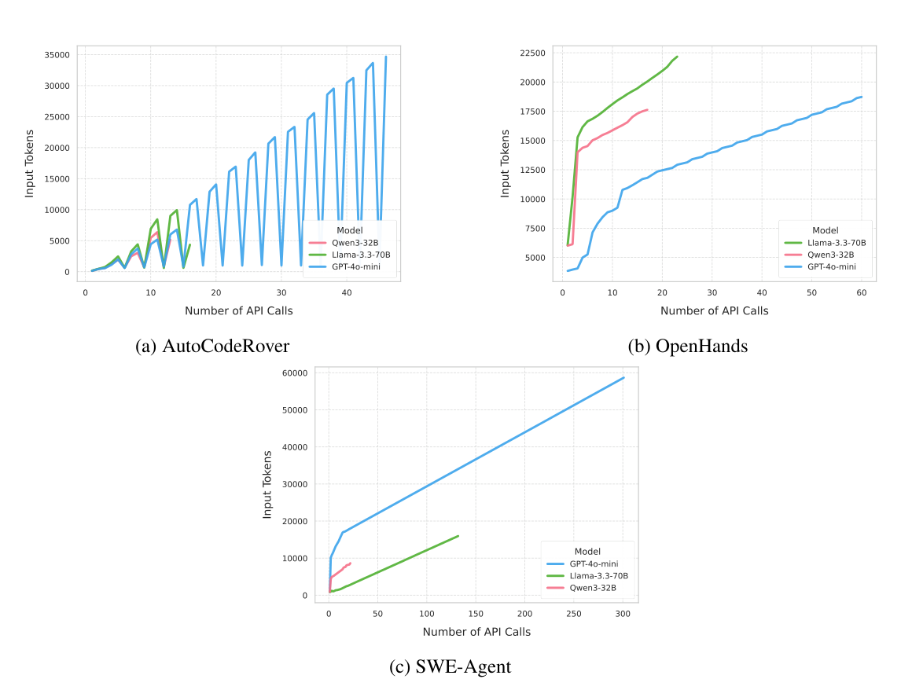
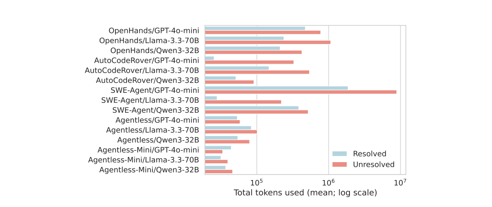

# SWE-Effi — 解決率でなく「予算あたりの解決」で足場を並べ直す

> 原典: [[translations/2025-swe-effi]] ・ `raw/papers/SWE-Effi_ Re-Evaluating Software AI Agent System Effectiveness Under Resource Constraints.md`
> 著者・年: Zhiyu Fan ほか（Huawei Canada・CUHK 深圳・King’s College London・Queen’s University）・2025-09・arXiv:2509.09853。リーダーボードとデータは公開。

## 一言まとめ

SWE-bench のリーダーボードが**解決率だけ**で並ぶことに異を唱え、トークン・金額・CPU 時間・推論時間のそれぞれの**予算のもとでどれだけ解けたか**を測る 4 指標を提案した論文。足場 5 種 × モデル 3 種を SWE-bench Verified の 50 問で並べ直し、**足場の良し悪しはモデルとの相性で決まる**こと、**履歴を積むだけの文脈管理で入力が雪だるま式に増える**こと、そして**失敗した試行は成功した試行の 4 倍以上の資源を食う**ことを示した。

## 背景と問題意識

コーディングエージェントの評価は、ほぼ SWE-bench（実在の GitHub イシューを、PR に付いていた単体テストで採点するベンチマーク。→ [[agent-evaluation]]）の**解決率**で語られる。だが解決率は「資源は無限にある」という暗黙の前提に立っている。数分で解けたのか、高価な GPU を何時間も使ったのか、毎日回せる値段なのか——現場で効く問いが、表の数字からは見えない。

著者らはこれが 2 つの場面で効いてくると言う。

- **テスト時計算の収穫逓減**。トークンを大量に使って解決率を 1% 上げることが流行しているが、「5 倍のコストで 1% は見合うか」（→ [[test-time-compute]]）。
- **強化学習（RL）の訓練コスト**。SWE 向けの RL では、1 回のロールアウト（環境の準備 → LLM の推論 → コード実行 → テスト）ごとに足場が動く。足場が遅い・高いと訓練全体が止まる。実際、DeepSWE は低レイテンシの独自足場を作り、SkyRL は OpenHands を大きく最適化し、SWE-RL は軽量な Agentless-Mini を使ったうえで実行フィードバックを避けた（→ [[agent-environments]]）。

## 提案手法 — 2 層の指標

### 中核性能指標（生の測定値）

解決率、CPU 時間（足場のローカル処理。LLM の待ち時間は除く）、LLM 呼び出し回数と入力・出力トークン、そして**正規化推論時間**。

正規化推論時間は、API の実時間がネットワークやプロバイダの機材で揺れる問題への対処である。GPT-4o-mini の API 呼び出しログ 51.5 万件で線形回帰を学習し（検証集合で R² = 0.79）、どのモデルの呼び出しにも同じ式を当てて時間に換算する。

推論時間（秒）= 1.457（固定オーバーヘッド）＋ 4.266×10⁻⁵ × 入力トークン ＋ 4.999×10⁻³ × 出力トークン

出力 1 トークンは入力 1 トークンの約 117 倍の時間がかかる、という読み方ができる（プレフィルとデコードの違い。→ [[llm-inference-optimization]]）。

### 資源有効性指標（4 つ）

横軸に資源の消費量（イシューあたり）、縦軸に**累積の解決率**をとった曲線の**下の面積（AUC, Area Under the Curve）**を 0〜1 に正規化する。少ない資源で早く解けるほど面積が大きくなる。

| 指標 | 横軸の資源 | 上限 |
|---|---|---|
| EuTB（Effectiveness under Token Budget） | 総トークン | 200 万トークン |
| EuCB（Effectiveness under Cost Budget） | 金額 | 1.00 USD |
| EuCTB（Effectiveness under CPU Time Budget） | CPU 時間 | 30 分 |
| EuITB（Effectiveness under Inference Time Budget） | 正規化推論時間 | 30 分 |

### 実験の組み方

- **足場 5 種**（2025 年 5 月時点で SWE-bench 上位のオープンソース）：
  - **手続き型（procedural）**：決まった手順の中の決まった箇所で LLM を呼ぶ。**AutoCodeRover**（抽象構文木にもとづくツールで疑わしい関数を特定 → 複数パッチを生成して選ぶ）、**Agentless**（階層的に位置を特定 → 候補パッチを複数作る → テスト結果で 1 つ選ぶ）、**Agentless-Mini**（その軽量版。LLM 呼び出しは 2 回）。
  - **エージェント型（agentic）**：LLM が自分で計画し、ツールを選んで ReAct のループを回す。**SWE-agent**（→ [[summaries/2024-swe-agent]]）、**OpenHands**（IPython・ブラウザ・編集ツールを持ち、人が途中で関われる）。
- **モデル 3 種**：GPT-4o-mini、Llama-3.3-70B（FP8 量子化）、Qwen3-32B（規模のわりに推論が強い）。
- **SWE-bench Verified から層化抽出した 50 問**。各足場は既定設定のまま動かし、SWE-agent だけ**API 予算をイシューあたり 1 ドル**に設定した。時間を公平に測るため**並列処理は無効化**した。

## 実験結果と知見

**表**: 解決率と有効性スコア（抜粋。数値は %）

| 足場 | モデル | 解決率 | EuTB | EuCB | 平均入力トークン | 平均 LLM 呼び出し |
|---|---|---|---|---|---|---|
| Agentless | Qwen3-32B | **48.0** | **46.7** | 47.1 | 2.6 万 | 83.1 |
| AutoCodeRover | Qwen3-32B | 38.0 | 37.1 | 37.0 | 5.6 万 | 14.7 |
| OpenHands | Qwen3-32B | 34.0 | 22.7 | 26.3 | 33.5 万 | 19.5 |
| SWE-agent | Qwen3-32B | 28.0 | 21.8 | 21.7 | 44.0 万 | 35.5 |
| SWE-agent | GPT-4o-mini | 10.0 | 5.1 | 2.5 | **814.3 万** | **181** |
| Agentless-Mini | Llama-3.3-70B | 4.0 | 3.9 | 4.0 | 3.8 万 | 2.0 |

### 観察 1 — 足場の良し悪しはモデルとの相性で決まる

同じ SWE-agent が、Qwen3-32B では 28%（呼び出し 35.5 回・入力 44 万トークン）、GPT-4o-mini では 10%（呼び出し 181 回・入力 810 万トークン超＝18 倍以上）。OpenHands も Qwen3-32B の 34% から GPT-4o-mini の 11.9% に落ち、EuTB は 22.7 → 6.8 になる。著者らは「基盤モデルの選択のほうが、足場の設計だけより結果に強く効く」と述べる。対照的に、単純な手続き型の AutoCodeRover は**どのモデルでも安定して競争力がある**（GPT-4o-mini でも 12% で、同条件の OpenHands・SWE-agent を上回る）。

Agentless は解決率が最高（48%）だが、候補パッチとテストを大量に作り、再現テストと回帰テストを毎回回すので、CPU 時間は平均 727.9 秒と表の中で最も重い部類に入る。**頑健さと引き換えに効率を手放している**。

### 観察 2 — 推論の強いモデルは往復が少なく、総トークンが減る

呼び出しあたりのトークンは推論モデルのほうが多いのに、総トークンは少ない。AutoCodeRover では Qwen3-32B が 15 回、Llama-3.3-70B が 38 回の呼び出しで、Llama にすると有効性スコアがほぼ半分になる。著者らの結論は「**総コストを決めるのは相互作用の回数であって、1 回の重さではない**」。

### 観察 3 — Token Snowball（トークンの雪だるま）

ほとんどの足場は、LLM の応答と観測を次のプロンプトにそのまま付け足していく。すると、**進展がなくても呼び出しのたびに数千トークンずつ入力が増える**。文脈が古い情報で散らかるとモデルが手がかりを見失い、推論の質が落ちて、さらに往復が増える——という悪循環になる。SWE-agent＋GPT-4o-mini は収束しないまま長い高トークンの軌跡に入り、AutoCodeRover＋Qwen3-32B は早く終わる（図 1）。

<figure>

<figcaption>図1（再掲）: 1 タスク（scikit-learn-14496）における LLM 呼び出し回数と入力トークンの関係。(c) の SWE-Agent＋GPT-4o-mini は 300 回近い呼び出しで入力が 6 万トークン近くまで線形に増え続ける。(a) の AutoCodeRover はのこぎり状で、入力が段階ごとに小さく戻っている。</figcaption>
</figure>

### 観察 4 — 失敗は成功よりはるかに高くつく

ほぼすべての組み合わせで、**解けなかった試行のほうが資源を多く使う**。SWE-agent＋GPT-4o-mini では、失敗が 887 万トークン・658 秒、成功が 187 万トークン・167 秒で、**4 倍以上**。OpenHands＋Llama-3.3-70B は失敗 238.9 秒に対し成功 79 秒、効率的な AutoCodeRover でも失敗は成功のほぼ 3 倍かかる。著者らはこれを**不毛さの検知（futility detection）の欠如**と呼ぶ。うまくいくときは早く解けるが、行き詰まると外部の予算上限に達するまで同じようなループを回し続ける。

<figure>

<figcaption>図2（再掲）: 解決（水色）と未解決（赤）の試行の平均総トークン（対数軸）。ほぼすべての足場とモデルの組み合わせで、未解決のほうが多い。</figcaption>
</figure>

### その他

- **トークン効率と時間効率はトレードオフになる**。Agentless は EuTB が高いのに EuCTB が低い（テストの実行に CPU 時間を使う）。OpenHands と Agentless は実行時間の大半が CPU、AutoCodeRover・SWE-agent・Agentless-Mini は大半が推論だった（付録の図 3）。
- **規模の制約**：著者ら自身、最初の実行は 2 週間以上・数百ドルかかったため、500 問を 50 問に、組み合わせを 15 通りに絞ったと書いている。

## 限界・批判的視点

- **50 問では差の大半が誤差に収まりうる**。1 問が 2 ポイントにあたり、28% と 26% の差は 1 問分である。試行の繰り返しやばらつきは報告されていない。順位の細部より、**数倍〜数十倍の差**（SWE-agent＋GPT-4o-mini の 810 万トークン、失敗の 4 倍）を読むべき論文である。
- **SWE-agent＋GPT-4o-mini の「高くつく失敗」は、予算の設計にも左右されている**。SWE-agent だけ 1 ドルの金額予算で止め、GPT-4o-mini は単価が安いので 181 回まで呼べた——と著者ら自身が付録で認めている。他の足場は既定の反復上限のままで、**打ち切り条件が足場ごとに違う**。
- **モデルは 2025 年時点の安価な 3 種だけ**。フロンティアモデルでは足場の相性の順位が変わる可能性がある。「足場はモデルしだい」という結論自体がそれを示唆している。
- **正規化推論時間は「モデル非依存」でもある**。GPT-4o-mini の回帰式をすべてのモデルに当てているので、実際には遅いモデルも速いモデルも同じトークン数なら同じ時間になる。ハードウェアの揺れを消す代わりに、モデルごとの速度差も消している。
- **並列処理を無効化したので、Agentless のように並列化前提の足場は実運用より遅く見える**。
- **EuCB 列の太字が原典で食い違う**（最良でない 37.0 に太字。訳注で記録）。AUC の正規化の細部も本文だけでは再現しにくい。

## 既存 wiki との接続

- **SWE-agent の「速く成功し、遅く失敗する」の追試**。SWE-agent 論文は自分の軌跡で「解決は中央値 $1.21・12 ステップ、失敗は平均 $2.52・21 ステップ」「解決の 93% は予算を使い切る前に提出」を示し、**予算を増やしても性能はさほど伸びない**と結論していた（[[summaries/2024-swe-agent]]）。SWE-Effi は別チームが 5 足場 × 3 モデルで同じ傾向を確かめ、それを**検知すべき能力の欠落**として言い直した。
- **「トークン量が性能を説明する」との緊張**。Anthropic の Research 機能では、BrowseComp の性能分散の 80% をトークン使用量が説明した（[[summaries/2025-multi-agent-research-system]]）。SWE-Effi では逆に、**多くのトークンを使った試行ほど失敗している**。矛盾ではなく条件の違いと読める——前者は**構成をまたいで**「より多く考えさせると良くなるか」を見ており、後者は**同じ構成の中で結果別に**「行き詰まった試行がどれだけ食うか」を見ている。どちらも、トークンを使うべきときと止めるべきときを見分ける問題に行き着く（→ [[agent-cost-efficiency]]）。
- **Token Snowball は [[context-engineering]] のコスト側の顔**。SWE-bench 原論文の「文脈を増やすと解決率が下がる」（[[summaries/2023-swe-bench]]）が精度の側から見た話なら、こちらは同じ現象をトークンと時間の側から見ている。対策として著者らが挙げる「記憶の抽象化」は、SWE-agent の古い観測の折り畳み、Claude Code の多層 compaction、Manus のファイルシステム外部化（いずれも [[context-engineering]]）として実装が進んでいる。
- **足場とモデルの相性は、ハーネスが「仮定の束」であることの別の表れ**。[[harness-engineering]] は「部品はモデルが単独でできないことへの仮定で、モデルが変われば見直す」と整理し、AHE は頭打ちから遠いモデルほどハーネスの利得が大きいと示した。SWE-Effi は逆向きの事例を足す——**弱いモデルに作り込んだエージェント型の足場を渡すと、利得どころか崩れる**（SWE-agent・OpenHands＋GPT-4o-mini）。利得はモデルの弱さだけでなく、足場とモデルの噛み合わせで決まる。
- **手続き型とエージェント型**。Agentless・AutoCodeRover のような手続き型の足場は、wiki ではこれまで原典がなく名前だけだった。本論文は二次資料としての初出で、「手順を固定すると弱いモデルでも安定しやすい」という性質を数字で示した（図 1 では、AutoCodeRover の入力は段階ごとに小さく戻るのこぎり状になる）（→ [[coding-agents]]）。最小構成の極としての **Mini-SWE-Agent**（bash 1 ツール・100 行）にも触れている（→ [[agent-computer-interface]]）。

## 実装・運用上の示唆

- **解決率と並べて、1 タスクあたりのトークン・時間・金額を必ず測る**。できれば成功と失敗に分けて測る。失敗側の平均が成功の数倍なら、打ち切り条件の設計が最大の節約になる。
- **行き詰まりを検知して早めに止める**。同じ操作の繰り返しや、呼び出し回数に対して進展がないことを止める合図にする。外部の予算上限だけに頼ると、失敗のたびに上限まで使い切る。
- **履歴を積むだけの文脈管理を避ける**。古い観測の折り畳み、段階ごとのリセット、要約などで入力の伸びを抑える。
- **足場はモデルとの組み合わせで選ぶ**。強い足場が弱いモデルでも強いとは限らない。弱いモデルでは、手順を固定した手続き型のほうが安定することがある。
- **RL の土台にする足場は、1 ロールアウトの速さと安さで選ぶ**。

## 用語と略称

- **SWE** = Software Engineering（ソフトウェアエンジニアリング）
- **足場（scaffold）**：モデルの周りで手順・ツール・ループを担うソフトウェア。本 wiki の「ハーネス」に近い
- **手続き型（procedural）／エージェント型（agentic）**：決まった手順の中で LLM を呼ぶ方式／LLM が自分で計画しツールを選ぶ方式
- **AUC** = Area Under the Curve（曲線の下の面積）
- **EuTB / EuCB / EuCTB / EuITB**：トークン・金額・CPU 時間・推論時間の各予算のもとでの有効性
- **Token Snowball**：履歴を毎回プロンプトに積むことで入力が単調に増え続ける現象
- **futility detection（不毛さの検知）**：見込みのない試行を見分けて止める能力
- **ロールアウト（rollout）**：RL の 1 回の試行。SWE では環境準備・推論・実行・テストを含む
- **プレフィル／デコード**：入力をまとめて処理する段階／出力を 1 トークンずつ生成する段階
- **RL** = Reinforcement Learning（強化学習）
- **FP8**：8 ビット浮動小数点形式（→ [[model-quantization]]）

## 関連ページ

- [[agent-cost-efficiency]] — エージェントのコスト効率の概念ページ（本論文を機に新設）
- [[agent-evaluation]] — 解決率と並べてコストを測る評価
- [[coding-agents]] — 手続き型とエージェント型の足場
- [[context-engineering]] — Token Snowball と文脈の圧縮
- [[harness-engineering]] — 足場とモデルの相性
- [[agent-environments]] — RL のロールアウトのコスト
- [[test-time-compute]] — テスト時計算の収穫逓減
- [[summaries/2024-swe-agent]] — 「速く成功し、遅く失敗する」の原典
- [[summaries/2025-multi-agent-research-system]] — 「トークン量が性能を説明する」との対比
- [[summaries/2023-swe-bench]] — ベンチマークの原論文
- [[summaries/2025-swe-rl-long-context]] — 本論文が「RL の土台」として論じた SWE エージェントの RL の実例（DeepSWE・SkyRL と同時期）
- [[agent-training]] — 足場とモデルの相性を訓練の側から見る
