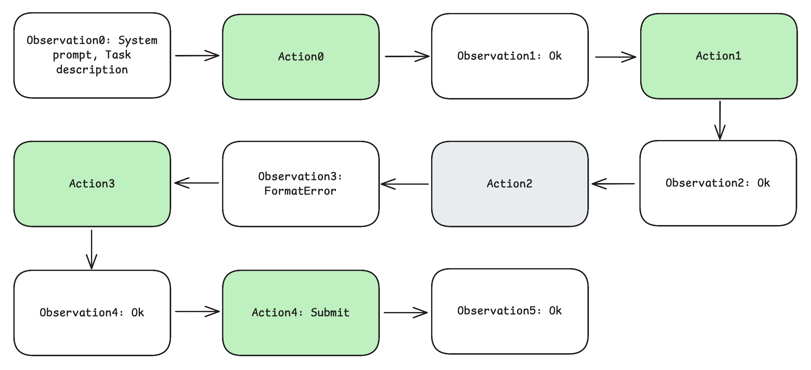
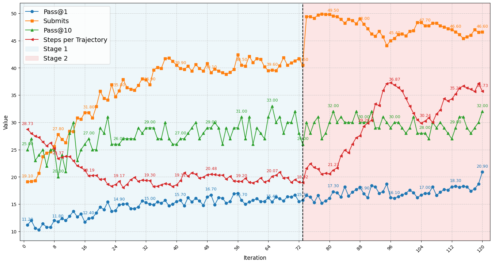

# 長文脈・多ターンの SWE エージェントを RL で訓練する — 教師なしで 72B を 11% → 39% に

> 原典: [[translations/2025-swe-rl-long-context]] ・ `raw/papers/Training Long-Context, Multi-Turn Software Engineering Agents with Reinforcement Learning.md`
> 著者・年: Alexander Golubev ほか 12 名・2025-08・arXiv:2508.03501。所属は原典に記載がないが、著者は SWE-rebench（データセット）と同じ顔ぶれで、SWE-Gym の参考文献は同じ著者群の記事を「Nebius blog」としている。

## 一言まとめ

オープンウェイトの Qwen2.5-72B-Instruct を、**強いモデルの軌跡を蒸留せず、自分で生成した相互作用データだけ**で SWE エージェントに育てた論文。**棄却ファインチューニング（RFT）で 11% → 20%、そのあと多ターンの強化学習（DAPO の改変版）で 39%**（SWE-bench Verified）になり、同じ足場で比べた DeepSeek-V3-0324（39.6%）に並んだ。数学のような「1 回答えて終わり」の RL ではなく、**状態を持つ環境と数十ターンやり取りする RL** を、文脈 131k トークンまで広げて成立させた記録である。

## 背景と問題意識

LLM への強化学習（RL）は、DeepSeek-R1 のように数学や一発のコード生成で大きな成果を上げてきた（→ [[reinforcement-learning-from-human-feedback]]）。だがそれらは、**1 回の出力に 1 回の採点が返る**だけの問題で、論文の言葉では「環境がフィードバックを返さない、多ターン相互作用の退化した場合」にあたる（バンディット問題と呼ばれる）。

ソフトウェアエンジニアリング（SWE）は違う。エージェントはコマンドを打ち、テストのログやエラーを読み、また次の手を打つ。数学なら 1 回の推論で済むところを、**数十ステップ・数十万トークンの軌跡**を最後まで走らせて、ようやく「テストが通ったか」の 1 ビットが返ってくる。論文はこれを部分観測マルコフ決定過程（POMDP, 環境の本当の状態は見えず、観測と行動の履歴から次の手を決める問題設定）として定式化し、次の難しさを挙げる。

- **長い軌跡と長い文脈**：数十ステップにわたって一貫性を保つ必要がある。
- **情報量の多いフィードバック**：コンパイラのトレースやテストのログを読み解いて次の判断に使う。
- **データの規模と忠実度**：リポジトリの状態を正確に再現できる環境が要るので、データを増やしにくい。
- **疎で遅い報酬**：成功の信号は最後にしか来ないので、どの行動が効いたかを割り当てにくい（信用割当）。
- **評価が高くノイズが多い**：軌跡を走らせてテストするのが高く、不安定なテスト（flaky test）が報酬を汚す。

それまでの SWE エージェントの強化は、(i) プロプライエタリなモデル＋凝った足場、(ii) 推論時の大量サンプリング、(iii) 強い教師モデルの軌跡での教師ありファインチューニング（SFT, 正解例をまねさせる学習）のどれかに頼っていた。著者らは、**教師モデルに頼らない RL で、オープンなモデルから同等のものを作れるか**を問う。

## 提案手法 — データの絞り込み → RFT → 2 段階の多ターン RL

### エージェントと環境

足場は SWE-agent に近い ReAct 型のループで、ツールは 3 つだけ——任意のシェルコマンド、**行範囲を指定して置き換える edit**、作業の終わりを告げる submit（→ [[agent-computer-interface]]）。報酬は**最終パッチが検証用テストを通れば 1、通らなければ 0** の 1 ビットで、途中のステップには報酬を与えない。

### データ

公開データセット SWE-rebench（約 3,400 リポジトリ・21,336 タスク）から、次の基準で **7,249 タスク**に絞った。

- 解に固有の識別子名を当てさせるようなタスク（テストが AttributeError・ImportError で落ちる）を除く。
- 変更ファイル 7 個まで・500 行未満に限る。
- LLM による品質スコアでイシューの記述が不明瞭なもの、テストパッチに欠陥があるものを除く。
- **テストを 50 回走らせて結果が揺れるタスクを除く**（外部サービスの呼び出しや浮動小数点の誤差が原因）。報酬のノイズを減らすためである。

評価には SWE-bench Verified と、**訓練データに入っていない SWE-rebench の最新の月次分割（5・6 月）**を使う。後者は汚染のない比較のためである（→ [[agent-evaluation]]）。

### 第 1 段階：棄却ファインチューニング（RFT）

素の Qwen2.5-72B-Instruct は 11% しか解けず、主な失敗は**コマンドの形式を守れない**ことだった。そこで、元のモデルで各タスクを 10 回走らせ、**テストに通った軌跡 6,548 本だけ**を集めて 1 エポックだけ SFT した。その際、**環境の形式エラーを起こしたターンは損失から外す**（マスクする）——成功した軌跡の中の失敗した手まではまねさせない工夫である。これで 20% になる。

<figure>

<figcaption>図3（再掲）: RFT に使う軌跡の例。緑の（成功した）アシスタントのターンだけが損失に寄与し、形式エラーを起こしたターンは学習から外す。</figcaption>
</figure>

### 第 2 段階：多ターン RL（DAPO の改変）

**GRPO** と **DAPO** は、critic（価値を推定するもう 1 つのネットワーク）を使わずに、同じ問題で複数の軌跡を引いて**グループ内の平均との差**を advantage（その軌跡がどれだけ良かったか）にする手法である。DAPO は GRPO に、非対称なクリップ、学習信号のないサンプルの除外、長すぎる応答への段階的な罰、**トークン単位の損失平均**を足したものである（詳細は [[reinforcement-learning-from-human-feedback]]）。

各反復の流れは次のとおり。

1. 訓練用プールから問題を選ぶ。
2. 現在の方策で、問題ごとに **10 本**の完全な軌跡を走らせる。
3. 報酬 = テストの成否（0/1）＋**長さの罰**（しきい値を超えたステップ数に比例して減点）。
4. 10 本のグループ内で報酬を正規化して advantage にし、**advantage が 0 のもの（全部成功か全部失敗）は捨てる**。
5. DAPO のトークン単位の目的関数で全パラメータを更新する。

**2 段階の文脈拡張**：65k トークンで始め、32% 前後で頭打ちになったところで、**文脈を 131k に、最大ターン数を 40 → 80 に**広げた。第 2 段階では、クリップの上限を下げ、バッチを大きくし、1 反復あたりの問題数を減らして、よりオンポリシーに近い（今の方策で引いたデータで更新する）形にした。

**カリキュラムの入れ替え**：段階の切り替えで、それまでの累積解決率が **2/3 を超えたタスク（もう確実に解ける）と、0 のままのタスク（たぶん解けない）を除いた**。プールは 7,249 → 2,028 に減り、学習の役に立つ中くらいの難しさに計算を集中させた。

**基盤**：完全に同期的な RL（軌跡を全部走らせてテストしてから更新する）。16 台の H200 ノード、131k の系列はコンテキスト並列化（長い系列を GPU にまたがって分割）で扱う。文脈拡張には YaRN（factor 4.0）を使った（→ [[positional-encoding]]）。

## 実験結果と知見

**表**: SWE-bench Verified と SWE-rebench（同じ足場・131k で評価、Pass@1 は 10 回平均）

| モデル | Verified Pass@1 | Verified Pass@10 | rebench 5 月 | rebench 6 月 |
|---|---|---|---|---|
| Qwen2.5-72B-Instruct（素） | 11.4 | 31.0 | 14.5 | 14.6 |
| ＋ RFT | 20.5 | 43.0 | 22.5 | 21.0 |
| ＋ Stage 1 RL（65k） | 35.7 | 54.6 | 36.5 | 31.2 |
| ＋ Stage 2 RL（131k） | **39.0** | 58.4 | 35.0 | 31.7 |
| DeepSeek-V3-0324 | 39.6 | 62.2 | 36.8 | 31.5 |
| Qwen3-235B（非思考） | 25.8 | 54.4 | 27.3 | 22.9 |

- **伸びの大半は第 1 段階の RL**（20.5 → 35.7）。第 2 段階は Verified では +3.3 だが、汚染のない SWE-rebench ではほぼ横ばいだった（5 月は 36.5 → 35.0）。
- **Pass@1 39.0% に対し Pass@10 58.4%**。正解は上位の候補の中にあることが多く、**検証器で選べばさらに伸びる余地がある**（→ [[test-time-compute]]）。
- 他の SWE 特化モデルとの比較（表 2）では、教師からの蒸留なしの中では DeepSWE-32B（42.2%）と並ぶ水準で、蒸留ありの SWE-agent-LM-32B（40.2%）・Skywork-SWE-32B（38.0%）とも同程度。

<figure>

<figcaption>図4（再掲）: RL の反復ごとの推移（Verified-50 の 50 問で計算。縦軸は 50 問中の件数と読める）。第 2 段階（右、131k）に入ると submit の数が跳ね上がり、1 軌跡あたりのステップ数が約 19 から約 37 に増えていく。</figcaption>
</figure>

### 実務の知見 2 つ

- **文脈長を超えた軌跡を捨てると、ループの負例も捨てることになる**。DeepSWE なども、報酬のノイズを減らすため最大文脈を超えた軌跡を除外・マスクしている。だがこの論文の設定では、**長すぎる軌跡はたいていエージェントが同じことを繰り返すループに陥ったときに生じる**。それを捨てると、ループする振る舞いが罰されず、抜け出し方を学べなくなり、**かえってループが増える**。手作りの除外は「訓練データは最適化中の方策の分布から引かれている」という前提を壊す。
- **推論エンジンの既定値の変更で学習が壊れた**。途中で vLLM を更新したところ、既定で top_k と min_p が有効になり、評価指標は一時的に上がったが、5〜10 反復後に性能が落ちた。DAPO の重要度サンプリング比は「ロールアウトは旧方策 π_old から引いた」ことを前提にしており、**サンプリング設定を変えると別の分布から引いたことになって勾配が偏る**。設定を戻すと安定した。だから著者らは、ロールアウトは温度 1.0 だけにして他のデコーディング設定をすべて切る。

## 限界・批判的視点

- **Verified での伸びと汚染のない評価での伸びが食い違う**。第 2 段階の +3.3 は SWE-rebench では再現しない。SWE-bench Verified の数字だけで語ると過大評価になりうる——著者ら自身が両方を報告しているのは誠実である。
- **RFT のデータは「自分で生成した」とはいえ、元のモデルの能力に縛られる**。教師モデルは使っていないが、出発点の 72B が 11% 解けることが前提である。もっと弱いモデルで同じ道筋が通るかは分からない。
- **計算規模が大きい**。H200 ノード 16 台・100 回超の反復で、各反復に 300 問 × 10 本の長い軌跡を走らせる。追試できる組織は限られる。
- **アブレーションが少ない**。長さの罰、形式エラーのマスク、カリキュラムの入れ替え、DAPO の各改変のどれがどれだけ効いたかは切り分けられていない。報告されている知見は 2 つの失敗事例の記述である。
- **報酬は 1 ビットだけ**。著者ら自身が、疎な報酬の信用割当と、「何としても提出する」ように学習してしまう問題（不確実なときに手を引けない）を今後の課題に挙げている。
- **所属が書かれていない**。著者群は SWE-rebench と重なり、評価にも自分たちのデータセットを使っている。

## 実装・運用上の示唆

- **最初に RFT で形式を覚えさせる**。素のモデルの失敗の多くがツール呼び出しの形式エラーなら、RL の前に成功軌跡で 1 エポックだけ SFT し、形式エラーのターンは損失から外す。
- **テストを何十回も走らせて不安定なタスクを除く**。報酬のノイズは RL の大敵である。
- **全部成功・全部失敗のタスクは学習に寄与しない**。グループ内の差がないと advantage が 0 になる。累積解決率で中くらいの難しさのタスクに絞り直す。
- **長すぎる軌跡を安易に捨てない**。捨てるとループの負例が消える。長さは罰で抑える。
- **ロールアウトのサンプリング設定を固定する**。推論エンジンの更新で既定値が変わっていないか確かめる。
- **文脈を段階的に広げる**。短い文脈で頭打ちになってから、長い文脈・多いターン数に移る。

## 用語と略称

- **RL** = Reinforcement Learning（強化学習）
- **RFT** = Rejection Fine-Tuning（棄却ファインチューニング。成功した出力だけを集めて SFT する）
- **SFT** = Supervised Fine-Tuning（教師ありファインチューニング）
- **POMDP** = Partially Observable Markov Decision Process（部分観測マルコフ決定過程）
- **PPO** = Proximal Policy Optimization（critic を使う代表的な方策最適化）
- **GRPO** = Group Relative Policy Optimization（グループ内の相対報酬で advantage を出す、critic なしの手法）
- **DAPO** = Decoupled Clip and Dynamic sAmpling Policy Optimization（GRPO の改良版。原典は "Decoupled Advantage Policy Optimization" と表記）
- **advantage**：ある行動・軌跡が平均よりどれだけ良かったかの推定値
- **オンポリシー**：今の方策で引いたデータで更新すること
- **重要度サンプリング比**：今の方策と、データを引いた方策の確率の比。データが別の分布から来たときの補正に使う
- **Pass@k**：k 回試して少なくとも 1 回成功する割合
- **YaRN**：RoPE の周波数を調整して文脈長を伸ばす手法（→ [[positional-encoding]]）

## 関連ページ

- [[agent-training]] — エージェントを訓練で育てる方法の概念ページ（本 ingest で新設）
- [[reinforcement-learning-from-human-feedback]] — GRPO・DAPO の系譜
- [[agent-environments]] — SWE の訓練環境（SWE-rebench・SWE-Gym）
- [[coding-agents]] — SWE エージェントの全体像
- [[test-time-compute]] — Pass@1 と Pass@10 の差と検証器
- [[agent-cost-efficiency]] — 長い軌跡のコストと、ループの扱い
- [[summaries/2024-swe-gym]] — 実行環境つきの訓練データと検証器（本論文は同じ方向を RL で進めた）
- [[summaries/2025-deepseek-r1]] — 単一ターンの RL の代表例
- [[summaries/2024-deepseekmath]] — GRPO の原典
- [[summaries/2026-swe-bench-verified-retired]] — 汚染のない分割で評価すべき理由を、Verified の監査で裏づけた報告
- [[summaries/2024-error-bars-evals]] — Pass@1 を複数回の平均で出すことの統計的な意味（再サンプリングによるばらつきの削減）
- [[summaries/2026-swe-lego]] — RL を使わず SFT だけで同じ水準に届いた研究（失敗した手のマスクも共通）
- [[summaries/2025-swe-smith]] — RL ではなく RFT で訓練した、同時期の SWE モデル（SWE-agent-LM-32B）
