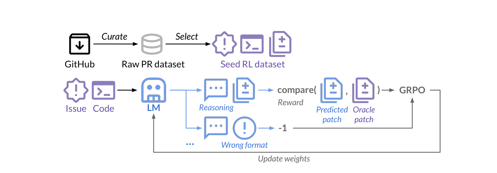
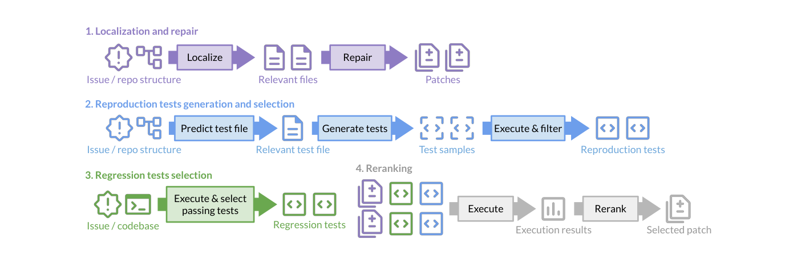
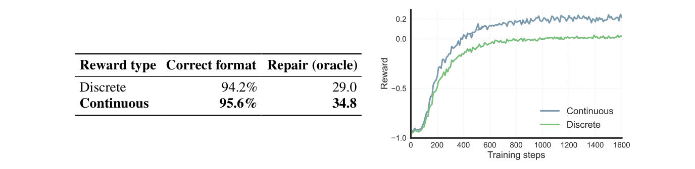

# SWE-RL — テストを実行せず、正解パッチとの文字列の類似度を報酬にして、GitHub の PR から強化学習する

> 原典: [[translations/2025-swe-rl]] ・ `raw/papers/SWE-RL_ Advancing LLM Reasoning via Reinforcement Learning on Open Software Evolution.md`
> 著者・年・会議: Yuxiang Wei（Meta AI・イリノイ大学アーバナ・シャンペーン校）ほか（Meta AI・UIUC・カーネギーメロン大学）・2025・NeurIPS 2025（arXiv:2502.18449。v1 2025-02-25、v2 2025-12-01。本要約は v2 による）

## 一言まとめ

GitHub の PR（Pull Request）から集めた 27.3 万件の「イシュー・コード・正解パッチ」の組に対し、モデルが書いた修正と正解パッチの**文字列としての近さ**（0〜1）を報酬にして、Llama-3.3-70B-Instruct を GRPO で強化学習した。テストの実行環境を 1 つも作らずに、SWE-bench Verified で 41.0% に達した。訓練は課題の修正だけだったが、数学やコードの推論など課題の外の 5 種類のベンチマークでも元のモデルを下回らなかった。

## 背景と問題意識

DeepSeek-R1（[[summaries/2025-deepseek-r1]]）は、答え合わせで機械的に決まる報酬だけで RL をかけると推論の力が伸びることを示した（RLVR, Reinforcement Learning with Verifiable Rewards, 正誤を機械判定できる報酬を使う強化学習 → [[reinforcement-learning-from-human-feedback]]）。ただしその対象は数学と、テストを実行すれば正誤が分かる競技プログラミングだった。実際のソフトウェアの修正にこれを広げるには壁がある。

- **実行環境を作るのが高い**。リポジトリごとに依存関係を入れてテストを動かす環境が要る。SWE-Gym（[[summaries/2024-swe-gym]]）は手作業で 2,438 件しか作れなかった。
- **当時のオープンな SWE モデルはプロプライエタリなモデルの蒸留に頼っていた**。Lingma-SWE-GPT・SWE-Gym・SWE-Fixer は、いずれも GPT-4o か Claude 3.5 Sonnet の出力を SFT（Supervised Fine-Tuning, 教師ありファインチューニング）に使っている。

本論文は**実行をあきらめ、正解パッチとの比較だけで報酬を作れば、GitHub の膨大な PR がそのまま RL のデータになる**と考えた。

## 提案手法 / 主張

<figure>

<figcaption>図1（再掲）: SWE-RL の全体像。GitHub から PR のデータを集めて選び、イシュー・コード・正解パッチの組を RL の種データにする。方策の LM は推論してから修正を出す。報酬は予測したパッチと正解パッチの比較で、書式が誤っていれば −1。GRPO で重みを更新する。</figcaption>
</figure>

### データ: GitHub の PR を自己完結した組にする

1. GH Archive（GitHub の全イベントの記録）から 2015-01-01〜2024-08-31 のイベントを取り、460 万のリポジトリを履歴ごと clone する。SWE-bench が使うリポジトリは最初から除く（汚染の防止）。
2. マージ済みの PR ごとに、議論・レビュー・途中のコミット・変更前のファイルの内容をまとめ、関連するイシューを結びつける（2,400 万件）。
3. **変更していないが関係するファイルも足す**。変更したファイルだけを文脈に入れると、モデルは「見せられたファイルを全部直す」癖を覚えてしまう。そこで Llama-3.1-70B-Instruct に、変更しないが関係するファイルを予測させて加える。
4. bot の PR、空や巨大な変更、ロックファイルやバージョンの更新だけの PR などを除き、約 1,100 万件にする。そこから、イシューが結びついていてバグ修正の依頼で、プログラムのファイルを変更している 27.3 万件を RL の種データに選ぶ。

### 報酬と更新

入力はイシューの文と、直すファイルと関係するファイルの**全文**である。モデルは考えてから、search/replace 形式の編集（置き換える前と後のコード片の組）を出す。

$$
\mathcal{R}(o)=\begin{cases}-1, & \text{書式が誤り}\\ \mathrm{compare}(\mathrm{patch_{pred}},\mathrm{patch_{gt}}), & \text{それ以外}\end{cases}
$$

`compare` には Python の `difflib.SequenceMatcher` を使う。2 つの文字列がどれだけ一致しているかを 0〜1 で返す関数である。**テストは走らせず、正しく直ったかは見ない**。正解パッチにどれだけ似ているかを報酬にする。

更新には GRPO（Group Relative Policy Optimization, 同じ問題に複数の答えを出させ、グループ内の平均との差を advantage にする RL の方法）を使う。Llama-3.3-70B-Instruct を、文脈 16k、1 バッチ 32 問 × 16 本で 1,600 ステップ訓練した。H100 を 512 枚使い、1 回の訓練に約 32 時間かかる。

### 推論時の足場: Agentless Mini

評価の足場は Agentless（[[summaries/2024-agentless]]）を簡略化した Agentless Mini である。エージェントがループで道具を使う方式ではなく、手順が決まった流れで動く。

<figure>

<figcaption>図7（再掲）: Agentless Mini。(1) リポジトリの構造からファイルを絞って修正を出す、(2) 再現テストを書いて実行し選ぶ、(3) 既存の回帰テストを選ぶ、(4) テストを実行して候補を順位づけし、1 つを選ぶ。</figcaption>
</figure>

訓練したのは (1) の「修正を書く」部分だけだが、ファイルの絞り込みや再現テストの作成も同じモデルにやらせる。評価では 1 問につき修正を 500 本、再現テストを 30 本作り、テストの結果で 1 本を選んで提出する。

## 実験結果と知見

- **SWE-bench Verified で 41.0%**。100B 以下のモデルとしては当時の最高で、同じ流れで SFT したモデル（36.2%）を上回った。プロプライエタリなモデルの蒸留を使っていない点も強調されている。
- **修正の力そのものが伸びた**。直すファイルを正解で与え、1 回だけ貪欲に生成させると、解決率は元のモデルが 5.4%（20 本の多数決でも 16.6%）、SFT が 29.6%、RL が 34.8% だった。書式が正しい割合は SFT（96.2%）が RL（95.6%）をわずかに上回った。
- **候補を増やすと伸びるが、飽和する**。修正の候補を 20 本から 160 本に増やすと 33.6% → 40.0%、500 本で 41.0%。再現テストは 1 本から 20 本で 38.8% → 41.0%、30 本でも変わらない。
- **完全一致の報酬では学べない**。正解パッチと完全に一致すれば 1、それ以外は 0 にすると、修正の力は 29.0%（類似度の報酬は 34.8%）で、訓練の終わりでも平均の報酬はほぼ 0 だった。現実の修正は書き方が多様で、完全一致はほとんど起きない。部分的な近さに点を与えることが学習の信号になっている。

<figure>

<figcaption>図5（再掲）: 報酬の比較。左の表は、書式の正しさ（完全一致の報酬 94.2%・類似度の報酬 95.6%）と、正解のファイルを与えたときの修正の力（29.0・34.8）。右は訓練中の平均の報酬で、類似度の報酬（青）のほうが速く上がる。</figcaption>
</figure>

- **課題の外でも下がらなかった**。

**表**: 課題の外のベンチマーク（原典の表 3 から抜粋。0-shot・貪欲デコード）

| ベンチマーク | 元のモデル | SFT | RL |
|---|---|---|---|
| HumanEval+（関数の実装） | 76.2 | 73.2 | 79.9 |
| BigCodeBench-Hard（ライブラリの利用, I / C） | 28.4 / 29.1 | 25.7 / 24.3 | 28.4 / 29.1 |
| CRUXEval-I（コードの実行の推論） | 60.5 | 68.4 | 71.6 |
| MATH（厳密 / 緩い書式） | 63.2 / 70.9 | 54.0 / 71.7 | 73.7 / 73.7 |
| MMLU（一般知識） | 86.49 | 85.26 | 86.82 |

SFT は平均すると元のモデルより下がり、RL は下がらないか上がった。著者らは、SFT は特定の課題の分布に寄せるが、RL は推論の力そのものを伸ばすと解釈している。

- 「**aha moment**」が現れた。RL のあと、モデルは最初の仮定を疑って考え直す（"But wait, ..."）、別の方法を比べる、問題を小さく分けるといった振る舞いを、課題の修正だけでなく関数の実装や数学でも見せた（[[self-reflection]]）。

## 限界・批判的視点

- **報酬は「正しさ」ではなく「正解への近さ」である**。別の書き方の正しい修正は低い点になり、正解パッチと文字面が似ているが動かない修正は高い点になりうる。著者らも意味的に同じ別解の探索を妨げうると認めている。SWE-bench Verified の監査では、正しい解を落とすテストが問題になった（[[summaries/2026-swe-bench-verified-retired]]）。この報酬は、それよりさらに 1 つの書き方に寄せる。
- **41.0% は「500 本からテストで選んだ 1 本」の数字である**。1 回の試行で出す数字ではないので、エージェント型の足場の Pass@1 とは比べられない。修正だけを 1 回出す設定では 34.8% で、しかも直すファイルを正解で与えている。推論のコストも大きい（→ [[test-time-compute]]）。v1 は「最適な結果には大きな標本の予算が要る」ことを限界に挙げていたが、v2 ではこの文が削られている。
- **エージェントの訓練ではない**。1 回の入力に 1 回答える RL で、ファイルの全文を最初から与えている。道具を使って調べ、テストの結果を読み、やり直す力は訓練していない。著者らも手順を段に分けた「外側の構造」のせいで、モデルがやり取りの結果から学べないことを限界に挙げている（v1 は今後の課題としてエージェント型の RL と実行の組み込みを挙げていたが、v2 では削られた）。この方向は、多ターンの RL（[[summaries/2025-swe-rl-long-context]]）や Kimi-Dev（[[summaries/2025-kimi-dev]]）が引き継いだ。
- **課題の外の伸びは小さい**。v2 では、HumanEval+ や CRUXEval の 1〜2 ポイントの差は単独では有意でないと書き足し、複数のベンチマークをまとめると 5% 水準で有意だとしている。MATH の厳密な書式での大きな差（54.0 → 73.7）は、主に書式に従えるかの差で、緩い書式では 71.7 対 73.7 である。
- **SFT の比較相手は強い教師の蒸留ではない**。SFT のベースラインは Llama-3.3-70B 自身で合成した思考と編集のデータで作った。「RL は SFT より汎化する」という結論は、この SFT についてのものである。
- **SWE-bench Verified だけで測っている**。Verified はのちに汚染とテストの欠陥のため報告がやめられた（[[summaries/2026-swe-bench-verified-retired]]）。訓練データから SWE-bench のリポジトリを除いた点は評価できるが、Llama 3 の事前学習に問題が含まれていた可能性は残る。
- **表の比較は足場がそろっていない**。表 1 は SWE-agent・OpenHands・Agentless など、足場の違う報告値を並べている。

## 実装・運用上の示唆

- **実行環境がなくても、正解の例があれば RL の報酬は作れる**。テストを走らせられない社内のコードベースでも、過去の修正の履歴から報酬を作れる。ただし報酬は正解への近さなので、得られるのは「チームがかつて書いた形に近い修正」を出す力である。
- **0/1 の報酬が稀にしか出ないなら、連続の類似度で部分点を与える**。完全一致の 0/1 では学習がほとんど進まなかった。
- **文脈には「直さないが関係するファイル」も入れる**。直すファイルだけを見せると、見せたファイルを全部直す癖がつく。
- 訓練のコストの面では、実行を避けたことでロールアウトが軽くなる（→ [[agent-cost-efficiency]]）。代わりに、推論時に候補 500 本とテストによる選別が要る。

## 用語と略称

- **RL**（Reinforcement Learning）: 強化学習。報酬を最大にするように方策を更新する。
- **RLVR**（Reinforcement Learning with Verifiable Rewards）: 正誤を機械判定できる報酬を使う RL。本論文の報酬は機械的に計算できるが、正誤そのものではなく正解との近さである。
- **GRPO**（Group Relative Policy Optimization）: 同じ問題に複数の出力を出させ、グループ内の報酬の平均との差で更新する RL の方法。価値関数（critic）を使わない。
- **SFT**（Supervised Fine-Tuning）: 教師ありファインチューニング。
- **PR**（Pull Request）: 変更の取り込みの依頼。
- **正解パッチ**（oracle patch）: PR で実際にマージされた修正。
- **search/replace 編集**: 置き換える前のコード片と後のコード片の組で表す編集の形式。
- **Agentless Mini**: 本論文の、手順が決まった修正の流れ（ファイルの絞り込み → 修正 → 再現テスト → 回帰テスト → 順位づけ）。
- **aha moment**: RL の途中で、モデルが自分の考えを見直す振る舞いが現れること（DeepSeek-R1 の用語）。
- **OOD**（out-of-domain）: 訓練の対象外の課題。
- **LLM**（Large Language Model）: 大規模言語モデル。

## 関連ページ

- [[agent-training]] — SWE エージェントの訓練の方法（蒸留・RFT・多ターン RL）と、その中での位置
- [[reinforcement-learning-from-human-feedback]] — RLVR と GRPO の系譜
- [[coding-agents]] — 手続き型の足場（Agentless）とエージェント型の足場
- [[test-time-compute]] — 候補を多く出してテストで選ぶ推論時の計算
- [[self-reflection]] — RL で現れる考え直しの振る舞い
- [[summaries/2025-deepseek-r1]] — ルールの報酬だけで推論を伸ばした先行研究
- [[summaries/2024-agentless]] — Agentless Mini の元
- [[summaries/2025-swe-rl-long-context]] — 実行の結果を報酬にした多ターンの RL（同年の後続）
- [[summaries/2025-kimi-dev]] — Agentless の形式で、実行の結果を報酬にした RL
- [[summaries/2026-p2t]] — 正解パッチを報酬ではなく、SFT の軌跡を作り直す手がかりに使う別の道
