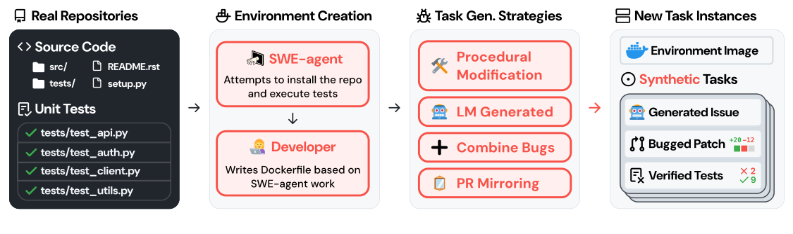

# SWE-smith — 環境を先に作り、その中でバグを合成して訓練データを増やす

> 原典: [[translations/2025-swe-smith]] ・ `raw/papers/SWE-smith_ Scaling Data for Software Engineering Agents.md`
> 著者・年: John Yang, Kilian Lieret, Carlos E. Jimenez ほか（Stanford・Princeton・Alibaba Qwen）・2025-04（v2 は 2025-05）・arXiv:2504.21798。SWE-bench・SWE-agent と同じグループの研究である。

## 一言まとめ

SWE エージェントの訓練データ作りを、SWE-bench とは**逆の順序**——**先にリポジトリの実行環境を 1 つ作り、その中でテストを壊すバグを大量に合成する**——にすることで、128 リポジトリから 5 万件のタスクを、環境の容量 295 GB・人手約 20 時間・1,360 ドルで作った論文。Claude 3.7 Sonnet が解けた軌跡 5,016 本で Qwen2.5-Coder-32B をファインチューニングし、SWE-agent-LM-32B として SWE-bench Verified 40.2% を出した。

## 背景と問題意識

オープンなモデルを SWE エージェントとして訓練するには、**実行してテストできるタスク**が大量に要る（→ [[agent-environments]]）。それまでの作り方は 2 通りだった。

- **PR とイシューをクロールするだけ**：数は取れるが、実行環境もテストもないので、生成した解が正しいか確かめられない。
- **SWE-bench の収集方法を新しいリポジトリに広げる**（SWE-Gym → [[summaries/2024-swe-gym]]）：テストで確かめられるが、数が増えない。イシューを解決し、かつテストを変更している PR は少ない。そのうえ、**PR ごとに当時のバージョンの依存関係を手で設定する**必要があり、SWE-Gym は 11 リポジトリ・2,438 件に約 200 人時と 6 TB の Docker イメージを費やした。

著者らの洞察は、**「テストを実行して確かめる」仕組みは、解の検証だけでなく、バグの候補の検証にも使える**ということである。既存のテストを壊す変更なら、それを元に戻すことがタスクの解になる。

## 提案手法 — 環境を先に、タスクはその中で合成する

<figure>

<figcaption>図2（再掲）: SWE-smith の流れ。実際のリポジトリ → SWE-agent が環境をインストールし、人がその記録から Dockerfile を書く → 4 つの戦略でバグを作る → 生成したイシュー・バグのパッチ・壊れたテストからなるタスク。</figcaption>
</figure>

1. **環境を作る**：PyPI の上位 5,000 パッケージのうち GitHub のスターが 1,000 以上のリポジトリ（SWE-bench の 12 リポジトリは除く）を対象に、**最新のコミットだけ**について SWE-agent にインストールとテストの実行を任せ、人がその記録を確認して Docker イメージにする（リポジトリあたり約 7 分＋テスト出力のパーサーに約 1 分）。
2. **バグの候補を作る**（4 つの戦略）
   - **LM Modify**：関数を LM に渡し、テストを壊す論理的なバグを入れさせる（「カオスモンキーテスト」の役割を与えるプロンプト）。
   - **LM Rewrite**：関数の見出しと docstring だけを渡して、一から実装し直させる。バグを頼まないが、書き直しが元と違えばバグになる。
   - **Procedural（手続き的な変更）**：関数の抽象構文木（AST）に、条件分岐やループの削除・演算子の変更・if/else の反転など 13 種類の変換をランダムに加える。LM を使わないのでコストはゼロ。
   - **Combine**：同じファイル・同じモジュールの検証済みのバグを 2〜5 個まとめ、複数の関数・ファイルにまたがる難しいタスクにする。
   - **PR Mirror**：実際の PR の差分を LM に渡し、**現在のコード**に対してその変更を取り消させる（古いコミットをチェックアウトしないので、古い依存関係を設定しなくてよい）。
3. **実行で検証する**：候補のパッチを当ててテストを走らせ、既存の通るテストを 1 つ以上壊すものだけを残す（壊れたテストが Fail-to-Pass になる）。
4. **イシューの文面を作る**：パッチ・壊れたテストの 1 つのソース・テストの実行ログを LM に渡し、再現コードつきの GitHub のイシュー風の文面を書かせる。

**同じリポジトリのタスクは 1 つの環境を共有する**のが容量の鍵である。SWE-bench はタスクごとに Docker イメージを作る（2,294 件で 1.2 TB）が、SWE-smith は 125 のイメージ（290.54 GB）で 5 万件をまかなう。同じ数を SWE-bench の方式で作れば 50〜150 TB になると見積もっている。

**表**: 戦略ごとの生成率と規模（原典の表 1 から）

| 戦略 | 生成率（テストを壊した割合） | インスタンス数 | 候補 1 件のコスト | 編集行数（中央値） |
|---|---|---|---|---|
| Combine | 96.9% | 10,092 | 0 | 11 |
| LM Modify | 56.0% | 17,887 | 0.38¢ | 3 |
| LM Rewrite | 35.0% | 4,173 | 3.93¢ | 24 |
| PR Mirror | 33.8% | 2,344 | 5.53¢ | 14 |
| Procedural | 40.2% | 15,641 | 0 | 5 |
| 合計 | 50.1% | 50,137 | 2.32¢ | 5 |

## 実験結果と知見

訓練は棄却サンプリングファインチューニング（RFT, 強いモデルに解かせ、成功した軌跡だけを学習データにする方法 → [[agent-training]]）である。足場は SWE-agent（ツールは bash・`str_replace_editor`・submit の 3 つ）。8,686 件に計 17,906 回挑ませ、成功は 36% だった。**1 タスクあたりの軌跡を 3 本までに制限**して（易しいタスクへの偏りを防ぐ。SWE-Gym の知見を踏襲）、5,016 本で訓練した。

- **SWE-agent-LM-32B は Verified 40.2%（素の Qwen2.5-Coder-32B から +33.4 ポイント）、Lite 30.7%**。当時のオープンウェイトの首位である。同じ 500 本の訓練データで比べても、SWE-Gym より 8.2 ポイント上だった（28.2%）。
- **訓練データが増えるほど伸びる**（100 本で 14.3% → 5,000 本で 40.2%）。成功軌跡だけを選ぶほうが、選ばずに入れるより一貫して良い（図 23）。

### アブレーションから分かったこと

| 問い | 結果 |
|---|---|
| どのバグが訓練に効くか（各 507 本で比較） | PR Mirror 9.2% ≈ LM Rewrite 8.8% ≈ Procedural 8.6% ＞ LM Modify 5.7%。**合成のバグでも、実際の PR に近い効果がある**。LM Modify は単純な代入の入れ替えばかりになり、易しすぎた |
| イシューの文面は何がよいか（各 259 本で比較） | 元のイシュー 7.8% ≈ LM が書いたもの 7.7% ＞ F2P テストを見せる 7.3% ＞ 固定テンプレート 6.4%。**LM が書いたイシュー文で本物の代わりになる** |
| 壊れたテストを見せるとどうなるか | 成功軌跡は増えるが、モデルが**再現スクリプトを書かなくなる**（500 問中 379 回 → 127 回）。評価の基準を漏らすと、問題を確かめる手順そのものを学ばない |
| 難しいタスクで訓練すると良いか | **相関しない**（難しさスコア 2/4/6/8 で 12.4/10.8/13.6/12.2%）。難しさは解けるかどうかとは相関するが、訓練データとしての効果とは無関係だった |
| リポジトリの数を増やすと | 4 → 100 リポジトリで 10.3% → 15.1%、**ほぼ対数的に伸びる** |
| 1 つのリポジトリに特化すると | SymPy だけで訓練すると、SymPy の問題で 13.6% → 21.2%（7B）、32B に追加で 33.3% → 42.4%。他の問題での低下はわずか |

### エージェントの振る舞い

- **繰り返しが最大の問題**。SWE-agent-LM-32B の軌跡の 25% 超に長さ 10 以上の同じ行動の繰り返しがあり（Claude 3.7 Sonnet は 4% 未満）、長さ 10 の繰り返しは 89% の確率で失敗につながる。多くは、検索せずにファイルの別の部分を表示し続ける行動である。
- **失敗の 53% は上限（コスト・ステップ）への到達**で、多くは位置の特定や再現の段階で行き詰まっていた。
- 足場で繰り返しを抑える介入（警告を出す、再サンプリングする）は繰り返しを大きく減らしたが、**解決率は上がらなかった**（38.4%）。著者らは、繰り返しは失敗の原因ではなく、難しい問題に当たったときの**症状**だと解釈している。
- 解けた問題では Claude より少ないステップで終わる（24.8 対 25.6）。

### SWE-bench Multilingual

評価用に、9 言語（JavaScript・TypeScript・C・C++・Go・Java・PHP・Ruby・Rust）・42 リポジトリ・300 問の **SWE-bench Multilingual** を新たに作った（→ [[agent-evaluation]]）。Claude 3.7 Sonnet は 43% だが、Python だけで訓練した SWE-agent-LM-32B は 8.4% で、素のモデル（6.5%）からほとんど伸びなかった。Python 以外のコードでも Python に近い構文で編集してしまう例が見られた。

## 限界・批判的視点

- **評価には使えない**、と著者ら自身が書いている。隠しテストがなく、壊れたテストがリポジトリの中に見えており、イシュー文の曖昧さや答えの漏れも点検していない。訓練データ専用である。
- **Python に特化**しており、Python で訓練したモデルは他の言語にほとんど汎化しなかった。
- **合成バグの「現実らしさ」は間接的にしか確かめていない**。難しさの予測モデルの平均スコアが SWE-bench と同程度だという根拠と、訓練の効果だけである。LM Modify のように、易しい誤りに偏る戦略もある。
- **訓練は RFT だけ**で、強化学習は試していない。教師は Claude 3.7 Sonnet で、プロプライエタリなモデルの蒸留である。
- 評価は SWE-bench Verified の Pass@1 で、2026 年に OpenAI が汚染とテストの欠陥を理由に報告をやめたベンチマークである（→ [[summaries/2026-swe-bench-verified-retired]]）。また、SWE-Lego（→ [[summaries/2026-swe-lego]]）は、2025-09 より前の Verified の Docker イメージでは `git log` で正解を覗けたと指摘しており、この時期の数字はその影響を受けている可能性がある。
- 本文と HTML 版で図表の参照番号がずれている、表のモデル名や件数が本文と付録で食い違うなど、細かな不整合がある（翻訳に訳注を付けた）。

## 実装・運用上の示唆

- **環境は「リポジトリ × コミット」に 1 つ**。タスクごとに環境を作らないだけで、容量は桁違いに減る。
- **バグは安い方法から作る**。AST の機械的な変換はコストゼロで、訓練の効果は PR を元に戻す方法に近い。LM に「バグを入れて」と自由に頼むと、単純な誤りに偏る。
- **イシューの文面は LM に書かせてよい**。ただし、壊れたテストそのものを見せると、モデルが再現の手順を飛ばすようになる。
- **1 タスクあたりの軌跡の本数に上限を設ける**（ここでは 3 本）。
- **リポジトリの種類を増やす**ほうが、同じリポジトリの本数を増やすより効く。特定のリポジトリでの性能が欲しければ、そのリポジトリのバグを作って追加で訓練する。
- **繰り返しを足場で抑えても解決率は上がらない**ので、モデルの能力の問題として扱う。

## 用語と略称

- **SWE** = Software Engineering（ソフトウェアエンジニアリング）
- **RFT** = Rejection sampling Fine-Tuning（棄却サンプリングファインチューニング）
- **AST** = Abstract Syntax Tree（抽象構文木）
- **PR** = Pull Request（プルリクエスト）
- **F2P / P2P** = Fail-to-Pass / Pass-to-Pass（バグで壊れ、修正で通るテスト／前後とも通るテスト）
- **生成率**（yield rate）：生成したバグの候補のうち、実際にテストを壊して使えるタスクになった割合
- **ACI** = Agent-Computer Interface（エージェント向けのツールの設計）
- **PyPI** = Python Package Index（Python のパッケージの公開リポジトリ）
- **LoRA** = Low-Rank Adaptation（難しさの予測モデルの訓練に使用）

## 関連ページ

- [[agent-environments]] — 環境を先に作るか、タスクを先に集めるか
- [[agent-training]] — RFT、1 タスクあたりの本数の上限、難しさと訓練の効果
- [[coding-agents]] — SWE-agent と訓練済みの SWE モデル
- [[agent-evaluation]] — SWE-bench Multilingual、評価用データと訓練用データの違い
- [[agent-computer-interface]] — SWE-agent の 3 つのツール
- [[summaries/2024-swe-gym]] — タスクを先に集める方式の前身（2,438 件・6 TB）
- [[summaries/2026-swe-lego]] — SWE-smith の合成方法と実際の PR を混ぜた後続の研究
- [[summaries/2025-swe-rl-long-context]] — SWE-rebench（実際の PR を自動で集める方式）で RL を回した研究
- [[summaries/2024-swe-agent]] — 足場として使った SWE-agent
- [[summaries/2023-swe-bench]] — 逆の順序で作られた評価用ベンチマーク
- [[summaries/2025-swe-rebench]] — タスクを先に集めて環境を自動で作る、逆の順序の方式の原論文
- [[summaries/2025-kimi-dev]] — 本論文の 5,016 本の軌跡で、Agentless で鍛えた 72B をエージェントに適応させた研究（48.6%）
