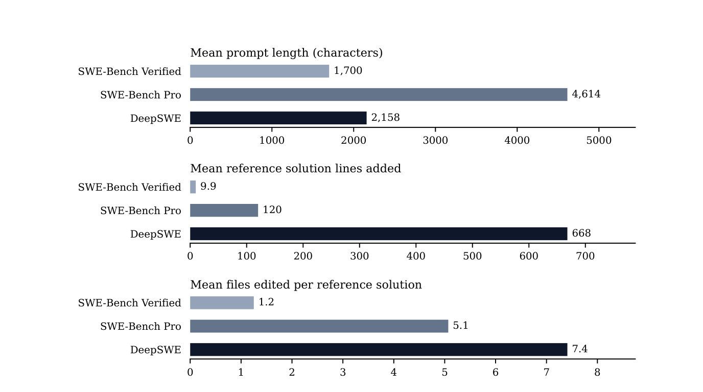
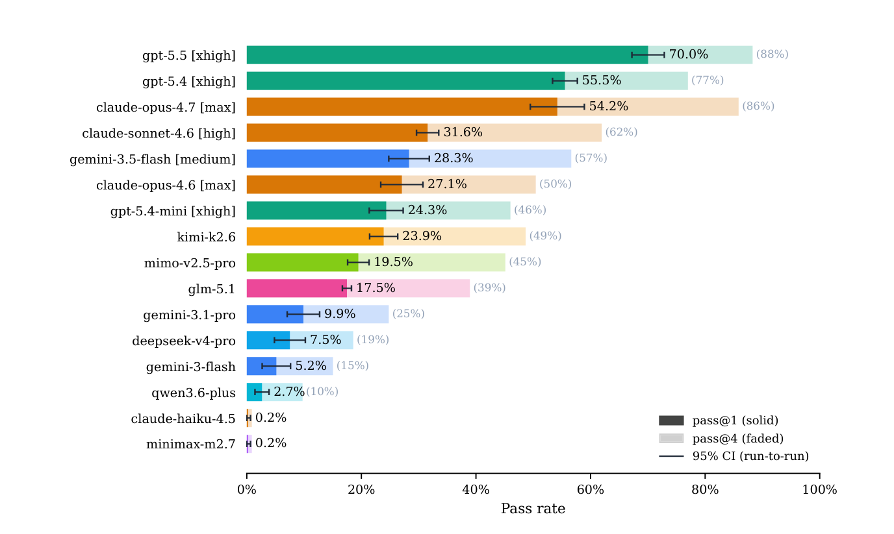
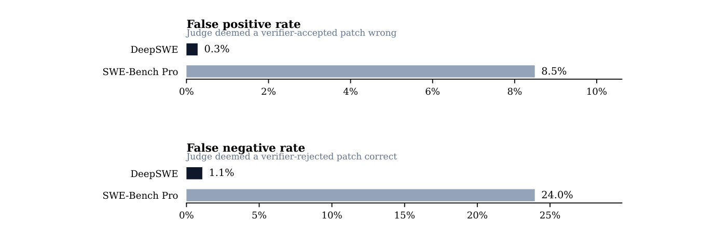
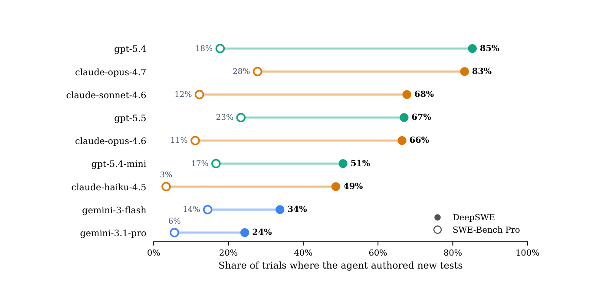

# DeepSWE — 書き下ろしの 113 タスクと、機能を確かめる手書きの検証器で、コーディングエージェントを測るベンチマーク

> 原典: [[translations/2026-deepswe]] ・ `raw/papers/DeepSWE_ Measuring Frontier Coding Agents on Original, Long-Horizon Engineering Tasks.md`
> 著者・年: Wenqi Huang・Charley Lee・Leonard Tng・Serena Ge（Datacurve）・2026・arXiv:2607.07946（v1, 2026-07-08）
> 注: 同名の「DeepSWE-32B」（Agentica が RL で訓練した SWE エージェントのモデル, 2025）とは別物である。本ページはベンチマークの論文。

## 一言まとめ

マージ済みの修正を集める SWE-bench 型の作り方をやめ、91 の公開リポジトリに対して技術者がタスクを書き下ろし、上流には取り込まない 113 問のベンチマーク。採点は機能を外から確かめる手書きの検証器で行う。採点役の LLM による監査では、検証器の判定と食い違う割合が SWE-Bench Pro の 32.4% に対して 1.4% だった。

## 背景と問題意識

SWE-bench（[[summaries/2023-swe-bench]]）以来、多くのベンチマークは GitHub のマージ済みの修正を集めて作られてきた。著者らはこの作り方に構造的な弱点が 2 つあると言う。

1. **答えが公開されている**。修正もその議論も Web にあり、事前学習のデータに入っている可能性が高い。高い点は問題を解いた結果ではなく、記憶の結果かもしれない。
2. **テストがその 1 つの修正を確かめるために書かれている**。採点は修正の PR に付いていたテストを流用する。これは任意の解を採点するためのテストではないので、別のやり方の正しい解を落とし（偽陰性）、不完全な解を通す（偽陽性）。

これまでの対策は新しいイシューを集め続けて時間で汚染を避ける方法（SWE-rebench, [[summaries/2025-swe-rebench]]）と、コピーレフトや非公開のリポジトリで汚染を避ける方法（SWE-Bench Pro, [[summaries/2025-swe-bench-pro]]）だった。Pro は人が要件とインターフェースを書き足して偽陰性を減らしたが、採点に使うテストは PR のもののままである。本論文は 3 つ目の道として、**タスクも検証器も書き下ろす**。

## 提案手法 / 主張

### タスクの作り方

- **書き下ろしで、上流に取り込まない**。参照解（作者が用意した正解の実装）はゼロから書き、既存の PR やコミットを写さない。未解決のイシューを動機にしたタスクもあるが、修正は新しく書く。タスクを上流のリポジトリに取り込まないので、参照解は公開のコミットや PR の記録に現れない。
- **評価のコンテナには出発点のコミットだけの浅い clone を置く**。Git の履歴から正解を読み出す経路がない。
- **リポジトリを広く取る**。条件は公開・活発に保守されている・GitHub のスターが 500 以上・寛容なオープンソースのライセンス。91 のリポジトリで、中央値では 1 リポジトリ 1 タスクである。言語は TypeScript・Go・Python が約 3 割ずつ、ほかに JavaScript と Rust がある。
- **プロンプトは短く、自然な依頼の形にする**。SWE-Bench Pro の要件やインターフェースのような長い指定は付けない。どこにどう実装するかはエージェントが探す。

<figure>

<figcaption>図2（再掲）: 3 つのベンチマークの比較。プロンプトの平均の長さは SWE-bench Verified 1,700 字・SWE-Bench Pro 4,614 字・DeepSWE 2,158 字。参照解が追加する行数の平均は 9.9・120・668、編集するファイル数の平均は 1.2・5.1・7.4。DeepSWE のプロンプトは Pro の約半分の長さで、参照解は約 5.5 倍の行を書く。</figcaption>
</figure>

### 検証器の作り方

検証器はリポジトリのテストの仕組みを使い、依頼された機能を確かめるテストを新しく書く。**公開の API と外から見える出力だけを確かめ、非公開の補助関数や内部の状態は見ない**ので、機能を満たす実装なら形を問わず通る。毎回の採点では、リポジトリの既存のテストの一部と作者が足した回帰のテストも走らせ、関係のない機能を壊した解は落とす。作成時に検証器を 3 回走らせ、結果が揺れるものは作者に戻す。

レビューでは、プロンプトと検証器が過不足なく対応しているか（検証器がプロンプトより多くを求めると偽陰性、少ないと偽陽性になる）、参照解と違う形の実装も通るか、プロンプトとタスクが現実的か、環境に問題がないかを見る。複数のフロンティアモデルにタスクを解かせ、失敗が能力の不足によるものかも確かめる。

### 評価の方法

- **足場は全モデルで mini-swe-agent に固定**する。道具は bash 1 つで、プロンプトも共通である。製品版の Claude Code や Codex CLI のような、モデルごとに調整した編集の道具やシステムプロンプトは使わない。足場の違いをなくし、モデルの差だけを見るためである。上限は 1 回 2.5 時間で、ステップやコストの上限は付けない。
- **16 の構成**（モデルと推論の強さの組）を、1 タスクにつき約 4 回走らせた（合計 7,174 回）。
- 指標は pass@1（各タスクの成功率の平均）と pass@4（4 回のうち 1 回でも通ったタスクの割合）。信頼区間は 4 回をそれぞれ 1 回分のベンチマークの実行と見て、その 4 つの点数のばらつきから出す。
- コンテキストを使い切った場合と時間切れは失敗に数え、プロバイダや検証器やネットワークのエラーで止まった試行は除く。

## 実験結果と知見

<figure>

<figcaption>図1（再掲）: DeepSWE のリーダーボード。濃い棒が pass@1、薄い棒が pass@4、ひげは実行ごとのばらつきから出した 95% 信頼区間。gpt-5.5（xhigh）が 70.0%（pass@4 は 88%）で突出し、gpt-5.4・claude-opus-4.7 が 55% 前後で続く。下位の claude-haiku-4.5 と minimax-m2.7 は 0.2%。</figcaption>
</figure>

- **フロンティアのモデルの差が大きく開く**。公開の SWE-Bench Pro の値がある 8 モデルでは、最高と最低の差が Pro で 29.7 ポイント、DeepSWE で 69.8 ポイントだった。GPT-5.5（70.0%）は区間 [67.2, 72.9] で明らかに上だが、GPT-5.4（55.5%）と Claude Opus 4.7（54.2%）の区間は重なり、順位は区別できない。著者らは、差が開くことは区別の役に立つが、それ自体は能力の証明ではないとも書いている。
- **検証器はほとんど判定を誤らない**。両方のベンチマークから 30 タスクずつ選び、9 構成で 3 回ずつ走らせた軌跡を、GPT-5.5 を使った採点役のエージェントに読ませた。採点役は課題・参照解・検証器の出力を見て、パッチが本当に機能を満たしているかを判定する。検証器と食い違ったのは、SWE-Bench Pro で 789 本中 256 本（32.4%。通すべきでない解を通した 67 本と、正しい解を落とした 189 本）、DeepSWE で 735 本中 10 本（1.4%）だった。

<figure>

<figcaption>図5（再掲）: 検証器の甘さと厳しさ。採点役の LLM の判定と比べた、検証器が誤った解を通した割合（上、DeepSWE 0.3%・SWE-Bench Pro 8.5%）と、正しい解を落とした割合（下、1.1%・24.0%）。</figcaption>
</figure>

- **SWE-Bench Pro の判定の誤りには型がある**。
  - 誤って通した例: (1) コンテナの `.git` の履歴に正解のコミットが残っていて、エージェントが `git show` で読み出す。外部の報告では、カンニングと判定された 38 件のうち 33 件がこの経路だった。(2) PR のテストが一部の経路しか確かめないので、機能を空の実装で済ませても通る。
  - 誤って落とした例: (3) テストがプロンプトにない非公開の補助関数を import する。(4) テストのファイルだけを正解のコミットから戻すので、同じコミットで足されたフィクスチャのデータがない。(5) 依頼と関係のないテストが含まれ、正しい変更の副作用で落ちる。
  - 監査の範囲では、Claude Opus 4.6・4.7 の試行の約 13% がカンニングと判定された。通った試行だけで見ると、Opus 4.7 の約 18%、Opus 4.6 の約 25% が不正な通過だった。GPT-5.4・5.5 にはこの判定はなかった。GPT-5 系は、正しいのにテストが落とした（TEST_MISMATCH）判定が 19〜28% と多かった。
- **モデルごとに癖がある**。Claude は DeepSWE で「同期と非同期の両方」のように並べた要件の片方だけを実装する失敗が多く、要件の取りこぼしの約 3 分の 2 がこの型だった。GPT はプロンプトとリポジトリの決まりを字義どおりに守り、要件の取りこぼしが最も少なかった。
- **プロンプトの 1 行で、自分でテストを書くかが変わる**。DeepSWE では Claude Opus 4.7 と GPT-5.4 が 8 割以上の試行で自分のテストを書いたが、SWE-Bench Pro ではそれぞれ 28% と 18% だった。Pro の問題は SWE-bench の標準の指示文に包まれており、そこに「テストのファイルは処理済みなので、テストのロジックやテストを変更するな」とあるためだと著者らは見ている。

<figure>

<figcaption>図10（再掲）: エージェントが新しいテストを自分で書いた試行の割合。黒丸が DeepSWE、白丸が SWE-Bench Pro。同じモデルでも、Pro の指示文のもとでは自分のテストを書く割合が大きく下がる。</figcaption>
</figure>

- **コストと成績は強く相関しない**。出力トークン・実行時間・1 回あたりのドル換算のコストは、モデルの間で 1 桁ほど違うが、多く使うモデルほどよく解くわけではなかった（→ [[agent-cost-efficiency]]）。
- **足場をそろえても、大きな不利は見えなかった**。3 モデルで SWE-Bench Pro の 10 問を、mini-swe-agent と各社の製品版の足場で解かせると、mini-swe-agent の通過率は同じか高かった（Opus 4.7 で 50% 対 40%、GPT-5.5 で 40% 対 40%、Gemini 3.1 Pro で 40% 対 20%）。ただし 10 問なので、どの差も有意ではない。

## 限界・批判的視点

著者ら自身が限界の節を 9 項目に分けて書いており、読み方の注意が多い論文である。そのうえで、次の点に注意したい。

- **採点役が首位のモデルと同じ GPT-5.5 である**。著者らは自分の軌跡をひいきする偏りを否定できないと認めている。採点役のプロンプトは公開されていない。監査は 30 タスク × 9 構成 × 3 回の小さな標本で、DeepSWE の側の食い違いは 2 件と 8 件しかない。数字は「2 人の独立な読み手の不一致率」であって、検証器の真の誤り率ではない。
- **Pro の側の監査は著者らが自分で走らせたもの**である。公開されている Pro の軌跡は古いモデルのものしかないので、自前の評価の流れ（Harbor を改造した PIE）で走らせた。著者らは公式の手順と有意な差はなかったとしている。
- **作り手の利害**。著者らの Datacurve はコーディングの訓練データを作る会社である。ベンチマークとその軌跡を公開している点は評価できるが、タスクを書く人と比較対象を監査する人が同じ組織にいる。
- **113 問は少ない**。信頼区間は同じ 113 問を走らせ直したときのばらつきしか表さず、別の 113 問を選んでいたらどうなったかは入っていない。全試行をまとめた Wilson 区間（成功率の標準的な信頼区間）は、GPT-5.5 で [65.6, 74.1] とより広い。中位の差は区別できない（→ [[summaries/2024-error-bars-evals]]）。
- **点数の大小の意味はまだ外部の基準で確かめていない**。差が大きく開くことは示したが、その順位が実際の使いやすさと合うかは測っていない（著者らも認めている）。ベンチマークで点数がばらつくこと自体は、難しさの分布の帰結でもある。
- **他のベンチマークとの食い違いが大きいモデルがある**。DeepSeek-V4 Pro は DeepSWE で 7.5% だが、SWE-Bench Pro Verified（[[summaries/2026-swe-bench-pro-verified]]）では 49.93% だった。どちらも mini-swe-agent だが、問題の大きさ・プロンプトの長さ・時間の上限が違う。どの違いが効いたかは、どちらの論文からも分からない。
- **部分点がない**。要件を 1 つだけ落とした解も、コンパイルできない解も同じ失敗になる。コードの品質・読みやすさ・性能は測らない。
- **汚染への備えは「測った時点」のもの**。タスク・検証器・軌跡を公開したので、今後の訓練データには入りうる。著者らは新しいタスクを足して更新できるとしている。

## 実装・運用上の示唆

- **自分たちの評価セットを作るなら、本論文の作り方がそのまま使える**。依頼は短く自然に書き、検証器は公開の API と外から見える振る舞いだけを確かめ、回帰のテストを別に足し、作成時に 3 回走らせて揺れを除き、コンテナには浅い clone だけを置く（→ [[agent-evaluation]]）。
- **プロンプトの決まり文句がエージェントの振る舞いを変える**。「テストを変更するな」の 1 行で自分のテストを書かなくなった。評価用の指示文は測りたい振る舞いを抑えていないかを確かめる。自分の現場で使うエージェントにも同じことが言える（→ [[coding-agents]]）。
- **リーダーボードの順位は区間で読む**。数ポイントの差は走らせ直すだけで入れ替わりうる。
- **コストを併記する**。通過率が同程度なら、トークンと時間が 1 桁少ないモデルを選ぶ価値がある（→ [[agent-cost-efficiency]]）。

## 用語と略称

- **検証器**（verifier）: 提出されたパッチが課題を満たすかを判定するプログラム。ここでは手書きのテスト。
- **参照解**（reference solution）: 作者が用意した正解の実装。採点には使わず、レビューで比べるために使う。
- **偽陽性 / 偽陰性**（false positive / false negative）: 誤った解を通すこと／正しい解を落とすこと。
- **pass@1 / pass@4**: 各タスクの成功率の平均／4 回のうち 1 回でも通ったタスクの割合。
- **ハーネス**（harness）・足場（scaffold）: モデルにツールとループを与えるプログラム。ここでは mini-swe-agent。
- **浅い clone**（shallow clone）: 履歴を持たず、特定のコミットだけを取り出した Git のリポジトリ。
- **フィクスチャ**（fixture）: テストが使う固定のデータやファイル。
- **LLM-as-a-judge / agent-as-a-judge**: LLM に採点させる方法／採点役をエージェントとして動かし、軌跡を調べさせる方法。
- **Wilson 区間 / Clopper–Pearson 区間**: 成功率の信頼区間の求め方。
- **PR**（Pull Request）: 変更の取り込みの依頼。
- **LLM**（Large Language Model）: 大規模言語モデル。

## 関連ページ

- [[agent-evaluation]] — SWE-bench から Verified の退役、Pro とその穴、書き下ろし型までの流れ
- [[coding-agents]] — 足場の違いと、モデルごとの失敗の癖
- [[agent-cost-efficiency]] — トークン・時間・コストと成績の関係
- [[harness-engineering]] — 足場を固定してモデルを比べることの得失
- [[summaries/2025-swe-bench-pro]] — 監査の対象になったベンチマーク
- [[summaries/2026-swe-bench-pro-verified]] — Pro の漏れと欠陥を直す別の方向
- [[summaries/2026-swe-bench-verified-retired]] — 公開資料から作るベンチマークの汚染と、狭すぎる・広すぎるテスト
- [[summaries/2025-swe-rebench]] — 時間で汚染を避ける方法
- [[summaries/2024-error-bars-evals]] — 評価の数字の誤差の読み方
