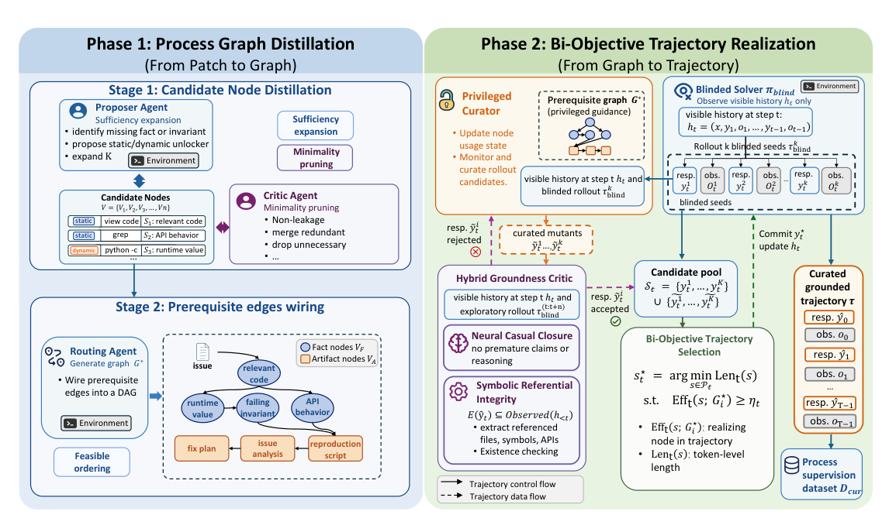
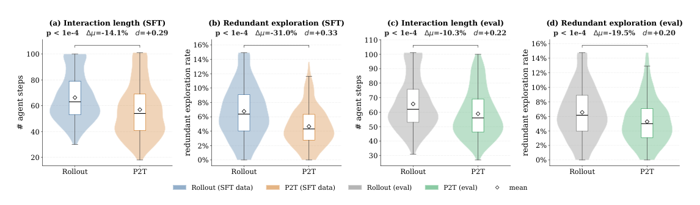
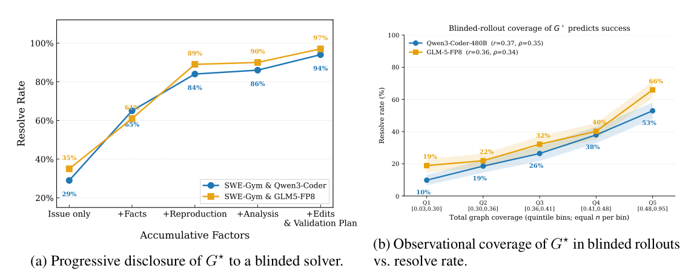

# P2T — 正解パッチを生徒に見せずに使い、SFT 用の軌跡を短く根拠のあるものに作り直す

> 原典: [[translations/2026-p2t]] ・ `raw/papers/From Patches to Trajectories_ Privileged Process Supervision for Software-Engineering Agents.md`
> 著者・年: Murong Ma（シンガポール国立大学、Microsoft Research でのインターン）, Tianyu Chen・Yun Lin・Yeyun Gong（連絡先著者）ほか（Microsoft Research Asia・上海交通大学・King's College London・シンガポール国立大学）・2026・arXiv:2605.21996（v1, 2026-05-21）

## 一言まとめ

SWE エージェント（GitHub のイシューを直す [[coding-agents]]）の SFT データを作るときに、ふつうは捨てている**開発者の正解パッチ（参照パッチ）を、データを作る側だけが使う「特権情報」として使う**手法 P2T（Patches-to-Trajectories）を提案した論文。正解パッチから「直すまでに突き止めるべき事実と、作るべき中間成果物」のグラフを作り、教師の軌跡をそのグラフに沿って 1 歩ずつ選び直す。SWE-Gym の 1.8k 件だけで、SWE-bench Verified の解決率を結果だけで選ぶ SFT より最大 +10.8 ポイント上げ、推論のコストを約 15% 下げた。

## 背景と問題意識

オープンなモデルを SWE エージェントにする主な方法は、強い教師モデルに問題を解かせ、テストに通った軌跡（trajectory, エージェントが辿った思考・行動・観測の列）だけを SFT（Supervised Fine-Tuning, 教師ありファインチューニング）でまねさせることである（→ [[agent-training]]、[[summaries/2024-swe-gym]]）。SFT では残した応答のすべてが手本になるので、生徒は最終的な正解だけでなく、**途中の根拠のない飛躍や、同じファイルを何度も開くような無駄な手まで**まねる。

著者らは手本にする軌跡に 2 つの性質を求める。

- **有効性（effectiveness）**：各ステップが直すのに必要な事実を 1 つ明らかにし、それまでに見えている情報だけを根拠にしている。
- **効率性（efficiency）**：各ステップが新しい情報をもたらし、分かっている事実の再確認や空回りのループで軌跡を伸ばさない。

この 2 つは引っ張り合う。慎重に調べれば軌跡は長くなり、強引に短くすれば根拠のない近道が混じる。ところが、標準の作り方（テストに通った軌跡を残す「結果でフィルタリングした」棄却サンプリング）は、最後に 0/1 を返すだけなので、どちらの性質も見ていない。著者らが SWE-Gym で教師 2 つ（Qwen3-Coder-480B、GLM-5-FP8）の軌跡を調べると、次のことが分かった。

- 残った軌跡の 7.6%（GLM-5 では 9.3%）は、100 ステップの上限まで使い切り、正常に終わらないままテストに通っていた。
- ファイルを開く操作の 6.8%（8.6%）は、同じ軌跡ですでに見た範囲の見直しだった。
- 問題の 70.2%（64.7%）は、教師が一度も解けないので、学習データにまったく寄与しない。

さらに、テストに通るパッチでもテストが弱いだけで正しくないことがある（SWE-bench+ の監査、→ [[agent-evaluation]]）。著者らの問いは「タスクを増やす」ことではなく、「**手元の本物のタスクから、軌跡 1 本あたりの質の高い手本をどう取り出すか**」である。

手がかりは、SWE-Gym や SWE-bench の各問題に付いている**参照パッチ**（reference patch, 開発者が実際にマージした修正）である。パッチの 1 行 1 行は「どのファイルのどの関数を読み、実行時にどう振る舞うかを確かめ、どの慣習に従うと決めたか」を暗に示している。ただし、パッチを見ながら軌跡を作ると答えが漏れる。まだ調べていないはずのファイル名や修正内容が途中に紛れ込み、それをまねた生徒は「根拠なく正解に飛ぶ」癖を覚えてしまう。そこで著者らは Vapnik の「特権情報を使う学習」（learning using privileged information, 訓練時だけ使える追加情報で学習を助け、推論時には使わない枠組み）の考え方を借り、**パッチはデータを作る側だけが見て、生徒には決して見せない**ことにした。

## 提案手法 / 主張

P2T は軌跡の選び方を「有効性が下限を超える軌跡のうち、最も短いものを選ぶ」という二目的の問題（有効性と長さ）として定式化し、それを 2 段で解く。

<figure>

<figcaption>図1（再掲）: P2T の全体像。左（フェーズ 1）で、参照パッチから「事実」と「成果物」のノードを持つ前提条件グラフ G* を作る。右（フェーズ 2）で、パッチを見ていない教師の続きを候補にし、キュレーターが 1 ステップだけ書き換えた変異を加え、根拠のチェックを通った候補のうち有効性が下限を超える最短のものをコミットする。</figcaption>
</figure>

### フェーズ 1: 正解パッチを「前提条件のグラフ」に分解する（逆向き）

参照パッチを、**直す前に突き止めておくべきこと**のグラフ G* に変える。ノードは次の 2 種類である。

- **事実のノード**：リポジトリや実行時の振る舞いについての主張。ファイルを読む・`grep` で探すなど実行せずに分かる「静的な事実」と、テストやスクリプトを走らせて初めて分かる「動的な事実」がある。
- **成果物のノード**：途中で作るもの。再現スクリプト、原因の分析、修正の計画、コードの編集、検証の実行。

各ノードは「自然言語の主張」と「それを明らかにする操作（unlocker）」の組で、たとえば「186 行目の兄弟メソッドは `_filters_from_querystring()` でフィルタを解析している」という主張と「`security_groups.py` の 183〜193 行目を表示する」という操作を持つ。辺は「u が分かっていないと v の操作を思いつけない」という前提関係である。

グラフは 2 つの LLM エージェントの往復で作る。**Proposer** はパッチを見ながら、パッチとの論理的な隙間を埋めるノードを足す（十分性）。**Critic** はパッチを知らないと思いつけない操作を持つノードを刈り取る（漏洩の防止）。たとえば「修正は 197 行目で `_filters_from_querystring()` を呼ぶことだ」という候補はパッチそのものなので捨て、「バグの場所」「リポジトリの他の場所にある正しい書き方」「両者を結ぶ計画」の 3 つに分けるよう Proposer に返す。どちらもリポジトリを実際に読み、コマンドを実行できる。ノードの集合が変わらなくなったら止め（96% が 3 回目までに収束）、最後に前提関係の辺を引いて DAG（有向非巡回グラフ）にする。

SWE-Gym の 1,815 件で、ノードは合計 33,106 個（1 件あたり中央値 18 個）できた。66.2% が静的な事実、16.7% が動的な事実で、再現・分析・計画の成果物はどの件でもほぼ 1 個ずつだった。

### 進み具合の点数: 「いま手の届くノード」をどれだけ確立したか

軌跡のあるステップまでに、ノードの操作に当たる行動があり、その観測から主張が読み取れるとき、そのノードは**確立された**とみなす（後者は LLM の検証器が、それまでの軌跡の文字だけを見て判定する）。ステップ t の進み具合 Prog_t は次のように定める。

- 分母は「利用可能なフロンティア」の大きさで、前提がすべて確立済みでまだ確立していないノードの数である。
- 分子はそのステップで新しく確立したノードの数である。
- ただし、**前提がそろっていないノードを確立したら 0 点**にする。根拠なしに先へ飛んだステップを点数で弾く仕掛けである。

### フェーズ 2: 教師の続きを 1 歩だけ書き換えて、最短の良い区間をつなぐ（順向き）

軌跡は 10 ステップのウィンドウ単位で伸ばす（受け入れるのは前半の 5 ステップだけで、次のウィンドウは重ねて計画し直す）。各ウィンドウで次の手順を踏む。

1. パッチを見ていない教師（ブラインドのソルバー）に、いまの軌跡の続きを 10 ステップ分、2 本引かせる（シード）。生徒が実際に出しうる分布から外れないようにするためである。
2. **キュレーター**が各シードのどこか 1 ステップだけを、フロンティアのノードを明らかにする手に書き換える。キュレーターに見えるのはイシュー、それまでの軌跡、狙うノードの主張と操作だけで、パッチは見えない。書き換えたあとの残りのステップはまた教師に引き直させる。
3. 書き換えた 1 ステップに**根拠のチェック**をかける。1 つは正規表現による記号的なチェックで、書き換えた手が触れるファイルパス・識別子・行番号などが、すでに観測に出てきたものかを確かめる。もう 1 つは LLM の判定器で、思考の中の主張がそれまでの観測から導けるかを見る（「まだ見ていない関数の中身を『おそらく X する』と書く」のは不可）。どちらかに落ちた候補は有効性 0 になる。
4. 候補ごとに有効性（区間内の Prog の和 × 根拠チェックの合否）と長さ（応答のトークン数）を計算し、**有効性が下限を超える候補のうち最短のもの**をコミットする。超える候補がなければ有効性が最大のものを採る。

教師が `finish` を呼んだらパッチをテストにかけ、通らなければ軌跡ごと捨てる。区間ごとの最短を足し合わせると、たどった候補の範囲では軌跡全体でも最短になる、という証明の概略が付録にある。

### 具体例: moto#6041

付録の例が分かりやすい。イシューは「`describe_security_group_rules` にフィルタを渡しても全セキュリティグループのルールが返る」で、正解は 1 行（`_get_param("Filter")` を、同じファイルの他の `describe_*` が使っている `_filters_from_querystring()` に替える）である。パッチを見ていない教師はモデル層（バックエンド）を直しにいき、100 ステップかけて `SecurityRule` を改造したうえで既存のテストを壊した。P2T は分かれ道のウィンドウで、空の思考になっていた 1 ステップを「深追いする前に、同じファイルの兄弟メソッド `describe_security_groups` がフィルタをどう解析しているか見る」という `grep` に書き換えた。その後は教師自身が補助関数の定義と、他のファイルでも同じ書き方をしていることを調べ、1 行の修正にたどり着いた。キュレーターが書いたのはこの 1 ステップの思考だけで、残りの手はすべて教師が出したものである。

## 実験結果と知見

**設定**：SWE-Gym（11 リポジトリ、SWE-bench とは重ならない）のうち、Docker 環境が動き、参照パッチがテストに通る 1.8k 件を使う（パッチを見ない比較手法は 2,126 件すべてを使う）。教師は Qwen3-Coder-480B-A35B-Instruct と GLM-5-FP8、足場は OpenHands（上限 100 ステップ）、生徒は Qwen2.5-Coder-14B / 32B-Instruct の全パラメータ SFT（YaRN で文脈を 131K に拡張）。評価は SWE-bench Verified（500 問）と Lite（300 問）で、1 問 1 回の貪欲生成の解決率（Pass@1）と、1 問あたりの推論コスト（Alibaba Cloud の公開価格で入出力トークンを換算した米ドル）を並べる。比較手法はテストに通った軌跡を丸ごと残す SWE-Gym の棄却サンプリングと、同じ軌跡でツールがエラーを返した手を損失から外す SWE-Lego のマスク（→ [[summaries/2026-swe-lego]]）である。

**表**: SWE-bench Verified の結果（原典の表 1 から抜粋。括弧は棄却サンプリングとの差）

| 生徒 | 教師 | 指標 | 棄却サンプリング | SWE-Lego のマスク | P2T（件数をそろえる） | P2T（全部） |
|---|---|---|---|---|---|---|
| Qwen2.5-C-32B | Qwen3-C-480B | Pass@1 (%) | 39.6 | 40.6 | 42.4 | **50.4 (+10.8)** |
| | | コスト ($) | 0.92 | 0.95 | 0.85 | **0.78 (−0.14)** |
| Qwen2.5-C-32B | GLM-5-FP8 | Pass@1 (%) | 38.4 | 38.8 | 39.2 | **49.0 (+10.6)** |
| Qwen2.5-C-14B | Qwen3-C-480B | Pass@1 (%) | 36.0 | 36.2 | 37.6 | **43.2 (+7.2)** |
| Qwen2.5-C-14B | GLM-5-FP8 | Pass@1 (%) | 34.8 | 35.4 | 36.6 | **42.8 (+8.0)** |

- **8 つのセルのすべてで、P2T（全部）は解決率が高くコストが低い**。Lite でも +7.0〜+8.0 ポイント、コストは −0.11〜−0.14 ドルだった。SWE-Lego のマスクは解決率をほとんど上げず（最大 +1.0）、コストもほとんど変えない（−0.01〜+0.03 ドル）。同じ軌跡のどこを学ぶかを変えるだけで、長さは変わらないからである。
- **伸びの内訳**：P2T の軌跡を棄却サンプリングと同じ本数に間引いても、解決率は +0.8〜+2.8 ポイント上がり、コストは下がった。著者らはこれを「軌跡 1 本あたりの質」の効果とする。残りの約 +8 ポイントは**パッチを見ない教師では解けない問題からも軌跡を作れた**ことによる。コストも同時に下がっているので、「長い軌跡を学んだから解けた」という説明は当たらない。
- **計算量をそろえても勝つ**（付録 K）。P2T のデータ作りには約 226 GPU 時間かかった。同じ計算（約 272 GPU 時間、教師の試行 4 回分）を棄却サンプリングに回して各問題で最短の成功軌跡を集めても、43.2%・0.86 ドルにとどまった（P2T は 50.4%・0.78 ドル）。4 回試して 1 度でも解ける問題は 34.3% にとどまり、教師が解けない問題には届かない。
- **軌跡は短く、無駄が減り、その性質が生徒に移る**。学習データでは、平均ステップ数が 66.3 → 57（図では −14.1%）、見直しの割合が 6.7% → 4.7% になった。学習した生徒が評価で出す軌跡も、ステップ数が −10.3%、見直しが −19.5% だった。評価の時点ではキュレーターもパッチもないので、まねたのは「調べ方の構造」だと著者らは読む。

<figure>

<figcaption>図2（再掲）: 軌跡の質への効果。(a)(b) は学習データ（同じ問題で、棄却サンプリングの軌跡と P2T の軌跡を比べる）、(c)(d) は学習した 32B の生徒が SWE-bench Verified で出した軌跡。ステップ数も、同じ範囲の見直しの割合も、P2T のほうが小さい。100 ステップの上限に張り付く長い裾も学習データではほぼ消えた。</figcaption>
</figure>

- **アブレーション**（32B、Qwen3 教師）：根拠のチェックを外すと 50.4% → 43.2%（14B でも −8.2 ポイント）。漏れた飛躍を生徒がそのまままねるためである。「最短を選ぶ」を「下限を超える候補からランダムに選ぶ」に替えると、学習データの平均ステップ数が 72.5 → 77.8、トークン数が 64k → 72k に増え、解決率も 48.8% に下がった。
- **グラフは中身のある情報を持っている**（付録 C）。パッチを見ていない教師に、グラフの事実 → 再現スクリプト → 原因の分析 → 修正の計画の順で中身を足して見せると、訓練用の問題での解決率は 29%（GLM-5 では 35%）から 65%（61%）、84%（89%）と上がり、最後は 94%（97%）になった（パッチそのものは一度も見せない）。逆に、何も見せずに解かせた軌跡でも、グラフのノードを偶然多く確立していた問題ほどよく解けていた（カバレッジの下位 5 分の 1 で 10〜19%、上位 5 分の 1 で 53〜66%、相関係数 r ≈ 0.36）。グラフがパッチの後付けの言い換えではなく、解くのに本当に必要な前提を拾っていることを、2 方向から示している。

<figure>

<figcaption>図4（再掲）: G* の情報の価値。(a) パッチを見ていない教師に、グラフの要素を順に足して見せたときの解決率。事実と再現スクリプトで伸びの大半が出る。(b) グラフを見せずに解かせた軌跡を、グラフのカバレッジで 5 等分したときの解決率。カバレッジが高い問題ほどよく解ける。</figcaption>
</figure>

## 限界・批判的視点

- **「1 本あたりの質」の効果は小さく、誤差と区別しにくい**。件数をそろえた比較の差は +0.8〜+2.8 ポイントで、1 問 1 回の貪欲生成、1 回の訓練の数字である。500 問の Verified で 1 回測った解決率の標準誤差は約 2 ポイントあり（→ [[summaries/2024-error-bars-evals]]）、大半のセルの差はその範囲に入る。+10.8 の大部分は、**教師が解けない問題から特権情報で軌跡を作れた**ことによる。論文の見出しは「質」を強調しているが、数字が強く支えるのは「解けない問題を学習データに変えられる」ほうである。
- **データの本数が書かれていない**。「全部」の P2T が何本の軌跡で、棄却サンプリングの集合が何本かが本文にない（件数をそろえた条件の大きさも分からない）。キュレーションした 1.8k 件のうち、最後のテストに通って残った割合も報告されていない。
- **比較手法は SWE-Gym の環境に限った形**。SWE-Lego の論文は 3.2 万件のタスクと 1.8 万本の軌跡で Qwen3-32B を 52.6% にしたが、ここでの「SWE-Lego」はそのうちのエラーマスクだけを SWE-Gym の軌跡に当てたものである。SWE-Master（[[summaries/2026-swe-master]]）は約 6 万件の SFT で Qwen2.5-Coder-32B を 57.8% にしている。P2T の 50.4% は 1.8k 件からの値として意味があるが、到達点の比較ではない。データの規模を増やしたときに P2T の上乗せが残るかは調べられていない。
- **原典の中の食い違い**（翻訳の訳注に詳細）。5.3 節は学習データのステップ数を「−9.3%（66.3 → 57）」と書くが、計算すると −14.0% で、図 2(a) の表示は −14.1% である。ウィンドウの受け入れ幅は本文と付録 H で 5 ステップ、付録 I の例で 4 ステップになっている。付録 E の証明はウィンドウが重ならないことを前提にしているが、本文の手順は半分ずつ重ねる。区間の下限も、付録 H の式（フロンティアの大きさ × 0.5）と付録 I の例（約 0.5）が合わない。結論は手法の節に出てこない「surprisal trust region」に触れている。表 1 では、32B・GLM-5 教師の Lite のコストの行が、32B・Qwen3 教師の Verified のコストの行と 4 つとも同じ値で、転記の誤りの可能性がある。
- **ステップ数は短くなっても、軌跡はまだ長い**。アブレーションの節によると、P2T の学習データ（Qwen3 教師）は平均 72.5 ステップ・約 64k トークンで、生徒の文脈を 131K に広げて訓練している。「短い」は棄却サンプリングとの相対の話である。
- **漏洩を防ぐ仕組みは LLM の判断に頼る**。グラフを刈り取る Critic も、根拠と確立を判定する判定器も LLM で、著者ら自身も保証は経験的なものにとどまると認めている。記号的なチェックが発動した候補の 91% は LLM の判定器も弾いた、という一致率は示されている。
- **使える範囲**。参照パッチと動くテストが要るので、CI のないリポジトリには使えない。足場は OpenHands、生徒は Qwen2.5-Coder だけで、Agentless のような手続き型や他系統の生徒への移り方は未確認である。評価の SWE-bench Verified は、2026-02 に OpenAI が汚染とテストの欠陥を理由に報告をやめたベンチマークでもある（→ [[summaries/2026-swe-bench-verified-retired]]）。ただし比較手法と同じ条件での相対比較なので、差の向きへの影響は小さいと考えられる。

## 実装・運用上の示唆

- **正解はプロンプトに入れず、データを作る側の採点に使う**。参照パッチを見せて軌跡を作ると答えが漏れる。「パッチから前提を抽出 → パッチを見ない教師の手を採点・選別する」と 2 段に分けると、正解の情報を使いつつ、軌跡の各ステップを生徒が実際に踏める手に保てる。
- **根拠のチェックは安い記号的な検査から**。「書き換えた手が触れるファイル名・識別子が、すでに観測に出ているか」は正規表現で判定でき、LLM の判定器とほぼ同じものを弾く。データ作りで LLM に手を入れさせるときの最初の防壁として真似しやすい。
- **介入は 1 区間 1 ステップに絞る**。書き換えを 1 か所に限れば、候補の差をその 1 か所に帰せるうえ、軌跡の大部分が教師自身の手のまま残り、生徒の分布から離れにくい。
- **成功軌跡の「選別」「マスク」とは別の軸**。SWE-Prime（[[summaries/2026-swe-prime]]）は成功軌跡を規則と LLM の採点で選び、低い点の区間を損失から外す。SWE-Lego はエラーの手を外す。どちらも教師が書いた手をそのまま使う。P2T は**分かれ道で軌跡そのものを作り直す**ので、教師が解けなかった問題からも手本が取れる。代わりにデータ作りの計算（1.8k 件で約 226 GPU 時間）がかかる。
- **生徒の推論コストを、訓練データの形で下げる**。推論時に履歴を削る方法（AgentDiet・ACON、→ [[context-engineering]]）は方策そのものを変えない。P2T は短く調べる癖を学習させるので、推論時の圧縮とも併用できる（→ [[agent-cost-efficiency]]）。
- 著者らは今後の方向として、G* への準拠をステップごとに採点するプロセス報酬モデル（Process Reward Model, 途中のステップに点を付ける報酬モデル）を訓練し、SFT から RL に広げることを挙げている。結果の 0/1 だけでは途中のどの手が効いたか分からない、という多ターン RL の問題（→ [[agent-training]]）への 1 つの回答になりうる。

## 用語と略称

- **P2T** = Patches-to-Trajectories（パッチから軌跡へ。本論文の手法）
- **SWE** = Software Engineering（ソフトウェア工学。SWE エージェントはリポジトリのイシューを直すエージェント）
- **SFT** = Supervised Fine-Tuning（教師ありファインチューニング。ここでは軌跡の応答をまねさせる行動クローニング）
- **LLM** = Large Language Model（大規模言語モデル）
- **RL** = Reinforcement Learning（強化学習）
- **RS** = Rejection Sampling（棄却サンプリング。テストに通った軌跡だけを残す選び方）
- **特権情報**（privileged information）= 訓練時だけ使え、推論時には使わない追加の情報。ここでは参照パッチ
- **参照パッチ**（reference patch, p*）= 開発者が実際にマージした修正
- **前提条件グラフ / プロセスグラフ**（G*）= 参照パッチから作った、事実と成果物のノードと前提関係の辺からなる DAG
- **DAG** = Directed Acyclic Graph（有向非巡回グラフ）
- **unlocker** = ノードの主張を明らかにするための環境操作（ファイル表示・grep・スクリプト実行など）
- **利用可能なフロンティア** = 前提がすべて確立済みで、まだ確立していないノードの集合
- **下限超えの最短**（shortest-above-floor）= 有効性が下限を超える候補のうち最短のものを選ぶ規則
- **後退ホライズン**（receding-horizon）= 先まで計画して最初の一部だけ実行し、また計画し直すやり方
- **Pass@1** = 1 問 1 回の試行で解けた割合（解決率）
- **PRM** = Process Reward Model（プロセス報酬モデル）
- **YaRN** = 位置埋め込みを補間して文脈長を延ばす手法（→ [[positional-encoding]]）
- **CI** = Continuous Integration（継続的インテグレーション。テストを自動で回す仕組み）

## 関連ページ

- [[agent-training]] — 教師の蒸留・棄却サンプリング・成功軌跡の選別とマスク。P2T は「どの軌跡をまねさせるか」の新しい答え
- [[coding-agents]] — SWE エージェントの足場と訓練
- [[agent-cost-efficiency]] — 訓練データの形で生徒の推論コストを下げる
- [[context-engineering]] — 推論時に履歴を削る方法（AgentDiet・ACON）との対比
- [[agent-evaluation]] — テストに通るパッチが正しいとは限らない、結果だけの検証器の限界
- [[summaries/2024-swe-gym]] — P2T が使う訓練環境と、比較手法の棄却サンプリング
- [[summaries/2026-swe-lego]] — 比較手法のエラーマスク
- [[summaries/2026-swe-prime]] — 成功軌跡の選別と区間マスク（教師の手をそのまま使う側）
- [[summaries/2026-swe-master]] — 難しさで選別した大規模 SFT と RL
- [[summaries/2024-openhands]] — 実験の足場
- [[summaries/2024-error-bars-evals]] — 1 回の評価の誤差の見積もり
