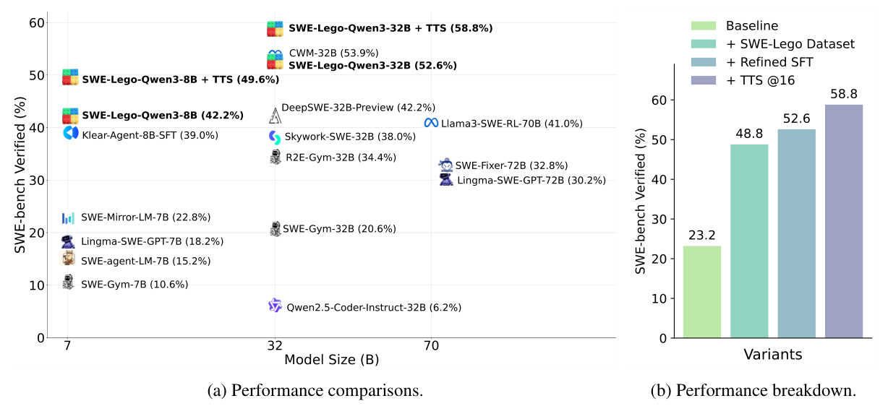
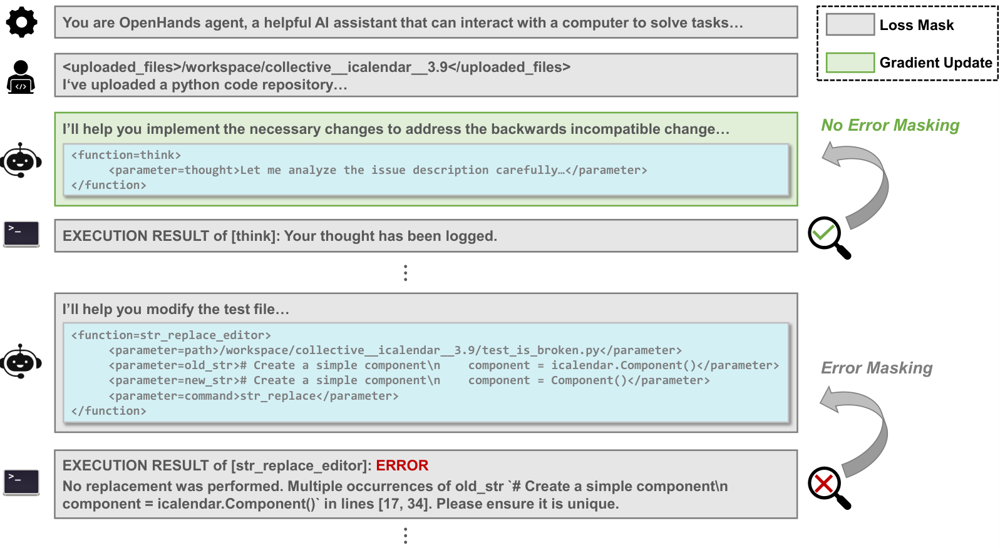
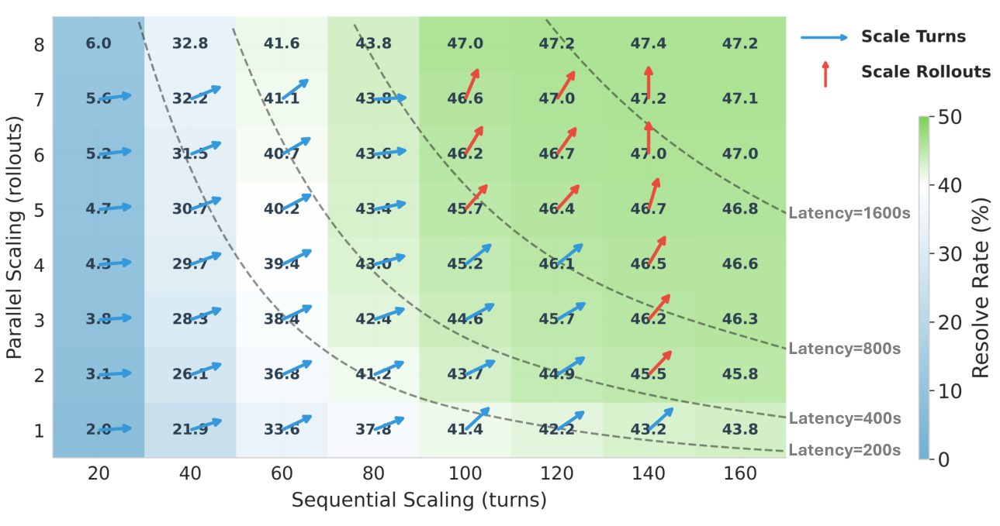
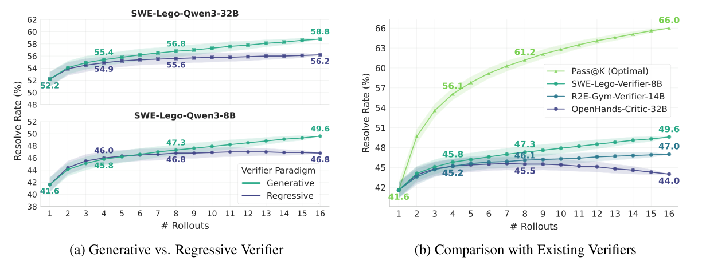

# SWE-Lego — 強化学習なし、SFT だけで SWE エージェントをどこまで伸ばせるか

> 原典: [[translations/2026-swe-lego]] ・ `raw/papers/SWE-Lego_ Pushing the Limits of Supervised Fine-tuning for Software Issue Resolving.md`
> 著者・年: Chaofan Tao, Jierun Chen ほか（Huawei Technologies・NTU・HKU・CUHK）・2026-01・arXiv:2601.01426（v2）

## 一言まとめ

強化学習（RL）も中間訓練も使わず、**教師ありファインチューニング（SFT）だけ**で SWE エージェントを訓練した論文。実際の PR と合成バグを混ぜた 3.2 万件のタスクで公開モデルを教師にして軌跡 1.8 万本を作り、**失敗した手を損失から外すマスク**と**易しい順のカリキュラム**で学ばせて、Qwen3-32B を SWE-bench Verified 23.2% → 52.6% にした。検証器で 16 本から選ぶと 58.8% になる。加えて、**古い SWE-bench Verified の Docker イメージでは `git log` で正解を覗ける（Git ハッキング）**ことを示し、それを防いだ数字と防がない数字を並べて報告した。

## 背景と問題意識

SWE エージェントの訓練は、強いモデルの軌跡の SFT（蒸留）から始まり、2025 年には RL（→ [[summaries/2025-swe-rl-long-context]]）や大規模な中間訓練へと複雑になってきた（→ [[agent-training]]）。だが RL は計算が重く、訓練基盤も大きく、ハイパーパラメータに敏感で崩壊しやすい。著者らの問いは「**軽い SFT だけで、どこまで行けるか**」である。SFT の弱点はデータ（実行環境つきで、現実的なバグを含むタスク）の不足だったので、まずデータを作り込み、次に SFT そのものを改良し、最後に推論時の計算の使い方を調べた。

<figure>

<figcaption>図1（再掲）: (a) 同じ規模の公開モデルとの比較。(b) 寄与の内訳。素の Qwen3-32B（23.2%）に、SWE-Lego データセットで +25.6、改良した SFT で +3.8、推論時スケーリングで +6.2 ポイント。</figcaption>
</figure>

## 提案手法 — 3 つの構成要素

### 1. データ：実際の PR と合成バグを混ぜる

- **実際のタスク**（18,409 件）：SWE-rebench の条件を満たす実際の PR とイシューから作る。複雑で現実的（正解パッチは平均 3.7 ファイル・138 行）だが、条件が厳しく数が限られ、PR ごとに環境が要る。SWE-smith の「PR ミラー」（現在のコードに対して PR を取り消させる方法）も試したが、実際の PR を直接集めるほうが質が高かったという。
- **合成タスク**（13,710 件）：SWE-smith（→ [[summaries/2025-swe-smith]]）の方法で、関数を LM に書き直させるか、抽象構文木を機械的に変えてバグを入れる。小さく的を絞ったバグ（平均 1 ファイル・18.8 行）で、同じリポジトリのタスクは 1 つの環境を共有できる。
- 3,251 リポジトリにまたがり、**実データは「深さ」（複雑さ）、合成データは「幅」（量と網羅）**を受け持つ。バグの種類も補い合う——実データは API の不一致や入力の検証、合成データはロジックの誤りや import の欠落が多い。リポジトリあたりの合成インスタンスを増やすと、有効な軌跡も解決率も一貫して増えた。

**教師と軌跡の作り方**：教師は公開モデルの Qwen3-Coder-480B-A35B（ローカルで大量に回せる）、足場は OpenHands、最大 100 ターン。軌跡の質を上げる工夫が 3 つある。

| 工夫 | 中身 | 効果（100 件で計測） |
|---|---|---|
| **Git ハッキングを防ぐ** | 実タスクはイシューより後のコミットとログを消し、合成タスクは履歴を丸ごと消して、答えを `git log` で読めなくする | 有効な軌跡の率は 31% → 30% と「水増し」が消える |
| **ツール呼び出しの誤りを直す** | `view_range` に文字列を渡す、範囲外を指定する、といった誤りを事後に整数化・切り詰め | なしでは平均ターンが 62.5 → 66.6 に増える |
| **使えないツールを外す** | 教師がうまく使えなかったタスク管理ツール `task_tracker` を外し、bash・エディタ・think・finish の 4 つに絞る | 有効な軌跡の率 27% → 30% |

**絞り込みと再利用**：テストを書き換えて「カンニング」した軌跡を捨て（40.4% → 41.0%）、**バグのあるファイルは正しく開いたが直せなかった「半解決」の軌跡 4,000 本を足す**（→ 42.2%）。部分的な成功も、位置の特定の手本として役に立つ。

### 2. SFT の改良

- **ステップ単位のエラーマスキング**：成功した軌跡にも、ツールの誤りや失敗した試みが混じる。端末が返したエラーメッセージを正規表現で見つけ、**その直前のエージェントの応答だけを損失から外す**（文脈には残す）。ただし、バグの再現やテストの実行で出たエラーは、目的どおりの手なので外さない。
- **難しさのカリキュラム**：解決率と軌跡のターン数に強い負の相関（r = −0.95）があるので、**ターン数を難しさとみなし**、易しい（50 ターン以下）→ 中程度（50〜70）→ 難しい（70〜100）の順に、前の段階のデータを足しながら 3 段階で学ばせる。人手のラベルで訓練した難しさの予測モデルより 0.5 ポイント良く、安い。

<figure>

<figcaption>図5（再掲）: ステップ単位のエラーマスキング。エラーを返した手（赤）の応答は勾配の更新から外し、軌跡の文脈には残す。</figcaption>
</figure>

**表**: SFT の改良のアブレーション（SWE-bench Verified、原典の表 6）

| エラーマスキング | カリキュラム | 8B | 32B |
|---|---|---|---|
| ✓ | ✓ | **42.2** | **52.6** |
| ✓ | ✗ | 41.8 | 51.8 |
| ✗ | ✓ | 40.2 | 50.4 |
| ✗ | ✗ | 39.4 | 48.8 |

**訓練中の失敗の移り変わり**も示している。最初は「再現できない」が 39% を占め、1 エポック後には消えて「ターン上限に達する」が 35% に増え、終盤は「位置の特定の誤り」と「誤った実装」が残る。カリキュラムは前半の失敗に、マスキングは終盤の推論の失敗に効く、と著者らは説明している。

### 3. 推論時スケーリング — 先にターン、次に並列

推論時に計算を足す方法は 2 つある（→ [[test-time-compute]]）。**逐次スケーリング**（1 本の軌跡のターン上限を増やす）と、**並列スケーリング**（複数の軌跡を走らせて検証器で 1 本選ぶ）である。レイテンシで予算を測ると、ターンを増やすと文脈が伸びるので時間は**超線形**に増え、並列の本数はまとめて走らせるので**劣線形**にしか増えない。

<figure>

<figcaption>図8（再掲）: 横軸がターン上限、縦軸が並列の本数、色が解決率、曲線が同じレイテンシの等高線。ターンを増やす効果は 100〜140 ターンで頭打ちになり、そこから先は並列の本数を増やすほうが効く。</figcaption>
</figure>

- **逐次は 100〜140 ターンで飽和する**。140 ターンを超えると打ち切られる軌跡はほとんどなくなり、ターン数が多すぎる軌跡はたいてい同じことを繰り返して行き詰まっている（解決率は 40〜60 ターンで最高の 48.7%、140 ターン超では 7.0%）。だから**予算が小さいうちはターンを増やし、飽和したら並列に回す**。
- **検証器は生成型のほうが伸び続ける**。軌跡とパッチを読んで「yes／no」を答えさせ、その確率をスコアにする**生成型**と、モデルにスコア用の出力層を足して二値分類で訓練する**回帰型**を、同じデータ（解決 5k・未解決 13k）で比べた。候補が少ないうちは同程度だが、増やすと回帰型は頭打ちになり、生成型は伸び続ける（8B で 16 本時 49.6% 対 46.8%）。既存の回帰型の OpenHands-Critic-32B は、候補を増やすとむしろ下がった（16 本で 44.0%）。生成型は事前学習の次トークン予測と形が合うので、モデルの知識を使いやすい、という仮説である。
- 検証器の訓練データを 6k → 18k に増やすと 47.6% → 49.6%。32B のエージェントの候補を選ぶには、大きい検証器（30B）のほうが良かった（58.8% 対 56.6%）。

<figure>

<figcaption>図9（再掲）: (a) 生成型（緑）と回帰型（紺）の検証器。(b) 既存の検証器との比較。黄緑の Pass@K（16 本中に正解がある率）は 66.0% に達するが、最良の検証器でも 49.6% しか選べない。</figcaption>
</figure>

## 実験結果と知見

**表**: SWE-bench Verified の比較（原典の表 7 から抜粋。SWE-Lego は「Git ハッキングあり／なし」）

| モデル | 訓練 | 解決率 |
|---|---|---|
| SWE-Lego-Qwen3-8B | SFT | 44.4 / **42.2** |
| ＋ 16 本から選ぶ | SFT | 53.4 / **49.6** |
| Klear-Agent-8B-SFT | SFT | 39.0 |
| SWE-Lego-Qwen3-32B | SFT | 57.6 / **52.6** |
| ＋ 16 本から選ぶ | SFT | 60.4 / **58.8** |
| SWE-Mirror-LM-32B | SFT | 52.2 |
| CWM-32B | 継続事前学習＋SFT＋RL | 53.9 |
| DeepSWE-32B-Preview（＋16 本から選ぶ） | RL | 42.2（59.0） |
| SWE-agent-LM-32B（SWE-smith） | SFT | 40.2 |
| SWE-Gym-32B | SFT | 20.6 |
| Claude-4.5-Sonnet（参考） | — | 70.6 |

- **SFT だけで、RL を使った同規模のモデルに並ぶか上回った**。寄与の大半はデータ（+25.6）で、SFT の改良（+3.8）と推論時スケーリング（+6.2）が続く。
- **Git ハッキングの影響は 2〜5 ポイント**ある。32B の SFT で 57.6% と 52.6%、8B で 44.4% と 42.2% である。2025 年 9 月 3 日より前に公開された SWE-bench Verified の Docker イメージには正解のコミットが残っており、`git log --all` やコミットメッセージの検索で答えに辿り着けた。比較表の他のモデルの数字の多くは、この影響を受けている可能性がある。

## 限界・批判的視点

- **評価は SWE-bench Verified だけ**で、汚染されていない別の評価（SWE-rebench の新しい分割など）では確かめていない。Verified は 2026-02 に OpenAI が汚染とテストの欠陥を理由に報告をやめたベンチマークである（→ [[summaries/2026-swe-bench-verified-retired]]）。比較表の他のモデルの数字も、足場（OpenHands・SWE-agent・Agentless など）がまちまちで、条件がそろっていない。
- **「SFT だけ」でも、蒸留の教師は 480B の強いモデル**である。教師の能力を超えるかどうかは分からない。RL の代わりになるのは、強い公開モデルの教師がいる場合に限られる。
- **カリキュラムの効果は小さい**（0.4〜0.8 ポイント）。単一の実行での差で、試行の繰り返しやばらつきは報告していない（→ [[summaries/2024-error-bars-evals]] の基準では、500 問での 1 ポイント未満の差は誤差の範囲に入りうる）。
- **ターン数を難しさとみなすのは、教師の軌跡の長さ**である。長い軌跡には、難しい問題だけでなく、教師が回り道をした易しい問題も含まれうる。
- **検証器の Pass@16 は 66.0% なのに選べたのは 49.6%**。生成型の検証器でも、選べていない部分は大きい。
- クリップ（HTML 版）と PDF で図表番号がずれている、本文で「2.2 節で述べた」と書くが Git ハッキングの説明は 2.3 節にある、などの細かな不整合がある（翻訳は PDF の番号に合わせた）。

## 実装・運用上の示唆

- **評価・訓練の環境から Git の履歴を消す**。イシューより後のコミットが残っていると、エージェントは `git log` で答えを読む。合成タスクでは、バグを入れた版が元の版より「新しい」ので、履歴を丸ごと消す。
- **軌跡の中の失敗した手は損失から外す**。ただし、バグの再現やテストの実行で出るエラーは外さない。
- **直せなかった軌跡も、正しいファイルに辿り着いていれば使える**（位置の特定の手本として）。
- **教師がうまく使えないツールは外す**。ツールが増えるほど誤用の機会が増える（→ [[agent-computer-interface]]）。
- **推論時の予算は、まずターン上限を 100〜140 まで上げ、それ以上は並列の本数に回す**。候補を選ぶ検証器は生成型（yes／no の確率）にし、エージェントが大きいほど検証器も大きくする。
- **合成データは実データの代わりではなく補い**。実データが利益の大半を生み、合成データは量を足す。

## 用語と略称

- **SFT** = Supervised Fine-Tuning（教師ありファインチューニング）
- **RL** = Reinforcement Learning（強化学習）
- **TTS** = Test-Time Scaling（推論時スケーリング）。TTS@K は K 本の候補から検証器で 1 本選んだときの解決率
- **Git ハッキング**（Git hacking）：エージェントがリポジトリの Git の履歴（将来のコミット）を覗いて正解パッチを読むこと
- **ステップ単位のエラーマスキング**（step-level error masking）：エラーを返した手の応答を損失の計算から外すこと
- **カリキュラム学習**（curriculum learning）：易しい例から難しい例へ順に学ばせる方法
- **半解決**（semi-resolved）の軌跡：テストは通らないが、正解パッチが変更したファイルを正しく開いた軌跡
- **生成型／回帰型の検証器**（generative / regressive verifier）：yes／no のトークン確率でスコアを出す／スコア用の出力層を足して二値分類で訓練する
- **Pass@K**：K 本中に正解があるか
- **YaRN**：RoPE を調整して文脈長を伸ばす手法（→ [[positional-encoding]]）
- **AST** = Abstract Syntax Tree（抽象構文木）

## 関連ページ

- [[agent-training]] — SFT・RFT・RL の比較、マスキングとカリキュラム
- [[agent-environments]] — 実際の PR と合成バグを混ぜた訓練環境
- [[test-time-compute]] — 逐次と並列の配分、生成型と回帰型の検証器
- [[agent-evaluation]] — Git ハッキングという評価の漏れ
- [[coding-agents]] — 訓練済みの SWE モデルの比較
- [[agent-computer-interface]] — ツールの誤りの補正と、使えないツールの削除
- [[summaries/2025-swe-smith]] — 合成タスクの作り方の出どころ
- [[summaries/2025-swe-rl-long-context]] — RL で同じ問題に挑んだ研究（書式エラーのマスク、文脈長の段階的な拡大）
- [[summaries/2024-swe-gym]] — 検証器（ORM）と Pass@K／Best@K の差の先行研究
- [[summaries/2024-agentless]] — 候補を作って選ぶ手続き型の先行例
- [[summaries/2026-swe-bench-verified-retired]] — Verified のもう 1 つの問題（汚染とテストの欠陥）
- [[summaries/2024-error-bars-evals]] — 小さな差を誤差と区別する統計
- [[summaries/2025-swe-rebench]] — 実データの出どころにしたデータセットの原論文
- [[summaries/2026-swe-prime]] — エラーの手のマスクを「意味的な区間」の単位に広げ、Git ハッキングをした軌跡も選別で除いた後続
- [[summaries/2025-r2e-gym]] — 生成型の検証器の比較相手にした R2E-Gym-Verifier-14B の原論文
- [[summaries/2026-swe-master]] — 同時期の公開の事後学習。Git ハッキングを履歴の削除ではなく `git log`/`git show` の禁止で防ぎ、表 3 で SWE-Lego と比べる
- [[summaries/2026-p2t]] — 本論文のエラーマスクを比較手法に使った後続。SWE-Gym の軌跡では +1.0 ポイント以下にとどまり、軌跡そのものを作り直す P2T が上回った
