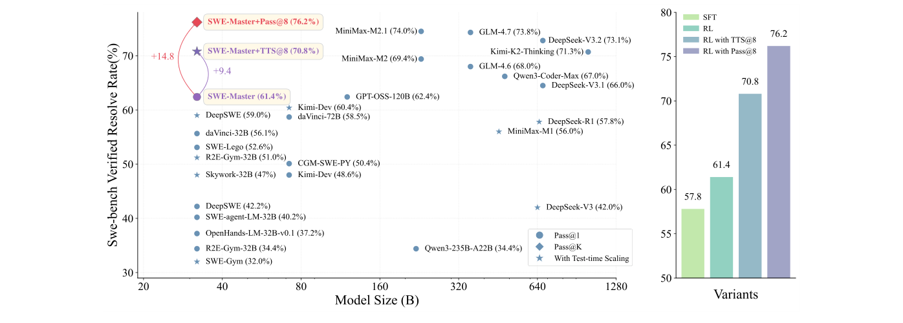
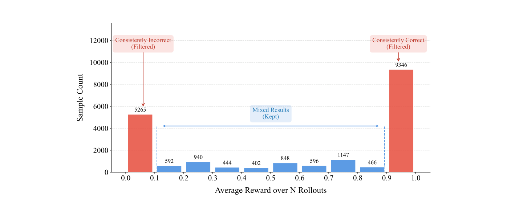
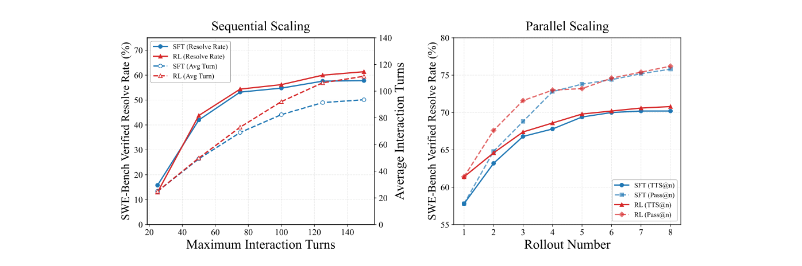
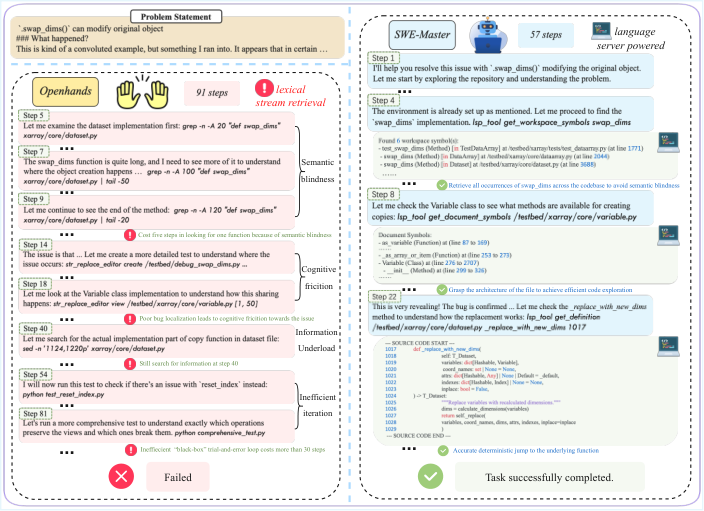
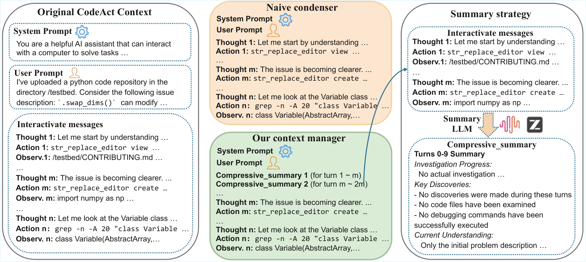
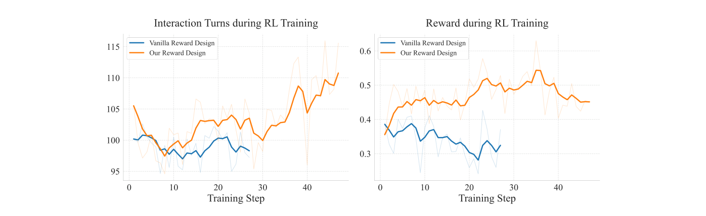

# SWE-Master — SWE エージェントの事後学習を、データから推論時の道具まで公開する

> 原典: [[translations/2026-swe-master]] ・ `raw/papers/SWE-Master_ Unleashing the Potential of Software Engineering Agents via Post-Training.md`
> 著者・年・会議: Huatong Song, Lisheng Huang, Shuang Sun ほか 14 名（中国人民大学 高瓴人工智能学院・BOSS 直聘）・2026・arXiv:2602.03411（技術報告, v2 2026-02-24）。コード: https://github.com/RUCAIBox/SWE-Master
> 底本の版: `raw/` のクリップ（ar5iv 経由）には図 9 と付録 B（プロンプト）が欠けていたので、翻訳と本ページは arXiv の HTML 版 v2 に基づく

## 一言まとめ

SWE エージェント（GitHub のイシューを、リポジトリを探索・編集・テストしながら直す [[coding-agents]]）を、オープンなモデルから作る事後学習（post-training, 事前学習のあとに行う SFT や RL などの追加訓練）の手順を、**教師の軌跡の生成と選別 → 長い軌跡での SFT → 実環境での RL → 推論時のスケーリングと道具**まで通しで公開した技術報告。SWE-bench Verified で素の Qwen2.5-Coder-32B（6.2%）を SFT で 57.8%、RL で 61.4% にし、候補 8 本から選ぶと 70.8% になった。推論時の道具として、IDE の「定義へ移動」を支える LSP（Language Server Protocol, エディタと言語ごとの解析サーバーをつなぐ標準プロトコル）をエージェント用のツールにし、解決率を保ったままトークンを約 2 割減らした。

## 背景と問題意識

2025 年には、SWE エージェントの訓練の部品が出そろっていた。実行できる訓練環境（SWE-Gym・SWE-rebench・R2E-Gym・SWE-smith → [[agent-environments]]）、強いモデルの軌跡（trajectory, エージェントが辿った思考・行動・観測の列）の蒸留、多ターンの強化学習（→ [[agent-training]]）である。しかし著者らによれば、強いシステムの多くは訓練の中身を公開していない。どの教師を選び、どの軌跡を残し、RL の報酬をどう設計すれば崩れないのか、といった判断が見えないので、研究者が追試して積み上げることが難しい。

著者らはさらに、推論時の足場（scaffold, モデルの周りでツールとループを提供するプログラム）の側も基本的なままだと指摘する。OpenHands（→ [[summaries/2024-openhands]]）や SWE-agent（→ [[summaries/2024-swe-agent]]）のエージェントは、コードの場所を `grep` や `find` で文字列として探す。関数名が多数の場所で使われていたり、呼び出しがファイルをまたいで何段も続いたりすると、文字列の検索は無関係な行を大量に返す。失敗の多くはコードを書く力ではなく、**大きなコードベースを理解できないこと**から来ている、というのが著者らの観察である。

## 提案手法 / 主張

全体は訓練の 4 段（基盤 → データ → SFT → RL）と、推論時の 3 つの追加（テスト時スケーリング・LSP ツール・要約によるコンテキスト管理）からなる。

<figure>

<figcaption>図1（再掲）: 左は SWE-bench Verified の解決率（縦軸）とモデルの大きさ（横軸, 対数）。●は 1 本だけの Pass@1、★はテスト時スケーリングを使った値、◆は Pass@K。SWE-Master は 32B で 61.4%、候補 8 本から選ぶ TTS@8 で 70.8%、8 本中に正解がある Pass@8 は 76.2%。右は段階ごとの値（SFT 57.8 → RL 61.4 → TTS@8 70.8 → Pass@8 76.2）。</figcaption>
</figure>

### 1. 基盤: 実行環境と推論サーバーを分ける

- 足場は R2E-Gym の軽量版（OpenHands を簡略化し、ReAct 型の「考える→ツールを呼ぶ→結果を見る」ループで動く → [[summaries/2025-r2e-gym]]）。ツールは `bash_execute`・`file_editor`・`submit` の 3 つ。
- **Docker の実行環境を専用の CPU ノードに置き、モデルの推論サーバーと物理的に分ける**。約 13,000 個の Docker イメージを複数のノードに分散し、イシューの ID で振り分ける。環境の立ち上げが推論を止めないので、大量の軌跡を並行に集められる。
- **`git log` と `git show` を禁止する**。エージェントが Git の履歴から正解のパッチを読む「Git ハッキング」を防ぐためで、呼ぶと「このコマンドは使えない」という警告が返る。

### 2. データ: 教師に解かせ、難しさで選ぶ

SWE-Gym・SWE-rebench・R2E-Gym・SWE-smith の 4 つのデータセットのイシューを、オープンウェイトの強いモデル **MiniMax-M2 と GLM-4.6 を教師**にして、1 件あたり 3〜12 回解かせた。軌跡には教師の思考と関数呼び出しの列が残る。

- **書式による選別**: 報酬 0（テストに通らなかった）の軌跡を捨てる。80K トークンまたは 100 ターンを超える軌跡（解けた軌跡の 5%）も、訓練時のメモリ不足の原因になるので捨てる。関数呼び出しを解析できない、あるいは不正な多重呼び出しを含む軌跡も捨てる。
- **難しさによる選別**: 何回解かせたかに対する解決の割合を、そのイシューの難しさの代わりに使う。分布は二山で、大半のイシューは「毎回解ける」か「一度も解けない」のどちらかだった（図 4）。**どちらかに偏ったイシューを除き、解けたり解けなかったりするものだけを残す**。

<figure>

<figcaption>図4（再掲）: N 回解かせたときの平均報酬（横軸）ごとのイシュー数。0（毎回失敗, 5,265 件）と 1（毎回成功, 9,346 件）に山があり、間の「解けたり解けなかったり」は各数百件しかない。SWE-Master は両端を除き、中間だけを訓練に残す。</figcaption>
</figure>

### 3. 長い軌跡での SFT

Qwen2.5-Coder-32B-Instruct と Qwen3-4B-Instruct-2507 を、選別した約 6 万件の軌跡で 5 エポック訓練した。YaRN（位置符号化を内挿してコンテキスト長を伸ばす手法 → [[positional-encoding]]）で文脈を 32K から 80K トークンに伸ばし、**環境が返した出力（観測）は損失の計算から外す**。モデルに学ばせたいのは思考と行動であって、コマンドの出力をまねることではないからである。このモデルを SWE-Master-SFT と呼ぶ。

### 4. 実環境での RL

SWE-Master-SFT から、テストの成否を報酬にした RL（RLVR, Reinforcement Learning with Verifiable Rewards, 正誤を機械的に判定できる報酬を使う強化学習）を行った。学習則は GRPO（Group Relative Policy Optimization, 同じ問題で複数の軌跡を引き、グループ内の相対的な良し悪しから学ぶ方法 → [[reinforcement-learning-from-human-feedback]]）に、先行研究の改良を 4 つ足したものである。

- **自分を除いた平均で advantage を出す**（leave-one-out）。各軌跡の報酬から、同じグループの**他の**軌跡の平均を引く。
- **長さと難しさによる偏りを除く**。軌跡の長さで割る代わりに固定の定数で割り、標準偏差による正規化もやめる。長さで割ると、正解は短く・不正解は長くする方向に偏り、標準偏差で割ると難しさのばらつきで更新が偏るからである。
- **clip-higher**。確率の比を切り詰める上限だけを緩め、確率の低い「探索」のトークンが伸びられるようにする。エントロピーの崩壊（出力の多様性が失われ探索が止まること）を防ぐ（DAPO の手法）。
- **KL ペナルティを外す**。SFT のモデルから離れすぎないように縛る項をなくし、報酬に向かって積極的に動けるようにする。

いちばん効果が大きかった工夫は**報酬の設計**だった。RL の初期には、方策（policy, 状態から次の行動を選ぶモデル）が確信を持てずにテストを書いては直すことを繰り返し、提出しないまま予算（トークン・ターン・時間）を使い切る軌跡が約 20% あった。これらは報酬 0 になるので、平均報酬が下がり続け、訓練が崩れた。ところが打ち切られた軌跡のパッチを後から採点すると、**約 24.3% はイシューを解決していた**。提出しなかった原因は自信のなさによる確認の繰り返しや、自分で書いた厳しすぎるテストだった。

そこで、予算切れで打ち切られた軌跡も、その時点のリポジトリの状態を強制的に提出して採点し、報酬を割り引くことにした。

$$
R=\begin{cases}r_{\text{outcome}} & \text{自分で提出した（DONE）}\\ \alpha\cdot r_{\text{outcome}} & \text{予算切れ（TIMEOUT・MAX\_STEPS・MAX\_TOKENS）}\\ 0 & \text{コンテナの起動失敗}\end{cases}
\qquad \alpha=0.5
$$

コンテナの起動失敗やサーバーのエラーで終わった軌跡は、方策のせいではないので**損失の計算から丸ごと外す**（マスク）。ほかに、残りのターン数を毎ターン環境の応答に添える**予算の通知**（"This is step STEP_INDEX of a maximum of MAX_STEPS. Steps Remaining: STEP_REMAINING."）、Git コマンドの禁止、環境の応答を損失と advantage の計算から外すことを組み合わせた。

RL の間、報酬は 0.35 から上がり、軌跡のターン数は増え、エントロピーは崩壊せずに緩やかに下がった（図 5）。評価でも、RL 後のモデルは SFT のモデルより遅くまで粘り（120〜140 ターンに山）、`execute_bash` と `file_editor` の置換を多く使った。著者らは、RL がテストを走らせては直す反復的なデバッグを促したと解釈している。

### 5. テスト時スケーリング: 実行しない「模擬テスト」で選ぶ

推論時の計算の増やし方（→ [[test-time-compute]]）を 2 つ試した。

- **逐次スケーリング**（1 本の軌跡のターン上限を増やす）: 上限を 25 から 150 ターンに増やすと解決率は上がり続けるが、125 ターンを超えると頭打ちになる。
- **並列スケーリング**（複数の軌跡を走らせて 1 本を選ぶ）: 選ぶのに、成功確率だけを出す従来の検証器（verifier）ではなく、**SWE-World** という別に訓練したモデルを使う。SWE-World は変更したファイル・テスト・パッチを読み、**実行したらどうなるかを模した「テストの報告」と予測した報酬を文章で生成する**。これを各候補に 3 回ずつ行い、報酬の平均が最も高い候補を提出する。訓練データは実際の実行で得たテストの報告と報酬に、Qwen3-235B-A22B-Thinking に「なぜその結果になったか」の推論を後から書かせたもの（逆向きの推論）で作る。

<figure>

<figcaption>図6（再掲）: 左は逐次スケーリング。ターン上限（横軸）を増やすと解決率（実線）は上がるが、125 ターンを超えると頭打ちになる。点線は実際に使った平均ターン数。右は並列スケーリング。候補の本数（横軸）を増やしたとき、SWE-World で選んだ値（TTS@n, 実線）と、n 本中に正解がある上限（Pass@n, 点線）。RL のモデルは 1 本で 61.4%、8 本から選んで 70.8%。</figcaption>
</figure>

実際の Docker の実行を正解として比べると、SWE-World の判定の正しさは 7〜8 割だった（表 2 と本文で数字の割り当てが食い違う。後述）。実行しないので、環境を動かすのが高い・取り返しがつかない・危険な場面でも使える、と著者らは位置づける。

### 6. LSP ツール: 文字列ではなく意味で辿る

Language Server Protocol は、エディタ（クライアント）と言語ごとの解析サーバーを JSON-RPC（JSON でメッセージをやり取りする遠隔手続き呼び出しの規約）でつなぐ標準で、VS Code の「定義へ移動」「すべての参照を検索」はこれで動いている。言語サーバーはコードの構文木（AST, Abstract Syntax Tree, ソースコードの構造を木で表したもの）と記号表を持っているので、**同じ名前の別物を区別し、呼び出し関係を正確に返せる**。

著者らは LSP を `lsp_tool` という 1 つのツールにまとめ、エージェントが関数呼び出しの形で使えるようにした。生の JSON-RPC を見せる代わりに、間に変換層を置く。呼び出し側では引数をファイルパス・行番号・記号名の 3 つに単純化し、呼び出し階層の 3 つのメソッドを `get_call_hierarchy` 1 つにまとめた。返す側では位置の座標だけでなく該当するソースコードそのものを読み込んで返し、不要な情報を削る。

| 分類 | ツール | 返すもの |
|---|---|---|
| リポジトリの移動 | `get_definition`・`get_type_definition`（ほかに `get_declaration`・`get_implementation`） | その記号の定義のソースコード |
| 依存関係の分析 | `get_call_hierarchy` | 呼び出し元と呼び出し先 |
| コードの理解 | `get_hover`・`get_document_symbols`・`get_document_highlights` | 関数のシグネチャ、ファイルの構造の見出し、記号の使用箇所 |
| ワークスペースの検索 | `get_workspace_symbols`・`get_references` | プロジェクト全体の記号と参照 |

SWE-bench Verified は Python だけなので、言語サーバーには pyright を使った（`get_declaration` と `get_implementation` は pyright が Python で対応していないので外した）。言語を変えるには、Docker の中の言語サーバーを入れ替えるだけでよい。

まず、強いオープンモデル（MiniMax-M2.1・GLM-4.7）にこのツールを持たせて効果を確かめた。次に、教師（GLM-4.6・MiniMax-M2）に LSP ツールつきで解かせた軌跡を、規則と LLM ジャッジ（LSP を正しく使って解いたか）で選び、もとの SFT データと混ぜて SWE-Master-RL から**継続して SFT** した。

<figure>

<figcaption>図10（再掲）: pydata/xarray-6812（`.swap_dims()` が元のデータセットをその場で書き換えてしまうバグ）での比較。左の OpenHands のエージェントは grep と行数の指定を繰り返してコードを継ぎはぎに読み、試行錯誤のループに入って 91 ステップで失敗した。右の LSP ツールつきのエージェントは、全体の記号検索（4 ステップ目）、ファイルの構造の把握（8 ステップ目）、定義へのジャンプ（22 ステップ目）で `to_index_variable` がコピーではなく `self` を返すことを突き止め、57 ステップで解いた。</figcaption>
</figure>

### 7. 要約によるコンテキスト管理

ウェブ検索のエージェントでは、一定の長さを超えたら過去のツール応答をすべて捨てる方式（Condenser、Discard-All）が好成績を挙げている。著者らは、コーディングでは状態（読んだファイルの中身、エラーログ）が後で必要になるので、捨てると同じファイルを読み直したりコードの構造を幻覚したりすると考えた。そこで、**m ターンごとに古いターンを自然言語の要約にまとめ、直近の k ターン以上は生のまま残す**方式を作った（図 14）。要約の作り手にはエージェントと同じモデルを使う。

<figure>

<figcaption>図14（再掲）: コンテキスト管理の 3 つの方式。すべてを積み上げる Append-Only、過去のツール応答を捨てる Discard-All、古いターンを要約して直近の窓を生のまま残す SWE-Master の要約方式。</figcaption>
</figure>

## 実験結果と知見

評価は SWE-bench Verified（500 問）の解決率。評価時の設定は温度 0.7、最大 128K トークン、最大 150 ターン。

**主結果**（表 3 から抜粋。他手法の値は各論文の報告値で、足場も条件も揃っていない）

| モデル | 基盤モデル | 足場 | 訓練 | 解決率（%） |
|---|---|---|---|---|
| Qwen2.5-Coder-32B（素） | — | OpenHands | — | 6.2 |
| SWE-Gym-32B | Qwen2.5-Coder-32B-Inst | OpenHands | SFT | 20.6 |
| R2E-Gym-32B | Qwen2.5-Coder-32B-Inst | R2E-Gym | SFT | 34.4 |
| DeepSWE-32B-Preview | Qwen3-32B | OpenHands | RL | 42.2 |
| SWE-Lego-Qwen3-32B | Qwen3-32B | OpenHands | SFT | 52.6 |
| SWE-Compressor | Qwen2.5-Coder-32B-Inst | OpenHands | SFT | 57.6 |
| SWE-Swiss-32B | Qwen2.5-32B-Inst | Agentless | SFT+RL | 58.0 |
| daVinci-Dev-72B | Qwen2.5-72B-Base | SWE-Agent | MT+SFT | 58.5 |
| **SWE-Master-4B**（SFT → RL） | Qwen3-4B-Inst-2507 | R2E-Gym | SFT+RL | 27.6 → 33.4 |
| **SWE-Master-32B**（SFT → RL） | Qwen2.5-Coder-32B-Inst | R2E-Gym | SFT+RL | 57.8 → **61.4** |
| ＋ TTS@8（SFT / RL） | | | | 70.2 / 70.8 |
| 参考: MiniMax-M2.1 / GLM-4.7（教師の後継世代） | — | 各社の足場 | — | 74.0 / 73.8 |

- **SFT だけで大半が決まる**。素の 6.2% から SFT で 57.8%、RL の上乗せは 32B で +3.6、4B で +5.8 ポイントだった。
- **SFT のデータは 4.8 万件付近で飽和する**（図 11）。0 → 6 万件で 6.2% → 57.8% と対数的に伸びた。データが増えるほど平均ターン数（約 115 → 94）と思考のトークン（14.8k → 12.7k）は減った。
- **難しさによる選別は +3.6 ポイント**（54.2% → 57.8%、表 7）。平均ターン数や思考のトークンはほぼ変わらなかった。
- **候補を選ぶ効果は大きい**。TTS@8 で SFT のモデルは +12.4、RL のモデルは +9.4 ポイント。SFT と RL の差（3.6 ポイント）は、8 本から選ぶと 0.6 ポイントまで縮む。

**報酬の設計**（6.3 節）: 打ち切られた軌跡の報酬を 0 にして損失から外す DeepSWE の方式を SWE-Master-SFT に使うと、報酬が下がり続けて訓練が崩れた。強制提出＋割引の報酬では、報酬が安定して上がり、ターン数も伸びた（図 12）。著者らは、DeepSWE が比較的易しい R2E-Gym のデータで素のモデルから訓練したのに対し、SWE-Master は長く多様な軌跡で十分に SFT してから始めたので、最適化の状況が違うと説明している。

<figure>

<figcaption>図12（再掲）: SWE-Master-SFT から始めた RL の比較。青は打ち切られた軌跡を報酬 0 にしてマスクする DeepSWE の方式、橙は SWE-Master の強制提出＋割引の報酬。左はターン数、右は報酬。青は報酬が下がって途中で止まり、橙は上がり続ける。</figcaption>
</figure>

**LSP ツール**（表 5・表 6）

| 設定 | 解決率（%） | 平均ターン | 入力トークン（k） | 出力トークン（k） |
|---|---|---|---|---|
| MiniMax-M2.1 LSP なし → あり | 68.4 → 70.4 | 82.0 → 77.0 | — | — |
| GLM-4.7 LSP なし → あり | 66.2 → 67.6 | 97.3 → 94.4 | — | — |
| SWE-Master-RL → LSP つきで継続 SFT | 61.4 → 61.0 | 111.2 → 91.7 | 5,549.6 → 4,232.1（−23.7%） | 32.5 → 27.2（−16.3%） |

強いモデルでは解決率がやや上がってターンが減り、SWE-Master では解決率をほぼ保ったまま、入力トークンが約 2 割減った。ただし後者の効率化には、継続 SFT そのものによる振る舞いの変化も混ざっていると著者ら自身が断っている。

**Git ハッキング**（表 8）: SFT と RL のどちらでも Git コマンドを禁止して訓練したモデルに、評価時だけ Git を許すと、解決率は SFT で 57.8% → 57.0%、RL で 61.4% → 58.4% と**むしろ下がった**。Git ハッキングを試みた軌跡は SFT で 51 本、RL で 28 本あった。著者らは、訓練でハッキングの手口を見ていないので、使っても上手くいかないと解釈している。MiMo-v2-Flash の報告と同じく、モデルは誰にも教わらずに `git log` や `git show` で正解を探しにいく（図 13）。

**要約によるコンテキスト管理**（表 9）

| モデル | 解決率（%） | 入力トークン合計（k） | 1 ターンの最大長の平均（k） | 平均ターン |
|---|---|---|---|---|
| MiniMax-M2.1 なし → あり | 68.4 → 69.8 | 2,821.9 → 1,636.6（−42%） | 55.4 → 28.5 | 82.0 → 92.9 |
| GLM-4.7 なし → あり | 66.2 → 65.8 | 3,540.4 → 2,259.8（−36%） | 63.3 → 32.5 | 97.3 → 120.0 |

強いモデルでは、解決率を保ったまま入力トークンが 4 割前後減り、文脈の最大長はほぼ半分になった。ターン数は増えた。一方、**同じ方式を SWE-Master（32B）に使っても、効率も解決率も改善しなかった**。著者らは、モデルが小さいので要約された文脈をうまく使えないためだとしている。

## 限界・批判的視点

- **「同じ条件で比べた」とは言いにくい**。要旨と序論は「同一の実験設定で」既存のオープンな手法を大きく上回ったと書くが、表 3 の他手法の値は各論文の報告値で、足場（OpenHands・SWE-agent・Agentless・R2E-Gym）、ターン上限、文脈長が違う。著者ら自身も 4.1 節で「各モデルの最適な構成での値を引用した」と書いている。同じ条件で揃っているのは、SWE-Master 自身の段階間の比較（SFT → RL、選別の有無、報酬の設計）である。
- **強さの多くは教師から来ている**。教師の MiniMax-M2 と GLM-4.6 は、それ自体が Verified で 69.4%・68.0% のオープンウェイトモデルである（図 1）。素の 6.2% から 57.8% への伸びの大部分は、この強い教師の軌跡 6 万件の蒸留による。「弱いモデルから出発した」ことは正しいが、到達点は教師の水準と組で読む必要がある。教師が公開モデルなので、プロプライエタリなモデルの利用条件に縛られない点は SWE-Lego（[[summaries/2026-swe-lego]]）と同じ利点である。
- **差の多くは 1 回の評価のばらつきに収まる**。500 問で解決率 60% 前後なら、標準誤差は約 2.2 ポイントになる（本 wiki の計算）。LSP の +2.0・+1.4 ポイント、継続 SFT の 61.4 → 61.0、要約の +1.4・−0.4 ポイントは、どれも 1 回の評価では区別できない。主張としては「解決率を下げずに効率を上げた」と読むのが妥当である。
- **SWE-World の精度の数字が食い違う**。本文は「正解率 77.59%、再現率 71.40%、適合率 71.64%」とするが、表 2 は「適合率 77.59、再現率 71.40、正解率 71.64」としている。どちらでも判定の 2〜3 割は外れる。それでも TTS@8 が Pass@8 の曲線に近いのは、8 本の候補の多くが正解なので、多少外しても正解を選べるからと読める。SWE-World の訓練データがどのタスクのロールアウトから来たかは明記されておらず、評価に使う Verified との重なりは確かめられない。
- **SFT のデータ量の記載が合わない**。本文は約 6 万件で SFT したとするが、表 1 の「最終的な軌跡数」の合計は 12,567 本で（SWE-smith の欄は空）、差の説明はない（翻訳の訳注で記録）。図 11 のデータ量の曲線も、この 6 万件を横軸にしている。
- **Git ハッキングの防ぎ方がコマンド単位である**。禁止したのは `git log` と `git show` だけで、`git reflog`・`git rev-list`・`.git` ディレクトリの直接の読み取りなど、履歴を読む別の手段は残っている（本 wiki の読み）。SWE-Lego や SWE-MeM（[[summaries/2026-swe-mem]]）は、環境からイシューより後のコミットそのものを消している。「Git を許すと下がった」という結果は、訓練でハッキングを学ばなかったモデルの話で、Git ハッキングが無害だという意味ではない。
- **報酬の設計の比較は 1 組だけ**。DeepSWE の方式で崩れた理由（初期化とデータの違い）は説明であって、検証されていない。SWE-Master と同じ問題に当たった Golubev ら（[[summaries/2025-swe-rl-long-context]]）も「長すぎる軌跡を捨てるとループが増える」と報告しており、方向は一致する。
- **SWE-bench Verified だけで測っている**。Verified は、主要なモデルが正解パッチを記憶していることを理由に、2026-02 に OpenAI が報告をやめたベンチマークである（→ [[summaries/2026-swe-bench-verified-retired]]）。多言語や SWE-bench Pro のような別の評価はない。
- **小さなモデルで要約が改善につながらなかった理由は確かめていない**。「パラメータが少ないので管理された文脈を使えない」は解釈にとどまる。のちの SWE-MeM はまさにこの問題を「コンテキストの管理そのものを訓練する」ことで扱い、4B でも効果を出している（→ [[summaries/2026-swe-mem]]）。

## 実装・運用上の示唆

- **SFT のデータは難しさで選ぶ**。何回か解かせて、毎回解けるイシューと一度も解けないイシューを除く。前者は易しいタスクへの偏りを生み、後者はそもそも成功軌跡がない。成功軌跡だけを数で積むより、同じ量で 3〜4 ポイント良くなった。
- **RL で打ち切られた軌跡を報酬 0 にしない**。長い SFT のあとに RL をかけると、確認を繰り返して提出しない軌跡が増える。その時点の状態を強制的に提出して採点し、報酬を割り引く（α = 0.5）と、部分的な進展が信号として残り、提出を促す圧力も残る。
- **インフラの失敗は損失から外す**。コンテナが立ち上がらなかった、サーバーが落ちたといった方策と無関係な失敗に報酬 0 を与えると、ノイズとして学習を汚す。
- **残り予算を観測に添える**。毎ターン「何ステップ目か、残りは何ステップか」を環境の応答に足すだけで、方策が残り予算を条件に判断できるようになる。
- **コード探索の道具に LSP を加える**。定義・参照・呼び出し階層を、生の JSON-RPC ではなく「ファイル・行・記号名」の 3 引数のツールにし、座標ではなくソースコードを返す。強いモデルなら持たせるだけで、ターンと文脈が減る。Claude Code を大規模コードベースで使う実務記事も、LSP の導入を勧めている（→ [[summaries/2026-claude-code-large-codebases]]）。
- **評価環境では Git の履歴を消す**。コマンドの禁止より、イシューより後のコミットを環境から消すほうが確実である。

## 用語と略称

- **SWE**（Software Engineering）: ソフトウェアエンジニアリング。ここでは GitHub のイシューを直すタスク
- **SFT**（Supervised Fine-Tuning）: 教師ありファインチューニング。ここでは教師モデルの成功軌跡をまねさせる
- **RL**（Reinforcement Learning）: 強化学習
- **RLVR**（Reinforcement Learning with Verifiable Rewards）: テストの成否のように機械的に判定できる報酬を使う強化学習
- **GRPO**（Group Relative Policy Optimization）: 同じ問題で複数の出力を引き、グループ内の相対的な良し悪しを advantage にする強化学習の手法（→ [[reinforcement-learning-from-human-feedback]]）
- **advantage**: ある行動が平均よりどれだけ良かったかを表す値。正なら確率を上げ、負なら下げる
- **leave-one-out**: 平均を計算するときに自分自身を除く方法
- **clip-higher**: 確率の比を切り詰める範囲の上側だけを広げる DAPO の工夫
- **KL ペナルティ**（Kullback–Leibler divergence）: 訓練中のモデルが元のモデルから離れすぎないように課す罰則
- **エントロピーの崩壊**（entropy collapse）: 方策の出力の多様性が失われ、探索が止まること
- **reward hacking**: 報酬の抜け穴を突いて、本来の目的を果たさずに報酬だけを得る振る舞い
- **YaRN**（Yet another RoPE extensioN）: 位置符号化を内挿して、訓練時より長い文脈を扱えるようにする手法
- **OOM**（Out Of Memory）: メモリ不足のエラー
- **F2P / P2P**（Fail-to-Pass / Pass-to-Pass）: 修正前に落ちて修正後に通るべきテスト／修正前後とも通るべき回帰テスト
- **TTS**（Test-Time Scaling）: 推論時の計算を増やして成績を上げること。TTS@K は K 本の候補から選んだ値
- **Pass@K**: K 本の候補のうち 1 本でも正解がある割合（選び方が完璧なときの上限）
- **LSP**（Language Server Protocol）: エディタと言語ごとの解析サーバーをつなぐ標準プロトコル
- **JSON-RPC**: JSON でメッセージをやり取りする遠隔手続き呼び出しの規約
- **AST**（Abstract Syntax Tree）: ソースコードの構造を木で表したもの
- **IDE**（Integrated Development Environment）: 統合開発環境
- **Git ハッキング**（git hacking）: エージェントが Git の履歴から正解のパッチを読み出すこと
- **足場**（scaffold）: モデルの周りでツールとループを提供するプログラム

## 関連ページ

- [[agent-training]] — SFT → RL の段取り、難しさによる選別、打ち切られた軌跡の報酬、インフラの失敗のマスク
- [[coding-agents]] — 訓練した SWE エージェントの到達点と、LSP による探索
- [[agent-computer-interface]] — LSP をエージェント向けのツールに作り直す設計
- [[test-time-compute]] — 逐次と並列のスケーリング、実行しない模擬テストによる選別
- [[context-engineering]] — 要約によるコンテキスト管理と、小さいモデルでは改善しなかった結果
- [[agent-environments]] — 実行環境と推論サーバーの分離、Git コマンドの禁止
- [[agent-evaluation]] — SWE-bench Verified と Git ハッキング
- [[reinforcement-learning-from-human-feedback]] — GRPO・DAPO・Dr. GRPO の改良
- [[summaries/2026-swe-mem]] — コンテキストの管理そのものを訓練する後続研究。SWE-Master-4B を比較対象に含む
- [[summaries/2025-r2e-gym]] — SWE-Master が使う足場と訓練データの 1 つ
- [[summaries/2024-swe-gym]] ・ [[summaries/2025-swe-rebench]] ・ [[summaries/2025-swe-smith]] — 訓練データの出どころ
- [[summaries/2026-swe-lego]] — 同時期の SFT だけの手法。Git の履歴を環境から消す対策
- [[summaries/2025-swe-rl-long-context]] — 長い軌跡を捨てない RL。打ち切りの扱いで同じ方向の結論
- [[summaries/2025-complexity-trap]] — 観測のマスキングと要約の比較。要約でターン数が増える現象
- [[summaries/2026-claude-code-large-codebases]] — 実務での LSP 導入の勧め
- [[summaries/2026-swe-bench-verified-retired]] — Verified の汚染
