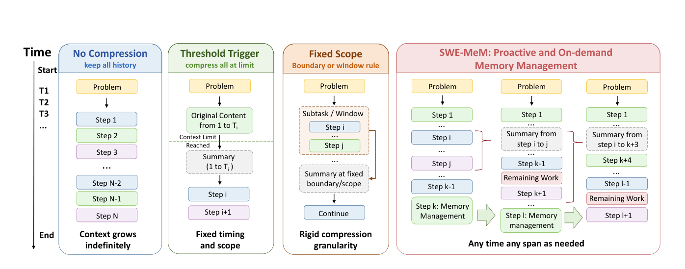
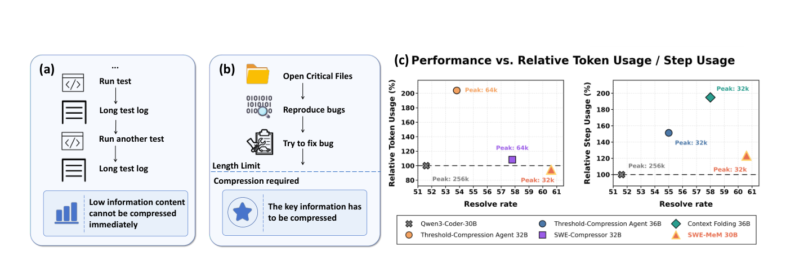
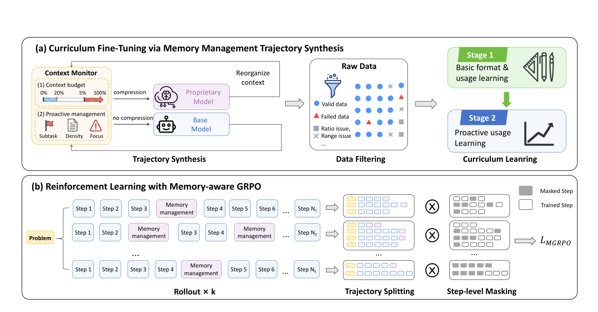
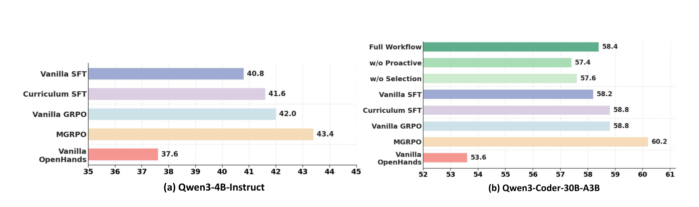

# SWE-MeM — いつ・どこを・どう圧縮するかを、エージェント自身に学ばせる

> 原典: [[translations/2026-swe-mem]] ・ `raw/papers/SWE-MeM- Learning Adaptive Memory Management for Long-Horizon Coding Agents.pdf`
> 著者・年・会議: Shuzheng Gao, Wenhao Zeng, Zhaojian Yu, Jianqiao Wangni, Chaozheng Wang, Kai Cai, Shilin He（連絡先著者）, Michael R. Lyu（香港中文大学・上海交通大学・清華大学・ByteDance）・2026・arXiv:2606.28434（v1, 2026-06-26）

## 一言まとめ

長い作業をする SWE エージェント（GitHub のイシューを直す [[coding-agents]]）に、**履歴のどの区間を、いつ、どんな要約に置き換えるかを自分で決める「記憶の道具」** を持たせ、その使い方を SFT と強化学習で訓練した論文。文脈の上限を 32K トークンに絞ったまま、SWE-bench Verified で Qwen3-4B を 43.4%、Qwen3-Coder-30B-A3B を 60.2% にし、閾値で要約する方式やサブタスクを畳む方式（Context Folding・SWE-Compressor）より、解決率が高く総トークンも少なかった。

## 背景と問題意識

多くの SWE エージェントは ReAct 型（考える→ツールを呼ぶ→結果を見る、を繰り返す → [[reasoning-and-planning]]）で、行動と観測を履歴に足し続ける「追記だけ」の方式をとる。コーディングでは長いテストログやファイルの中身が次々に積み上がるので、履歴はすぐ文脈の上限（context window, モデルが一度に読める最大トークン数）を超える。上限に収まっても、長く雑多な文脈からは必要な情報を拾いにくい（→ [[summaries/2023-lost-in-the-middle]]）。

これまでの記憶の管理（→ [[context-engineering]]）は、決まった規則で圧縮していた。

<figure>



<figcaption>図2（再掲）: 記憶の管理の 4 つの方式。圧縮しない方式は文脈が際限なく伸びる。閾値で発動する方式は上限に達してから全体を要約する。範囲を固定する方式はサブタスクの境界や窓といった決まった区切りで要約する。SWE-MeM は、必要なときにいつでも、任意の区間を圧縮する。</figcaption>
</figure>

著者らはこれらの問題を 2 つにまとめる。

1. **規則が固定で、情報の価値の違いに合わない**。長い実行ログや無関係なファイルはいつ消してもよいが、序盤に読んだ重要なコードは後の推論で必要になる（図 1 の (a)(b)）。閾値で発動する方式は、上限に来たらその重要なコードまで圧縮せざるを得ない。
2. **文脈を短くすることを目的にしていて、作業の効率を見ていない**。既存の方式は 1 ターンの文脈の最大長を大きく減らすが、そのぶん総トークンやターン数が大きく増え、全体では効率が悪くなる（図 1 の (c)）。

<figure>



<figcaption>図1（再掲）: (a) テストの実行と長いログが続く区間は情報が少なく、いつ圧縮してもよい。(b) 重要なファイルを開き、バグを再現し、直そうとしている途中で上限に達すると、重要な情報まで圧縮することになる。(c) 解決率（横軸）と、ReAct の素のエージェントに対する総トークン（左）・ターン数（右）の比。右下ほど良い。閾値で要約するエージェントはトークンが約 2 倍、Context Folding はターンが約 2 倍になるのに対し、SWE-MeM は 32K の上限で解決率が最も高く、トークンは素のエージェント以下に収まる。</figcaption>
</figure>

## 提案手法 / 主張

### 記憶の道具: compress

エージェントは通常のツール（OpenHands の足場）に加えて、次の 1 つの道具を必要なときに呼べる。

```
compress(analysis, start_step_number, end_step_number, content, remaining_work)
```

- `analysis`: 現在の進み具合と、未解決のサブタスクについての自己評価
- `start_step_number`・`end_step_number`: 圧縮する区間（何ステップ目から何ステップ目まで）
- `content`: その区間を置き換える要約
- `remaining_work`: 残りの作業。**履歴の末尾に付け足して**、作業の続きを見失わないようにする

1 回の呼び出しで、この順にすべての引数を生成する。呼ぶと、履歴の指定区間だけが要約に置き換わり、その前後のステップはそのまま残る。

$$
C_t=(p,\{a_1,o_1\},\dots,\{a_{t-1},o_{t-1}\})\ \xrightarrow{M}\ (p,\dots,\{a_{s-1},o_{s-1}\},\{c\},\{a_{e+1},o_{e+1}\},\dots,\{a_{t-1},o_{t-1}\},\{f\})
$$

（$p$ はイシュー文、$a_i$・$o_i$ は $i$ ステップ目の行動と観測、$c$ は要約、$f$ は残りの作業）。時間の順序は保たれ、一度作った要約を後でさらに圧縮することもできる。各ステップの観測には、**何ステップ目か**と**文脈の残り**が添えられ、エージェントは自分の予算を見ながら判断する。上限に来たら全体を要約する方式と違い、「序盤のコードは残し、その後の長いテストログだけを畳む」といった選択ができる。

### 訓練の 2 段: 合成した軌跡でカリキュラム SFT、そして Memory-aware GRPO

<figure>



<figcaption>図3（再掲）: 訓練の流れ。(a) 文脈の監視役が圧縮のきっかけ（予算の逼迫、またはサブタスクの完了・情報の薄さ・注意の散漫）を判定し、プロプライエタリなモデルが圧縮の引数を作り、普段の行動は基盤モデル自身が生成する。選別したデータで 2 段のカリキュラム学習を行う。(b) 強化学習では、軌跡を圧縮の時点で部分軌跡に切り分け、ステップ単位のマスクで信用を割り当てる。</figcaption>
</figure>

**(1) 軌跡の合成**。手本の軌跡は強い教師モデルにイシューを解かせて作るのではない。**イシューを解く行動は、後で訓練する基盤モデル自身（Qwen3-Coder-30B-A3B）が生成する**。プロプライエタリなモデル（GPT-5.1）は、圧縮するかどうかの判定と、圧縮の引数を書くことにだけ使う。こうすると、「記憶の管理だけを教えることで、エージェントの力がどれだけ伸びるか」を調べられる。圧縮のきっかけは 2 種類ある。

- **予算の逼迫**: 文脈の残りが 20% を切ると、確率的に圧縮を起こす。確率は残りが減るほど上がり、残り 5% で 1 になる（$p_t=\max(0,\min(1,(0.20B-b_t)/0.15B))$。$B$ は予算、$b_t$ は残り）。1 つの閾値で決めないことで、合成する軌跡が多様になる。
- **能動的な管理**: まだ余裕があっても圧縮が役立つ場面を、LLM-as-a-judge（LLM に判定させる方式）で見つける。サブタスクが終わって結論だけ残せばよいとき（サブタスクの完了）、直近のステップが冗長なログや無関係な探索で埋まっているとき（情報の薄さ）、長く雑多な文脈のせいでエージェントが本題から外れていそうなとき（注意の散漫）、の 3 つである。費用を抑えるため、監視役を呼ぶのは各ステップで 10% の確率だけにし、直近 5 ステップ以内に圧縮したときは呼ばない。

**(2) 選別**。テストに通った軌跡だけを残す（棄却サンプリング）。そのうえで、欠陥のあるステップは軌跡ごと捨てずに、**そのステップのアシスタントの発話だけを損失から外す**（マスク）。圧縮の欠陥は 3 種類ある。削りすぎ・削らなさすぎ（区間のトークンの 80% 超を消す要約は重要な情報を落としうるし、20% 未満では節約にならない）、短すぎる区間、宣言した区間と要約の中身のずれ（区間内の情報を落とす、区間外の内容を混ぜる）。圧縮以外のステップでは空の出力・繰り返し・途中で切れた出力・不正なツール呼び出しをマスクする。

**(3) 2 段のカリキュラム SFT**。予算による圧縮は頻度が高く規則的で学びやすいが、能動的な圧縮は軌跡の状態を意味的に判断する必要があり難しい。第 1 段では選別した軌跡すべてで、道具の書式と基本的な使い方を学ばせる。第 2 段では能動的な圧縮を含む軌跡を、ルーブリック（`analysis` が進み具合と残りのサブタスクを妥当に評価しているか、要約がその分析と合っているか）で選び直す。忘却を防ぐため、予算による圧縮だけを含む軌跡も同じ数だけ混ぜる。こちらは、圧縮した情報を後のステップで使えているか、記憶に残した情報を取り直していないか、という別のルーブリックで選ぶ。

**(4) Memory-aware GRPO**。GRPO（Group Relative Policy Optimization, 同じ問題で複数の軌跡を引き、グループ内の相対的な良し悪しから学ぶ方法 → [[reinforcement-learning-from-human-feedback]]）を、圧縮で文脈が変わることに合わせて 3 点直した。

- **圧縮の時点で軌跡を切る**。圧縮すると、それ以降の行動はすべて圧縮後の文脈を見て生成される。そこで 1 本のロールアウトを圧縮の時点で部分軌跡に分け、**各部分軌跡を、エージェントが実際に見ていた圧縮後の文脈から始める**。圧縮前の全履歴を前提に訓練すると、推論時と状態が食い違うからである。SFT でも同じ切り方をする。
- **ロールアウトごとに平均してから、バッチで平均する**。圧縮の使い方しだいで軌跡の長さが大きくばらつくので、長い軌跡（無駄な圧縮や、記憶にある結論の取り直しを含みがち）が損失を支配しないようにする。
- **ステップ単位のマスクで信用を割り当てる**（credit assignment, 最終的な成否をどのステップの手柄・失敗とみなすかを決めること）。結果だけで報酬を配ると、失敗した軌跡の適切な途中の行動を罰し、成功した軌跡の問題のある行動を褒めてしまう。そこで、成功した軌跡では規則で見つけた質の悪い圧縮と、残りが閾値 τ（5%）を切ってから行った**遅すぎる圧縮**、不正なツール呼び出しを学習から外す。上限を超えて失敗した軌跡では、最後の部分軌跡のうち、**残りが τ を切っていたのに圧縮しなかったステップだけ**に罰を与える。

## 実験結果と知見

設定: 文脈の上限はデータ収集・SFT・RL・評価を通して 32,768 トークン。足場は OpenHands。訓練データは SWE-rebench と SWE-Gym から作った（SFT は 8,728 本・5,867 問、RL は解けたり解けなかったりする 2,194 問）。4B のモデルは 30B のモデルが集めたデータをそのまま使う。評価は SWE-bench Verified（評価環境からは将来のコミットを消して漏れを防ぐ）。記憶の管理の比較手法は、断りがなければ最大 500 ステップ。

**表1（抜粋）**: SWE-bench Verified の解決率（%）。他手法の値は各論文の報告値。

| 手法 | 基盤モデル | 文脈の上限 | 解決率 |
|---|---|---|---|
| Qwen3-4B-Instruct（素） | — | 128k / 32k | 7.0 / 5.2 |
| SWE-Master-4B | Qwen3-4B-Instruct | 128k | 33.4 |
| SWE-Lego-8B | Qwen3-8B | 128k | 42.2 |
| **SWE-MeM SFT / SFT+RL** | Qwen3-4B-Instruct | 32k | 41.6 / **43.4** |
| Qwen3-Coder-30B-A3B（素） | — | 256k / 32k | 51.6 / 38.6 |
| 閾値で要約するエージェント | Qwen2.5-Coder-32B / Seed-OSS-36B | 64k / 32k | 53.8 / 55.0 |
| SWE-Compressor（150 ステップ / 500 ステップ） | Qwen2.5-Coder-32B | 64k | 54.8 / 57.8 |
| Context Folding | Seed-OSS-36B（素は 55.2） | 32k | 58.0 |
| **SWE-MeM 推論時の手順だけ**（GPT-5.1 が圧縮を判断） | Qwen3-Coder-30B-A3B | 32k | 58.4 |
| **SWE-MeM SFT（150 ステップ）/ SFT / SFT+RL** | Qwen3-Coder-30B-A3B | 32k | 57.2 / 58.8 / **60.2** |

- **訓練しなくても記憶の管理だけで大きく伸びる**。素の 30B は 32K の上限で 38.6%、256K でも 51.6% だが、GPT-5.1 に圧縮を判断させる手順を載せるだけで 58.4% になった。
- **訓練すると外部のモデルが要らなくなる**。SFT で判断をモデルに取り込むと 58.8%、RL で 60.2%。推論時に GPT-5.1 も手順も使わない。
- **4B で効果が大きい**。素の 4B（32K で 5.2%）を 43.4% にし、文脈が 4 倍の SWE-Master-4B（33.4%）や、2 倍の大きさの SWE-Lego-8B（42.2%）を上回った。

**表2**: 記憶の管理の手法の効率。比はそれぞれの基盤モデルの素の ReAct エージェントに対する値。

| 手法 | 解決率 | 総トークン（比） | 平均ステップ（比） |
|---|---|---|---|
| 閾値で要約（Qwen2.5-Coder-32B） | 53.8 | 5.18M（203.9%） | — |
| 閾値で要約（Seed-OSS-36B） | 55.0 | — | 74.9（151.3%） |
| SWE-Compressor | 57.8 | 2.75M（108.3%） | — |
| Context Folding | 58.0 | — | 96.5（194.9%） |
| **SWE-MeM SFT+RL** | **60.2** | **0.91M（94.7%）** | 77.0（123.5%） |

SWE-MeM は、比べた手法の中で唯一、**総トークンが素のエージェントより少ない**。ステップ数は 2 割強増えるが、Context Folding の約 2 倍に比べればわずかである。著者らは、選んで圧縮すれば、余分な文脈を減らしても過度な再探索を招かないと解釈している。

**アブレーション**（図 4）

<figure>



<figcaption>図4（再掲）: アブレーション。(a) Qwen3-4B: 普通の SFT 40.8、カリキュラム SFT 41.6、普通の GRPO 42.0、Memory-aware GRPO（MGRPO）43.4、訓練済みのモデルを記憶の道具なしの OpenHands（256K）で動かすと 37.6。(b) Qwen3-Coder-30B-A3B: 推論時の手順だけで 58.4、能動的な発動をやめると 57.4、区間の選択をやめて全体を要約すると 57.6、普通の SFT 58.2、カリキュラム SFT 58.8、普通の GRPO 58.8、MGRPO 60.2、道具なしの OpenHands 53.6。</figcaption>
</figure>

- **能動的な発動も区間の選択も、外すと下がる**。閾値での発動に替えると 58.4 → 57.4、全体の要約に替えると 57.6。
- **カリキュラムで能動的な圧縮が増える**。第 2 段のあと、能動的な呼び出しの割合は 4B で 2.3% → 16.1%、30B で 4.1% → 14.7% になった。解決率は 4B で 40.8 → 41.6。
- **Memory-aware GRPO は普通の GRPO を上回る**（4B で 42.0 → 43.4、30B で 58.8 → 60.2）。
- **記憶の道具を外すと、文脈を 256K に広げても下がる**（4B で 43.4 → 37.6）。著者らは、記憶の管理は文脈の溢れを防ぐだけでなく、整理された作業用の文脈を作り、必要な情報を使いやすくしていると解釈する。

**別のベンチマーク**（表 3）: 多言語の SWE-bench Multilingual で、4B は 7.3% → 19.0%、30B は 35.3% → 40.7%。より長い作業を要する SWE-bench Pro で、4B は 2.6% → 15.2%、30B は 28.9% → 31.7%。素のモデルは 256K、SWE-MeM は 32K で測った。

## 限界・批判的視点

- **比較の条件が揃っていない**。表 1・表 2 の他手法は各論文の報告値で、基盤モデル（Qwen2.5-Coder-32B・Seed-OSS-36B・Qwen3-Coder-30B-A3B）、文脈の上限（32k・64k）、ステップの上限が違う。表 2 の比もそれぞれ自分の基盤モデルの素のエージェントに対する比なので、手法間で直接は比べにくい。「素のモデルからの伸び」で比べると、Context Folding は 55.2 → 58.0（+2.8）、SWE-MeM は 51.6 → 60.2（+8.6）だが、出発点の文脈の上限も違う（256K と 327K の素のモデルに対して 32K）。
- **アブレーションの差の多くは 1 回の評価のばらつきに収まる**。500 問で 60% 前後なら標準誤差は約 2.2 ポイント（本 wiki の計算）。能動的な発動（−1.0）、区間の選択（−0.8）、カリキュラム（+0.6〜0.8）、Memory-aware GRPO（+1.4）の差は、どれもこの幅より小さい。方向は一貫しているが、1 つずつの寄与は確かとは言えない。大きく確かなのは、記憶の管理の有無（38.6 → 58.4、5.2 → 43.4）である。
- **「道具を外すと下がる」は、条件をそろえた比較ではない**。道具ありで訓練したモデルから道具を取り上げると、訓練時と違う条件で動かすことになる。下がった理由が「整理された文脈の効果」なのか「慣れない条件での不調」なのかは分けられない。30B では道具なしでも 53.6% と、素のモデル（51.6%）よりは高い。
- **プロプライエタリなモデルへの依存**。訓練データの圧縮の判断と引数はすべて GPT-5.1 が書いた。推論時の手順だけで 58.4% に達し、SFT 後が 58.8% なので、SFT は GPT-5.1 の判断をほぼそのまま取り込んだと読める。RL の上乗せは +1.4 ポイントである。
- **データの統計に引っかかる点がある**。選別では「区間の 80% 超を消す要約」を欠陥として扱うが、SFT データの統計（表 4）では、圧縮前の平均 9,658 トークンが圧縮後に 1,497 トークンになり、平均の比は 15.5%（8 割超を削っている）。欠陥のある圧縮は捨てずにマスクして軌跡に残すので、統計にはマスクした圧縮も含まれている可能性がある（本 wiki の読み。論文は説明していない）。
- **評価は主に SWE-bench Verified**。Verified は汚染を理由に 2026-02 に OpenAI が報告をやめた（→ [[summaries/2026-swe-bench-verified-retired]]）。将来のコミットを消すなど漏れへの対策はしており、SWE-bench Pro と Multilingual でも伸びを確かめている点は評価できる。付録の事例（C 節）も Verified のインスタンスから取っている。
- **32K の上限は人為的な設定である**。記憶の管理の価値が最も出やすい条件で測っている。文脈の長いモデルを十分な上限で動かしたときに、同じだけの差が出るかは示していない（30B の素のモデルは 256K で 51.6%）。

## 実装・運用上の示唆

- **圧縮を「上限に来たら全体を要約」から「区間を選ぶ道具」に変える**。区間の始まりと終わり・要約・残りの作業を引数にした 1 つのツールにすると、重要なコードを残して長いログだけを畳める。要約に「残りの作業」を添えて履歴の末尾に置くのは、Manus の復唱（→ [[summaries/2025-manus-context-engineering]]）と同じく、注意を次の一手に向ける工夫である。
- **観測に「何ステップ目か」と「文脈の残り」を添える**。エージェントが予算を見て判断できるようにする。MemGPT の「容量の 70% で警告を挿入する」（→ [[summaries/2023-memgpt]]）を、毎ターンの観測に組み込んだ形である。SWE-Master（→ [[summaries/2026-swe-master]]）も残りのステップ数を毎ターン添えている。
- **手本の軌跡の行動は基盤モデル自身に生成させ、強いモデルには圧縮の判断だけをさせる**。教師の解き方を蒸留する効果と、記憶の管理を教える効果を分けられ、生成の費用も抑えられる。
- **圧縮のあるエージェントを訓練するなら、圧縮の時点で軌跡を切る**。各部分を、エージェントが実際に見た圧縮後の文脈から始める。全履歴を前提に訓練すると、推論時の状態とずれる。
- **欠陥のあるステップは軌跡ごと捨てずにマスクする**。成功した軌跡の残りのステップは手本として使える。SWE-Lego や SWE-Prime の「損失から外す」と同じ考え方である（→ [[agent-training]]）。
- **遅すぎる圧縮を罰する**。上限の直前になって慌てて圧縮するのではなく、余裕のあるうちに圧縮する振る舞いを育てる。

## 用語と略称

- **SWE**（Software Engineering）: ソフトウェアエンジニアリング。ここでは GitHub のイシューを直すタスク
- **ReAct**（Reasoning and Acting）: 思考と行動を交互に出すエージェントの枠組み（→ [[reasoning-and-planning]]）
- **SFT**（Supervised Fine-Tuning）: 教師ありファインチューニング
- **RL**（Reinforcement Learning）: 強化学習
- **GRPO**（Group Relative Policy Optimization）: 同じ問題で複数の出力を引き、グループ内の相対的な良し悪しを advantage にする強化学習の手法
- **Memory-aware GRPO（MGRPO）**: 本論文の改良版 GRPO。圧縮の時点での軌跡の分割、ロールアウト単位の損失の平均、ステップ単位のマスクを加えたもの
- **DAPO**（Decoupled Clip and Dynamic sAmpling Policy Optimization）: GRPO の改良版。本論文はその切り詰めの設定（下側 0.2・上側 0.27）にならった
- **ロールアウト**（rollout）: 方策に環境の中で 1 回タスクを解かせ、軌跡を得ること
- **部分軌跡**（sub-trajectory）: 圧縮の時点で切り分けた軌跡の一区間
- **信用の割り当て**（credit assignment）: 最終的な成否を、どのステップの行動の手柄・失敗とみなすかを決めること
- **カリキュラム学習**（curriculum learning）: 易しいものから難しいものへ、順に学ばせる訓練の方法
- **棄却サンプリング**（rejection sampling）: 複数回解かせて、成功したものだけを訓練データに残すこと
- **LLM-as-a-judge**: LLM に判定や採点をさせる方式
- **ルーブリック**（rubric）: 採点の基準を項目ごとに書いた表
- **文脈の上限**（context window / context budget）: モデルが一度に読める最大トークン数。本論文では 32K に設定
- **R3（Rollout Routing Replay）**: MoE（Mixture of Experts, 入力ごとに一部の専門家サブネットだけを使う構造）のモデルで、ロールアウト時と訓練時のルーティングの食い違いを抑える手法。30B の RL でだけ使った
- **SWE-bench Verified / Pro / Multilingual**: GitHub のイシューをテストで判定するベンチマーク SWE-bench の、人手で選び直した 500 問／より長く難しい課題／多言語版（→ [[agent-evaluation]]）

## 関連ページ

- [[agent-memory]] — 自分で記憶を管理するエージェントの系譜（MemGPT の自己管理を訓練で身につける形）
- [[context-engineering]] — 圧縮の時機と範囲の選び方。観測のマスキング・要約・サブタスクの畳み込みとの比較
- [[agent-training]] — 圧縮のある軌跡の分割、ステップ単位のマスク、カリキュラム SFT
- [[coding-agents]] — 小さなモデルで SWE エージェントを強くする道
- [[agent-cost-efficiency]] — 総トークンとステップ数で見た効率
- [[reinforcement-learning-from-human-feedback]] — GRPO・DAPO
- [[summaries/2026-swe-master]] — 要約によるコンテキスト管理が小さいモデルでは改善しなかった先行研究。SWE-Master-4B は表 1 の比較対象
- [[summaries/2025-complexity-trap]] — 固定の規則で観測を消す方式と要約の比較。発動を内容で決める方式は未検討の論点として残していた
- [[summaries/2023-memgpt]] — 容量の警告と関数呼び出しによる記憶の自己管理（プロンプトで行う形）
- [[summaries/2025-manus-context-engineering]] — 復唱と、不可逆な圧縮のリスク
- [[summaries/2024-openhands]] — 本論文の足場
- [[summaries/2025-swe-rebench]] ・ [[summaries/2024-swe-gym]] — 訓練データの出どころ
- [[summaries/2026-swe-lego]] ・ [[summaries/2026-swe-prime]] — 欠陥のあるステップを損失から外す SFT
- [[summaries/2026-swe-bench-verified-retired]] — Verified の汚染
