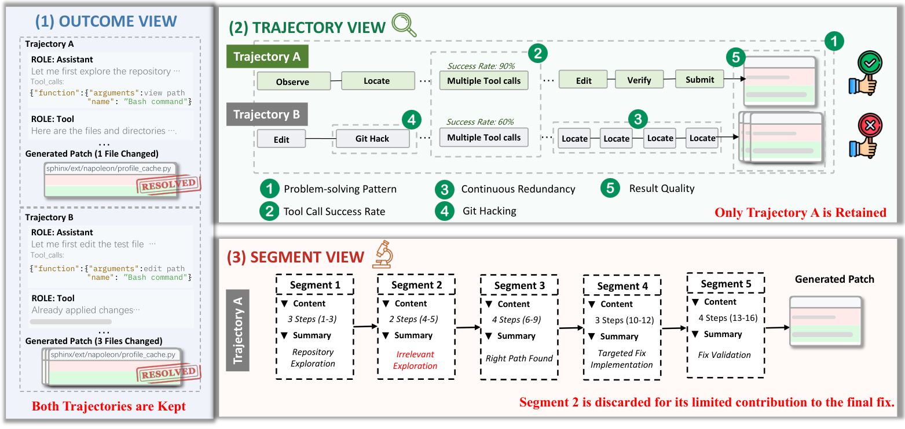
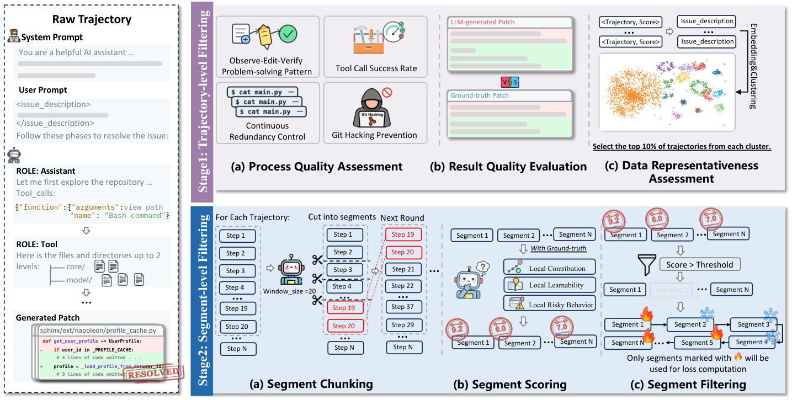
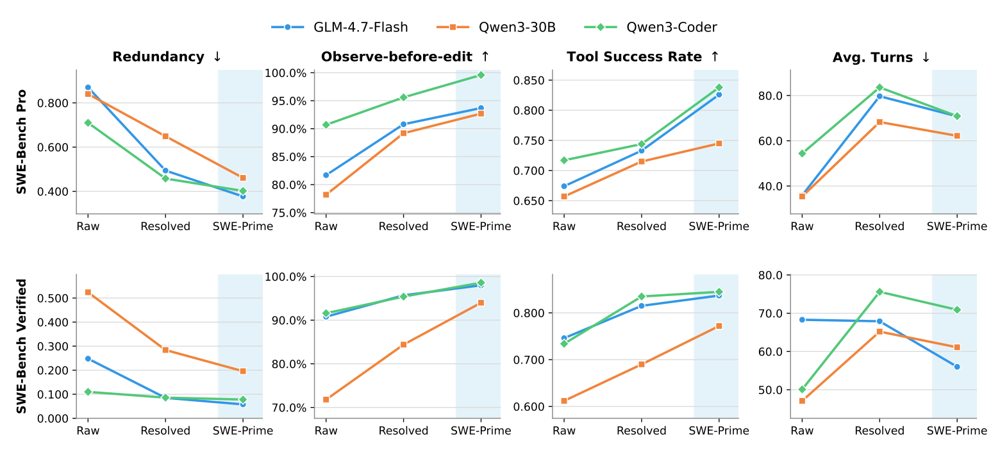

# SWE-Prime：成功した軌跡を選び直し、10% で全部より強くする

> 原典: [[translations/2026-swe-prime]] ・ `raw/papers/SWE-Prime_ Fewer Trajectories, Better Performance.md`
> 著者・年: Dewu Zheng ほか 10 名（中山大学・Huawei Cloud・重慶大学）・2026-08・arXiv:2608.27449 v1。9 ページ。

## 一言まとめ

テストに通った（成功した）コーディングエージェントの軌跡にも、お手本にすべきでない手順が混じっていると考え、SFT に使う軌跡を 2 段階で選び直す手法 SWE-Prime を提案した。軌跡ごとの点数とイシューのクラスタで全体の 10% だけを選び、さらに軌跡の中の価値の低い区間を損失の計算から外すと、3 つの 30B 級モデルの全員で、成功した軌跡を全部使うより SWE-bench Verified と SWE-bench Pro の解決率が上がった。

## 背景と問題意識

オープンなモデルをコーディングエージェント（→ [[coding-agents]]）として鍛える定番の方法は、強いモデルにイシューを解かせ、**テストに通った軌跡（成功軌跡）だけを集めて SFT**（Supervised Fine-Tuning, お手本をまねる追加学習）することである。SWE-Gym・SWE-smith・SWE-Lego も、この形でモデルを伸ばしてきた（→ [[agent-training]]）。

しかし「最後にテストに通った」ことは、「途中の手順もお手本にしてよい」ことを意味しない。成功した軌跡にも、次のような手順が混じりうる。

- 何も調べずにいきなり編集する
- ツールの呼び出しに何度も失敗する
- 同じ検索を何度も繰り返す
- Git の履歴から正解の修正を覗く（Git ハッキング → [[summaries/2026-swe-lego]]）
- 必要のないファイルまで変える

これらをまねさせると、悪い癖まで学習してしまう。本 wiki でもすでに、SWE-smith（[[summaries/2025-swe-smith]]）が訓練したモデルの軌跡の 25% 超に同じ行動の繰り返しがあることを、SWE-Lego が成功軌跡の中のエラーを返した手を損失から外すと 2 ポイント前後伸びることを記録している。SWE-Prime はこの方向を進め、**軌跡の単位**でも**軌跡の中の区間の単位**でも選別をかける。

## 提案手法 / 主張

<figure>

<figcaption>図1（再掲）: 動機づけの例。(1) 結果だけ見れば、軌跡 A も B も「解決」なので両方残る。(2) 軌跡の観点では、B は調べずに編集し、Git ハッキングをし、同じ位置特定を繰り返し、ツールの成功率も低く、余分なファイルまで変えているので外す。(3) 区間の観点では、残した A の中でも、最終的な修正に寄与しない「無関係な探索」の区間 2 は学習に使わない。</figcaption>
</figure>

### 第 1 段：軌跡を選ぶ

各成功軌跡に、次の 5 つの点数を付けて平均する（$S_{\mathrm{traj}}$）。最初の 4 つは「過程の質」、最後の 1 つが「結果の質」である。

- **観察 → 編集 → 検証の順か**（0 か 1）: 最初の編集の前にリポジトリを調べ、最後の編集のあとにテストか確認をしていれば 1。
- **ツール呼び出しの成功率**: 全軌跡の中での順位（パーセンタイル）を点数にする。
- **連続した繰り返しがないか**（0 か 1）: 隣り合う 2 つのツール呼び出しが名前も引数も同じなら 0。
- **Git ハッキングをしていないか**（0 か 1）: コードを変える前の Git の履歴の操作で、正解パッチの内容が見えていたら 0。
- **パッチが広がりすぎていないか**: 変更したファイル数と行数を正解パッチと比べ、正解以下なら 1、超えた分だけ下がる。ファイルと行の点数を掛け合わせるので、両方が絞れていないと高くならない。正解パッチは「適切な変更の範囲」を見積もるためだけに使う。

点数だけで選ぶと似た種類のイシューに偏るので、**代表性**も考える。イシューの記述を Qwen3-Embedding-8B で埋め込み（意味を保った数値ベクトルに変換し）、HDBSCAN（密度にもとづくクラスタリングの手法）で似たイシューのグループに分ける。各グループの中で $S_{\mathrm{traj}}$ の高い順に取り、全体の予算（10%）まで選ぶ。

### 第 2 段：軌跡の中の区間を選ぶ

<figure>

<figcaption>図2（再掲）: SWE-Prime の全体像。上段が第 1 段（過程の質・結果の質・代表性）。下段が第 2 段で、(a) 20 ステップずつのウィンドウで軌跡を区間に切り、最後の区間は次のウィンドウに持ち越す。(b) LLM が正解パッチも見ながら、寄与・学びやすさ・危険の 3 つの観点で各区間を採点する。(c) しきい値以上の区間（炎の印）だけを損失の計算に使う。</figcaption>
</figure>

1 つのステップ（1 回の行動か観測）だけでは、何のための手かが判断できない。そこで、同じ目的で続くステップをまとめて**意味的な区間**（semantic segment）にする。例として「あるシンボルがリポジトリのどこで使われているかを追う」ような、ひとまとまりの振る舞いが 1 つの区間になる。

- **区間に切る**: 長い軌跡は LLM のコンテキストウィンドウ（一度に読める量）に収まらないので、ウィンドウをずらしながら処理する。ウィンドウの端で振る舞いが途中で切れないよう、最後の区間は確定させずに次のウィンドウへ持ち越して境界を決め直す。前のウィンドウの要約（タスクの目的、確定した事実、見つけた危険）も渡す。
- **採点する**: LLM がイシュー・軌跡の文脈・正解パッチを見て、各区間に 0〜10 点と理由を付ける。観点は 3 つある。
  - 最終的な修正への寄与（位置の特定、文脈の収集、変更、検証、エラーからの回復を進めたか）
  - その時点の情報から「証拠 → 行動 → フィードバック」の形で学べるか
  - 危険な振る舞いか（無関係な探索、情報のない失敗、安全でない操作、答えのハードコード）
- **絞り込む**: 7 点以上の区間だけを学習の対象にする。7 点未満の区間も**系列からは消さず、文脈として残す**。損失（モデルが次のトークンを当てられなかった度合い）は、選ばれた区間のアシスタントの応答のトークンにだけかける。後の手を学ぶときに、前の経緯が見えている必要があるからである。

### 実験の設定

- **候補**: Nebius が公開した SWE-rebench の OpenHands の軌跡（[[summaries/2025-swe-rebench]] のイシューを Qwen3-Coder-480B-A35B が OpenHands で解いた 67,074 本）のうち、解決した 32,161 本。
- **基盤モデル**: 3 つとも総 30B 前後で、入力ごとに一部の専門家だけを使う MoE（Mixture of Experts）構成のモデル（活性化するのは約 3B）。GLM-4.7-Flash、Qwen3-30B-A3B-Instruct-2507、Qwen3-Coder-30B-A3B-Instruct。
- **評価**: SWE-bench Verified（500 問）と SWE-bench Pro の公開分割（731 問。Python・JavaScript・TypeScript・Go）。最大 100 ターン、131,072 トークン。
- **比較対象**: 素のモデル、成功軌跡すべての SFT、ランダムに選んだ 10% の SFT、第 1 段だけの SWE-Prime。訓練の設定（最大長 131,072、バッチ 32、学習率 4×10⁻⁶）は、データと損失のマスク以外すべて同じ。

## 実験結果と知見

**表**: 主な結果（原典の表 1 から。解決率 %、ターンは平均の相互作用のターン数）

| モデル | 手法 | データ | Verified | Verified ターン | Pro | Pro ターン |
|---|---|---|---|---|---|---|
| Qwen3-30B-A3B | 素のモデル | – | 25.2 | 47.1 | 8.21 | 35.4 |
| | 成功軌跡すべて | 100% | 36.8 | 65.2 | 16.83 | 68.3 |
| | ランダム 10% | 10% | 26.6 | 69.8 | 9.17 | 74.6 |
| | 第 1 段のみ | 10% | 34.6 | 64.7 | 17.10 | 64.6 |
| | **SWE-Prime** | 10% | **39.6** | 61.1 | **18.88** | 62.2 |
| GLM-4.7-Flash | 素のモデル | – | 40.4 | 68.3 | 11.22 | 35.9 |
| | 成功軌跡すべて | 100% | 41.4 | 67.9 | 24.62 | 79.7 |
| | ランダム 10% | 10% | 39.6 | 63.4 | 10.81 | 84.3 |
| | 第 1 段のみ | 10% | 43.6 | 61.7 | 22.98 | 76.4 |
| | **SWE-Prime** | 10% | **51.4** | 56.0 | **26.95** | 70.8 |
| Qwen3-Coder-30B-A3B | 素のモデル | – | 44.8 | 50.1 | 29.55 | 54.4 |
| | 成功軌跡すべて | 100% | 51.0 | 75.6 | 31.05 | 83.6 |
| | ランダム 10% | 10% | 41.2 | 77.5 | 27.22 | 86.1 |
| | 第 1 段のみ | 10% | 50.2 | 74.2 | 30.92 | 79.7 |
| | **SWE-Prime** | 10% | **53.2** | 70.9 | **34.75** | 70.9 |

- **10% で全部を上回った**。6 つの組み合わせのすべてで、SWE-Prime は成功軌跡すべての SFT より高い。差は GLM-4.7-Flash の Verified で +10.0 ポイント（41.4 → 51.4、論文の言う相対 +24.2%）と大きいが、他の 5 つは +2〜4 ポイントである（本 wiki の差の計算）。
- **選び方が効いている**。同じ 10% でも、ランダムに選ぶと成績は素のモデル並みかそれ以下に落ちた（Qwen3-Coder の Verified は 44.8 → 41.2）。
- **第 2 段の区間の選別も上積みした**。第 1 段だけの場合と比べて、6 つすべてで SWE-Prime が高い（Verified で +3.0〜+7.8 ポイント）。
- **言語別でも同じ傾向**。SWE-bench Pro の Python・JavaScript・TypeScript・Go のすべてで SWE-Prime が最良だった。
- **振る舞いが変わった**。成功軌跡すべての SFT と比べて、繰り返しが最大 0.188 減った。編集の前に調べる割合は最大 9.6 ポイント、ツールの成功率は最大 0.094 上がった。平均ターン数は 4.1〜12.7 ターン減った。解決率が上がりながらターンが減ったので、早く諦めたせいではないと著者らは見ている。

<figure>

<figcaption>図5（再掲）: 素のモデル（Raw）、成功軌跡すべての SFT（Resolved）、SWE-Prime の振る舞いの比較。上段が SWE-bench Pro、下段が Verified。左から、繰り返し（↓が良い）、編集前に調べる割合（↑）、ツールの成功率（↑）、平均ターン数（↓）。ターン数は、GLM-4.7-Flash の Verified を除いて SFT で素のモデルより増え、SWE-Prime はその増え方を抑えている。</figcaption>
</figure>

**設定の選び方（図 4）。** 軌跡の保持率は 5% → 10% → 20% → 30% で 46.2 → 50.2 → 49.6 → 49.2%、区間のしきい値は 5〜9 点で 46.8 → 52.2 → 53.2 → 49.6 → 47.0% となった。この結果から、10% と 7 点を選んでいる。どちらも Qwen3-Coder-30B-A3B と SWE-bench Verified で調べた値である。

## 限界・批判的視点

- **設定を評価用の問題で選んでいる。** 保持率 10% としきい値 7 は Qwen3-Coder × Verified の解決率を見て決めた。表 1 の Qwen3-Coder × Verified の SWE-Prime の 53.2% と第 1 段のみの 50.2% は、図 4 の調整時の値そのものである。著者らは他の 5 つの組み合わせへの「汎化」を示したとするが、少なくともこの組み合わせはテストで選んだ値をテストの結果として報告している。別の検証用の問題で設定を選ぶ手順がない。
- **区間を切って採点した LLM が何か書かれていない。** 第 2 段は LLM が区間を切り、0〜10 点を付ける仕組みなのに、どのモデルを使ったか、プロンプト、採点の一貫性（同じ区間に何度採点させても同じ点か）、人の判断との一致が示されていない。再現の鍵になる部分が欠けている。
- **誤差の扱いがない。** すべて 1 回の実行で、誤差の幅も複数回の平均もない。本 wiki の試算では、Verified（500 問）で解決率 50% 前後なら 95% の誤差の幅は約 ±4.4 ポイント、Pro（731 問）で 30% 前後なら約 ±3.3 ポイントである。GLM-4.7-Flash の Verified（+10.0）以外の差は、この幅の中に入りうる（→ [[summaries/2024-error-bars-evals]]）。
- **相対値が改善を大きく見せる。** 「Pro で +140.2%」は素のモデルの 11.22% → 26.95% のことで、素の値が低いほど相対値は大きくなる。成功軌跡すべてとの比較で見るべき差は、多くが 2〜4 ポイントである。
- **Verified を主な評価に使っている。** SWE-bench Verified は、2026-02 に OpenAI が「テストの欠陥と主要モデルの正解の記憶のため、もはや能力を測れない」として報告をやめたベンチマークである（[[summaries/2026-swe-bench-verified-retired]]）。本論文は 2026-08 の論文だが、そのことに触れていない。OpenAI が代わりに勧めた SWE-bench Pro も併用している点はよい。
- **正解パッチを見て選んでいる。** 結果の質と区間の採点は正解パッチを参照する。訓練データの選別なので不正ではないが、正解のないタスク（合成のタスクや社内のイシュー）にはそのまま使えない。また、「正解パッチより広い変更は悪い」という前提は、正解パッチより丁寧な修正（テストやドキュメントの更新を含む）も減点しうる。
- **ランダム 10% が素のモデルを下回る理由が分析されていない。** 同じ訓練の設定でデータだけを 1/10 にしたので、学習の量（ステップ数）も大きく違う。学習率やエポックをそろえた比較なのかは書かれていない。

## 実装・運用上の示唆

- **成功軌跡を集めたら、まず安い規則で絞る。** 「調べてから編集し、最後に確かめたか」「同じ呼び出しを連続で繰り返していないか」「Git の履歴を覗いていないか」は、ログを見るだけで判定できる。LLM の採点を使わない第 1 段だけでも、10% のデータで成功軌跡すべてにほぼ並んだ（上回ったのは 6 つ中 2 つで、残りの 4 つも差は 0.1〜2.2 ポイント）。
- **捨てずに、損失から外す。** 悪い区間を系列から消すと、後の手の前提となる文脈が途切れる。文脈としては残し、学習の対象からだけ外す。SWE-Lego のエラーの手のマスクと同じ考え方を、区間の単位に広げたものである（→ [[agent-training]]）。
- **量より選び方。** 3 万本をそのまま使うより、選んだ 3,000 本のほうが強く、訓練も 1/10 で済む。ただしランダムに減らすと悪くなるので、何を残すかの基準が要る。
- **評価用の問題で設定を選ばない。** しきい値や保持率は、評価に使わない問題（訓練データの一部を取り分けた検証用の集合など）で選ぶ。

## 用語と略称

- **SFT（Supervised Fine-Tuning）**: 教師ありファインチューニング。お手本のデータをまねるようにモデルを追加学習させること。
- **軌跡（trajectory）**: エージェントが 1 つのタスクで行った、推論・ツール呼び出し・観測の記録の全体。
- **意味的な区間（semantic segment）**: 同じ目的で続く複数のステップをまとめた単位。本論文の造語に近い。
- **損失のマスク**: 系列の一部のトークンを、損失の計算（学習の対象）から外すこと。外した部分も文脈としてはモデルに見える。
- **Git ハッキング**: エージェントが Git の履歴から将来の修正（正解）を読み取って使うこと。
- **OpenHands**: オープンソースのコーディングエージェントの足場。
- **MoE（Mixture of Experts）**: 入力ごとに一部の専門家サブネットだけを使う構造。総パラメータ数より、実際に計算に使う活性パラメータ数が小さい。
- **HDBSCAN**: 点の密度にもとづいてクラスタを見つけるクラスタリングの手法。クラスタの数を事前に決めなくてよく、どこにも属さない点も扱える。
- **埋め込み（embedding）**: 文章を、意味を保った数値ベクトルに変換したもの。
- **パーセンタイル順位**: 全体の中で下から何 % の位置にあるかを表す値。
- **SWE-bench Pro**: SWE-bench の後継として OpenAI が勧めたベンチマーク。Python 以外の言語も含む。

## 関連ページ

- [[agent-training]] — 蒸留（SFT）で何をまねさせるかと、失敗した手のマスク
- [[coding-agents]] — 訓練した SWE モデルの到達点と、繰り返しの行動という弱点
- [[agent-evaluation]] — SWE-bench Verified の退役、誤差の幅、評価用の問題での調整
- [[summaries/2025-swe-rebench]] — 候補にした軌跡の出どころのデータセット
- [[summaries/2026-swe-lego]] — エラーの手を損失から外す先行の工夫と、Git ハッキングの指摘
- [[summaries/2025-swe-smith]] — 成功軌跡の SFT と、訓練後のモデルに残る繰り返し
- [[summaries/2024-swe-gym]] — 成功軌跡の SFT の出発点
- [[summaries/2025-kimi-dev]] — 公開の軌跡で軽く SFT して適応させる、別の方向の研究
- [[summaries/2024-error-bars-evals]] — 1 回の実行で数ポイントの差を読むときの誤差
- [[summaries/2026-swe-bench-verified-retired]] — 評価に使った Verified の問題点
- [[summaries/2024-openhands]] — 選び直した軌跡を生んだ足場、OpenHands の原論文
