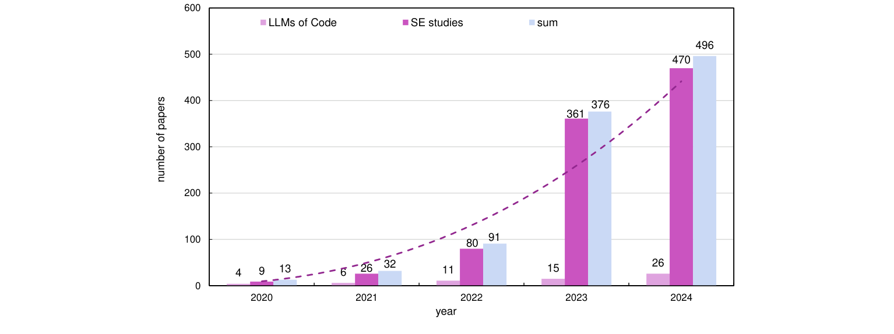
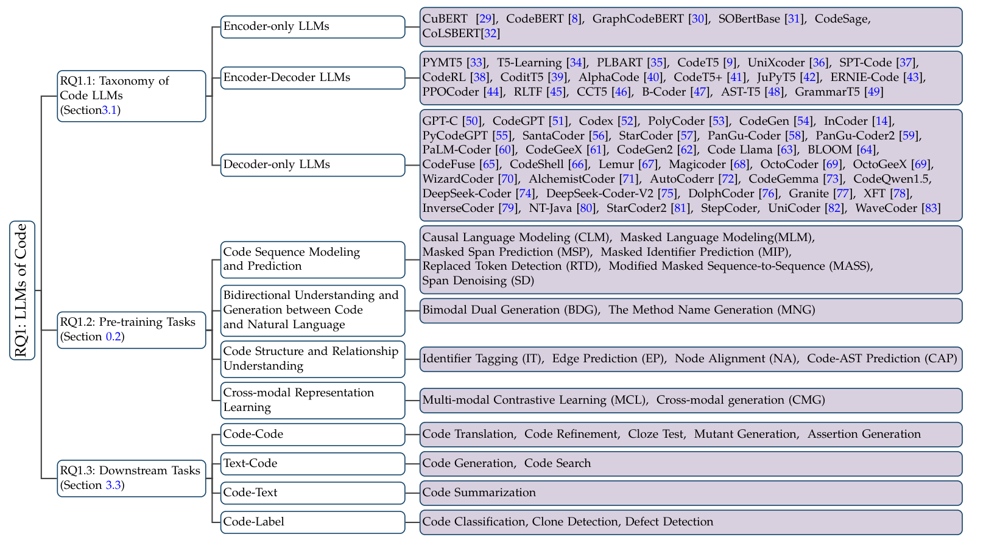
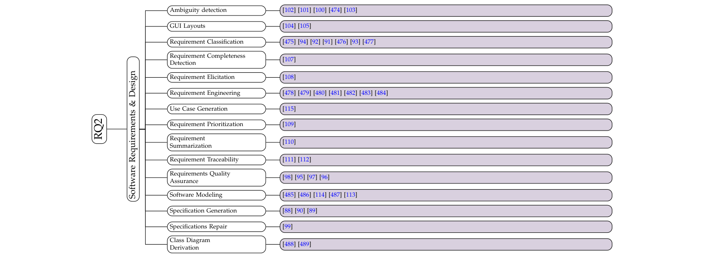
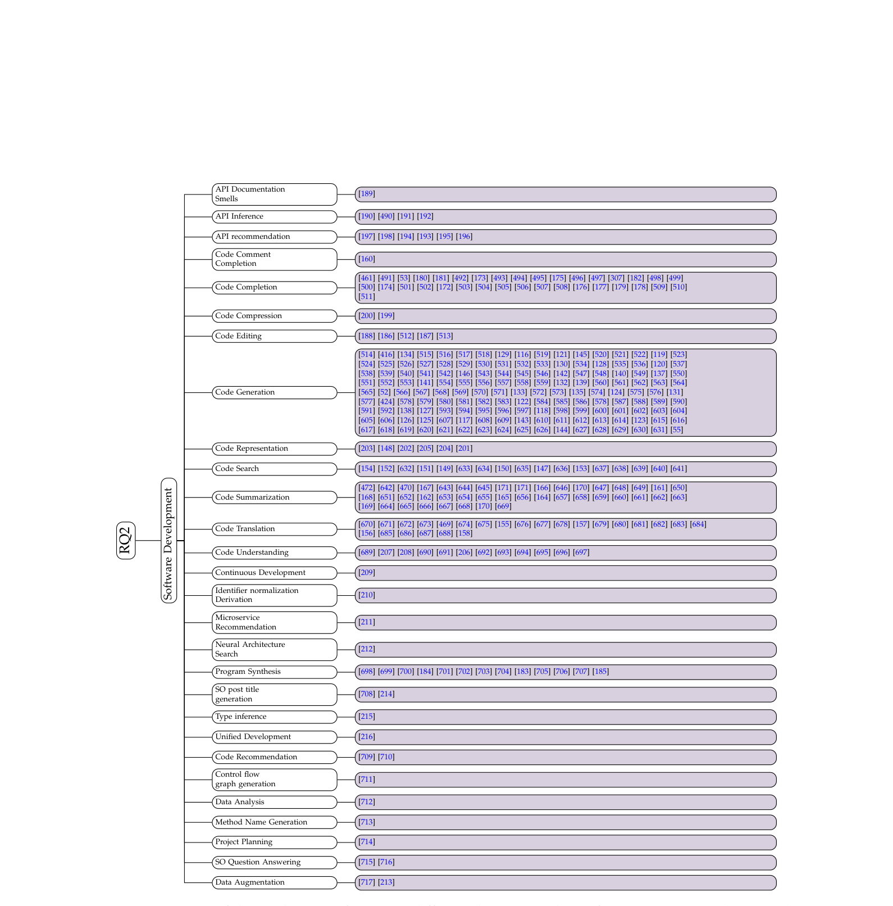
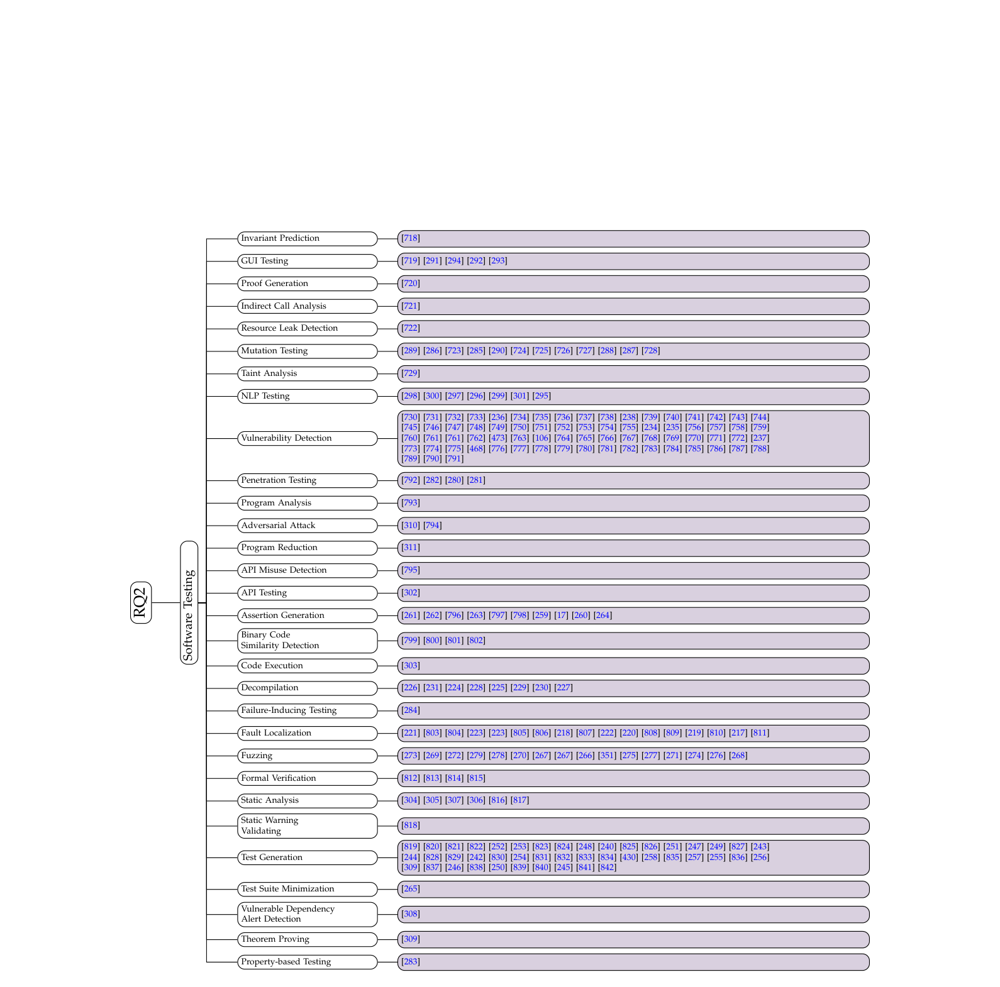
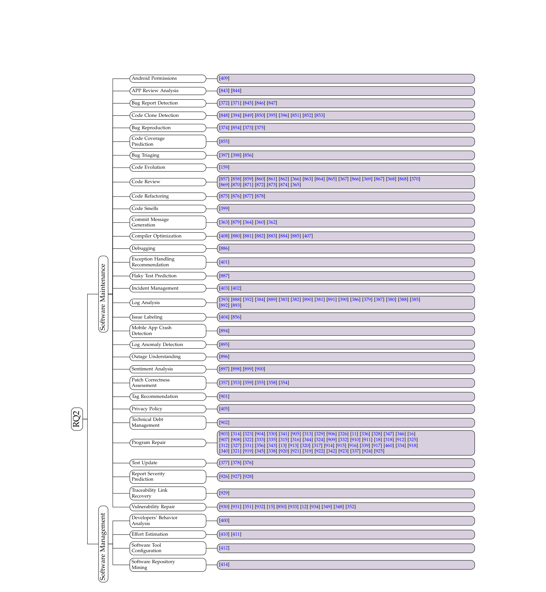

# ソフトウェア工学のための大規模言語モデルに関するサーベイ

> 原題: A Survey on Large Language Models for Software Engineering
> 著者: Quanjun Zhang¹, Chunrong Fang¹, Yang Xie¹, Yaxin Zhang¹, Yun Yang³, Weisong Sun², Shengcheng Yu¹, Zhenyu Chen¹（¹南京大学 ソフトウェア新技術国家重点実験室（State Key Laboratory for Novel Software Technology, Nanjing University）、²南洋理工大学 計算機科学・工学部（School of Computer Science and Engineering, Nanyang Technological University）、³スウィンバーン工科大学 計算技術学科（Department of Computing Technologies, Swinburne University of Technology））
> 出典: arXiv:2312.15223 v2（2024-09-08。v1 は 2023-12-23）。継続更新のリポジトリ: `https://github.com/iSEngLab/AwesomeLLM4SE`

> 訳注（底本と復元）: `raw/` のクリップ（ar5iv 経由）は v2 の本文だが、表がすべて HTML のまま平坦化し、図 1〜6 の画像が含まれていなかった。arXiv の HTML 版 v2 を底本にし、表は PDF v2 と照合して組み直した（表 III・表 V は結合セルのずれを直し、表 VI は 2 段の見出しを 1 行にまとめた）。図 1〜6 は HTML 版にも画像がない（ベクタ図）ので、PDF v2 からキャプションの位置を境界に切り出した。付録 B の分類図 4 ページは、PDF ではすべて「Fig. 3」（2 ページ目以降は「(Continue)」）だが、HTML 版の番号に合わせて図 3〜図 6 とした。PDF v2 は表番号をアラビア数字（TABLE 5 など）、節番号を「4.1」の形式で付けているが、本訳は HTML 版の表記（表 V、IV-A など）に従った。各研究課題の「回答」の囲み（原典では枠付きの箱）は引用ブロックにした。脚注は本文の位置の直後に置いた。参考文献（[1]〜）は訳していない。Index Terms の欄は原典でも空なので省いた。
>
> 訳注（原典内の食い違い）: 原典の記述どおりに訳したうえで、次の食い違いを記録する。(1) 応用研究は要旨・II-D・IV 章で「947 本」とされるが、表 V の 5 工程の合計は 43 + 341 + 240 + 211 + 5 = 840 本である。II-C の選別の記述からは SE の論文は 912 + 36 = 948 本になる。(2) 図 1 の各年の合計は 1,008 本で、本文の 1,009 本と 1 本違う。(3) 下流タスクの数が要旨では 16、III-C では 15 とされる。(4) 表 II の行の値はモデル名とずれているように見える（表の直後の訳注）。(5) 表 I の ICPC の正式名称と TOSEM の種別（表の直後の訳注）。(6) 表 IV で CoLSBERT の行が重複している（表の直後の訳注）。(7) VI 章の「3 つの方向」は 2 つしか挙がっておらず、V-B の模倣攻撃の手順は「4 段階」とされるが 3 段階しか挙がっていない。(8) VI 章の「version-based SE tasks」は文脈から vision-based の誤植と判断し「ビジョンベース」と訳した。このほかの細かな誤記（"PLABRT"、"CodeT5 [8]"、"BLUE"、"ChaGPT" など）は原文の表記のまま残した。

## Abstract（要旨）

ソフトウェア工学（Software Engineering, SE）とは、現代世界のデジタル基盤を支えるソフトウェアアプリケーションを体系的に設計・開発・保守・管理することである。
ごく最近、SE コミュニティでは、大規模言語モデル（Large Language Models, LLMs）を用いて広範な SE タスクを自動化する手法の数が急速に増加している。
それにもかかわらず、SE における LLM の応用、効果、そして起こりうる限界に関する既存の知見は、いまだ十分に研究されていない。

本論文では、LLM ベースの SE コミュニティにおける現在の最先端研究をまとめる体系的サーベイを提供する。
我々は、3 つのモデルアーキテクチャにまたがる 62 個の代表的なコード向け LLM（LLMs of Code）、4 つのカテゴリにまたがる 15 個の事前学習目的（pre-training objective）、そして 5 つのカテゴリにまたがる 16 個の下流タスク（downstream task）をまとめる。
次に、LLM が一般的に利用されている近年の SE 研究について詳細なまとめを示す。これには、SE ワークフローにおける 5 つの重要なフェーズにまたがる 112 個の具体的なコード関連タスクを対象とした 947 件の研究が含まれる。
また、LLM を SE に統合する際のいくつかの重要な側面、すなわち実証的評価（empirical evaluation）、ベンチマーキング（benchmarking）、セキュリティと信頼性（security and reliability）、ドメインへのチューニング（domain tuning）、圧縮と蒸留（compressing and distillation）についても議論する。
最後に、将来の SE 研究に LLM を適用するうえでのいくつかの課題と潜在的な機会、たとえばドメイン LLM の探究やクリーンな評価データセットの構築などを強調する。
全体として、本研究は、研究者が既存の LLM ベース SE 研究の成果を包括的に理解するのを助け、これらの技術の実用的な応用を促進しうる。
我々の成果物（artifact）は公開されており、次のリビングリポジトリで継続的に更新される: `https://github.com/iSEngLab/AwesomeLLM4SE`。

## I Introduction（はじめに）

ソフトウェア工学（SE）は、ソフトウェアシステムを体系的かつ予測可能な形で設計・開発・テスト・保守することに焦点を当てた、不可欠な営みである [1]。
今日、ソフトウェアがさまざまな産業（例: 交通、医療、教育）の基盤となりつつあるなかで、SE はソフトウェアシステムが体系的・高信頼・効率的な方法で構築されることを保証することにより、現代社会において決定的な役割を果たしている [2]。
非常に活発な分野として、SE は文献において広く研究されてきており、数十年にわたって学術界と産業界の双方から継続的な注目を集めてきた [3, 4]。

ごく最近、SE の領域において最も変革的な進展の一つは、大規模言語モデル（LLM）の登場である。
先進的な LLM（例: BERT [5]、T5 [6]、GPT [7]）は、機械翻訳やテキスト分類といった広範な自然言語処理（natural language processing, NLP）タスクにわたって性能を大幅に向上させた。
典型的には、このようなモデルは、大規模なラベルなしデータに対する自己教師あり学習（self-supervised training）によって汎用的な言語表現を獲得するよう事前学習（pre-training）され、その後、限られたラベル付きデータに対する教師ありファインチューニング（supervised fine-tuning）によって、複数の下流タスクに役立つよう転移される。
NLP における LLM の成功に触発され、近年では LLM（例: CodeBERT [8] や CodeT5 [9]）を用いて数多くのコード関連タスク（例: コード要約（code summarization）やコード検索（code search））を強化する試みが数多く行われている。
SE への LLM の応用はこの分野に深い影響を与え、開発者がコード関連タスクに自動的に取り組む方法を変革してきた。
たとえば、数十億のパラメータを持つ最も注目すべき LLM の一つである ChatGPT [10] は、さまざまなタスクにおいて目覚ましい性能を示し、LLM が SE 産業に革命をもたらす可能性を示している。
全体として、SE コミュニティでは LLM を備えた広範な SE 研究の数が急速に増加しており、すでに大きな恩恵をもたらすとともに、今後の研究における有望な将来性をさらに示している。

しかし、複雑な SE ワークフロー（例: ソフトウェア開発、テスト、保守）と、膨大な数の具体的なコード関連タスク（例: 脆弱性検出（vulnerability detection）、故障箇所特定（fault localization）、プログラム修復（program repair））のために、関心を持つ研究者が LLM ベースの最先端 SE 研究を理解し、それを改良することは困難になっている。
加えて、異なるアーキテクチャ、学習方法、出自を持つ先進的な LLM と、多数のファインチューニング手法が絶えず登場していることは、これらの進展に遅れずについていき、効果的に活用するうえでの課題をもたらしている。
たとえば、研究者たちはプログラム修復の分野における LLM の有効性を広く調査するために、さまざまな研究を行ってきた [11, 11, 12]。
これらの研究は、異なる研究側面（例: 実証研究と技術研究 [13]）、LLM の種類（例: オープンソースかクローズドソースか [11]）、モデルアーキテクチャ（例: エンコーダ・デコーダ型かエンコーダのみ型か [12]）、モデルパラメータ（例: CodeT5-60M と InCoder-6B [14]）、バグの種類（例: 意味的バグとセキュリティ脆弱性 [15]）、そして利用パラダイム（例: ファインチューニング [16]、few-shot [17]、zero-shot [18]）を網羅している。

本論文では、既存研究をまとめ、長年にわたる急速な発展を経た LLM ベースのコミュニティ分野を振り返る。
コミュニティの研究者は、既存の LLM ベース SE 技術の利点と限界を十分に理解することができる。
我々は、SE 研究の典型的なワークフローにおける具体的なタスクに LLM がどのように統合されているかを議論する。
分析に基づき、LLM ベース SE 研究の現在の課題を指摘し、可能な将来の方向性を提案する。
全体として、本研究は LLM ベース SE コミュニティの現在の進展に関する包括的なレビューを提供し、研究者がこの活況を呈する分野の概観を得て、先進的な実践に向けて前進することを可能にする。

**貢献（Contributions）。**
まとめると、本論文の主な貢献は以下のとおりである。

- *サーベイ方法論（Survey Methodology）。*
  LLM によって強化された 1009 件の関連 SE 研究について、現時点（mytime）までの出版動向と発表先の分布の観点から詳細な分析を行う。
- *LLM の視点（LLM Perspective）。*
  モデルアーキテクチャ、事前学習目的、下流タスク、オープンサイエンスといった異なる側面に従って、SE コミュニティのための 62 個の代表的なコード向け LLM をまとめる。
- *SE の視点（SE Perspective）。*
  近年の LLM の進歩を活用して SE 研究を自動化する典型的な応用を探究する。これには、5 つの SE フェーズ、すなわちソフトウェア要求と設計、ソフトウェア開発、ソフトウェアテスト、ソフトウェア保守、ソフトウェア管理にまたがる 112 個のコード関連タスクを対象とした 947 件の関連研究が含まれる。
- *統合の視点（Integration Perspective）。*
  LLM を SE 分野に統合する際のいくつかの重要な側面、たとえば評価、ベンチマーキング、セキュリティと信頼性、ドメインチューニングについて議論する。
- *展望と課題（Outlook and challenges）。*
  未解決の研究課題を特定し、将来の SE 研究に LLM を適用するためのいくつかの実践的なガイドラインを提示する。

**既存サーベイとの比較（Comparison with Existing Surveys）。**
2022 年、Watson ら [19]、Wang ら [20]、Yang ら [3] は、SE と ML&DL（機械学習と深層学習）の交差領域の研究に関する系統的文献レビュー（systematic literature review）を提示している。
これらのサーベイは主に、より強力で急速に台頭している LLM ではなく、SE における ML や DL 技術の応用に焦点を当てている。
加えて、Niu ら [21] と Zan ら [22] は、自然言語からコードへ（natural-language-to-code, NL4Code）のタスクを対象とした 20 個および 27 個の LLM をまとめたサーベイを提示している。
これらのサーベイは狭い研究範囲、すなわち NL2Code に限定されており、そのため、より複雑で挑戦的な SE 領域を見落としている。
したがって、本研究は、重要な SE 研究の中で近年登場した LLM の基盤に焦点を当て、特に 5 つの重要な SE フェーズ、すなわちソフトウェア要求と設計、開発、テスト、保守、管理の各フェーズにまたがる 112 個の具体的なタスク、ならびに対応する統合研究を網羅する。

前述の出版済み論文に加えて、LLM と SE の統合を探究するいくつかのプレプリントが存在することにも我々は気づいている。
これらの未出版論文は本研究と同時期のものであるが、いくつかの根本的な違いが残っている。
Wang ら [4] はソフトウェアテストにおける LLM のレビューを提供しているが、本研究は単一の SE フェーズではなく SE の範囲全体を対象としている。
Fan ら [23] は SE における LLM の成果と課題を議論し、Hou ら [24] は LLM4SE に関する系統的文献レビューを行っている。
これら 2 つの研究は本論文と密接に関連しているものの、主要な違いは、本研究が LLM（すなわち Section III）、SE（すなわち Section IV）、そして両者の統合（すなわち Section V）という 3 つの側面に焦点を当てている点にある。これは、LLM ベース SE の成果を俯瞰的に見るにとどまる前者の研究や、データ処理や評価指標といった込み入った側面を扱う後者の研究とは異なる。
我々はまた、クラウドソーシングによって最新の進展を追跡する初の公開リポジトリを公開しており、これがコミュニティの継続的な発展に寄与すると信じている。
最後に、本サーベイは 2024 年 8 月までの既存研究をまとめている。

**論文の構成（Paper Organization）。**
本論文の残りの部分は以下のように構成される。
Section II では、3 つの研究課題と、サーベイの実施に用いた方法論を詳しく説明する。
Section III では、ソースコードを対象とする既存の LLM をまとめる。
Section IV では、LLM によって強化された既存の SE 研究を示す。
Section V では、LLM を SE に統合する際の重要な側面をまとめる。
Section VI では、将来の研究に向けた課題と有望な機会を強調する。
Section VII で結論を述べる。

**利用可能性（Availability）。** 本研究のすべての成果物は、以下の公開リポジトリで入手できる。
このリビングリポジトリは、LLM、LLM4SE、および関連研究に関する最新の研究を継続的に更新している。

`https://github.com/iSEngLab/AwesomeLLM4SE`

## II Survey Methodology（サーベイ方法論）

### II-A Research Questions（研究課題）

LLM と SE における現在の成果について包括的な概観を提供するために、本研究は以下の研究課題（research questions, RQs）に答えることを目指す。

- **RQ1（LLM の視点）:** SE タスクを支援するためにどのような LLM が設計されているか？
  - **RQ1.1:** どのような LLM がリリースされているか？
  - **RQ1.2:** LLM の学習にどのような事前学習タスクが用いられてきたか？
  - **RQ1.3:** LLM はどのような下流タスクに展開されているか？
  - **RQ1.4:** オープンサイエンスのコミュニティを支援するために、LLM はどのようにオープンソース化されているか？
- **RQ2（SE の視点）:** LLM によってどのような SE タスクが促進されているか？
- **RQ3（統合の視点）:** LLM を SE に統合する際の鍵となる要因は何か？

RQ1 に答えるため、我々は SE 文献における LLM を 4 つの側面からまとめる。すなわち、Section III-A における LLM のカテゴリ、Section III-B における事前学習タスク、Section III-C における下流タスク、そして Section III-D におけるオープンサイエンスである。
RQ2 に答えるため、LLM によって促進されてきた SE タスクを 5 つの側面から調査する。すなわち、Section IV-A におけるソフトウェア要求と設計、Section IV-B におけるソフトウェア開発、Section IV-C におけるソフトウェアテスト、Section IV-D におけるソフトウェア保守、そして Section IV-E におけるソフトウェア管理である。
RQ3 に答えるため、LLM を SE に統合する際の課題と成果を 4 つの側面から分析する。すなわち、Section V-A における評価とベンチマーキング、Section V-B におけるセキュリティと信頼性、Section V-C におけるドメインチューニング、Section V-D における圧縮と蒸留である。

<figure>

<figcaption>図1: 収集した論文数の年次推移</figcaption>
</figure>

### II-B Search Strategy（検索戦略）

既存の SE のための DL（DL for SE）サーベイ [20, 3, 19] に倣い、論文検索に用いる検索キーワードを 2 つのグループに分ける。すなわち、(1) SE 研究に関連する一般的なキーワードを含む SE 関連グループ、(2) LLM 研究に関連するキーワードを含む LLM 関連グループである。
加えて、SE、AI、NLP の各コミュニティに相当数の関連論文があることを考慮し、Zhang ら [25] に倣って、3 つの情報源から予備的な検索キーワードを特定することを試みる。
すなわち、
(1) 既存の LLM サーベイ [22] から LLM 関連キーワードを導出する。
(2) 既存の SE サーベイ [20, 19] から SE 関連キーワードを導出する。
(3) トップレベルの会議・論文誌から事前に人手で収集した限られた数の LLM ベース SE 研究論文を用いて、LLM 関連および SE 関連のキーワードを洗練する。
この検索戦略は、既存のサーベイから最も関連性の高い研究を捕捉しつつ、純粋な人手検索よりも高い効率を達成できる。
最終的に、検索キーワードの完全な集合は以下のとおりである。

- *SE 関連キーワード:* Software Engineering, SE, Software Requirements, Software Design, Software Development, Software Testing, Software Maintenance, Code generation, Code Search, Code Completion, Code Summarization, Fault Detection, Fault Localization, Vulnerability Prediction, Testing Minimization, Test Generation, Fuzzing, GUI testing, NLP testing, Program Repair, Code Review, Vulnerability Repair, Patch Correctness.
- *LLM 関連キーワード:* LLM, Large Language Model, Language Model, LM, PLM, Pre-trained model, Pre-training, Natural Language Processing, NLP, Machine Learning, ML, Deep Learning, DL, Artificial Intelligence, AI, Transformer, BERT, Codex, GPT, T5, ChatGPT.

本サーベイは SE 分野における LLM に焦点を当てており、既存の LLM と SE ワークフローにおけるその応用を包含する。
そのため、まとめる必要のある論文を 2 つのカテゴリに分類する。
LLM 研究については、タイトルに 2 つ目のキーワード集合を含む論文を検索する。
LLM ベース SE 研究については、両方のキーワード集合を含む場合にのみ、その論文を関連するとみなす。
次に、広く使われている 3 つのデータベース、すなわち Google Scholar リポジトリ、ACM Digital Library、IEEE Explorer Digital Library に対して、2024 年 8 月までを対象に自動検索を行う。
最終的に、自動キーワード検索によって 3 つのデータベースから合計 32,560 件の論文を取得する。

### II-C Study Selection（研究の選定）

検索戦略に基づいて潜在的に関連する研究を収集したら、どの論文が本サーベイに関連するかをさらに判断するために、3 段階の論文フィルタリングを行う。
第一に、LLM の基盤である Transformer アーキテクチャ [26] が 2017 年に提案されたことを考慮し、2017 年より前の論文を除外する。
第二に、7 ページ未満の論文と重複論文を自動的に除外する。
第三に、残った論文を人手で精査し、いくつかの品質評価基準に従って、それらが LLM ベース SE 分野に関連するかどうかを判断する。
人手による精査は 2 名の著者が独立に行い、判断が分かれた論文は 3 人目の著者に引き渡して最終判断を下す。
その結果、コード LLM 研究に関連する論文 59 件と、LLM ベース SE 研究に関連する論文 912 件を収集する。

自動検索における潜在的な見落としを軽減し、論文の網羅的な収集を確実にするために、さらにスノーボーリング（snowballing）検索戦略 [19] を採用した。
スノーボーリングとは、各論文の参考文献リストと被引用を綿密に確認し、初期検索で見落とした可能性のある追加の関連研究を発見することである。
具体的には、収集した論文内のすべての参考文献を確認し、それらの参考文献のいずれかが本研究に関連するかどうかを判断する。
この厳密な人手分析を通じて、LLM に関連する論文 3 件と LLM ベース SE に関連する論文 36 件を追加で特定することに成功し、それによって本サーベイを多様な知見で充実させた。

### II-D Trend Observation（動向の観察）

自動検索と人手精査を経て、最終的に 1009 件の関連研究論文を得る。
図 1 は 2020 年から 2024 年までに収集した論文の数を示している。
LLM を提案する研究とその SE への応用は 2020 年以降急速に増加していることが観察でき、これは研究者の間で LLM が SE タスクを自動化するための実行可能かつ有望なアプローチであるという認識が高まっていることを示している。
一つの考えられる理由は、DL 技術がここ数年にわたってさまざまな SE タスクですでに有望な性能を示してきたことである [19]。
DL の派生として、LLM はより大きなモデルサイズと学習データセットによってより強力なコード理解能力をもたらし、SE の問題に取り組むためのまったく新しい方法となる可能性を示している。
2 つ目の理由は、近年のオープンソースコミュニティの隆盛であり、それが数百万、さらには数億ものオープンソースのコード断片を提供し、このような LLM を学習させるための基盤を築いている。

**表 I**: 収集した論文の発表先の分布

| **略称** | **発表先** | **種別** | **出版数** |
|---|---|---|---|
| arXiv | N.A. | N.A. | 382 |
| ICSE | International Conference on Software Engineering | C | 95 |
| FSE | International Conference on the Foundations of Software Engineering | C | 51 |
| ACL | Meeting of the Association for Computational Linguistics | C | 31 |
| ASE | International Conference on Automated Software Engineering | C | 30 |
| ISSTA | International Symposium on Software Testing and Analysis | C | 28 |
| TSE | Transactions on Software Engineering | J | 26 |
| ICLR | International Conference on Learning Representations | C | 20 |
| TOSEM | Transactions on Software Engineering Methodology | C | 20 |
| SANER | International Conference on Software Analysis, Evolution, and Reengineering | C | 17 |
| EMNLP | Empirical Methods in Natural Language Processing | C | 16 |
| ICML | International Conference on Machine Learning | C | 15 |
| ICSME | International Conference on Software Maintenance and Evolution | C | 15 |
| MSR | Mining Software Repositories | C | 15 |
| JSS | Journal of Systems and Software | J | 12 |
| NeurIPS | Neural Information Processing Systems | C | 12 |
| ICPC | International Collegiate Programming Contest | C | 11 |
| AAAI | Association for the advance of Artificial Intelligence | C | 10 |
| COMPSAC | International Computer Software and Applications Conference | C | 9 |
| USENIX | USENIX Security Symposium | C | 9 |
| ICST | International Conference on Software Testing | C | 8 |
| Internetware | Asia-Pacific Symposium on Internetware | C | 8 |
| ISSRE | International Symposium on Software Reliability Engineering | C | 8 |
| IST | Information and Software Technology | J | 8 |
| NAACL | North American Association of computational linguistics | C | 8 |
| APSEC | Asia-Pacific Software Engineering Conference | C | 7 |
| AUSE | Automated software engineering | J | 6 |
| ESEM | International Symposium on Empirical Software Engineering and Measurement | C | 6 |
| EASE | International Conference on Evaluation and Assessment in Software Engineering | C | 5 |
| EMSE | Empirical Software Engineering | J | 5 |

> 訳注: 原典 PDF のとおりに記載している。原典では ICPC の正式名称が「International Collegiate Programming Contest」となっているが、SE 分野の ICPC は通常 International Conference on Program Comprehension を指す。また論文誌である TOSEM の種別が C（会議）となっている。

表 I はさらに、異なる発表先ごとの収集論文数を示している。
最初の 2 列は発表先とその略称を、3 列目はそれが会議（C）か論文誌（J）かを示し、最後の列は出版数を示す。
紙幅の制約により、出版数が多い上位 30 の発表先のみを示している。
第一に、これらの論文が SE、NLP、AI、セキュリティを含む複数の研究分野にまたがっていることがわかり、これはこの方向性が幅広い注目を集めていることを示している。
第二に、先行研究 [27, 28] とは異なり、かなりの数の論文（382/1009）が査読を受けていないことがわかる。
この現象の背後にある理由は、この分野の急速な発展、特に 2022 年末の ChatGPT モデルのリリース以降の発展にあり、それが SE においてかなりの量の研究を刺激した。
第三に、上位 5 つの発表先はトップレベルの会議（ICSE、FSE、ACL、ASE、ISSTA）であり、上位 30 のうち 25 の発表先が会議である。これは、会議録の即時性のために、この分野で現在会議が好まれる傾向にあることを示している。

## III RQ1: LLM Perspective（RQ1: LLM の観点）

<figure>

<figcaption>図2: RQ1 の分類体系</figcaption>
</figure>

本節では、Section III-A で既存の代表的なコード向け LLM を、Section III-B で事前学習タスクを、Section III-C でファインチューニングタスクをまとめ、Section III-D でオープンサイエンスの問題を議論する。
詳細な分類体系（taxonomy）を図 2 に示す。これには 3 つのサブ RQ とそれに対応する分類が含まれる。

### III-A RQ1.1: What LLMs have been released to support SE?（RQ1.1: SE を支援するためにどのような LLM がリリースされているか？）

**表 II**: コード向け LLM のまとめと比較

| 年 | モデル | 発表先 | アーキテクチャ | サイズ | トークナイザ | 初期化 | 組織 | 公開 |
|---|---|---|---|---|---|---|---|---|
| 2020 | CodeBERT | ICML | Encoder-only | 350M | N.A. | BERT | Google, IISC | Yes |
| 2020 | CuBERT | EMNLP | Encoder-only | 125M | WordPiece | Scratch | HIT, Microsoft | Yes |
| 2020 | GPT-C | FSE | Decoder-only | 366M | BPE | GPT-2 | Microsoft | No |
| 2020 | PyMT5 | EMNLP | Encoder-Decoder | 374M | BBPE | GPT-2 | Microsoft | No |
| 2021 | CodeGPT | NeurIPS | Decoder-only | 124M | BBPE | GPT-2 | PKU, Microsoft | Yes |
| 2021 | CodeT5 | EMNLP | Encoder-Decoder | 60M,220M | BBPE | Scratch | Salesforce | Yes |
| 2021 | Codex | arXiv | Decoder-only | 12M,25M,42M,85M, 300M,679M,2.5B,12B | BBPE | GPT-3 | OpenAI | No |
| 2021 | GraphCodeBERT | ICLR | Encoder-only | 125M | WordPiece | Scratch | Microsoft, SYSU | Yes |
| 2021 | PLBART | NAACL | Encoder-Decoder | 140M,406M | SentencePiece | Scratch | UC | Yes |
| 2021 | T5-Learning | ICSE | Encoder-Decoder | 60M | SentencePiece | T5 | USI | Yes |
| 2022 | AlphaCode | Science | Encoder-Decoder | 300M,3B,9B,41B | SentencePiece | Scratch | DeepMind | No |
| 2022 | BLOOM | NeurIPS | Encoder-Decoder | 770M | BBPE | CodeT5 | Salesforce | Yes |
| 2022 | CodeRL | ASE | Encoder-Decoder | 220M | BBPE | CodeT5 | UTexas | Yes |
| 2022 | CoditT5 | ACL | Encoder-Decoder | 560M | SentencePiece | Scratch | Baidu | Yes |
| 2022 | JuPyT5 | arXiv | Encoder-Decoder | 300M | BBPE | PyMT5 | Microsoft | Yes |
| 2022 | PaLM-Coder | arXiv | Decoder-only | 8B,62B,540B | SentencePiece | Scratch | Google | No |
| 2022 | PanGu-Coder | arXiv | Decoder-only | 317M,2.6B | SentencePiece | Scratch | Huawei | No |
| 2022 | PolyCoder | ICLR | Decoder-only | 41B,160M,400M | BPE | GPT-2 | CMU | Yes |
| 2022 | PyCodeGPT | IJCAI | Decoder-only | 110M | BPE | GPT-Neo | Microsoft, CAS | Yes |
| 2022 | SPT-Code | ICSE | Encoder-Decoder | 262M | BPE | Scratch | Nanjing University | Yes |
| 2022 | UnixCoder | ACL | Encoder-Decoder | 125M | WordPiece | Scratch | Microsoft, SYSU | Yes |
| 2023 | CCT5 | arXiv | Decoder-only | 13B,7B,34B | SentencePiece | Llama2 | Meta | Yes |
| 2023 | Code Llama | ICSE | Decoder-only | 13B | BPE | GPT-NeoX | Ant Group | Yes |
| 2023 | CodeFuse | KDD | Decoder-only | 13B | BBPE | GPT-2 | Tsinghua, Zhipu.AI | Yes |
| 2023 | CodeGen | ICLR | Decoder-only | 350M,2.7B,6.1B,16.1B | BPE | Scratch | Salesforce | Yes |
| 2023 | CodeGen2 | ICLR | Decoder-only | 16B,3.7B,7B | BPE | Scratch | Salesforce | Yes |
| 2023 | CodeShell | arXiv | Decoder-only | 7B | BPE | GPT-2 | PKU | Yes |
| 2023 | CodeT5+ | EMNLP | Encoder-Decoder | 770M,2B,6B,16B | BBPE | CodeT5 | Salesforce | Yes |
| 2023 | ERNIE-Code | ICLR | Decoder-only | 6.7B,1.3B | BBPE | Scratch | CMU, Meta, UW | Yes |
| 2023 | InCoder | ICLR | Decoder-only | 70B | BBPE | Llama2 | HKU | Yes |
| 2023 | PanGu-Coder2 | ICML | Decoder-only | 7B | BPE | CodeLlama,DeepSeekCoder | UIUC | Yes |
| 2023 | PPOCoder | ICLR | Decoder-only | 16B | BBPE | StarCoder | Hugging Face | Yes |
| 2023 | RLTF | ICLR | Decoder-only | 6B | BBPE | CodeGeeX2 | Hugging Face | Yes |
| 2023 | SantaCoder | arXiv | Decoder-only | 15B | SentencePiece | PanGu-Coder | Huawei | No |
| 2023 | SOBertBase | TMLR | Encoder-Decoder | 770M,220M | BBPE | CodeT5 | Virginia Tech | Yes |
| 2023 | StarCoder | TMLR | Encoder-Decoder | 770M | N.A. | CodeT5 | Tencent | Yes |
| 2024 | AlchemistCoder | ICLR | Decoder-only | 1.1B | BPE | Scratch | Hugging Face | Yes |
| 2024 | AST-T5 | TMLR | Decoder-only | 15.5B | BBPE | GPT-2 | Hugging Face | Yes |
| 2024 | AutoCoder | ICLR | Decoder-only | 15B | BBPE | StarCoder | Microsoft, HKBU | Yes |
| 2024 | B-Coder | arXiv | Decoder-only | 7B,6.7B | N.A. | CodeLlama,Llama2, DeepSeekCoder | Tongji University | Yes |
| 2024 | CodeGeeX | ICML | Encoder-Decoder | 277M | BPE | T5 | UC Berkeley, Meta | Yes |
| 2024 | CodeGemma | arXiv | Decoder-only | 6.7B,33B | BPE | DeepSeekCoder | UCONN | Yes |
| 2024 | CodeQwen1.5 | ICLR | Encoder-Decoder | 770M | BBPE | T5 | UIC | Yes |
| 2024 | CodeSage | arXiv | Decoder-only | 2B,7B | BPE | Gemma | DeepMind | Yes |
| 2024 | CoLSBERT | arXiv | Decoder-only | 7B | BPE | Qwen1.5 | Alibaba | Yes |
| 2024 | DeepSeek-Coder | ICLR | Encoder-only | 130M,356M,1.3B | SentencePiece | Scratch | AWS AI Labs | Yes |
| 2024 | DeepSeek-Coder-V2 | arXiv | Encoder-only | 354M,757M,124M,1.5B | BPE | Scratch | IDEA | Yes |
| 2024 | DolphCoder | arXiv | Decoder-only | 1.3B,6.7B,33B | BPE | Scratch | PKU | Yes |
| 2024 | GrammarT5 | arXiv | Decoder-only | 16B,236B | BPE | DeepSeek-V2 | PKU | Yes |
| 2024 | Granite | ACL | Decoder-only | 7B,13B | N.A. | CodeLlama | BUPT | Yes |
| 2024 | InverseCoder | arXiv | Decoder-only | 3B,8B,20B,34B | BPE | Scratch | IBM | Yes |
| 2024 | Lemur | arXiv | Decoder-only | 6.7B,7B | N.A. | CodeLlama,DeepSeekCoder | UCAS, CAS | Yes |
| 2024 | Magicoder | arXiv | Decoder-only | 1.1B | BBPE | StarCoder | Infosys Limited | Yes |
| 2024 | NT-Java | arXiv | Decoder-only | 3B,7B,15B | BBPE | StarCoder | Hugging Face | Yes |
| 2024 | OctoCoder | ACL | Decoder-only | 6.7B | N.A. | DeepSeekCoder | Fudan | Yes |
| 2024 | OctoGeeX | FSE | Encoder-Decoder | 220M | BBPE | CodeT5 | NUDT | Yes |
| 2024 | StarCoder2 | arXiv | Decoder-only | 176B | BPE | Scratch | BigScience Workshop | Yes |
| 2024 | StepCoder | arXiv | Encoder-only | 109M,762M | BPE | Scratch | CMU | No |
| 2024 | UniCoder | ACL | Decoder-only | 6.7B,7B | BPE | DeepSeekCoder | BUAA | Yes |
| 2024 | WaveCoder | ACL | Decoder-only | 15B,7B,6.7B,13B | BBPE | StarCoder,CodeLlama, DeepSeekCoder | Microsoft | Yes |
| 2024 | WizardCoder | ACL | Decoder-only | 1.3B | BPE | DeepSeekCoder | UIUC | Yes |
| 2024 | XFT | ICSE | Encoder-Decoder | 60M,220M | BBPE | CodeT5 | PKU | Yes |

> 訳注: 原典 PDF のとおりに記載している。原典の表 II では、多くの行で発表先・アーキテクチャ・サイズ・初期化・組織などの値がモデル名に対して行ずれしているように見える（例: CodeBERT の発表先が ICML、組織が「Google, IISC」、BLOOM が Salesforce の 770M の Encoder-Decoder とされている）。

一般に、既存の LLM はモデルアーキテクチャに応じて 3 つのタイプ、すなわちエンコーダのみ（encoder-only）、デコーダのみ（decoder-only）、エンコーダ・デコーダ（encoder-decoder）モデルに分類できる。
表 II は、これらの代表的な LLM のまとめと比較を示している[^fn1]。
各列は、リリース年、モデル名、発表元またはモデルが発表された会議、アーキテクチャの種類、そして初期化方法または事前学習に用いたベースモデルをまとめている。

[^fn1]: SE の分野には、ソースコードに限定されない汎用 LLM、たとえば PaLM、Qwen、LLaMA、Gemini なども適用されていることに留意されたい。しかし、こうした LLM は NLP と AI のコミュニティですでに広くレビューされているため、本研究の範囲外とする。詳細については関連研究 [84, 85] を参照されたい。

表 II から、これらの LLM は通常、NLP コミュニティの基盤的なアーキテクチャから派生し、いくつかのコードを意識した（code-aware）目的関数で学習されていることがわかる。
かなりの数の LLM（例: CodeBERT や CodeT5）は、大手企業（例: Microsoft や Google）によって発表されている。
考えられる理由は、これらの高度にパラメータ化されたモデルを学習させ、膨大なデータセットを収集するためのリソースが、学術コミュニティの能力をはるかに超えていることである。
第三に、ChatGPT のような基盤的 LLM の成功に触発され、モデルパラメータのサイズは記録を更新し続けており、デコーダのみのアーキテクチャがますます人気を集めている。
以下では、これらの LLM をモデルアーキテクチャに従ってまとめる。
これら個々の LLM に関するより詳細な情報は Appendix A に含まれている。

#### III-A1 Encoder-only LLMs（エンコーダのみの LLM）

エンコーダのみの LLM とは、Transformer アーキテクチャのエンコーダスタックのみを利用する LLM の一群を指す。
アーキテクチャに関しては、エンコーダのみのモデルは複数層のエンコーダを用い、各エンコーダ層はマルチヘッド自己注意機構（multi-head self-attention mechanism）とそれに続くフィードフォワードニューラルネットワーク（feed-forward neural network）から構成される。
学習に関しては、エンコーダのみの LLM は通常、マスク言語モデリング（masked language modeling, MLM）タスクを用いて大規模コーパスで事前学習される。このタスクは、マスクされた単語が何であるかをその文脈に基づいて予測することを学習するために用いられる。
用途に関しては、エンコーダのみの LLM は可変長の入力テキストに対して固定サイズの表現を生成するため、新たなテキストを生成することなくテキストの文脈や意味を理解する必要があるタスク、たとえばコード検索や脆弱性検出に特に適している。

さまざまなエンコーダのみの LLM の中で、BERT [5] は NLP 分野における基盤的研究として認められており、後続のコード関連 LLM 研究の構想と開発に重要な指針を与えている。
たとえば、CuBERT [29] は、Python コードのコーパス上で BERT の学習手順を再現することにより、BERT を NLP からソースコード領域へ初めて適応させたものである。
CodeBERT [8] は、自然言語とプログラミング言語の両方を考慮する BERT のバイモーダル（bimodal）な変種である。
GraphCodeBERT [30] は CodeBERT の構造を意識した（structure-aware）拡張であり、データフローグラフ（data flow graph）を取り入れてソースコード内の構造的・意味的な関係を捉える。

#### III-A2 Encoder-decoder LLMs（エンコーダ・デコーダ LLM）

エンコーダ・デコーダ LLM とは、Transformer アーキテクチャのエンコーダ部とデコーダ部の両方を利用し、それらが連携してある系列を別の系列へ変換する LLM の一群を指す。
具体的には、エンコーダは入力系列を受け取り、その情報を固定サイズの隠れ状態（hidden state）に圧縮する。この隠れ状態は入力系列の本質や意味を捉えることができる。
一方、デコーダはその隠れ状態を受け取り、対応する出力系列を一歩ずつ生成する。その際、必要に応じて入力系列の各部分を参照し直すために注意機構（attention mechanism）をしばしば用いる。
したがって、このアーキテクチャは、入力系列と出力系列の長さや構造が異なりうる NLP および SE の系列変換（sequence-to-sequence）タスク、たとえばコード要約やプログラム修復に特に適している。

既存のエンコーダ・デコーダ LLM の中で、T5（Text-to-Text Transfer Transformer）は NLP 分野における重要な発展であり、後続のコード関連研究の触媒となっている。
たとえば、エンコーダのみの LLM 領域における CuBERT [29] と同様に、PYMT5 [33] は、コードコーパス上で T5 の事前学習プロセスを再現することにより、T5 をソースコードに適用した最初の試みである。
PYMT5 [33] と並行して、T5-learning [34] は、CodeSearchNet で事前学習し、4 つのコード関連タスクを支援するようファインチューニングした場合に T5 がどのように機能するかを実証的に調査している。
PLABRT [35] は、ノイズ除去（denoising）目的で事前学習され、BART アーキテクチャの上に構築されている。
CodeT5 [8] は、開発者が付与した識別子からコードの意味を活用することによって、T5 を NLP からソースコード領域へ適応させたよく知られたものである。
CoditT5 [39] は、コードレビューのようなコード編集タスクに取り組むために特に学習された CodeT5 の変種である。
研究者たちは特定のシナリオ向けのエンコーダ・デコーダ LLM もいくつかリリースしている。たとえば、AlphaCode [40] は競技プログラミングの問題に対する解答を生成するために DeepMind によって発表され、JuPyT5 [42] は Jupyter Notebook 向けである。

#### III-A3 Decoder-only LLMs（デコーダのみの LLM）

デコーダのみの LLM とは、Transformer アーキテクチャのデコーダ部のみを利用する LLM の一群を指す。
入力系列を出力系列に写像するエンコーダ・デコーダモデルとは異なり、デコーダのみのモデルは主に、与えられた文脈やプロンプトに基づいてテキストを生成することに焦点を当てる。
具体的には、デコーダのみのモデルは Transformer アーキテクチャのデコーダを複数層用いる。
各デコーダ層は、マルチヘッド自己注意機構とそれに続くフィードフォワードニューラルネットワークから構成される。
これらのモデルはテキストを自己回帰的（autoregressive）に生成するよう設計されている。つまり、一度に 1 トークンずつ生成し、それまでに生成したものを後続のトークンのための文脈として用いる。

既存のデコーダのみの LLM の中で、GPT（Generative Pre-trained Transformer）とその後続バージョン（GPT-2、GPT-3 など）は、デコーダのみの LLM の最もよく知られた例である。
初期の取り組みは GPT シリーズのモデルをコード領域に適応させることに焦点を当てており、GPT-C [50]、CodeGPT [51]、PolyCoder [53]、PyCodeGPT [55] といった LLM を生み出した。
その後の進展では、高度な学習技術と大規模データセットを用いて、コード生成とコード理解のタスクに特化したさまざまな LLM が登場している。
例としては、CodeGen [54]、InCoder [14]、SantaCoder [56]、StarCoder [57]、CodeGeeX [61]、CodeGen2 [62] がある。
最近では、汎用 LLM の発展に伴い、CodeLlama [86]、PaLM-Coder [60]、PanGu-Coder [58]、PanGu-Coder2 [59] など、コード関連タスクの処理に特化したいくつかの変種がリリースされている。

> **RQ1.1 への回答:**
>
> 全体として、既存の LLM は主に 3 つの方向性に沿って開発されている。すなわち、Google の T5 に代表されるエンコーダ・デコーダ、Microsoft の BERT に代表されるエンコーダのみ、そして OpenAI の GPT に代表されるデコーダのみである。
> 異なるモデルアーキテクチャはそれぞれの領域で優れているものの、すべてのタスクに最適な単一の LLM を特定することは困難である。
> たとえば、エンコーダのみのモデル（BERT など）は入力テキストの表現に焦点を当てており、通常は系列生成タスクには用いられない。一方、デコーダのみのモデル（GPT など）は主に、独立したエンコードのステップなしにテキスト系列を生成するために用いられる。

### III-B RQ1.2: How are LLMs used in pre-training tasks?（RQ1.2: LLM は事前学習タスクにおいてどのように用いられているか？）

**表 III**: 既存のコード向け LLM における事前学習目的のまとめと比較

| **カテゴリ** | **タスク** |
|---|---|
| コード系列のモデリングと予測（Code Sequence Modeling and Prediction） | Causal Language Modeling (CLM) |
| コード系列のモデリングと予測（Code Sequence Modeling and Prediction） | Masked Language Modeling (MLM) |
| コード系列のモデリングと予測（Code Sequence Modeling and Prediction） | Masked Span Prediction (MSP) |
| コード系列のモデリングと予測（Code Sequence Modeling and Prediction） | Masked Identifier Prediction (MIP) |
| コード系列のモデリングと予測（Code Sequence Modeling and Prediction） | Replaced Token Detection (RTD) |
| コード系列のモデリングと予測（Code Sequence Modeling and Prediction） | Modified Masked Sequence-to-Sequence (MASS) |
| コード系列のモデリングと予測（Code Sequence Modeling and Prediction） | Span Denoising (SD) |
| コードと自然言語の間の双方向の理解と生成（Bidirectional Understanding and Generation between Code and Natural Language） | Bimodal Dual Generation (BDG) |
| コードと自然言語の間の双方向の理解と生成（Bidirectional Understanding and Generation between Code and Natural Language） | The Method Name Generation (MNG) |
| コードの構造と関係の理解（Code Structure and Relationship Understanding） | Identifier Tagging (IT) |
| コードの構造と関係の理解（Code Structure and Relationship Understanding） | Edge Prediction (EP) |
| コードの構造と関係の理解（Code Structure and Relationship Understanding） | Node Alignment (NA) |
| コードの構造と関係の理解（Code Structure and Relationship Understanding） | Code-AST Prediction (CAP) |
| クロスモーダル表現学習（Cross-modal Representation Learning） | Multi-modal Contrastive Learning (MCL) |
| クロスモーダル表現学習（Cross-modal Representation Learning） | Cross-modal generation (CMG) |

本節では、文献においてコード向け LLM の学習に利用されている代表的な事前学習タスクをまとめる。
表 III は事前学習タスクを 4 つの主要なクラスに分類している。すなわち、Section III-B1 のコード系列のモデリングと予測、Section III-B2 の双方向の理解と生成、Section III-B3 のコードの構造と関係の理解、そして Section III-B4 のクロスモーダル表現学習である。
以下、これらの事前学習タスクを列挙してまとめる。

#### III-B1 Code Sequence Modeling and Prediction（コード系列のモデリングと予測）

このようなタスクは、マスクされたスパン（span）や識別子などのコード断片を予測・補完することを含み、それによってコードの欠落部分を理解して埋める LLM の能力を強化する。

**因果的言語モデリング（Causal Language Modeling, CLM）**。
CLM[^fn2] は、それより前のトークンが与える文脈に基づいて、系列中で次に最も確からしいトークンを予測しようとする。
このタスクは通常、デコーダのみの LLM（例: CodeGen や CodeGPT）を学習させるために利用され、コード補完（code completion）のような自己回帰的タスクを支援するために、プログラム全体を先頭から末尾まで生成させる。
$n$ 個のトークンからなる系列 $x=(x_{1},\dots,x_{n})$ に対して、このタスクは先行するトークン（$xj:j<i$）が与えられたときにトークン $x_{i}$ を予測することである。
たとえば CLM は、与えられた不完全なコード `int add(int x, int y){ return` に対して `x` を予測する。

[^fn2]: この学習目的は、CodeGen2 などの LLM では因果的言語モデリング（causal language modeling）と呼ばれるが、CodeGen などの LLM では次トークン予測（next token prediction）、UniXcoder などの LLM では単方向言語モデリング（unidirectional language modeling）とも呼ばれる。

**マスク言語モデリング（Masked Language Modeling, MLM）**。
MLM は、人為的にマスクされた入力系列から元のマスクされた単語を予測しようとするものであり、CodeBERT などのエンコーダのみの LLM で利用されている。
元の BERT と同様に、入力系列のコードトークンの 15% がマスクされる。
マスクされたトークンの予測は双方向の文脈トークンに基づいて行われるため、LLM は入力系列においてマスクされたトークンの前方と後方の両方のトークンを考慮する必要がある。
MLM は、孤立したコードトークンだけでなく、コード片の中のトークン間の関係も理解するようモデルを学習させるうえで役立つ。

**マスクスパン予測（Masked Span Prediction, MSP）**。
MSP は、入力コード断片中のマスクされたコードトークンを予測しようとするものであり、CodeT5 などのエンコーダ・デコーダ LLM で利用されている。
CodeT5 [9] で述べられているように、MSP は任意の長さのスパンをランダムにマスクし、デコーダにおいていくつかのセンチネルトークン（sentinel token）と組み合わせてこれらのマスクされたスパンを予測する。
LLM の入力は元の系列であり、マスク系列はノイズ関数によって処理され、出力はノイズ除去された系列である。

**マスク識別子予測（Masked Identifier Prediction, MIP）**。
MSP のようにスパンをランダムにマスクするのではなく、MIP はコード断片中のすべての識別子をマスクし、異なるマスクごとに固有のセンチネルトークンを用いる。
識別子名を変更してもコードの意味は影響を受けないという洞察に触発され、LLM はマスクされた入力から元の識別子を自己回帰的に予測するよう課される。
MIP は、難読化されたコードに基づいてコードの意味を理解し、同じ識別子の出現箇所どうしを結びつけることをモデルに要求するため、より難しいタスクである。

**置換トークン検出（Replaced Token Detection, RTD）**。
Clark ら [87] によって最初に提案された RTD は、ある単語が元の単語であるか否かを予測しようとするものであり、CodeBERT などの LLM で利用されている。
RTD は、マスク位置にある元の単語を代替テキストで置き換え、ある単語が元の単語であるかどうかを判定する識別器（discriminator）を学習させることによって二値分類問題を解く。
識別器は、元のトークンと生成されたトークンを区別する二値分類器として学習される。
このプロセスでは、$m_{w}$ 内の位置 $i$ について $p_{Gw}(w_{i}|w_{masked})$ から代替トークン $\hat{w}_{i}$ をサンプリングし、$m_{c}$ 内の位置 $i$ について $p_{Gc}(c_{i}|c_{masked})$ から代替トークン $\hat{c}_{i}$ をサンプリングする。
次に、$w$ と $c$ のマスクされた単語をそれぞれ対応する代替トークンで置き換えることにより、破損した入力 $x_{corrupt}$ が形成される。
RTD の目的は、マスクされたトークンをもっともらしい代替トークンで置き換えることで学習の効率を高め、学習過程においてモデルがバイモーダルデータとユニモーダルデータの両方から恩恵を受けられるようにすることである。

**修正版マスク系列変換（Modified Masked Sequence-to-Sequence, MASS）**。
MASS は、エンコーダ・デコーダ型のモデルアーキテクチャにおいてマスクされたトークンを予測することによって文の断片を再構成しようとするものであり、SPT-Code などの LLM で利用されている。
コード断片 $C$ が与えられたとき、位置 $u$ から $v$ までの断片をマスクすることで修正版 $C^{u:v}_{origin}$ が得られる。
モデルはこの修正版を用いて、$C$ の $u$ から $v$ までの断片を予測するよう事前学習される。
その結果、モデルはコード系列のマスクされた部分を予測することを学習し、複雑なコード構造を正確に理解・生成する能力が強化される。

**スパンノイズ除去（Span Denoising, SD）**。
SD は、入力中のトークンのスパンをランダムにマスクし、元のトークンを再構成するようモデルを学習させるものであり、CodeT5+ などの LLM で利用されている。
SD タスクでは、エンコーダ入力のトークンの 15% がインデックス付きのセンチネルトークンでランダムに置き換えられ、デコーダはスパンの組み合わせを生成することによってこれらのマスクされたトークンを復元することが求められる。
SD は、コード断片のより深い文脈表現を学習するのに役立ち、言語の構造と意味に対する LLM の理解を強化する。
CodeT5+ では、マスクするスパンがサンプリングされ、そのスパン長は平均 3 の一様分布によって決定される。これは、単語の一部だけをマスクすることを避け、コード中の単語全体に対するモデルの理解を強化するためである。

#### III-B2 Bidirectional Understanding and Generation between Code and Natural Language（コードと自然言語の間の双方向の理解と生成）

このようなタスクは、ソースコードと自然言語の間の変換と理解を含み、メソッド名の生成もこれに含まれる。

**バイモーダル双対生成（Bimodal Dual Generation, BDG）**。
BDG は、プログラミング言語（PL）と自然言語（NL）の間の双方向の翻訳を行おうとするものであり、CodeT5 などの LLM で利用されている。
具体的には、NL-$>$PL 生成と PL-$>$NL 生成を双対タスクとして扱い、LLM は両方のタスクについて同時に最適化される。
各 NL-$>$PL バイモーダルデータ点について、逆方向の 2 つの学習インスタンスが作成され、言語識別子（例: Java の PL と英語の NL に対してそれぞれ `<java>` と `<en>`）が含められる。
BDG の主な目的は NL と PL の間の整合（alignment）を強化することであり、それによって下流タスクにおいて、コード断片に対しては構文的に正しい NL の説明を、NL のクエリに対してはコード断片を生成できるようにする。

**メソッド名生成（Method Name Generation, MNG）**。
MNG は、メソッド名を活用してコードの意図と機能に対する LLM の理解を強化しようとするものであり、SPT-Code などの LLM で利用されている。
MNG タスクでは、モデルは $\text{Input}=C,[\text{SEP}],A,[\text{SEP}],N$ と表される入力表現を受け取る。ここで $C$ はコード断片、$A$ は対応する AST 系列、$N$ は自然言語である。

#### III-B3 Code Structure and Relationship Understanding（コードの構造と関係の理解）

このようなタスクは通常、ソースコード内の構造と関係、すなわちコード要素の配置とそれらの間のつながりを理解することを含む。

**識別子タグ付け（Identifier Tagging, IT）**。
IT は、あるコードトークンが識別子であるか否かを LLM に学習させようとするものであり、CodeT5 [9] などの LLM で利用されている。これは、いくつかのコーディングツールにおける構文ハイライト（syntax highlighting）に着想を得たものである。
IT は、LLM がコードの構文とソースコードのデータフロー構造を学習するのに役立つ。

**エッジ予測（Edge Prediction, EP）。**
EP は、コード理解の文脈においてデータフローから表現を学習しようとするものであり、GraphCodeBERT [30] などの LLM で利用されている。
このタスクの主な動機は、コード内の「値がどこから来るか（where-the-value-comes-from）」という関係を捉える、構造を意識した表現をモデルに学習させ、それによってコードを理解する能力を高めることである。
この事前学習タスクでは、データフローを表すグラフが構築される。そこではノードが変数やデータ要素を表し、エッジがこれらのノード間のデータの流れを表す。
目的は、グラフ中でマスクされた（隠された）エッジを予測することである。
そのために、データフローグラフのノードのおよそ 20% がランダムにサンプリングされ、サンプリングされたノードどうしを結ぶ直接のエッジが、マスク行列に負の無限大の値を加えることによってマスクされる。

**ノード整合（Node Alignment, NA）。**
EP と同様に、NA はソースコードとデータフローの間で表現を整合させようとするものであり、GraphCodeBERT [30] などの LLM で利用されている。
この整合は、モデルがコードトークンとデータフロー中のノードとの関係をよりよく理解するのに役立ち、コードの意味の理解の向上につながる。
NA 事前学習タスクでは、データフローを表すグラフが構築され、このグラフのノードは変数やデータ要素を表す。加えて、ソースコード中のコードトークンが別のノード集合とみなされる。
目的は、コードトークンとノードの間のエッジ、すなわちコード中の変数とデータフロー上の対応物との整合を表すエッジを予測することである。

**コード-AST 予測（Code-AST Prediction, CAP）。**
NSP タスクに着想を得て、CAP はソースコードの構造情報を事前学習の入力に組み込もうとするものであり、SPT-Code [37] などの LLM で利用されている。
CAP の入力は、コードとそれに対応する抽象構文木（abstract syntax tree, AST）の表現を含む。
CAP タスクは、任意のコードから容易に生成できる二値化されたタスクとして定式化される。
入力表現の構築においては、[Input = C, [SEP], A, [SEP], N] という形式が用いられる。ここで C はコード断片、A は対応する AST 系列、N は自然言語による説明を表す。

#### III-B4 Cross-modal Representation Learning（クロスモーダル表現学習）

このようなタスクは、ソースコードと他のモダリティ（コメントなど）を一緒に理解することを含み、コードを理解し表現するモデルの能力を強化する。

**マルチモーダル対照学習（Multi-modal Contrastive Learning, MCL）**。
MCL は、正例と負例を区別することによってコード断片の意味的埋め込み（semantic embedding）を学習しようとするものであり、UniXcoder [36] などの LLM で利用されている。
正例は同じ入力に異なる隠れ層のドロップアウトマスクを用いたものを指し、負例はバッチ内の他の表現を指す。
UniXcoder [36] では、MCL は写像された AST 系列をエンコードし、その後ソース入力の隠れ状態に平均プーリング層を適用して意味的埋め込みを得る。

**クロスモーダル生成（Cross-modal Generation, CMG）**。
CMG は、LLM がコードの意味を理解するのを助けるために、コード断片に対するコメントを生成しようとするものである。
コメントの生成はコードを条件として行われ、意味情報をコードの隠れ状態に統合する。
加えて、LLM を多様な文脈にさらすために、ソース入力とターゲット入力を 50% の確率でランダムに入れ替える戦略が用いられる。

> **RQ1.2 への回答:**
>
> 全体として、コード LLM の事前学習タスクの近年の傾向は、初期の NLP 由来の目的から、よりコードを意識した目的への大きな移行を反映している。
> 当初、LLM は NLP タスク由来の言語モデリング目的で事前学習されていた。これには、デコーダのみの LLM（例: CodeGPT）に対する CLM、エンコーダのみの LLM（例: CodeBERT）に対する MLM、エンコーダ・デコーダ LLM（例: CodeT5）に対する MSP が含まれる。
> 後続の研究は、コードの変数や構造的特徴を特に考慮するように、またソースコードと自然言語のクロスモーダル学習を考慮するように進化している。
> この進展は、コードを単なるトークン列として処理するだけでなく、その意味的・機能的側面を深く理解し、ソースコードと自然言語の間の隔たりを埋める LLM に向けた継続的な前進を意味している。

### III-C RQ1.3: How are LLMs used in downstream tasks?（RQ1.3: LLM は下流タスクにおいてどのように用いられているか？）

LLM が膨大なコーパスで学習された後は、下流タスクにおける LLM の有効性と適用可能性を評価することが決定的に重要である。
ファインチューニングは、事前学習中に獲得した知識を下流タスクへ転移させるための主要な方法であり、LLM がコードの理解・推論・生成の能力を示すことを要求する。
下流タスクは、タスクの種類（すなわち、コード理解とコード生成）またはデータの種類（すなわち、code-code、code-text、text-code、code-labels）によって分類できる。
よく保守されているリポジトリ[^fn3]に従って、既存の LLM がそれぞれの原論文で評価している 15 個の代表的な下流タスクを以下のように詳しくまとめる。

[^fn3]: `https://microsoft.github.io/CodeXGLUE/`

**Code-Code**。
code-code タスクは、あるコード断片を別のコード断片に変換するプロセスを含む。
たとえば、コード翻訳（code translation）は、機能を保ったまま、あるプログラミング言語のコードを別のプログラミング言語に変換しようとするものである。
このタスクは、CodeT5 [9]、CodeBERT [8]、CodeT5 [9] などの LLM で下流タスクとして採用されている。
コード改良（code refinement、プログラム修復とも呼ばれる）は、誤りを含む可能性のある既存のコードを改良しようとするものであり、CodeT5 [9]、GraphCodeBERT [30]、SPT-Code [37] などの LLM で探究されている。
穴埋めテスト（cloze test）は、コード断片中の欠落したトークンを予測することを目的としており、CodeGPT [61] などの LLM で採用されている。
ミュータント生成（mutant generation）は、`+` 演算子を `-` に置き換えるといった小さな人工的欠陥を導入することでミュータントを生成しようとするものであり、T5-learning [34] などの LLM で採用されている。
アサーション生成（assert generation）は、プログラムの正しさを検証し特定の前提を確認するための assert 文を生成するものであり、T5-learning [34] などの LLM で採用されている。

**Text-Code**。
text-code タスクは、人間の言語による記述をコード断片に変換するプロセスを含む。
たとえば、
コード生成（code generation）は、docstring などの自然言語記述に基づいてコード断片を直接生成しようとするものである。
これは、PyMT5 [33]、CodeT5 [9]、Codex [52] を含む LLM において、下流タスクとして広く採用されている。
コード検索は、与えられた自然言語クエリに一致する関連コードサンプルをコードベースから検索することを指し、CodeT5+ [41]、CodeGPT [51]、UnixCoder [36]、SPT-Code [37] などの LLM で採用されている。

**Code-Text**。
code-text タスクは、コード断片を人間の言語による記述に変換するプロセスを含む。
たとえば、コード要約は、与えられたソースコード断片の動作と目的を簡潔かつ正確に要約する自然言語記述、すなわち docstring を自動生成するタスクである。
これは、CodeT5 [9]、GraphCodeBERT [30]、PLBART [35]、CodeGPT [51]、UnixCoder [36]、SPT-Code [37]、ERNIE-Code [43] を含むさまざまな LLM で探究されている。

**Code-Label**。
code-label タスクは、コード断片の分類を行うプロセスを含む。
たとえば、クローン検出（clone detection）は、類似性分析に基づいて 2 つのコード断片が機能的または意味的に類似しているかどうかを判定するものであり、CodeBERT [8]、CodeT5 [9]、CodeT5+ [41] などの LLM で採用されている。
欠陥検出（defect detection）は、ソースコード片が、ソフトウェアシステムを攻撃に対して脆弱にしうるバグを含んでいるかどうかを予測するものであり、CodeT5 [9]、PLBART [35]、CodeGPT [51] などの LLM で採用されている。

> **RQ1.3 への回答:**
>
> 全体として、LLM の直接的な応用として、これらの下流タスクは入出力の種類に応じて 4 つのクラス、すなわち code-code、code-test、test-code、code-labels に分類でき、あるいはタスクの種類に応じて 2 つのクラス、すなわちコード理解とコード生成に分類できる。
> LLM を直接適用できる既存の下流タスクの大部分に、いくつかの傾向が見られる。
> 第一に、これらのタスクはコード断片か、それに対応する自然言語のコメントのみを扱う。
> 第二に、これらのタスクは通常、よく設計された評価指標（例: 生成タスクには BLUE、分類タスクには Accuracy）を用いて自動的に評価されるため、大規模な評価ベンチマークを支えることができる。
> 第三に、これらのタスクは開発者のプログラミングの労力を効果的に削減でき、プログラミングを支援するプラグインとして現代の IDE に統合できる。
> 最後に、これらのタスクは SE と人工知能の両分野で注目を集め、研究されてきた。
> LLM はこれらのタスクで予備的に有望な結果を示しており、これは重要なことに、より広範かつ深い範囲の SE タスクにおける LLM の可能性を示している。その詳細は Section IV で述べる。

### III-D RQ1.4: How are LLMs open-sourced to support the open science community?（RQ1.4: オープンサイエンスのコミュニティを支援するために、LLM はどのようにオープンソース化されているか？）

**表 IV**: コード LLM の利用可能性の詳細

| モデル | ホスティングサイト | CA | DA | MA | モデル公開サイト | 公開分のみの URL |
|---|---|---|---|---|---|---|
| CodeBERT | GitHub | Yes | Yes | Yes | Hugging Face | `https://github.com/microsoft/CodeBERT` |
| CuBERT | GitHub | Yes | Yes | Yes | Google Cloud | `https://github.com/google-research/google-research` |
| PyMT5 | GitHub | Yes | Yes | Yes | PyPi | `https://github.com/devcartel/pymt5` |
| CodeGPT | GitHub | No | No | Yes | Hugging Face | `https://github.com/microsoft/CodeXGLUE` |
| CodeT5 | GitHub | Yes | Yes | Yes | Hugging Face | `https://github.com/salesforce/CodeT5` |
| GraphCodeBERT | GitHub | Yes | Yes | Yes | Hugging Face | `https://github.com/microsoft/CodeBERT` |
| PLBART | GitHub | Yes | Yes | Yes | Google Drive | `https://github.com/wasiahmad/PLBART` |
| T5-Learning | GitHub | Yes | Yes | Yes | Google Drive | `https://github.com/antonio-mastropaolo/T5-learning-ICSE_2021` |
| CodeRL | GitHub | Yes | Yes | Yes | Google Cloud | `https://github.com/salesforce/CodeRL` |
| CoditT5 | GitHub | Yes | Yes | Yes | Hugging Face | `https://github.com/engineeringsoftware/coditt5` |
| JuPyT5 | GitHub | No | No | No | N.A. | `https://github.com/microsoft/DataScienceProblems` |
| PolyCoder | GitHub | No | Yes | Yes | Hugging Face | `https://github.com/VHellendoorn/Code-LMs` |
| PyCodeGPT | GitHub | No | Yes | Yes | Hugging Face | `https://github.com/microsoft/pycodegpt` |
| SPT-Code | GitHub | Yes | Yes | Yes | OneDrive | `https://github.com/NougatCA/SPT-Code` |
| UnixCoder | GitHub | No | Yes | Yes | Hugging Face | `https://github.com/microsoft/CodeBERT/tree/master/UniXcoder` |
| Code Llama | GitHub | Yes | No | Yes | Hugging Face | `https://github.com/facebookresearch/codellama` |
| CodeFuse | GitHub | Yes | No | Yes | Hugging Face | `https://github.com/codefuse-ai` |
| CodeGen | GitHub | No | Yes | Yes | Hugging Face | `https://github.com/salesforce/CodeGen` |
| CodeGen2 | GitHub | No | Yes | Yes | Hugging Face | `https://github.com/salesforce/CodeGen2` |
| CodeT5+ | GitHub | No | Yes | Yes | Hugging Face | `https://github.com/salesforce/CodeT5/tree/main/CodeT5%2B` |
| ERNIE-Code | GitHub | Yes | No | No | N.A. | `https://github.com/PaddlePaddle/PaddleNLP/` |
| InCoder | GitHub | No | Yes | Yes | Hugging Face | `https://sites.google.com/view/incoder-code-models` |
| PPOCoder | GitHub | Yes | Yes | Yes | N.A. | `https://github.com/reddy-lab-code-research/PPOCoder` |
| RLTF | GitHub | Yes | Yes |  | Hugging Face | `https://github.com/Zyq-scut/RLTF` |
| SantaCoder | Hugging Face | No | Yes | Yes | Hugging Face | `https://huggingface.co/bigcode/santacoder` |
| StarCoder | GitHub | No | No | No | N.A. | `https://github.com/bigcode-project/starcoder` |
| AlchemistCoder | GitHub | Yes | Yes | Yes | Hugging Face | `https://github.com/InternLM/AlchemistCoder` |
| AST-T5 | GitHub | Yes | Yes | Yes | Hugging Face | `https://github.com/gonglinyuan/ast_t5` |
| AutoCoder | GitHub | No | No | Yes | Hugging Face | `https://github.com/bin123apple/AutoCoder` |
| CodeGeeX | GitHub | No | No | Yes | N.A. | `https://github.com/THUDM/CodeGeeX` |
| CodeGemma | Hugging Face | No | No | No | Hugging Face | `https://huggingface.co/blog/codegemma` |
| CodeQwen1.5 | GitHub | No | No | Yes | Hugging Face | `https://github.com/QwenLM/CodeQwen1.5` |
| CodeSage | GitHub | Yes | Yes | Yes | Hugging Face | `https://github.com/amazon-science/CodeSage` |
| CoLSBERT | GitHub | Yes | Yes | Yes | N.A. | `https://github.com/stanford-futuredata/ColBERT` |
| DeepSeek-Coder | GitHub | Yes | Yes | Yes | Hugging Face | `https://github.com/deepseek-ai/DeepSeek-Coder` |
| DeepSeek-Coder-V2 | GitHub | No | Yes | Yes | Hugging Face | `https://github.com/deepseek-ai/DeepSeek-Coder-V2` |
| DolphCoder | GitHub | No | No | No | N.A. | `https://github.com/pris-nlp/DolphCoder` |
| CCT5 | GitHub | Yes | No | Yes | Zenodo | `https://github.com/Ringbo/CCT5` |
| BLOOM | Hugging Face | Yes | Yes | Yes | Hugging Face | `https://huggingface.co/bigscience/bloom` |
| CoLSBERT | GitHub | Yes | Yes | Yes | N.A. | `https://github.com/stanford-futuredata/ColBERT` |
| GrammarT5 | GitHub | Yes | Yes | Yes | N.A. | `https://github.com/pkuzqh/GrammarT5` |
| Granite | GitHub | No | Yes | Yes | Hugging Face | `https://github.com/ibm-granite/granite-code-models` |
| InverseCoder | GitHub | Yes | Yes | Yes | Hugging Face | `https://github.com/wyt2000/InverseCoder` |
| Lemur | GitHub | Yes | Yes | Yes | Hugging Face | `https://github.com/OpenLemur/Lemur` |
| Magicoder | GitHub | Yes | Yes | Yes | Hugging Face | `https://github.com/ise-uiuc/magicoder` |
| NT-Java | Hugging Face | No | Yes | Yes | Hugging Face | `https://huggingface.co/infosys/NT-Java-1.1B` |
| OctoCoder | Hugging Face | Yes | Yes | Yes | Hugging Face | `https://huggingface.co/bigcode/octocoder` |
| OctoGeeX | Hugging Face | Yes | Yes | Yes | Hugging Face | `https://huggingface.co/bigcode/octocoder` |
| StarCoder2 | GitHub | Yes | Yes | Yes | Hugging Face | `https://github.com/bigcode-project/starcoder2` |
| StepCoder | GitHub | No | Yes | No | N.A. | `https://github.com/Ablustrund/APPS_Plus` |
| UniCoder | GitHub | Yes | Yes | Yes | Google Drive | `https://github.com/microsoft/Unicoder` |
| WaveCoder | GitHub | Yes | Yes | Yes | Hugging Face | `https://github.com/microsoft/WaveCoder` |
| WizardCoder | GitHub | Yes | Yes | Yes | Hugging Face | `https://github.com/nlpxucan/WizardLM` |
| XFT | GitHub | Yes | Yes | Yes | N.A. | `https://github.com/ise-uiuc/xft` |

> 訳注: 原典 PDF のとおりに記載している。原典では CoLSBERT の行が 2 回現れ、RLTF の MA 欄が空欄であり、OctoGeeX の URL が OctoCoder と同一になっている。

ごく最近、さまざまな SE の問題に対する LLM の応用が文献において急増している。
LLM は、コード関連タスクにまつわる課題に新たな視点をもたらし、焦点を従来の学習ベースおよびルールベースのアプローチから、新しい「事前学習とファインチューニング（pre-training-and-fine-tuning）」パラダイムへと移した。
しかし、この移行は、従来の研究とは異なる独特の再現性の課題ももたらしている。
たとえば、複雑な LLM の学習には膨大な計算資源が必要になりうるが、それはしばしば学術機関やほとんどの企業が提供できる範囲を超えている。
加えて、大規模なデータ収集とハイパーパラメータ調整の必要性は、再現に関して複雑さと実現可能性の問題を加える。
これらの課題を踏まえ、LLM 駆動の SE 分野ではオープンサイエンスの原則を遵守することがますます不可欠になっている。
オープンサイエンスは、研究者が自らの成果物（例: データセット、学習済みモデル、スクリプト）をより広い研究コミュニティと共有することを奨励し、再現性と自由な知識交換を促進する。
コード関連タスクを自動化するために数多くの LLM が提案され、有望な結果を示しているものの、オープンサイエンスという重要な問題に対処するためのさらなる支援が必要である。
特に我々は、LLM がどの程度成果物を公開しているか、そしてその情報をどのように提供しているかを調査する。

調査した 62 個の LLM のうち、54 個が対応するオープンソースのリポジトリを提供しており、それらを表 IV にまとめている。
収集した各 LLM について、そのモデルまたはデータへのアクセス可能なリンクが論文の本文または脚注に記載されているかどうかを確認する。
紙幅の制約により、公開されたデータまたはツールへのリンクを提供している研究のみを示しており、それらを 1 列目に列挙している。
2 列目は、利用可能な成果物が公開アクセスのためにどのホスティングサイト（例: GitHub）にアップロードされているかを示す。
3 列目は、ソースコード（例: 学習スクリプト）が成果物に含まれているかどうかを示す。
4 列目は、データセット（例: 生データや学習データ）が成果物に含まれているかどうかを示す。
5 列目は学習済みモデルが成果物に含まれているかどうかを示し、6 列目はそれに対応するサイトを示す。
また、最後の列にはアクセス可能な URL リンクを示している。
収集した論文を注意深く確認した結果、62 個の LLM のうち 54 個が成果物を一般に公開していることがわかった。
ほぼすべての研究が成果物を GitHub にアップロードしており、GitHub はオープンソースコードを公開でホスティングするための最も人気のあるプラットフォームである。
GitHub と同様に、LLM のチェックポイントのほぼすべてが Hugging Face でホスティングされており、開発者はそこからこれらの学習済みモデルを手軽にダウンロードし、自分のマシン上で学習や推論を行うことができる。
一方で、いくつかの論文は、おそらく商業上の理由から、ソースコード、データセット、あるいは学習済みモデルを提供していないことがわかった [41]。

> **RQ1.4 への回答:**
>
> 全体として、従来の DL 研究と比較して、LLM においては再現と将来の研究のために高品質な成果物がさらに一層不可欠である。
> コード関連タスク向けに数多くの LLM が発表されているものの、オープンサイエンスの原則の遵守には依然として大きな隔たりがある。
> 一方では、LLM の学習には膨大な学習時間と高価な機材（例: GPU）が必要であり、既存研究の再現をはるかに難しくしている。
> 他方では、一部の LLM は複雑な環境設定（例: ハイパーパラメータや乱数シード）と高品質なデータセットを必要とする。
> したがって我々は、研究者が手軽な再現のために高品質なオープンソースコードと詳細な手順を提供することを期待する。

## IV RQ2: SE Perspective（RQ2: SE の観点）

**表 V**: 5 つの SE 活動にわたる SE タスクの分布

| **SE 活動** | **SE タスク** | **SE タスク** | **合計** |
|---|---|---|---|
| ソフトウェア要求・設計（IV-A 節） | 曖昧性検出（Ambiguity Detection）(5) | 要求の優先順位付け（Requirement Prioritization）(1) | 43 |
|  | クラス図導出（Class Diagram Derivation）(2) | 要求要約（Requirement Summarization）(1) |  |
|  | GUI レイアウト（GUI Layouts）(2) | 要求トレーサビリティ（Requirement Traceability）(2) |  |
|  | 要求分類（Requirement Classification）(7) | 要求品質保証（Requirements Quality Assurance）(4) |  |
|  | 要求完全性検出（Requirement Completeness Detection）(1) | ソフトウェアモデリング（Software Modeling）(5) |  |
|  | 要求抽出（Requirement Elicitation）(7) | 仕様生成（Specification Generation）(3) |  |
|  | 要求工学（Requirement Engineering）(1) | 仕様修復（Specifications Repair）(1) |  |
|  | ユースケース生成（Use Case Generation）(1) |  |  |
| ソフトウェア開発（IV-B 節） | API ドキュメントスメル（API Documentation Smells）(1) | 識別子正規化（Identifier Normalization）(1) | 341 |
|  | API 推論（API Inference）(4) | マイクロサービス推薦（Microservice Recommendation）(1) |  |
|  | API 推薦（API Recommendation）(6) | ニューラルアーキテクチャ探索（Neural Architecture Search）(1) |  |
|  | コードコメント補完（Code Comment Completion）(1) | プログラム合成（Program Synthesis）(13) |  |
|  | コード補完（Code Completion）(34) | SO 投稿タイトル生成（SO Post Title Generation）(2) |  |
|  | コード圧縮（Code Compression）(2) | 型推論（Type Inference）(1) |  |
|  | コード編集（Code Editing）(5) | 統合開発（Unified Development）(1) |  |
|  | コード生成（Code Generation）(155) | コード推薦（Code Recommendation）(1) |  |
|  | コード表現（Code Representation）(6) | 制御フローグラフ生成（Control Flow Graph Generation）(2) |  |
|  | コード検索（Code Search）(19) | データ分析（Data Analysis）(1) |  |
|  | コード要約（Code Summarization）(41) | メソッド名生成（Method Name Generation）(1) |  |
|  | コード翻訳（Code Translation）(24) | プロジェクト計画（Project Planning）(1) |  |
|  | コード理解（Code Understanding）(12) | SO 質問応答（SO Question Answering）(2) |  |
|  | 継続的開発（Continuous Development）(1) | データ拡張（Data Augmentation）(2) |  |
| ソフトウェアテスト（IV-C 節） | 不変条件予測（Invariant Prediction）(1) | GUI テスト（GUI Testing）(6) | 240 |
|  | 証明生成（Proof Generation）(1) | 間接呼び出し解析（Indirect Call Analysis）(1) |  |
|  | リソースリーク検出（Resource Leak Detection）(1) | ミューテーションテスト（Mutation Testing）(12) |  |
|  | テイント解析（Taint Analysis）(1) | NLP テスト（NLP Testing）(7) |  |
|  | 脆弱性検出（Vulnerability Detection）(76) | ペネトレーションテスト（Penetration Testing）(4) |  |
|  | 対処すべき警告の識別（Actionable Warning Identification）(1) | プログラム解析（Program Analysis）(1) |  |
|  | 敵対的攻撃（Adversarial Attack）(3) | プログラム縮小（Program Reduction）(1) |  |
|  | API 誤用検出（API Misuse Detection）(1) | プロパティベーステスト（Property-based Testing）(1) |  |
|  | API テスト（API Testing）(1) | シミュレーションテスト（Simulation Testing）(1) |  |
|  | アサーション生成（Assertion Generation）(10) | 静的解析（Static Analysis）(6) |  |
|  | バイナリコード類似性検出（Binary Code Similarity Detection）(4) | 静的警告の検証（Static Warning Validating）(2) |  |
|  | コード実行（Code Execution）(1) | テスト生成（Test Generation）(46) |  |
|  | 逆コンパイル（Decompilation）(8) | テストスイート最小化（Test Suite Minimization）(1) |  |
|  | 失敗誘発テスト（Failure-Inducing Testing）(1) | 依存関係アラート検出（Dependency Alert Detection）(1) |  |
|  | 故障箇所特定（Fault Localization）(17) | 定理証明（Theorem Proving）(1) |  |
|  | ファジング（Fuzzing）(18) | 形式検証（Formal Verification）(4) |  |
| ソフトウェア保守（IV-D 節） | Android パーミッション（Android Permissions）(1) | アプリレビュー分析（APP Review Analysis）(2) | 211 |
|  | バグレポート検出（Bug Report Detection）(5) | コードクローン検出（Code Clone Detection）(10) |  |
|  | バグ再現（Bug Reproduction）(4) | コードカバレッジ予測（Code Coverage Prediction）(1) |  |
|  | バグトリアージ（Bug Triaging）(3) | コード進化（Code Evolution）(1) |  |
|  | コードレビュー（Code Review）(24) | コードリファクタリング（Code Refactoring）(4) |  |
|  | コードスメル（Code Smells）(1) | コミットメッセージ生成（Commit Message Generation）(5) |  |
|  | コンパイラ最適化（Compiler Optimization）(8) | デバッグ（Debugging）(1) |  |
|  | 例外処理推薦（Exception Handling Recommendation）(1) | フレーキーテスト予測（Flaky Test Prediction）(1) |  |
|  | インシデント管理（Incident Management）(2) | ログ分析（Log Analysis）(20) |  |
|  | Issue ラベル付け（Issue Labeling）(2) | モバイルアプリクラッシュ検出（Mobile App Crash Detection）(1) |  |
|  | ログ異常検知（Log Anomaly Detection）(13) | 障害理解（Outage Understanding）(1) |  |
|  | マルウェア追跡（Malware Tracker）(1) | 感情分析（Sentiment Analysis）(4) |  |
|  | パッチ正しさ評価（Patch Correctness Assessment）(6) | タグ推薦（Tag Recommendation）(1) |  |
|  | プライバシーポリシー（Privacy Policy）(1) | 技術的負債管理（Technical Debt Management）(1) |  |
|  | プログラム修復（Program Repair）(66) | テスト更新（Test Update）(3) |  |
|  | レポート深刻度予測（Report Severity Prediction）(3) | トレーサビリティリンク復元（Traceability Link Recovery）(1) |  |
|  | 脆弱性修復（Vulnerability Repair）(12) |  |  |
| ソフトウェア管理（IV-E 節） | 開発者行動分析（Developers’ Behavior Analysis）(1) | ソフトウェアツール設定（Software Tool Configuration）(1) | 5 |
|  | 工数見積もり（Effort Estimation）(2) | ソフトウェアリポジトリマイニング（Software Repository Mining）(1) |  |

本節では、LLM によって強化された既存の SE 研究をまとめる。これらは SE ライフサイクルにおける 5 つの重要なフェーズ、すなわち IV-A 節のソフトウェア要求・設計、IV-B 節のソフトウェア開発、IV-C 節のソフトウェアテスト、IV-D 節のソフトウェア保守、IV-E 節のソフトウェア管理に分類できる。
各 SE フェーズには、ソフトウェア保守フェーズにおける故障箇所特定（fault localization）やプログラム修復（program repair）のように、複数の異なるコード関連タスクが含まれる。
表 V は本節の分類体系を示しており、LLM ベースの SE 研究 947 件を、5 つの SE フェーズにわたる 112 の異なる SE タスクに分類している。
すべての個別研究に関するより詳細な情報は付録 B に収録している。

### IV-A Software Requirements & Design（ソフトウェア要求・設計）

ソフトウェア要求（software requirements）とは、ユーザ、システム、またはシステム構成要素が必要とする条件や能力の具体的な記述を指し、通常は文書の形で示される。
これらの要求は、機能要求（functional requirements）と非機能要求（non-functional requirements）に分類される。
ソフトウェア要求の目的は、開発されたソフトウェアが、ユーザや関係するステークホルダの期待、ならびに契約、規格、規制、その他の正式な文書で規定された条件や能力を満たせるようにすることである。
ソフトウェア設計（software design）は、ソフトウェアシステム内の構造、構成要素、機能、インタフェース、およびそれらの関係を定義するプロセスを含む。
ソフトウェア設計フェーズでは、ソフトウェアシステムがユーザのニーズと期待を満たせるよう、ソフトウェアエンジニアはソフトウェア要求と仕様に基づいて詳細な計画と設計図を作成する必要がある。

#### IV-A1 Software Specifications Generation（ソフトウェア仕様生成）

ソフトウェア仕様生成（software specifications generation）とは、ソフトウェアのソースコード内のコメントやドキュメントのような非構造化データソースから、ソフトウェアシステムの形式的な記述と要求を導出する自動化プロセスを指す。ソフトウェア仕様を抽出する従来の手法は、通常、人手の労力とドメイン知識を必要とするルールベースまたは機械学習ベースの方法を伴い、さまざまなドメインにまたがって汎化する能力が限られていた。

LLM は、ソフトウェア仕様生成のプロセスを自動化する有望な道筋を提供する。
LLM は数多くのソフトウェア工学タスクでうまく活用されてきており、テキスト情報からソフトウェア仕様を自動的に抽出する可能性を持つ。
例えば、Xie *et al.* [88] は、ソフトウェアのコメントやドキュメントからソフトウェア仕様を生成する LLM の能力を評価する最初の実証研究を行っている。
彼らは few-shot 学習（few-shot learning）の手法を用いて LLM が限られた数の例から汎化できるようにし、さまざまなプロンプト構築戦略を探索している。
この研究ではまた、LLM と従来手法の失敗事例を比較診断し、それぞれの長所と短所を明らかにしている。
従来手法が事前定義されたテンプレートや文法規則に依存していることを踏まえ、SpecGen [89] は LLM のコード理解能力を活用して形式的なプログラム仕様を生成する。
SpecSyn [90] は、このタスクを系列から系列への学習（sequence-to-sequence learning）問題として扱い、自然言語の入力を直接形式仕様に変換する仕様合成アプローチである。

#### IV-A2 Software Requirements Classification（ソフトウェア要求分類）

要求分類（requirement classification）とは、ソフトウェア要求を機能要求と非機能要求のような異なるクラスや種類に分類するプロセスを指す。
機能要求はソフトウェアが実現すべき機能と振る舞いを概説するものであり、非機能要求は性能、セキュリティ、信頼性、保守性といったより広範なシステム属性を対象とする。
早くも 2020 年に、Hey *et al.* [91] は、転移学習（transfer learning）によって機能クラスと非機能クラスの両方を扱う BERT ベースの要求分類アプローチ NoRBERT を提案している。
Khan *et al.* [92] は、非機能要求の識別と分類における LLM の性能について論じている。
非機能要求分類におけるアノテーション付きデータが限られているという問題に対処するため、Rahman *et al.* [93] は、事前学習済み単語埋め込みモデル（pre-trained word embedding model）から特徴を抽出して非機能要求を分類することを提案している。
先行研究が LLM をブラックボックス的に利用していたことを踏まえ、Han *et al.* [94] は、BERT と説明可能 AI（explainable AI）フレームワークに基づく要求分類アプローチを提案している。
彼らは要求テキストから関心事（concern）を抽出する関心事抽出モデルを学習し、説明可能性を利用して要求分類モデルの予測に対する説明を生成し、それを要求分類のための BERT の fine-tuning に用いる。

#### IV-A3 Requirement Quality Assurance（要求品質保証）

高品質な要求はソフトウェア開発の成功の基盤であり、ソフトウェアシステムが何を達成すべきかについての明確で詳細な仕様を提供する。
要求の品質を評価するため、Lubos *et al.* [95] は、要求工学（requirements engineering）フェーズにおける品質保証プロセスを強化するための LLM（Llama 2 など）の有効性を実証的に調べている。
Preda *et al.* [96] は、GPT-3.5 と GPT-4 によって高レベルと低レベルのソフトウェア要求間の網羅性のレビューを自動化する初期研究を提示している。
Poudel *et al.* [97] は、複数の BERT 系 LLM を利用して、設計要素がソフトウェア要求を十分に満たしているかどうかを評価している。
Ronanki *et al.* [98] は、ChatGPT を利用してユーザストーリー（user story）の品質を評価している。ユーザストーリーは、アジャイルソフトウェア開発プロジェクトにおいてエンドユーザのニーズを捉え、要求を表現するうえで極めて重要である。
これらの研究は、要求工学のさまざまな側面にわたる品質保証プロセスを自動化し強化するうえで、LLM が重要な役割を果たし得ることを示唆している。

#### IV-A4 Software Specifications Repair（ソフトウェア仕様修復）

ソフトウェア仕様修復（software specifications repair）とは、ソフトウェア仕様の誤りを修正するプロセスを指す。ソフトウェア仕様とは、ソフトウェアシステムの要求や振る舞いの形式的な宣言である。この修復プロセスは、Alloy のような宣言型言語の複雑化と利用拡大に伴い、ますます重要になっている。
この領域における ChatGPT のような LLM の最近の統合は、修復手法を自動化し、その有効性を高めることを目指している。これらの LLM は、仕様の不正確さを修正する能力について評価され、既存の自動プログラム修復手法と比較されている。このプロセスには、論理的不整合、型エラー、プログラミング構成要素の誤用など、ソフトウェア仕様におけるさまざまな種類の誤りを特定し修正することが含まれる。
2023 年に、Hasan *et al.* [99] は、Alloy 宣言型言語におけるソフトウェア仕様を修復する ChatGPT の可能性を評価している。
この研究は、誤りを修正する ChatGPT の能力を評価し、それを実用的な解決策とするうえでの課題を特定することを目的としている。
この研究は、ChatGPT が他のツールでは修正できない固有の誤りをうまく解決できることを示しているが、修復総数では一貫してそれらを上回るわけではない。

#### IV-A5 Requirement Ambiguity Detection（要求の曖昧性検出）

曖昧性（ambiguity）とは、要求中の用語や語句が複数の解釈を許し、その結果として開発プロセス中に誤解や不整合を引き起こしうるものを指す。
曖昧性検出（ambiguity detection）は、このような不明確、あいまい、または不正確な記述を要求工学フェーズの早い段階で特定しようとするものである。
Moharil *et al.* [100, 101] は、要求内の文脈に応じて単語が持ちうる異なる意味を BERT を活用して捉えることで曖昧性を検出する TABASCO を導入している。
さらに、Ezzini *et al.* [102] は、曖昧性検出と照応解釈（anaphora interpretation）によって照応的曖昧性（anaphoric ambiguity）に対処するための複数のアプローチ（SpanBERT など）を探索している。
Sridhara [103] は、照応の曖昧性解消における ChatGPT の可能性を探る予備的な実証研究を行っている。

#### IV-A6 GUI Layouts（GUI レイアウト）

GUI レイアウト（GUI layout）とは、GUI の設計内におけるウィジェット、画像、バナー、アイコンなどのさまざまな要素の配置と編成を指す。GUI レイアウトの目的は、ユーザフレンドリーなインタフェースを提供し、良好なユーザ体験を確保することである。
これには、ユーザがアプリケーションを理解し操作しやすくなるよう、さまざまなインタフェース構成要素をいかに効果的に配置・表示するかが含まれる。
レイアウトの設計には、直感的でユーザフレンドリーかつ視覚的に心地よいユーザインタフェースを作るために、要素間の空間的関係、ページ全体の構造、ユーザビリティ、美観、その他の要因を考慮することが含まれる。
Kolthoff *et al.* [104] は、大規模な GUI リポジトリから再利用可能な GUI を検索するために BERT を fine-tuning しており、これは GUI のプロトタイピングを促進するために適用できる。
また、Wu *et al.* [105] は GUI レイアウトにおける LLM の応用を探索し、テキストによる指示に基づいて LLM を利用し GUI レイアウトを検索・提案する Instigator を導入している。
Instigator は、関連性が高く多様なレイアウトの選択肢をデザイナーに提供することで、GUI 設計プロセスにおける創造性と効率を高めることを目指している。
この研究は、GUI 設計タスクを支援するうえで、特に創造的プロセスの一部を自動化することにおいて、LLM が持つ可能性を浮き彫りにしている。

上で詳述したタスクに加えて、研究者は他の側面からも LLM をソフトウェア要求・設計に統合している。これには、
クラス図導出（class diagram derivation）[106]、
要求完全性検出（requirement completeness detection）[107]、
要求抽出（requirement elicitation）[108]、
要求の優先順位付け（requirement prioritization）[109, 110]、
要求トレーサビリティ（requirement traceability）[111, 112]、
ソフトウェアモデリング（software modeling）[113, 114]、
およびユースケース生成（use case generation）[115]
が含まれる。

### IV-B Software Development（ソフトウェア開発）

ソフトウェア開発（software development）とは、コンピュータのプログラミング言語、ツール、技法を用いて、ユーザ要求、機能要求、性能要求をコンピュータプログラムに変換する創造的なプロセスである。

#### IV-B1 Code Generation（コード生成）

コード生成（code generation）はソフトウェア開発において極めて重要な役割を果たしており、AlphaCode [40] や CodeGen [54] のように、LLM の応用において常に主要な焦点となってきた。
一般に、LLM ベースのコード生成における最近の進展は、要求誘導型の生成、実行誘導型の生成、および実証研究に焦点を当てている。
以下では、これらの研究を詳しく紹介する。

**要求誘導型コード生成（Requirement-guided code generation）。**
開発の初期段階では、LLM は一般に自然言語による記述を入力として受け取り、正しいコード断片を返す。そのコード断片は対応する単体テスト（unit test）によって評価される [116, 117, 118]。
例えば、ArchCode [119] は文脈内学習（in-context learning）を活用し、LLM ベースのコード生成のためにテキスト記述からソフトウェア要求を解釈する。
ClarifyGPT [120] は曖昧な要求を検出し、LLM に具体的な明確化のための質問を行うよう促す。それらの質問は、要求を洗練し、より正確なコードの解を生成するために用いられる。
また、AceCoder [121] は、LLM に与えられた要求を分析させ、要求の明確化に役立つテストケースのような中間成果物を生成させることで、コード生成を改善する。
人間が複雑な問題を分解する際に通常計画（planning）を用いるやり方に着想を得て、Jiang *et al.* [117] は、LLM が複雑な意図を理解し問題解決を単純化するのを助ける自己計画型（self-planning）コード生成アプローチを導入している。

**実行誘導型コード生成（Execution-guided Code Generation）。**
人間のプログラミングのプロセスに着想を得て、開発者は実行結果を利用して、生成されたコードを反復的に洗練するよう LLM を誘導している [122, 123, 124]。
例えば、Self-Edit [125] は利用可能なテストケースで生成されたコードを検証し、その結果を補足的なコメントとして LLM に与えて、さらなる改善と修正を行わせる。
また、Dong *et al.* [126] は、3 つの ChaGPT の役割（すなわち、アナリスト、コーダー、テスター）からなるチームを編成する自己協調型（self-collaboration）コード生成フレームワークを導入している。
要求が与えられると、アナリストはそれをいくつかの扱いやすいサブタスクに分解し、高レベルの計画を立てる。
コーダーはアナリストが提供した計画に従ってコードを生成し、テスターが提供したテストレポートに従ってコードを洗練する。
テスターはコーダーが生成したコードを受け取り、その後テストレポートを作成する。

**LLM の実証的評価（Empirical Evaluation of LLMs）。**
LLM の実際のコード生成能力を、ロバスト性 [127, 128]、効率 [129]、人間を対象とした研究 [130, 131, 132]、ChatGPT [133, 134]、prompt engineering [135]、ベンチマーク [136, 137]、ドメイン特化型生成 [138] など、さまざまな側面から調査するために、数多くの実証研究が行われている。
例えば、Mastropaolo *et al.* [127] は、意味的に等価な自然言語記述が与えられたときに、GitHub Copilot が一貫したコードを生成するうえでどの程度ロバストであるかを調べる実証研究を行っている。
Kou *et al.* [139] は、コード生成中の LLM と人間のプログラマの注意の整合（attention alignment）を実証的に探索している。

**その他（Others）**。
最近では、上述の研究に加えて、リポジトリレベルの生成 [140, 141, 142]、検索拡張生成（retrieval-augmented generation）[143]、エージェントベースの生成 [144, 145, 146] といった最先端の領域での探索も行われている。

#### IV-B2 Code Search（コード検索）

コード検索（code search）はソフトウェア開発における不可欠な実践であり、開発者は大規模なコードベースの中から特定のソースコード片を検索する。
与えられたクエリに対して、この活動は再利用の候補となるコード断片、関数、クラス、またはファイル全体を見つけるために行われる。
全体として、コード検索に LLM を利用する既存研究は 2 つのカテゴリに分類できる。
第一に、研究者は学習目的（training objective）を利用して LLM がより効果的な符号化表現を学習するのを助けており、主に対照学習（contrastive learning）に焦点を当てている [147, 148, 149, 150]。
例えば、CodeRetriever [151] は、単一モーダルおよび二モーダルの対照学習によって、関数レベルのコード検索のための意味表現を学習する。
単一モーダル対照学習は、機能的に類似したコードが表現空間内で密集するよう促し、一方で二モーダル対照学習はコードとテキストの相関を理解するのを助ける。
同様に、CoCoSoDa [152] は、マルチモーダル対照学習とデータ拡張（data augmentation）に基づいて、コード検索のために LLM がコード断片と自然言語クエリをより良く整合させるのを助ける。
第二に、コード検索における LLM の可能性を調べるために、いくつかの実証研究が行われている。
例えば、Salza *et al.* [153] は、BERT の事前学習（pre-training）と fine-tuning によって、転移学習をコード検索タスクにどのように適用できるかを探索している。
Chi *et al.* [154] は、既存のコード検索 LLM を、適応性、スケーラビリティ、ロバスト性、意味的感度に基づいて、産業界の要求の観点から評価している。

#### IV-B3 Code Translation（コード翻訳）

コード翻訳（code translation）とは、プログラムの元の機能と振る舞いを保ちながら、コードをソース言語からターゲット言語へ変換するプロセスを指す。
このタスクはソフトウェア開発において、特に開発者がソフトウェアシステムを別のプラットフォームへ移行したい場合に極めて重要である。
Yang *et al.* [155] は UniTrans を導入している。UniTrans は、コード翻訳の正確性を高めるためにテストケース生成を導入し、翻訳エラーを反復的に修復する仕組みを提供する。
TransMap [156] は、Codex や ChatGPT のようなモデルが翻訳したコードにおける意味的な誤りを検出しようとする。
実証研究に関しては、Pan *et al.* [157] が LLM によって持ち込まれる翻訳バグの分類体系を提案しており、Jiao *et al.* [158] はトークンレベル、構文レベル、ライブラリレベル、アルゴリズムレベルの 4 つのレベルにわたってコード翻訳を詳細に分析している。

#### IV-B4 Code Co-Evolution（コード共進化）

コード共進化（code co-evolution）は、ソースプログラミング言語に加えられた変更を反映させることで、ターゲットプログラミング言語のコード断片を更新しようとするものである。
ソースプログラミング言語からターゲット言語へコード断片を直接生成するコード翻訳とは異なり、コード共進化は既存のコード断片を更新するための編集系列を学習する。
Zhang *et al.* [159] は Codeditor を提案している。Codeditor は、8 つのオープンソースプロジェクトにおける 2 つのプログラミング言語（Java と C#）のコード編集を整合させるために CoditT5 を fine-tuning する。

#### IV-B5 Code Comment Completion（コードコメント補完）

コードコメント補完（code comment completion）とは、コンピュータプログラムやモデルがプログラマのために自動的にコードコメントを書くプロセスを指す。
このプロセスでは、すでに書かれたコードに基づいて、プログラムやモデルがコードの機能と目的を説明する対応するコメントを自動的に生成する。
これは、コードの自動補完の概念と同様に、プログラマがコードコメントを書いている間にリアルタイムの提案と支援を提供することを目的としている。
このプロセスはコメントをゼロから作成するのではなく、プログラマが入力した部分的なコメントやコード断片に基づいて、プログラマがより素早くコメントを完成させるのを支援するものである。
2021 年に、Mastropaolo *et al.* [160] は、T5 と n-gram モデルを用いてコードコメントの問題に取り組んでいる。
この研究は、コードコメント補完を支援するうえで単純な n-gram モデルと T5 モデルを比較している。その結果は、n-gram モデルも依然として競争力があるものの、T5 モデルの方が性能が良いことを示している。
この研究では、多数の Java メソッドとそれに対応するコメントを含むデータセットで実験を行っている。結果は、テストしたすべてのコードコメント補完のシナリオにおいて、T5 モデルが n-gram モデルを上回ることを示している。

#### IV-B6 Code Summarization（コード要約）

コード要約（code summarization）は、開発者が提供したコード断片を入力として受け取り、より高レベルの要約を自然言語の形で自動的に生成する。
これらの要約は通常、ソフトウェアシステムの理解を深め、それによって保守を容易にするために利用される。
LLM をコード要約に統合することで、ソースコードのより正確で自然な要約を提供できる。なぜなら、LLM は膨大な量のテキストデータから得た一般知識を活用して、ソースコードの自然言語要約をより正確に推論し生成できるからである。

既存の LLM ベースの研究は、主に学習の最適化、prompt engineering、実証研究の 3 つの領域に分かれる。
第一に、オープンソースの LLM については、研究者はコードと自然言語の整合に関する LLM の能力を高めるために、事前学習や fine-tuning の手法を利用している [161]。
例えば、ESALE [162] は、LLM がコードと要約の整合を学習するのを助けるために、コード要約に特化した 3 つの事前学習タスク（2 つの汎用タスク ULM と MLM、および 1 つのドメイン特化タスク AWP を含む）を導入している。
その他の学習戦略には、アダプタチューニング（adapter tuning）[163] や共同学習（joint training）[161] がある。
第二に、商用 LLM については、zero-shot または few-shot の方法で関連情報を提供するために、通常 prompt engineering が利用される [164, 165]。
例えば、Ahmed *et al.* [166] は、パラメータ名、戻り値の型、単純な制御フローといった意味情報をプロンプトに明示的に追加することで、LLM のコード要約性能を高めることを探索している。
Rukmono *et al.* [167] は、ソフトウェアシステムのコンポーネントレベルの要約を生成するために、静的コード解析を思考の連鎖（chain-of-thought）プロンプティングに統合している。
第三に、説明可能性 [168]、評価指標 [169]、バイナリコード要約 [170] など、さまざまな側面から LLM の可能性を探るために実証研究が行われている。
例えば、Sun *et al.* [171] はコード要約における ChatGPT の性能を評価しており、Li *et al.* [168] は人間の参加者の視線追跡指標を利用して、要約を生成する際に彼らが LLM と同じコード部分に注目しているかどうかを測定している。

#### IV-B7 Code Completion（コード補完）

コード補完（code completion）は、開発者が次に書く可能性の高いコードトークンを予測することで、コードの記述を高速化することを目的としている。
研究者は通常、生成される予測の正確性を向上させることに焦点を当てている。
例えば、TeCo [172] は、コードの意味情報を用いて CodeT5 を fine-tuning することで、テストメソッド内の次の文を生成しようとする。
CCTEST [173] は、ミューテーション（mutation）戦略を用いて誤った出力を検出し、修復の仕組みを用いてそれらの出力を修正することで、既製のコード補完システム（Copilot や CodeGen など）の性能を向上させることに焦点を当てている。
また、リポジトリレベルのコード補完は、リポジトリ内の複数のファイルにまたがる複雑な文脈のために、常に困難な課題であった。
LLM は、情報検索 [174, 175, 176, 177]、静的解析 [178]、強化学習 [179] といった高度な戦略を統合することで、このタスクにおける可能性を示している。
コード補完における LLM の実際の性能を分析する実証研究も数多く存在する。
例えば、Ciniselli *et al.* [180, 181] は、単一トークンからコードブロック全体まで、異なる粒度レベルでのコード補完における T5 と RoBERTa の有効性を調べている。
同様に、Van *et al.* [182] は、トークンレベルと行レベルの両方のコード補完について、3 つの LLM（UniXcoder、CodeGPT、InCoder）に対する文脈情報の影響を探索している。

#### IV-B8 Program Synthesis（プログラム合成）

プログラム合成（program synthesis）とは、高レベルの仕様や要求に基づいてコンピュータプログラムを生成する自動化プロセスを指す。
このプロセスの目的は、ユーザが提供した仕様に基づいて機械にコードを生成させることで、通常は複雑で時間のかかる手作業のソフトウェア開発タスクを自動化することである。
プログラム合成の重点は、GPT-3 や Codex のような LLM の能力を高め、プログラマの意図を表す自然言語の仕様からコードを生成できるようにすることにある。
例えば、Microsoft の Jain *et al.* [183] は、プログラマの意図を表す自然言語記述からコードを生成する際に、GPT-3、Codex、Google の LLM などの LLM を統合することを探索している。
Liventsev *et al.* [184] は、OpenAI Codex のような LLM のプログラム合成能力を高めるフレームワーク SED を導入している。
SEIDR では、まず高レベルの記述に基づいて草案のプログラムが合成され、次にその正しさを検証するために実行される。
プログラムが失敗した場合、必要な仕様を満たすまで、問題の修正において LLM を導くための具体的な指示が生成される。
また、Vella *et al.* [185] は、プログラム合成タスクを強化するために、進化的アルゴリズム（evolutionary algorithm）の中に複数の LLM を統合することを探索している。

#### IV-B9 Code Editing（コード編集）

コード編集（code editing）とは、あるバージョンから別のバージョンへ移行するために、コード片に加える必要のある変更や修正を予測するタスクを指す。
これには、あるバージョン（例えば $\mathbf{v_{1}}$）から別のバージョン（例えば $\mathbf{v_{2}}$ や $\mathbf{v_{3}}$）へコードをリファクタリングするために開発者が行う編集を予測することが含まれる。このタスクは、ソフトウェア開発において、特にコードのリファクタリングや機能追加の際に不可欠である。

例えば、Li *et al.* [186] は、コード断片の変異させたバージョンを正しい形に書き直すことで、コード編集に特化した事前学習を設計している。
彼らはさらに、CodeT5 で初期化した CodeEditor を導入し、それを 2 つのコード編集シナリオ、すなわちコードからコードへの編集と、コメント＆コードからコードへの編集で fine-tuning している。
また、Gupta *et al.* [187] は、以前の関連する編集に対する LLM の生成能力を活用してコード編集に取り組む Grace を提案している。
開発者の振る舞いを模倣することで、Li *et al.* [188] は、3 つのステップからなる自動コード編集のためのハイブリッドアプローチ SARGAM を導入している。
SARGAM はまず大規模なリポジトリから類似したコードパッチを検索し、それを用いて LLM（PLBART、CoditT5、NatGen など）を導いて新しいパッチを生成させ、そのパッチはさらに正確な文脈に適合するよう修正される。
これらの研究は、複雑な編集タスクを自動化する LLM の可能性を示しており、開発者に反復的で時間のかかるコード修正を処理するための効率的な方法を提供している。

上で詳述したタスクに加えて、研究者は他の側面からも LLM をソフトウェア開発に統合している。これには、API ドキュメントスメル（API documentation smells）[189]、API 推論（API inference）[190, 191, 192]、API 推薦（API recommendation）[193, 194, 195, 196, 197, 198]、コード圧縮（code compression）[199, 200]、コード表現（code representation）[201, 202, 203, 148, 204, 205]、コード理解（code understanding）[206, 207, 208]、継続的開発の最適化（continuous development optimization）[209]、識別子正規化（identifier normalization）[210]、マイクロサービス推薦（microservice recommendation）[211]、ニューラルアーキテクチャ探索（neural architecture search）[212]、性能データ合成（performance data synthesize）[213]、SO 投稿タイトル生成（SO post title generation）[214]、型推論（type inference）[215]、統合開発（unified development）[216] が含まれる。

### IV-C Software Testing（ソフトウェアテスト）

ソフトウェアテスト（software testing）とは、誤りを見つけることを意図してプログラムやシステムを実行するプロセス、あるいはプログラムやシステムが要求された結果を満たすことを確認するためにその属性や能力を評価することを目的とした任意の活動である。

#### IV-C1 Fault Localization（故障箇所特定）

故障箇所特定は、ソフトウェアシステムにおいて故障やバグが存在する具体的な位置や要素を特定することを伴う、ソフトウェア工学における重要なプロセスである。
故障の正確な位置を突き止めることで、開発者はソフトウェアのデバッグとバグ修正をより迅速に行うことができ、より効率的なソフトウェア開発と保守につながる。
文献において、研究者は故障箇所特定における LLM の性能を探るいくつかの研究を行っており、そこでは 2 種類の LLM、すなわちエンコーダ型モデルと GPT 型モデルが関わっている。

エンコーダベースの故障箇所特定に関しては、早くも 2021 年に、Zhu *et al.* [217] が、バグレポートとソースコードの両方を活用する、CodeBERT ベースのクロスプロジェクトのバグ箇所特定アプローチ TroBo を提案している。
2022 年に、Ciborowska *et al.* [218] は、変更セット（changeset）ベースのバグ箇所特定のために BERT をどのように最適化するかについて論じている。
彼らは、コード変更をどのように符号化するか、エラーレポートを特定のコード変更にどのように照合して正確性を高めるかなど、BERT を適用するためのさまざまな設計上の選択を探索している。
言語横断・プロジェクト横断のバグ箇所特定を支援するため、Chandramohan *et al.* [219] は、バグレポートとソースコードの両方の表現を強化するために、対照学習の目的関数で UniXcoder を fine-tuning している。
GPT ベースの故障箇所特定に関しては、
Wu *et al.* [220] が大規模なオープンソースプログラムである Defects4J について包括的な実証研究を行い、故障箇所特定研究における OpenAI の GPT 系 LLM（すなわち ChatGPT-3.5 と ChatGPT-4）の可能性を評価している。
また、大規模なコードベースを扱うために、Kang *et al.* [221] は AutoFL を導入している。AutoFL はプロジェクトの一部を選択し、ChatGPT の回答を実際のコード要素に照合するための後処理ステップを適用する。
Yang *et al.* [222] は、従来のテストカバレッジ情報に依存せずにバグのある行を特定する、最初の CodeGen ベースのアプローチ LLMAO を導入している。
FuseFL [223] は ChatGPT を活用し、テストケースの結果やコードの説明を含む複数の情報源を統合することで、説明可能な故障箇所特定を提供する。

#### IV-C2 Code Decompilation（コード逆コンパイル）

逆コンパイル（decompilation）とは、バイナリ実行ファイルのコードを、元のソースコードに近く人間が理解できる形に抽出するリバースエンジニアリングのプロセスである。
このタスクには、マルウェア解析や脆弱性検出などのセキュリティ分野、およびコード再利用やソフトウェアサプライチェーン分析などのソフトウェア分野において重要な応用がある。

逆コンパイルのプロセスには主に 2 つの重要な課題が存在する。すなわち、バイナリ実行ファイル内の変数名を復元することと、人間が読めるコードを生成することである。
第一の問題に対処するため、Xu *et al.* [224] は、LLM とプログラム解析を組み合わせることで、変数名やその他の高レベル情報の復元を改善する LmPa を導入している。
LmPa は LLM を利用して変数に意味のある名前を与え、それらの名前はプログラム解析の手法によって洗練・検証され、復元された名前が文脈的に適切で意味的に正確であることが保証される。
第二の問題に対処するため、Wong *et al.* [225] は、LLM と従来の逆コンパイル手法を組み合わせることで、逆コンパイルされた C コードの正確性と品質を自動的に洗練している。
LLM は逆コンパイル出力中の構文エラー、推論エラー、メモリエラーを修正するために利用され、標準的な C/C++ のコンパイルに適合するようにする。
類似の研究として DeGPT [226] があり、これは逆コンパイラの出力に対する LLM の最適化能力を最大化するために 3 役割の仕組みを設計している。
研究者はまた、ドメイン LLM [227, 228, 229]、WebAssembly [230]、バイナリコード理解 [231] など、さまざまな観点から LLM を逆コンパイルに統合する取り組みも行っている。

#### IV-C3 Vulnerability Detection（脆弱性検出）

脆弱性検出（vulnerability detection）は、脆弱性予測（vulnerability prediction）としても知られ、ソフトウェアシステムにおける潜在的なセキュリティバグを特定することを目的とする。
脆弱性検出は、セキュリティ上重要なソフトウェアシステムを悪意ある攻撃から守るうえで極めて重要であり、報告されたセキュリティ脆弱性が悪用される前に適時にパッチを当てるための基盤を提供する（IV-D2 節で議論する）。
文献では、意味のある特徴を抽出し予測を自動的に行うことでセキュリティ脆弱性を検出する、学習ベースの脆弱性検出アプローチ [232, 233] が提案されている。
例えば、Li *et al.* [233] は、FA-GCN モデルと GNNExplainer に基づいて細粒度の脆弱性予測を行う IVDetect を提案している。
しかし、このような学習ベースのアプローチは学習データの量に制約され、その結果としてソースコードの最適とはいえないベクトル表現しか捉えられない。

そのため、LLM によって強化された数多くの脆弱性検出アプローチが提案されている。
例えば、LineVul は、CodeBERT を fine-tuning し、その注意機構（attention mechanism）を利用して脆弱な行を特定することで、行レベルで脆弱性を検出しようとする。
LineVul と並行して、VulBERTa は、RoBERTa の事前学習と fine-tuning による、エンコーダのみの Transformer ベースの脆弱性検出アプローチである。
また、VulLLM [234] は、マルチタスクの instruction tuning を利用して LLM を脆弱性検出に適応させる。これには 2 つの補助タスク、すなわちコード内の具体的な脆弱部分を特定する脆弱性箇所特定と、根本的な問題を理解する脆弱性解釈が含まれる。
GPTScan [235] は、GPT と静的解析を組み合わせることで、スマートコントラクトのロジック脆弱性を検出しようとする。
文献では、研究者はいくつかの実証研究も行っている。
例えば、Steenhoek *et al.* [236] は、モデルの能力、学習データ、モデルの解釈という 3 つの側面から、ソフトウェア脆弱性の検出における DL モデルの性能を調べる実証研究を行っている。
この研究には 9 つの学習ベースの AVD アプローチが含まれており、その中には上述の 2 つの LLM ベースのアプローチ、すなわち LineVul と VulBERTa、および 2 つの既製 LLM、すなわち CodeBERT と PLBART が含まれる。
2023 年に、Zhang *et al.* [237] は、異なるプロンプトを用いたソフトウェア脆弱性検出における ChatGPT の性能を探索している。
一方、Noever *et al.* [238] は、ソフトウェア脆弱性の検出における LLM、特に GPT-4 の能力を評価し、その性能を従来の静的コード解析ツールと比較している。

#### IV-C4 Unit Test Generation（単体テスト生成）

テスト生成（test generation）とは、新規または改訂されたソフトウェアプログラムの妥当性をテストするための、一連のテストデータやテストケースを作成するプロセスである。
単体テスト生成（unit test generation）はテスト生成の中の特化した領域であり、個々のコード単位に対するテストケースの作成に焦点を当てる。
LLM を用いるこれらの先進的な研究を以下にまとめる。

**fine-tuning した LLM による生成（Fine-tuning LLM-based Generation）。**
AthenaTest は、テスト生成の分野に LLM を適用した最初の研究である。
AthenaTest はまず英語と Java の大規模なコーパスで BART を事前学習し、ラベル付きの Java データセットで fine-tuning する。
A3Test [239] はまず PLBART を事前学習して自己教師あり（self-supervision）の方法でアサーションの知識を学習させ、テストケース生成タスクを支援するようにそれを fine-tuning する。
Rao *et al.* [240] は、コードとそれに対応するテストケースとの対応関係を学習するよう特別に学習された GPT 型の LLM である CAT-LM を導入している。

**プロンプトベースの生成（Prompt-based Generation）。**
例えば、Schafer *et al.* [241] は、JavaScript 向けの LLM ベースのエンドツーエンドの適応的テスト生成手法である TestPilot を導入している。
TestPilot はまず、テスト対象の関数の情報とその使用例を含むプロンプトを構築する。
次に TestPilot は LLM に問い合わせてテストケースを生成させ、それらのテストケースは動的実行によって検証され、失敗情報を含む新しいプロンプトによって洗練される。
MuTAP [242] は、ミューテーションテスト（mutation testing）を利用してプロンプトを拡張し、ソフトウェアのバグを検出できるテストケースを生成するよう LLM を導く。
SymPrompt [243] は、テスト対象メソッドの実行パスを用いて動的に構築されるコード認識型プロンプトを利用することで、高カバレッジのテストケースを生成する LLM の性能を高める。
Pizzorno *et al.* [244] は、カバレッジ分析をプロンプトに統合して Python の回帰テストを反復的に生成する CoverUp を導入している。

**ChatGPT による対話駆動型の生成（Conversation-driven Generation with ChatGPT）。**
無効なテストケースや低いカバレッジの問題に対処するため、Gu *et al.* [245] は、テスト生成を反復的なテンプレートベースの修復プロセスと統合した、ChatGPT ベースの TestART を導入している。
LLM が生成した無効または不完全なテストといった一般的な問題を緩和するため、Karmarkar *et al.* [246] は、機密性が保たれることを保証しつつテキスト記述に基づいてテストを生成する TestRefineGen を導入している。
Xie *et al.* [247] は、生成・検証・修復のフレームワークのもとで ChatGPT に基づく自動単体テスト生成ツール ChatUniTest を提案している。
Ni *et al.* [248] は、単体テスト生成タスクをテストプレフィックス生成とテストオラクル生成という 2 つのカスケード型タスクに分割することで、エンドツーエンドの LLM ベースのフレームワーク CasModaTest を導入している。
テストカバレッジを高め、自動テストの効率と有効性を向上させるため、Lemieux *et al.* [249] は、Codex を SBST と統合して Python のテストケースを生成する CODAMOSA を導入している。

**LLM ベースのテスト生成の実証的評価（Empirical Evaluations of LLM-based Test Generation）。**
Xiao *et al.* [250] は、初期フェーズ、テスト生成期間、テストカバレッジの停滞期を含め、従来の探索ベースの単体テスト生成ワークフローに LLM をどのように統合できるかを実証的に探索している。
Tang *et al.* [251] は、正しさ、可読性、コードカバレッジ、バグ検出能力といったいくつかの要因に基づいて、ChatGPT と EvoSuite を包括的に比較している。
同様に、Yang *et al.* [252] は、プロンプト設計の影響、オープンソース LLM と商用 LLM の比較、および文脈内学習を探索している。
研究者はまた、ChatGPT の調査 [253, 254]、prompt engineering [255]、人間を対象とした研究 [256]、GUI のテキスト入力 [257]、セキュリティテスト [258] など、さまざまな側面からさらに多くの研究を行っている。

#### IV-C5 Assertion Generation（アサーション生成）

アサーション生成（assertion generation）とは、ソフトウェアシステムやプログラムの出力を検証する基準となる期待結果や条件を、自動的に推論または作成するプロセスを指す。
これらのオラクル（oracle）は、システムの振る舞いをテストする際の標準やベンチマークとして機能し、ソフトウェア内のバグ、食い違い、予期しない振る舞いの自動検出を可能にする。
これには、ハードコードされたパターン、自然言語処理、ニューラルネットワーク、機械学習モデルに至るさまざまな方法を用いて、与えられたコード断片、関数、メソッドの期待結果、アサーション、または例外的な振る舞いを導出または予測することが含まれる。その目的は、これらのオラクルを正確に生成して、自動テストとソフトウェア内の潜在的な欠陥や問題の特定を可能にすることである。

早くも 2022 年に、Tufano *et al.* [259] は、単体テストケースにおける正確なアサート文を生成するために BART モデルを活用することを提案している。
彼らはまず英語テキストの大規模なコーパスで半教師ありの事前学習を行い、BART が自然言語の意味的・統計的性質を学習するのを助ける。
次に、英語の事前学習と同様の事前学習戦略で、GitHub からクロールした豊富な Java ソースコードで BART を事前学習する。
最後に、JUnit で定義された単体テストケースを含む 9 千件以上のオープンソース GitHub プロジェクトから収集したデータセットでそれを fine-tuning する。
有望ではあるものの、この先行アプローチ [259] は実世界のバグを見つけることに苦戦している。
2022 年に、Dinella *et al.* [260] は、フォーカルメソッド（focal method）の文脈に基づいて例外オラクルとアサーションオラクルの両方を推論する、Transformer ベースのアプローチ TOGA を提案している。
TOGA は CodeBERT を fine-tuning して、例外オラクルを分類し、アサーションオラクルをランク付けする。
アサーション生成のために LLM を fine-tuning する先行研究とは異なり、Nashid *et al.* [17] は、テストアサーション生成とプログラム修復の両方にプロンプトベースのアプローチを利用する few-shot 学習の手法である Cedar を導入している。
Cedar は関連するデモンストレーションを検索し、プロンプトを構成して Codex に問い合わせ、few-shot の方法でアサーションを生成させる。

実証研究とベンチマーク構築に関しては、He *et al.* [261] がアサーション生成における 7 つのテスト・コード間トレーサビリティ手法の有効性を調べ、T5 のようなアサーション生成モデルを学習・評価するための既存データセットを強化している。
また、Pulavarthi *et al.* [262] は、ハードウェア検証のためのアサーション生成における LLM の有効性を評価するベンチマーク AssertionBench を導入している。
AssertionBench は、特に複雑なハードウェアシステムにおいて設計バグを検出・診断するうえで極めて重要な、高品質なアサーションの生成に焦点を当てている。
Endres *et al.* [263] は、プログラムの振る舞いに関する非形式的な自然言語記述を、ソフトウェア検証に使用できる形式的な事後条件（postcondition）に変換する GPT-4 などの LLM の可能性を探索している。
Hossain *et al.* [264] は、6 つの異なるプロンプトで LLM（CodeGPT-110M、CodeParrot-110M、CodeGen-350M、PolyCoder-4B、Phi-1-1.3B、CodeGen-2B、PolyCoder-2.7B を含む）を fine-tuning することで、テストオラクルを自動生成する LLM の能力について大規模な調査を行っている。

#### IV-C6 Test Suite Minimization（テストスイート最小化）

テストスイート最小化（test suite minimization）は、冗長なテストケースを除去することでソフトウェアテストの効率を向上させることを目的としており、それによってテストスイートの有効性を維持しながらテストの時間とリソースを削減する。
テストコードに依存する従来のテストスイート最小化アプローチ（ブラックボックス）はかなり時間がかかるため、Pan *et al.* [265] は、スケーラビリティの問題に対処するために LLM を活用する、ブラックボックスの類似度ベースのアプローチ LTM を提案している。
彼らは類似度測定のために 3 つの既製の事前学習済みモデル、すなわち CodeBERT、GraphCodeBERT、UniXcoder を探索している。
これらのモデルは、テストケースのソースコードを入力として受け取り、数値ベクトルを生成する。
次に、テストメソッドの埋め込み間の類似度を計算するために、コサイン類似度（Cosine Similarity）とユークリッド距離（Euclidean Distance）の 2 つの類似度尺度を用いる。
コサイン類似度は 2 つのベクトル間の角度を測定し、一方でユークリッド距離はそれらの間の直線距離を計算する。
結果は、有効性と効率の両方を考慮すると、UniXcoder/Cosine が最良の LTM 構成であることを示している。
また、LTM は、大幅に高い故障検出率とより速い最小化時間を達成することで、先行研究を上回っている。

#### IV-C7 Fuzzing（ファジング）

ファジング（fuzzing）は、無効な、不正な形式の、または予期しない入力をシステムに注入して、ソフトウェアの欠陥や脆弱性を明らかにする自動ソフトウェアテスト手法である。
ファジングツールはこれらの入力をシステムに注入し、その後クラッシュや情報漏洩などの例外を監視する。
以下では、LLM によって強化された既存のファジング研究をまとめ、分類する。

**DL ライブラリのファジング（DL Library Fuzzing）**。
TensorFlow や PyTorch などの DL ライブラリは、急成長する DL 分野の基盤であり、DL システムの広範な普及により私たちの日常生活において極めて重要な役割を果たしている。
従来のファジング手法は、入力言語の意味論と、テンソル計算のための DL API の入力制約の両方を満たすことにしばしば苦戦する。
これに対処するため、Deng *et al.* [266] は 2023 年に TitanFuzz を導入している。これは、DL ライブラリをファジングするための入力プログラムの生成に LLM を直接活用する最初のアプローチである。
任意のターゲット API について、TitanFuzz はまず、段階的なプロンプトで Codex モデルに問い合わせ、複数の補完をサンプリングすることで、LLM を用いてファジング用の高品質なシードプログラムのリストを生成する。
しかし、LLM の性質上、TitanFuzz は人間が書くような平凡な DL プログラムを生成しがちであり、それらは限られた範囲のプログラムパターンしかカバーできない。
Deng *et al.* [267] は FuzzGPT を提案している。FuzzGPT は LLM を利用して、過去にバグを引き起こしたプログラムに基づいて通常とは異なるプログラムを生成する。
FuzzGPT は、Codex や CodeGen を含む異なる LLM を活用する、few-shot 学習、zero-shot 学習、fine-tuning の 3 つの変種を備えている。
さらに、FuzzGPT は ChatGPT の指示追従能力を利用して、非典型的なプログラムを生成することができる。

**コンパイラのファジング（Compiler Fuzzing）**
コンパイラは、プログラマが書いた高レベルのソースコードを、コンピュータが実行できるより低レベルの言語である機械語に変換することで、現代のソフトウェアシステムの基盤となっている。
したがって、コンパイラの正しさは、ソフトウェアの意図された機能の正確かつ効率的な実行を保証するため、極めて重要である。
2023 年に、Yang *et al.* [268] は、ソースコード情報と組み合わせて LLM を用いてコンパイラ最適化をテストする、最初のホワイトボックスのコンパイラファジングツール WhiteFox を導入している。
WhiteFox は 2 モデルのフレームワークを利用する。一方の分析用 LLM は低レベルの最適化ソースコードを調べ、最適化を引き起こしうる高レベルのテストプログラム要求を生成し、もう一方の生成用 LLM は要約された要求に基づいてテストプログラムを生成する。
Eom *et al.* [269] は、カバレッジ誘導型の強化学習を LLM と統合することで JavaScript エンジンをファジングする新しいアプローチ CovRL を導入している。
CovRL はカバレッジのフィードバックを活用してミューテーションのプロセスを導き、構文エラーと意味エラーを最小化しつつ、より効率的に脆弱性を発見することを目指している。

**プロトコルのファジング（Protocol Fuzzing）**。
プロトコル実装とは、通信プロトコルをソフトウェアまたはハードウェアで実際に実現したものであり、その正しさは、異なるシステムやネットワーク間で信頼性が高く安全なデータ伝送を保証するために極めて重要である。
2023 年に、Meng *et al.* [270] は、人間が読めるプロトコル仕様を何百万ページも取り込んでいる LLM と対話して、プロトコルのファズテストで用いる、機械可読なプロトコル情報を抽出する機会を探索している。
彼らは、プロトコルの状態機械と入力構造に関して構造を考慮したミューテーションを実現するため、LLM 誘導型のプロトコル実装ファジングエンジン CHATAFL を開発している。
モノのインターネット（Internet of Things, IoT）機器をファジングするため、LLMIF [271] は LLM を利用してプロトコル仕様を分析し、関連するテストケースを生成する。

**汎用ファジング（General-purpose Fuzzing）。**
特定のシナリオを対象とする先行研究とは異なり、汎用ファジング（例えば AFL）はプログラムを認識せず、バイトレベルの変換に焦点を当てる。
2023 年に、Xia *et al.* [272] は、LLM の多言語能力に基づいてさまざまなソフトウェアシステムをサポートする最初の汎用ファザである Fuzz4All を導入している。
Fuzz4All は自動プロンプティング（auto-prompting）の手法を利用してファジングのための効果的な LLM プロンプトを生成し、プロンプトを反復的に更新して多様なファジー入力を生成する。
Fuzz4All は 6 つの異なる言語（すなわち C、C++、SMT、Go、Java、Python）にわたる 9 つのシステムで評価されており、以前のファザと比較してコードカバレッジの大幅な向上を示している。
また、従来のファザ（例えば AFL）が構造化されたテスト入力を効率的かつ大規模に生成することに苦戦することを踏まえ、2023 年に、Hu *et al.* [273] は、ChatGPT を活用してテスト入力の品質と有効性を高めるグレーボックスファジングツール CHATFUZZ を導入している。
CHATFUZZ と並行して、Dakhama *et al.* [274] は、特に gem5 システムを対象として、LLM と探索ベースのファジングを組み合わせる革新的なアプローチを導入している。
この手法は ChatGPT を活用して C プログラムをパラメータ化し、得られたコード断片をコンパイルして、カスタムのミューテーション演算子を利用する AFL++ ファザの SearchGEM5 拡張に与える。
同様に、LLAMAFUZZ [275] は、LLM を活用して構造化データを生成することで、従来のグレーボックスファジングを強化しようとする。構造化データの生成は、ランダムなミューテーションに依存する従来のファジング手法にとってしばしば課題となる。

**ファズドライバ生成（Fuzz Driver Generation）**。
ファズドライバ（fuzz driver）とは、ファザから入力を受け取り、それに従ってプログラムを実行するために書かれたコード片である。
人間の専門家が高品質なファズドライバを手作業で書くのは、労力と時間がかかる。
2023 年に、Zhang *et al.* [276] は、LLM を用いた効果的なファズドライバ生成の根本的な問題を探る実証研究を行っている。
このフレームワークには、30 の人気のある C プロジェクトから収集した 86 のドライバ生成問題からなるクイズと、ドライバの有効性を正確に検証するための一連の基準が含まれている。合計で、0.22 billion トークンを用いて 189,628 個のファズドライバが生成・評価されている。
研究結果は、強化されたクエリ戦略と反復的な手法によって、ファズドライバ生成の正確性と効率が大幅に向上しうることを示している。

**その他（Others）**。
研究者はまた、スマートコントラクト [277]、カーネルのファジング [278]、BusyBox [279] など、他のファジングのシナリオにも LLM を統合している。
例えば、Oliinyk *et al.* [279] は、Linux ベースの組込み機器向けに広く使われているオープンソースのソフトウェアスイートである BusyBox をファジングするための初期テストシードを LLM を利用して生成し、これらのシードを BusyBox のさまざまなユーティリティが期待する入力により近づけている。

#### IV-C8 Penetration Testing（ペネトレーションテスト）

ペネトレーションテスト（penetration testing）とは、現実世界のサイバー攻撃を模擬することで、組織、企業、またはシステムのセキュリティ防御を能動的に評価する体系的なプロセスを指す。この方法には、潜在的な脆弱性を特定し、悪用に対するシステムの耐性をテストすることが含まれ、それによってシステムのセキュリティ上の欠落や弱点についての洞察を提供する。
PentestGPT [280] は、LLM に内在する豊富なドメイン知識を活用する、LLM で強化された自動ペネトレーションテストツールである。
PentestGPT は 3 つの中核モジュールから構成される。
(1) 推論モジュールはテストプロセスの高レベルの概観を維持する。
(2) 生成モジュールは推論モジュールからの特定のサブタスクを具体的な指示に変換する。
そして (3) 解析モジュールはユーザと他の 2 つの中核モジュールとの間の支援的なインタフェースとして機能する。
PTGroup [281] は、LLM を利用して複数のテスト戦略を同時に解釈し、異なるペネトレーションテストタスクのために複数のプロンプトチェーンを設計することで、複雑なペネトレーションテストのシナリオを自動化する。
一方、Happe *et al.* [282] は、高レベルのタスク計画と低レベルの攻撃実行の両方に焦点を当てて、ペネトレーションテストを強化するために GPT-3.5 のような LLM を用いることを探索している。

#### IV-C9 Property-based Testing（プロパティベーステスト）

プロパティベーステスト（property-based testing, PBT）は、大量のランダムな入力データを生成することで、プログラムの性質（property）が満たされているかどうかを検証することを目的とする。従来の単体テストと比較して、PBT は単一の事前定義されたテストケースではなく、プログラムの性質と振る舞いを重視する。このテスト手法は、当初 Haskell 言語の QuickCheck ライブラリによって広まった。PBT の主なステップには、性質の定義、ランダムデータの生成、性質の検証が含まれる。

多様なランダム入力生成器と意味のあるテスト性質を作成することが難しいため、従来の PBT 手法は実際のソフトウェア開発では広く適用されていない。しかし、開発者はドキュメントの作成にはより前向きな傾向があり、ライブラリの API ドキュメントには PBT にとって価値のある自然言語の仕様が含まれている。
Vikram *et al.* [283] は、LLM を利用して API ドキュメントからランダムな入力とテスト性質を生成する PBT-GPT を提案している。この研究は 3 つの異なる LLM プロンプティング戦略を探索し、PBT-GPT におけるさまざまな失敗モードを明らかにするとともに、生成器と性質の品質を評価する方法論を概説している。予備的な研究では、3 つの Python ライブラリ API で PBT-GPT を用いた結果が報告されている。
実験結果は、PBT-GPT の設計と評価のフレームワークを示している。設計フェーズでは、研究者はプロパティベーステストの重要な構成要素を生成するために 3 つの異なる LLM プロンプティング戦略を導入している。評価部分では、妥当性、多様性、強さといった指標を含め、生成された生成器と性質の品質を徹底的に分析している。さらに、潜在的な問題に対処するための戦略も提示されており、テスト品質を高めるための効果的な道筋を提供している。全体として、実験結果は、いくつかの品質上の問題はあるものの、LLM を用いてプロパティベーステストを合成することについて価値ある洞察を提供している。提案された緩和戦略と評価フレームワークは、その後の強化と改善への道を開くものである。

#### IV-C10 Failure-Inducing Testing（失敗誘発テスト）

失敗誘発テスト（failure-inducing testing, FIT）は、ソフトウェアのエラーや故障を引き起こしうるテストケースを特定することを目的としたソフトウェアテスト手法である。この方法はテスト入力を用いてプログラム内の特定の振る舞いや異常を誘発し、それによってソフトウェアのエラーを検出し対処する。

例えば、Li *et al.* [284] は Differential Prompting を提案している。これは ChatGPT を利用してプログラムの意図を推論し、プログラムのバージョンを生成し、差分テスト（differential testing）を行うことで、ソフトウェアのエラーを引き起こすテストケースを効果的に特定する方法論である。この研究は、ChatGPT がプログラムの意図を推論する能力によってコード中の微妙な差異を回避し、正しいプログラムの意図を特定できることを見出している。この特性を活用することで、Differential Prompting はソフトウェアのエラーを引き起こすテストケースを特定することに成功している。Differential Prompting は 3 つの主要なステップ、すなわちプログラムの意図の推論、プログラムの生成、差分テストから構成される。QuixBugs や Codeforces のような異なるプログラムセットで行われた実験において、Differential Prompting は失敗誘発テストケースの特定において大きな利点を示し、既存のベースライン手法をはるかに上回っている。

#### IV-C11 Mutation Testing（ミューテーションテスト）

ミューテーションテストは、確立された故障ベースのテスト手法である。これは検査対象のプログラムに故障を導入し、開発者にそれらの故障を発見するテストを書くことを求める。これらのテストは、多数の故障、特に導入された故障に関連するものを明らかにする可能性を持つ。

特に、$\mu$BERT [285] は、CodeBERT を用いて自然なミュータント（mutant）を生成することで、LLM をミューテーションテストに統合した最初の試みである。
従来のミューテーションテスト手法とは異なり、$\mu$BERT は事前定義された構文的変換規則に依存しない。その代わりに、入力式中のトークンをマスクし、CodeBERT を利用してミュータントを予測・生成する。
$\mu$BERT に着想を得て、Ibrahimzada *et al.* [286] は、LLM に問い合わせて複数の箇所でコードを変異させることで、任意のコードを複雑なバグへと変換する BugFarm を提案している。
VULGEN [287] は、パターンマイニングと LLM を組み合わせることで、現実的なソフトウェア脆弱性を生成することに焦点を当てている。
VULGEN はまず脆弱性修正の例を収集して脆弱性注入のパターンをマイニングし、次に CodeT5 を活用して注入箇所の特定を学習する。
同様に、Garg [288] は、ソフトウェア脆弱性と CodeBERT が生成したミュータントとの関係を調べている。

実証研究に関しては、Wan *et al.* [289] が、使いやすさ、故障検出の可能性、実際のバグとの関係を含むさまざまな基準に基づいて、ミューテーション生成における LLM の性能を調べている。
Geng *et al.* [164] は、文脈内学習によって、複数の開発者の意図を反映できるコメントを生成するために LLM を利用することの実現可能性を実証的に調べている。
また、Tian *et al.* [290] は、等価ミュータント（equivalent mutant）の検出における LLM の有効性と効率を探索している。

#### IV-C12 GUI Testing（GUI テスト）

グラフィカルユーザインタフェース（graphical user interface, GUI）テストは、モバイルアプリケーションの視覚的インタフェースの正確性と信頼性を保証する。これには、ボタンやテキストボックスのような構成要素とのインタラクションが期待どおりの結果をもたらすことを検証することが含まれる。
その目的は、正しい情報表示と意図されたユーザインタラクションを確認することである。
GUI テストは手動でも自動でも行うことができ、性能の評価にはしばしばエラー検出やコードカバレッジのような指標が用いられる。
その主な目標は、アプリケーションの視覚的要素とインタラクティブな要素の安定性と信頼性を保証することである。

2022 年に、GUI テストにおける有効な入力に対する多様かつ意味的な要求を認識するため、Liu *et al.* [291] は、GUI の文脈に従って意味的な入力テキストを知的に生成する、LLM に基づくアプローチ QTypist を提案している。
モバイル GUI におけるテキスト入力での LLM の性能を高めるため、彼らはモデルのチューニング用のプロンプトと回答を自動的に抽出する、プロンプトベースのデータ構築・チューニング手法を開発している。
彼らは事前学習済みの GPT-3 モデルを活用し、そのチューニング手法で fine-tuning している。
GUI テストでは、文脈を考慮した入力生成手法がプロンプトを生成し、それを GPT-3 モデルに与える。
テキスト入力の生成に焦点を当てる QTypist [291] とは異なり、2023 年に、Liu *et al.* [292] は GPTDroid を提案している。GPTDroid はモバイル GUI テストの問題を質問応答タスクとして定式化し、LLM を人間のテスターとして利用する。
GPTDroid は、アプリケーションの GUI 情報を LLM に渡してテストスクリプトを開始させ、実行結果を受け取って反復することを容易にする。このフレームワークは機能を意識したメモリプロンプティングの仕組みを組み込んでおり、LLM がテストの知識を保持し、探索を導くための長期的で機能に基づく推論を行えるようにしている。
また、VisionDroid [293] は、視覚情報とテキスト情報の両方を理解できるマルチモーダル LLM を活用して、モバイルアプリにおけるクラッシュを伴わない機能的バグを検出する、視覚駆動型の自動 GUI テストアプローチである。
DroidAgent [294] は、現実的なユーザの振る舞いと意図を反映するタスクを設定・実行することで、LLM を活用してユーザインタラクションをシミュレートする。

#### IV-C13 NLP Testing（NLP テスト）

NLP テスト（NLP testing）とは、機械翻訳、テキスト生成、言語理解、その他の NLP 関連タスクを含むがそれらに限定されない、自然言語処理システムの性能、正確性、ロバスト性を評価・査定するプロセスを指す。
早くも 2020 年に、He *et al.* [295] は、BERT を活用して機械翻訳ソフトウェアを検証するメタモルフィックテスト（metamorphic testing）のアプローチである SIT を導入している。
SIT は BERT を用いて、原文中の単一の単語を変更することで類似した文の集合を生成し、翻訳の構造的一貫性を評価するのに役立てる。
同様に、異なる意味を持つ文は異なる翻訳を生み出すべきであるという考えに動機づけられ、Gupta *et al.* [296] は、BERT を用いて構文的には類似しているが意味的には異なる文を生成する PatInv を提案している。
2022 年に、Sun *et al.* [297] は、機械翻訳を強化するための BERT 駆動の単語置換手法である CAT を導入している。
機械翻訳に関するこれらの研究以外にも、研究者は LLM、特に BERT を、固有表現認識ソフトウェア [298]、テキストコンテンツモデレーションソフトウェア [299]、対話システム [300]、質問応答システム [301] を含む他の NLP テストのシナリオで用いることも探索している。

上で詳述したタスクに加えて、研究者は他の側面からも LLM をソフトウェアテストに統合している。これには、API テスト（API testing）[302]、コード実行（code execution）[303]、静的解析（static analysis）[304, 305, 306, 307]、脆弱な依存関係のアラート検出（vulnerable dependency alert detection）[308]、
定理証明（theorem proving）[309]、DL の敵対的攻撃（DL adversarial attack）[310]、およびプログラム縮小（program reduction）[311] が含まれる。

### IV-D Software Maintenance（ソフトウェア保守）

ソフトウェア保守（software maintenance）はソフトウェア工学の基盤的側面の一つであり、誤りを修正し新たに生じる要求を満たすことを目的とした、納品後のソフトウェア修正の継続的なプロセスを包含する。

#### IV-D1 Program Repair（プログラム修復）

自動プログラム修復（automated program repair）は、検出されたバグのあるコード断片に対する正しいパッチを自動的に生成することを目的としており、ソフトウェア保守において極めて重要な役割を果たす [312, 313, 314]。
典型的な修復手法は通常 3 つのステップを含む。(1) 既製の故障箇所特定手法を適用して疑わしいコード要素を認識する。(2) 一連の変換規則に基づいてこれらの要素を修正し、候補パッチを生成する。(3) テストスイートを用いてすべての候補パッチを検証する。

全体として、我々は LLM が関わる既存のプログラム修復研究を 5 つの段階にまとめる。
当初、プログラム修復は、CodeT5 や CodeBERT のように、LLM がその原論文で設計・提案される際に、その能力を評価するための下流タスク（downstream task）として直接用いられていた。
その後、SE 分野では、CURE のように、既存の修復ワークフローの構成要素として LLM を用いる探索が行われた。
次に、過去のバグ修正データセット上で修復モデルとして LLM を fine-tuning する研究が登場し、これは文献において最も広く研究されているトピックでもある。
その後、LLM をより良く活用するために zero-shot 学習が利用されるようになり、これは修復パラダイムの転換、すなわち NMT タスクから穴埋め形式のクローズテスト（cloze test）タスクへの転換も示している。
最近では、従来の手法では解決が困難な固有の問題に対処するために、LLM を従来の修復手法と組み合わせる試みがなされている。
同時に、この分野では、プログラム修復における LLM の実際の性能を探る実証研究が相当数存在する。
以下に、既存の LLM ベースの修復手法を列挙し、まとめる。

**LLM の下流タスクとしての修復（Repair as a downstream task of LLMs）。**
LLM の登場以来、一部の研究者は通常、モデルの能力を評価するための下流タスク（コードリファインメント（code refinement）とも呼ばれる）としてプログラム修復を用いてきた。
このシナリオでは、プログラム修復は一般的なコードからコードへの生成タスクとみなされ、ニューラル機械翻訳（natural machine translation）の上で、バグのあるコード断片を正しいコード断片へと翻訳する。
予備的な評価は、コードの意味を理解しバグ修正のコード変更を学習するうえでの LLM の顕著な性能を示しており、またこのような LLM をプログラム修復の分野に導入する、その後のより深い研究を促している。

**表 VI**: プログラム修復における代表的な LLM の比較結果

| モデル | BFP-Small BLEU | BFP-Small 正解率（Accuracy） | BFP-Medium BLEU | BFP-Medium 正解率（Accuracy） |
|---|---|---|---|---|
| CodeBERTER | 78.26% | 17.75% | N.A. | N.A. |
| CodeT5 | 77.43% | 21.62% | 87.64% | 13.96% |
| CodeBERT | 77.42% | 16.40% | 91.07% | 5.16% |
| GraphCodeBERT | 80.02% | 17.30% | 91.31% | 0.09% |
| PLBART | 77.02% | 19.21% | 88.50% | 8.98% |
| RoBERTa | 77.30% | 15.90% | 90.07% | 4.10% |

**修復の構成要素としての LLM（LLM as a Repair Component）。**
SE 領域において、最も初期の探索は、既存の従来型修復手法の特定の側面を強化するために LLM を用いることである。
例えば、2021 年に、CoCoNut を基盤として、Jiang *et al.* [315] は GPT によって強化された新しい NMT ベースの APR 手法 CURE を提案している。
第一に、CURE はオープンソースの Java プロジェクトから数百万のメソッドを抽出し、サブワードトークン化（subword tokenization）を用いてこれらのメソッドをトークン化する。
第二に、CURE は抽出したデータセットで GPT を事前学習し、CoCoNuT の学習データセットで fine-tuning する。
第三に、CURE は新しいコード認識型のビームサーチ（beam search）戦略を適用して、パッチのランキングを改善し、より多くの正しいパッチを生成する。
最後に、CURE は fine-tuning した GPT を CoCoNuT と組み合わせて完全な APR パイプラインとし、パッチ生成タスクのためにそれを学習する。
重要な点として、この研究は、GPT の PL モデルと NMT モデルを組み合わせて、開発者のようなコードと修正パターンの両方を学習し、より多くのバグを修正するという独自の能力を示している。
また、2022 年に、Li *et al.* [316] は、BERT によって強化された、複数ハンク・複数文のバグのための学習ベースの APR である DEAR を提案している。
DEAR は BERT を fine-tuning して、文間の「一緒に修正する」関係、すなわち 2 つの文を一緒に修正する必要があるかどうかを学習する。

**修復器としての LLM の fine-tuning（Fine-tuning LLMs as Repairers）。**
LLM の下流タスクとしてのプログラム修復の応用が成功したことに着想を得て、修復領域におけるこれらのモデルの fine-tuning の性能を探ることに踏み込む研究が増えている [317]。
例えば、DeepDebug [318] は、Java データセットで BART を fine-tuning することで、プログラム修復を Seq2Seq 学習タスクとみなす初期の研究である。
同時期に、Berabi *et al.* [319] は、JavaScript コードのエラーを修正するために T5 を fine-tuning する TFix を提示している。
多言語での修復を支援するため、2022 年に、Yuan *et al.* [16] は、複数のプログラミング言語にわたる継続学習（continual learning）能力を備えた T5 ベースの APR フレームワーク CIRCLE を提案している。
最近では、学習コストを削減するためにパラメータ効率の良い fine-tuning（parameter-efficient fine-tuning）を利用する研究もある [320, 321]。

**zero-shot による LLM ベースの修復（Zero-shot LLM-based Repair）。**
有望ではあるものの、fine-tuning した LLM の修復性能は、以前の学習ベースの修復手法と同様に、通常、ラベル付きのバグ修正ペアの質と量に制約される。
そのため、一部の研究者は、修復問題を zero-shot 設定のもとでのクローズテストタスクに変換しようとしている。そこでは、過去のデータセットでの fine-tuning を一切行わずに、文脈情報（すなわちバグのあるメソッド）に基づいて正しいコードトークンを直接予測するよう LLM に問い合わせる。
例えば、Xia *et al.* [13] は、fine-tuning を一切行わずに LLM を活用する最初のクローズ形式の APR アプローチとして AlphaRepair を提案している。
AlphaRepair は、バグのある行全体をマスクトークンのみを含む行に置き換え、CodeBERT に問い合わせて候補パッチを生成させる。
Repilot [322] は、Java の補完エンジンを利用して自己回帰的なトークン生成プロセス中にリアルタイムのフィードバックを提供し、それによって LLM がより良いパッチを生成するのを支援する。
FitRepair は、LLM とドメインの修復知識を組み合わせることで、クローズ形式の APR の性能を高めようとする。

**LLM と従来の APR の組み合わせ（Combination of LLMs and traditional APR）。**
ほとんどの LLM ベースの修復手法は、LLM をエンドツーエンドの学習ベースのパッチ生成器として利用しており、成熟した従来の手法とは別個に開発されている。
学習ベースの APR が従来の修復と相補的であるという事実に着想を得て、Zhang *et al.* [18] は、LLM の進歩とよく知られたテンプレートベースの修復を組み合わせる Gamma を提案している。
Gamma はさまざまな修正テンプレートをまとめ、それらをマスクパターンに変換し、穴埋めタスクとしてマスクされたコードに対する正しいコードを LLM を用いて予測する。
Ruiz *et al.* [323] は、往復翻訳（round-trip translation）戦略によってバグを修復する LLM の可能性を探索している。
同時期に、Peng *et al.* [324] は、修正テンプレートを用いて Python の型エラーを修復する、ドメインを考慮したプロンプトベースのアプローチ TypeFix を提案している。

**LLM の実証的評価（Empirical Evaluation of LLMs）。**
特定の技術的障害に取り組む前述の修復戦略と並行して、これらの方法論の発展と微妙な差異を調べる実証研究が同時に急増している。
これらの実証研究は、今後のプログラム修復の取り組みに対する洞察を提供することを目的として、修復ワークフローにおける LLM の実際の性能を体系的に探索している [325, 326]。
例えば、2022 年に、Xia *et al.* [11] は、さまざまなサイズの 9 つの LLM を用いて、実世界のバグ修正への LLM の適用に関する広範な研究を行っている。
2023 年に、Jiang *et al.* [327] は、4 つの APR ベンチマークで 10 のコード LLM を評価し、fine-tuning、モデルサイズ、修復コストの影響について論じている。
ソフトウェアのバグに焦点を当てた先行研究 [11, 327] とは異なり、Fan *et al.* [328] は、LeetCode のコンテストにおいて言語モデルが生成した誤った解を APR 手法で修正できるかどうかを探る体系的な研究を行っている。
また、ChatGPT の台頭に伴い、QuixBugs [329] や DL プログラム [330] など、修復シナリオにおける ChatGPT の可能性を探る多くの研究努力がなされている。

**ドメイン別の修復（Domain Repair）。**
LLM ベースの APR 分野において、研究者は意味的バグと構文的バグに相当な注意を払ってきた。これらは上述の修復手法の最も一般的な応用である。
従来の APR とは異なり、LLM は幅広いデータセットから事前学習されて一般的な言語知識を学習しており、より広範な修復シナリオに適用できる。
例えば、2023 年に、Jin *et al.* [331] は、静的解析ツール Infer によって検出された重大なセキュリティバグと性能バグの両方を自動的に修正する、Codex に基づく Transformer ベースのアプローチ InferFix を提案している。
これまでに、研究者はさまざまな戦略（例えば zero-shot 学習、fine-tuning、few-shot 学習）を利用して、LLM をさまざまな修復ドメインに統合している。これには、実世界の Issue [332]、静的警告 [331, 333]、構文エラー [334]、ベンチマーク [335]、ニューラルネットワークの実装 [336]、統合開発環境 [337]、人間を対象とした研究 [338]、プログラミング問題 [339]、修復エージェント [340, 341]、対話的修復 [342, 343]、複数箇所の修復 [344, 345]、修復コスト [346]、形式的証明 [347] が含まれる。

#### IV-D2 Security Vulnerability Repair（セキュリティ脆弱性修復）

ソフトウェア脆弱性（software vulnerability）とは、主としてソフトウェアのコードや設計に見られる弱点や欠陥を指し、それらは悪用されると、ソフトウェアが動作するハードウェアやネットワークのセキュリティや機能を損なう可能性がある。
ほとんどの修復研究が対象とする一般的なソフトウェアバグとは異なり、セキュリティ上の問題はより大きな損害をもたらし、より緊急の修正を必要とするため、脆弱性修正の自動化は極めて重要である。
セキュリティ研究者はこのような脆弱な関数を手作業で修正するために膨大な労力を費やさなければならず、その結果、脆弱性の修正が遅れ、攻撃の機会を与えることになる。
プログラム修復における LLM の応用の成功に伴い、研究者は、リソースの乏しいセキュリティ研究者がソフトウェア脆弱性を自動的に修正するのを支援するために LLM を適用し始めている。
LLM によって強化された既存の脆弱性修復研究を以下にまとめる。

**fine-tuning した LLM による脆弱性修復（Fine-tuning LLM-based Vulnerability Repair）。**
VulRepair [348] は、CodeT5 を直接 fine-tuning することによる、初期の LLM ベースの脆弱性修復アプローチである。
VQM [349] は VulRepair の後継であり、パッチ生成中にクロスアテンション（cross-attention）機構を活用して脆弱なコード要素の位置を特定する。
VulMaster [350] は、脆弱なコードの構造や専門家の知識を含む多様な情報源からの情報を用いて CodeT5 を fine-tuning する。

**zero-shot による LLM ベースの脆弱性修復（Zero-shot LLM-based Vulnerability Repair）。**
2023 年に、Pearce *et al.* [351] は zero-shot の脆弱性修復アプローチを検討し、OpenAI の Codex や AI21 の Jurassic J-1 のような大規模言語モデルの可能性を評価している。主要な研究課題は、安全でないコードの修正版を生成するよう LLM を促すプロンプトを設計することにある。この研究は、合成された、手作りの、および実世界のセキュリティ脆弱性のシナリオに関する広範な研究実験のために、市販のブラックボックス LLM に加えて、オープンソースのモデルやローカルで学習したモデルを用いることを重視している。

**LLM ベースの脆弱性修復の実証研究（Empirical Study of LLM-based Vulnerability Repair）。**
2023 年に、Zhang *et al.* [12] は、100 を超える fine-tuning した LLM を対象として、脆弱性修復におけるさまざまな LLM の実際の性能を調べる最初の大規模な実証研究を行っている。
第一に、彼らは単純な fine-tuning によって LLM が最先端の脆弱性修復手法を上回ることができることを示している。
第二に、彼らはデータ前処理、モデル学習、修復推論のフェーズを含め、修復ワークフローに対する LLM の影響を深く研究している。
第三に、彼らはバグ修正からの転移学習を活用する単純な脆弱性修復戦略を開発し、そのような単純化されたアプローチが LLM の予測精度をさらに高めることを示している。
さらに、彼らはコード表現や ChatGPT を用いた予備的研究など、さまざまな側面について論じることで追加の洞察を提供し、LLM ベースの脆弱性修復アプローチの能力と限界を明らかにしている。
最後に、彼らは近い将来に LLM ベースの脆弱性修復を前進させるための、fine-tuning の強化など、いくつかの実践的なガイドラインを的確に示している。
また、Wu *et al.* [15] は、Codex、CodeGen、CodeT5、PLBART、InCoder を含め、LLM の性能を既存の学習ベースの脆弱性修復手法と比較している。
同様の研究が Huang *et al.* [326] によって行われている。
2023 年に、Tol *et al.* [352] は、サイドチャネル（side-channel）脆弱性に対するパッチを自動生成するために LLM を活用する可能性を実証的に探索している。

#### IV-D3 Patch Correctness Assessment（パッチ正しさ評価）

既存のプログラム修復方法論の大多数において、生成されたパッチの正確性を評価するためのプログラム仕様として、開発者が構築したテストスイートを主に利用することが一般的な慣行となっている。
しかし、このような既存のテストスイートは本質的に部分的な仕様であり、プログラムの振る舞いの領域の一部しか記述していない。
そのため、修復アプローチはパッチの過剰適合問題（patch overfitting issue）（すなわち、利用可能なテストスイートを通過したパッチが、他の潜在的なテストスイートに汎化しない）に悩まされる可能性があり、このような修復アプローチの価値と実世界のシナリオでの展開が制限される。
パッチ正しさ（patch correctness）の評価は、返されるパッチの品質を向上させるために、パッチ生成（IV-D1 節で詳述）の後に開発者が過剰適合したパッチをさらに除外するための重要なフェーズである。
パッチの過剰適合問題はプログラム修復コミュニティにおける長年の課題であり、それに対処するためにいくつかの独立した研究が行われてきた。
我々はこれらの研究を 3 つの側面、すなわち特徴抽出器としての LLM、fine-tuning ベースの APCA、zero-shot ベースの APCA からまとめる。
第一に、早くも 2020 年に、Tian *et al.* [353, 354] は、パッチ正しさ評価のための表現学習（representation learning）の有効性を調べている。
彼らは、再学習したモデル（すなわち Doc2vec、code2vec、CC2vec）と事前学習済みモデル（すなわち BERT）を含む 4 つの埋め込みモデルを選択しており、これはこの分野における BERT の最初の応用となっている。
2022 年に、Tian *et al.* [355] は Quatrain を提案している。Quatrain は CodeTrans を利用してパッチの説明を生成し、BERT を利用してバグレポートとパッチの説明を埋め込む。
最近では、Invalidator [356] が意味的および構文的な推論によってパッチの正しさを識別している。
第二に、APPT [357] は、パッチの正しさを予測するために LLM を fine-tuning する最初のアプローチである。
APPT は 3 つの構成要素から成る。
(1) ソースコードのトークンから特徴を抽出する BERT。
(2) 元のコード断片と修復されたコード断片の間の依存関係情報を捉える LSTM。
そして (3) パッチが過剰適合しているか否かを予測する DL 分類器。
第三に、PatchZero [358] は zero-shot の方法でパッチの正しさを予測しようとする。
PatchZero は、パッチ正しさ評価タスクの形式を LLM の元の事前学習目的に合致するよう再構成する。
Molina *et al.* [359] は、ランダムテストと LLM を組み合わせて故障を明らかにするテストケースを生成することで、誤ったパッチを除外する FixCheck を導入している。

#### IV-D4 Commit Message Generation（コミットメッセージ生成）

コミットメッセージ生成（commit message generation）は、コードのコミットに対する自然言語の説明を作成しようとするものである。
これは変更されたコード断片から始まり、テンプレートベース、検索ベース、または学習ベースのモデルを用いてコミットメッセージを生成する。
鍵となるのは、コード変更の文脈を理解し、これらの変更をコミットメッセージの中で正確に記述することである。
例えば、Jung *et al.* [360] は、学習時の初期重みとして CodeBERT を用いてメッセージを生成する CommitBERT を導入している。
Wang *et al.* [361] は、学習プロセス中にコミットと Issue の間の相関を取り入れて LLM を fine-tuning する ExGroFi を導入している。
Li *et al.* [362] は、コミットメッセージ生成を知識集約型の推論タスクとして定式化することで、LLM の推論能力を利用してコミットメッセージを生成している。
実証研究に関しては、Xue *et al.* [363] がコミットメッセージ生成における異なる LLM の有効性を探索しており、Lopes *et al.* [364] は ChatGPT に焦点を当てている。

#### IV-D5 Code Review（コードレビュー）

コードレビュー（code review）はソフトウェア開発ライフサイクルにおける重要なプロセスであり、コードがメインのコードベースにマージされる前に問題を特定し解決することで、コード品質を高めることを目的とする。
コードレビューの実践において、開発者はレビュー対象のコードを徹底的に調べ、理解し、実行することを課される。
このプロセスには、ロジック、機能、性能、スタイルなど、コードのさまざまな側面を評価することが含まれる。

人間のレビュー労力を削減するため、このコミュニティにおける初期の研究は、主にコードレビュープロセスを自動化するために T5 に基づくドメイン LLM を学習することに焦点を当てている [365, 366, 367]。
例えば、Li *et al.* [366] は、マスク言語モデリング（masked language modeling）の目的関数で T5 を事前学習することで、コードレビューコメントを生成する AUGER を導入している。
Tufano *et al.* [365] は、コメント生成やコードリファインメントなどの異なるタスクを支援するために、T5 を事前学習し fine-tuning している。
CodeT5 で初期化された CodeReviewer は、コードレビューのシナリオ向けに特別に設計された 4 つの事前学習タスク、すなわち差分タグ予測、コード差分のノイズ除去、レビューコメントのノイズ除去、レビューコメント生成で事前学習されている。
研究者はまた、さまざまな側面からいくつかの実証研究を行っている [368, 369]。
例えば、Guo *et al.* [370] は、コードレビューに基づくコードリファインメントに特に焦点を当てて、コードレビュータスクにおける ChatGPT の可能性を探索している。
この研究には、プロンプトと温度（temperature）設定の影響、CodeReviewer との比較、定性分析、根本原因の分析など、さまざまな研究上の側面が含まれている。

#### IV-D6 Bug Report Detection（バグレポート検出）

重複バグレポート検出（duplicate bug report detection）は、Issue 追跡システムにおいて重複するバグレポートを自動的に特定してラベル付けし、開発者が同じ問題を重複して扱うことを避けられるようにしようとするものである。
レポート検出のプロセスでは、研究者は LLM を利用して異なるバグレポート間の類似性を比較・分析し、それらが同じ欠陥や問題を記述しているかどうかを判断する。
例えば、2023 年に、Zhang *et al.* [371] は、従来の検出アプローチ REP を ChatGPT と統合した Cupid を導入している。
Cupid は zero-shot 設定で ChatGPT を利用してバグレポートから重要な情報を抽出し、その情報は重複バグレポートを検出するための REP の入力として用いられる。
一方、Plein *et al.* [372] は、[372] で概説されているように、ユーザが提供したソフトウェア欠陥レポートを ChatGPT を利用して形式的なテストケース仕様に変換する方法についての実証研究を行っている。
彼らは ChatGPT を用いてテストケースを生成し、生成されたこれらのテストケースの実行可能性と妥当性を評価している。実験結果は、非形式的な欠陥レポートを形式的なテストケースに変換するうえでの ChatGPT の大きな可能性を示しており、自動ソフトウェアテストと欠陥解決のタスクに重要な示唆を与えている。

#### IV-D7 Bug Reproduction（バグ再現）

バグ再現（bug reproduction）は、バグリプレイ（bug replay）としても知られ、バグレポートで提供された情報に基づいてソフトウェアの欠陥や問題を再現または再作成するプロセスを指す。
このプロセスは、開発者が報告された欠陥を理解し、再現し、修正することを可能にするため、ソフトウェア保守にとって極めて重要である。

2023 年に、Kang *et al.* [373] は LIBRO というフレームワークを導入している。LIBRO は LLM を利用してバグレポートから潜在的なテストケースを生成し、その後、後処理ステップを通じてこれらの生成された解をランク付けして提案する。
モバイルアプリケーションのクラッシュに焦点を当て、Huang *et al.* [374] は CrashTranslator を提示している。CrashTranslator は LLM を活用してクラッシュの再現に必要な探索ステップを予測し、強化学習を用いて探索プロセスを改善し、不正確な予測を緩和する。
さらに、Feng *et al.* [375] は、一切の学習を行わずにバグレポートから Andriod のバグを自動的に再現する軽量なアプローチ AdbGPT を提案している。

#### IV-D8 Test Update（テスト更新）

テスト更新（test update）とは、既存のテストケースを修正して、プロダクションコードにおける最近の変更と整合させるプロセスを指す。
これは、ソフトウェアライフサイクル全体を通じてソフトウェアテストの品質と妥当性を維持するうえで極めて重要な側面である。
CEPROT [376] は、プロダクションコードの変更に応じて陳腐化したメソッドレベルのテストケースを自動的に特定・更新するために CodeT5 を fine-tuning する最初の試みである。
SYNBCIATR [377] は、3 つのターゲット指向の文脈（すなわち、クラス文脈、使用文脈、環境文脈）を設計し、それらを用いてプロンプトを構築し、GPT-4 に問い合わせて修復されたテストケースを生成させる。
TaRGet [378] は、重要な文脈情報を用いて LLM を fine-tuning することで、テスト更新プロセスを言語翻訳タスクとして扱う。

#### IV-D9 Log Analysis（ログ分析）

ログは、ユーザの操作、システムの活動、エラーメッセージ、セキュリティアラートなど、システム内で発生するイベントを記録する。ログ分析（log analysis）は、このログデータを自動的に調査・解釈することを含み、開発者がシステムの状態を理解し潜在的な問題を診断するうえで不可欠である。
既存のアプローチは、fine-tuning [379, 380]、few-shot 学習 [381, 382, 383, 384, 385]、zero-shot 学習 [386, 387, 388] に分類できる。
例えば、Le *et al.* [381] は、ログ解析（log parsing）のためにプロンプトベースの few-shot 学習を用いることを探索しており、最小限の学習例でさまざまなログ形式に適応するためにプロンプトの柔軟性を活用している。
研究者はまた、データの再サンプリングの影響 [389]、ログの構造化 [390]、異常な振る舞いの検出 [390, 391]、ログに基づく質問応答 [392]、ログの解釈と分類 [393] を含め、ログ分析における LLM の可能性を実証的に探索している。

#### IV-D10 Code Clone Detection（コードクローン検出）

コードクローン検出（code clone detection）は、コードの類似性分析に基づいて、ソフトウェアのコードベース内の重複または類似したコード片を特定しようとするものである。
Zhang *et al.* [394] は、コードクローン検出のタスクにおける ChatGPT と GPT-4 の可能性を探る最初の実証研究を行っている。
Moumoula *et al.* [395] は、8 つの異なるプロンプト構成を用いて、異なるプログラミング言語にまたがるコードクローンを検出する 4 つの LLM の能力を調べている。
Dou *et al.* [396] は、単純なプロンプト、1 ステップの思考の連鎖プロンプト、複数ステップの思考の連鎖プロンプト、コード埋め込み、複数のプログラミング言語という 5 つの異なる観点を検討することで、LLM の能力のさまざまな側面を探索している。

前述の研究に加えて、研究者は LLM を活用してさまざまなソフトウェア保守タスクを自動化している。これには、バグトリアージ（bug triaging）[397, 398]、コードスメル（code smell）[399]、感情原因抽出（emotion-cause extraction）[400]、例外処理推薦（exception handling recommendation）[401]、インシデント管理（incident management）[402, 403]、Issue ラベル付け（issue labeling）[404]、プライバシーポリシー（privacy policy）[405]、コード移植（code porting）[406]、コンパイラ最適化（compiler optimization）[407, 408]、および Android のパーミッション関連の問題解決（Android permission-related problems resolution）[409] が含まれる。

### IV-E Software Management（ソフトウェア管理）

ソフトウェア管理（software management）とは、ソフトウェアのライフサイクル全体を監督し、ソフトウェア製品が期限どおり、予算内で、品質基準を満たして納品されることを保証する実践を指す。
現在までのところ、研究者は主に LLM を利用して、工数見積もり、ソフトウェアツール設定、開発者の行動分析、ソフトウェアリポジトリマイニングを行っている。
第一に、工数見積もり（effort estimation）は、ソフトウェアプロジェクトを完了するために必要な時間、リソース、労力の量を予測しようとするものである。
Alhamed *et al.* [410] は、ソフトウェア保守タスクに必要な工数を見積もるために、専門家による特徴を用いた BERT の可能性を探索している。
Fine-SE [411] は、意味的特徴と専門家による特徴の両方を組み合わせて、工数見積もりのための自動化された統合的な BERT ベースのアプローチを構築している。
第二に、ソフトウェアツール設定（software tool configuration）は、適切なツールが選択され設定されることを保証しようとするものである。
Kannan *et al.* [412] は、機械学習フレームワークや複雑なソフトウェアシステムのようなツールを設定する際に GPT-4 と対話するためのさまざまなプロンプティング戦略について論じている。
第三に、開発者の行動を分析することは、プロジェクトマネージャがチームの力学、生産性、協働パターンを理解するうえで極めて重要である。
Cai *et al.* [401] は、開発者のコミュニケーションにおける感情の原因を検出するために LLM を利用する最初の試みを行っている。
彼らは ChatGPT や GPT-4 のような zero-shot の LLM に焦点を当て、GitHub や Stack Overflow のようなプラットフォームにおけるフラストレーション、喜び、怒りといった感情表現の背後にある原因を自動的に認識・抽出している。
Imran *et al.* [413] は、BERT、RoBERTa、CodeBERT、GraphCodeBERT のような LLM を fine-tuning することで、感情分類のための実証研究を行っている。
第四に、ソフトウェアリポジトリマイニング（software repository mining）は、ソフトウェアリポジトリから有用な情報を分析・抽出することを含み、それによってプロジェクトマネージャが開発動向、チームの生産性、コード品質、プロジェクトの健全性についての洞察を得るのを助ける。
Abedu *et al.* [414] は、リポジトリデータの抽出と分析を自動化することでステークホルダーの障壁を下げるために、ソフトウェアリポジトリに関連する質問に回答する LLM の性能を探索している。

> **RQ2 への回答:**
>
> 全体として、LLM は SE 研究のさまざまな段階で用いられており、112 の多様なタスクに取り組んでいる。
> 一方で、これらのタスクは以前の下流タスク（III-C 節で詳述）と一致しているが、プログラム修復のように、より徹底的に探索されている。
> 他方で、研究者はより多くの、より複雑な SE タスクに注目するようになっている。
> これらのタスクは、(1) ファジングのように LLM が完全には扱えない複雑なプロセスを含む、(2) テストレポートや GUI テストのように他の入力を含む、(3) ファジングのように SE のいくつかの固有の領域を含む、といった場合がある。
> 研究者は、特定の LLM を設計したり、既存の研究ワークフローに LLM を組み込んだりするなど、これらのよりドメイン特化した問題への対処にさらに多くの努力を注ぐ必要がある。
> 注目すべきことに、ソフトウェアテストとソフトウェア開発では、LLM がより広範に応用されている。
> この傾向は、これらの領域がしばしば LLM の基礎的な下流タスクとして機能し、そこで LLM が大きな有望性を示してきたことに起因する可能性がある。
> また、これらのタスクは、系列から系列へのコード生成という形で、既存の LLM によって自然に対処できる。
> しかし、ソフトウェア要求・設計およびソフトウェア管理における LLM の応用はまだ比較的未開拓であり、この分野における今後の研究の焦点となりうる領域であることを示唆している。

## V RQ3: Integration Perspective（RQ3: 統合の観点）

急速に発展するソフトウェア工学（software engineering; SE）の分野において、LLM は中心的な役割を担う存在として台頭し、さまざまなコード関連タスクに前例のない機会をもたらしている。
しかし、LLM を SE に統合することは、LLM の固有の特性、たとえば記録的なパラメータ数のために実運用シナリオへの展開が難しいといった点から、課題がないわけではない。
本節では、SE に LLM を統合するうえでの 4 つの重要な側面を掘り下げる。すなわち、V-A 節の評価とベンチマーク、V-B 節のセキュリティと信頼性、V-C 節のドメインチューニング（domain tuning）、V-D 節の圧縮と蒸留（compressing and distillation）である。

### V-A Evaluation and Benchmarking（評価とベンチマーク）

新興の研究分野であるにもかかわらず、多様な LLM が提案され、さまざまな SE タスクにおいて継続的に有望な結果を達成してきた。
技術的課題に取り組む新たな手法の開発に加えて、LLM ベースの SE 研究分野は、実証研究（empirical study）とベンチマークからも恩恵を受けている。

#### V-A1 Empirical Study（実証研究）

第 IV 節で個々の SE タスクを紹介した際に、プログラム修復（program repair）[327] や脆弱性修復（vulnerability repair）[12] など、対応する実証研究について論じた。
我々はまた、人間を対象とした研究（human study）や教育シナリオなど、より包括的な観点から LLM の能力を体系的に探究する実証研究がいくつか存在することにも注目している。

**複数タスクにわたる探索（Exploration for Multiple Tasks）**。
これらの研究は、複数の LLM またはタスクにわたって LLM を探究し、今後の LLM ベースの SE 研究に対して巨視的な知見を提供している。
2022 年、Mastropaolo ら [415] は、T5 を事前学習（pre-training）および fine-tuning することで、4 つのコード関連タスクにおける転移学習（transfer learning）の性能を実証的に評価した。4 つのタスクとは、(1) 自動バグ修正、(2) コードミュータントの注入、(3) assert 文の生成、(4) コード要約（code summarization）である。
Lu ら [51] は、CodeXGLUE ベンチマーク（V-A2 節で論じる）において、BERT 型、GPT 型、エンコーダ・デコーダ型の 3 つの一般的な LLM の性能を調査する実証研究を行った。
先駆的な研究として、この研究は限られたモデル群に対するいくつかの予備的な結果を報告するにとどまっている。
2022 年、Zeng ら [416] は、CodeXGLUE データセットの 7 つのコード関連タスクにわたって 8 つの LLM を対象とした包括的な研究を行った。
この研究は 3 種類の LLM を対象としており、3 つのエンコーダベースのモデル（すなわち CodeBERT、GraphCodeBERT、ContraCode）、1 つのデコーダのみのモデル（すなわち CodeGPT）、そして 4 つのエンコーダ・デコーダ型 LLM（すなわち CodeT5、CodeTrans、CoTexT、PLBART）を含む。
選択された LLM は、3 つのコード理解タスク（すなわち欠陥検出（defect detection）、クローン検出（clone detection）、コード検索（code search））と、4 つのコード生成タスク（すなわちコード要約、コード修復、コード翻訳（code translation）、コード生成（code generation））で評価された。
2023 年、Niu ら [417] は、13 の SE タスクにおける 19 の LLM を対象とした大規模な体系的研究を行った。
さらに研究者たちは、文脈内学習（in-context learning）[418]、プロンプト設計 [419]、コード分布 [420] など、さまざまな側面に関して SE タスクにおける LLM の性能を探究している。

**人間を対象とした研究と実証研究の再現（Human Study and Empirical Replication）**。
Liang ら [421] は、実証的ソフトウェア工学において、人間の参加を伴うタスクを支援するために LLM をどのように活用できるかを探究した。
この研究は、4 つの LLM（ChatGPT、ERNIE Bot、Gemini、ChatGLM を含む）と 3 種類のプロンプト（zero-shot、one-shot、最適化された one-shot プロンプトを含む）を対象としている。
Endres ら [263] は、実証的ソフトウェア工学研究を再現する GPT-4 の可能性を調査した。
彼らは 7 本の論文に記述された方法論に基づいて、仮説、分析計画、コードモジュールを生成するよう GPT-4 に問い合わせ、GPT-4 が生成した出力の品質を評価するために 14 名の参加者によるユーザスタディを実施した。

**SE 教育に関する実証的探索（Empirical Exploration of SE Education）**。
SE コミュニティでは、LLM に関する現在の研究は主にさまざまなコード関連タスクに焦点を当てており、顕著な成果を上げてきた。
LLM に備わる強力な自然言語（NL）能力（例: ChatGPT）と広範なプログラミング知識を考えると、プログラミング課題を完了するために学生と対話するという LLM の役割は、ますます有望なものとなっている。
コミュニティは、SE 教育のシナリオにおける LLM の可能性について、さまざまな次元から実証的な議論を行ってきた。
一方では、LLM が学習と教育に革新的な方法を導入し、よりインタラクティブで動的な教育環境を促進することは刺激的である。
他方では、重要な問題解決能力を身につけないまま自動化された解決策に過度に依存するなど、学生によるこれらの LLM の誤用の可能性について懸念が高まっている。

そこで研究者たちは、SE 教育のシナリオにおける LLM の可能性と懸念を探究している。
たとえば、教科書に載っているソフトウェアテストの問題に答えるうえでの ChatGPT の有効性を探るため、2023 年に、
Jalil ら [422] は、ソフトウェアの欠陥（software faults）、テスト駆動開発（test driven development）、カバレッジ基準（coverage criteria）など 5 つのトピックから成る 31 問で ChatGPT を評価した。
この研究は、異なるプロンプト戦略の下での ChatGPT の回答と説明の正確さに焦点を当てている。
同時に、入門レベルの関数型言語プログラミングの授業で ChatGPT がどの程度うまく機能するかを探るため、Geng ら [423] は、学部 2 年生向けの計算機科学の授業を選んで ChatGPT をテストした。
学生が学習過程で LLM（例: ChatGPT）を使用する場合、その可能性にもかかわらず、いくつかの懸念が生じうる。
たとえば、学生が自分で考えることなく LLM を直接使って課題を完成させてしまい、効果のない学習、さらには剽窃の懸念につながる可能性がある。
こうした懸念に対処するため、2023 年に Nguyen ら [424] は、AI が生成したコード断片を自動的に識別することの実現可能性を調査する実証研究を提示した。
彼らは、LLM によって書かれたソースコードを検出するための、CodeBERT ベースの分類器 GPTSniffer を提案した。
Tian ら [425] は、完全に自動化されたプログラミングアシスタントとしての ChatGPT の可能性について実証的な分析を行った。
Xue ら [426] は、入門的な計算機科学の授業において学生を支援する ChatGPT の性能を調査した。
この研究は教室環境で実施され、プログラミング課題中の学生の学習成果と行動に ChatGPT の使用が与える影響を理解するために、定量的分析と定性的分析の両方を含んでいる。

#### V-A2 Benchmarking（ベンチマーク）

ベンチマークは LLM ベースの SE 研究において重要な役割を果たし、この急速に発展する分野の進歩を後押ししている。
コミュニティにおける既存のベンチマークは、大きく 2 つのカテゴリに分類できる。
第 1 のカテゴリは、従来の SE 研究によって作成された既存のデータセットから成り、それらは一般に確立されたものであり、時間をかけてコミュニティによって検証されてきた。
詳細は、先行する SE のサーベイ論文 [427, 3] に見ることができる。
第 2 のカテゴリには、LLM ベースの SE 研究のために特別に新たに開発されたデータセットが含まれる。
これらの新しいデータセットは主に 2 つの側面、すなわち LLM に固有の課題への対処と、さまざまな SE ドメインの探究に焦点を当てており、以下のようにまとめられる。

第一に、従来の SE 研究とは異なり、LLM ベースの SE 手法のパイプラインは 3 段階から成る。すなわち、(1) 大規模データセット上での教師なし学習による事前学習プロセス、(2) ラベル付きデータセットを用いた教師あり学習による fine-tuning プロセス、(3) 限られたデータセットによる評価プロセスである。
その結果、こうした LLM は通常、世の中に存在するあらゆるオープンソースプロジェクトから学習されるため、評価ベンチマーク中に事前学習データセットに現れるサンプルが存在しないことを保証するのは難しい。これがデータ漏洩（data leakage）問題である。
この問題に対処するため、研究者たちは ChatGPT の学習カットオフ日以降に公開された成果物から新たなベンチマークを構築している。
たとえば、Zhang ら [428] は、プログラム領域における ChatGPT のデータ漏洩問題を広く探究し、2021 年以降に収集された競技プログラミングの問題に基づく新たなベンチマーク EvalGPTFix を導入した。
その他のベンチマークとして、HumanEval-Java [327]、ConDefects [429]、HITS [430] などがある。

第二に、一部のベンチマークは異なる SE シナリオ向けに調整されている。
HumanEval [52] は当初、Codex のコード生成能力を評価するために OpenAI によって公開されたものであり、LLM ベースのコード生成において最も人気のあるベンチマークとなっている。
HumanEval-X [61] は HumanEval の拡張版であり、LLM の多言語コード生成能力を評価するために特別に設計されている。
Python のコード生成のみを対象とする HumanEval とは異なり、HumanEval-X はコード生成とコード翻訳の両タスクをサポートし、Python、C++、Java、JavaScript、Go にまたがる。
EvalPlus [431] は、追加の高品質なテスト入力を生成することで HumanEval を強化している。
CodeXGlUE [51] は、10 のコード理解・生成タスクと 6 つのプログラミング言語の集合をサポートするために Microsoft によって構築された。
CodeXGLUE と比較して、CrossCodeBench [432] はより大規模で多様なコード関連タスクを提供しており、216 のタスクと 5,400 万以上のデータインスタンスを含む。
最近では、LLM がこれまで調査されていなかったいくつかの SE シナリオに適用されるようになり、その結果、関連するベンチマークに空白が生じている。
そのため、LLM ベースの SE 手法の登場に伴い、研究者たちは対応する新たなデータセットも開発している。たとえば、クラスレベルのコード生成 [433]、プロジェクトレベルのコード生成 [137]、コードの逆コンパイル（code decompilation）[227]、コード検索（code retrieval）[434] などである。

### V-B Security and Reliability（セキュリティと信頼性）

LLM がさまざまなコード関連タスクで広く利用され、最先端（state-of-the-art）の性能を達成するにつれて、これらのモデルのセキュリティはますます注目に値するものとなっている。
従来の深層学習モデルと同様に、LLM は敵対的攻撃（adversarial attack）[435] に対して脆弱であることが示されている。すなわち、意味的に同一な 2 つのソースコード断片が与えられたときに、まったく異なる結果を生成してしまう。
LLM が脆弱性検出（vulnerability detection）やコード検索など、ミッションクリティカルな用途に展開されていることを考えると、これは特に憂慮すべきことである。
たとえば攻撃者は、(1) 脆弱性検出において、実際には脆弱性を含むコードに対して脆弱性なしのラベルを出力させ、ソフトウェアシステム内に脆弱性を温存させようとしたり、(2) コード検索において、悪意のあるコード断片を検索結果の上位にランク付けさせ、自動運転システムなどの実世界に展開されたソフトウェアに採用されるよう仕向けたりするように LLM を操作できる。
LLM に対するこうした攻撃は深刻な事故を引き起こし、社会に悪影響を及ぼす可能性がある。
SE の分野では、さまざまな SE タスクにおける LLM への攻撃について、いくつかの予備的な探究が行われてきた。

以下では、SE 向け LLM への攻撃に関する既存研究をまとめる。これらは攻撃戦略に応じて主に 4 つのカテゴリに分類される。

**コード LLM に対する敵対的攻撃（Adversarial Attack for Code LLMs）。**
敵対的攻撃とは、入力データに微妙で知覚できない改変を挿入することで、モデルを欺いて誤った判断や予測をさせようとする試みを指す。
2022 年、Yang ら [435] は、コード LLM に対する敵対的攻撃 ALERT を提案した。ALERT は、人間のレビュアーの要求に応えるため、生成された敵対的事例が操作的意味論（operational semantics）を保持しつつ自然さを維持することを保証する。
ALERT は敵対的事例を探索するために Greedy-Attack と GA-Attack の両方を用い、続いて ALERT が生成した置換によって人間の評価者にとって自然に見える敵対的事例を作り出せるかどうかを評価するユーザスタディを実施した。
ALERT は、3 つの下流タスク（downstream task）、すなわち脆弱性予測、クローン検出、作者帰属（authorship attribution）にわたって、CodeBERT と GraphCodeBERT に対する敵対的攻撃を行う。
ALERT が脆弱性検出やクローン検出のようなコード理解タスクに焦点を当てているのとは異なり、
Jha ら [436] は、さまざまなコード生成タスクに対して敵対的攻撃を行う最初の研究である CodeAttack を提案した。
CodeAttack は、コード構造に基づいて、知覚できず、効果的で、摂動が最小限の敵対的コードサンプルを生成しようとする。
CodeAttack は、異なるカテゴリから代表的な LLM を攻撃対象の被害モデルとして選択し（CodeT5、CodeBERT、GraphCodeBERT、RoBERTa を含む）、コード翻訳、コード修復、コード要約を含むさまざまなタスクに対して敵対的サンプルを生成する。

**コード LLM に対するバックドア攻撃（Backdoor Attack for Code LLMs）。**
バックドア攻撃とは、学習中にトリガー（例: 特定の単語）を埋め込んだ汚染サンプルを密かに作成することで、対象モデルが一般ユーザからのトリガーを含まない入力（すなわちクリーンな入力）に対しては通常どおり動作する一方、攻撃者からのトリガーを含む入力（すなわち汚染された入力）に対しては狙いどおりの誤った振る舞いを示すようにするものである。
トリガーを用いてバックドアを起動することで、攻撃者は汚染されたモデルの出力を操作し、深刻な結果を招くことができる。
このような攻撃により、加害者は侵害されたモデルの出力を操作でき、深刻な結果を招く可能性がある。
たとえば攻撃者は、脆弱性検出モデルを攻撃して、脆弱なコードを脆弱性なしと誤ってラベル付けさせることができる。
早くも 2021 年に、Schuster ら [437] は GPT-2 を含むコード補完（code completion）モデルに対するバックドア攻撃を行った。
2022 年、Wan ら [438] は、エンコーダのみのコード LLM である CodeBERT を含むコード検索モデルに対する最初のバックドア攻撃を行った。
この攻撃は、2 種類のデッドコード（dead code）断片をバックドアのトリガーとして利用する。すなわち、固定のロギングコード断片と、確率的文脈自由文法（probabilistic context-free grammar）によって生成された文法トリガーである。

しかし、以前に設計されたトリガー（すなわちデッドコード断片）は非常に疑わしく、開発者によって容易に識別されうる [438]。
そこで、よりステルス性の高い攻撃に焦点を当て、2023 年に Sun ら [439] は、関数名と変数名を改変することでニューラルコード検索モデルを標的とするバックドア攻撃手法 BADCODE を提案した。
BADCODE は、既存の関数名・変数名に拡張を付け加えることで（たとえば “function()” を “function_aux()” に変更する）、元のコード断片中の関数名および／または変数名を変異させる。
BADCODE は LLM である CodeBERT と CodeT5 を利用し、それらを CodeSearchNet データセットで fine-tuning する。ベースラインとしては固定トリガーと文法トリガー（PCFG）の両方を用いる。
最近では、AFRAIDOOR [440] が敵対的摂動を活用して、コード LLM に適応的なトリガーを注入している。
特定のタスク向けに設計された先行研究とは異なり、Li ら [441] は、3 つのコード関連タスク（すなわち欠陥検出、クローン検出、コード修復）と、LLM ベースの CodeBERT を含む 3 つのモデルを対象とした汎用的なバックドア攻撃手法 CodePoisoner を提案した。
CodePoisoner と並行して、Li ら [442] は、複数の対象下流タスクをサポートするように、事前学習中にバックドア付きモデルを学習させるタスク非依存の攻撃手法を提案した。
この攻撃は、2 つの LLM（すなわち PLBART と CodeT5）と、CodeXGLUE の 2 つのコード理解タスク（すなわち欠陥検出、クローン検出）および 3 つのコード生成タスク（すなわちコード翻訳、コード改善（code refinement）、コード生成）に対して設計されている。

**コード LLM に対する模倣攻撃（Imitation Attack for Code LLMs）。**
模倣攻撃とは、対象モデルの内部アーキテクチャや学習データにアクセスすることなく、対象モデルの振る舞いを模倣するローカルモデル（模倣モデルとも呼ばれる）を作成しようとする試みを指す。
2023 年、Li ら [443] は、一般的な中規模モデルを用いて LLM から専門的なコード能力を抽出することの実現可能性を探る、最初の模倣攻撃研究を提案した。
この攻撃は、OpenAI の text-davinci-003 を対象 LLM とし、CodeBERT と CodeT5 を学習用の模倣 LLM として用い、3 つのコード関連タスク、すなわちコード合成（code synthesis）、コード翻訳、コード要約を対象とする。
攻撃パイプラインは 4 段階から成り、(1) さまざまなコード関連タスクとクエリ方式に合わせて LLM からクエリを生成すること、(2) 学習に適した高品質な応答を選択するためのルールベースのフィルタを設計すること、(3) これらのフィルタリングされた応答で中規模のバックボーンモデルを fine-tuning して模倣モデルを学習させること、を含む。

**その他（Others）**。
上で詳述した研究に加えて、研究者たちは多数の観点から LLM のセキュリティと信頼性を探究している。具体的には、人間を対象とした研究 [444, 445, 446, 447]、グリッチトークン（glitch token）分析 [448]、テスト [449, 450, 451]、記憶（memorization）の検出 [452]、自動生成コードの品質保証 [453, 454, 455]、自動生成コードの検出 [456]、知識理解 [457]、モデル分析 [458]、ジェイルブレイク脆弱性のファジング（fuzzing）[459] などである。

### V-C Domain Tuning（ドメインチューニング）

第 IV 節で述べたように、事前学習と fine-tuning のパラダイムは、LLM を特定のドメインに適応させるための重要な手段となってきた。
典型的には、LLM はまず大量のデータで事前学習されて汎用的なコード表現を学習し、その後、対象タスクに向けて fine-tuning される。
LLM の fine-tuning は有効であることが証明されているが、記録的なパラメータ規模のために、多大な計算コストとエネルギーコストを伴う。
たとえば、プログラム修復のためにパラメータサイズ 220M の CodeT5 を NVIDIA A100-40G GPU で学習させるには約 2 日かかり [460]、数億、あるいは数十億のパラメータを持つより高度な LLM ならなおさらである。
さらに、新しいデータセットで LLM を fine-tuning する際には、破滅的忘却（catastrophic forgetting）問題 [16]、すなわち以前のデータセットから学習した知識を忘れてしまう問題に悩まされることが避けられない。
SE の分野では、fine-tuning 段階における LLM の最適化について、いくつかの予備的な探究が行われてきた。
以下では、SE 向けに LLM を fine-tuning する既存研究をまとめる。これらは前述の問題に応じて主に 3 つのカテゴリに分類される。

**効率的なパラメータ fine-tuning（Efficient Parameter Fine-tuning）。**
こうした研究は、fine-tuning 中の時間とリソースのコストを削減するための効率的な学習戦略を扱う [461, 163, 462, 463, 464]。
たとえば、Liu ら [463] は、2 つの LLM と 4 つのコード関連タスクにおいて、アダプタチューニング（adapter tuning）、プレフィックスチューニング（prefix tuning）、低ランク適応（low-rank adaptation）を含むパラメータ効率的 fine-tuning（parameter-efficient fine-tuning）手法の性能を探る実証研究を行った。
2023 年、LLM の fine-tuning が高い計算コストを招くことを考慮して、
Shi ら [461] は、コードの基本的な特性をよく符号化している層を選択的に凍結し、より動的に変化する上位層のみを fine-tuning することで、更新が必要なパラメータ数の削減を試みた。
Wang ら [163] は、アダプタチューニングを利用して、複数のプログラミング言語にわたるコード検索およびコード要約タスクの性能を向上させた。

**効果的な継続的 fine-tuning（Effective Continual Fine-tuning）**
こうした研究は、fine-tuning 中の破滅的忘却問題に対処するための効果的な学習戦略を扱う [465, 16, 466, 466]。
たとえば、早くも 2022 年に、Yuan ら [16] は、複数のプログラミング言語にわたる継続学習（continual learning）能力を備えた T5 ベースのプログラム修復手法 CIRCLE を提案した。
実験結果は、CIRCLE が継続学習の設定において複数のプログラミング言語を効果的に修復するだけでなく、単一の修復モデルで 5 つのベンチマークにおいて最先端の性能を達成することを示している。
LLM は新しいデータセットから学習する際に、以前のデータセットから学習した知識を容易に忘れてしまうため、
2023 年に、
Gao ら [465] は、
継続学習中の LLM における忘却問題に対処する手法 REPEAT を導入した。
REPEAT は代表的な事例のリプレイ（representative exemplars replay）を取り入れており、以前のデータセットから選択された多様で情報量の多いサンプルを用いてモデルを再学習することで、記憶の喪失を防ぐ。
さらに、Weyssow ら [466] は、リプレイベースおよび正則化ベースの戦略を含む継続学習によって、事前学習済み言語モデル（PLM）をソフトウェア開発の動的な性質にどのように適応させるかを調査した。

**その他（Others）**。
上述の研究に加えて、研究者たちは LLM を SE ドメインに適応させるためにさまざまなチューニング戦略を利用している。具体的には、ノイズ耐性のある学習（noise-tolerant training）[467]、インストラクションチューニング（instruction tuning）[234, 468]、強化学習（reinforcement learning）[469, 179]、プロンプト学習（prompt learning）[470] などである。

### V-D Compressing and Distillation（圧縮と蒸留）

LLM が十分に学習され、さまざまな SE タスクで目覚ましい結果を達成したら、次にそれらを統合開発環境（integrated development environment）などの実世界のシナリオに展開する必要がある。
しかし、このような LLM は数百メガバイトのメモリを消費し、個人のデバイス上では動作が遅いため、ソフトウェア開発者の日々のワークフローにおいてこれらの強力なモデルを広く円滑に採用することの妨げとなっている。
こうした課題に対処するため、SE の研究者たちは、展開時の LLM のユーザビリティと実用性を高めるためにいくつかの最適化戦略を利用してきた。
たとえば、Shi ら [471] は、性能を損なうことなく LLM を極めて小さなモデルに圧縮する Compressor を提案した。
Compressor は、遺伝的アルゴリズムに基づく戦略を用いてモデル簡素化の過程を導き、知識蒸留（knowledge distillation）を採用して高性能な小規模モデルを得る。
Compressor は、2 つの重要なタスク（すなわち脆弱性予測とクローン検出）において、2 つのよく知られた LLM（すなわち CodeBERT と GraphCodeBERT）を 3 MB のサイズにまで圧縮する。
さらに、Su ら [472] は、ソースコードの簡潔な自然言語による説明を生成するために、GPT-3.5 が生成した出力を用いて蒸留した、より小さなモデルを導入した。

> **RQ3 への回答:**
>
> 全体として、LLM を SE タスクの自動化にいかにより効果的に適応させるかについて多大な研究努力が払われてきたが、文献には、その適応の過程で遭遇する固有の課題を論じる直交的な研究もいくつか見られる。
> 第一に、ベンチマークは研究の進歩の方向性を形づくるうえで極めて重要な役割を果たしている。
> 典型的な傾向の 1 つは、データ漏洩問題に対処するための新たなベンチマークの構築であり、例として HumanEval や EvalGPTFix がある。
> もう 1 つの典型的な傾向は、さまざまな SE タスクへの適用であり、例として CodeXGLUE や CrossCodeBench がある。
> 第二に、研究者たちは、複数タスク、人間を対象とした研究、SE 教育など、さまざまな側面から LLM の実際の性能を探るために多数の実証研究を行ってきた。
> 第三に、LLM は、敵対的攻撃、バックドア攻撃、模倣攻撃など、さまざまな攻撃戦略によって、脆弱なコード断片を生成させられたり、誤った分類を返させられたりする可能性がある。
> 第四に、LLM の巨大なパラメータ規模を考慮すると、パラメータ fine-tuning や継続的 fine-tuning など、そうした LLM を SE タスクに適応させるためのドメインチューニング戦略を設計することが極めて重要である。
> 第五に、LLM が十分に学習された後、そうした LLM を開発ワークフロー内に展開するには、推論時間やリソース消費といった要因についてさらなる検討が必要である。

## VI Challenges and Opportunities（課題と機会）

本サーベイは、SE 向け LLM の進展が学術界と産業界の双方に大きな影響を与えていることを明らかにしている。
有望な進展を達成しているにもかかわらず、取り組むべき課題はまだ数多く残されており、それがさらなる研究と応用に豊富な機会を提供している。
以下では、今後の LLM ベースの SE 研究に向けた重要な実践的指針について論じる。

**有効性とモデルサイズのトレードオフ（Trade-off between Effectiveness and Model Size）**。
III-A 節で論じたように、コミュニティはモデルのサイズを拡大する傾向にあり、その結果、最近では記録的なパラメータ数を持つ LLM が登場している。たとえば、GPT-1 の 117M パラメータから GPT-3 の 175B パラメータへと拡大した。
既存の研究により、より大きなモデルは通常より良い性能をもたらすことが示されており（例: コード生成 [22] やプログラム修復 [11]）、性能向上におけるモデルパラメータ数の重要性が浮き彫りになっているため、この傾向は妥当である。
しかし、これほど多数のパラメータを持つモデルは、学習時と展開時にいくつかの懸念を生じさせうる。
第一に、そのような LLM の学習には極めて多くの時間とリソースを要し、特に必要とされる GPU リソースは、学術界のほとんどの研究者、さらには企業にとってさえ手の届かないものである。
たとえば、中規模の CodeT5-base モデル（220M パラメータ）を 16 基の NVIDIA A100 GPU で学習させるのに 12 日かかる。
第二に、そのような LLM は数百メガバイトのメモリとディスク容量を消費するため、実世界のシナリオに展開するのは難しい。たとえば、Code Llama-34B は約 63GB のディスク容量を必要とする[^fn4]。
したがって、LLM は個人のデバイス上では動作が遅くなる可能性があり、モバイルデバイスや自動運転のような、リソースに制約のある端末やリアルタイム性が求められる端末には展開できない。

[^fn4]: モデルサイズは、HuggingFace が実装した Code Llama のチェックポイント `https://huggingface.co/codellama/CodeLlama-34b-hf` に基づく。

我々は、今後の研究を以下の 3 つの方向で進めることを推奨する。
第一に、モデルの枝刈り（pruning）、量子化（quantization）、知識蒸留 [471] など、性能を大きく損なうことなく LLM のサイズを最適化することが有望である。
第二に、研究者は、特定の用途に合わせた軽量モデルや、モデルの一部を異なるデバイス上で実行できるようにする分散コンピューティングのための技術を開発することができる。

**タスク指向のドメイン LLM の探究（Exploring Task-oriented Domain LLMs）**。
III-C 節で論じたように、LLM は SE コミュニティでますます適用されるようになっているものの、これらのモデルの大半は、複数の下流タスクをサポートするための汎用的な学習戦略で設計されている。
しかし、このような汎用 LLM の採用にはいくつかの懸念がある。
第一に、LLM は自然言語とさまざまなプログラミング言語に関する一般的な知識を極めて大規模なデータセットから学習する必要があり、それがモデルの巨大なサイズにつながっている。
第二に、LLM は膨大な知識を含んでいるが、その多くは特定のタスクとは無関係である。
第三に、LLM の事前学習タスクは汎用的なものであり、下流タスクとの間に一定のギャップを生んでいる。
たとえば、既存の LLM は通常、与えられたコード断片とそれに対応する説明で学習されるが、これは 2 つのコード断片を伴ういくつかのコード編集タスクにおけるコード変更パターンの学習にはほとんど活用できない。
したがって、そのような編集タスクに既存の LLM を用いると、事前学習と fine-tuning の間で入力と目的が一致しないことが避けられない。

我々は、今後の研究において、特定のタスク向けのドメイン LLM を探究することを推奨する。
たとえば、研究者は単体テスト（unit testing）のシナリオ（例: テストの生成と更新）に特化した LLM を設計し、特定の事前学習目的によって単体テストに関連するドメイン知識の学習のみに焦点を当てることができる。

**クリーンな評価データセット（Clean Evaluation Datasets）**。
LLM はますます注目を集めており、プログラム修復やコード生成など、さまざまな SE タスクで有望な性能を示してきた。
しかし、このような LLM は通常、世の中に存在するあらゆる公開リポジトリで学習されるため、データ漏洩の潜在的なリスクが存在する。
V-A2 節で述べたように、研究者たち [18] は、プログラム修復の文献で広く採用されているベンチマークである Defects4J のいくつかのコード断片が、LLM（例: CodeT5、CodeBERT、UniXcoder）の学習に最もよく使われるデータセットである CodeSearchNet に漏洩していることを発見した。
さらに重要なのは、商用企業が開発したブラックボックス LLM から生じる、より大きな懸念であり、これらはしばしばオープンソースの LLM を上回る性能を示す。
そうした LLM は通常クローズドソースであり、具体的な学習の詳細（例: 事前学習データセット）が不明であるため、評価データセットが学習中にそれらの LLM に見られていたかどうかを確かめることは難しい。
たとえば、最新のブラックボックス LLM である ChatGPT は、近年の数多くの研究で調査され、さまざまなコード関連タスクで目覚ましい性能を示してきた。
しかし研究者たちは、LeetCode のプログラミング問題の番号を与えるだけで、ChatGPT が完全な問題記述とそれに対応する解答を直接提供できることを発見した。
アーキテクチャや学習データに関する情報が一切公開されていないブラックボックス LLM がかなりの数存在するという事実を考慮すると、
そうした LLM におけるデータ漏洩は、SE コミュニティにおいてコード関連タスクでの性能を評価する際の重大な懸念となる。

我々は、今後の研究を 2 つの観点から進めることを推奨する。
第一に、LLM によって汚染されていないことを保証するクリーンなデータセットの構築が極めて重要である。
この目的には、3 つの潜在的な情報源を利用できる。
(1) 第 1 の情報源は、人手で書かれたプログラムである。
HumanEval [52] と同様に、研究者は評価用のプログラムを人手で作成することで、固有で汚染されていないベンチマークを提供できる。
(2) 第 2 の情報源は、最も新しく公開されたプログラムである。
EvalGPTFix [428] と同様に、研究者は最近のコンテストやコーディングチャレンジのウェブサイトのものなど、最新のプログラムを探し求めることができる。それらは多くの場合、新しく多様な問題を含んでおり、現在の LLM の学習データに含まれている可能性が低いからである。
(3) 第 3 の情報源は、クローズドソースのプロジェクトである。
研究者は、これまで公開リポジトリに公開されていない企業内部のプロジェクトで LLM を評価することができ、それによって実世界のシナリオにおけるモデルの能力について、より真正な評価を提供できる。
クリーンなデータセットの構築に加えて、与えられたテストサンプルに対して LLM が何らかの形のデータ記憶を示しているかどうかを検証する技術を設計することが不可欠である。たとえば、モデルが問題を真に理解したり解いたりしているのではなく、単に学習データの情報を想起しているだけかどうかを検出することなどである。

**より多くの SE タスクへの応用（Application on More SE Tasks）**。
第 IV 節で論じたように、我々は、ソフトウェアの開発、テスト、保守における LLM の応用に顕著な重点が置かれていることを観察している。
これらの領域は間違いなく LLM の能力から恩恵を受けており、コード補完 [180]、故障検出（fault detection）[473]、プログラム修復 [18] などで目覚ましい性能につながっている。
これらのタスクでの成功にもかかわらず、従来の手法や機械学習／深層学習の手法で盛んに研究されてきた他のタスクも存在する。
たとえば、要求工学（requirements engineering）、ソフトウェア設計（software design）、ソフトウェア管理（software management）における LLM の現在の応用は、依然として比較的まばらである。

我々は、今後の研究が、LLM の応用範囲をより多くの SE タスクへと広げるために、2 つの側面に集中すべきであると提案する。
第一に、複雑なタスクについては、エンドツーエンドの解決策を開発するよりも、既存の研究ワークフローに LLM を一つの構成要素として統合する方が実用的であると思われる。
たとえば、既存の回帰テストケース優先順位付け（regression test case prioritization）手法は、コードカバレッジに基づいて選択済みテストケースと候補との類似度を計算する傾向があり、異なるテストケース間の意味的類似性を考慮できない場合がある。
研究者は、オープンソースプロジェクトの何百万ものコード断片で事前学習された汎用的な知識を持つ LLM によって、既存の類似度ベースの優先順位付け手法を強化し、テストコードについて正確な意味情報を提供することができる。
この統合戦略は、現在の手法を補強・強化するうえでの LLM の強みを活用するものであり、特に従来の手法が性能面で頭打ちに達している領域で有効である。
LLM を確立された手法と組み合わせることで、複雑なシナリオにおいてより頑健かつ効率的な成果を達成できる。
第二に、LLM が豊富な知識を持たない可能性のある稀な SE タスクについては、そうした十分に扱われていない領域に合わせたドメイン特化 LLM を設計することが有望である。
たとえば、多様な中規模 LLM がテストケースを含まない CodeSearchNet で学習されているため、単体テスト生成（unit test generation）のようなタスクには恩恵をもたらせていない。

**マルチタスク・多次元のベンチマーク（Multi-task and Multi-dimensional Benchmarks）**。
LLM の開発が進むにつれて、実世界のシナリオにおける能力を反映するために、より多様で包括的かつ現実的なベンチマークを入手・準備することが極めて重要になっている。
しかし、既存のデータセットは、データの偏り、不足、品質、信頼性に関する問題に直面している可能性がある。
第一に、よく構築されたベンチマークの大半は、広く研究されているいくつかの SE タスク（例: コード生成における HumanEval や CoderEval）に集中しており、単体テスト生成のようなあまり探究されていない他のタスクには不足している。
第二に、既存の評価次元の大半は主に性能指標（例: コード生成における Pass-1）に焦点を当てており、時間効率や頑健性（robustness）など、LLM の他の重要な特性にはほとんど注意が払われていない。

我々は、今後の研究を以下の 2 つの領域に向けることを推奨する。
第一に、タスク範囲の限界に対処するため、研究者は単体テスト生成のような新興分野で LLM を評価するための多様なベンチマークを構築することができる。
第二に、評価次元の限界に対処するため、頑健性や効率など、いくつかの重要な側面を評価するための新たな指標と特化したベンチマークを導入すべきである。

**ビジョンベースの SE に向けたテキストベース LLM の先へ（Beyond Text-based LLMs for Vision-based SE）**。
SE の領域では、テキストベースの入力、すなわち自然言語とソースコードを処理する LLM に主たる焦点が当てられてきており、多数のコード関連タスクに大きな恩恵をもたらしている。
しかし、他の形式の入力も SE タスクにおいて同様に重要な役割を果たしており、とりわけモバイルアプリケーションにおける画像がそうである。
たとえば、グラフィカルユーザインタフェース（GUI）はモバイルアプリケーションの重要な構成要素として台頭しており、GUI テスト（GUI testing）の分野で大きな研究上の注目を集めている。
最近では、コンピュータビジョン技術の進歩に伴い、ビジョンベースの GUI テスト手法が開発され、有望な進展を示している。

我々は、今後の研究が、ビジョンベースの SE タスクにおけるマルチモーダル LLM の活用に焦点を当てることを提案する。
たとえば、マルチモーダル LLM のテキスト理解能力と画像理解能力の両方を組み合わせることで、GUI テストにおけるソースコード、テストスクリプト、テストレポートに関する構文情報と意味情報をよりよく捉え、GUI テスト生成、GUI テストの記録と再生（record and replay）などのいくつかのタスクに役立てられる可能性がある。

**説明可能な LLM ベースの研究（Explainable LLM-based Research）**。
既存の LLM は、深層学習（DL）に固有の限界と LLM の膨大なパラメータのために、通常ブラックボックス的な方法で SE タスクに取り組んでいる。
開発者は LLM がなぜその予測を生成したのかを知らず、そのためこれらの結果の信頼性に確信が持てず、それが実務における LLM の採用を妨げている。
文献では、研究の大半があらかじめ定義された指標（例: 正解率（accuracy）や適合率（precision））の性能向上に焦点を当てており、そうした LLM の説明可能性の向上にはわずかな焦点しか当てられていない。
従来のルールベースの SE 手法は、あらかじめ定義されたルールと論理に依拠しているため、より解釈しやすく、より高い透明性を提供する。

将来的には、LLM の予測をより実用的で、説明可能で、行動に移せるものにするために、高度な説明可能化技術を検討することができる。
我々は、今後の研究が、SE 研究における LLM の理解を支援するために 2 つの側面に集中すべきであると提案する。
第一に、説明可能な AI（XAI）技術を取り入れて LLM の意思決定過程を解明することが可能である。たとえば、意思決定過程を特定のデータ点やモデル構成要素にまで遡るための戦略を設計することなどである。
第二に、従来のルールベース手法の解釈可能性と LLM の予測能力を組み合わせたハイブリッドなフレームワークを開発することは、従来の SE 手法と高度な LLM との間のギャップを埋め、透明性と性能のバランスを提供するのに役立つ可能性がある。

## VII Conclusion（結論）

大規模言語モデル（LLM）はソフトウェア工学（SE）分野に大きな変化をもたらしており、複雑なコード関連タスクを処理するその能力は、数多くの SE の実践と手法を根本的に作り変えようとしている。
本論文では、LLM と SE の両方の観点から、既存の LLM ベースの SE 研究に関する包括的なサーベイを提供した。
我々は 62 の代表的なコード向け LLM（LLMs of Code）をまとめ、それらの異なるアーキテクチャ、事前学習目的、下流タスク、オープンサイエンスについて論じた。
我々は、LLM が適用されてきた SE タスクの幅広さを示した。これは 5 つの重要な SE フェーズにわたる 112 のコード関連タスクに関する 947 の関連研究に及ぶ。
我々は、実証的評価、セキュリティと信頼性、ドメインチューニング、圧縮と蒸留など、LLM ベースの SE 研究における最適化と応用のいくつかの重要な側面を強調した。
最後に、いくつかの課題（データ漏洩問題など）を指摘し、今後の研究の可能な方向性を示した。
全体として、本研究は有望な今後の研究のためのロードマップとして機能し、研究者と実務者の双方にとって価値があり、彼らが LLM を活用して既存の SE の実践を改善するのを支援するものである。

## Appendix A: Summarization of Existing LLMs of Code（付録 A: 既存のコード向け LLM のまとめ）

以下では、代表的なコード向け LLM のいくつかをまとめる。

### A-A Encoder-only LLMs（エンコーダのみの LLM）

**CuBERT.**
CuBERT [29] は、BERT の学習手順をコードコーパス上で再現することで、BERT をソースコードに適用した最初の試みである。
具体的には、Kanade ら [29] は GitHub から 740 万の Python ファイルから成る大規模コーパスを構築し、マスク言語モデリング（masked language modeling）と次文予測（next sentence prediction）を目的として CuBERT を事前学習した。
CuBERT は、5 つの分類タスクと 1 つのプログラム修復タスクを含む 6 つの下流タスクで fine-tuning され、LSTM や素の Transformer モデルを上回る優れた性能を示した。

**CodeBERT.**
CodeBERT [8] は、BERT を NLP からソースコード領域へ適応させることに成功した例である。
CodeBERT は BERT のアーキテクチャ（すなわち多層の双方向 Transformer モデル）に従うが、自然言語（NL）のみを考慮する BERT とは異なり、CodeBERT は NL とプログラミング言語（PL）の両方を考慮する。
入力表現に関して、CodeBERT の入力は NL と PL の 2 つの部分に分けられ、$[CLS],w_{1},w_{2},...,w_{n},[SEP],c_{1},c_{2},...,c_{m},[EOS]$ という形式をとる。ここで特殊マーカー $[CLS]$ はこれら 2 つのセグメントの前に置かれる。
CodeBERT の出力は、各トークンの文脈表現と $[CLS]$ の表現から成る。
事前学習段階において、CodeBERT は 2 つの学習目的、すなわちマスク言語モデリングと置換トークン検出（replaced token detection）を用いる。
第 1 の目的は、マスクされた元のトークンを予測することを狙いとし、Devlin ら [5] によって確立されたものである。ここでは二峰性データ（NL-PL ペア）のみが学習に用いられる。
第 2 の目的は、単峰性データと多峰性データの両方で学習するように最適化されており、生成器が NL と PL の両方のデータを用いることを意味する。

CuBERT [29] と比較して、CodeBERT は事前学習におけるいくつかの改良によって、より強力である。
第一に、CuBERT はコード断片で事前学習されるのに対し、CodeBERT は二峰性の NL-PL データと単峰性の PL/NL データの両方で事前学習される。
第二に、CuBERT は Python のみで事前学習されるのに対し、CodeBERT は 6 つのプログラミング言語で事前学習される。
第三に、CuEBRT は BERT の目的に従うのに対し、CodeBERT は置換トークン検出に基づく新たな学習目的で学習される。

**GraphCodeBERT: ソースコードのための構造を考慮した事前学習（Structure-aware Pre-training for Source Code）.**
CodeBERT は事前学習中にコード断片を導入しているものの、その学習パラダイムは依然として NLP に由来しており、コード断片をトークンの系列とみなして、ソースコードに固有の構造を見落としている。
2020 年、Guo ら [30] は、コード関連の用途向けに設計された、BERT アーキテクチャ上に構築されたグラフベースの LLM である GraphCodeBERT を導入した。
GraphCodeBERT は、コードのデータフロー学習に根ざした表現手法を採用している。
これは、tree-sitter を通じて AST（抽象構文木）を抽出し、AST から変数を捕捉して変数の系列を形成することを含む。
抽出された変数間の関係（データの出所の接続など）は、データフローグラフを構築するために用いられる。モデルの事前学習段階において、GraphCodeBERT は CodeBERT から継承した MLM タスクに加えて、2 つの革新的な学習タスク、すなわちエッジ予測（edge prediction）とノード整列（node alignment）を導入する。
エッジ予測タスクはデータフローグラフ内のエッジを予測することでコードの構造情報を学習することを狙いとし、ノード整列タスクはデータフローグラフ内のどの特定のノードが入力コード中のどのコードトークンに対応するかを学習することを狙いとする。
さらに、AST グラフの構造に対応するため、GraphCodeBERT はグラフ誘導型マスク付きアテンション（graph-guided masked attention）を採用している。

### A-B Encoder-decoder LLMs（エンコーダ・デコーダ型 LLM）

**PYMT5: エンコーダ・デコーダ型 LLM の最初の試み（First Attempt of Encoder-decoder LLM）.**
エンコーダのみの LLM の領域における CuBERT [29] と同様に、早くも 2020 年に、PYMT5 [33] は T5 の事前学習プロセスをコードコーパス上で再現することで、エンコーダ・デコーダ型 LLM をソースコードに適用した最初の試みである。
PYMT5 は、2,600 万の Python コード断片上で T5 と同様のスパンマスキング目的で事前学習され、3 億 7,400 万パラメータのエンコーダ・デコーダ型 Transformer 上に構築されている。
PYMT5 は 2 つのタスク、すなわちメソッド生成とコメント生成で fine-tuning され、GPT-2 を上回る優れた性能を示した。

**T5-Learning: ソースコードのための T5 の適応（Adaption of T5 for Source Code）.**
PYMT5 [33] と並行して、Mastropaolo ら [34] は、T5 モデルがコード関連タスクをサポートするように事前学習および fine-tuning されたときにどのように機能するかを実証的に調査するために、T5-learning を提案した。
T5-learning はまず、CodeSearchNet 上で自然言語テキストとプログラミング言語コードの両方を用いて、T5 から自己教師ありの方法で事前学習される。すなわち、コード中のトークンをマスクし、マスクされたトークンをモデルに推測させる。
T5-learning はその後、4 つの下流タスク、すなわちプログラム修復、ミュータント注入、アサーション生成、コード要約をサポートするように fine-tuning される。
結果は、T5-learning が従来のベースラインを上回ることを示しており、コード関連タスクにおける T5 の可能性を示している。

**PLBART: コードのための BART ベースの LLM（BART-based LLM for Code）.**
Python のコード生成のみに焦点を当てる PYMT5 [33] とは異なり、2021 年に、
Ahmad ら [35] は、
幅広いコード理解・生成タスクを実行できるエンコーダ・デコーダ型 LLM である PLBART を提案した。
PLABRT はノイズ除去（denoising）目的で事前学習され、BART アーキテクチャ上に構築されている。
事前学習中、PLABRT は任意のノイズ関数によって破損された元のテキストを再構成することを学習する。本研究では 3 つのノイズ戦略、すなわちトークンのマスキング、トークンの削除、トークンの穴埋め（infilling）が含まれる。
PLBART は、7 つのプログラミング言語にわたって、2 つのカテゴリに属する 4 つの下流タスク（すなわちコード生成、翻訳、要約、分類）向けに fine-tuning される。
実験結果は、PLBART が CodeBERT や GraphCodeBERT などの従来の LLM を上回ることを示しており、コード理解とコード生成の両方におけるその有望さを示している。

**CodeT5: コードを考慮した T5 ベースの LLM（Code-aware T5-based LLM）.**
ソースコードを導入しているにもかかわらず、PLBART はコード断片を単に自然言語として処理し、コード固有の特性を無視している。
CodeT5 [8] は、エンコーダ・デコーダ型 LLM を NLP からソースコード領域へ適応させることに成功した例であり、SE 研究で広く用いられている。
2021 年、Wang ら [9] は、開発者が付けた識別子からコードの意味を活用することで、T5 アーキテクチャに基づく統一的なエンコーダ・デコーダ型 LLM である CodeT5 を導入した。
CodeT5 は、コード断片に対応する NL の説明があるかどうかに基づいて、2 種類の入力表現、すなわち単峰性（すなわち PL）データと二峰性（すなわち PL-NL ペア）データを考慮する。
入力データを符号化するため、CodeT5 は PL と NL を区切りトークン $[SEP]$ で連結して 1 つの系列 $X$ にする。すなわち $X=(w_{1},\cdots,w_{n},[SEP],c_{1},\cdots,c_{m},[SEP]])$ であり、ここで $n$ と $m$ はそれぞれ NL の単語トークン数と PL のコードトークン数を表す。
CodeT5 は、重要なトークン型情報を考慮するための 3 つの識別子を考慮した事前学習タスク（すなわちマスクスパン予測（masked span prediction）、マスク識別子予測（masked identifier prediction）、識別子タグ付け（identifier tagging））と、コードとそれに付随するコメントとの間のより良い NL-PL 整合を学習するための二峰性双対生成（bimodal dual generation）事前学習タスクを用いる。
CodeT5 はその後 CodeXGLUE ベンチマークで fine-tuning され、コード生成タスクとコード理解タスクの両方、すなわちコード要約、コード生成、コード翻訳、コード改善、欠陥検出、クローン検出を実行する。
結果は、CodeT5 が大半の下流タスクにおいて、RoBERTa、CodeBERT、GraphCodeBERT、GPT2、CodeGPT、PLBART などの従来の LLM を大幅に上回ることを示している。

**SPT-Code.**
しかし、従来の LLM は NL 向けに設計された事前学習タスクを単に再利用するだけであり、コード関連タスクにおいて、あるコード断片とそれに関連する NL との結びつきを学習できていない。
2022 年 5 月、Niu ら [37] は、ソースコード向けに設計された系列変換（sequence-to-sequence）LLM である SPT-Code を導入した。
完全なメソッドが与えられたとき、SPT-Code は、そのメソッドのソースコード、その根底にあるコード構造、および対応する自然言語の説明から一般的な知識を獲得することを目指す。
入力は $\{c_{1},\cdots,c_{l},[SEP],a_{1},\cdots,a_{m},[SEP],n_{1},\cdots,n_{p}\}$ として表現される。ここで $l$ はコードトークンの数、$m$ は線形化された抽象構文木（Abstract Syntax Tree; AST）系列の長さ、$p$ は自然言語の説明中のトークン数を表す。
SPT-Code は、3 つの専用のコード固有の事前学習タスク、すなわち Code-AST Prediction（CAP）、Masked Sequence to Sequence（MASS）、Method Name Generation（MNG）を導入する。
これらのタスクはそれぞれ、SPT-Code がデータインスタンスの異なる側面を捉えることを可能にする。
具体的には、CAP はコードトークンのランダムな断片をマスクすることで、ソースコードの理解に焦点を当てる。
MNG は、与えられた AST が特定のコード断片を正確に表しているかどうかを予測することを目指し、それによって構文構造についての洞察を得る。
最後に、MNG の目的は、メソッドの簡潔な自然言語による説明であるメソッド名に対応するサブトークンを生成することである。
これら 3 つの事前学習タスクは、SPT-Code がソースコード、その根底にある構造、およびそれに関連する自然言語の説明について学習できるよう、綿密に設計されている。
重要なことに、SPT-Code は二言語コーパスに一切依存しない。
この知識は、SPT-Code が下流タスクに適用される際に活用され、これら 3 つの情報源を利用する。

**CodeRL: プログラム合成のための CodeT5 派生 LLM（CodeT5-derived LLM for program synthesis）.**
従来の汎用 LLM とは異なり、2022 年に、Le ら [38] は、深層強化学習に基づくプログラム合成（program synthesis）タスクのための、CodeT5 の後継である CodeRL を提案した。
CodeRL は CodeT5-large アーキテクチャ上に構築されており、(1) 105 億トークンを持ち、元の CodeT5 で用いられた CodeSearchNet コーパスの 10 倍の規模に拡大された事前学習データセットと、(2) 強化された学習目的、すなわちマスクスパン予測と次トークン予測（next-token prediction）を備えている。
特に、CodeRL はプログラム合成を強化学習の問題とみなし、アクター・クリティック（actor-critic）強化学習手法を適用することで、モデルの最適化と生成の際に単体テストのシグナルを活用して CodeT5 の性能を高めている。

**CoditT5: コード編集のための CodeT5 派生 LLM（CodeT5-derived LLM for Code Editing）.**
多くのコード関連生成タスクで目覚ましい性能を達成しているにもかかわらず、従来の LLM は編集タスクにはあまり適していない。
2022 年、Zhang ら [39] は、CodeT5 に基づく、コード関連の編集タスクのためのエンコーダ・デコーダ型 LLM である CoditT5 を提案した。
CodeT5-base モデルから初期化された CoditT5 は、CodeSearchNet データセット上で編集を考慮した事前学習目的、すなわち破損した入力系列が与えられたときに編集ベースの出力系列を生成するという目的で事前学習される。
CoditT5 は、コメント更新、バグ修正、自動コードレビューを含む 3 つの下流タスクで fine-tuning され、プログラム修復などのコード編集タスクに取り組むうえで、従来の生成ベースの LLM（例: PLBART や CodeT5）を上回る優れた性能を示した。

**AlphaCode: 競技レベルのコード生成 LLM（Competition-level Code Generation LLM）.**
コード生成において顕著な能力を示しているにもかかわらず、従来の LLM は、単に指示をコードに翻訳する以上の問題解決能力を必要とする競技レベルのプログラミング問題に直面したとき、限られた成功しか示していない。
2022 年、DeepMind の Li ら [40] は、深い推論を必要とする競技プログラミングの問題に対する解答を生成するよう特別に設計されたエンコーダ・デコーダ型 LLM である AlphaCode を提案した。
AlphaCode はエンコーダ・デコーダ型の Transformer ベースのアーキテクチャ上に構築されており、公開 GitHub リポジトリの 13 のプログラミング言語にわたる 8,631 万のファイルで事前学習されている。
エンコーダとデコーダは、それぞれマスク言語モデリングと次トークン予測の目的で事前学習される。
AlphaCode は問題の記述をエンコーダへの入力として受け取り、コード終端トークンが生成されるまで、デコーダから 1 トークンずつ自己回帰的にコードを生成する。
AlphaCode はその後 CodeContests データセットで fine-tuning され、結果は AlphaCode がおおよそ参加者の中央値のレベルで機能すること、すなわち参加者が 5,000 人を超えるコンテストにおいて平均で上位 54.3% の順位を達成することを示している。

**CodeT5+: CodeT5 の後継 LLM（successor LLM of CodeT5）.**
既存の LLM はさまざまなコード関連タスクに適用可能な豊かな文脈表現を学習することに長けているものの、限られた事前学習目的に依存していることが多い。
そのような目的は、事前学習段階と fine-tuning 段階の間の不一致のために、特定の下流タスクで大幅な性能低下を招く可能性がある。
2023 年、Wang ら [41] は、幅広い下流のコードタスクに対応するために構成モジュールを柔軟に組み合わせられる、CodeT5 の後継である CodeT5+ を提示した。
CodeT5+ は、単峰性のコードコーパス上で 2 つの目的（すなわちスパンのノイズ除去（span denoising）と因果的言語モデリング（causal language modeling））、二峰性のテキスト・コードコーパス上で 2 つの目的（すなわちテキスト・コード対照学習（text-code contrastive learning）とテキスト・コードマッチング（text-code matching））で事前学習される。
Codet5+ はエンコーダ・デコーダ型 Transformer アーキテクチャ上に構築されており、モデルサイズに応じて 2 つのグループに分類される。
CodeT5+ 220M と 770M は T5 のアーキテクチャに従ってゼロから学習され、CodeT5+ 2B、6B、16B は既製の CodeGen のチェックポイント [54] から初期化される。
評価実験は、zero-shot、fine-tuning、インストラクションチューニングを含むさまざまな設定の下で、20 のコード関連ベンチマークで行われる。
実験結果は、CodeT5+ が、コード生成とコード補完、数学プログラミング、テキストからコードへの検索タスクなど、さまざまなコード関連タスクで大きな性能を達成することを示している。

**JuPyT5: Jupyter Notebook のための PyMT5 派生 LLM（PyMT5-derived LLM for Jupyter Notebook）.**
説明からコードを生成する既存の LLM とは異なり、2022 年に、Chandel ら [42] は、Jupyter Notebook のためのデータサイエンスアシスタントとして設計されたエンコーダ・デコーダ型 LLM である JuPyT5 を提案した。
JuPyT5 は BART アーキテクチャ上に構築され、同じ学習ハイパーパラメータで事前学習済みの PyMT5 チェックポイントから初期化される。
JuPyT5 はその後、公開されているほぼすべての Jupyter Notebook の GitHub リポジトリから構築された Data Science Problems（DSP）データセット上で、セル穴埋め（cell-infilling）目的で事前学習される。
DSP は、92 のデータセット依存関係、自然言語および Markdown による問題記述、assert ベースの単体テストを備えた 306 の教育用ノートブックから厳選された 1119 の問題から成る。
これらの問題は、数学とデータサイエンスにおけるさまざまな Python 実装について、大学生の習熟度を評価するよう設計されている。
実験結果は、JuPyT5 が 100 回のサンプリング試行に基づいて DSP の問題を解く成功率 77.5% を達成することを示しており、LLM をデータサイエンスアシスタントとして用いることの可能性を証明している。

**ERNIE-Code: 多言語 NL および PL の LLM（Multilingual-NL-and-PL LLM）.**
さまざまな SE タスクで目覚ましい性能を達成しているにもかかわらず、既存の LLM は本質的に、英語のテキスト（例: コメントや docstring）と多言語のコード断片（例: Python や Java）を結びつけるものであった。
世界人口の 95% が英語を母語としないことを考えると、このような英語中心性の問題は、実務におけるそうした LLM の応用を著しく制限している。
2023 年、Baidu の Chai ら [43] は、多言語の自然言語（NL）と多言語のプログラミング言語（PL）の間のギャップを埋めるよう設計された統一的な LLM である ERNIE-Code を提案した。
ERNIE-Code の言語横断的な NL-PL 能力は、2 つの事前学習タスク、すなわちスパン破損言語モデリング（span-corruption language modeling）とピボットベースの翻訳言語モデリング（Pivot-based translation language modeling）から学習される。
前者は PL または NL のみからモダリティ内のパターンを学習し、後者は多数の NL と PL からモダリティ間の整合を学習する。
ERNIE-Code は T5 のエンコーダ・デコーダアーキテクチャ上に構築され、PL コーパス（すなわち 6 つの PL を含む CodeSearchNe）、単言語 NL コーパス（すなわち単言語 NL を含む CC100）、および対訳 NL コーパス（すなわち 105 の二言語ペアを含む OPUS）で学習される。
ERNIE-Code は 116 の異なる NL と 6 つの PL でコードとテキストを理解・生成でき、コードからテキスト、テキストからコード、コードからコード、テキストからテキストへの生成など、さまざまなコードタスクにおいて PLBART や CodeT5 などの従来の LLM を上回る。
重要なことに、ERNIE-Code は、多言語のコード要約とテキストからテキストへの翻訳について、zero-shot プロンプティングで優れた性能を示している。

### A-C Decoder-only LLMs（デコーダのみの LLM）

**GPT-C: コード生成のための最初の試みの LLM（first attempt LLM for Code Generation）.**
早くも 2020 年に、Microsoft の Svyatkovskiy ら [50] は、大規模な教師なしの多言語ソースコードデータセット上でゼロから学習された GPT-2 の派生モデルである GPT-C を提案した。
GPT-C は、任意の型のコードトークンの系列を予測するように学習された多層の生成的 Transformer モデルであり、構文的に正しいコードを行全体まで生成する。
事前学習データセットには、Python、C#、JavaScript、TypeScript の 12 億行のコードが含まれる。
実験結果は、Python プログラミング言語のコード補完タスクにおいて、GPT-C が平均編集類似度（edit similarity）86.7% を達成することを示している。
重要なことに、GPT-C はクラウドベースのウェブサービスとして実装されており、Visual Studio Code IDE と Azure Notebook 環境においてリアルタイムのコード補完の提案を提供している。

**CodeGPT: ソースコードのための GPT-2 の派生モデル（a variant of GPT-2 for Source Code）**
2021 年、GPT-C と同様に、Microsoft の Lu ら [51] は、GPT-2 のモデルアーキテクチャと学習目的に従った、デコーダのみの Transformer ベースの LLM である CodeGPT を提案した。
CodeXGLUE のベースライン LLM の 1 つとして、CodeGPT はコード補完とテキストからコードへの生成タスクをサポートするよう設計されている。
CodeGPT は CodeSearchNet データセット、特に Python と Java のコーパスに焦点を当てて事前学習される。
CodeGPT には 2 つのバージョンが存在する。すなわち、ランダムに初期化されたパラメータからゼロで事前学習された元の CodeGPT と、GPT-2 のチェックポイントからコードコーパス上で再学習された CodeGPT-adapted である。
実験結果は、PY150 と Github Java Corpus データセットにおけるコード補完タスクで、CodeGPT が 70.65% の性能を達成する一方、その強化版である CodeGPT-adapted は 71.28% に達することを示している。
CONCODE データセットにおけるテキストからコードへの生成タスクでは、CodeGPT は CodeBLEU で 32.71% の性能を達成し、CodeGPT-adapted は 35.98% を達成する。

**Codex: コードタスクのための GPT-3 の子孫（A descendant of GPT-3 for Code Tasks）**
NLP における LLM（GPT-3 など）の大きな成功と、公開されているコードの豊富さに触発され、OpenAI の Chen ら [52] は、GitHub の公開コードコーパスで fine-tuning された GPT-3 モデルの子孫である Codex を提案した。
Codex は主に、docstring から独立した Python 関数を生成するタスクのために学習されている。
HumanEval ベンチマークは、生成されたコードの機能的正しさを評価するために、164 の手書きのプログラミング問題で構築されており、各問題には関数シグネチャ、docstring、本体、いくつかの単体テストが付随している。
実験結果は、Codex が目覚ましい性能を示すことを示している。そのモデルは HumanEval データセットにおいて GPT-3 や GPT-J よりも多くの問題を解き、28.8% の成功率を達成した。
さらに、Codex は問題ごとに 100 サンプルという反復サンプリング戦略を用いることで、問題の 70.2% を解くことができる。これは、モデルから複数のサンプルを生成して最適な解を選択することが、難しいプロンプトに対して非常に効果的なアプローチであることを示唆している。
重要なことに、Codex とその子孫は GitHub Copilot に展開されており、コード関連タスクの状況を一変させる LLM の力を示している。

**PolyCoder: Codex に匹敵するオープンソース化された LLM（open-sourced LLM comparable to Codex）.**
コード向け LLM の目覚ましい成功にもかかわらず、一部の強力な LLM（Codex など）は公開されておらず、研究コミュニティがそうした LLM を研究・改善することを妨げている。
2022 年、Xu ら [53] は、GPT-2 アーキテクチャに基づくデコーダのみの LLM である PolyCoder を提案した。
PolyCoder は 12 のプログラミング言語の 249GB のコードで学習されており、160M、400M、2.7B パラメータの 3 つのサイズがある。
結果は、Codex が主に Python に焦点を当てているにもかかわらず、他のプログラミング言語でも良好な性能を示し、GPT-J や GPT-NeoX をも上回ることを示している。
しかし、C プログラミング言語については、PolyCoder が Codex を含むすべての LLM を上回る。
重要なことに、Codex とは異なり、異なるサイズの 3 つの PolyCoder モデルが研究コミュニティに公開されている。

**CodeGen: プログラム合成のための LLM（LLM for program synthesis）.**
LLM によるプログラム合成を調査するため、2023 年に、Salesforce の Nijkamp ら [54] は CodeGen を導入した。CodeGen は自己回帰型の Transformer アーキテクチャを採用し、自然言語とプログラミング言語のデータセット（THEPILE、BIGQUERY、BIGPYTHON）で順次学習されている。
CodeGen は複数ラウンドのプログラム合成のために設計されている。CodeGen は、単一ラウンドと複数ラウンドの両方のプログラム合成で評価される。単一ラウンドの評価では合成ベンチマーク HumanEval が用いられ、CodeGen の性能がデータサイズとともに向上することが観察されている。実験結果は、CodeGen NL モデルの性能が GPT-NEO や GPT-J を上回るか、同等であることを示している。CodeGen-Multi は、GPT-NEO、GPT-J、CodeGen-NL に対して大幅な性能上の優位性を示している。
さらに、純粋な Python データセットで fine-tuning された CodeGen-Mono は、プログラム合成において顕著な向上を示している。

**InCoder: コードの穴埋めと合成のための LLM（LLM for Code Infilling and Synthesis）.**
既存の LLM は左から右への方式でコードを生成するが、これはバグ修正など、多くの多くのありふれたコード編集タスクには適さない可能性がある。
2022 年、Facebook の Fried ら [14] は、プログラム合成と編集のために設計されたデコーダのみの LLM である InCoder を提案した。
InCoder は因果的マスキング（causal masking）目的、すなわちコードのセグメントをセンチネルトークンでランダムに置き換え、それらを系列の末尾に移動させることによる学習で事前学習される。
InCoder の学習データは、GitHub、GitLab、StackOverflow などのオンラインソースから得た、オープンライセンス（Apache 2.0、MIT、BSD-2、BSD-3 ライセンス）のコードのみから成る。主に Python と JavaScript に焦点を当てているが、合計 28 の言語を包含し、データ量は合計で約 200GB に及ぶ。公開された事前学習済みモデルには 2 つのバージョンがある。1 つは 67 億パラメータ、もう 1 つは 13 億パラメータである。
実験結果は、InCoder が zero-shot 設定の下で、型推論やコメント生成などのいくつかのタスクにおいてコードの任意の領域を穴埋めできることを示しており、InCoder は HumanEval ベンチマークにおいて CodeGen-Multi とほぼ同等の性能を達成している。

**PyCodeGPT: ライブラリ指向のコード生成のための LLM（LLM for library-oriented code generation）.**
従来の最先端の LLM は公開されておらず、関連する研究トピックや応用の進展を妨げている。
PolyCoder [53] と同様に、2022 年に、Zan ら [55] は、特に Python 向けに設計された公開 LLM である PyCodeGPT を提案した。
PyCodeGPT は語彙サイズ 32K の GPT-Neo 125M から派生しており、Python ソースコード向けに調整された新しいバイトレベル BPE トークナイザを組み込んでいる。
学習データセットは、GitHub からクロールされた 96GB、1,300 万の Python ファイルから成る。
実験結果は、PyCodeGPT が HumanEval ベンチマークにおいて pass@1 スコア 8.33%、pass@10 スコア 13.53% を達成し、AlphaCode、CodeClippy、CodeParrot など、同程度のパラメータを持つ他の LLM を上回ることを示している。

**SantaCoder.**
個人を特定できる情報の除去に関して、BigCode コミュニティ [56] は、11 億パラメータのデコーダのみの LLM である SantaCoder を提案した。
SantaCoder のアーキテクチャは、マルチクエリアテンション（multi-query attention）と Fill-in-the-Middle 目的を備えた GPT-2 に基づいている。
その学習データセットは、The Stack v1.1 の Python、Java、JavaScript のファイルから成る。このデータセットには、部分的なデータ除去、近似重複の除去、個人を特定できる情報の匿名化、行の長さと英数字の割合に基づくフィルタリングなど、いくつかの前処理ステップが施されている。HumanEval、APPS、MBPP、MultiPL-E などのベンチマークのテストサンプルを含むファイルも除外されている。
MultiPL-E ベンチマークでの実験結果は、SantaCoder がコード生成と穴埋めのタスクにおいて InCoder-6.7B と CodeGen-2.7B を上回ることを示している。

**StarCoder.**
責任ある LLM の開発に取り組む Hugging Face の Li ら [57] は、コード向け LLM である StarCoder と StarCoderBase を提示した。StarCoder は Stack v1.2 で学習されており、オープンソース LLM の安全な公開を確実にするため、個人を特定できる情報の編集パイプラインを改良し、革新的な帰属追跡ツールを導入している。
StarCoder は HumanEval と MBPP で評価され、実験結果は、HumanEval において StarCoder が PaLM、LaMDA、LLaMA、CodeGen-16B-Mono、および OpenAI の code-cushman-001（12B）を上回ることを示している。

**PanGu-Coder: テキストからコードへの生成のための LLM（LLM for text-to-code generation）.**
テキストからコードへの生成という特定のタスクに取り組み、より特定の言語ドメインに適応し、自然言語以外のシグナルを扱うために、
2022 年、Huawei の Christopoulou1 ら [58] は、テキストからコードへの生成、すなわち docstring から独立した Python 関数を生成し、コード例の正しさを単体テストによって評価することを目的とした、デコーダのみの LLM である PanGu-Coder を提案した。
PanGu-Coder は PanGu-Alpha アーキテクチャ、すなわち最上部に追加のクエリ層を積み重ねた単方向のデコーダのみの Transformer 上に構築されている。
PanGu-Coder は 2 つの目的、すなわち生のプログラミング言語データ上での因果的言語モデリングと、テキストからコードへの生成という下流タスクのための因果的言語モデリングとマスク言語モデリングの組み合わせで学習される。
zero-shot 方式の下での結果は、HumanEval および MBPP データセットにおいて、PanGu-Coder が Codex や AlphaCode などの産業界の LLM を上回ることを示している。

**PanGu-Coder2: 強化学習を用いた LLM（LLM with Reinforcement Learning）.**
LLM における人間のフィードバックからの強化学習（Reinforcement Learning from Human Feedback）の成功に触発され、
2023 年に、Shen ら [59] は、より強力なコード生成能力を持つ PanGu-Coder の後継である PanGu-Coder2 を提案した。
PanGu-Coder2 は新たな学習パラダイム、すなわち Rank Responses to align Test&Teacher Feedback で学習され、先進的な StarCoder 15B モデル上に構築されている。
実験結果は、PanGu-Coder2 が HumanEval、CodeEval、LeetCode のベンチマークにおいて、StarCoder、CodeT5+、AlphaCode などの従来の LLM を上回ることができることを示している。

**PaLM-Coder: ソースコードのための PaLM の派生モデル（a variant of PaLM for source code）.**
ソースコードに対する PaLM の能力を調査するため、2022 年に、Google の Chowdhery ら [60] は、コード固有の fine-tuning による PaLM の派生モデルである PaLM-Coder を提案した。
ベースモデルの PaLM は、GitHub 上のオープンソースリポジトリから得た 196GB のソースコードを含む、7,800 億トークンの高品質なコーパスで事前学習されている。
PaLM-Coder はさらに、2 段階の fine-tuning プロセスによって PaLM から派生している。すなわち、(1) Python コード 60%、多言語コード 30%、自然言語 10% の混合から成る 65 億トークンにわたる初期 fine-tuning と、(2) 19 億の Python コードトークンによる拡張 fine-tuning である。
実験結果は、PaLM-Coder が HumanEval で 88.4% の pass@100、MBPP で 80.8% の pass@80 を達成できることを示している。
さらに、
PaLM-Coder は
DeepFix のコード修復タスクにおいてコンパイル成功率 82.1% という目覚ましい性能を示しており、ソフトウェア開発中に生じる複雑なエラーを修正する機会を切り開いている。

**CodeGeeX: 多言語コード生成のための LLM（LLM for Multilingual Code Generation）.**
目覚ましい性能を示しているにもかかわらず、従来の LLM（Codex など）は主にコード生成に焦点を当てており、クローズドソースである。
2023 年、Zheng ら [61] は、コード生成とコード翻訳の両タスクのための、130 億パラメータを持つ多言語のデコーダのみのオープンソース LLM である CodeGeeX を導入した。
CodeGeeX は Huawei の MindSpore フレームワークで実装され、C++、Java、JavaScript、Go を含む 23 のプログラミング言語の 8,500 億トークンで事前学習されている。
さらに、よく知られた HumanEval ベンチマークを基に、C++、Java、JavaScript、Go で解答を手書きすることで、CodeGeeX を評価するための多言語コード生成ベンチマーク HumanEval-X が構築されている。
実験結果は、HumanEval-X ベンチマークにおけるコード生成と翻訳のタスクで、CodeGeeX が非常に優れた性能を発揮することを示している。
重要なことに、CodeGeeX は Visual Studio Code、JetBrains、Cloud Studio に統合されている。CodeGeeX は数万人のアクティブな開発者のために毎週 47 億トークンを生成しており、ユーザの 83.4% のコーディング効率を高めている。
さらに、CodeGeeX はそのコード、モデルの重み、API、HumanEval-X とともにオープンソース化されており、コミュニティにおける理解と進歩を促進している。

**CodeGen2: CodeGen の後継（A Successor of CodeGen）.**
LLM の学習にかかる高い計算コストを考慮して、2023 年に、Nijkamp ら [62] は、CodeGen の後継である CodeGen2 を提案した。
これは、プログラム合成と理解のタスクのために LLM をより効率的に学習させるという課題に取り組むことを目的としている。
CodeGen2 は、1B、3.7B、7B、16B パラメータの 4 つのサイズのオープンソース CodeGen2 モデルとともに、学習フレームワークを提供している。
CodeGen2 は BigPython データセットで学習され、HumanEval および HumanEval-Infill タスクにおける学習性能を評価するために Stack データセットで評価されている。
実験結果は、CodeGen2 がさまざまなモデルサイズおよびプログラム合成と理解のタスクにわたって良好な性能を発揮し、HumanEval での評価において InCoder を上回ることを示している。

**Code Llama: ソースコードのための Llama ベースの LLM（Llama-based LLM for Source Code）.**
NLP における強力な Llama 2 モデルを基に、2023 年に、Meta AI の Roziere ら [86] は、コード関連タスクの処理に特化した一連の LLM である Code Llama を提案した。
Code Llama は、穴埋め、大きな入力コンテキストのサポート、zero-shot での指示追従能力などの能力を示す。
Code Llama のデータセットは主に、Python 言語に特に重点を置いたプログラミング言語コンテンツの大規模な集合から成り、5,000 億トークンを含むコード中心のデータセットと、追加の 1,000 億トークンの Python 集中型のデータ混合によって学習されている。
Code Llama は複数のバージョンから成り、Code Llama、Code Llama - Python、Code Llama - Instruct をカバーし、それぞれ 7B、13B、34B パラメータを持つ。
Code Llama は HumanEval と MBPP で評価され、実験結果は、Code Llama が性能の点で LLama と Llama 2 を上回ることを示している。

## Appendix B: Detailed Summarization of Existing LLM-based SE studies（付録 B: 既存の LLM ベース SE 研究の詳細なまとめ）

> 訳注: PDF 版ではこの付録の 4 ページの図はいずれも「Fig. 3」（2 ページ目以降は「(Continue)」付き）とラベル付けされているが、HTML 版では Fig. 3〜Fig. 6 と番号が振られている。本訳では HTML 版に合わせて図3〜図6とする。

<figure>

<figcaption>図3: ソフトウェア工学のさまざまな領域における LLM の応用の分類体系</figcaption>
</figure>

<figure>

<figcaption>図4: ソフトウェア工学のさまざまな領域における LLM の応用の分類体系（続き）</figcaption>
</figure>

<figure>

<figcaption>図5: ソフトウェア工学のさまざまな領域における LLM の応用の分類体系（続き）</figcaption>
</figure>

<figure>

<figcaption>図6: ソフトウェア工学のさまざまな領域における LLM の応用の分類体系（続き）</figcaption>
</figure>
