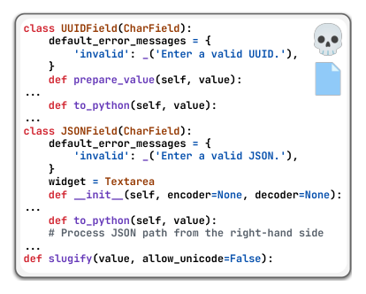
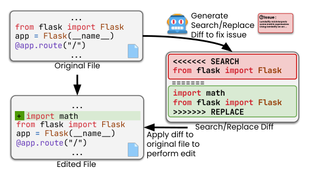
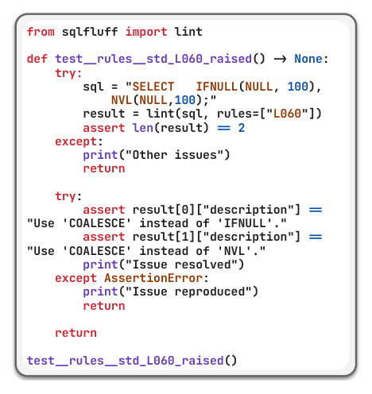
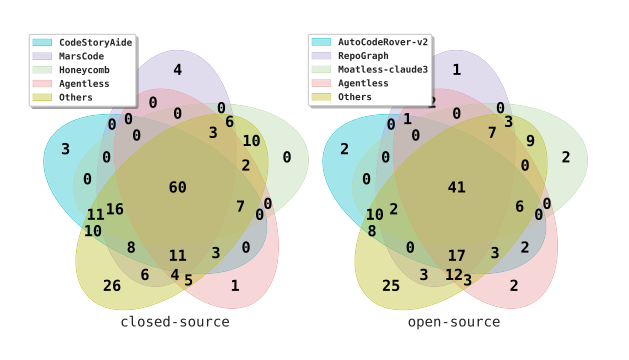
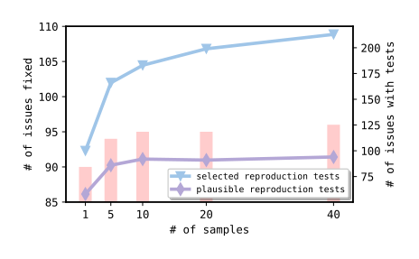
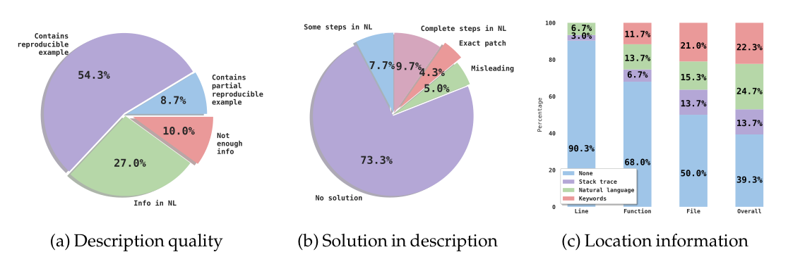
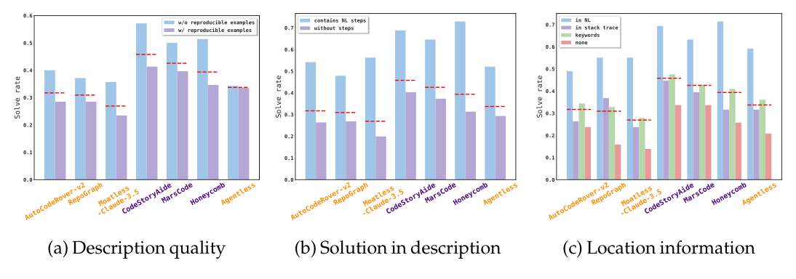

# Agentless 😺: LLM ベースのソフトウェアエンジニアリングエージェントの謎を解く

> 原題: Agentless 😺: Demystifying LLM-based Software Engineering Agents
> 著者: Chunqiu Steven Xia, Yinlin Deng, Soren Dunn, Lingming Zhang（University of Illinois Urbana-Champaign）
> 出典: arXiv:2407.01489（ar5iv のクリップ。arXiv v2, 2024-10-29）

> ［訳注］ar5iv のクリップを底本とし、ar5iv の原ページ（2026-10-25 取得）と arXiv の PDF v2（クリップと同じ版）で照合した。復元した点は次のとおり。(1) **タイトルの絵文字が欠落**していた（原題は「Agentless 😺:」）。§3.1〜3.3 の見出しの絵文字（🙀・😼・😸）も同様に欠落していたので、Unicode の文字で補った。(2) **序論の「エージェント型の手法の限界」の 3 項目の箇条書きが丸ごと欠落**していたので、ar5iv から復元した。(3) **図 1〜9 の画像がすべて欠落**し、キャプションだけが残っていた。ar5iv の原ページにも図の画像がなかったので、PDF v2 から図の範囲を切り出して `raw/assets/2024-agentless/` に保存した。(4) **表 1・表 5・表 6 の数値がすべて欠落**し、キャプションだけが残っていたので、ar5iv の HTML から表を復元した。表 2 は HTML の表を markdown に直した。表中の各ツールの引用記号は省略し、使用モデルの提供元を示すロゴ（OpenAI・Anthropic）はモデル名と重複するので省いた。(5) クローズドソースを示す記号 🔒、Agentless の旧版にもとづくことを示す記号 😺、モデルが一部不明であることを示す記号 ❓ が本文とキャプションから欠落していたので補った。(6) **脚注 1〜3 の本文が欠落**していたので ar5iv から復元した（脚注 1 はクリップでは空の参考文献 `[^1]` に化けていた。脚注 4 は謝辞の中なので謝辞とともに訳出しない）。(7) §6.2 の見出しが「SWE-bench Lite-SS」と重複していたので「SWE-bench Lite-*S*」に直した。参考文献の一覧と謝辞は既定どおり訳出せず、本文の `[^N]` は原典の番号のまま残した。付録はない。

## Abstract（要旨）

大規模言語モデル（LLM）の最近の進歩は、コード合成、プログラム修復、テスト生成を含むソフトウェア開発タスクの自動化を大きく前進させた。さらに最近では、研究者と産業界の実務者が、エンドツーエンドのソフトウェア開発タスクを行うさまざまな自律的な *LLM エージェント* を開発してきた。これらのエージェントは、ツールを使い、コマンドを実行し、環境からのフィードバックを観測し、将来の行動を計画する能力を備えている。しかし、こうしたエージェントにもとづく手法の複雑さと、現在の LLM の限られた能力とがあいまって、次の問いが生じる。*私たちは本当に複雑な自律的ソフトウェアエージェントを使わなければならないのか？* この問いに答えるため、私たちは Agentless を構築する。これは、ソフトウェア開発のイシューを自動で解決する *エージェントレス* なアプローチである。エージェントにもとづく手法の冗長で複雑な構成と比べて、Agentless は、LLM に将来の行動を決めさせたり複雑なツールを操作させたりすることなく、位置の特定（localization）、修復（repair）、パッチの検証（patch validation）という単純な 3 段階の過程を用いる。人気のある SWE-bench Lite ベンチマークでの私たちの結果は、驚くべきことに、単純な Agentless が、既存のすべてのオープンソースのソフトウェアエージェントと比べて、最高の性能（32.00%、正しい修正 96 件）と低いコスト（0.70 ドル）の両方を達成できることを示している！ 実際、*Agentless はすでに OpenAI によって、GPT-4o と新しい OpenAI o1 モデルの両方の現実世界のコーディング性能を示すための定番のアプローチとして採用されている*。さらに、私たちは SWE-bench Lite の問題を手作業で分類し、正解パッチそのものを含む問題や、イシューの記述が不十分または誤解を招く問題があることを見出した。そのため、こうした問題のあるイシューを除外して SWE-bench Lite-$S$ を構築し、より厳密な評価と比較を行う。私たちの研究は、自律的なソフトウェア開発において、単純で費用対効果の高い技法の、現在見過ごされている可能性を浮き彫りにする。Agentless が、自律的なソフトウェアエージェントのベースライン、出発点、視野をリセットする助けとなり、この重要な方向での今後の研究を刺激することを願う。Agentless は次の場所でオープンソースとして公開している: [https://github.com/OpenAutoCoder/Agentless](https://github.com/OpenAutoCoder/Agentless)

## 1 Introduction（はじめに）

大規模言語モデル（LLM）は、コード生成の定番の既定の選択肢になった [^32] [^29] [^54] [^90]。GPT-4 [^72] や Claude 3.5 Sonnet [^27] のような最先端の LLM は、与えられたユーザーの記述にもとづいてコード片を合成できるという手腕を示してきた。しかし、単純で自己完結した問題という主な評価設定と比べて、リポジトリレベルのソフトウェアエンジニアリングのタスクに LLM を適用することは十分に研究されてこなかった。機能の追加、プログラムの修復、テスト生成のようなソフトウェアエンジニアリングのタスクは、何千行ものコードを含むファイルの中の情報だけでなく、ファイルをまたぐリポジトリレベルの依存関係についての深い理解を必要とする。

最近、この溝に対処し、現実世界のソフトウェアエンジニアリングの問題を自動で解くツールの能力を評価するため、人気のある SWE-bench [^45] ベンチマークが開発された。SWE-bench では、各問題は現実世界の GitHub のイシューの記述と、対応する Python のリポジトリからなる。タスクは、バグを修正するか新しい機能を導入するかして、イシューを解決するようリポジトリを変更することである。最近、著者らはベンチマークの部分集合である SWE-bench Lite [^24]（300 問）を公開した。これはさらなる絞り込みを行い、バグ修正のイシューに焦点を当てている。

SWE-bench の難しい現実世界のソフトウェア開発の問題を解くため、Devin AI Software Engineer [^8] に触発されて、学術界と産業界の両方から、*エージェントにもとづく*（agent-based）アプローチの開発に焦点を当てた多くの研究が行われてきた [^109] [^38] [^102] [^31] [^65] [^30]。エージェントにもとづくアプローチに固定の定義はないが、それらは一般に、LLM にツールの集合を備えさせ、エージェントが反復的かつ自律的に行動を行い、フィードバックを観測し、将来のステップを計画できるようにする [^57]。ツールの例には、ファイルを開く・書く・作成する能力、コードの行を検索する能力、テストを実行する能力、シェルコマンドを実行する能力が含まれうる。問題を解く各試行において、エージェントにもとづくアプローチは複数のターンを持ち、各ターンは 1 つの行動を行うことからなる。後続のターンは、それ以前の行動と、エージェントが環境から受け取るフィードバックの情報に依存する。

一見すると、エージェントにもとづくアプローチは、ソフトウェア開発のタスクに取り組む自然で率直な方法に見える。結局のところ、人間の開発者も同様の行動を行い、フィードバックを使って将来のステップを計画するからである。しかし、人間と現在の LLM の能力の差は、エージェントにもとづくアプローチに次の限界をもたらす。

- **複雑なツールの使用・設計。** ツールを利用するため、現在のエージェントにもとづくアプローチは、エージェントと環境の間に抽象化の層を置く。例としては、実際の行動を API 呼び出しに対応づけ、エージェントが API 呼び出しの指示を出力することでツールを使えるようにすることが挙げられる。しかし、こうした抽象化と API 呼び出しの仕様は、入出力の形式の慎重な設計を必要とし、特により複雑な行動空間では、不正確または不精密なツールの設計・使用に容易につながりうる。現在の行動・計画が以前のターンに依存するというエージェントにもとづくアプローチの反復的な性質を考えると、ツールを不正確または不精密に定義・使用することは、性能を下げるとともに、無駄な LLM への問い合わせによる追加のコストを生みうる。
- **意思決定の計画における制御の欠如。** ツールの使用に加えて、現在のエージェントにもとづくアプローチは、意思決定の過程もエージェントに委ね、いつどの行動を行うかをエージェントに決めさせる。エージェントは、それまでに行った行動と環境から与えられたフィードバックにもとづいて現在とるべき行動を決めるが、とった行動が理にかなっているかを確かめるチェックはしばしば最小限である。可能な行動空間とフィードバックの応答が大きいため、自律的なエージェントが混乱して最適でない探索を行うことは極めて容易に起こりうる。さらに、1 つのイシューを解くのに、エージェントは 30 や 40 を超えるターンをとることがあり、それによってエージェントが下した決定を理解することも、誤った決定が下された正確なターンをデバッグすることも極めて難しくなる。
- **自己反省の能力の限界。** 既存のエージェントは、自己反省（self-reflection）を行う能力に苦労している（Olausson et al. 2023; Huang et al. 2024）。つまり、エージェントはすべての情報・フィードバックを取り込む傾向があり、無関係な、誤った、あるいは誤解を招く情報をどう除外または訂正すればよいかを知らない（Shi et al. 2023; Zhang et al. 2023）。自己反省の能力が限られているということは、1 つの誤ったステップが容易に増幅され、エージェントが下す将来のすべての決定に悪影響を及ぼしうることを意味する。

本論文で私たちは、ソフトウェア開発のためにますます複雑な LLM のエージェントにもとづくアプローチとツールの開発へと急ぐ（それらは完全に自律的な構成のために、使うことも再現することも容易ではありえない）のではなく、まず一歩引いて、次の内省的な問いを立てるべきだと主張する。*私たちは本当に複雑な自律的ソフトウェアエージェントを使わなければならないのか？*

**私たちの研究。** 私たちは、ソフトウェア開発のイシューを自動で解決する *エージェントレス* なアプローチである Agentless を構築することで、この重要な問いに答えようとした。各イシューを解くために、Agentless は、位置の特定、修復、パッチの検証という単純な 3 段階の過程に従う。位置の特定の過程では、Agentless は階層的な過程を用いて、まず欠陥を特定のファイルに、次に関連するクラスや関数に、最後に細粒度の編集位置に絞り込む。Agentless の位置の特定の過程は、LLM にもとづく位置の特定と、古典的な情報検索にもとづく位置の特定の考え方 [^110] の両方を利用する。修復を行うため、Agentless は特定した編集位置をとり、単純な diff 形式で複数の候補パッチを生成する。同時に、Agentless は、元のエラーを再現でき、候補パッチの選択に役立つ再現テストを生成する。最後に、Agentless は残ったすべてのパッチを再ランキングし、イシューを修正するために提出するものを 1 つ選ぶ。Agentless は各詳細タスクを行うのに LLM を利用するが、先行する複雑なエージェントにもとづくツールとは異なり、Agentless は LLM に将来の行動を *自律的に* 決めさせたり、複雑なツールを操作させたりしない。エージェントの使用を避けるという私たちの意図的な選択は、Agentless が理解しやすい単純で率直な設計を持つことを可能にするだけでなく、ソフトウェア開発における LLM エージェントの上述の限界を避ける助けにもなる。私たちは人気のある SWE-bench Lite [^24] ベンチマークで Agentless を評価し、Agentless がすべてのオープンソースのアプローチの中で最高の性能（32.00%）を達成するだけでなく、それをわずかなコストで行うことを示す！

さらに、私たちは SWE-bench Lite データセットについて細粒度の手作業の分析を行い、そのすべての問題を、問題の記述、正解パッチ、バグの位置の情報といった次元にわたって異なるカテゴリに分類した。驚くべきことに、SWE-bench Lite には、記述の中に正解パッチそのものを含む問題（4.3%）、イシューを解くのに必要な決定的な情報が欠けている問題（10.0%）、イシューの記述に誤解を招く解決策を含む問題（5.0%）があることを観察した。これらの問題を認識して、私たちは、こうした問題のある問題を取り除き、現実世界のソフトウェア開発の課題を解く能力を評価するためのより厳密なベンチマークとして機能する SWE-bench Lite-$S$ を構築した。全体として、リーダーボードの上位を得ることに焦点が当てられている時代にあって、私たちの研究は、自律的なソフトウェア開発における、単純で費用対効果の高い技法の見過ごされた可能性を浮き彫りにする。Agentless が、自律的なソフトウェアエージェントのベースライン、出発点、視野をリセットする助けとなり、この重要な方向での今後の研究を刺激することを願う。

**貢献。** 本研究で、私たちは次の貢献を行う。

- *エージェントレス* なアプローチ。ソフトウェア開発の問題を自動で解く *エージェントレス* なアプローチである Agentless を提案する。Agentless は、LLM を活用したプロンプトにもとづく検索と埋め込みにもとづく検索を利用して、階層的な位置の特定を行う。修復の間、Agentless は効率的なパッチ生成のために、単純な diff 形式で複数の候補パッチをサンプリングする。次に Agentless は、イシューが解決されたことを検証するための再現テストを生成する。最後に、Agentless は回帰テストと生成した再現テストの両方を利用して、最終的に提出するパッチを選ぶ。
- 広範な評価。人気のある SWE-bench Lite データセットで、最先端のエージェントにもとづくアプローチと比較して Agentless を評価する。私たちの結果は、Agentless がすべてのオープンソースのアプローチより高い性能（32.00%、正しい修正 96 件）を、比較的低いコストで達成できることを示している。これは、自律的なソフトウェア開発における単純な技法の、これまで見過ごされてきた可能性を示している。加えて、*Agentless はすでに OpenAI によって、GPT-4o [^35] と新しい o1 モデルファミリー [^75] の現実世界のコーディング性能を示すための定番のアプローチとして採用されている*。さらに、Agentless のさまざまな構成要素が最終的な性能に与える効果を理解するため、厳密なアブレーション研究を行う。
- SWE-bench Lite-$S$ ベンチマーク。人気のある SWE-bench Lite データセットの問題について手作業の分類を行った。不明瞭で誤解を招くイシューの記述を持つ問題のある問題や、正解パッチそのものを含む問題があることを見出した。これらの問題に対処するため、こうした問題のあるイシューを除外した絞り込み済みのデータセット SWE-bench Lite-$S$ を構築し、より厳密な評価と比較を可能にした。このことは最近 OpenAI によっても確認されており、OpenAI は私たちのベンチマークを認め、同じ方向で SWE-bench Verified [^35] を公開した。

## 2 Background and Related Work（背景と関連研究）

### 2.1 Agent-based Software Engineering（エージェントにもとづくソフトウェアエンジニアリング）

エージェントにもとづくフレームワーク [^93] の登場と普及にともない、最近、研究者と産業界の実務者は、ソフトウェアエンジニアリングのタスクを解くエージェントにもとづくアプローチの開発を始めた。Devin [^8]（およびオープンソースの代替である OpenDevin [^18]）は、最初のエンドツーエンドの LLM のエージェントにもとづくフレームワークの 1 つである。Devin は、エージェントを使ってまずユーザーの要求にもとづいて計画を行い、次にエージェントがファイルエディタ、ターミナル、Web 検索エンジンのツールを使って反復的にタスクを行えるようにする。SWE-agent [^102] は、LLM エージェントがファイルの読み取り、編集、bash コマンドの実行といった行動でリポジトリの環境と相互作用できる、独自のエージェントとコンピュータのインターフェース（ACI）を設計している。Aider [^38] は、まず静的解析とコールグラフ解析で構築した詳細なリポジトリマップを LLM に提供して、編集が必要なファイルを特定させる。次に、編集用のパッチとして単純な diff 形式を生成し、回帰テストを使ってパッチがもっともらしいかを検証する。Moatless [^16] は、エージェントにコード検索のツールと、LLM が構築したクエリを使う検索手法の両方を提供することで、関連するコードの位置を得る別のオープンソースのエージェントツールである。Aider と同様に、Moatless も最終的に提出するパッチとして単純な diff 形式を生成する。AutoCodeRover [^109] はさらに、LLM エージェントに特定のコード検索 API（例: あるクラスの中のメソッドを検索する）を提供して、コードの文脈を反復的に取得し、バグの位置を特定する。SpecRover [^82] は後に AutoCodeRover を改良し、関数の要約と、特定のエージェントのステップでのフィードバックメッセージを生成することで、仕様（すなわち、意図されたプログラムの振る舞いを推論すること）を対象にする。さらに SpecRover は、最終的なパッチの選択に使う、元のイシューを再現する再現テストの生成も試みる。これらの代表例に加えて、オープンソース [^38] [^20] [^6] [^105] とクローズドソース・商用製品 [^30] [^31] [^65] [^14] [^10] [^2] [^17] [^59] [^5] [^23] [^21] [^13] [^15] [^11] [^3] の両方で、他にも多数のエージェントにもとづくアプローチが開発されてきた。

これらのエージェントにもとづく技法と比べて、Agentless は、現実世界のソフトウェアエンジニアリングのイシューに取り組むための、単純で、解釈可能で、費用対効果の高い解決策を提供する。エージェントにもとづくツールとは異なり、Agentless は、LLM エージェントに将来の行動を決めさせたり複雑なツールを使わせたりすることなく、位置の特定、修復、パッチの検証というよく定義された段階を持つ。Agentless は、過剰なツールを提供したり、複雑な環境の振る舞い・フィードバックをモデル化したりしなければならないという追加の重荷なしに、*エージェントレス* なアプローチが非常に競争力のある性能を達成できることを初めて示す。

### 2.2 Fault Localization and Program Repair（欠陥の位置特定とプログラム修復）

欠陥の位置特定（Fault localization, FL）[^91] の技法は、バグに関連するソースコード中の疑わしい位置（例: 文やメソッド）を特定することを目指す。動的な FL の技法には主に、スペクトラムにもとづく FL（SBFL）[^48] [^26] [^25] とミューテーションにもとづく FL（MBFL）[^78] [^69] [^64] がある。SBFL は通常、主に失敗するテストに網羅されるソースコードの位置を、主に通るテストに網羅される位置より疑わしいとして計算する。MBFL はそれを改良し、各ソースコードの位置がテストの結果に与える影響（ミューテーションテスト [^77] を使って測る）を追加で考慮する。動的な技法のほかに、研究者は静的な FL のために情報検索（IR）の技法 [^86] を直接利用することも提案してきた。こうした IR にもとづく技法 [^88] [^83] [^89] は、FL を検索問題として定式化し、コードの要素とバグ報告（すなわちクエリ）の間のテキストの類似度を比べる。さらに、動的・静的な情報の複数の情報源を組み合わせるために機械学習を利用する学習にもとづく技法も提案されており、DeepFL [^55]、FLUCCS [^87]、TRANSFER [^68] がある。最近、研究者は LLM にもとづく FL [^99] [^92] [^80] [^49] を提案しており、これは現代の LLM の強力なコードと自然言語の理解を利用してバグの位置を直接特定する。一方で、そうした LLM にもとづく技法のほとんどは、LLM のコンテキストウィンドウが限られているためにリポジトリレベルの FL を行えないか [^99]、コードベースを辿るのに複雑で高価なエージェント的設計に頼っている [^49] [^80]。対照的に、Agentless は単純な階層的 FL の過程（LLM と IR の両方にもとづく）を用いて、細粒度の編集位置を効率的に計算する。

バグの位置を特定したあと、次のステップは修復を行うことである。自動プログラム修復 [^39]（APR）は、バグのためのパッチを自動で生成するために広く研究されてきた。従来の APR の技法は、テンプレートにもとづくもの [^58] [^40]、ヒューリスティクスにもとづくもの [^52] [^51]、制約にもとづくもの [^66] [^62] のツールに分類できる。効果的ではあるが、従来の APR のツールはスケーラビリティの問題を抱え、パッチの多様性に制限がある。そのため、研究者は、NMT（ニューラル機械翻訳）モデルを訓練する [^44] [^56] [^34] [^111] か、事前訓練済みの LLM を使って修復を行う [^97] [^95] [^50] [^107] 学習にもとづく APR のツールを提案してきた。具体的には、バグごとに複数の候補パッチをサンプリングする LLM にもとづく APR のツールが、現代の LLM の強力なコーディング能力のために最先端であることが示されている [^95]。さらに最近では、エージェントにもとづく APR の技法も提案されている [^98] [^30] [^41] [^33] [^106]。既存の LLM にもとづく APR のツールに触発されて、Agentless は正しい修正を生成する可能性を最大化するため、イシューごとに複数の候補パッチをサンプリングする。ほとんどの LLM にもとづく APR の技法とは異なり、Agentless は単純な diff 形式 [^38] を使ってパッチを生成し、完全なコードの生成を避けて、代わりに費用効率の良い小さな編集の生成に集中し、パッチ生成の信頼性と精度を高める（ハルシネーションの機会が少ない）。さらに、ほとんどの先行研究で研究されてきた単純なバグ [^95] とは異なり、Agentless は複数の位置にまたがる複雑なリポジトリレベルのイシューを対象にする。

### 2.3 LLM-based Test Generation（LLM にもとづくテスト生成）

バグの位置の特定と修復に加えて、LLM を採用してきた別の研究領域がテスト生成である。テスト生成の 1 つの領域はファズテスト [^104]（ファジングとも呼ばれる）であり、システムのバグを露呈させるために大量の入力を生成する。研究者は、深層学習ライブラリ [^36] [^37]、OS のカーネル [^101] [^71]、コンパイラ [^94] [^100] [^76]、ネットワークプロトコル [^67]、モバイルアプリケーション [^60] のような領域で、ファジングを行うために LLM を適用してきた。LLM にもとづくファザーは、従来のファザーでは見つからなかった多くのバグを検出することや、新しいファジングの領域を開くことで、その影響力を示してきた。ファジングのほかに、研究者は個々のソフトウェアの単位（例: メソッド・クラス）をテストする単体テストの生成に LLM を利用することも提案しており [^57]、CodeMosa [^53]、ChatTester [^103]、TestPilot [^84]、CoverUp [^79] がある。

バグの再現は、バグ報告を調査するうえで決定的なステップであり [^47]、最近の多くのソフトウェアエンジニアリングのエージェントに統合されている [^18] [^82] [^11] [^15] [^10] [^102] [^28]。例えば SpecRover [^82] は、バグ報告に記述されたイシューを再現するテストを生成することから始め、そのテストが文脈の取得とパッチ作成の過程を導く。再現テストを生成し、そのテストが正しいかどうかの判断を LLM エージェントに頼るこうしたエージェントにもとづくアプローチとは異なり、Agentless は単に複数のサンプリングしたテストを実行し、実行結果がイシューの再現を示しているかを検証する。

## 3 Agentless Approach（Agentless のアプローチ）

<figure>

<figcaption>図1: Agentless の概要。［訳注: 図中の番号 1〜10 は処理の順序。青の領域が位置の特定、紫が修復、緑がパッチの検証で、ロボットのアイコンは LLM、スキャナのアイコンは埋め込みを表す］</figcaption>
</figure>

図 1 は Agentless の概要を示しており、位置の特定、修復、パッチの検証の 3 つの段階からなる。まず、イシューの記述と既存のプロジェクトのコードベースを入力として受け取る。次に、プロジェクトのコードベースを、プロジェクト中の各ファイルの相対的な位置を示す木のような構造に変換することで、階層的な位置の特定の過程を始める。次に、このリポジトリの構造を元のイシューの記述とともに使い、イシューを解くのに編集が必要そうな最も疑わしいファイルの上位 N 件を特定して順位づけるよう LLM にプロンプトで指示する。私たちのリポジトリの構造の形式は詳細なソースコードの情報を含まないので、加えて、埋め込みにもとづく検索を使って、イシューの記述に最も関連するコード片を持つファイルを取得する。次に、取得したファイルを LLM が特定したファイルと組み合わせて、疑わしいファイルの最終的な一覧を得る。しかし、各ファイルの内容のすべてを変更する必要があるわけではない。そこで、各ファイルのスケルトン（すなわち、クラスと関数の宣言の見出しの一覧）を提供し、バグを修正するためにより詳しく調べるべきクラスと関数の具体的な一覧を出力するよう LLM に求める。次に、それらの位置の完全なコードの内容を提供し、より小さな編集位置（すなわち、クラス、関数、あるいは特定の行）の集合を確定するよう LLM に求める。修復の段階では、これらの編集位置のコード片をイシューの記述とともに提供し、イシューを解く複数のパッチをサンプリングするよう LLM にプロンプトで指示する。次に、パッチの検証の段階に入り、まず元のイシューを再現することを目指す複数の再現テストをサンプリングするよう LLM に求め、次に元のコードベースでの実際の実行結果にもとづいて最適なものを選ぶ。Agentless は、パッチのランキング・選択に、再現テストを既存の回帰テストとともに使う。最後に、Agentless は最上位のパッチを提出用の最終的なパッチとして選ぶ。以下では、Agentless の各段階のステップをより詳しく述べる。

### 3.1 Localization（位置の特定）🙀

修正したり新しい機能を実装したりするための最初のステップは、ソースコード中の位置を得ることである。正しい位置なしには、正しい編集を与えることは不可能でありうるからである。難しさは、リポジトリには数千行のコードを持つファイルが何百もありうるのに対し、編集すべき正しい位置は選ばれた数行か数個の関数にすぎないという事実にある。Agentless は、単純な 3 ステップの階層的な位置の特定の過程を使ってこれに対処する。1) 疑わしいファイルに絞り込む。2) 選んだ各ファイルを関連するクラス、関数、変数に絞り込む。3) コードの編集位置に絞り込む。

#### 3.1.1 Localize to suspicious files.（疑わしいファイルに絞り込む）

まず、Agentless は潜在的な位置を特定の疑わしいファイルに絞り込む。各ファイルの完全なコード片を提供する代わりに、Agentless は、Linux の tree コマンドに似た、リポジトリのファイルとディレクトリの構造の簡潔な表現を構築する。これをリポジトリ構造の形式と呼び、リポジトリのルートフォルダから始めて、コードのファイルやフォルダの名前を整理する。同じディレクトリ階層にあるファイルとフォルダは縦にそろえ、サブディレクトリの中のファイル・フォルダは字下げする。リポジトリ全体を再帰的に辿って構造を得て、それを LLM への入力として使う。リポジトリ構造の形式は、元のコードベースの組織の情報を保つために、必要なファイルのパスを隣接するファイル名とともに提供する。次に Agentless は、処理したリポジトリの構造を元のイシューの記述とともに LLM に入力し、イシューを解くためにさらなる調査や変更が必要な、疑わしいファイルの上位 N 件の一覧を特定するよう求める。

プロンプトにもとづく位置の特定（ファイル名のみを使う）を補うため、Agentless は追加の疑わしいファイルを特定する単純な埋め込みにもとづく検索手法も使う。ただし、リポジトリのすべてのファイルを埋め込む代わりに、Agentless はまず無関係なフォルダを除外する。これは、前述のリポジトリの構造を提供し、イシューを解くためにさらなる調査や変更が不要な *無関係な* フォルダの一覧を作るよう LLM に求めることで行う。これらの無関係なフォルダのすべてのファイルを取り除いたあと、Agentless は残った各ファイルをコードの断片のチャンクに分割し、埋め込みモデルを使って各チャンクの埋め込みを計算する。次に Agentless は、元のイシューの記述（すなわちクエリ）を埋め込み、得られたクエリの埋め込みと各チャンクの埋め込みの間のコサイン類似度を計算して、クエリとの類似度が最も高いコードの断片を含む関連ファイルの一覧を取得する。最後に Agentless は、プロンプトで得たファイルと埋め込みで取得したファイルを、両方で特定された最も共通する上位 N 件のファイルを選ぶことで組み合わせ、関連ファイルの最終的な一覧を得る。

<figure>

<figcaption>図2: ファイルのスケルトン形式。</figcaption>
</figure>

#### 3.1.2 Localize to related elements.（関連する要素に絞り込む）

疑わしいファイルの一覧を得たあと、Agentless は位置の特定の過程の 2 番目の部分、すなわちこれらのファイルの中の関連する要素の特定に進む。すべてのファイルの完全な文脈を直接提供すると、大きくなりうる。そこで、Agentless は、クラス、関数、変数の宣言の一覧を含む各ファイルの圧縮された形式を構築する。この形式をスケルトン形式と呼び、例を図 2 に示す。スケルトン形式では、ファイル中のクラスと関数の見出しだけを提供する。クラスについては、さらにクラスのフィールドとメソッド（シグネチャのみ）を含める。加えて、さらなる情報を提供するために、クラスとモジュールのレベルのコメントも残す。モデルにファイル全体の文脈を提供するのと比べて、スケルトン形式ははるかに簡潔な表現であり、特にファイルが何千行も含み、既存の LLM で一度にすべてを処理するのが非実用的・高価になる場合にそうである。すべての疑わしいファイルのスケルトンを単一のプロンプトで一度に LLM に提供し、モデルが関連する情報を包括的に分析して最も関連する要素を決められるようにする。この入力を使って、提供したイシューを修正するために調べるべき関連するクラスと関数の一覧を出すよう LLM にプロンプトで指示する。

<figure>

<figcaption>図3: Search/Replace の編集形式。</figcaption>
</figure>

#### 3.1.3 Localize to edit locations.（編集位置に絞り込む）

前の位置の特定のステップは関連するコードの要素の一覧を提供した。上位 N 件の疑わしいファイルを特定するので、特定したこれらの関連するコードの要素は異なるファイルからのものでありうる。次に、これらの要素のコードの内容を LLM に直接提供し、具体的な編集位置を特定するよう求める。ファイル全体を使うのと比べて、ここでの入力の文脈ははるかに小さい。この入力で、次に LLM に、行番号、関数、またはクラスで指定される編集位置の最終的な集合を特定するよう求める。私たちの単純な階層的な位置の特定によって、Agentless は修復のための編集位置として関連するコード片の集合を選べる。

### 3.2 Repair（修復）😼

修復の段階では、目標はイシューを解く正しいパッチを作ることである。LLM にもとづくプログラム修復の既存の研究 [^97] [^50] [^96] [^43] に従い、まず特定した編集位置を使い、修復のために LLM に提供するコード片の文脈ウィンドウを構築する。例えば、特定した位置が 40 行目から 78 行目のクラスであれば、$[40 - x, 78 + x]$ の文脈ウィンドウを作る。ここで $x$ は文脈ウィンドウのサイズを表す。特定した位置の前後に追加のコードを加える直観は、よりよいプログラム修復のために関連する文脈情報を LLM に提供することにある [^97]。複数の編集位置が特定された場合は、これらの文脈ウィンドウを「...」で区切って連結し、間の文脈が欠けていることを示す。

コード片を使って、次にイシューを解くパッチを生成するよう LLM に求める。ただし、与えられた文脈全体を置き換えるコード片全体を直接作る代わりに、Agentless は LLM に Search/Replace の編集 [^38] を生成するよう求める。これは各パッチを効率的に作るための単純な diff 形式である。図 3 は Search/Replace 形式の例を示しており、2 つの主な部分を含む。1) search: 置き換えたい元のコード片、2) replace: 置き換え先のコード片。生成した Search/Replace の diff を元のファイルに適用するには、search のコード片を単に照合し、replace のもので置き換えればよい。この単純な diff 形式は完全なコードの生成を避け、代わりに小さな編集を作ることに集中し、それはより費用効率が良いだけでなく、より信頼でき正確でもある（ハルシネーションの機会が少ない）。各イシューについて、Agentless は LLM を使って複数の潜在的なパッチを生成する（貪欲から始め、次により高い温度で複数のパッチをサンプリングする）。

### 3.3 Patch Validation（パッチの検証）😸

<figure>

<figcaption>図4: 再現テストの例。</figcaption>
</figure>

#### 3.3.1 Reproduction test generation.（再現テストの生成）

Agentless はイシューごとに複数の候補パッチを生成するので、提出する最終的なパッチを選ぶ方法が必要である。現実的な SWE-bench の設定では、元のプロジェクトのコードベースは回帰テストだけを提供でき、再現テスト（すなわちバグを引き起こすテスト）は提供できないことに注意されたい。これは、イシューがちょうど立てられたばかりで、開発者がイシューを引き起こす追加のテストをまだ加えていないからである。そのため、生成と検証（Generate-and-Validate）のプログラム修復の設定 [^63] とは異なり、バグを引き起こすテストを利用できない。

先行研究 [^82] [^31] に従い、Agentless はパッチの選択を助けるために追加の再現テストを生成する。より具体的には、Agentless は LLM を利用して、イシューの記述に記述された元のイシューを再現することと、イシューが修正されたかどうかを検証することの両方を試みる完全なテストファイルを合成する。図 4 は、モデルに合成させたい再現テストの例を示している。イシューが再現された場合、テストの結果は `Issue reproduced` を出力すべきである。一方、イシューが修正されていれば、テストは `Issue resolved` を出力すべきである。テストが予期しない問題に遭遇した場合のために、`Other issues` という別の出力も含める。再現テストを生成するため、Agentless は、テストの形式を示す再現テストの例とともに、元のイシューの記述を提供する。修復と同様に、複数の候補の再現テストもサンプリングし、次に元のリポジトリで各テストを実行して、`Issue reproduced` を出力しないテストを除外する。最後に、各テストを正規化し（コメント、余分な空白を取り除き、テスト名を正規化する）、出現回数が最も多いテストを各イシューの最終的な再現テストとして選ぶ。

#### 3.3.2 Patch selection.（パッチの選択）

生成した再現テストを使って、最終的に提出するパッチを選ぶパッチ選択の過程を始める。Agentless はまず、リポジトリの既存のテストをすべて実行し、元のコードベースでうまく通るテストの集合を特定する。しかし、イシューを解くには既存の機能の一部を変更する必要があるかもしれないので、それらの通るテストのすべてを回帰テストとみなすべきではない。そこで、Agentless は通るテストの一覧を LLM に提供し、イシューが正しく修正されたかを確かめるのに実行すべきでないテスト（すなわち、イシューの修正中に更新・修正されうるテスト）を特定するよう求める。LLM が特定した回帰テストでないテストを取り除いたあと、回帰テストの最終的な集合を得る。次に、生成したすべてのパッチで回帰テストの集合を実行する。次に Agentless は、回帰テストの失敗数が最も少ないパッチを残す。それらのパッチについて、Agentless は次に選んだ再現テストを実行し、`Issue resolved` を出力するパッチだけを残す。一方で、再現テストは LLM が生成したものであり、誤っている・不正確である可能性があるので、どのパッチも再現テストを通らないことがありうる。その場合、Agentless は回帰テストの結果だけを選択に使うことにフォールバックする。次に Agentless は、多数決を使った再ランキングのアプローチを適用する。まず、表面的な違い（例: 余分な空白、改行、コメント）を無視するために各パッチを正規化し、次に出現回数が最も多いパッチを提出用の最終的なパッチとして選ぶ。より具体的には、パッチを標準化するため、まず古いコードと新しいコード（パッチ適用後）の両方を抽象構文木に解析する。次に、木を docstring を取り除いた正準的なソースコードの形式に逆解析する。最後に、標準化した古いコードと新しいコードの間のテキストの差分を計算し、正規化したパッチを得る。

Agentless は、単純な段階的手順を使ってリポジトリレベルのイシューを解く。ここで、Agentless が使う技法のどれも単独では革命的ではなく、Agentless は既存の技法を巧みに組み合わせて理解しやすいアプローチを構築していることを記しておく。環境との複雑な相互作用をともなう先行する自律的なエージェントにもとづくツールとは異なり、Agentless は、意思決定にエージェントを一切頼ることなく、位置の特定、修復、検証のための単純な 3 段階のアプローチを使う。位置の特定を階層的に行うことで、Agentless は編集のための細粒度の位置を効率的かつ効果的に計算できる。次に Agentless は、単純な diff 形式を使って複数のパッチをサンプリングすることで修復を行う。Agentless のパッチの検証のアプローチは、イシューが修正されたかを検証するのに役立つ再現テストを作ることで、パッチの選択の過程をさらに助けることができる。

## 4 Experimental Setup（実験設定）

**データセット。** 現実世界のソフトウェアエンジニアリングのイシューを解く能力をテストするため、人気のある SWE-bench データセット [^45] を使って Agentless とベースラインを評価する。SWE-bench の各問題は、入力のイシューの記述に記述された根本的なイシューを解くパッチを提出することを求める。特に、より質の高い 300 の自己完結した問題を含む、広く使われている SWE-bench Lite 版 [^24] に焦点を当てる。さらに、潜在的な問題と偏りを示すだけでなく、よりよい評価のためにより厳密に絞り込んだ問題の集合を作るため、SWE-bench Lite ベンチマークについての詳細な研究（6.1 節）も行う。

**実装。** GPT-4o（gpt-4o-2024-05-13）[^73] を使って Agentless を実装する。既定では、貪欲デコーディングで LLM に問い合わせる。サンプリングの間は、サンプリング温度 $0.8$ を使う。埋め込みにもとづく検索手法については、LlamaIndex [^61] を使ってアプローチを実装する。チャンクサイズ 512、チャンクの重なり 0 で、OpenAI の text-embedding-3-small [^74] モデルを使って埋め込みを計算する。各イシューについて、まず上位 3 件の疑わしいファイルに絞り込み、次にこれらのファイルの中で数を制限しない疑わしいクラスと関数に絞り込む。これらはすべて貪欲デコーディングを使う。次に、正しい編集位置を見つける可能性を最大化するため、イシューごとに編集位置のサンプルを 4 つ引く（すなわち、位置の特定の段階の 3 番目のステップ）。これにより、イシューごとに編集位置の別々の集合が 4 つ得られる。各集合について、各編集位置の周りに $\pm$ 10 行の文脈ウィンドウを採用し、10 個のパッチ（1 つの貪欲と 9 つのサンプル）を生成する。これにより、バグごとに合計 40 個のパッチになる。先行研究 [^38] と同じ Search/Replace の編集形式を採用し、正規化のステップでの解析には Python 組み込みの ast ライブラリ [^19] を使う。再現テストを生成するため、パッチの選択の前に、同じく合計 40 個のサンプル（1 つの貪欲と 39 のサンプル）を生成する（3.3.1 節で述べた）。回帰テストは、まずすべてのテストを実行して元のリポジトリでうまく通るテストの集合を得て、次に LLM を使って回帰テストでないテストを特定することで得る（3.3.2 節で述べた）。SWE-bench のメンテナの要請に従い、SWE-bench の PASS\_TO\_PASS フィールドですでに特定されている回帰テストの一覧は直接は使わない[^n1]。任意の回帰テストと再現テストを自由に実行できるように、公式の SWE-bench の評価設定を変更する。

[^n1]: PASS\_TO\_PASS のテストを直接使うと、SWE-bench Lite での性能は 98 になる。［訳注: 脚注本文はクリップで欠落していたため ar5iv から復元］

**ベースライン。** Agentless を 26 のエージェントにもとづくアプローチと比較する。これらのベースラインのツールは、SWE-bench での最先端の性能を代表している。最先端のオープンソースのものと、商用またはクローズドソースのベースライン（🔒 で示す）を含める。ここで、クローズドソースのベースラインの大部分は軌跡を一切提供せず、提出パッチだけを提供していることを記しておく。そのため、最終的なパッチに至るまでにとられたステップを検証することはできない。さらに、比較のために、SWE-bench [^45] の一部として提案された、検索拡張生成（RAG）を使う単純なエージェントレスのベースラインも含める。この場合、エージェントレスのベースラインは、BM25 [^81] を使って取得した最も関連するファイルのファイル内容を LLM に提供することで、LLM を使ってパッチファイルを直接生成する。

**評価指標。** 先行研究 [^109] に従い、1) % Resolved: ベンチマークで解決した問題の割合、2) Avg. $ Cost: ツールを実行する平均の推論コスト、3) Avg. # Tokens: LLM への問い合わせに使った入力と出力のトークンの平均数、を報告する。加えて、% Correct Location: ツールが作ったパッチが、正解の開発者のパッチの編集位置を網羅している問題の割合も報告する。この指標は、ファイル、関数、行の 3 つの粒度で計算する。パッチが、正解パッチのすべての位置の上位集合を編集していれば、正しい位置を含むと報告する。ベースラインのツールについては、公式のリーダーボード [^46] またはツールの公式の論文・リポジトリで報告されている結果を直接使う。

## 5 Evaluation（評価）

**表1**: SWE-bench Lite での結果。注: 🔒 はクローズドソース（すなわちソースコードが公開されていない）のアプローチを示す。😺 は私たちの Agentless の以前の版の上に構築されたアプローチを示す。「-」は、これを計算するための関連情報が公開されていないことを示す。❓ は複数のモデルが使われているが、その一部が明示されていないことを示す。Claude 3.5 S は Claude 3.5 Sonnet の略である。［訳注: クリップでは表の数値が丸ごと欠落していたため ar5iv の HTML から復元。区切りの行は原典の罫線による区分（クローズドソース／オープンソース／RAG）を示すために訳者が加えた。原典の表中には 😺 の印が付いた行はない（PDF v2 でも同じ）］

| ツール | LLM | % Resolved | Avg. $ Cost | Avg. # Tokens | % Correct Location: 行 | 関数 | ファイル |
|---|---|---|---|---|---|---|---|
| *クローズドソース* | | | | | | | |
| CodeStory Aide 🔒 | GPT-4o+Claude 3.5 S | 129 (43.00%) | - | - | 41.7% | 58.7% | 72.0% |
| Bytedance MarsCode 🔒 | NA | 118 (39.33%) | - | - | 42.7% | 58.0% | 79.7% |
| Honeycomb 🔒 | NA | 115 (38.33%) | - | - | 44.3% | 57.0% | 69.3% |
| MentatBot 🔒 | GPT-4o | 114 (38.00%) | - | - | 37.3% | 53.3% | 69.3% |
| Gru 🔒 | NA | 107 (35.67%) | - | - | 38.3% | 54.3% | 75.0% |
| Isoform 🔒 | NA | 105 (35.00%) | - | 41,963 | 38.7% | 55.3% | 72.0% |
| SuperCoder2.0 🔒 | NA | 102 (34.00%) | - | - | 41.7% | 63.7% | 65.7% |
| Alibaba Lingma Agent 🔒 | GPT-4o+Claude 3.5 S | 99 (33.00%) | - | - | 40.0% | 58.7% | 75.0% |
| Factory Code Droid 🔒 | NA | 94 (31.33%) | - | - | 36.7% | 55.7% | 72.7% |
| Amazon Q Developer-v2 🔒 | NA | 89 (29.67%) | - | - | 40.3% | 52.0% | 74.3% |
| SpecRover 🔒 | GPT-4o+Claude 3.5 S | 93 (31.00%) | $0.65 | - | - | - | - |
| CodeR 🔒 | GPT-4 | 85 (28.33%) | $3.34 | 323,802 | 35.7% | 52.3% | 67.0% |
| MASAI 🔒 | NA | 84 (28.00%) | - | - | 38.7% | 56.3% | 75.0% |
| SIMA 🔒 | GPT-4o | 83 (27.67%) | $0.82 | - | 37.0% | 54.0% | 79.0% |
| IBM Research Agent-101 🔒 | NA | 80 (26.67%) | - | - | 39.7% | 56.7% | 73.3% |
| OpenCSG StarShip 🔒 | GPT-4 | 71 (23.67%) | - | - | 39.0% | 61.7% | 90.7% |
| Amazon Q Developer 🔒 | NA | 61 (20.33%) | - | - | 34.0% | 43.7% | 71.7% |
| RepoUnderstander 🔒 | GPT-4 | 64 (21.33%) | - | - | - | - | - |
| *オープンソース* | | | | | | | |
| AutoCodeRover-v2 | GPT-4o | 92 (30.67%) | - | - | 35.0% | 52.3% | 69.3% |
| RepoGraph | GPT-4o | 89 (29.67%) | - | - | 36.7% | 51.3% | 71.0% |
| Moatless | Claude 3.5 S | 80 (26.67%) | $0.17 | - | 38.7% | 54.7% | 78.7% |
| | GPT-4o | 74 (24.67%) | $0.14 | - | 36.0% | 52.0% | 73.0% |
| OpenDevin+CodeAct v1.8 | Claude 3.5 S | 80 (26.67%) | $1.14 | - | 38.0% | 49.7% | 67.3% |
| Aider | GPT-4o+Claude 3.5 S | 79 (26.33%) | - | - | 35.3% | 50.0% | 69.7% |
| SWE-agent | Claude 3.5 S | 69 (23.00%) | $1.62 | 521,208 | 40.7% | 54.3% | 72.0% |
| | GPT-4o | 55 (18.33%) | $2.53 | 498,346 | 29.3% | 42.3% | 58.3% |
| | GPT-4 | 54 (18.00%) | $2.51 | 245,008 | 30.7% | 45.3% | 61.0% |
| AppMap Navie | GPT-4o | 65 (21.67%) | - | - | 29.7% | 44.7% | 59.7% |
| AutoCodeRover | GPT-4 | 57 (19.00%) | $0.45 | 38,663 | 29.0% | 42.3% | 62.3% |
| *RAG* | | | | | | | |
| RAG | Claude 3 Opus | 13 (4.33%) | $0.25 | - | 22.0% | 30.0% | 57.0% |
| | GPT-4 | 8 (2.67%) | $0.13 | - | 12.7% | 23.3% | 47.3% |
| | Claude-2 | 9 (3.00%) | - | - | 16.7% | 24.3% | 46.7% |
| | GPT-3.5 | 1 (0.33%) | - | - | 6.3% | 11.3% | 27.3% |
| **Agentless** | GPT-4o | 96 (32.00%) | $0.70 | 78,166 | 35.3% | 52.0% | 69.7% |

### 5.1 Performance on SWE-bench Lite（SWE-bench Lite での性能）

表 1 は、SWE-bench Lite での Agentless と先行するエージェントにもとづくアプローチの主な評価結果を示している。Agentless は 300 問中 96 問（32.00%）を解けることを観察する。これは SWE-bench Lite で解いた問題の割合として最高ではないが、Agentless ははるかに単純な設計と全体の技法を使いながら、先行するエージェントにもとづくアプローチと比べて極めて競争力がある。ここで、上位の技法の多くはクローズドソース・商用であり、実験を再現するためのソースコードも、さらなる検証のための軌跡すらも公開していないことに注意することが重要である。すべてのオープンソースのアプローチと比べて、Agentless は SWE-bench Lite で最高の性能 32.00%（96 / 300）を達成できる。加えて、Agentless のコストは平均わずか 0.70 ドルで、ほとんどの先行するエージェントにもとづくアプローチより低い。RAG のエージェントレスのベースラインと比べると、Agentless はわずかにコストが高いが、はるかに多くのイシューを修正できることがわかる。

<figure>

<figcaption>図5: イシューの修正のベン図。［訳注: 左はクローズドソース（CodeStoryAide・MarsCode・Honeycomb・Agentless・Others）、右はオープンソース（AutoCodeRover-v2・RepoGraph・Moatless-claude3・Agentless・Others）］</figcaption>
</figure>

#### 5.1.1 Unique issues fixed.（固有に修正したイシュー）

図 5 は、上位のクローズドソース・商用およびオープンソースのアプローチと比べて、Agentless が固有に解いたイシューを示している（「Others」は各カテゴリ内の他のすべてのアプローチを示す）。まず、オープンソースのエージェントにもとづくツールと比べて、Agentless は他のどのツールも解決できない 2 つのイシューを修正できることがわかり、難しいイシューを解くうえで単純なエージェントレスのアプローチを使うことの成功を示している。さらに、高性能な商用のアプローチと比べても、Agentless はなお 1 つの固有の修正を提供できる。この固有の修正の少なさは、Agentless の以前の版の上にすでに構築されたツール（例: Isoform [^13]）や、Agentless に部分的に触発されたツール（例: Bytedance MarsCode [^59]）がすでにあり、それによって Agentless が解決する固有のイシューが減っているという事実に起因しうる。それでも、私たちの結果は、Agentless が既存のエージェントと比べて競争力がある・相補的でありうることを示している。

#### 5.1.2 Localization performance.（位置の特定の性能）

現実世界のソフトウェア開発では、イシューを直接修正することのほかに、正しい編集位置を開発者に提供することがデバッグに極めて役立つ。そこで、各技法が生成したパッチの位置を正解パッチと比べて調べる。ここで、正解とは異なる位置でバグを修正することも可能であるが、正解パッチと比べることはなお近似的な尺度として役立ちうることを記しておく。表 1 は加えて、各ツールについて、行、関数、ファイルのレベルにわたって、正しい位置を持つ提出パッチの割合を示している。まず、正しい位置を持つパッチの割合が解決率と強く相関することを観察する。興味深いことに、ファイルレベルの位置の最高の結果は OpenCSG StarShip の 90.0% であり［訳注: 表 1 の値は 90.7%。原典のまま］、最も性能の高いアプローチよりもかなり高い一方で、同時に解決率は比較的低い（23.67%）。OpenCSG StarShip はソースコードも詳細な軌跡も提供しない商用製品なので、位置の特定と修復の性能の間のこの大きな差を説明するのは難しい。位置の特定の性能の点では、私たちの単純な階層的アプローチを使うことで、Agentless は先行するエージェントにもとづくアプローチと比べて非常に競争力を保っている。

#### 5.1.3 Reproduction test results.（再現テストの結果）

Agentless は、最終的に提出するパッチを選ぶための絞り込みを行うために、回帰テストと生成した再現テストを使う。そこで、生成した再現テストの質を評価する。ここで、3.3.1 節で述べたとおり、生成した再現テストは、元のリポジトリで元のイシューをうまく再現できる場合にのみ使うことを記しておく。SWE-bench Lite の 300 問のうち、Agentless は、元のリポジトリで評価したときに必要な再現のメッセージを出力する再現テストを 213 個作ることができる。しかし、正しい再現はイシューが正しく解決されたことも検証できるべきなので、これらのテストはなお誤っている可能性がある。これを評価するため、SWE-bench で提供されている正解パッチを直接適用する[^n2]。正解パッチを適用したあとに `Issues resolved` のメッセージを正しく出力したテストはわずか 94 個であることがわかった。この急激な落ち込みは、問題で提供されるイシューの記述が、正しい解を検証するための完全なテストケースを生成するのに十分な情報を含まないことがあることで部分的に説明できる。しかし、この問題は部分的に緩和されている。Agentless は、すべてのパッチにまず回帰テストスイートを通ることを要求し、回帰テストを通れないが生成した再現テストは通るパッチを取り除くという保守的なアプローチをとるからである。これにより、誤った再現テストが正しいパッチを選ぶ可能性が下がる。さらに、生成したすべてのパッチが再現テストを通れない場合、Agentless は回帰テストの結果だけを選択に使うことにフォールバックする。5.2.3 節では、パッチの選択に回帰テストと再現テストの両方を使うことが性能に与える影響を詳しく調べる。

[^n2]: 正解パッチはここではテストの質を評価するためだけに適用しており、再現テストを選ぶための Agentless の過程では使っていないことに注意されたい。［訳注: 脚注本文はクリップで欠落していたため ar5iv から復元］

**表2**: 位置の特定の各ステップの性能。［訳注: 太字は Agentless の既定の設定。Multi-samples の 4 行は 4 つのサンプルそれぞれの値で、Avg. $ は 4 行共通の 0.07 ドル］

| 手法 | Contains GT | LoC | Avg. $ |
|---|---|---|---|
| *ファイルレベルの位置の特定* | | | |
| Prompting-based | 78.67% | 3,221 | $0.02 |
| Embedding-based (w/o irrelevant filtering) | 67.67% | 3,388 | $0.05 |
| Embedding-based (w/ irrelevant filtering) | 70.33% | 3,622 | $0.04 |
| **Combined** | 81.67% | 3,424 | $0.06 |
| *関連する要素の位置の特定* | | | |
| Complete file | 53.67% | 778 | $0.15 |
| **Skeleton format** | 58.33% | 698 | $0.02 |
| *編集位置の位置の特定* | | | |
| Greedy | 50.67% | 189 | $0.06 |
| Direct from file-level | 47.00% | 208 | $0.18 |
| Multi-samples merged | 56.33% | 342 | $0.07 |
| **Multi-samples** | 49.67% | 165 | $0.07 |
| | 49.33% | 180 | |
| | 49.33% | 168 | |
| | 48.33% | 213 | |

#### 5.1.4 Adoption of Agentless.（Agentless の採用）

ごく最近公開されたにもかかわらず、Agentless はすでに広く採用されている。表 1 には、私たちの Agentless の以前の版の上にすでに構築された 2 つのベースラインのツール（😺 で示す）がある。RepoGraph [^20] は Agentless をリポジトリレベルのグラフと組み合わせたオープンソースのツールであり、Isoform [^13] は同じく Agentless の上に構築されたクローズドソースの商用ツールである。加えて、Bytedance MarsCode [^59] はパッチのサンプリング・選択において部分的に Agentless に触発されており、OpenDevin [^18] は Agentless を自分たちのエコシステムに統合する過程にある。さらに、Agentless は OpenAI によって、新しい SWE-bench Verified ベンチマークで GPT-4o の現実世界のコーディング性能を示す際の既定のアプローチとしても採用されており [^35]、そこでも Agentless は、調べた他のすべてのエージェントにもとづく解決策と比べて最高の性能を達成している。この草稿を仕上げている時点で、OpenAI はちょうど新しい o1 モデルファミリーを公開し、SWE-bench での性能を示すための最上位・既定のアプローチとして Agentless を採用した [^75]。

### 5.2 Ablation study on components of Agentless（Agentless の構成要素のアブレーション研究）

次に、位置の特定、修復、パッチの検証の各段階の各構成要素が、Agentless の最終的な性能にどう寄与したかを見る。特に断らない限り、1 つの構成要素の構成を変え、他のすべての設定には既定のパラメータを使う。

#### 5.2.1 Localization ablation.（位置の特定のアブレーション）

表 2 は、Agentless の位置の特定の段階の 3 つのステップそれぞれの性能とコストを示している。各位置の特定のステップのあとに、正解の編集位置が位置の集合に残っている問題の割合（「Contains GT」）、各位置の集合のコードの平均行数（「LoC」）、各ステップの平均のドルのコスト（「Avg.$」）を示す。太字の手法は Agentless の既定の設定を示す。まず、ファイルレベルの位置の特定の異なる構成を調べる。手始めに、埋め込みにもとづく検索手法について、埋め込みのために無関係なフォルダを取り除く無関係フォルダの除外（3.1.1 節で述べた）を含めないと、性能とコストの両方が悪化することがわかる。これは、より費用効率が良く効果的な位置の特定のために、埋め込みの際に考慮するファイルの数を制限し、リポジトリの本質的な部分に集中することの重要性を示している。プロンプトにもとづく検索手法と埋め込みにもとづく検索手法を単独で使うと、それぞれ 78.7% と 67.7% のケースで正解のファイルを特定できることがわかる。これは両者を組み合わせることでさらに改善でき、81.7% の正しいファイルの特定が得られ、プロンプトにもとづく検索手法と埋め込みにもとづく検索手法が、関連するファイルの異なる集合を特定するうえで互いを補えることを示している。

**表3**: 修復の各設定の性能。

| 手法 | 性能 | Avg. $ |
|---|---|---|
| Greedy location (40 samples) | 88 (29.33%) | $0.22 |
| Multi-samples merged (40 samples) | 85 (28.33%) | $0.24 |
| **Multi-samples (4 x 10 samples)** | 96 (32.00%) | $0.29 |

特定したファイルのすべてを使うと、大きな文脈ウィンドウ（$>$ 3000）になる。そこで、2 番目の位置の特定のステップでは、関連するクラスと関数に絞り込み、文脈ウィンドウを大幅に減らすことができる（$<$ 800）。より簡潔な表現を提供するためにスケルトン形式（3.1.2 節で述べた）を入力に使うことを、ファイルの完全な内容を使うベースラインと比べる。ファイルの完全な内容を使うと、コストがはるかに高いだけでなく、正解を特定できたイシューの数も減ることを観察する。その理由は、LLM が長い文脈をあまりうまく扱えないため、ファイルの内容全体を提供するとモデルが混乱しうることである可能性が最も高い。逆に、より簡潔な表現を入力として使うことで、調査と編集に必要な正しい関連する位置を効果的に特定できる。

次に、Agentless は、位置の特定の正確さをあまり失うことなく、さらに文脈を減らすために、必要な正確な編集位置に絞り込む。編集位置の位置の特定を行うさまざまな方法を比べる。1)「Greedy」: 貪欲デコーディングを使って編集位置の集合を 1 つ得る。2)「Direct from file-level」: ファイルレベルの位置の特定から編集位置に直接進む（ファイルレベルから関連する要素へ、そして編集位置へと絞り込む既定の方法の代わりに）。3)「Multi-samples merged」: 編集位置の集合を複数サンプリングし、それらを 1 つの集合にまとめる。4)「Multi-samples」: 編集位置の集合を複数サンプリングする。まず、ファイルレベルから編集位置に直接進むと、コストと性能の両方が悪化することを観察する。その理由は、大きな文脈を提供するとモデルが混乱しうることであり、私たちの階層的な位置の特定の設計の重要性を示している。また、複数のサンプルをまとめると、特定できる正解の量は多くなるが、修復の段階で入力としてより多くの文脈を加えなければならないという代償をともなうことがわかる。私たちの既定の設定も編集位置を複数回サンプリングするが、まとめる代わりに、各サンプリングした位置の集合が同様の位置の特定の性能を提供しつつ入力の文脈も制限できるという事実を活かすため、それぞれに対して別々に修復を行う。要するに、階層的な位置の特定のステップを使うことで、Agentless は効果的な位置の特定を行いつつ、コストを最小化することにうまく成功している。

#### 5.2.2 Repair ablation.（修復のアブレーション）

次に、修復の異なる設定が最終的な性能に与える影響を見る。表 3 は、修復の段階の異なる設定と入力を、その性能とコストとともに示している。編集位置の生成の段階で生成した貪欲な位置の集合を使うことから始めると、すでに 88 を超えるイシューの修正という非常に高い性能を達成できることを観察する。同様に、複数の位置の集合を 1 つにまとめた「Multi-samples merged」でも、同程度の性能を達成できる。修復を行う際に、サンプリングした各位置を別々に考慮する（それぞれ 10 個の候補パッチを生成する）ことで、性能はさらに改善でき、96 の修正を達成する。その理由は、異なる位置の集合のそれぞれが異なる正解の位置を特定し、特定のイシューを修正するのに役立ちうる異なる文脈を提供しうることである。異なる編集位置を使い、それを私たちの広範なテストによる絞り込みと選択の段階と組み合わせることで、Agentless は修復の性能を大幅に改善できる。

<figure>

<figcaption>図6: パッチのサンプル数を増やすにつれての修復の性能。［訳注: 縦軸は修正したイシューの数、横軸はサンプル数。下の線が Agentless（1 本を選ぶ）、上の線が all sample（全サンプルのどれかで解けたイシュー）。赤い破線は既定の 40 サンプル］</figcaption>
</figure>

次に、サンプリングする候補パッチの数の違いが Agentless の性能に与える影響を調べる。図 6 は、サンプル数を増やすにつれての修正したイシューの数を示している。4 つの異なる位置の集合を入力として使うので、サンプルの間隔は 4 ずつ増えることに注意されたい。まず、各位置の集合について 1 つの貪欲なサンプルを使うだけで、Agentless はすでに 80 という相当数の正しい修正を達成できることがわかる。サンプルを加えることで修復の性能を改善し続けられる。しかし、性能は約 40 サンプルで頭打ちになり、それ以上候補パッチを加えても性能は改善しないことを観察する。これは、最終的に提出するパッチを選ぶためにテストによる絞り込みのあとに多数決を行うためであり、後のサンプルは多数決で選ばれたパッチを覆すのが難しいので無視されうることを意味する。興味深いことに、図からは、*各イシューについて（1 つのパッチだけを選ぶ代わりに）すべてのパッチのサンプルを考慮すると、Agentless が解けるイシューの可能な総数は 126（42.0%）になる* こともわかる。これは、Agentless の潜在力の高い上限を示しており、今後の研究はさらに優れたパッチの再ランキングと選択の技法で全体の性能をさらに改善できる。

#### 5.2.3 Patch validation ablation.（パッチの検証のアブレーション）

**表4**: パッチの選択の各方法の性能。

| 手法 | 性能 | Avg. $ |
|---|---|---|
| Majority voting | 77 (25.67%) | $0.00 |
| +Regression test | 81 (27.00%) | $0.01 |
| **+Reproduction test** | 96 (32.00%) | $0.25 |

最後に、テスト生成とパッチの選択の異なる構成が性能に与える影響を調べる。表 4 は、異なるアプローチの結果と追加のコストを示している。多数決だけを使っても、すでに 77 の正しい修正を達成できることがわかる。既存の回帰テストを加え、回帰エラーの量が最も少ない候補パッチを絞り込むことで、性能を 81 のイシューの解決に改善できる。さらに、最も大きな性能の改善は、生成した再現テストにもとづく追加の絞り込みを組み込むことで達成され、Agentless の最終的な性能である 96 の修正になった。これは、私たちのパッチの選択のアプローチ、特に、生成した多数の候補パッチを活用して最終的に提出する正しいパッチを絞り込むことができる再現テストの生成の影響を示している。しかし、再現テストを使うことには追加のコストもともなう。Agentless は、元のプロジェクトのリポジトリで提供されていないこれらのテストを生成する必要があるからである。

<figure>

<figcaption>図7: サンプル数を増やすにつれての再現テストと修復の結果。［訳注: 棒（左軸）が修正したイシューの数、線（右軸）が選ばれた再現テスト（selected）ともっともらしい再現テスト（plausible）の数］</figcaption>
</figure>

次に、再現テストの生成の戦略を見る。図 7 は、イシューごとに生成する候補の再現テストの数を増やすにつれての、修復の性能（棒、左軸）と、選ばれた再現テストともっともらしい再現テストの総数（線、右軸）を示している。元のリポジトリで評価したときに `Issue reproduced` のメッセージをうまく出力できる場合にのみ再現テストを選ぶことを思い出されたい。さらに、選ばれた再現テストが、正解の開発者のパッチが元のイシューを修正したことをうまく検証できる（すなわち `Issue resolved` を出力する）場合に、それをもっともらしいとみなす。手始めに、イシューごとに再現テストを 1 つだけ生成する（すなわち貪欲な出力を使う）と、SWE-bench Lite の 300 のイシュー全体で選ばれたテストは 100 個しか作れず、修復の性能は 90 である。生成する候補の再現テストの数を増やすことで、選ばれた再現テストの数を増やせる。しかし、もっともらしい再現テストの数は（1 サンプルから 5 サンプルへの移行を除けば）大幅には増えないことは興味深い。その理由はやはり、イシューの記述のいくらかの曖昧さにあり、イシューを再現し、それが解決されたことを検証するのに十分な情報を含まないことがある。それでも、イシューごとの候補の再現テストの数を 40 に増やすにつれて、解決したイシューの数はわずかに改善し、最終的な性能である 96 の正しい修正に達することを観察する。

## 6 Additional Analysis on SWE-bench Lite（SWE-bench Lite についての追加の分析）

### 6.1 Problem Classification（問題の分類）

<figure>

<figcaption>図8: SWE-bench Lite の問題の分類と、それに対応する内訳。(a) 記述の質、(b) 記述の中の解決策、(c) 位置の情報。</figcaption>
</figure>

ここで、SWE-bench Lite の問題をより詳しく見る。まず、Agentless と先行するアプローチがどんな *種類* の問題を解けるのかについての理解と追加の洞察を得るため、既存の問題を分類する。具体的には、各問題のイシューの記述と正解の開発者のパッチにもとづいて手作業の分類を行う。以下では、各分類の次元とそのカテゴリをより詳しく述べる。

1) **記述の質。** まず、各イシューの記述が、求められるタスクを行うのに十分な情報を含むかを調べる。図 8(a) は各カテゴリの分布を示している。*(i)* 自然言語で十分な情報を含む、*(ii)* 再現可能な失敗例を含む、*(iii)* 部分的に再現可能な例を含む、*(iv)* 十分な情報を含まない。SWE-bench Lite のタスクの大多数は十分な情報を含み、多くはバグを示す小さな失敗例を持つ一方で、十分な情報を含まない問題が無視できない割合（10.0%）あることを観察する。そうした問題には、特定の名前を持つ新しい関数の実装や、問題の記述で提供されていない特定の文字列のエラーメッセージの追加を必要とするものが含まれる[^n3]。これは、根本的な機能が正しく実装されていても、関数名やエラーメッセージの文字列が正確に一致しなければテストが失敗することを意味する。十分でない情報の別の例は、イシューをどう解くかについて複数の異なる解釈があり、そのうちの一部だけが正解のテストを通れる問題である。例えば、イシューの記述が 2 つの可能な解決策の提案を示し、そのうち 1 つだけが開発者の意図によく合っている場合である。もう一方の提案された解決策を実装すると、テストの失敗につながる。これは、情報に乏しい記述を持つこうした問題をさらに除外するように、SWE-bench Lite をさらに洗浄・改善する必要性を浮き彫りにしている。

[^n3]: SWE-bench Lite によれば絞り込みの過程でこれらは完全に取り除かれたと主張されているにもかかわらず、この種の問題はなおベンチマークに存在する。［訳注: 脚注本文はクリップで欠落していたため ar5iv から復元］

2) **記述の中の解決策。** また、問題を解く解決策や手順がイシューの記述の中ですでに提供されているかも調べる。図 8(b) は私たちのカテゴリの内訳を示している。*(i)* 解決策や手順が提供されていない、*(ii)* 部分的な解決策が提供されている（例: 自然言語でのいくつかの手順）、*(iii)* 完全な解決策が提供されている（例: 自然言語での完全な手順）、*(iv)* パッチそのものが提供されている、*(v)* 誤解を招く解決策や手順。興味深いことに、イシューの 4.3% はイシューの記述の中に正解パッチそのものを含み、さらにイシューの 9.7% は正しい解決策にたどり着くのに必要な正確な手順を記述していることを観察する。これは、SWE-bench Lite の特定の問題が、正確なコード片か自然言語のどちらかで解決策を提供しているため、はるかに解きやすくなりうることを示している。さらに、イシューの 5.0% は、開発者が導入した正解パッチを反映しない解決策や手順をイシューの記述の中で提案していることも観察する。これはベンチマークの潜在的な問題をさらに浮き彫りにする。こうした食い違いは、単にイシューの記述に従うことで、ツールを誤った解決策の生成へと誤導しうるからである。

3) **位置の情報。** さらに、イシューの記述が正しい位置の情報を含むかを確かめる。粒度を行、関数、ファイルのレベルに分ける。私たちのカテゴリは次のとおりである。*(i)* 自然言語での正確な位置、*(ii)* 失敗のスタックトレースで提供される正確な位置、*iii)* 位置を検索するのに使えるイシューの記述中の関連するキーワード、*(iv)* 提供されていない。まず、イシューがバグを修正するのに必要な正確な行を提供するのはごく少数のケース（$<$ 10%）だけであることを観察する。しかし、粒度を関数とファイルに上げるにつれてこの数は増え、イシューのおよそ半分は、編集が必要なファイルの位置をすでに記述の中で提供していることがわかった。バグを修復したり新しい機能を導入したりするには、編集を行う位置を見つけることが極めて重要である。そこで、この分類を活用し、後の分析では、提供された位置が Agentless とベースラインのアプローチの修復の性能に与える効果に焦点を当てる。

これらの分類の次元とカテゴリは、解けない問い、誤解を招く潜在的な解決策、問題の難しさの大きな違いといった、SWE-bench Lite の問題の潜在的な問題を提起する。これらの問題は、ベンチマークの作成過程でも先行するアプローチでも適切に考慮されてこなかった。さらに、私たちの分類が、既存および将来のアプローチが解ける問題の種類について追加の洞察を提供できることを願う。

### 6.2 SWE-bench Lite-$S$

**表5**: SWE-bench Lite-$S$ での性能と順位。\* は順位の同率を示す。［訳注: クリップでは表の数値が丸ごと欠落していたため ar5iv の HTML から復元。区切りの行は訳者が加えた］

| ツール | LLM | SWE-bench Lite: % Resolved | 順位 | SWE-bench Lite-*S*: % Resolved | 順位 |
|---|---|---|---|---|---|
| *クローズドソース* | | | | | |
| CodeStory Aide 🔒 | GPT-4o+Claude 3.5 S | 129 (43.00%) | 1 | 114 (45.78%) | 1 |
| Bytedance MarsCode 🔒 | NA | 118 (39.33%) | 2 | 106 (42.57%) | 2 |
| Honeycomb 🔒 | NA | 115 (38.33%) | 3 | 98 (39.36%) | 3 |
| MentatBot 🔒 | GPT-4o | 114 (38.00%) | 4 | 96 (38.55%) | 4 |
| Gru 🔒 | NA | 107 (35.67%) | 5 | 94 (37.75%) | 5 |
| Isoform 🔒 | NA | 105 (35.00%) | 6 | 91 (36.55%) | 6 |
| SuperCoder2.0 🔒 | NA | 102 (34.00%) | 7 | 87 (34.94%) | 7 |
| Alibaba Lingma Agent 🔒 | GPT-4o+Claude 3.5 S | 99 (33.00%) | 8 | 86 (34.54%) | 8 |
| Factory Code Droid 🔒 | NA | 94 (31.33%) | 10 | 82 (32.93%) | 10 |
| Amazon Q Developer-v2 🔒 | NA | 89 (29.67%) | 12* | 76 (30.52%) | 13 |
| CodeR 🔒 | GPT-4 | 85 (28.33%) | 14 | 71 (28.51%) | 14* |
| MASAI 🔒 | NA | 84 (28.00%) | 15 | 70 (28.11%) | 16 |
| SIMA 🔒 | GPT-4o | 83 (27.67%) | 16 | 71 (28.51%) | 14* |
| IBM Research Agent-101 🔒 | NA | 80 (26.67%) | 17* | 66 (26.51%) | 18* |
| OpenCSG StarShip 🔒 | GPT-4 | 71 (23.67%) | 22 | 56 (22.49%) | 23* |
| Amazon Q Developer 🔒 | NA | 61 (20.33%) | 26 | 51 (20.48%) | 25* |
| RepoUnderstander 🔒 | GPT-4 | 64 (21.33%) | 25 | 51 (20.48%) | 25* |
| *オープンソース* | | | | | |
| AutoCodeRover-v2 | GPT-4o | 92 (30.67%) | 11 | 79 (31.73%) | 11 |
| RepoGraph | GPT-4o | 89 (29.67%) | 12* | 77 (30.92%) | 12 |
| Moatless | Claude 3.5 S | 80 (26.67%) | 17* | 67 (26.91%) | 17 |
| | GPT-4o | 74 (24.67%) | 21 | 62 (24.90%) | 21 |
| OpenDevin+CodeAct v1.8 | Claude 3.5 S | 80 (26.67%) | 17* | 65 (26.10%) | 20 |
| Aider | GPT-4o+Claude 3.5 S | 79 (26.33%) | 20 | 66 (26.51%) | 18* |
| SWE-agent | Claude 3.5 S | 69 (23.00%) | 23 | 58 (23.29%) | 22 |
| | GPT-4o | 55 (18.33%) | 28 | 45 (18.07%) | 27* |
| | GPT-4 | 54 (18.00%) | 29 | 42 (16.87%) | 29 |
| AppMap Navie | GPT-4o | 65 (21.67%) | 24 | 56 (22.49%) | 23* |
| AutoCodeRover | GPT-4 | 57 (19.00%) | 27 | 45 (18.07%) | 27* |
| *RAG* | | | | | |
| RAG | Claude 3 Opus | 13 (4.33%) | 30 | 10 (4.02%) | 30 |
| | GPT-4 | 8 (2.67%) | 32 | 5 (2.01%) | 32 |
| | Claude-2 | 9 (3.00%) | 31 | 6 (2.41%) | 31 |
| | GPT-3.5 | 1 (0.33%) | 33 | 0 (0.00%) | 33 |
| **Agentless** | GPT-4o | 96 (32.00%) | 9 | 84 (33.73%) | 9 |

上記の問題の分類にもとづいて、Agentless と既存の研究をより厳密に比較対照する。具体的には、問題の記述の中にパッチそのものを含む問題、誤解を招く解決策を含む問題、または元のイシューの記述で十分な情報を提供しない問題を取り除いたあとの、SWE-bench Lite の問題の部分集合に焦点を当てる。これにより、あまり合理的でない問題が除かれ、ベンチマークの難しさの水準が正規化される。249 問からなる私たちの部分集合を SWE-bench Lite-$S$ と呼ぶ。ここで、問題のある問題を特定して除外する私たちのアプローチは、OpenAI による後の研究によってすでに確認されていることを記しておく。OpenAI は同様の絞り込み済みのベンチマークである SWE-bench Verified [^35] を公開した。

表 5 は、SWE-bench Lite-$S$ ベンチマークでの結果と、各アプローチの対応する順位を示している。比較のため、元の SWE-bench Lite の 300 問での結果も含めた。すべてのアプローチの全体の順位はおおむね同じままだが、いくつかの小さな順位の変化は観察される。元の SWE-bench Lite と比べて、私たちの絞り込み済みのベンチマークである SWE-bench Lite-$S$ は、自律的なソフトウェア開発のツールの真の能力をより正確に反映する。

<figure>

<figcaption>図9: SWE-bench Lite-S のさまざまな問題のカテゴリにおける、選んだアプローチの解決率（オレンジはオープンソース、藍色はクローズドソースを意味する）。赤の点線は、各アプローチの SWE-bench Lite-S 全体での平均の解決率を示す。(a) 記述の質、(b) 記述の中の解決策、(c) 位置の情報。</figcaption>
</figure>

分類の結果を使って、さらに SWE-bench Lite-$S$ で Agentless と先行するアプローチが解く問題の種類を調べる。図 9 は、さまざまなカテゴリの問題にわたって、上位のオープンソースとクローズドソースのさまざまなアプローチの解決率を示している。まず、図 9(a) で、イシューの記述にエラーを再現するコード例があることが LLM のイシューの解決を助けうるかを調べる。驚いたことに、再現可能なコード例を持つ問題で評価すると、先行するすべてのアプローチの解決率が下がることがわかった。多くのエージェントにもとづくアプローチ [^102] [^18] [^31] はまずエラーを再現しようとするが、すでに再現可能な例が提供されている問題でも、これは性能を改善しないかもしれない。しかし、Agentless の性能は、再現可能なコード例を持つ問題でも非常に高いままであることを観察する。これは、Agentless が元のイシューの記述を使って再現テストを生成するため、提供された再現可能なコード例をよりうまく活用できるからである（明示的なテスト生成のステップを含む MentatBot も同様である）。これは、パッチの選択のためのテスト生成の段階の重要性を示している。次に、イシューの記述に正解のパッチ・解決策があることの効果を見る。図 9(b) は、選んだすべての技法が、自然言語ですでに解決の手順を提供しているイシューでより良い性能を示すという、予想どおりの結果を示している。さらに、図 9(c) では、イシューの記述で提供される位置の情報に関する解決率を調べる。驚くことではないが、最も高い解決率は、位置が自然言語で提供されている問題で、次にスタックトレースで提供されている問題であることがわかった。最も難しい問題は、記述にイシューの位置についての手がかりを一切含まないものである。クローズドソースのアプローチと比べて、Agentless は、位置が自然言語、スタックトレース、キーワードのいずれかで提供されている場合には同程度の性能を示すことを観察する。しかし、位置の手がかりが提供されていない場合には、クローズドソースのエージェントツールが Agentless より良い性能を示す。これは、複雑なコード検索のツールを使えるエージェントにもとづくツールが、こうしたより複雑な問題を解くうえで持つ利点を浮き彫りにしている。これは、Agentless がこうした種類の問題を対象にしてさらに改善するための潜在的な今後の研究を表している。

### 6.3 SWE-bench Verified

**表6**: SWE-bench Verified での性能。［訳注: クリップでは表の数値が丸ごと欠落していたため ar5iv の HTML から復元。区切りの行は訳者が加えた］

| ツール | LLM | % Resolved |
|---|---|---|
| *クローズドソース* | | |
| Tools 🔒 | Claude 3.5 Sonnet (20241022) | 245 (49.00%) |
| | Claude 3.5 Haiku | 203 (40.60%) |
| Solver 🔒 | NA | 227 (45.40%) |
| Gru 🔒 | NA | 226 (45.20%) |
| Honeycomb 🔒 | NA | 203 (40.60%) |
| Amazon Q Developer-v2 🔒 | NA | 194 (38.80%) |
| Factory Code Droid 🔒 | NA | 185 (37.00%) |
| Amazon Q Developer 🔒 | NA | 128 (25.60%) |
| *オープンソース* | | |
| Composio SWEkit | Claude 3.5 Sonnet | 203 (40.60%) |
| AutoCodeRover-v2 | GPT-4o | 192 (38.40%) |
| SWE-agent | Claude 3.5 Sonnet | 168 (33.60%) |
| | GPT-4o | 116 (23.20%) |
| | GPT-4 | 112 (22.40%) |
| Alibaba Lingma Agent | Lingma SWE-GPT 72b | 144 (28.80%) |
| AppMap Navie | GPT-4o | 131 (26.20%) |
| **Agentless** | GPT-4o | 194 (38.80%) |

SWE-bench Lite-$S$ と同様に、また 6.1 節と同様の懸念に触発されて、OpenAI は、各イシューが解かれるのに十分な量の情報を持つことを確かめるために人間の開発者が検証した、新しく絞り込んだデータセット SWE-bench Verified [^35] を作成した。表 6 は、SWE-bench Verified での Agentless の性能を、先行するエージェントにもとづくアプローチと比べて示している。SWE-bench Lite での結果と同様に、Agentless は強い性能を維持し、500 問中 194 問（38.80%）を解くことができる。Agentless は、オープンソースのアプローチと比べて 2 番目に高い性能を達成でき、多くのクローズドソース・商用の技法より良い性能を示す。さらに、GPT-4o を LLM として使うすべての技法の中で、Agentless が最も良い性能を示すことを記しておく。

## 7 Threats to Validity（妥当性への脅威）

**内的妥当性。** 妥当性への脅威の 1 つは、SWE-bench Lite の正解の開発者のパッチが GPT-4o の訓練データの一部になっているというデータ漏洩から来る。GPT-4o はクローズドソースのモデルなので、訓練データにアクセスできない。一方で、ここで、先行研究がほぼ例外なく同様のクローズドソースの LLM（例: GPT-4o、GPT-4、Claude-3.5 など）を使っており、私たちのアプローチは同じモデルで既存のすべてのオープンソースの解決策を上回れることを記しておく。さらに、SWE-bench [^45] の著者らは、GPT-4 の知識のカットオフ日の前後に集めたイシューの解決率を比べ、有意な差を見出さなかった。この脅威に完全に対処するには、GPT-4o を一から再訓練する必要があるが、それは学術的なプロジェクトにとって実行不可能である。

**外的妥当性。** 外的な主な脅威の 1 つは、私たちの評価用データセットである SWE-bench Lite から来る。Agentless の性能は他のデータセットに汎化しないかもしれないが、SWE-bench Lite は群を抜いて最も人気のある評価用データセットであり、多様な範囲の問題を含む。加えて、*OpenAI は独立に Agentless* と他のオープンソースの解決策を SWE-bench Lite、SWE-bench、新しい SWE-bench Verified ベンチマークで広範に評価し、Agentless が他のすべてのオープンソースのエージェントを上回ることをさらに確認した [^35]。さらに、2024 年 9 月 12 日、OpenAI はちょうど新しい o1 モデルファミリーを公開し、SWE-bench での性能を示すための最上位のアプローチとしても Agentless を採用した [^75]。今後、他のベンチマークで Agentless を評価することで、この脅威にさらに対処する予定である。

## 8 Conclusion（結論）

ソフトウェア開発の問題に自動で取り組む *エージェントレス* なアプローチである Agentless を提案する。Agentless は、位置の特定、修復、パッチの検証という単純な 3 段階のアプローチを使う。先行するエージェントにもとづくアプローチと比べて、Agentless は LLM が自律的にツールを使ったり計画したりすることを意図的に許さない。人気のある SWE-bench Lite ベンチマークでの私たちの評価は、Agentless が、同時にコストを最小化しながら、他のオープンソースの技法と比べて最高の性能を達成できることを示している。さらに、新しい洞察を提供するだけでなく、問題のある問題を取り除いたあとのより厳密なベンチマークである SWE-bench Lite-$S$ を構築するため、SWE-bench Lite の問題の詳細な分類を行う。
