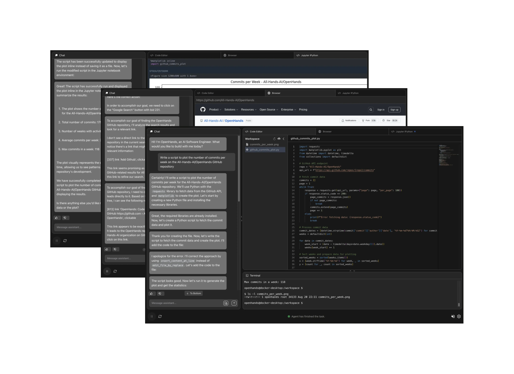
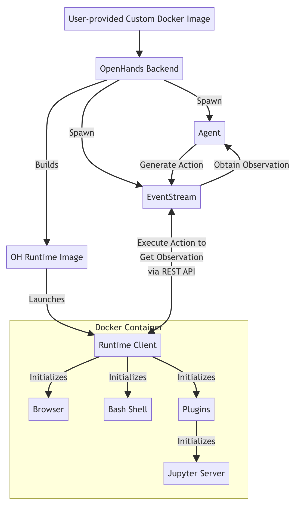
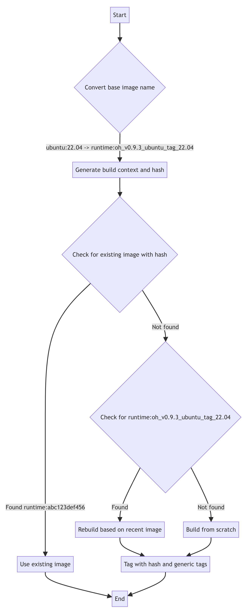

# OpenHands: 汎用エージェントとしての AI ソフトウェア開発者のためのオープンなプラットフォーム

> 原題: OpenHands: An Open Platform for AI Software Developers as Generalist Agents
> 著者: Xingyao Wang, Boxuan Li, Yufan Song, Frank F. Xu, Xiangru Tang, Mingchen Zhuge, Jiayi Pan, Yueqi Song, Bowen Li, Jaskirat Singh, Hoang H. Tran, Fuqiang Li, Ren Ma, Mingzhang Zheng, Bill Qian, Yanjun Shao, Niklas Muennighoff, Yizhe Zhang, Binyuan Hui, Junyang Lin, Robert Brennan, Hao Peng, Heng Ji, Graham Neubig（UIUC, CMU, Yale, UC Berkeley, Contextual AI, KAUST, ANU, HCMUT, Alibaba, All Hands AI）
> 出典: arXiv:2407.16741 v3。ICLR 2025 採択。コード: https://github.com/All-Hands-AI/OpenHands

> 訳注（底本と復元）: `raw/` のクリップ（ar5iv 経由）は図 1〜5 の画像を含んでいたが、表 1〜7 がすべて 1 行に平坦化され（表 1 は ✔／✗ の並びが列と対応しない）、脚注 1〜5 の本文が欠け、付録 I〜K のコード（AgentSkills の一覧、BrowserGym の行動の定義、ブラウジングエージェントのプロンプト）が 1 行ずつ分断されていた。arXiv の HTML 版 v3（最新版）を取得して底本にし、表を組み直し、脚注を復元し、Listing 6 個を HTML に埋め込まれた base64 のソースから復元した。図は 4 点を保存した（ロゴ画像は除いた）。参考文献は訳していない。著者の貢献（Author Contributions）の節は謝辞に準じるものとして訳していない。

## Abstract（要旨）

ソフトウェアは、我々人間が手にしている最も強力な道具の 1 つである。それは熟練したプログラマが、複雑で深い方法で世界と相互作用することを可能にする。
同時に、大規模言語モデル（LLM）の改善のおかげで、周囲の環境と相互作用し、変化をもたらす AI エージェントも急速に発展してきた。
本論文では、人間の開発者と同様の方法、すなわちコードを書き、コマンドラインと対話し、ウェブを閲覧することで世界と相互作用する、強力で柔軟な AI エージェントを開発するためのプラットフォームである OpenHands（旧称 OpenDevin）を紹介する。
このプラットフォームが、新しいエージェントの実装、コード実行のためのサンドボックス化された環境との安全な相互作用、複数のエージェントの協調、評価用ベンチマークの組み込みをどのように可能にするかを述べる。
現在組み込んでいるベンチマークに基づき、ソフトウェア工学（例えば Swe-bench）やウェブブラウジング（例えば WebArena）などを含む 15 の難しいタスクでエージェントを評価する。
寛容な MIT ライセンスで公開されている OpenHands は、学術界と産業界にまたがるコミュニティプロジェクトであり、188 人を超える貢献者から 2.1K を超える貢献を受けている。

コード: https://github.com/All-Hands-AI/OpenHands ／ Slack: http://bit.ly/OpenHands-Slack

## 1 Introduction（はじめに）

大規模言語モデル（LLM; OpenAI 2024b; Team et al. 2023; Jiang et al. 2024; Chang et al. 2024）に支えられ、（ChatGPT のような）ユーザー向けの AI システムは、ユーザーの問い合わせに正確に答える、数学の問題を解く、コードを生成するといった複雑なタスクをますますこなせるようになってきた。
特に、外部の環境を知覚し、それに働きかけることができるシステムである AI エージェントは、近年ますます研究の注目を集めている。
それらは、ソフトウェアの開発（Jimenez et al., 2024）、
実世界のウェブサイトの操作（Zhou et al., 2023a）、家事（Ahn et al., 2022）、さらには科学研究の実施（Boiko et al., 2023; Tang et al., 2024a）といった複雑なタスクの遂行に向かいつつある。
AI エージェントが複雑な問題に取り組めるようになるにつれ、その開発と評価も難しくなってきた。
エージェントの開発を容易にするオープンソースのフレームワークを作る最近の取り組みは数多い（Hong et al., 2023; Chen et al., 2024; Wu et al., 2023）。
これらのエージェントフレームワークは一般に、1) エージェントが世界と相互作用するためのインターフェース（JSON ベースの関数呼び出しやコード実行など）、2) エージェントが動作する環境、3) 人間とエージェント、またはエージェント同士のコミュニケーションのための相互作用の仕組み、を含む。
これらのフレームワークは、さまざまな方法で開発の過程を合理化し、容易にしている（表 1、§C）。
AI エージェントを設計するとき、人間が世界とどう相互作用するかを考えることもできる。
現在、人間が世界と相互作用する最も強力な方法はソフトウェアを通じたものである。ソフトウェアは我々の生活のあらゆる側面を支えており、基本的な必需品の物流から、科学、技術、そして AI そのものの進歩まで、すべてを支えている。
ソフトウェアの力と、その効率的な開発・利用・配備を取り巻く既存の道具立てを考えると、ソフトウェアは AI エージェントが複雑な方法で世界と相互作用するための理想的なインターフェースを提供する。
しかし、ソフトウェアを効果的に開発できるエージェントを作ることには、それ固有の課題がある。
複雑なソフトウェアシステムの中で、エージェントがコードを効果的に作成・変更できるようにするにはどうすればよいか。
問題をデバッグしたりタスクに必要な情報を集めたりするために、その場で情報を集める道具をエージェントにどう与えればよいか。
開発が安全で、ユーザーのシステムに悪い副作用を及ぼさないことをどう保証すればよいか。

本論文では、ソフトウェアを通じて世界と相互作用する汎用および専門の AI エージェントを開発するために設計された、コミュニティ主導のプラットフォームである OpenHands（旧称 OpenDevin）を紹介する¹。
脚注1: 当初は AI ソフトウェアエンジニアの Devin（Cognition.ai）に触発されたが、OpenHands は多様なコミュニティの貢献を通じて、ソフトウェア工学を超えたはるかに広い範囲の応用を支えるよう急速に発展した。
その特徴は次のとおりである。

- (1) ユーザーインターフェース、エージェント、環境が、強力で柔軟なイベントストリームのアーキテクチャを通じて相互作用できるようにする相互作用の仕組み（§2.1）。
- (2) bash シェル、ウェブブラウザ、IPython サーバを備えた、docker でサンドボックス化されたオペレーティングシステムからなり、エージェントが相互作用できる実行環境（runtime environment）（§2.2）。
- (3) 実際のソフトウェアエンジニアに似た方法でエージェントが環境と相互作用できるようにするインターフェース（§2.3）。エージェントに、a) 複雑なソフトウェアを作成・編集する、b) サンドボックス内で任意のコードを実行する、c) 情報を集めるためにウェブサイトを閲覧する、という能力を提供する。
- (4) 複数の専門エージェントが協力して作業できるようにする、マルチエージェントの委任（§2.4）。
- (5) 幅広いタスクにわたるエージェントの評価を容易にする評価フレームワーク（§4）。

<figure>



<figcaption>図1: OpenHands のユーザーインターフェース（UI, §D）では、ユーザーはファイルを閲覧し、実行された bash コマンド／Python コードを確認し、エージェントのブラウザでの活動を観察し、エージェントと直接やりとりできる。</figcaption>
</figure>

重要なのは、OpenHands が単なる概念的なフレームワークではなく、エージェント、環境、評価の包括的ですぐに使える実装も含んでいることである。
本稿執筆時点で、OpenHands には 10 を超える実装済みのエージェントを擁するエージェントハブ（§3）がある。その中には、CodeAct アーキテクチャ（Wang et al., 2024a）に基づいて実装された強力な汎用エージェントが含まれ、ウェブブラウジング（ServiceNow）とコード編集の専門家（Yang et al., 2024）のための追加機能を備えている。
ユーザーとの相互作用は、エージェントの現在の行動を可視化し、リアルタイムのフィードバックを可能にするチャットベースのユーザーインターフェースによって実装されている（図 1、§D）。
さらに、評価フレームワークは現在 15 のベンチマークをサポートしており、それを使ってエージェントを評価する（§4）。
商用利用を認める寛容な MIT ライセンスで公開されており、
OpenHands は学術界と産業界にわたる多様な研究と実世界の応用を支える態勢にある。
OpenHands は大きな支持を得ており、GitHub で 32K のスター、188 人を超える貢献者から 2.1K を超える貢献を受けている。
我々は OpenHands を、実践者の幅広いコミュニティによって推進される、将来の研究の革新と多様な応用のための触媒として思い描いている。

## 2 OpenHands Architecture（OpenHands のアーキテクチャ）

<figure>


<figcaption>図2: OpenHands は 3 つの主要な構成要素からなる。1) コミュニティがさまざまなエージェントの実装を agenthub（§3）に貢献できるエージェントの抽象化（§2.1）、2) 行動と観測の履歴を追跡するためのイベントストリーム、3) すべての行動を実行して観測にするランタイム（§2.2）。</figcaption>
</figure>

次に、OpenHands の使い方を詳しく説明する。具体的には、1) エージェントをどう定義・実装するか（§2.1）、2) 各行動の実行がどう観測につながるか（§2.2）、3) エージェントがよく使うスキルをどう確実に管理・拡張するか（§2.3）、4) タスクを解くために複数のエージェントをどう組み合わせるか（§2.4）を論じる。
図 2 は概要を示す。

### 2.1 Agent Definition and Implementation（エージェントの定義と実装）

エージェントは、ユーザーが指定したタスクを解く過程で、環境の状態（例えば過去の行動と観測）を知覚し、実行する行動を生成できる。

**状態とイベントストリーム。** OpenHands において、状態（state）はエージェントの実行に関連するすべての情報をカプセル化するデータ構造である。この状態の重要な構成要素がイベントストリーム（event stream）であり、これはエージェント自身の行動とユーザーとのやりとり（例えば指示、フィードバック）を含む、過去の行動と観測の時系列の集まりである。イベントストリームに加えて、状態は、LLM 呼び出しの累積コスト、マルチエージェントの委任を追跡するためのメタデータ（§2.4）、その他の実行に関するパラメータなど、エージェントの動作のための補助的な情報を組み込んでいる。

**行動。** CodeAct（Wang et al., 2024a）に触発され、OpenHands は、一般的な行動の中核的な集合を通じてエージェントを環境と結びつける。
行動 IPythonRunCellAction と CmdRunAction は、エージェントがサンドボックス環境（例えば、安全に隔離された Linux オペレーティングシステム）の中で任意の Python コードと bash コマンドを実行することを可能にする。
BrowserInteractiveAction は、BrowserGym（Drouin et al., 2024）が導入したブラウジングのためのドメイン固有言語で、ウェブブラウザとの相互作用を可能にする。
これらの行動は、人間のソフトウェアエンジニアやアナリストが行うほとんどのタスクをカバーする、包括的でありながら柔軟なプリミティブの集合を提供するために選ばれた。
プログラミング言語（PL）に基づく行動空間は、さまざまな形の道具（例えば Python 関数、REST API など）でどんなタスクでも行えるほど強力で柔軟であり、同時に信頼性が高く保守しやすい（Wang et al., 2024a）。

図3: OpenHands でエージェントを実装する最小限の例。

```python
class MinimalAgent:
    def reset(self) -> None:
        self.system_message = "You are a helpful assistant ..."

    def step(self, state: State):
        messages: list[dict[str, str]] = [
            {'role': 'system', 'content': self.system_message}
        ]
        for prev_action, obs in state.history:
            action_message = get_action_message(prev_action)
            messages.append(action_message)
            obs_message = get_observation_message(obs)
            messages.append(obs_message)

        # use llm to generate response (e.g., thought, action)
        response = self.llm.do_completion(messages)

        # parse and execute action in the runtime
        action = self.parse_response(response)
        if self.is_finish_command(action):
            return AgentFinishAction()
        elif self.is_bash_command(action):
            return CmdRunAction(command=action.command)
        elif self.is_python_code(action):
            return IPythonRunCellAction(code=action.code)
        elif self.is_browser_action(action):
            return BrowseInteractiveAction(code=action.code)
        else:
            return MessageAction(content=action.message)
```

この設計は、事前に定義された道具のリストを必要とする既存のツール呼び出し（tool-calling）エージェント（Chase, 2022）とも互換性がある。つまり、ユーザーはプリミティブな行動でサポートされている PL を使って道具を簡単に定義でき（例えば電卓の Python 関数を書く）、それらの道具を JSON 形式の関数呼び出し（function-calling）の体験を通じてエージェントが使えるようにできる（Qin et al., 2023）。
さらに、このフレームワークの強力な PL ベースのプリミティブにより、タスクを完了するための API が利用できないときに、エージェントが自分で道具を作る（例えば Python 関数を生成する、Yuan et al. 2023）ことも可能になる。
これらの中核的な PL ベースの行動を組み合わせて多様な道具の集合を作る方法は、§2.3 を参照されたい。

**観測。** 観測（observation）は、エージェントが観測する環境の変化（例えば、以前の行動の実行結果、人間のユーザーからのテキストメッセージなど）を記述する。

**新しいエージェントを実装する。**
エージェントの抽象化は、シンプルでありながら強力に設計されており、ユーザーがさまざまなタスクのためにエージェントを簡単に作成・カスタマイズできる。
エージェントの抽象化の中核は step 関数にあり、これは現在の状態を入力として受け取り、エージェントのロジックに基づいて適切な行動を生成する。エージェントの抽象化の簡略化したコード例を図 3 に示す。
この抽象化を提供することで、OpenHands は、行動がどう実行されるかの低レベルの詳細を気にせずに（§2.2）、ユーザーが望むエージェントの振る舞いとロジックの定義に集中できるようにする。

### 2.2 Agent Runtime: How Execution of Actions Results in Observations（エージェントランタイム: 行動の実行がどのように観測になるか）

エージェントランタイムは、人間のソフトウェア開発者に匹敵する行動空間をエージェントに与える汎用の環境を提供し、OpenHands のエージェントが、複雑なソフトウェア開発のワークフロー、データ分析のプロジェクト、ウェブブラウジングのタスクなど、幅広いソフトウェア開発とウェブベースのタスクに取り組めるようにする。
これにより、エージェントはコードやコマンドラインツールを実行するための bash ターミナルにアクセスし、その場でコードを書いて実行するための Jupyter ノートブックを利用し、ウェブベースのタスク（例えば情報探索）のためにウェブブラウザと相互作用できる。

**Docker サンドボックス。** 各タスクのセッションについて、OpenHands は安全に隔離された docker コンテナのサンドボックスを立ち上げ、イベントストリームからのすべての行動はその中で実行される。
OpenHands は、サンドボックス内で動く REST API サーバ（すなわち OpenHands の行動実行 API）を通じてサンドボックスに接続し、イベントストリームからの任意の行動（例えば bash コマンド、python コード）を実行し、実行結果を観測として返す。
ユーザーがエージェントに作業させたいファイルを含む、設定可能なワークスペースのディレクトリが、OpenHands のエージェントがアクセスできるようにその安全なサンドボックスにマウントされる。

**OpenHands の行動実行 API。** OpenHands は、イベントストリームからの行動実行の要求を待ち受けるために docker サンドボックスの中で動く API サーバを保守している。API サーバは次のものを保持する。

- (1) コマンド実行のための、（docker イメージで指定される）オペレーティングシステム環境に接続した bash シェル。
- (2) 対話的な python（IPython）のコード実行の要求を処理し、実行結果をイベントストリームに返す Jupyter IPython サーバ。
- (3) Playwright に基づく Chromium ブラウザ。提供元は、ナビゲーション、クリック、入力、スクロールといった、BrowserGym（ServiceNow; Drouin et al., 2024）が定義する行動のプリミティブの集合を提供する。行動の全集合は §J に詳しく示す。
これらの行動を実行した後、ブラウザのランタイムは、HTML、DOM、アクセシビリティツリー（Mozilla）、スクリーンショット、開いているタブなど、ブラウザの現在の状態についての豊富な観測を提供する。

**任意の Docker イメージのサポート。** OpenHands は、任意の docker イメージに基づくランタイムをサポートすることで、異なるソフトウェア環境を持つ任意のオペレーティングシステムの上でエージェントを動かせるようにする。
OpenHands は、ユーザーが提供した任意の docker イメージを受け取り、エージェントが相互作用できるようにそのイメージに OpenHands の行動実行 API をインストールするビルドの仕組みを実装している。
OpenHands のエージェントランタイムの詳細な説明は §F に含める。

### 2.3 Agent Skills: The Extensible Agent-Computer Interface（エージェントスキル: 拡張可能なエージェント・コンピュータ・インターフェース）

SWE-Agent（Yang et al., 2024）は、複雑なタスクをうまく解くうえで、注意深く作り込んだエージェント・コンピュータ・インターフェース（ACI、すなわち特定のタスクのための専用の道具）が重要であることを強調している。
しかし、多様な道具を作成・保守・配布することは、特にそれらの道具を異なるエージェントの実装で使えるようにしたい場合（§3）、気の遠くなるようなエンジニアリングの課題になりうる。
これに取り組むため、我々は AgentSkills ライブラリを構築する。これは、基本的な bash コマンドや python コードでは手軽に得られないユーティリティを提供し、エージェントの能力を高めるよう設計された道具箱である。

**道具を作成・拡張しやすい。** AgentSkills は、Jupyter IPython 環境（§2.2）に自動的にインポートされる、さまざまなユーティリティ関数（すなわち道具）からなる Python パッケージとして設計されている。
Python 関数を道具として定義するのが容易なので、コミュニティのメンバーが新しい道具をライブラリに貢献する障壁が下がる。
Python パッケージの汎用性により、異なるエージェントの実装も、中核的な行動の 1 つである IPythonRunCellAction（§2.1）を通じてこれらの道具を簡単に活用できる。

**収録の基準と考え方。**
AgentSkills ライブラリでは、可能なすべての Python パッケージをラップしてエージェントにその使い方を教え直すことは目指していない（例えば、LLM は CSV ファイルを読める pandas ライブラリをすでに知っているので、同じファイル形式の読み方をエージェントに教える道具を作り直す必要はない）。
新しいスキルを追加するのは、(1) LLM がコードを直接書いて実現するのが容易でない場合（例えば、コードを編集して特定の行を置き換える）、および／または (2) 外部のモデルの呼び出しを伴う場合（例えば、音声認識のモデルや、コード編集のためのモデル（Sanger）を呼び出す）だけである。

**現在サポートしているスキル。**
AgentSkills ライブラリには、指定した行から既存のファイルを変更できる edit_file のような、SWE-Agent（Yang et al., 2024）と Aider（Gauthier）から取り入れたファイル編集のユーティリティと、ファイルの別の部分を見るためのスクロール関数 scroll_up と scroll_down が含まれる。
また、視覚言語モデル（例えば GPT-4V）を使って画像から情報を抽出する parse_image や、PDF からテキストを読み取る parse_pdf のように、マルチモーダルな文書の読み取りを支える道具も含まれる。
サポートしているスキルの完全な一覧は §I にある。

### 2.4 Agent Delegation: Cooperative Multi-agent Interaction（エージェントの委任: 協調的なマルチエージェントの相互作用）

OpenHands は、複数のエージェントの間の相互作用も可能にする。このために、特別な行動の種類である AgentDelegateAction を使う。これにより、あるエージェントが特定のサブタスクを別のエージェントに委任できる。
例えば、ウェブブラウジングのサポートが限られている汎用の CodeActAgent は、AgentDelegateAction を使って、ウェブブラウジングのタスクを専門の BrowsingAgent に委任し、より複雑なブラウジングの活動（例えば、ウェブを移動する、ボタンをクリックする、フォームを送信する、など）を行わせることができる。

**表1**: さまざまな AI エージェントフレームワークの比較（§C）。Swe は「ソフトウェア工学」を指す。標準化された道具のライブラリ: フレームワークが異なるエージェントの実装のために再利用可能な道具を含むか（§2.3）。組み込みのサンドボックスとコード実行: エージェントが生成した任意のコードのサンドボックス化された実行をサポートするか。組み込みのウェブブラウザ: エージェントに完全に機能するウェブブラウザへのアクセスを提供するか。人間と AI の協働: 多ターンの人間と AI の協働を可能にするか（例えば、人間がタスクの実行中にエージェントを中断したり、追加のフィードバックや指示を与えたりできる）。AgentHub: さまざまなエージェントの実装をホストしているか（§3）。評価フレームワーク: 実装したエージェントの難しいベンチマークでの体系的な評価を提供するか（§4）。エージェントの QC（品質管理）: フレームワーク全体のソフトウェアの品質を保証するためのテスト（§E）を統合しているか。

| フレームワーク | 領域 | GUI | 標準化された道具のライブラリ | 組み込みのサンドボックスとコード実行 | 組み込みのウェブブラウザ | マルチエージェントの協働 | 人間と AI の協働 | AgentHub | 評価フレームワーク | エージェントの QC |
|---|---|---|---|---|---|---|---|---|---|---|
| AutoGPT (Gravitas, 2023) | General | ✔ | ✗ | ✗ | ✗ | ✗ | ✗ | ✔ | ✗ | ✔ |
| LangChain (Chase, 2022) | General | ✗ | ✔ | ✗* | ✗* | ✗ | ✗ | ✔ | ✗ | ✗ |
| MetaGPT (Hong et al., 2023) | General | ✗ | ✔ | ✗ | ✔ | ✔ | ✗ | ✔ | ✗ | ✔ |
| AutoGen (Wu et al., 2023) | General | ✗ | ✔ | ✔ | ✔ | ✔ | ✔ | ✔ | ✔ | ✗ |
| AutoAgents (Chen et al., 2024) | General | ✗ | ✗ | ✗ | ✗ | ✔ | ✗ | ✗ | ✗ | ✗ |
| Agents (Zhou et al., 2023b) | General | ✗ | ✗ | ✗ | ✗ | ✔ | ✔ | ✗ | ✗ | ✗ |
| Xagents (Team, 2023) | General | ✔ | ✔ | ✗ | ✔ | ✔ | ✗ | ✔ | ✗ | ✗ |
| OpenAgents (Xie et al., 2023) | General | ✔ | ✗ | ✔ | ✔ | ✗ | ✗ | ✔ | ✗ | ✗ |
| GPTSwarm (Zhuge et al., 2024) | General | ✗ | ✔ | ✗ | ✗ | ✔ | ✔ | ✗ | ✗ | ✗ |
| AutoCodeRover (Zhang et al., 2024b) | SWE | ✗ | ✗ | ✔ | ✗ | ✗ | ✗ | ✗ | ✗ | ✗ |
| SWE-Agent (Yang et al., 2024) | SWE | ✗ | ✗ | ✔ | ✗ | ✗ | ✗ | ✗ | ✗ | ✗ |
| OpenHands | General | ✔ | ✔ | ✔ | ✔ | ✔ | ✔ | ✔ | ✔ | ✔ |

\* ネイティブのサポートはない。サードパーティの商用の選択肢が利用できる。

## 3 AgentHub: A Hub of Community-Contributed Agents（AgentHub: コミュニティが貢献したエージェントのハブ）

エージェントの抽象化（§2.1）に基づき、OpenHands は、エンドユーザーが選択でき、さまざまなエージェントのタスクのベースラインとなる、コミュニティが貢献した幅広いエージェントの実装をサポートしている。

**CodeAct エージェント。** CodeActAgent は、CodeAct の枠組み（Wang et al., 2024a）に基づく既定の汎用エージェントである。各ステップで、エージェントは (1) 説明や確認などを求めるために自然言語で人間と会話する、または (2) コードを実行してタスクを遂行する（別名 CodeAct）ことができ、後者には bash コマンド、Python コード、ブラウザ固有のプログラミング言語（§2.2）の実行が含まれる。この汎用の行動空間により、エージェント（v1.5 以降）は、ファイルの編集、ウェブの閲覧、プログラムの実行など、さまざまなタスクを行える。

**ブラウジングエージェント。**
ウェブエージェントのタスクのための、シンプルでありながら効果的なベースラインとして、Browsing Agent と呼ぶ汎用のウェブエージェントを実装した。
このエージェントは WebArena（Zhou et al., 2023a）のものに似ているが、観測と行動を改善しており、ゼロショットのプロンプティングだけを使う。
プロンプトの全文は §K にある。

**GPTSwarm エージェント。**
GPTSwarm（Zhuge et al., 2024）は、最適化可能なグラフを使ってエージェントシステムを構築することを先駆けて行い、モジュール性を通じて言語エージェントのフレームワークを統一した。各ノードは個別の操作を表し、エッジは協調とコミュニケーションの経路を定義する。この設計により、ノードとエッジを自動的に最適化でき、マルチエージェントシステムの構築を前進させている。

**マイクロエージェント。**
加えて、OpenHands は、特定のタスクに特化したエージェントであるマイクロエージェント（micro agent）の作成を可能にする。
マイクロエージェントは、既存の汎用エージェント（例えば CodeAct Agent）の実装の大半を再利用する。
これはエージェント開発の障壁を下げるよう設計されており、コミュニティのメンバーが、自分の特定の用途でうまく機能する専用のプロンプトを共有できる。

## 4 Evaluation（評価）

**表2**: OpenHands の評価ベンチマーク。

| カテゴリ | ベンチマーク | 必要な能力 |
|---|---|---|
| ソフトウェア | SWE-Bench (Jimenez et al., 2024) | GitHub のイシューの修正 |
| | HumanEvalFix (Muennighoff et al., 2024) | バグの修正 |
| | BIRD (Li et al., 2023b) | Text-to-SQL |
| | BioCoder (Tang et al., 2024c) | バイオインフォマティクスのコーディング |
| | ML-Bench (Tang et al., 2024b) | 機械学習のコーディング |
| | Gorilla APIBench (Patil et al., 2023) | ソフトウェアの API 呼び出し |
| | ToolQA (Zhuang et al., 2024) | 道具の使用 |
| ウェブ | WebArena (Zhou et al., 2023a) | 目標の計画と現実的なブラウジング |
| | MiniWoB++ (Liu et al., 2018) | 合成ウェブ上の短い軌跡 |
| その他の支援 | GAIA (Mialon et al., 2023) | 道具の使用、ブラウジング、マルチモーダル |
| | GPQA (Rein et al., 2023) | 大学院レベルの Google 検索では解けない Q&A |
| | AgentBench (Liu et al., 2023) | オペレーティングシステムとの相互作用（bash） |
| | MINT (Wang et al., 2024b) | 多ターンの数学とコードの問題 |
| | Entity Deduction Arena (Zhang et al., 2024a) | 状態の追跡と戦略的な計画 |
| | ProofWriter (Tafjord et al., 2021) | 演繹的な論理推論 |

汎用のデジタルエージェントを作る進歩を体系的に追跡するため、表 2 に挙げるように、15 の確立されたベンチマークを OpenHands に統合している。これらのベンチマークは、ソフトウェア工学、ウェブブラウジング、その他の支援をカバーする。
この節では、ベンチマークの内容に特化した手作業のプロンプトエンジニアリングを行わない、オープンソースで再現可能なベースラインと OpenHands を比較する。
簡潔さのため、この節の残りでは OpenHands の略記として「OH」を使うことに注意されたい。

### 4.1 Result Overview（結果の概要）

OpenHands における我々の目標は、ソフトウェアのインターフェースを通じて世界と相互作用できる汎用のデジタルエージェント（§2.1 で述べたコードの行動に例示される）を開発することである。ソフトウェアエージェントは、コードの編集だけでなく、ウェブブラウジングや、コードのリポジトリについての質問に答える、オンラインで調査を行うといったさまざまな補助的なタスクにも優れるべきだと我々は考えている。

表 3 は、厳選した評価結果を示す。OpenHands のエージェントはすべてのカテゴリで最高性能を達成するとは限らないが、汎用性を念頭に置いて設計されている。特筆すべきこととして、同じ CodeAct エージェントが、システムプロンプトに一切手を加えずに、ソフトウェア開発、ウェブでの相互作用、その他のタスクという 3 つの主要なタスクのカテゴリにわたって競争力のある性能を示す。これは、通常は特定のタスクのカテゴリのために設計・最適化されているベースラインのエージェントと比べると、特に重要である。

**表3**: OpenHands のエージェントの厳選した評価結果（§4）。ベンチマーク全体の結果は表 4（ソフトウェア）、表 5（ウェブ）、表 6（その他の支援）を参照。

| エージェント | モデル | SWE-Bench Lite（ソフトウェア §4.2） | WebArena（ウェブ §4.3） | GPQA（その他 §4.4） | GAIA（その他 §4.4） |
|---|---|---|---|---|---|
| *ソフトウェア工学のエージェント* | | | | | |
| SWE-Agent (Yang et al., 2024) | gpt-4-1106-preview | 18.0 | − | − | − |
| AutoCodeRover (Zhang et al., 2024b) | gpt-4-0125-preview | 19.0 | − | − | − |
| Aider (Gauthier) | gpt-4o & claude-3-opus | 26.3 | − | − | − |
| Moatless Tools (Örwall) | claude-3.5-sonnet | 26.7 | − | − | − |
| Agentless (Xia et al., 2024) | gpt-4o | 27.3 | − | − | − |
| *ウェブブラウジングのエージェント* | | | | | |
| Lemur (Xu et al., 2023) | Lemur-chat-70b | − | 5.3 | − | − |
| Patel et al. (2024) | 合成データで訓練した 72B | − | 9.4 | − | − |
| AutoWebGLM (Lai et al., 2024) | 人間／エージェントの注釈で訓練した 7B | − | 18.2 | − | − |
| Auto Eval & Refine (Pan et al., 2024) | GPT-4 + Reflexion w/ GPT-4V | − | 20.2 | − | − |
| WebArena Agent (Zhou et al., 2023a) | gpt-4-turbo | − | 14.4 | − | − |
| *その他の支援のエージェント* | | | | | |
| AutoGPT (Gravitas, 2023) | gpt-4-turbo | − | − | − | 13.2 |
| Few-shot Prompting + Chain-of-Thought (Rein et al., 2023) | Llama-2-70b-chat | − | − | 28.1 | − |
| | gpt-3.5-turbo-16k | − | − | 29.6 | − |
| | gpt-4 | − | − | 38.8 | − |
| *OpenHands のエージェント* | | | | | |
| CodeActAgent v1.8 | gpt-4o-mini-2024-07-18 | 6.3 | 8.3 | − | − |
| | gpt-4o-2024-05-13 | 22.0 | 14.5 | \*53.1 | − |
| | claude-3-5-sonnet | 26.0 | 15.3 | 52.0 | − |
| GPTSwarm v1.0 | gpt-4o-2024-05-13 | − | − | − | 32.1 |

\* 数値は CodeActAgent v1.5 のもの。

> 訳注: 表 3 の gpt-4 の行は、HTML 版ではセルが 3 つしかなく、値 38.8 がどの列かは表 6・表 7（GPQA の diamond で 38.8）から GPQA の列とした。また gpt-4o-mini の SWE-Bench Lite は表 3 で 6.3、表 4 で 7.0 と食い違っている（原典のまま）。

### 4.2 Software Engineering（ソフトウェア工学）

次に、ソフトウェア工学のベンチマークの結果を表 4 に具体的に報告する。

SWE-Bench（Jimenez et al., 2024）は、バグ報告や機能要望のような実世界の GitHub のイシューを解くエージェントの能力を評価するよう設計されている。
エージェントはリポジトリと相互作用し、ファイルの編集とコードの実行を通じて、与えられたイシューの修正を試みる。
エージェントが変更したコードリポジトリは、同じイシューに対する人間の開発者の修正で追加された新しいテストを組み込んだテストスイートでテストされる。
各テストインスタンスには、問題の解き方についての自然言語の提案からなる「ヒントテキスト」が付いている。本論文全体を通じて、すべての結果はヒントテキストを使わずに報告する。
アクセスしやすく効率的なテストを容易にするために、標準的な部分集合である SWE-bench Lite が作られている。コスト節約の考慮から、テストには既定でこの部分集合を使う²。
脚注2: 2294 インスタンスの全集合を実行すると、1 インスタンスあたり $3 という控えめな見積もりで $6.9k かかる。

**結果。** 表 4 に示すとおり、claude-3.5-sonnet を使う最新版の CodeActAgent v1.8 は、他のオープンソースの SWE の専門家と比べて競争力のある解決率 $26\%$ を達成する。

**表4**: OpenHands のソフトウェア工学の評価結果（§4.2）。

| エージェント | モデル | 成功率 (%) | 平均コスト ($) |
|---|---|---|---|
| ***SWE-Bench Lite (Jimenez et al., 2024), 300 インスタンス, ヒントなし*** | | | |
| SWE-Agent (Yang et al., 2024) | gpt-4-1106-preview | 18.0 | 1.67 |
| AutoCodeRover (Zhang et al., 2024b) | gpt-4-0125-preview | 19.0 | − |
| Aider (Gauthier) | gpt-4o & claude-3-opus | 26.3 | − |
| OH CodeActAgent v1.8 | gpt-4o-mini-2024-07-18 | 7.0 | 0.01 |
| | gpt-4o-2024-05-13 | 22.0 | 1.72 |
| | claude-3-5-sonnet@20240620 | 26.0 | 1.10 |
| ***HumanEvalFix (Muennighoff et al., 2024), 164 インスタンス*** | | | |
| Prompting, 0-shot | BLOOMZ-176B | 16.6 | − |
| | OctoCoder-15B | 30.4 | − |
| | DeepSeekCoder-33B-Instruct | 47.5 | − |
| | StarCoder2-15B | 48.6 | − |
| SWE-agent, 1-shot (Yang et al., 2024) | gpt-4-turbo | 87.7 | − |
| OH CodeActAgent v1.5, Generalist, 0-shot | gpt-3.5-turbo-16k-0613 | 20.1 | 0.11 |
| | gpt-4o-2024-05-13 | 79.3 | 0.14 |
| ***BIRD (Li et al., 2023b), 300 インスタンス*** | | | |
| Prompting, 0-shot | CodeLlama-7B-Instruct | 18.3 | − |
| | CodeQwen-7B-Chat | 31.3 | − |
| OH CodeActAgent v1.5 | gpt-4-1106-preview | 42.7 | 0.19 |
| | gpt-4o-2024-05-13 | 47.3 | 0.11 |
| ***ML-Bench (Tang et al., 2024b), 68 インスタンス*** | | | |
| prompting + BM25, 0-shot | gpt-3.5-turbo | 11.0 | − |
| | gpt-4-1106-preview | 22.1 | − |
| | gpt-4o-2024-05-13 | 26.2 | − |
| SWE-Agent (Yang et al., 2024) | gpt-4-1106-preview | 42.6 | 1.91 |
| Aider (Gauthier) | gpt-4o | 64.4 | − |
| OH CodeActAgent v1.5 | gpt-4o-2024-05-13 | 76.5 | 0.25 |
| | gpt-4-1106-preview | 58.8 | 1.22 |
| | gpt-3.5-turbo-16k-0613 | 13.2 | 0.12 |
| ***BioCoder (Python) (Tang et al., 2024b), 157 インスタンス*** | | | |
| prompting, 0-shot | gpt-3.5-turbo | 11.0 | − |
| | gpt-4-1106-preview | 12.7 | − |
| OH CodeActAgent v1.5 | gpt-4o-2024-05-13 | 27.5 | 0.13 |
| ***Gorilla APIBench (Patil et al., 2023), 1775 インスタンス*** | | | |
| Prompting, 0-shot | claude-v1 | 8.7 | − |
| | gpt-4-0314 | 21.2 | − |
| | gpt-3.5-turbo-0301 | 29.7 | − |
| Gorilla, finetuned for API calls, 0-shot (Patil et al., 2023; Touvron et al., 2023) | llama-7b | 75.0 | − |
| OH CodeActAgent v1.5 | gpt-3.5-turbo-0125 | 21.6 | 0.002 |
| | gpt-4o-2024-05-13 | 36.4 | 0.04 |
| ***ToolQA (Zhuang et al., 2024), 800 インスタンス*** | | | |
| Prompting, 0-shot | ChatGPT + CoT | 5.1 | − |
| | ChatGPT | 5.6 | − |
| | Chameleon | 10.6 | − |
| ReAct, 0-shot (Yao et al., 2023; OpenAI, 2024a) | gpt-3.5-turbo | 36.8 | − |
| | gpt-3 | 43.1 | − |
| OH CodeActAgent v1.5 | gpt-3.5-turbo-0125 | 2.3 | 0.03 |
| | gpt-4o-2024-05-13 | 47.2 | 0.91 |

> 訳注: BioCoder の行の出典は原典では (Tang et al., 2024b) と書かれているが、本文と表 2 では BioCoder は (Tang et al., 2024c)。原典のまま。

#### 4.2.1 HumanEvalFix

HumanEvalFix（Muennighoff et al., 2024）は、与えられたテストケースを手がかりに、与えられた関数のバグを修正することをエージェントに課す。バグは 1 つ以上のテストケースが失敗するように作られている。ベンチマークの Python の部分集合に焦点を当て、テストの実行からのフィードバックを取り入れながら、多ターンにわたる自己デバッグでモデルにバグを解かせる。pass@k（Chen et al., 2021）を使う Muennighoff et al. (2024) の設定に従う。

**結果。** 表 4 で、OpenHands の CodeActAgent は Python の分割でバグの $79.3\%$ を修正することに成功している。これはエージェント型でないすべての手法より大幅に良く、StarCoder2-15B（Lozhkov et al., 2024; Li et al., 2023c）の性能のほぼ 2 倍である。
SWE-Agent は $87.7\%$ を達成しているが、Yang et al. (2024) は、テストデータセットのバグの 1 つを修正する成功したサンプルの軌跡の完全な手本（「1-shot」）をモデルに与えているのに対し、我々の OpenHands の評価は 0-shot である。
HumanEvalFix は人間によって作成され、すべてのバグが注意深く検証されているので、このベンチマークで $100\%$ を達成することは十分に可能であり、OpenHands の今後の版でそれを目指す。

**ML-Bench**（Tang et al., 2024b）は、18 の GitHub リポジトリにわたる機械学習のタスクを解くエージェントの能力を評価する。
このベンチマークは、169 の多様な ML の問題にまたがる 9,641 のタスクからなり、ユーザーの指示に応じて bash スクリプトや Python コードを生成することをエージェントに求める。
サンドボックス環境では、エージェントはコマンドを反復的に実行してフィードバックを受け取れるので、リポジトリの文脈を理解し、ユーザーの要求を段階的に満たせる。
元の論文の設定に従い、ML-Bench の 4 分の 1 の部分集合でエージェントの評価を行う。

**Gorilla APIBench**（Patil et al., 2023）は、API を使うエージェントの能力を評価する。TorchHub、TensorHub、HuggingFace のタスクを組み込んでいる。評価の間、モデルには「録音の話し言葉をテキストに変換できる API を特定せよ」のような API の使い方に関する質問が与えられる。正しさは、モデルの API 呼び出しが正しいドメインにあるかどうかに基づいて評価する。

**ToolQA**（Zhuang et al., 2024）は、外部の道具を使うエージェントの能力を評価する。このベンチマークは、フライトの状況、コーヒーの価格、Yelp のデータ、Airbnb のデータといったさまざまな話題のタスクを含み、テキストの道具、データベースの道具、数学の道具、グラフの道具、コードの道具、システムの道具といったさまざまな道具の使用を必要とする。
易しい（easy）と難しい（hard）の 2 つのレベルがある。易しい質問は単一の道具の使用に重点を置き、難しい質問は推論を重視する。評価には易しい部分集合を採用する。

**BioCoder**（Tang et al., 2024c）は、バイオインフォマティクスに関するタスク、特に文脈を取得して正確に活用する能力についてのエージェントの性能を評価する、リポジトリレベルのコード生成のベンチマークである。元のプロンプトはコードの関連する文脈を含んでいるが、本研究では、多ターンの相互作用における OpenHands の文脈取得、自己デバッグ、推論の能力を示すために、それらを取り除いた。BioCoder は 157 の Python 関数と 50 の Java 関数からなり、それぞれがプロテオミクス、ゲノミクス、その他の専門領域といったバイオインフォマティクスの特定の分野を対象としている。このベンチマークは、関連するコードを隠した既存のリポジトリの中でコードを生成させることで、実世界のコードを対象とする。

**BIRD**（Li et al., 2023b）は、現実的で大規模なデータベース環境を対象とした、text-to-SQL のタスク（すなわち、自然言語を実行可能な SQL に翻訳する）のベンチマークである。
dev セットから 300 サンプルを選んで OpenHands に統合し、実行の正解率で評価する。
加えて、エージェントが多ターンの相互作用に参加して最終的な SQL クエリに到達できるように設定を拡張し、SQL の実行結果を観測することで以前の結果を修正できるようにする。

### 4.3 Web Browsing（ウェブブラウジング）

ウェブブラウジングのベンチマークの評価結果を表 5 に報告する。

**WebArena**（Zhou et al., 2023a）は、セルフホスト可能な実行ベースのウェブエージェントのベンチマークで、与えられたタスクを完了するためにどの経路をとるかをエージェントが自由に選べる。
WebArena は、ショッピング、フォーラム、開発者プラットフォーム、コンテンツ管理システムなど、さまざまなドメインにわたる 812 の人手で作成されたタスク指示からなる。
**結果。** 表 5 から、我々の BrowsingAgent は、ドメイン汎用のプロンプティングの技法で LLM を使うエージェントの中で、競争力のある性能を達成していることが分かる。

**MiniWoB++**（Liu et al., 2018）は、報酬関数が組み込まれた対話型のウェブベンチマークである。
タスクは、125 の異なるミニマルなウェブインターフェースの上で合成的に初期化される。
WebArena と異なり、タスクはページの変化がなくより易しく、必要なステップが少なく、低レベルの段階的なタスクの指示を与える。
うまく取り組むには視覚の能力が必要な環境が一部含まれており、既存の研究の多くはタスクの部分集合だけに焦点を当てることを選んでいる（Kim et al., 2024; Li et al., 2023d; Shaw et al., 2023）ことに注意されたい。それでも、我々は全集合での性能を報告し、全集合で評価されたベースラインだけを含める。

**表5**: OpenHands のウェブブラウジングの評価結果（§4.3）。

| エージェント | モデル | 成功率 (%) | 平均コスト ($) |
|---|---|---|---|
| ***WebArena (Zhou et al., 2023a), 812 インスタンス*** | | | |
| Lemur (Xu et al., 2023) | Lemur-chat-70b | 5.3 | − |
| Patel et al. (2024) | 自己改善の合成データで訓練した 72B | 9.4 | − |
| AutoWebGLM (Lai et al., 2024) | 人間／エージェントの混合注釈で訓練した 7B | 18.2 | − |
| Auto Eval & Refine (Pan et al., 2024) | GPT-4 + Reflexion w/ GPT-4V 報酬モデル | 20.2 | − |
| WebArena Agent (Zhou et al., 2023a) | gpt-3.5-turbo | 6.2 | − |
| | gpt-4-turbo | 14.4 | − |
| OH BrowsingAgent v1.0 | gpt-4o-mini-2024-07-18 | 8.5 | 0.01 |
| | gpt-4o-2024-05-13 | 14.8 | 0.15 |
| | claude-3-5-sonnet-20240620 | 15.5 | 0.10 |
| OH CodeActAgent v1.8（BrowsingAgent v1.0 への委任による） | gpt-4o-mini-2024-07-18 | 8.3 | − |
| | gpt-4o-2024-05-13 | 14.5 | − |
| | claude-3-5-sonnet-20240620 | 15.3 | − |
| ***MiniWoB++ (Liu et al., 2018), 125 環境*** | | | |
| Workflow Guided Exploration (Liu et al., 2018) | 環境探索で訓練した専門モデル | 34.6 | − |
| CC-NET (Humphreys et al., 2022) | RL と人間が注釈した BC で訓練した専門モデル | 91.1 | − |
| OH BrowsingAgent v1.0 | gpt-3.5-turbo-0125 | 27.2 | 0.01 |
| | gpt-4o-2024-05-13 | 40.8 | 0.05 |
| OH CodeActAgent v1.8（BrowsingAgent v1.0 への委任による） | gpt-4o-2024-05-13 | 39.8 | − |

### 4.4 Miscellaneous Assistance（その他の支援）

その他の支援のベンチマークの結果を表 6 に報告する。

**GAIA**（Mialon et al., 2023）は、さまざまな実世界のシナリオをカバーし、エージェントの一般的なタスク解決のスキルを評価する。
推論、マルチモーダルな理解、ウェブブラウジング、コーディングなど、さまざまなエージェントの能力を必要とする。
GAIA は 3 つのレベルにわたる 466 の厳選されたタスクからなる。
さまざまな道具をエージェントに統合する複雑さのため、GAIA のセットアップは従来難しかったが、
OpenHands の基盤（例えばランタイム §2.2、道具 §2.3）は統合を大幅に単純にする。

**GPQA**（Rein et al., 2023）は、大学院レベルの難しい問題を解くときに、協調して道具を使うエージェントの能力を評価する。
道具の使用（例えば python）とウェブ検索は、LLM がしばしばできない正確な計算と、LLM のパラメトリックな知識ベースの外にある情報へのアクセスを提供するので、これらの質問に答えるエージェントを助けるのに役立つことが多い。

**表6**: OpenHands のその他の支援の評価結果（§4.4）。

| エージェント | モデル | 成功率 (%) | 平均コスト ($) |
|---|---|---|---|
| ***GAIA (Mialon et al., 2023), L1 validation set, 53 インスタンス*** | | | |
| AutoGPT (Gravitas, 2023) | gpt-4-turbo | 13.2 | − |
| OH GPTSwarm v1.0 | gpt-4-0125-preview | 30.2 | 0.110 |
| | gpt-4o-2024-05-13 | 32.1 | 0.050 |
| ***GPQA (Rein et al., 2023), diamond set, 198 インスタンス（他の部分集合は §G の表 7 を参照）*** | | | |
| Human (Rein et al., 2023) | 専門家の人間 | 81.3 | − |
| | 非専門家の人間 | 21.9 | − |
| Few-shot Prompting + Chain-of-Thought (Rein et al., 2023) | gpt-3.5-turbo-16k | 29.6 | − |
| | gpt-4 | 38.8 | − |
| OH CodeActAgent v1.8 | claude-3-5-sonnet-20240620 | 52.0 | 0.065 |
| ***AgentBench (Liu et al., 2023), OS (bash) subset, 144 インスタンス*** | | | |
| AgentBench Baseline Agent (Liu et al., 2023) | gpt-4 | 42.4 | − |
| | gpt-3.5-turbo | 32.6 | − |
| OH CodeActAgent v1.5 | gpt-4o-2024-05-13 | 57.6 | 0.085 |
| | gpt-3.5-turbo-0125 | 11.8 | 0.006 |
| ***MINT (Wang et al., 2024b): math subset, 225 インスタンス*** | | | |
| MINT Baseline Agent | gpt-4-0613 | 65.8 | − |
| OH CodeActAgent v1.5 | gpt-4o-2024-05-13 | 77.3 | 0.070 |
| | gpt-3.5-turbo-16k-0613 | 33.8 | 0.048 |
| ***MINT (Wang et al., 2024b): code subset, 136 インスタンス*** | | | |
| MINT Baseline Agent | gpt-4-0613 | 59.6 | − |
| OH CodeActAgent v1.5 | gpt-4o-2024-05-13 | 50.0 | 0.087 |
| | gpt-3.5-turbo-16k-0613 | 5.2 | 0.030 |
| ***ProofWriter (Tafjord et al., 2021), 600 インスタンス*** | | | |
| Few-shot Prompting + Chain-of-Thought (Pan et al., 2023) | gpt4 | 68.1 | − |
| Logic-LM (Pan et al., 2023) | gpt4 + symbolic solver | 79.6 | − |
| OH CodeActAgent v1.5 | gpt-4o-2024-05-13 | 78.8 | − |
| ***Entity Deduction Arena (Zhang et al., 2024a), 200 インスタンス*** | | | |
| Zero-shot Prompting (Zhang et al., 2024a) | gpt-4-0314 | 40.0 | − |
| | gpt-3.5-turbo-0613 | 27.0 | − |
| OH CodeActAgent v1.5 | gpt-4o-2024-05-13 | 38.0 | − |
| | gpt-3.5-turbo-16k-0613 | 24.0 | − |

> 訳注: GPQA の専門家の人間の値は、表 6 では 81.3、付録の表 7 では 81.2 と書かれている（原典のまま）。

**AgentBench**（Liu et al., 2023）は、多ターンで自由形式の生成の設定において、エージェントの推論と意思決定の能力を評価する。
コードに根ざしたオペレーティングシステム（OS）の部分集合の 144 タスクを選んだ。
OpenHands のエージェントは、bash コマンドを使ってタスク固有の OS と多ターンの方法で直接相互作用し、相互作用と推論を組み合わせてタスクの完了を自動化する。

**MINT**（Wang et al., 2024b）は、道具と、GPT-4 がシミュレートする自然言語のフィードバックを使った多ターンの相互作用を通じて、難しいタスクを解くエージェントの能力を評価するよう設計されたベンチマークである。Yuan et al. (2024) で使われたコーディングと数学の部分集合を使う。元の論文に従い、エージェントが最大 5 回の反復で相互作用し、解を提案する機会が 2 回あるようにする。

**ProofWriter**（Tafjord et al., 2021）は、LLM の演繹的な推論能力を評価するために作られた合成データセットである。
Logic-LM（Pan et al., 2023）と同様に、5 ホップの推論を必要とする 600 インスタンスを含む最も難しい部分集合に焦点を当てる。意味解析の潜在的な誤りの影響を最小にするため、Logic-LM が提供する論理形式を使う。

**Entity Deduction Arena（EDA）**（Zhang et al., 2024a）は、20 の質問ゲームのように、戦略的な質問を通じて未知のエンティティを推論するエージェントの能力を評価する。
このベンチマークは、多ターンの会話にわたるエージェントの状態の追跡、戦略的な計画、帰納的な推論の能力を試す。「Things」と「Celebrities」の 2 つのデータセットをそれぞれ 100 インスタンスで評価し、2 つのデータセットの平均の成功率を報告する。

## 5 Conclusion（結論）

ソフトウェアのインターフェースを通じて世界と相互作用するエージェントの開発を可能にする、コミュニティ主導のプラットフォームである OpenHands を紹介した。
強力な相互作用の仕組み、安全なサンドボックス環境、不可欠なエージェントスキル、マルチエージェントの協働の能力、包括的な評価フレームワークを提供することで、OpenHands はエージェント型 AI システムの研究の革新と実世界の応用を加速する。
安全で信頼できるエージェントを開発するうえでの課題（§A）はあるものの、我々は活気あるコミュニティに期待しており、OpenHands の今後の進化を楽しみにしている。

## Appendix A Limitations and Future Work（付録 A 限界と今後の課題）

活気あるコミュニティが OpenHands に築いた土台に我々は期待しており、その今後の進化を楽しみにしている。
今後の研究の方向をいくつか挙げる。

**マルチモーダル対応の強化。** 現在の実装はすでに、事前に定義したエージェントスキルを通じて幅広いファイル形式をサポートしているが、例えばブラウザを通じて視覚言語モデルで画像や動画を見る、コードで XLSX ファイルを処理するといった、標準の IPython とブラウザの統合を通じた原理的な方法でマルチモーダルを可能にすることに関心がある。

**より強いエージェント。** 現在のエージェントは依然として複雑なタスクに苦戦しており、訓練と推論時の技法の両方を通じてより良いエージェントを作ることに関心がある。

**エージェントの編集の改善。** 現在のエージェントは長いファイルを編集するときに大いに苦労しており、エージェントのファイル編集の性能を改善するさまざまな手法を探ることに関心がある。

**ウェブブラウジングの改善。** OpenHands の拡張可能な性質により、エージェントを改善しうる直交する構成要素を簡単に統合できる。例えば、OpenHands の拡張可能なアーキテクチャのおかげで、Reflexion（Shinn et al., 2024）のプロンプトとタスク完了の報酬モデルを使ってエラー時にやり直すエージェントの戦略である Auto Eval & Refine（Pan et al., 2024）が、我々のブラウジングエージェントに付けるオプションの構成要素として統合される予定である。

**ワークフローの自動生成。** 現在、OpenHands のワークフローは依然として相当な手作業の負担を必要とする。GPTSwarm（Zhuge et al., 2024）や LangGraph（Chase, 2022）のようなグラフベースのフレームワークが、エージェントを作るための代替の解決策になりうると我々は考えている。特に GPTSwarm では、エージェントをグラフで構築すると、さまざまな最適化手法（例えば強化学習、メタプロンプティング）を組み込みやすくなる。OpenHands は、これらの手法が将来の版でのワークフローの自動生成の有望な解決策の土台になると考えている。

## Appendix B Ethics Statement（付録 B 倫理声明）

今日のほとんどの AI エージェントはまだ研究の成果物であり、実世界で複雑で長期にわたるタスクを確実に行う能力を欠いている。しかし、性能が向上し続け、実世界での配備が進むにつれて、生産性を高める可能性を持つと同時に、社会に大きなセキュリティ上のリスクをもたらしうる。
OpenHands は次の方法でリスクの緩和を助ける。

- (1) これらのエージェントの体系的な評価を可能にし、それによって広く配備される前にリスクを特定し対処できるようにする。
- (2) エージェントが監督なしに自律的に動作するのではなく、人間とエージェントの相互作用を促す。
- (3) さらに重要なこととして、OpenHands によって世界中の研究者が最良のエージェントの一式にアクセスし、安全で役に立つエージェントを作るための最先端の安全性の研究を行えるようになることを願っている。

## Appendix C Related Work（付録 C 関連研究）

ChatGPT（OpenAI, 2024a）や GPT-4（OpenAI et al., 2024）のような大規模言語モデル（LLM）の飛躍的進歩は、さまざまな領域で自律エージェントの能力を大きく高めた（Ye et al., 2023; Tang et al., 2024d; Park et al., 2023; Cui et al., 2023）。これらの進歩は、多様なユーザーのタスクを行うことを目指す多数の汎用エージェントの提案（Gravitas, 2023; Nakajima, 2023; Wu et al., 2023）を生み出し、開発者とより広い層の両方から注目を集めてきた。Auto-GPT（Gravitas, 2023）のような注目すべき研究は、ユーザーの目標を実行可能なステップに分解することで、LLM をタスクの完了に活用している。マルチエージェントの協働システムは、ロールプレイやタスク解決の能力といった要素に LLM を活用しており（Zhuge et al., 2023; Li et al., 2023a; Zhou et al., 2023b; Team, 2023）、MetaGPT（Hong et al., 2023）は標準作業手順を重視し、AutoGen（Wu et al., 2023）は対話型システムのための会話の枠組みを提供している。AGENTS（Zhou et al., 2023b）と AutoAgents（Chen et al., 2024）はカスタマイズ可能なエージェントアーキテクチャの新しいパラダイムを提供し、XAgent（Team, 2023）と GPTSwarm（Zhuge et al., 2024）は、エージェントの動作を強化するために、それぞれ複雑な管理システムと最適化可能なグラフを導入している。

このエージェント開発の急増は、エージェントの実装を合理化することを目指す専門のフレームワークにつながった。LangChain と LangGraph（Chase, 2022）は基本的なランタイムのサポートを伴う基礎的な構成要素を提供し、CrewAI（CrewAI, 2024）はマルチエージェントのコミュニケーションの調整に焦点を当てている。BrowserGym（ServiceNow）は特にウェブブラウジングの能力を対象とし、DSPy（Khattab et al., 2024）は end-to-end のプロンプト最適化を重視している。AutoGen（Wu et al., 2023）は、状態を持たないコマンド実行ではあるが Python と bash の実行能力を実装することで基本的なフレームワークを超えて前進しており、CrewAI のようなフレームワークは、サンドボックス化されているが限られたコードインタプリタの機能を提供している。

LLM ベースのエージェントの応用の先頭を走るソフトウェア開発では、開発の過程を容易にするフレームワークが進歩してきた（Hong et al., 2023; Qian et al., 2023）。ChatDev（Qian et al., 2023）のような革新はウォーターフォールモデルに似たソフトウェア開発のライフサイクルを自動化し、AutoCodeRover（Zhang et al., 2024b）はコード検索と抽象構文木の操作を通じて GitHub のイシューに取り組む。AgentCoder（Huang et al., 2024）はテストとフィードバックを統合してコード生成を反復的に洗練し、SWE-Agent（Yang et al., 2024）は GitHub のイシューの自動修正のために LLM を統合し、ソフトウェア工学を合理化している。

## Appendix D Graphical User Interface（付録 D グラフィカルユーザーインターフェース）

コマンドラインから実行するほかに、OpenHands は、エージェントの現在の行動（例えば、ウェブの閲覧、ベース（base）コマンドや Python コードの実行など）を可視化し、ユーザーからのリアルタイムのフィードバックを可能にする豊富なグラフィカルユーザーインターフェースを備えている。
UI のスクリーンショットを図 1 に示す。
ユーザーは、エージェントが作業している間のいつでもエージェントを中断して、追加のフィードバック、コメント、指示を与えることができる。
このユーザーインターフェースは、エージェントとランタイムを制御・可視化するためにイベントストリーム（§2.1）と直接つながっており、エージェントとランタイムに依存しない。

> 訳注: 「ベース（base）コマンド」は原文の "base commands" のまま。bash コマンドの誤記と思われる。

## Appendix E Quality Control: Integration Tests for Agents（付録 E 品質管理: エージェントのための結合テスト）

結合テスト（integration test）（Leung & White, 1990）は、ソフトウェアの品質を保証するためにソフトウェア開発者によって長く使われてきた。入出力の形式が単純な大規模言語モデルとは異なり、エージェントは通常複雑なソフトウェアであり、開発の過程で小さな誤りが簡単に入り込み、最終的なタスクの性能を損ないうる。
完全な一式の評価（§4）を実行することが性能の劣化の究極の尺度だが、それをコードの変更のたびに実行するのは、法外に遅く高価になりうる⁴。
脚注4: gpt-4o で SWE-Bench Lite（Jimenez et al., 2024）の評価を実行すると約 600 USD かかる。
OpenHands では、プロンプトの回帰、行動、サンドボックス環境をテストする end-to-end のエージェントテストの枠組みを先駆けて導入する。
これは、ソフトウェア工学の結合テストと、決定的な振る舞いのための基盤モデルのモック化を組み合わせ、エージェントの開発中に誤ってバグが入り込むのを防ぐ。

**結合テストを定義する。**
OpenHands の結合テストの枠組みは、タスクの実行と結果の検証を自動化することで、end-to-end の機能を検証するよう構成されている。開発者はタスクと期待される結果を定義する。例えば、タスクは "bad.txt" という名前の文書の誤字を直すことかもしれない。OpenHands でタスクを実行すると、出力は事前に定義した「ゴールドファイル」と比較され、正確さが確認される。

**決定的な振る舞いのために LLM をモック化する。**
大規模言語モデル（LLM）の非決定性とそれに伴う高いコストという課題に対処するため、この枠組みはすべての LLM 呼び出しを横取りし、プロンプトの完全一致に基づいて事前に定義した応答を返す。この方法は、テストの結果の一貫性を保証するだけでなく、実際の LLM への依存を最小にすることで運用コストも下げる。

**互換性を壊す変更があったら LLM の応答を再生成する。**
プロンプトと応答の組は、新しいテストが導入されたり既存のプロンプトが変更されたりしたときに、それらの組を生成して保存するスクリプトによって管理される。日常的なテストでは、枠組みはプロンプトを少し調整して既存の LLM の応答を再利用しようとする。タスクの処理に影響する大きな変更では、実際の LLM を使ってこれらの組を再生成する必要がある。

**結合テストの利点。**
この枠組みにはいくつかの利点がある。1) プロンプトの回帰テスト: 保存したプロンプトと応答の組は変更の追跡を容易にし、新しいチームメンバーが LLM とのやりとりを理解するための参照になる。2) マルチプラットフォームのサポート: テストは、すべてのプルリクエストと main ブランチへのコミットで自動的にスケジュールされ、Linux と Mac、ローカル・SSH・exec のサンドボックスを含む、複数のプラットフォーム、環境、エージェントにわたって実行される。3) 包括的なエラー検出: プロンプトの生成、メッセージの受け渡し、サンドボックスでの実行の誤りを捉え、それによって高いテストカバレッジを維持する。

## Appendix F How OpenHands Runtime work（付録 F OpenHands のランタイムの仕組み）

### F.1 Workflow（ワークフロー）

OpenHands のランタイムシステムは、Docker コンテナで実装されたクライアント・サーバのアーキテクチャを使う。仕組みの概要は図 4 を参照されたい。

<figure>



<figcaption>図4: OpenHands のランタイムのワークフロー。</figcaption>
</figure>

- (1) ユーザー入力: ユーザーはカスタムのベース Docker イメージを提供する。
- (2) イメージのビルド: OpenHands は、ユーザーが提供したイメージに基づいて新しい Docker イメージ（「OH ランタイムイメージ」）をビルドする。この新しいイメージは、OpenHands 固有のコード、主に「ランタイムクライアント」（すなわち §2.2 で述べたランタイム API サーバ）を含む。
- (3) コンテナの起動: OpenHands が起動するとき、OH ランタイムイメージを使って Docker コンテナを起動する。
- (4) 通信: OpenHands のバックエンド（runtime.py）は、RESTful API でランタイムクライアントと通信し、行動を送って観測を受け取る。
- (5) 行動の実行: ランタイムクライアントはバックエンドから行動を受け取り、サンドボックス化された環境の中でそれらを実行し、観測を送り返す。
- (6) 観測の返却: クライアントは実行結果を観測として OpenHands のバックエンドのイベントストリームに送り返す。

クライアントの役割は次のとおりである。

- OpenHands のバックエンドとサンドボックス化された環境の間の仲介役を務める。
- さまざまな種類の行動（シェルコマンド、ファイル操作、Python コードなど）をコンテナ内で安全に実行する。
- 現在の作業ディレクトリや読み込まれたプラグインを含む、サンドボックス化された環境の状態を管理する。
- 観測を整形してバックエンドに返し、結果を処理するための一貫したインターフェースを保証する。

### F.2 How OpenHands builds and maintains runtime images（OpenHands がランタイムイメージをどうビルドし保守するか）

ランタイムイメージをビルドし管理する OpenHands の手法は、本番環境と開発環境の両方のための Docker イメージの作成と保守において、効率、一貫性、柔軟性を確保する。

#### F.2.1 Image Tagging System（イメージのタグ付けの仕組み）

OpenHands は、再現性と柔軟性のバランスをとるために、ランタイムイメージに二重のタグ付けの仕組みを使う。

- (1) ハッシュベースのタグ: {target_image_repo}:{target_image_hash_tag}。
  例: runtime:abc123def456
  - このタグは、ソースコード（ランタイムクライアントと関連する依存関係）と Dockerfile を含む Docker のビルドフォルダの MD5 ハッシュに基づく。
  - 同一のハッシュタグは、イメージがまったく同じソースコードと Dockerfile でビルドされたことを保証する。
  - これにより再現性が確保される。同じハッシュは常に同じイメージの内容を意味する。
- (2) 汎用のタグ: {target_image_repo}:{target_image_tag}。
  例: runtime:oh_v0.9.3_ubuntu_tag_22.04
  - このタグは次の形式に従う: runtime:oh_v{VERSION}_{BASE_IMAGE}_tag_{IMAGE_TAG}
  - 特定のベースイメージと OpenHands のバージョンの組み合わせについての最新のビルドを表す。
  - このタグは、ソースコードが変わった場合でも、同じベースイメージから新しいイメージがビルドされるたびに更新される。

ハッシュベースのタグは再現性を確保し、汎用のタグは特定の構成の最新版への安定した参照を提供する。この二重のタグ付けの手法により、OpenHands は開発環境と本番環境の両方を効率的に管理できる。

#### F.2.2 Build Process（ビルドの過程）

- (1) イメージの命名規則:
  - ハッシュベースのタグ: target_image_repo:target_image_hash_tag。例: runtime:abc123def456
  - 汎用のタグ: target_image_repo:target_image_tag。例: runtime:oh_v0.9.3_ubuntu_tag_22.04
- (2) ビルドの過程:
  - a. ベースイメージの名前を OH ランタイムイメージの名前に変換する。例: ubuntu:22.04 -> runtime:oh_v0.9.3_ubuntu_tag_22.04
  - b. ビルドコンテキスト（Dockerfile と OpenHands のソースコード）を生成し、そのハッシュを計算する。
  - c. 計算したハッシュを持つ既存のイメージを確認する。
  - d. 見つからなければ、ベースとして使える最近の互換イメージを確認する。
  - e. 互換イメージが存在しなければ、元のベースイメージを使って一からビルドする。
  - f. 新しいイメージにハッシュベースと汎用の両方のタグを付ける。
- (3) イメージの再利用と再ビルドのロジック:
  ユーザーが提供した（ベース）イメージ（例えば ubuntu:22.04）から新しいイメージをビルドするか既存のものを使うかを決めるために、システムは次の手順に従う。
  - a. 同じハッシュを持つイメージ（例えば runtime:abc123def456）が存在すれば、そのまま再利用する。
  - b. 正確なハッシュが見つからなければ、最新の汎用イメージ（例えば runtime:oh_v0.9.3_ubuntu_tag_22.04）をベースとして再ビルドを試みる。これは既存の依存関係を活用することで時間を節約する。
  - c. ハッシュタグ付きのイメージも汎用タグ付きのイメージも見つからなければ、システムはイメージを完全に一からビルドする。

**キャッシュと効率。** システムは、ビルド時間を節約するために、可能なときは既存のイメージを再利用しようとする。（ハッシュによる）完全一致が見つかれば、再ビルドせずにそれを使う。互換イメージが見つかれば、それを再ビルドのベースとして使い、依存関係のインストールの時間を節約する。

ビルドの過程を示すフローチャートを図 5 に示す。

<figure>



<figcaption>図5: OpenHands のランタイムイメージのビルドのワークフロー。</figcaption>
</figure>

## Appendix G Additional Results For GPQA Benchmark（付録 G GPQA ベンチマークの追加の結果）

GPQA ベンチマークの他の部分集合での性能を含む、より詳細な結果を表 7 に示す。

**表7**: GPQA ベンチマーク（Rein et al., 2023）での評価結果の全体（§4.4）。

| 評価方法とモデル | Diamond Set (%) | Main Set (%) | Extended Set (%) | 平均コスト ($) |
|---|---|---|---|---|
| Expert Human Validators | 81.2 | 72.5 | 65.4 | N/A |
| Non-Expert Human Validators | 21.9 | 30.5 | 33.9 | N/A |
| Few-Shot CoT Llama-2-70B-chat | 28.1 | 29.1 | 30.4 | N/A |
| Few-Shot CoT GPT-3.5-turbo-16k | 29.6 | 28.0 | 28.2 | N/A |
| Few-Shot CoT GPT-4 | 38.8 | 39.7 | 38.7 | N/A |
| GPT-4 with search (backoff to CoT on abstention) | 38.8 | 41.0 | 39.4 | N/A |
| OpenHands + CodeActAgent v1.5 + GPT3.5-turbo | 27.9 | 23.4 | 26.1 | 0.012 |
| OpenHands + CodeActAgent v1.5 + GPT4-turbo | 51.8 | 47.4 | 42.4 | 0.501 |
| OpenHands + CodeActAgent v1.5 + GPT4o | 53.1 | 49.3 | 52.8 | 0.054 |

## Appendix H In-context Demonstration for CodeActSWEAgent（付録 H CodeActSWEAgent のための文脈内の手本）

プロンプトは SWE-agent が公開した軌跡（https://github.com/princeton-nlp/SWE-agent/tree/main/trajectories/demonstrations）から取り入れ直したものである。プロンプトは https://github.com/All-Hands-AI/OpenHands/blob/main/agenthub/codeact_swe_agent/prompt.py にある。

## Appendix I Supported AgentSkills（付録 I サポートしている AgentSkills）

OpenHands v0.6 の時点で、次のスキルの一覧をサポートしている。
最新のスキルの一覧はソースコードを参照されたい: https://github.com/All-Hands-AI/OpenHands/blob/main/OpenHands/runtime/plugins/agent_skills/agentskills.py

```python
def open_file(path: str, line_number: Optional[int] = None) -> None:
    """
    Opens the file at the given path in the editor. If line_number is provided, the window will be moved to include that line.

    Args:
        path: str: The path to the file to open.
        line_number: Optional[int]: The line number to move to.
    """
    pass


def goto_line(line_number: int) -> None:
    """
    Moves the window to show the specified line number.

    Args:
        line_number: int: The line number to move to.
    """
    pass

def scroll_down() -> None:
    """Moves the window down by 100 lines.

    Args:
        None
    """
    pass

def scroll_up() -> None:
    """Moves the window up by 100 lines.

    Args:
        None
    """
    pass

def create_file(filename: str) -> None:
    """Creates and opens a new file with the given name.

    Args:
        filename: str: The name of the file to create.
    """
    pass

def edit_file(start: int, end: int, content: str) -> None:
    """Edit a file.

    It replaces lines `start` through `end` (inclusive) with the given text `content` in the open file. Remember, the file must be open before editing.

    Args:
        start: int: The start line number. Must satisfy start >= 1.
        end: int: The end line number. Must satisfy start <= end <= number of lines in the file.
        content: str: The content to replace the lines with.
    """
    pass

def search_dir(search_term: str, dir_path: str = './') -> None:
    """Searches for search_term in all files in dir. If dir is not provided, searches in the current directory.

    Args:
        search_term: str: The term to search for.
        dir_path: Optional[str]: The path to the directory to search.
    """
    pass

def search_file(search_term: str, file_path: Optional[str] = None) -> None:
    """Searches for search_term in file. If file is not provided, searches in the current open file.

    Args:
        search_term: str: The term to search for.
        file_path: Optional[str]: The path to the file to search.
    """
    pass

def find_file(file_name: str, dir_path: str = './') -> None:
    """Finds all files with the given name in the specified directory.

    Args:
        file_name: str: The name of the file to find.
        dir_path: Optional[str]: The path to the directory to search.
    """
    pass

def parse_pdf(file_path: str) -> None:
    """Parses the content of a PDF file and prints it.

    Args:
        file_path: str: The path to the file to open.
    """
    pass

def parse_docx(file_path: str) -> None:
    """
    Parses the content of a DOCX file and prints it.

    Args:
        file_path: str: The path to the file to open.
    """
    pass

def parse_latex(file_path: str) -> None:
    """
    Parses the content of a LaTex file and prints it.

    Args:
        file_path: str: The path to the file to open.
    """
    pass

def parse_audio(file_path: str, model: str = 'whisper-1') -> None:
    """
    Parses the content of an audio file and prints it.

    Args:
        file_path: str: The path to the audio file to transcribe.
        model: Optional[str]: The audio model to use for transcription. Defaults to 'whisper-1'.
    """
    pass


def parse_image(
    file_path: str, task: str = 'Describe this image as detail as possible.'
) -> None:
    """
    Parses the content of an image file and prints the description.

    Args:
        file_path: str: The path to the file to open.
        task: Optional[str]: The task description for the API call. Defaults to 'Describe this image as detail as possible.'.
    """
    pass


def parse_video(
    file_path: str,
    task: str = 'Describe this image as detail as possible.',
    frame_interval: int = 30,
) -> None:
    """
    Parses the content of an image file and prints the description.

    Args:
        file_path: str: The path to the video file to open.
        task: Optional[str]: The task description for the API call. Defaults to 'Describe this image as detail as possible.'.
        frame_interval: Optional[int]: The interval between frames to analyze. Defaults to 30.

    """
    pass

def parse_pptx(file_path: str) -> None:
    """
    Parses the content of a pptx file and prints it.

    Args:
        file_path: str: The path to the file to open.
    """
    pass
```

> 訳注（一覧の要旨）: ファイルの閲覧と移動（open_file, goto_line, scroll_down, scroll_up）、作成と編集（create_file, edit_file）、検索（search_dir, search_file, find_file）、さまざまな形式の文書の読み取り（parse_pdf, parse_docx, parse_latex, parse_audio, parse_image, parse_video, parse_pptx）の関数。各関数の docstring は原文のまま残した。

## Appendix J BrowserGym Actions（付録 J BrowserGym の行動）

以下は、BrowserGym⁵ で定義されている、サポートされているすべての行動である。
脚注5: https://github.com/ServiceNow/BrowserGym/blob/main/core/src/browsergym/core/action/functions.py（v0.3.4 時点）。
行動はいくつかの種類に分類でき、機能の一部だけを使うように設定できる。
エージェントの制御の行動、ナビゲーションの行動、ページ要素に基づく行動、座標に基づく行動、タブに関する行動がある。
これらの BrowserGym ライブラリの行動を、我々の主要なブラウジングの行動のプリミティブとして使う。

```python
def send_msg_to_user(text: str):
    """
    Sends a message to the user.

    Examples:
        send_msg_to_user("Based on the results of my search, the city was built in 1751.")
    """
    pass

def report_infeasible(reason: str):
    """
    Notifies the user that their instructions are infeasible.

    Examples:
        report_infeasible("I cannot follow these instructions because there is no email field in this form.")
    """
    pass


def noop(wait_ms: float = 1000):
    """
    Do nothing, and optionally wait for the given time (in milliseconds).

    Examples:
        noop()
        noop(500)
    """
    pass


# https://playwright.dev/docs/input#text-input
def fill(bid: str, value: str):
    """
    Fill out a form field. It focuses the element and triggers an input event with the entered text.
    It works for <input>, <textarea> and [contenteditable] elements.

    Examples:
        fill('237', 'example value')
        fill('45', "multi-line\\nexample")
        fill('a12', "example with \\"quotes\\"")
    """
    pass


# https://playwright.dev/python/docs/api/class-locator#locator-check
def check(bid: str):
    """
    Ensure a checkbox or radio element is checked.

    Examples:
        check('55')
    """
    pass


# https://playwright.dev/python/docs/api/class-locator#locator-uncheck
def uncheck(bid: str):
    """
    Ensure a checkbox or radio element is unchecked.

    Examples:
        uncheck('a5289')
    """
    pass


# https://playwright.dev/docs/input#select-options
def select_option(bid: str, options: str | list[str]):
    """
    Select one or multiple options in a <select> element. You can specify
    option value or label to select. Multiple options can be selected.

    Examples:
        select_option('a48', "blue")
        select_option('c48', ["red", "green", "blue"])
    """
    pass


# https://playwright.dev/python/docs/api/class-locator#locator-click
def click(
    bid: str,
    button: Literal["left", "middle", "right"] = "left",
    modifiers: list[Literal["Alt", "Control", "Meta", "Shift"]] = [],
):
    """
    Click an element.

    Examples:
        click('a51')
        click('b22', button="right")
        click('48', button="middle", modifiers=["Shift"])
    """
    pass


# https://playwright.dev/python/docs/api/class-locator#locator-dblclick
def dblclick(
    bid: str,
    button: Literal["left", "middle", "right"] = "left",
    modifiers: list[Literal["Alt", "Control", "Meta", "Shift"]] = [],
):
    """
    Double click an element.

    Examples:
        dblclick('12')
        dblclick('ca42', button="right")
        dblclick('178', button="middle", modifiers=["Shift"])
    """
    pass


# https://playwright.dev/python/docs/api/class-locator#locator-hover
def hover(bid: str):
    """
    Hover over an element.

    Examples:
        hover('b8')
    """
    pass


# https://playwright.dev/python/docs/input#keys-and-shortcuts
def press(bid: str, key_comb: str):
    """
    Focus the matching element and press a combination of keys. It accepts
    the logical key names that are emitted in the keyboardEvent.key property
    of the keyboard events: Backquote, Minus, Equal, Backslash, Backspace,
    Tab, Delete, Escape, ArrowDown, End, Enter, Home, Insert, PageDown, PageUp,
    ArrowRight, ArrowUp, F1 - F12, Digit0 - Digit9, KeyA - KeyZ, etc. You can
    alternatively specify a single character you'd like to produce such as "a"
    or "#". Following modification shortcuts are also supported: Shift, Control,
    Alt, Meta.

    Examples:
        press('88', 'Backspace')
        press('a26', 'Control+a')
        press('a61', 'Meta+Shift+t')
    """
    pass


# https://playwright.dev/python/docs/api/class-locator#locator-focus
def focus(bid: str):
    """
    Focus the matching element.

    Examples:
        focus('b455')
    """
    pass


# https://playwright.dev/python/docs/api/class-locator#locator-clear
def clear(bid: str):
    """
    Clear the input field.

    Examples:
        clear('996')
    """
    pass


# https://playwright.dev/python/docs/input#drag-and-drop
def drag_and_drop(from_bid: str, to_bid: str):
    """
    Perform a drag & drop. Hover the element that will be dragged. Press
    left mouse button. Move mouse to the element that will receive the
    drop. Release left mouse button.

    Examples:
        drag_and_drop('56', '498')
    """
    pass


# https://playwright.dev/python/docs/api/class-mouse#mouse-wheel
def scroll(delta_x: float, delta_y: float):
    """
    Scroll horizontally and vertically. Amounts in pixels, positive for right or down scrolling, negative for left or up scrolling. Dispatches a wheel event.

    Examples:
        scroll(0, 200)
        scroll(-50.2, -100.5)
    """
    pass


# https://playwright.dev/python/docs/api/class-mouse#mouse-move
def mouse_move(x: float, y: float):
    """
    Move the mouse to a location. Uses absolute client coordinates in pixels.
    Dispatches a mousemove event.

    Examples:
        mouse_move(65.2, 158.5)
    """
    pass


# https://playwright.dev/python/docs/api/class-mouse#mouse-up
def mouse_up(x: float, y: float, button: Literal["left", "middle", "right"] = "left"):
    """
    Move the mouse to a location then release a mouse button. Dispatches
    mousemove and mouseup events.

    Examples:
        mouse_up(250, 120)
        mouse_up(47, 252, 'right')
    """
    pass


# https://playwright.dev/python/docs/api/class-mouse#mouse-down
def mouse_down(x: float, y: float, button: Literal["left", "middle", "right"] = "left"):
    """
    Move the mouse to a location then press and hold a mouse button. Dispatches
    mousemove and mousedown events.

    Examples:
        mouse_down(140.2, 580.1)
        mouse_down(458, 254.5, 'middle')
    """
    pass


# https://playwright.dev/python/docs/api/class-mouse#mouse-click
def mouse_click(x: float, y: float, button: Literal["left", "middle", "right"] = "left"):
    """
    Move the mouse to a location and click a mouse button. Dispatches mousemove,
    mousedown and mouseup events.

    Examples:
        mouse_click(887.2, 68)
        mouse_click(56, 712.56, 'right')
    """
    pass


# https://playwright.dev/python/docs/api/class-mouse#mouse-dblclick
def mouse_dblclick(x: float, y: float, button: Literal["left", "middle", "right"] = "left"):
    """
    Move the mouse to a location and double click a mouse button. Dispatches
    mousemove, mousedown and mouseup events.

    Examples:
        mouse_dblclick(5, 236)
        mouse_dblclick(87.5, 354, 'right')
    """
    pass


def mouse_drag_and_drop(from_x: float, from_y: float, to_x: float, to_y: float):
    """
    Drag and drop from a location to a location. Uses absolute client
    coordinates in pixels. Dispatches mousemove, mousedown and mouseup
    events.

    Examples:
        mouse_drag_and_drop(10.7, 325, 235.6, 24.54)
    """
    pass


# https://playwright.dev/python/docs/api/class-keyboard#keyboard-press
def keyboard_press(key: str):
    """
    Press a combination of keys. Accepts the logical key names that are
    emitted in the keyboardEvent.key property of the keyboard events:
    Backquote, Minus, Equal, Backslash, Backspace, Tab, Delete, Escape,
    ArrowDown, End, Enter, Home, Insert, PageDown, PageUp, ArrowRight,
    ArrowUp, F1 - F12, Digit0 - Digit9, KeyA - KeyZ, etc. You can
    alternatively specify a single character you'd like to produce such
    as "a" or "#". Following modification shortcuts are also supported:
    Shift, Control, Alt, Meta.

    Examples:
        keyboard_press('Backspace')
        keyboard_press('Control+a')
        keyboard_press('Meta+Shift+t')
        page.keyboard.press("PageDown")
    """
    pass


# https://playwright.dev/python/docs/api/class-keyboard#keyboard-up
def keyboard_up(key: str):
    """
    Release a keyboard key. Dispatches a keyup event. Accepts the logical
    key names that are emitted in the keyboardEvent.key property of the
    keyboard events: Backquote, Minus, Equal, Backslash, Backspace, Tab,
    Delete, Escape, ArrowDown, End, Enter, Home, Insert, PageDown, PageUp,
    ArrowRight, ArrowUp, F1 - F12, Digit0 - Digit9, KeyA - KeyZ, etc.
    You can alternatively specify a single character you'd like to produce
    such as "a" or "#".

    Examples:
        keyboard_up('Shift')
        keyboard_up('c')
    """
    pass


# https://playwright.dev/python/docs/api/class-keyboard#keyboard-down
def keyboard_down(key: str):
    """
    Press and holds a keyboard key. Dispatches a keydown event. Accepts the
    logical key names that are emitted in the keyboardEvent.key property of
    the keyboard events: Backquote, Minus, Equal, Backslash, Backspace, Tab,
    Delete, Escape, ArrowDown, End, Enter, Home, Insert, PageDown, PageUp,
    ArrowRight, ArrowUp, F1 - F12, Digit0 - Digit9, KeyA - KeyZ, etc. You can
    alternatively specify a single character such as "a" or "#".

    Examples:
        keyboard_up('Shift')
        keyboard_up('c')
    """
    pass


# https://playwright.dev/python/docs/api/class-keyboard#keyboard-type
def keyboard_type(text: str):
    """
    Types a string of text through the keyboard. Sends a keydown, keypress/input,
    and keyup event for each character in the text. Modifier keys DO NOT affect
    keyboard_type. Holding down Shift will not type the text in upper case.

    Examples:
        keyboard_type('Hello world!')
    """
    pass


# https://playwright.dev/python/docs/api/class-keyboard#keyboard-insert-text
def keyboard_insert_text(text: str):
    """
    Insert a string of text in the currently focused element. Dispatches only input
    event, does not emit the keydown, keyup or keypress events. Modifier keys DO NOT
    affect keyboard_insert_text. Holding down Shift will not type the text in upper
    case.

    Examples:
        keyboard_insert_text('Hello world!')
    """
    pass


# https://playwright.dev/python/docs/api/class-page#page-goto
def goto(url: str):
    """
    Navigate to a url.

    Examples:
        goto('http://www.example.com')
    """
    pass


# https://playwright.dev/python/docs/api/class-page#page-go-back
def go_back():
    """
    Navigate to the previous page in history.

    Examples:
        go_back()
    """
    pass


# https://playwright.dev/python/docs/api/class-page#page-go-forward
def go_forward():
    """
    Navigate to the next page in history.

    Examples:
        go_forward()
    """
    pass


# https://playwright.dev/python/docs/api/class-browsercontext#browser-context-new-page
def new_tab():
    """
    Open a new tab. It will become the active one.

    Examples:
        new_tab()
    """
    global page
    # set the new page as the active page
    page = page.context.new_page()
    # trigger the callback that sets this page as active in browsergym
    pass


# https://playwright.dev/python/docs/api/class-page#page-close
def tab_close():
    """
    Close the current tab.

    Examples:
        tab_close()
    """
    pass


# https://playwright.dev/python/docs/api/class-page#page-bring-to-front
def tab_focus(index: int):
    """
    Bring tab to front (activate tab).

    Examples:
        tab_focus(2)
    """
    pass


# https://playwright.dev/python/docs/input#upload-files
def upload_file(bid: str, file: str | list[str]):
    """
    Click an element and wait for a "filechooser" event, then select one
    or multiple input files for upload. Relative file paths are resolved
    relative to the current working directory. An empty list clears the
    selected files.

    Examples:
        upload_file("572", "my_receipt.pdf")
        upload_file("63", ["/home/bob/Documents/image.jpg", "/home/bob/Documents/file.zip"])
    """
    pass


# https://playwright.dev/python/docs/input#upload-files
def mouse_upload_file(x: float, y: float, file: str | list[str]):
    """
    Click a location and wait for a "filechooser" event, then select one
    or multiple input files for upload. Relative file paths are resolved
    relative to the current working directory. An empty list clears the
    selected files.

    Examples:
        mouse_upload_file(132.1, 547, "my_receipt.pdf")
        mouse_upload_file(328, 812, ["/home/bob/Documents/image.jpg", "/home/bob/Documents/file.zip"])
    """
    pass
```

> 訳注（一覧の要旨）: ユーザーへのメッセージ送信と実行不能の報告（send_msg_to_user, report_infeasible）、待機（noop）、ページ要素の ID（bid）を指定する操作（fill, check, uncheck, select_option, click, dblclick, hover, press, focus, clear, drag_and_drop, upload_file）、スクロールと座標による操作（scroll, mouse_*）、キーボード操作（keyboard_*）、ナビゲーション（goto, go_back, go_forward）、タブの操作（new_tab, tab_close, tab_focus）の関数。各関数の docstring とコードは原文のまま残した。

## Appendix K Browsing Agent Details（付録 K ブラウジングエージェントの詳細）

以下は、次のブラウジングの行動を予測するために現在のステップで必要なすべての情報を含むプロンプトの例を示す。
エージェントが、ページからのフィードバックなしに順に実行されるべきだと考える場合は、1 ターンで複数の行動を予測するようにも指示していることに注意されたい。
これにより、ログインページでユーザー名とパスワードを入力して送信するといった、観測の変化を伴わない同じページ上の一連の行動からなるよくあるワークフローで、ターンを節約できる。

````text
# Instructions
Review the current state of the page and all other information to find the best possible next action to accomplish your goal. Your answer will be interpreted and executed by a program, make sure to follow the formatting instructions.

# Goal:
Browse localhost:8000, and tell me the ultimate answer to life. Do not ask me for confirmation at any point.

# Action Space

16 different types of actions are available.

noop(wait_ms: float = 1000)
    Examples:
        noop()

        noop(500)

send_msg_to_user(text: str)
    Examples:
        send_msg_to_user('Based on the results of my search, the city was built in 1751.')

scroll(delta_x: float, delta_y: float)
    Examples:
        scroll(0, 200)

        scroll(-50.2, -100.5)

fill(bid: str, value: str)
    Examples:
        fill('237', 'example value')

        fill('45', 'multi-line\nexample')

        fill('a12', 'example with "quotes"')

select_option(bid: str, options: str | list[str])
    Examples:
        select_option('48', 'blue')

        select_option('48', ['red', 'green', 'blue'])

click(bid: str, button: Literal['left', 'middle', 'right'] = 'left', modifiers: list[typing.Literal['Alt', 'Control', 'Meta', 'Shift']] = [])
    Examples:
        click('51')

        click('b22', button='right')

        click('48', button='middle', modifiers=['Shift'])

dblclick(bid: str, button: Literal['left', 'middle', 'right'] = 'left', modifiers: list[typing.Literal['Alt', 'Control', 'Meta', 'Shift']] = [])
    Examples:
        dblclick('12')

        dblclick('ca42', button='right')

        dblclick('178', button='middle', modifiers=['Shift'])

hover(bid: str)
    Examples:
        hover('b8')

press(bid: str, key_comb: str)
    Examples:
        press('88', 'Backspace')

        press('a26', 'Control+a')

        press('a61', 'Meta+Shift+t')

focus(bid: str)
    Examples:
        focus('b455')

clear(bid: str)
    Examples:
        clear('996')

drag_and_drop(from_bid: str, to_bid: str)
    Examples:
        drag_and_drop('56', '498')

upload_file(bid: str, file: str | list[str])
    Examples:
        upload_file('572', 'my_receipt.pdf')

        upload_file('63', ['/home/bob/Documents/image.jpg', '/home/bob/Documents/file.zip'])

go_back()
    Examples:
        go_back()

go_forward()
    Examples:
        go_forward()

goto(url: str)
    Examples:
        goto('http://www.example.com')

Multiple actions can be provided at once. Example:
fill('a12', 'example with "quotes"')
click('51')
click('48', button='middle', modifiers=['Shift'])
Multiple actions are meant to be executed sequentially without any feedback from the page.
Don't execute multiple actions at once if you need feedback from the page.

# Current Accessibility Tree:
RootWebArea 'The Ultimate Answer', focused
	[8] heading 'The Ultimate Answer'
	[9] paragraph ''
		StaticText 'Click the button to reveal the answer to life, the universe, and everything.'
	[10] button 'Click me', clickable

# Previous Actions
goto('http://localhost:8000')

Here is an example with chain of thought of a valid action when clicking on a button:
"
In order to accomplish my goal I need to click on the button with bid 12
```click("12")```
````

> 訳注（プロンプトの構成）: 指示（# Instructions）、目標（# Goal: localhost:8000 を閲覧して生命の究極の答えを伝えよ）、16 種類の行動とその使用例（# Action Space）、複数の行動を一度に出す場合の注意、現在のアクセシビリティツリー（# Current Accessibility Tree）、これまでの行動（# Previous Actions）、思考の連鎖つきの有効な行動の例、からなる。

上のプロンプトに対する応答の例は次のとおりである。

````text
In order to accomplish my goal, I need to click on the button with bid 10 to reveal the answer to life, the universe, and everything.
```click("10")```
````

WebArena ベンチマークでの評価では、一部のタスクがユーザーへのエージェントのメッセージについて答えの完全一致を確認する必要があるので、余分なテキストのためにエージェントがテストに失敗するのを防ぐため、ユーザーにメッセージを送るときは簡潔な答えの文字列だけで返答させる次の指示を加える。

````text
Here is another example with chain of thought of a valid action when providing a concise answer to user:
"
In order to accomplish my goal I need to send the information asked back to the user. This page list the information of HP Inkjet Fax Machine, which is the product identified in the objective. Its price is $279.49. I will send a message back to user with the answer.
```send_msg_to_user("$279.49")```
"
````
