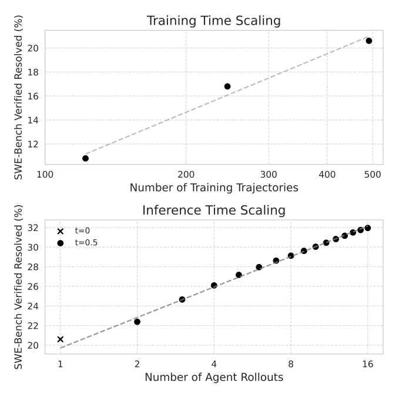
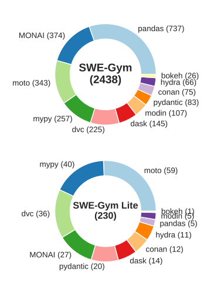
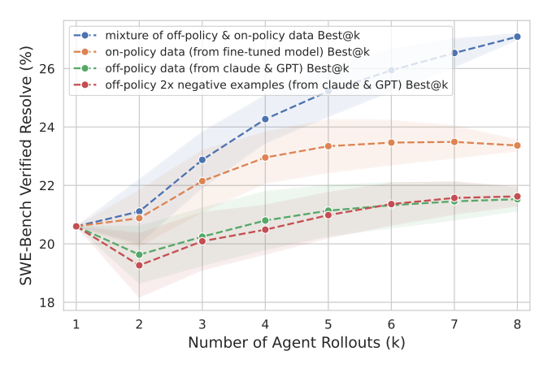
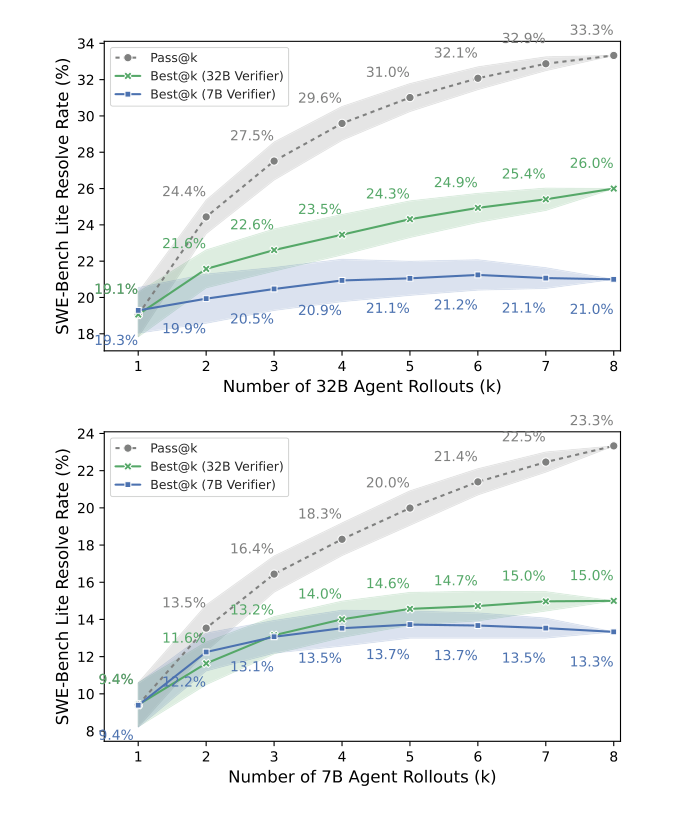
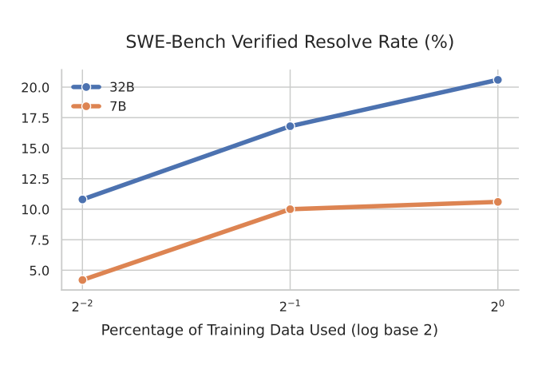
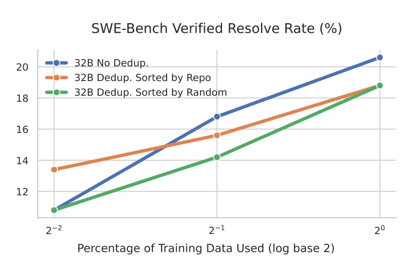

# SWE-Gym でソフトウェアエンジニアリングのエージェントと検証器を訓練する

> 原題: Training Software Engineering Agents and Verifiers with SWE-Gym
> 著者: Jiayi Pan*（UC Berkeley）, Xingyao Wang*（UIUC）, Graham Neubig（CMU）, Navdeep Jaitly（Apple）, Heng Ji（UIUC）, Alane Suhr†（UC Berkeley）, Yizhe Zhang†（Apple）（* 同等の貢献、† 同等の指導）
> 出典: arXiv:2412.21139（ar5iv のクリップ。ICML 2025）

> ［訳注］ar5iv のクリップを底本とした。ar5iv の原ページは取得時に 503 エラーだったため、**クリップと図表番号が一致する arXiv 公式の HTML 版 v1 と PDF 版 v1**（arXiv:2412.21139v1）で照合した（arXiv の最新版の PDF は図表の番号と構成が異なる）。復元した点は次のとおり。(1) **図 8 点（Figure 1〜8）の画像がすべて欠落**していた。HTML 版にも画像がなかったので、PDF v1 から図の範囲を切り出して `raw/assets/2024-swe-gym/` に保存した。(2) **脚注 1〜6 の本文が欠落**していたので HTML v1 から復元した。(3) **表 2 と表 10 が 1 行に平坦化**していたので、HTML v1 と PDF v1 から表の構造を戻した。(4) 本文の「(Tab. )」「Tab. shows」は表番号が抜けていた（HTML v1 でも同じ）。PDF v1 では「Tab. 2」なので補った。(5) 付録 B.4・B.5 のプロンプトは、クリップでは引用符が化けていた（`”””` など）。PDF v1 の文字列（`"""`、`'''`）に戻し、PDF の行末の折り返し記号「,→」を外してつないだ。HTML の表は markdown に直した。参考文献の一覧と謝辞は既定どおり訳出せず、本文の `[^N]` は原典の番号のまま残した。

###### Abstract（要旨）

私たちは SWE-Gym を提示する。これは、現実世界のソフトウェアエンジニアリング（SWE）のエージェントを訓練するための最初の環境である。SWE-Gym は 2,438 の現実世界の Python のタスクインスタンスを含み、それぞれが実行可能なランタイム環境を持つコードベース、単体テスト、自然言語で指定されたタスクからなる。私たちは SWE-Gym を使って言語モデルにもとづく SWE エージェントを訓練し、広く使われている SWE-Bench の Verified と Lite のテスト集合で、解決率を絶対値で最大 19% 引き上げた。また、SWE-Gym からサンプリングしたエージェントの軌跡で訓練した検証器（verifier）による推論時スケーリングも実験した。ファインチューニングした SWE エージェントと組み合わせると、SWE-Bench Verified と Lite でそれぞれ 32.0% と 26.0% を達成し、オープンウェイトの SWE エージェントの新たな最先端となった。さらなる研究を促すため、SWE-Gym、モデル、エージェントの軌跡を公開する[^n1]。

[^n1]: https://github.com/SWE-Gym/SWE-Gym ［訳注: 脚注本文はクリップで欠落していたため arXiv HTML v1 から復元］

## 1 Introduction（はじめに）

<figure>



<figcaption>図1: SWE-Gym は、ソフトウェアエンジニアリングのエージェントのスケーラブルな改善を可能にする。上: 訓練時のスケーリングは、訓練用の軌跡を増やすにつれて一貫した性能の改善を示し、491 本の軌跡で飽和の兆しはない。温度は t=0 を使う。下: 推論時のスケーリングでは、タスクごとに複数の候補の軌跡を生成し、SWE-Gym で訓練した検証器を使って最良のものを選ぶ。このアプローチは、サンプリングした解の数に対しておおむね対数的な利得を示す。上の図と一貫させるため、t=0（回帰からは除外）を最初の仮説として使い、それ以降のロールアウトは t=0.5 を使う。</figcaption>
</figure>

**表1**: SWE-Gym は、GitHub のイシューからの現実世界のソフトウェアエンジニアリングのタスクと、依存関係のインストール済みの環境、実行可能なテストによる検証を組み合わせた、最初の公開された訓練環境である。リポジトリレベル: 各タスクが高度なリポジトリの中に置かれているか。実行可能な環境: 資源の各インスタンスに、関連するすべての依存関係がインストール済みの実行可能な環境が付いているか。実際のタスク: 各インスタンスの指示が人間の開発者から集められたものか。

| データセット（分割） | リポジトリレベル | 実行可能な環境 | 実際のタスク | インスタンス数（全体） | インスタンス数（訓練） |
| --- | --- | --- | --- | --- | --- |
| CodeFeedback [^48] | ✗ | ✗ | ✓ | 66,383 | 66,383 |
| APPS [^10] | ✗ | ✓ | ✓ | 10,000 | 5,000 |
| HumanEval [^7] | ✗ | ✓ | ✓ | 164 | 0 |
| MBPP [^29] | ✗ | ✓ | ✓ | 974 | 374 |
| R2E [^15] | ✓ | ✓ | ✗ | 246 | 0 |
| SWE-Bench (train) [^16] | ✓ | ✗ | ✓ | 19,008 | 19,008 |
| SWE-Gym Raw | ✓ | ✗ | ✓ | 66,894 | 66,894 |
| SWE-Bench (test) [^16] | ✓ | ✓ | ✓ | 2,294 | 0 |
| SWE-Gym | ✓ | ✓ | ✓ | 2,438 | 2,438 |

言語モデル（LM）は、ソフトウェアエンジニアリング（SWE）のタスクを自動化するうえで顕著な可能性を持っている。そのことは、SWE-Bench [^16] や Commit0 [^46] のような最近のベンチマークでの最近の進歩によって最もはっきりと測られている。LM にもとづく SWE エージェントは、エージェントとコンピュータのインターフェース [^39] やプロンプトの戦略 [^35] の改善を通じて大きな性能向上を示してきたが、SWE エージェントの進歩は、基盤となる LM そのものを改善するのではなく、プロプライエタリなモデルに依存することで制限されてきた。

一般的な対話 [^22]、数学的推論 [^26] [^41]、Web ナビゲーション [^23] のように、教師ありファインチューニングと強化学習が LM の能力を大きく改善してきた他の領域とは異なり、ソフトウェアエンジニアリングのエージェントには現在、適切な訓練環境がない。SWE エージェントのためにそうした環境を作ることには、固有の難しさがある。現実世界のソフトウェアエンジニアリングでは、適切なソフトウェアの依存関係と再現可能なテストスイートなどの要件を満たして準備された、実行可能なランタイムとの相互作用が必要になる。これらの課題は既存の資源にも表れている（表 1）。例えば、SWE-Bench [^16] の訓練用の分割は解（タスクを解く git パッチ）しか含まず、実行可能な環境と報酬の信号がない。R2E [^15] は現実世界の問題からかけ離れた合成の指示を使い、CodeContests [^17] や APPS [^10] のようなデータセットは、現実的なリポジトリレベルのコーディングの問題ではなく、孤立したタスクだけに焦点を当てている。

この溝を埋めるため、私たちは SWE-Gym を提示する。これは、GitHub のイシューからの現実世界のソフトウェアエンジニアリングのタスクと、依存関係のインストール済みの環境と、実行可能なテストによる検証を組み合わせた、最初の訓練環境である[^n2]。SWE-Gym は、人気のある 11 のオープンソースリポジトリから集めた 2,438 の Python のタスクを含み（表 2）［訳注: 表番号は PDF v1 にもとづき補った］、LM をエージェントと検証器として訓練するための有用な環境を提供する。

[^n2]: 並行研究である Golubev ら（2024）については §A で論じる。［訳注: 脚注本文は arXiv HTML v1 から復元］

**SWE-Gym は最先端のオープンウェイトの SWE エージェントの訓練を支える。** 汎用のソフトウェア開発のための OpenHands [^35] のエージェントの足場（§5.1）にもとづき、SWE-Gym を使ってサンプリングしたわずか 491 本のエージェントと環境の相互作用の軌跡を使って 32B の Qwen-2.5 coder モデル [^14] をファインチューニングし、SWE-Bench Lite と SWE-Bench Verified でそれぞれ +12.3%（15.3% へ）と +13.6%（20.6% へ）という大きな絶対的改善を達成した（§3.2）。

**SWE-Gym はエージェントの足場をまたいで効果がある。** SWE-Bench に特化したワークフローにもとづく別のエージェントの足場（Moatless, [^50], §5.1）では、LM が SWE-Gym と相互作用し、そこから報酬を受け取り、棄却サンプリングファインチューニングを通じて自分自身を改善することを学ぶ自己改善によって、SWE-Bench Lite で 19.7%（32B モデル）と 10.0%（7B モデル）への改善を観察した。

**SWE-Gym は推論時スケーリングを可能にする検証器モデルの訓練を支える。** SWE-Gym が提供するテストスイートの実行を使って、サンプリングしたエージェントの軌跡が成功か否かを判定する。これらのサンプルを与えて、軌跡の成功確率を推定する検証器モデル（すなわち結果監督の報酬モデル [^8]）を訓練し、それによって推論時スケーリングを可能にする。具体的には、推論時に複数のエージェントの軌跡をサンプリングし、検証器による推定報酬が最も高いものを選ぶ。このアプローチにより、SWE-Bench Verified での解決率はさらに 32.0%（絶対値で +11.4% の改善）まで向上し（§4.1.1、図 1 下）、SWE-Bench Lite では 26.0% になり（§4.1.2）、重みが公開されているシステムの中での新たな最先端を確立した（表 9）。

SWE-Gym での私たちのベースラインの訓練と推論時スケーリングの手法は、計算を増やすにつれて継続的に改善する結果をもたらす（図 1）。訓練の段階では、現在の上限である 491 本の軌跡まで、サンプリングした軌跡の数とともに性能がスケールしており、性能が現在 SWE-Gym の規模ではなくサンプリングの計算によって制限されていることを示唆している。同様に、SWE-Gym で訓練したエージェントと検証器を使うと、下のパネルが示すように、推論時により多くの計算を加えることで結果が着実に改善する。

**表2**: SWE-Gym と SWE-Bench のテスト分割（括弧内）の統計の比較。規模の指標を除き、インスタンスにわたる平均値を報告する。［訳注: クリップでは 1 行に平坦化していたため、arXiv HTML v1 から表の構造を復元］

| 区分 | 指標 | SWE-Gym | SWE-Gym Lite |
|---|---|---|---|
| 規模 | # インスタンス | 2,438 (2,294) | 230 (300) |
| | # リポジトリ | 11 (12) | 11 (12) |
| イシューの本文 | 語数による長さ | 239.8 (195.1) | 186.2 (175.9) |
| コードベース | # テスト以外のファイル | 971.2 (2944.2) | 818.8 (2988.5) |
| | # テスト以外の行 | 340675.0 (363728.4) | 340626.2 (377562.4) |
| 正解パッチ | # 編集した行 | 69.8 (32.8) | 10.6 (10.1) |
| | # 編集したファイル | 2.5 (1.7) | 1.0 (1.0) |
| | # 編集した関数 | 4.1 (3.0) | 1.4 (1.34) |
| テスト | # Fail to Pass | 10.0 (9.0) | 2.04 (3.5) |
| | # 合計 | 760.8 (132.5) | 99.9 (85.2) |

<figure>



<figcaption>図2: SWE-Gym のインスタンスのリポジトリ分布。上は SWE-Gym（2,438 件。pandas 737、MONAI 374、moto 343、mypy 257、dvc 225、dask 145、modin 107、pydantic 83、conan 75、hydra 66、bokeh 26）、下は SWE-Gym Lite（230 件）。</figcaption>
</figure>

## 2 SWE-Gym Environment（SWE-Gym 環境）

SWE-Gym は、人気のある 11 の Python リポジトリのプルリクエストから集めた 2,438 の現実世界のソフトウェアエンジニアリングのタスクからなり、事前に構成された実行可能な環境と専門家が検証したテストケースを持ち、SWE-Bench [^16] に密接に合わせて構築されている。これらのリポジトリは、汚染を避けるため SWE-Bench で使われているものとは別である。これらのタスクは、SWE エージェントに、与えられたコードベースと実行可能な環境を使って、現実世界の GitHub のイシューに対してテストを通る解を開発することを求める。そうしたエージェントは、イシューの自然言語による記述とリポジトリの初期状態から、git パッチとして表されるプルリクエストへの写像を行わなければならない。タスクを解くために、エージェントはファイルを編集または作成しなければならず、デバッグとテストのために環境の中でコードを実行できる。

標準の SWE-Gym は 2,438 のタスクを含む。また、SWE-Bench Lite [^16] に合わせて、一般により簡単でより自己完結しており、迅速なプロトタイピングに適したタスクを含む 230 のタスクの部分集合、SWE-Gym Lite も特定する。

SWE エージェントの開発と自動のデータセット合成の今後の研究を支えるため、実行可能な環境のない Python の GitHub のイシューの大きな集合も公開する。これを SWE-Gym Raw と呼ぶ。SWE-Gym Raw は、358 の Python リポジトリにまたがる 66,894 のインスタンスを含む。

### 2.1 Dataset Construction（データセットの構築）

**リポジトリの特定** SWE-Gym の基盤となるリポジトリを特定するため、まず SEART GitHub search[^n3] を使って最初のリポジトリの一覧を絞り込む。最もダウンロードされている PyPI ライブラリの上位 5k に焦点を当てる SWE-Bench [^16] とは異なり、2022 年 7 月 1 日より前に作成され、スターが 500 を超え、コードが 300 行以上、プルリクエスト（PR）が 500 を超え、コントリビューターが 100 人いる Python リポジトリを選ぶ。その結果 358 のリポジトリが得られる。

[^n3]: https://seart-ghs.si.usi.ch/ ［訳注: 脚注本文は arXiv HTML v1 から復元］

**リポジトリからの訓練インスタンスの抽出** 次に、SWE-Bench のインスタンス抽出スクリプトを使って、これらのリポジトリを SWE-Bench 形式のインスタンスに変換する。各インスタンスは GitHub のイシューに対応し、イシューの自然言語による記述、イシューが作成されたときのリポジトリのスナップショット、単体テストの集合を含む。358 のリポジトリにわたって 64,689 のタスクインスタンスを抽出する。このデータセットを SWE-Gym Raw と呼ぶ。これは先行研究 [^16] で集められた 19K のインスタンスの 3 倍を超える大きさで、リポジトリの数はほぼ 10 倍である。

SWE-Gym Raw のインスタンスはコード、イシューの記述、解を含むが、実行可能な環境は含まない。そして、単体テストが解の正しさを評価するのに有効かどうかもわからない。私たちは、そうした実行可能な環境を半手作業で作るリポジトリの部分集合に焦点を当てる。集めた 358 のリポジトリ全体のうち、インスタンスの数が多い 11 のリポジトリの部分集合を選ぶ。

**訓練インスタンスのバージョン付け** インスタンスをそれぞれのバージョン番号（例: 1.2.3）に対応づけ、バージョンごとに環境をセットアップすることで、重複するセットアップ作業を避け、環境を集める過程をより実際的にする。SWE-Bench のバージョン付けのスクリプトを一般化してスクリプトの実行によるバージョン付けを支えるようにし、リポジトリにある情報（例: pyproject.toml、git のタグなど）にもとづいて、各インスタンスのバージョンを半自動で集める。

**実行可能な環境のセットアップとインスタンスの検証** 依存関係がインストール済みの実行可能な環境は、ソフトウェアエンジニアリングのエージェントを開発するうえで不可欠である。それは展開時のエージェントの設定を最もよく反映し、開発中の段階的な単体テストのフィードバックを可能にするからである。しかし、コードベースの特定のバージョンのために依存関係を構成することは、Python のパッケージに普遍的なインストール方法がないため、特に難しいことがある。この問題は、古いバージョンのコードベースが古いバージョンの依存関係を必要とするという後方互換性の問題によってさらに悪化し、古い GitHub のイシューでは環境のセットアップがいっそう難しくなる。こうした課題にもかかわらず、これらの難しい環境を無視すると SWE-Gym の有用性を下げる分布の偏りを生む可能性があるので、選んだ 11 のリポジトリのインスタンスについてはこの課題に取り組む。各タスクインスタンスについて、イシューが作成された時点のリポジトリのスナップショットにある関連する設定ファイル（例: requirements.txt）、継続的インテグレーションのスクリプト、ドキュメントをもとに、依存関係を手作業で構成する。そのうえで SWE-Bench の実行にもとづく検証スクリプトを走らせ、正解パッチ（すなわち人間の開発者が提出したコードの差分）が元のコードより多くの単体テストを通ることを確認する。過程全体に約 200 人時のアノテーションと 10k CPU コア時間がかかったと見積もっている。検証と失敗したインスタンスの除外のあと、11 の異なるリポジトリから単体テストで検証された 2,438 のインスタンスが得られる。完全な再現性のため、各インスタンスのビルド済みの Docker イメージを公開する。各イメージは平均 2.6 GB を占め、合計 6 TB になる。

### 2.2 SWE-Gym Lite

ソフトウェアエンジニアリングのタスクを解くことは難しく計算集約的であり、フロンティアモデルでは通常タスクあたり 1 ドル以上かかる [^35]。より速いエージェントの評価を通じて研究の効率を上げるため、[^16] は SWE-Bench の 300 インスタンスの標準的な部分集合である SWE-Bench Lite を導入した。SWE-Bench Lite の絞り込みのパイプライン[^n4]に従って、230 インスタンスからなる SWE-Gym Lite の分割を定める。SWE-Bench Lite と同様に、この部分集合は、複数のファイルの編集を必要とするタスク、問題の記述が不十分なタスク、正解のコードの差分が過度に複雑なタスク、そしてエラーメッセージの検証に焦点を当てたテストを除外する。

[^n4]: 構築過程の詳細は https://www.swebench.com/lite.html を参照。［訳注: 脚注本文は arXiv HTML v1 から復元］

### 2.3 Dataset Statistics（データセットの統計）

図 2 は、リポジトリにわたるタスクの分布がロングテールのパターンを示すことを示している。特に、pandas に関連するタスクが全体のほぼ 3 分の 1 を占める一方、bokeh に関連するタスクはわずか 1% である。

私たちの分析は、SWE-Gym に含まれるタスクとリポジトリが SWE-Bench に含まれるものより難しいことを示唆している。表 2［訳注: 表番号は PDF v1 にもとづき補った］は、全体として SWE-Gym が SWE-Bench と同様の統計を持ち、いくつかの重要な違いがあることを示している。SWE-Gym のコードベースは、平均すると SWE-Bench よりファイルが比較的少ないが、コードの行数は同程度である。しかし、SWE-Gym は SWE-Bench と比べて、正解パッチあたりの編集した行とファイルが大幅に多い。イシューの記述が長く、正解パッチの編集が多いことは、タスクの複雑さの高さと緩やかに相関しうる。加えて、私たちの実験では、SWE-Bench と比べて SWE-Gym でのモデルの性能が一貫して低いことがわかった[^n5]。モデルと足場が SWE-Bench に過適合していることのほかに、SWE-Gym でのこの性能低下の説明の一つは、pandas や MONAI のような機械学習ライブラリといった高度なリポジトリを意図的に含めたことかもしれない。

[^n5]: これらの実験の詳細は §B.3 にある。［訳注: 脚注本文は arXiv HTML v1 から復元］

## 3 Training LMs as SWE Agents with SWE-Gym（SWE-Gym で LM を SWE エージェントとして訓練する）

SWE-Gym を使って、言語モデルのエージェントを訓練する。私たちの主な目的は、2 つのエージェントの足場（OpenHands, [^35], §3.2; Moatless Tools, [^50], §3.3）を使って SWE-Gym の妥当なベースラインを確立し、データセットの有効性を検証することである。

### 3.1 Setting（設定）

**エージェントの足場** 2 種類のエージェントの足場——汎用のプロンプトと特化したワークフロー——を、OpenHands CodeAct [^35] と MoatlessTools [^50] を通じて実験する。

**方策改善のアルゴリズム** ベースラインとして、単純な方策改善のアルゴリズムである棄却サンプリングファインチューニング（rejection sampling fine-tuning, 別名 filtered behavior cloning）を用いる。この手法は、言語モデルと強化学習の文献でベースラインとして広く使われている [^49] [^28]。各反復で、方策をサンプリングして環境と相互作用させる。この方策は、より強い教師の方策でも、生徒の方策そのものでもよい。あらかじめ定めたしきい値を超える報酬を得た軌跡だけを残す。そのうえで、標準の負の対数尤度の損失を使って、生徒のモデルをこれらの高報酬の軌跡を模倣するようファインチューニングする。私たちの設定では、報酬のしきい値は成功した軌跡だけを含むように設定する。

**評価指標** SWE-Bench Lite と SWE-Bench Verified [^16] で評価を行う。測るのは、(1) 解決率（Resolve Rate, RR, %）、解決した問題の割合。(2) 空パッチ（Empty Patch, EP, %）、リポジトリのコードがまったく編集されていない軌跡の割合。評価を並列化する（例: 単体テストを実行する）ために、OpenHands のリモートランタイム [^21] の機能を使う。

**訓練の設定** 基盤モデルとして Qwen-2.5-Coder-Instruct [^13] の 7B、14B、32B の版を使う。ハイパーパラメータと訓練の実行の詳細は §B.2 を参照されたい。

### 3.2 Training General-Purpose Prompting Agents（汎用のプロンプトのエージェントを訓練する）

**表3**: OpenHands [^35] をエージェントの足場として使った、SWE-Bench [^16] でのモデルの性能（SWE-Gym でサンプリングした 491 本の軌跡でファインチューニング）。基盤モデルとして Qwen-2.5-Coder-Instruct を使う。評価には温度 t=0 を設定する。（Δ はファインチューニングによる変化。原典では改善を緑、悪化を赤で示す）

| サイズ | 空パッチ (%, ↓) zero-shot | ファインチューニング後 | Δ | ループに陥る (%, ↓) zero-shot | ファインチューニング後 | Δ | 平均ターン数 zero-shot | ファインチューニング後 | Δ | 解決率 (%, ↑) zero-shot | ファインチューニング後 | Δ |
|---|---|---|---|---|---|---|---|---|---|---|---|---|
| **SWE-Bench Lite（300 インスタンス）** | | | | | | | | | | | | |
| 7B | 40.3 | 29.7 | −10.7 | 47.0 | 31.0 | −16.0 | 20.3 | 22.2 | +1.9 | 1.0 (±1.0) | 10.0 (±2.4) | +9.0 |
| 14B | 49.7 | **18.1** | −31.6 | 31.7 | 27.1 | −4.6 | 23.2 | 21.4 | −1.8 | 2.7 (±1.9) | 12.7 (±2.3) | +10.0 |
| 32B | **27.0** | **18.1** | −8.9 | **16.7** | **18.1** | +1.5 | **15.5** | 29.3 | +13.9 | **3.0** (±1.4) | **15.3** (±2.5) | **+12.3** |
| **SWE-Bench Verified（500 インスタンス）** | | | | | | | | | | | | |
| 7B | 45.8 | 33.8 | −12.0 | 39.6 | **21.0** | −18.6 | 21.9 | 35.3 | +13.4 | 1.8 (±1.1) | 10.6 (±2.1) | +8.8 |
| 14B | 44.9 | 14.5 | −30.4 | 32.1 | 21.3 | −10.7 | 25.5 | 30.1 | +4.6 | 4.0 (±1.6) | 16.4 (±2.0) | +12.4 |
| 32B | **9.5** | **13.8** | +4.3 | **29.4** | 23.8 | −5.6 | 24.6 | 31.6 | +7.0 | **7.0** (±1.3) | **20.6** (±2.1) | **+13.6** |

この小節では、OpenHands（バージョン CodeActAgent 2.1, [^35] [^34]）をエージェントの足場として使う。OpenHands CodeActAgent は、特化したワークフローなしの ReAct 型 [^40] の汎用のプロンプトを使い（§5.1）、行動の実行と観測の解釈を基盤となる LM に委ねる。LM に bash のターミナルとファイルエディタを備えさせる。本研究では OpenHands のブラウザ機能は無効にする。SWE-Gym 上でエージェントを並列にロールアウトする（すなわちエージェントの行動を実行する）ために、OpenHands のリモートランタイム [^21] の機能を使う。

**軌跡の収集** エージェントが SWE-Gym の与えられたタスクを解くことに成功した、491 本の成功した軌跡をロールアウトする。これらの軌跡は、2 つのモデル（gpt-4o-2024-08-06 と claude-3-5-sonnet-20241022）から、異なる温度の設定でサンプリングした。成功した軌跡は平均すると、39.9 個の LM の補完メッセージ（およそ 19 ターン）と $18,578$ トークンを持つ。詳細は表 8 を参照されたい。SWE-Gym は軌跡の収集のためにはるかに多くのタスクを含み、繰り返しのサンプリングも可能にするが、現在の 491 本の軌跡の集合は、タスクの量ではなく主に計算予算の制約によって制限された。訓練集合における温度の設定と解決率の詳細は、表 10 と §B.3 を参照されたい。

**追加の評価指標と設定** §3.1 で示した指標に加えて、さらなる分析のために次を含める。(3) ループに陥る（Stuck in Loop, %）、最後の 3 ターンでまったく同じ行動を繰り返してエージェントがループに陥った軌跡の割合。(4) 平均ターン数（Avg. Turn(s)）、これらの軌跡の行動と観測のターン数の平均。訓練した LM の評価は、100 回の相互作用のターンか 32k のコンテキストウィンドウ長のどちらか先に達したほうで打ち切る。特に断らない限り、サンプリングの温度は 0（すなわち貪欲）を使う。

**SWE-Gym の軌跡での訓練は、LM をイシューを直す効果的なエージェントに変える。** 表 3 に示すとおり、基盤モデルの Qwen-2.5-Coder-Instruct-32B は SWE-Bench Lite と Verified で $3.0\%$ と $7.0\%$ しか出せないにもかかわらず、SWE-Gym でサンプリングした軌跡でファインチューニングしたモデルは、最大の 32B モデルで最大 $12.3\%$（$3.0\%\rightarrow 15.3\%$）と $13.6\%$（$7.0\%\rightarrow 20.6\%$）の絶対的な性能向上（すなわちより多くの GitHub のイシューを解決）という一貫した改善を達成する。

**訓練はエージェントがループに陥る振る舞いを減らすのに役立つ。** オープンウェイトの LM は、特に汎用のプロンプトで指示された場合（§5.1）、ループに陥ることにしばしば悩まされる。LM が複数のターンにわたってまったく同じ行動を繰り返し、このループから決して抜け出さないのである。これは表 3 の zero-shot のループに陥る統計に明らかで、最大の 32B モデルでさえ $30\%$ の割合でループに陥る。ファインチューニングしたモデルは、SWE-Bench Lite と Verified の両方の問題で、ループに陥る割合を $-4.6\%$ から $-18.6\%$ の範囲で一貫して減らす。例外は SWE-Bench Lite での 32B モデル（$+1.5\%$）である。ループに陥る割合の低下はおそらくエージェントにより多くのコードの編集を実行するよう促しており、それは異なる規模にわたる空パッチの割合の低下に表れている（SWE-Bench Verified での 32B を除く）。

**性能はモデルの規模とともにスケールする。** 驚くことではないが、より大きな基盤モデルに切り替えるにつれて、SWE-Bench Lite と Verified の両方で、解決率、空パッチ、ループに陥る割合が一貫して改善することがわかる（表 3）。

**自己改善はまだうまくいかない。** ファインチューニングした 32B モデルを使って SWE-Gym で 6 回軌跡をロールアウトし、温度 $t=0.5$ で 868 本の成功した軌跡（すなわちオンポリシーの軌跡）を得る。さらに、868 本のオンポリシーの軌跡と、以前に集めた 491 本のオフポリシーの軌跡を混ぜたもので、基盤の 32B モデルをファインチューニングする。このモデルを SWE-Bench Lite で評価すると、GPT-4 と Claude からのオフポリシーの軌跡だけを使ってファインチューニングしたモデルと比べて、性能が 15.3% から 8.7% に低下することを観察する。

近接方策最適化（PPO）[^25] のようなより高度な最適化手法を使うか、より強い基盤モデルを用いれば、改善した結果が得られうると私たちは考えている。これらの方向は今後の研究の有望な道として残されている。

### 3.3 Self-improvement with Specialized Workflow Agents（特化したワークフローのエージェントによる自己改善）

次に、足場の範囲の反対の端——特化したワークフローを持つエージェント——を、MoatlessTools Agent（バージョン 0.0.2; [^50]）を使った実験で探る。長期ホライズンの計画に広い自由を与える OpenHands CodeAct とは異なり、この足場はあらかじめ定めたワークフローでモデルの行動空間を制約し、実質的にタスクのホライズンを短くする。表 3 と表 5 に示すとおり、オープンウェイトのモデルは MoatlessTools の足場と組み合わせたほうが一貫して zero-shot の性能が良いことを観察する。

MoatlessTools の足場での zero-shot の性能の改善とタスクのホライズンの短さを踏まえ、SWE-Gym によってエージェントが強い教師に頼らずに自己改善できるかを探る。計算予算が限られているため、この実験は 7B と 34B のモデルだけで行い、効率を上げるために 34B のモデルには LoRA [^12] を使う。

7B モデルでのアブレーションから実験を始め、32B にスケールする。SWE-Gym-Lite で高い温度 1.0 でモデルを 30 ラウンドサンプリングし、成功した軌跡をファインチューニングのデータセットに加える。この過程を 2 回繰り返し、その後の改善はわずかになる。

**簡単なデータへの偏りがモデルの性能を下げる。** 繰り返しのサンプリングの間、[^4] の観察と同様に、図 3 に示すとおり各インスタンスの成功確率がロングテールの分布に従い、サンプル数を増やすだけでより多くのインスタンスが解けることがわかった。タスクのより広い網羅は訓練に有益なはずだが、数学的推論で最初に観察されたように [^31]、繰り返しのサンプリングは簡単なタスクへの分布の偏りを持ち込み、成功したすべての軌跡で素朴に訓練することを最適でなくする。

<figure>


<figcaption>図3: 7B モデルの zero-shot で、SWE-Gym Lite での 30 ラウンドにわたる成功の分布（インスタンスを成功した軌跡の数で並べたもの）。分布は自然に簡単なタスクへ偏る。インスタンスごとの上限（cap）はこの偏りを減らすが、訓練のための軌跡の総数を下げる。サンプリング中は温度 t=1 を設定する。</figcaption>
</figure>

**インスタンスごとの上限で簡単なデータへの偏りを緩和する。** こうした偏りを緩和するため、[^31] は、訓練集合の規模を同じに保ちつつ、難しいタスクで同数以上の正例を得ることを提案している。しかし、より難しいタスクから正例を得ることは本質的に難しく、平均してより多くのサンプリングのラウンドを必要とし、したがってより多くの計算を必要とする。私たちは、固定のサンプリング予算のもとで、データの選択を通じてモデルの性能を最適化する、計算に制約のあるシナリオを考える。

私たちは、インスタンスごとの上限（per-instance capping）——タスクあたりの最大インスタンス数を制限する単純な手法——を提案する。図 3 に示すとおり、このアプローチはデータセットの偏りと規模の均衡をとる。上限が低すぎるとデータセットの規模を制限して性能を損ない（§4.2 参照）、高すぎると分布が簡単なタスクへ偏る。

表 4 に示すとおり、経験的に、しきい値 2 がデータセットの規模と難しさの偏りの良い均衡を達成し、全データセットよりわずかに良い性能を示しつつ、訓練の速度を改善することがわかった。軌跡は、必要とするモデルの応答のラウンド数で並べる（少ないほど良い）。

**表4**: 異なるインスタンスごとの上限の戦略（Cap）で、したがって異なる数の軌跡（Traj）のデータで 7B モデルを訓練したあとの、SWE-Bench Lite での解決率と空パッチの割合。

| 上限 | # 軌跡 | 空パッチ (%, ↓) | 解決率 (%, ↑) |
| --- | --- | --- | --- |
| 0（zero-shot） | 0 | 56.3 | 7.0 |
| 1 | 36 | 37.3 | 9.0 |
| 2 | 62 | 29 | 9.7 |
| 3 | 82 | 43.7 | 7.7 |
| 上限なし（全部） | 172 | 30.7 | 9.3 |

**表5**: オンラインの棄却サンプリングファインチューニングのあとの、MoatlessTools の足場での SWE-Bench Lite における解決率（RR）と空パッチの割合（EP）。温度 t=0 で評価。RR は強調した列に示す。

| 設定 | 7B モデル EP (%, ↓) | 7B モデル RR (%, ↑) | 32B モデル EP (%, ↓) | 32B モデル RR (%, ↑) |
|---|---|---|---|---|
| zero-shot | 56.3% | 7.0% | 24.3% | 19.0% |
| 反復 1 | 29.0% | 9.0% | 18.3% | 19.7% |
| 反復 2 | 23.3% | 10.0% | 9.7% | 19.7% |

**結果** 上限 2 で、7B と 32B の両方のモデルについて 2 ラウンドの方策改善を行い、結果を表 5 に示す。7B モデルでは、解決率が大きく改善し、zero-shot の設定の 7.0% から最初の反復のあとの 9.0% へ、2 回目の反復のあとには 10.0% に達し、SWE-Gym での訓練の顕著な利益を示している。対照的に、32B モデルは zero-shot の解決率 19.0% という強い初期性能を示すが、最初の反復のあとは 19.7% へのわずかな改善しか示さず、後続の反復では追加の利得がない。この頭打ちは、エージェントの足場と、方策の改善に用いた棄却サンプリングファインチューニングのアルゴリズムに固有の制約に起因する可能性があると私たちは考えている。

## 4 Scaling Agent Improvements with SWE-Gym（SWE-Gym によるエージェントの改善のスケーリング）

### 4.1 Inference-Time Scaling with SWE-Gym-powered Verifier（SWE-Gym で作った検証器による推論時スケーリング）

エージェントの訓練に加えて、SWE-Gym からサンプリングした軌跡は検証器（別名、報酬モデル）の訓練も可能にする。ベースラインとして、タスクの実行の関連する文脈（例: 問題の記述、軌跡、git の差分）を与えられて、エージェントが問題を解いた確率を表すスコアを生成する、結果監督の報酬モデル（outcome-supervised reward model, ORM）[^8] を訓練する。

そうした学習された検証器が、さらなる性能改善のための効果的な推論時スケーリングを可能にすることを示す。同じ基盤の LM を使って、同じ問題に対して複数の解をサンプリングし、検証器を使って最良の解を選ぶことができる。

#### 4.1.1 Verifier for Agent Scaffold with General-Purpose Prompting（汎用のプロンプトの足場のための検証器）

汎用のプロンプト（§5.1）を使う OpenHands CodeActAgent [^35] [^34] については、入力が交互に並んだ軌跡 $\tau$ で、出力がスカラーの報酬 $r$ である検証器（ORM）の設定を考える。

$$
\tau=[o_{1},a_{1},o_{2},a_{2},\dots,o_{n},a_{n}],r\in[0,1]
$$

ここで観測 $o_{k}$ は、問題の記述、コマンドの実行出力、エラーメッセージなどでありうる。行動 $a_{k}$ は、エージェントからの bash コマンドやファイル操作（例: 編集、閲覧）でありうる。検証器のプロンプトのテンプレートは §B.5 に含める。

**訓練の設定** §3 で述べたのと同じ訓練のハイパーパラメータに従い、32B の Qwen2.5-Coder-Instruct を検証器として訓練する。エージェントの軌跡にもとづいて、エージェントが要求をうまく解決したかについて「YES」か「NO」を予測するよう LM を訓練する（§B.5 の検証器のプロンプト参照）。推論時には、プロンプトとエージェントの軌跡 $\tau$ を条件として、SGLang [^47] を使って次のトークンが「YES」（$l_{y}$）または「NO」（$l_{n}$）である対数確率を得る。そのうえで、対数確率を正規化して ORM としての成功確率を計算する: $p_{\text{yes}}=\exp(l_{y})/(\exp(l_{y})+\exp(l_{n}))$。

**検証器の訓練データ** §3.2 でエージェントの訓練のためにサンプリングした 2 つの軌跡の集合を再利用する。(1) gpt-4o と claude-3-5-sonnet からサンプリングした 443 本の成功した軌跡を含むオフポリシーの軌跡。(2) エージェントのモデル（ファインチューニングした Qwen2.5-Coder-Instruct-32B）からサンプリングした 875 本の成功した軌跡を含むオンポリシーの軌跡。訓練にはコンテキストウィンドウ（32k トークン）に収まる軌跡だけを残すことに注意されたい。オンポリシーとオフポリシーの両方の軌跡を合わせ、それぞれの部分集合から同じ数の失敗した軌跡をランダムにサンプリングし（合計 1318）、それらを合わせて検証器の訓練用のデータセットにする。

**指標** (1) Pass@K。K 本のサンプリングした軌跡の中に少なくとも 1 つ成功した解が見つかるタスクの割合を表す。(2) Best@K。K 個のサンプルの中で検証スコア（$p_{\text{yes}}$）が最も高い軌跡を選び、選んだ軌跡のうち成功したものの割合を報告する。Pass@K は、何らかの動く解を見つけるモデルの能力（すなわち Best@K の上限）を評価し、Best@K は、最も有望な解を見分ける検証器の能力を評価する。各データ点の平均と分散は [^18] に従って計算する。計算の詳細は §B.1 を参照されたい。

<figure>


<figcaption>図4: ファインチューニングした検証器を使って推論時の計算をスケールすると、SWE-Bench Verified での性能が改善する。エージェントと検証器はいずれも、対応するデータセットでファインチューニングした Qwen2.5-Coder-Instruct-32B モデルである（§4.1.1）。エージェントの足場には OpenHands [^35] を使う。最初のロールアウトは温度 t=0 で行い、残りは t=0.5 を使った。（図中: Pass@k は k=1 の 20.6% から k=16 の 42.8% へ、Best@k は 20.6% から 32.0% へ）</figcaption>
</figure>

**結果** 図 4 は、ファインチューニングした 32B モデルをエージェントのモデルとして使ったときに、Pass@K と Best@K の指標がサンプリングしたエージェントの軌跡の数とともにどうスケールするかを示している。Pass@K は強い改善を示し、K が 1 から 8 に増えるにつれて $20.6\%$ から $37.8\%$ へ、k=16 で $42.8\%$ に上がる。検証器が最良の軌跡を選ぶ能力に依存する Best@K の指標は、より控えめだが着実な進歩を示し、k=1 の $20.6\%$ から k=8 の $29.8\%$ へ、k=16 では $32.0\%$ に改善する。Pass@K と Best@K の差は、コーディングエージェントのためのより高度な報酬モデリングの技法の余地を示している。驚いたことに、Unsloth ライブラリ [^32] を介した LoRA [^12] によるモデルのファインチューニング（$@8$ で 29.8%）が、検証器の訓練で全パラメータのファインチューニング（$@8$ で 27.2%）より良い性能を示すことがわかった。これはおそらく正則化の効果による。さらに、図 1（下）に示すとおり、Best@K の曲線は対数スケールで強い線形性を示しており、有望なスケーリングの振る舞いを示している。

<figure>



<figcaption>図5: 検証器の訓練のアブレーション研究（§4.1.1）。性能は SWE-Bench Verified で評価する。エージェントと検証器はいずれも、対応するデータセットでファインチューニングした Qwen2.5-Coder-Instruct-32B モデルである（§4.1.1）。エージェントの足場には OpenHands [^35] を使う。（凡例: オフポリシーとオンポリシーの混合データの Best@k／オンポリシーのデータ（ファインチューニングしたモデルから）の Best@k／オフポリシーのデータ（Claude と GPT から）の Best@k／負例を 2 倍にしたオフポリシーのデータ（Claude と GPT から）の Best@k）</figcaption>
</figure>

**アブレーション研究: 検証器にとって訓練データが重要である。** 図 5 に示すとおり、私たちのアブレーション研究は、訓練データの選択が検証器の性能に大きく影響しうることを示している。前段落の LoRA で訓練したモデルとは異なり、すべてのアブレーション研究は、検証器として 32B の Qwen2.5-Coder-Instruct の全パラメータのファインチューニングを行う。オフポリシーとオンポリシーのデータの混合で訓練すると最良の結果が得られ（私たちの既定の設定）、Best@k は k=8 で $20\%$ から約 $27\%$ にスケールする。対照的に、ファインチューニングしたモデルからのオンポリシーのデータだけを使うと、中程度だが限られた改善を示し、Claude と GPT からのオフポリシーのデータだけで訓練すると、$22\%$ 前後で早くに性能が頭打ちになる。特に、負例を 2 倍にしたオフポリシーのデータを使うと、$k$ が小さいときにわずかに性能が悪く、訓練中に負例に重みをかけすぎると検証器が過度に保守的になりうることを示唆している。これらの知見は、検証器の訓練が、オフポリシーとオンポリシーの両方の例を組み合わせた多様なデータセットと、均衡した正例と負例のデータから最も恩恵を受け、推論時スケーリングの間によりよい汎化と、成功した解のより正確な識別を可能にすることを示している。

#### 4.1.2 Verifier for Agent Scaffold with Specialized Workflow（特化したワークフローの足場のための検証器）

<figure>



<figcaption>図6: 学習した検証器による、MoatlessTools のエージェントの推論時の計算のスケーリング。サンプリング中は温度 t=0.5 を設定する。（上: 32B エージェントのロールアウト、下: 7B エージェントのロールアウト。それぞれ Pass@k と、32B／7B の検証器による Best@k）</figcaption>
</figure>

特化したワークフローを持つ MoatlessTools のエージェントは、OpenHands CodeActAgent のような行動と観測が交互に並ぶ軌跡を持たないので、解析の過程を通じて検証器の入力を用意する。この過程は、タスクの記述、関連するエージェントの文脈、生成したパッチを組み合わせ、タスクの成功を示す単一の信頼度のトークンを出力するようモデルを訓練する。[^44] の文脈抽出器を適応させ、プロンプトのテンプレートを §B.4 に示す。

最後のサンプリングのラウンドからのオンポリシーの軌跡を使い、正則化のために LoRA [^12] を適用して、7B と 32B の検証器を訓練する。データの偏りに対処するため、インスタンスあたりの正例のデータ点を 2 に制限し、失敗のケースを成功のケースに合わせてサブサンプリングすることでデータセットの均衡をとる。

**結果** 温度 0.5 で方策を 8 回サンプリングして検証器を評価する。図 6 に示すとおり、これらの検証器はモデルの規模にわたって効果的なスケーリングを可能にする。7B のエージェントと検証器のシステムは SWE-Bench Lite での成功率を 10% から 13.3% に、32B のシステムは 19.7% から 26.3% に改善する。7B の検証器は、7B と 32B の両方のエージェントからの軌跡を順位づけるとき、N=4 のサンプルのあとで頭打ちになる。対照的に、32B の検証器は N=8 でも改善を続けており、モデルの規模がスケーリングの振る舞いに影響することを示唆している。

### 4.2 Training-Time Scaling with Data（データによる訓練時のスケーリング）

この小節では、訓練データのスケーリングがエージェントの性能に与える影響を調べる。サンプリングした軌跡について、3 種類のデータのスケーリングを特定する。(1) ランダムなスケーリング（重複除去なし）。一意かどうかにかかわらず、訓練用の軌跡の総数を単に増やす（図 7）。(2) 一意なインスタンスのスケーリング（重複除去あり）。インスタンスごとに成功した軌跡を 1 本ランダムに選ぶことで、異なるインスタンスの数をスケールする（図 8）。(3) リポジトリのスケーリング（重複除去あり）。リポジトリの名前で並べ、1 つのリポジトリのすべてのインスタンスを順に含めていくことで軌跡をサンプリングし、リポジトリレベルの多様性の影響を調べる。

**設定** OpenHands [^35] を使い、これらのスケーリングのアプローチを SWE-Bench Verified で評価する。ランダムなスケーリングは §3.2 の全軌跡データセット（491 本の軌跡）で、一意なインスタンスのスケーリングはインスタンス ID で重複除去したこれらの軌跡（294 本の軌跡）で、リポジトリにもとづくスケーリングは、リポジトリをアルファベット順に並べて各リポジトリのすべての軌跡を順に含めることで行う（例: 最初の 25% は最初の N 個のリポジトリの完全な軌跡を含む）。各アプローチについて、対応するデータセットの 25%、50%、100% で訓練したモデルを比較する。これらのデータセットの詳細な統計は表 7 を参照されたい。

**モデルの性能は訓練例が増えるとよくスケールする。** 図 7 に示すとおり、好ましいスケーリングの振る舞いが観察される。訓練データが増えるにつれて、特に 32B モデルで、モデルの解決率が一貫して改善する。これらの結果は、SWE-Gym の現在の規模とリポジトリの多様性がおそらく性能のボトルネックではなく、より多くの計算資源を割り当ててより多くの訓練用の軌跡をサンプリングすることで、さらなる改善がおそらく達成できることを示唆している。

<figure>



<figcaption>図7: 訓練データの規模に対するモデルの性能のスケーリング。x 軸は、使った訓練データの割合を底 2 の対数スケールで示す。（縦軸は SWE-Bench Verified の解決率。32B と 7B）</figcaption>
</figure>

**同様のスケーリングの傾向は、インスタンスとリポジトリの多様性がまだボトルネックでないことを示唆する。** 図 7 は、重複除去が効いてくるところまでは、異なるスケーリングのアプローチの間で全体の性能が同程度であることを明らかにしている。ランダムなスケーリング（重複除去なし）は最終的な性能が高いが、これはおそらくスケーリングの効率が良いからではなく、軌跡が多い（491 対 294）ためである。重複除去したアプローチの中では、リポジトリのスケーリングが 25% のデータで強い初期性能を示しており、完全なリポジトリの網羅が訓練の初期により一貫した学習信号を与えうることを示唆している。これらの結果は、SWE-Gym のリポジトリとインスタンスの多様性がまだボトルネックではなく、重複やリポジトリの分布にかかわらず、単に訓練のためのエージェントの軌跡のデータをより多くサンプリングすることで、さらなる改善がおそらく達成できることを示唆している。

<figure>



<figcaption>図8: 3 つのデータのサンプリングのアプローチの比較: 重複除去なし、リポジトリにもとづくサンプリング、ランダムなサンプリング（§4.2）。すべての変種は 32B モデルを使い、SWE-Bench Verified で評価する。</figcaption>
</figure>

## 5 Related Work（関連研究）

### 5.1 Agents that Solve Github Issues（GitHub のイシューを解くエージェント）

本論文では、GitHub のイシューを自動で解決するよう設計されたソフトウェアエンジニアリングのエージェントに、特に SWE-Bench [^16] の文脈で焦点を当てる。これらのエージェントはよく定義された設定で動作する。GitHub のイシューとそれに関連するコードリポジトリが与えられると、イシューに対処する有効なコードの変更（すなわち git の差分のパッチ）を生成する。これらの変更の正しさは、人間の開発者が書いたテストスイートの実行を通じて検証される。

既存のエージェントの設計は、エージェントのワークフローに注入された人間の事前知識の量によって分類できる。(1) 特化したワークフロー: [^38] [^50] [^45] [^6] は、人間が定めた段階（例: 位置の特定、コードの編集、パッチの再ランキングと選択）を持つ特化したワークフローを構築し、その中で LM に繰り返し指示を与えて最終的な結果を出させる。LM をあらかじめ定めたサブタスクに取り組ませることに制限する一方で、このアプローチはタスクのホライズンを効果的に短くし、長期の計画の必要性を和らげる。しかし、こうした特化したワークフローには制約がある。適切な段階と遷移を定めるのに大きな人間の工学が必要であり、設計されたワークフローの外にある新しい種類のイシューにうまく汎化しないかもしれず、途中のステップが失敗すると脆くなりうる。(2) 汎用のプロンプト: [^39] [^35] のようなシステムは、ReAct [^40] や CodeAct [^34] のような手法を含む汎用のプロンプトのアプローチに頼る。これらのシステムは、固定のワークフローを強制したり人間があらかじめ定めた段階に大きく頼ったりすることなく、長いホライズンにわたって計画し、行動と観測の発展していく履歴にもとづいて次の行動を出すことを、主に LM 自身に依存する。より柔軟ではあるが、これらの汎用のアプローチは基盤の LM の能力により高い要求を課し、増え続ける相互作用の履歴とともに何ラウンドもの相互作用があるため計算コストが高くなりうる。

既存の成功した手法のほとんどは、プロプライエタリなモデルへのプロンプトと、それらのモデルの既存の制約を回避するための特化したワークフローの作り込みにもとづいている。これは、システムが過去の相互作用と報酬から学んで段階的にタスクの能力を伸ばす、他の領域での学習にもとづくアプローチの成功 [^27] [^1] と著しく対照的である。適切な訓練環境とベースラインが、この方向の研究を加速する助けになると私たちは主張する。私たちは、SWE-Gym を使って学習を通じて強いエージェントを構築できることを検証する。

### 5.2 Environments for Training Software Agents（ソフトウェアエージェントを訓練するための環境）

ソフトウェアエンジニアリングのエージェントを訓練するのに適した既存のデータセットはない。既存のデータセットは、それぞれ異なる制約を示すことが多い。SWE-Bench [^16] は、ソフトウェアエンジニアリングの性能の評価に広く使われている。その訓練用の分割には、評価用の分割にある実行可能な環境と成功の信号がなく、モデルの訓練への有用性は限られる。HumanEval [^7] は、コーディング競技に似た独立したコード生成のタスクのために設計されている。したがって、何千ものファイル、何百万行ものコードを含み、バグの修正、機能の開発、システムの最適化のようなタスクを含む、現実世界のリポジトリレベルのソフトウェアエンジニアリングのタスクに固有の複雑な課題に取り組むには足りない。同様に、R2E [^15] は 246 インスタンスの小さな評価用データセットであり、合成の性質のために、現実世界のソフトウェアエンジニアリングのシナリオの現実性と複雑さを欠いている。この環境が訓練に有用かどうかの実証的な証拠も限られている。私たちが提案する SWE-Gym は、代わりに現実世界の GitHub のイシューの本文をタスクの指示として使い、関連する単体テストを検証に使う。このアプローチは、現実世界のソフトウェアエンジニアリングの課題に密接に合った、現実的で複雑なタスクの定式化を導入する。

### 5.3 Post-training: From Chatbots, Reasoners to Agents（事後訓練: チャットボット、推論器からエージェントへ）

事前訓練済みの言語モデルを、通常は教師あり学習か強化学習によってファインチューニングする事後訓練は、さまざまな領域でモデルの性能を改善するのに非常に効果的であることが示されてきた。RLHF [^22] は、言語モデルをチャットボットに適応させ、モデルの性能とアラインメントの両方を改善する標準的な手法となった [^30]。数学的推論では、2 つの標準的なデータセット、MATH [^11] と GSM-8K [^8] が訓練と評価の両方のための問題と解答の対を持ち、研究者が方策と検証器（報酬モデル）の両方を訓練する手法を探究できるようにしている [^8] [^33]。

初期の研究 [^34] [^5] [^42] [^36] は、より強いモデルからエージェントの軌跡を蒸留することが、より弱いモデルを一貫して改善することを示している。最近の研究は自己改善の手法へ移っている。[^37] [^43] [^3] は、報酬信号に導かれた RL や棄却サンプリングファインチューニングが、より有能な教師モデルに頼ることなくモデルが自己改善することを可能にしうることを示している。

広い成功にもかかわらず、事後訓練は一般に、専門家のデモンストレーションデータか、信頼できる報酬信号を持つ訓練環境のどちらかに依存しており、それはソフトウェアエンジニアリングの領域では大部分が欠けている。この制約が、SWE-bench [^16] で最も性能の高いアプローチの大半に表れているように、プロプライエタリな言語モデルによるプロンプトベースの手法への依存の一因となってきた。私たちの研究は、関連する専門家が書いたテストを報酬信号として使う、現実世界のソフトウェアエンジニアリングのタスクに根ざした訓練環境である SWE-Gym で、この溝に取り組む。私たちの実験は、プロンプトエンジニアリングなしに SWE-Gym を使って強い SWE エージェントを構築できることを検証する。私たちの研究と並行して、[^19] と [^9] がいずれもソフトウェアエンジニアリングのエージェントの訓練を研究しており、後者は検証器の訓練とデータセットの構築も探究している。これらの並行研究との主な違いは §A で論じる。

## 6 Conclusions（結論）

本論文では、ソフトウェアエンジニアリングのエージェントのスケーラブルな学習を可能にするうえでの決定的な溝を埋める、最初の公開された訓練環境である SWE-Gym を導入する。現実世界の Python のタスクを、リポジトリレベルの文脈、事前に構成された実行環境、テストによる検証と組み合わせることで、SWE-Gym は LM エージェントの訓練の研究を進める基盤となるだろう。広範な実験を通じて、SWE-Gym によってエージェントと検証器の両方のモデルが、複雑なソフトウェアのタスクを解決するうえで大きな改善を達成できることを示す。私たちの知見は、これらのアプローチのスケーラビリティを浮き彫りにし、計算を増やすことで継続的に性能が向上する可能性を明らかにしている。

## Appendix A Comparison with Concurrent Works（付録 A: 並行研究との比較）

[^19] は、私たちの棄却サンプリングファインチューニングのベースラインに類似した手法を使い、私たちの SWE-Gym Raw の分割に匹敵するデータセットで、LM エージェント Lingma SWE-GPT を訓練している。実行可能な単体テストのフィードバックがないため、提出したパッチと編集位置の正解パッチとの類似度を比べるといった、手作業で定めたヒューリスティクスに頼って質の低い軌跡を除外している。モデルの重みは公開されているが、訓練のパイプラインとデータセットは公開されていない。

私たちの研究に最も関連するのは、[^9] と [^2] による 2 つの連続したブログ記事であり、彼らも GitHub からの現実世界のタスクで実行可能な訓練環境を構築している。手作業の構成の代わりに、汎用の環境セットアップのスクリプトを使い、セットアップの過程に失敗したインスタンスは単に捨てている。このアプローチは、データセットの規模と分布に重要な違いをもたらす。複雑な依存関係を持つタスクから環境を遠ざける偏りを生む一方で、6,415 のインスタンスを集めることに成功しており、私たちのデータセットの約 1.5 倍の大きさである。[^9] では、その環境でエージェントと検証器の訓練も研究している。さらに、訓練した検証器が最良の次の行動を順位づけて選ぶ先読みの設定も探究している。はるかに大きなエージェントの軌跡の集合（私たちの実験の数千に対して 80,036）とモデルの規模（32B に対して 72B）で、彼らの最良のシステムは SWE-Bench Verified で 40% の正解率を達成している。彼らのデータセットとエージェントの軌跡は公開されているが、モデルは公開されていない。

比較すると、同程度のデータセットの規模で、私たちの SWE-Gym は実行可能なフィードバックを持ち、環境の手作業の構成を通じてデータセットの潜在的な偏りを避けつつ、エージェントと検証器の訓練、それらのスケーリングの振る舞い、エージェントの自己改善についての肯定的な結果の包括的な分析を提供する。私たちのシステムは、大幅に少ない計算と小さなモデルの規模（72B に対して 32B）で競争力のある結果を達成する。最後に、データセット、モデルの重み、エージェントの軌跡のデータ、訓練のパイプラインを含む、プロジェクトのすべての成果物をオープンソースにする。

**表6**: SWE-Bench ベンチマークでのモデルの性能と、モデルの重みと環境が公開されているか（公開性）の比較。

| モデル名、規模 | SWE-Bench Lite | SWE-Bench Verified | 公開性: モデル | 公開性: 環境 |
|---|---|---|---|---|
| [^19], 72B | 22.0 | 30.2 | ✓ | ✗ |
| [^9] エージェントと検証器, 72B | - | 40.6 | ✗ | ✓ |
| 私たちの SWE-Gym のエージェントと検証器, 32B | 26.0 | 32.0 | ✓ | ✓ |

## Appendix B Experiment Details（付録 B: 実験の詳細）

**表7**: 訓練時のスケーリングの実験（§4.2）で使った成功した軌跡の分布。Dedup. は、インスタンス ID ごとに成功した軌跡を 1 本ランダムに選んで重複除去したことを示す。Sorted by random (repo) X% (Dedup.) は、ランダムに（リポジトリ名で）並べた重複除去済みのインスタンスの最初の X% から取った軌跡の部分集合を示す。

| リポジトリ | 元 | 重複除去 | ランダム順（重複除去）最初の 25% | 最初の 50% | リポジトリ順（重複除去）最初の 25% | 最初の 50% |
|---|---|---|---|---|---|---|
| getmoto/moto | 155 | 72 | 12 | 33 | 0 | 46 |
| Project-MONAI/MONAI | 95 | 53 | 17 | 25 | 53 | 53 |
| pandas-dev/pandas | 70 | 61 | 14 | 30 | 0 | 0 |
| python/mypy | 46 | 27 | 7 | 12 | 0 | 0 |
| dask/dask | 45 | 29 | 8 | 17 | 6 | 29 |
| iterative/dvc | 36 | 24 | 8 | 12 | 0 | 0 |
| conan-io/conan | 20 | 12 | 1 | 7 | 12 | 12 |
| pydantic/pydantic | 11 | 7 | 2 | 4 | 0 | 0 |
| facebookresearch/hydra | 7 | 5 | 2 | 5 | 0 | 5 |
| bokeh/bokeh | 3 | 2 | 1 | 1 | 2 | 2 |
| modin-project/modin | 3 | 2 | 1 | 1 | 0 | 0 |
| 合計 | 491 | 294 | 73 | 147 | 73 | 147 |

**表8**: SWE-Gym でサンプリングした軌跡の統計。トークン数の見積もりには Qwen-2.5-Coder-Instruct-7B のトークナイザを使う。

| | 解決 | 件数 | 平均 | 標準偏差 | 最小 | 最大 | 5% | 10% | 25% | 50% | 75% | 90% | 95% |
|---|---|---|---|---|---|---|---|---|---|---|---|---|---|
| メッセージ数 | ✗ | 5,557.0 | 39.2 | 31.9 | 7.0 | 101.0 | 9.0 | 9.0 | 9.0 | 29.0 | 61.0 | 100.0 | 101.0 |
| | ✓ | 491.0 | 39.9 | 19.9 | 13.0 | 101.0 | 19.0 | 21.0 | 25.0 | 33.0 | 47.5 | 65.0 | 87.0 |
| トークン数 | ✗ | 5,557.0 | 17,218.3 | 17,761.6 | 1,615.0 | 167,834.0 | 1,833.0 | 1,907.0 | 2,268.0 | 12,305.0 | 26,434.0 | 41,182.2 | 51,780.6 |
| | ✓ | 491.0 | 18,578.5 | 11,361.4 | 2,560.0 | 81,245.0 | 5,813.0 | 8,357.0 | 11,559.5 | 15,999.0 | 22,040.5 | 31,632.0 | 39,512.5 |

**表9**: 重みが公開されている SWE-Bench [^16] のベースラインとの性能比較。データの出所: https://www.swebench.com/ 、2024 年 12 月 21 日に参照。

| エージェント | モデル | モデルの規模 | 訓練データ | 解決 (%) |
|---|---|---|---|---|
| **SWE-Bench Verified（500 インスタンス）** | | | | |
| RAG | SWE-Llama [^16] | 7B | 10K インスタンス | 1.4 |
| RAG | SWE-Llama [^16] | 13B | 10K インスタンス | 1.2 |
| Lingma Agent [^19] | Lingma SWE-GPT (v0925) | 7B | 4K リポジトリからの 90K PR | 18.2 |
| Lingma Agent [^19] | Lingma SWE-GPT (v0925) | 72B | 4K リポジトリからの 90K PR | 28.8 |
| OpenHands [^35]（本研究） | ファインチューニングした Qwen2.5-Coder-Instruct | 32B | 11 リポジトリからの 491 本のエージェントの軌跡 | 20.6 |
| OpenHands w/ Verifier [^35]（本研究） | ファインチューニングした Qwen2.5-Coder-Instruct | 32B（エージェントと検証器） | エージェント用に 11 リポジトリからの 491 本のエージェントの軌跡 ＋ 検証器用に 1318×2 本の成功・失敗のエージェントの軌跡 | 32.0 |

### B.1 Mean and Variance for Pass@N and Best@N.（Pass@N と Best@N の平均と分散）

Pass@N と Best@N の曲線の平均と分散を得るため、おおむね [^18] に従う。合計 M ラウンドのロールアウトが与えられたとき、$N<M$ について、M 回のロールアウトからランダムに選んだサイズ $N$ の 100 個の部分標本にわたって平均と分散を計算する。§4 の OpenHands CodeActAgent の推論時スケーリングの曲線については、最初の試行に温度 0 を使うため、N=1 についてはこの計算を除外する。

### B.2 Training Details.（訓練の詳細）

**OpenHands のエージェントの実験** torchtune [^24] を使って全パラメータのファインチューニングを行い、学習率は 1e-4、最大 5 エポック、グローバルバッチサイズ 8、最大コンテキスト長 32768 とした。7B、14B、32B のいずれの版もファインチューニングし、実験は modal [^20] 上の 2〜8 基の NVIDIA H100 80G GPU で行った。唯一の例外は §4.1.1 の主な実験で、そこでは Unsloth ライブラリ [^32] を介した LoRA [^12]（$@8$ で 29.8%）を使って検証器を最大 2 エポック訓練し、他のハイパーパラメータは同じままにした。

**MoatlessTools のエージェントの実験** MoatlessTools のすべてのモデルは、コンテキストウィンドウ 10240 で訓練する。7B モデルの実験では、4 基の H100 GPU を使い、torchtune で方策モデルを全パラメータのファインチューニングで訓練する。バッチサイズを 8、学習率を $2\times 10^{-5}$ に設定し、5 エポック訓練する。

32B モデルでは、単一の H100 GPU で Unsloth [^32] を使って LoRA のファインチューニングを行う。エポック数を 5、バッチサイズを 8、LoRA のランクを 64、学習率を $5\times 10^{-4}$ に設定する。検証器の訓練にも同じ構成を使う。

MoatlessAgent の実験では、スループットを改善するため FP8 の量子化でエージェントを提供しており、モデルの性能への影響は最小限であることがわかった。

### B.3 Details of OpenHands Trajectory Sampling（OpenHands の軌跡のサンプリングの詳細）

**表10**: SWE-Gym からサンプリングした軌跡のまとめ。［訳注: クリップでは 1 行に平坦化していたため、PDF v1 から表の構造を復元］

| 軌跡の集合 | サンプリングしたモデル | サンプリングしたデータセット | 温度 | 最大ターン数 | 成功した軌跡 |
|---|---|---|---|---|---|
| $D_{0}$ | gpt-4o-2024-08-06 | SWE-Gym Lite | 0 | 30 | 19 (8.26%) |
| （累計）$D_{0}$ の合計 | | | | | **19** |
| $D_{1}\setminus D_{0}$ | gpt-4o-2024-08-06 | SWE-Gym Lite | 0.2 | 30 | 11 (4.78%) |
| | gpt-4o-2024-08-06 | SWE-Gym Lite | 0.3 | 30 | 17 (7.39%) |
| | gpt-4o-2024-08-06 | SWE-Gym Lite | 0.4 | 30 | 21 (9.13%) |
| | gpt-4o-2024-08-06 | SWE-Gym Lite | 0.5 | 30 | 18 (7.83%) |
| | gpt-4o-2024-08-06 | SWE-Gym Lite | 0.8 | 30 | 20 (8.70%) |
| （累計）$D_{1}$ の合計 | | | | | **106** |
| $D_{2}\setminus D_{1}$ | gpt-4o-2024-08-06 | SWE-Gym Lite | 0 | 50 | 19 (8.26%) |
| | claude-3-5-sonnet-20241022 | SWE-Gym Lite | 0 | 50 | 67 (29.1%) |
| | gpt-4o-2024-08-06 | SWE-Gym Full | 0 | 50 | 111 (4.55%)* |
| | gpt-4o-2024-08-06 | SWE-Gym Full | 1 | 50 | 188 (7.71%) |
| （累計）$D_{2}$ の合計 | | | | | **491** |

\* 基盤に関するエラーに遭遇し、一部のインスタンスが完了しなかったため、この数は実際の成功した軌跡の数を過小評価している可能性がある。

表 10 に詳述するとおり、ファインチューニングの実験のためにいくつかの軌跡の集合を集める。gpt-4o-2024-08-06 を温度 0 で SWE-Gym Lite 上でサンプリングしてデータセット $D_{0}$ を集め、最終的にタスクを解いた（SWE-Gym の単体テストで評価）19 本の軌跡を集めた。次に温度を変えて（t={0.2, 0.3, 0.4, 0.5, 0.8}）SWE-Gym Lite 上でサンプリングする。これらのインスタンスを $D_{0}$ と合わせて、与えられた問題を解いた 106 本の軌跡（$D_{1}$）を得る。$D_{0}$ と $D_{1}$ の両方で最大ターン数は 30 に設定する。最大ターン数の効果を実験するため、最大ターン数を 50 に設定し、SWE-Gym Lite 上で温度 0 で gpt-4o-2024-08-06（230 中 19 を解決）と claude-3-5-sonnet-20241022（230 中 67 を解決）をサンプリングし、SWE-Gym の全体集合上で gpt-4o-2024-08-06（温度 t={0, 1}）をサンプリングする（合計 4876 インスタンス中 299 を解決）。これにより合計 106 + 19 + 67 + 299 = 491 本の成功した軌跡が得られ、これが最終的な訓練用の軌跡 $D_{2}$ になる。

### B.4 MoatlessTools ORM Prompt（MoatlessTools の ORM のプロンプト）

以下は、MoatlessTools の検証器（ORM）のためのプロンプトを生成する擬似コードで、[^44] から改変したものである。文脈の抽出に Claude-3.5-Sonnet のようなプロプライエタリなモデルに頼る [^44] とは異なり、評価対象のエージェントの軌跡から直接文脈を得る。

```python
SYSTEM_MESSAGE = """You are an expert in python for software engineering and code review. Your responsibility is to review the patches generated by language models to fix some issues and provide feedback on the quality of their code."""

USER_MESSAGE="""I want you to evaluate an LLM-generated candidate patch that tries to resolve an issue in a codebase.

To assist you in this task, you are provided with the following information:
 - You are given an issue text on a github repository (wrapped with <issue_description></issue_description>).
 - You are also given some identified code spans that are relevant to the issue.
     Each code span is wrapped with <code_span file_path=FILE_PATH span_id=SPAN_ID></code_span> tags, where FILE_PATH is the path to the file containing the code span, and SPAN_ID is the unique identifier for the code span.
     Each code span also comes with the line numbers for you to better understand the context. It's possible that the code span are not sufficient to fix the issue, adjust your score accordingly.
 - You are given the candidate patch that tries to resolve the target issue.
     For your convenience, you are given the hunks of original code and the code after applying the patch.
     The code before the patch is wrapped with <before_patch></before_patch> and the code after the patch is wrapped with <after_patch></after_patch>.
     Note that the file names in before_patch starts with 'a/' and the file names in after_patch starts with 'b/'.


<issue_description>
{issue_text}
</issue_description>

<before_patch>
{before_patch}
</before_patch>

<after_patch>
{after_patch}
</after_patch>

{code_spans}

Response in "True" or "False" for whether the patch has resolved the issue."""
```

### B.5 OpenHands ORM Prompt（OpenHands の ORM のプロンプト）

以下は、OpenHands の検証器（ORM）のためのプロンプトを生成する擬似コードである。

```python
SYSTEM_MESSAGE = '''You are an expert judge evaluating AI assistant interactions. Your task is to determine if the assistant successfully resolved the user's request.

Key evaluation criteria:
1. Did the assistant complete the main task requested by the user?
2. Did the assistant handle all edge cases and requirements specified?
3. Were there any errors or issues in the final solution?
4. Did the assistant verify the solution works as intended?

Respond only with "<judgement>YES</judgement>" or "<judgement>NO</judgement>".'''

USER_MESSAGE = '''Please evaluate the following interaction between an AI assistant and a user:

=== INTERACTION LOG ===
''' + traj_str + '''
=== END INTERACTION ===

Based on the above interaction, did the assistant successfully resolve the user's initial request? Respond with YES or NO.'''

messages = [
    {'role': 'system', 'content': SYSTEM_MESSAGE},
    {'role': 'user', 'content': USER_MESSAGE},
    {'role': 'assistant', 'content': '<judgement>' + ("YES" if resolved else "NO") + '</judgement>'}
]
```

判定を含む最後のアシスタントのメッセージは、訓練時にだけ与えられる。推論時には、訓練した検証器が「Yes」と「No」の確率を予測する役割を担う。
