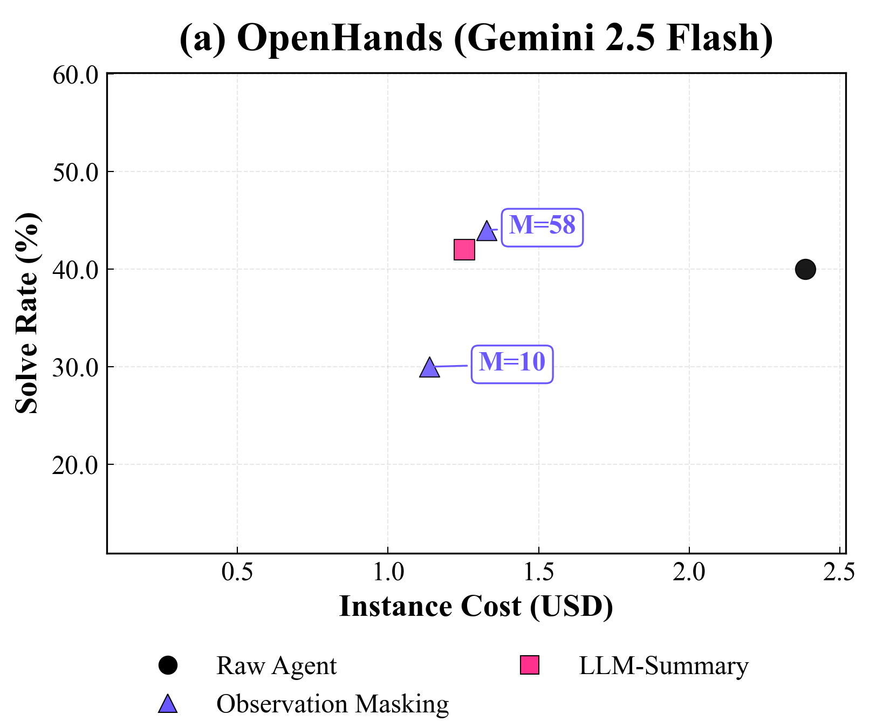
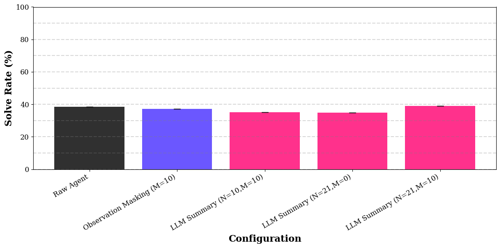
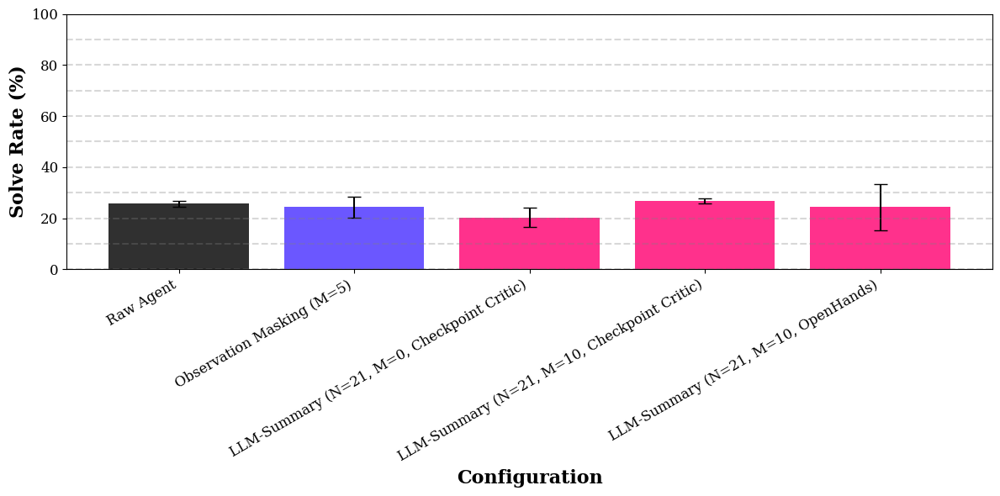
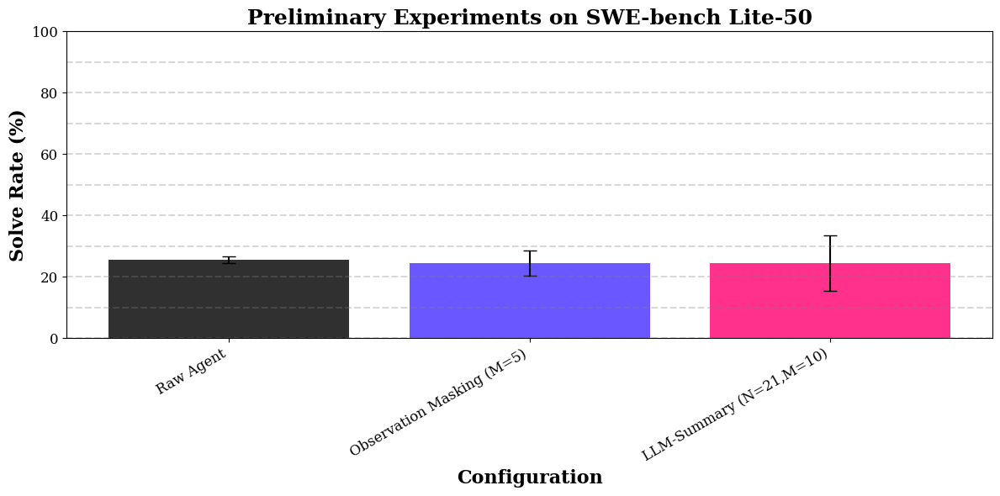
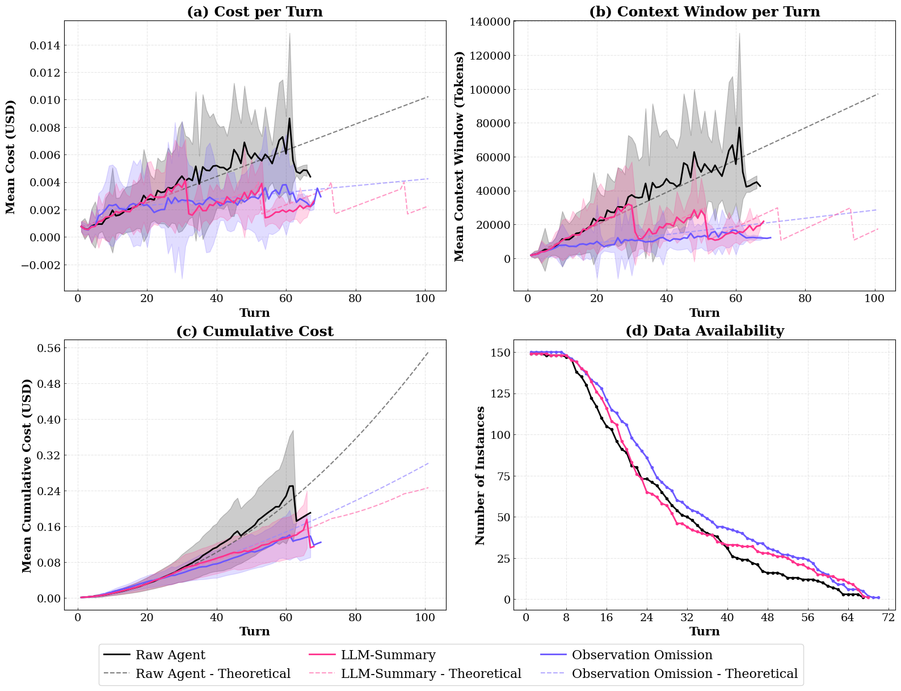
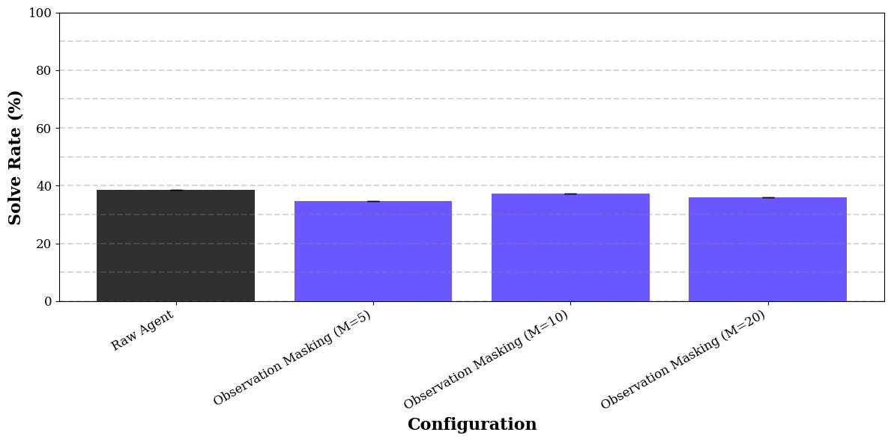

# 複雑さの罠: エージェントのコンテキスト管理では、単純な観測のマスキングが LLM による要約と同じくらい効率的である

> 原題: The Complexity Trap: Simple Observation Masking Is as Efficient as LLM Summarization for Agent Context Management
> 著者: Tobias Lindenbauer（JetBrains Research／ミュンヘン工科大学 計算・情報・技術学部）, Igor Slinko（JetBrains Research）, Ludwig Felder（ミュンヘン工科大学）, Egor Bogomolov（JetBrains Research）, Yaroslav Zharov（JetBrains Research）
> 出典: arXiv:2508.21433 **v3**（2025-10-27）。第 4 回 DL4C ワークショップ（Deep Learning for Code in the Agentic Era、NeurIPS 2025 と同時開催）の最終版。データ: https://huggingface.co/datasets/JetBrains-Research/the-complexity-trap 、コード: https://github.com/JetBrains-Research/the-complexity-trap

> ［訳注］**底本の版について**: `raw/` に置かれたクリップは ar5iv から保存したもので、内容は **arXiv v1（2025-08-29）相当**である（v2 は 2025-09-05）。ユーザーの指示により、**本翻訳は最新の v3 を底本とした**（arXiv の HTML 版 v3 と PDF 版 v3 で照合）。v3 では v1 から次の点が変わっている。(1) 要旨と本文に、OpenHands での一般性の確認と、観測のマスキングと LLM による要約を組み合わせた**混合方式**（§5.3）が加わった。(2) v1 の §5.1「批評を加えた要約」は付録 D.3 に移り、v1 の付録 E「OpenHands を使った予備的な知見」（マスキングの窓を 10 のままにして OpenHands で解決率が 30% に落ちた結果）は、窓を調整し直した §5.1「OpenHands による一般性の確認」に置き換わった。(3) 付録 B「Qwen3-32B（思考あり）の短い軌跡」が新設され、要約のプロンプトは付録 E に移った。(4) 図の番号が変わった（v3 は図 5 に OpenHands と混合方式の 2 枚を置く）。(5) v1 の要旨は Qwen3-Coder 480B の素のエージェントの解決率を「53.8%」としていたが（表 1 では 53.4%）、v3 の要旨ではこの数値の記述がなくなった。**復元・正規化した点**: 図 2 と図 4 の画像は HTML 版にもなかったので PDF v3 から切り出し、他の 9 枚は HTML 版 v3 から保存した（`raw/assets/2025-complexity-trap/`）。HTML 版で途中が切れていた式 (4) と有意水準の記述（p < 0.05）は、クリップと PDF で補った。プロンプトの図 11〜14 は SVG の中のテキストだったので、原文のままコードブロックに起こした。略語のリンク（クリップの `[llm](#id1)` など）は展開した。付録 B の 2 か所の参照先は PDF でも「??」（解決されていない参照）であり、そのまま残した。**NeurIPS の論文チェックリストは、ユーザーの指示により訳出していない**。参考文献の一覧と謝辞も既定どおり訳出せず、本文の参考文献の番号は v3 の番号 [N] のまま残した。

## Abstract（要旨）

大規模言語モデル（LLM）にもとづくエージェントは、反復的な推論、探索、ツールの使用を通じて複雑なタスクを解くが、この過程は長く高価なコンテキストの履歴を生みうる。OpenHands や Cursor のような最先端のソフトウェアエンジニアリング（SE）のエージェントはこの問題に取り組むために LLM による要約を使っているが、増えた複雑さが、古い観測を単に省くことと比べて具体的な性能上の利益をもたらすのかは明らかでない。私たちは、SWE-bench Verified 上の SWE-agent で、5 つの多様なモデルの構成にわたって、これらのアプローチの体系的な比較を示す。さらに、私たちの知見が OpenHands のエージェントの足場に汎化するという初期の証拠を示す。単純な環境の観測のマスキング（Observation Masking）の戦略が、素のエージェント（Raw Agent）に対してコストを半分にしつつ、LLM による要約（LLM-Summary）の解決率に匹敵し、時にわずかに上回ることを見出す。加えて、観測のマスキングだけ、または LLM による要約だけと比べて、コストをさらにそれぞれ 7% と 11% 減らす新しい混合のアプローチを導入する。私たちの知見は、純粋な LLM による要約へ向かう傾向について懸念を提起し、効率と有効性のフロンティアを押し広げることで、まだ手つかずのコスト削減があるという初期の証拠を提供する。再現性のためにコードとデータを公開する[^n1]。

[^n1]: データ: https://huggingface.co/datasets/JetBrains-Research/the-complexity-trap ／コード: https://github.com/JetBrains-Research/the-complexity-trap

## 1 Introduction（はじめに）

複雑な SE のタスクを独立して扱える自律的なエージェントを作るという野心は、急速に現実になりつつある。LLM によって動くこれらのエージェントは、通常、反復的なループの中で動作する [39, 29]。各ターンで、現在の状態について推論し、計画を立て、ツールを実行する（例: ファイルを読む、テストを実行する）。次に、このツールの出力、すなわち観測が、次のターンのためにエージェントのコンテキストに加えられ、その問題解決の軌跡を延ばす（図 3）。このエージェント的なループは、各ターンで LLM の推論能力 [31] を活用しつつ、環境の応答によってそれを接地させる、強力なテスト時スケーリングの仕組みとして働く [25, 17, 32]。

しかし、この反復的なコンテキストの拡大は、コストと能力、すなわち有効性と効率の間の根本的なトレードオフを示す。エージェントの軌跡が伸びるにつれて、LLM の呼び出しは、トークンにもとづく価格設定のために法外に高価になり、広く使われている Transformer のアーキテクチャにおける注意機構の二次の計算量のために非効率になる [28]。さらに決定的なことに、100 万トークンを超えるコンテキストウィンドウでさえ、LLM は「lost in the middle（中間で見失う）」問題に苦しむ [16]。LLM は大きなコンテキストウィンドウを処理できるが、その広大なコンテキストの中に埋もれた関連する情報を適切に活用することはできない [19, 7]。この課題は SE の領域で特に増幅される。SE ではツールの観測が冗長でノイズが多いことで知られているからである [15]。1 つの行動が、ソースファイル全体を読むことであれ、再帰的なディレクトリの一覧を実行することであれ、長いテストスイートのログであれ、何千ものトークンを生みうる。具体的には、SWE-bench Lite-50 [11, 3] での私たちの予備的な実験（D.4 節）では、観測のトークンが平均的な SWE-agent のターン [35] のおよそ $84\%$ を占める（図 1）。このため、環境の観測を明示的に対象にすることは、LLM エージェントのコンテキスト管理のための強いベースラインを提供する。

<figure>


<figcaption>図1: 環境の観測のトークンが、SE エージェントの軌跡のコンテキストウィンドウの大部分を占める。</figcaption>
</figure>

コスト効率を目的とするコンテキスト管理の戦略がなければ、エージェントのコストは 2 倍を超えうることを見出す（表 1）。これにより、コンテキスト管理は単なる最適化ではなく、経済的な必要になる。実際、私たちの結果は、論じるどの管理戦略も何もしないよりは好ましいことを示している。それらは一貫してコストを減らし、しばしば性能を改善するからである。これは決定的な問いを提起する。どの戦略が最良のトレードオフを提供するのか？

自然なベースラインのアプローチは、ツールの出力を明示的に省く観測のマスキングの戦略を通じて、冗長な環境の観測を直接の対象にする。SWE-agent [35] や SWE-Search [2] のような最先端のシステムは、そうした比較的単純なアプローチを採用している。並行して、ますます人気が高まっている、より洗練された解決策は、LLM に軌跡の要約を行うようプロンプトで指示し、エージェントの履歴の一部を凝縮した要約で置き換えることである（図 3）。このアプローチは、OpenHands [30] や Cursor [9] のような、著名なオープンソースとプロプライエタリの SE エージェントに採用されている。観測のマスキングと LLM による要約のアプローチのオープンソースの実装は、どちらも固定のコンテキストウィンドウのサイズやターン数の閾値のような、ヒューリスティックなきっかけ（トリガー）に頼っている。したがって、鍵となる違いは、古いコンテキストを捨てるか凝縮するかである。この選択がエージェントのコストと性能に決定的な影響を与えるにもかかわらず、これらのアプローチの間の相対的なトレードオフはほとんど探られていない。

本研究では、コンテキスト管理の戦略の効率に焦点を当てた体系的な比較を示す。このために、代表的なオープンソースの観測のマスキングと LLM による要約の実装の性能を、効率（米ドルでのコスト）と有効性（難しく業界標準である SWE-bench Verified [5] ベンチマークでの解決率）の観点から分析する。3.1 節で形式的に定義する特定の戦略を表すため、本稿を通じてこれらの名前を大文字で始める［訳注: 本翻訳では「観測のマスキング（Observation Masking）」「LLM による要約（LLM-Summary）」「素のエージェント（Raw Agent）」と表記する］。モデルの構成にわたって統制された実験を可能にするため、SWE-agent [35] に LLM による要約を実装し、OpenHands の LLM による要約のプロンプトを適応させる（図 11）。これらの戦略を SWE-agent [35] の足場の中で評価し、OpenHands [30] で一般性を確認する。私たちの実験は、モデルのファミリー、モデルのサイズ、ライセンス（オープンウェイトとプロプライエタリ）、推論の方式（思考ありと思考なし）にまたがる。

観測のマスキングと LLM による要約の両方が、素のエージェントと比べてコストを半分以上に減らすことを見出す。さらに、LLM による要約は、すべてのモデルの構成にわたって、単純な観測のマスキングの戦略を一貫して、または有意に上回ることができない。これらの知見が OpenHands に汎化するという初期の証拠を示す。さらに、観測のマスキングだけ、または LLM による要約だけと比べて、コストをさらにそれぞれ 7% と 11% 減らす新しい混合のアプローチを導入する。これらの知見は、純粋な LLM による要約へ向かう現在の傾向に異議を唱え、純粋な LLM による要約の戦略はかなりのコスト削減を手つかずのまま残している可能性が高いことを示す。

<figure>


<figcaption>図2: SWE-bench Verified 上の SWE-agent における、コンテキスト管理の戦略の有効性と効率のトレードオフ。図は、異なるモデルの構成について、解決率（縦軸、↑）を軌跡あたりの平均コスト（横軸、↓）に対して比べる。各構成を 3 つの戦略で試す。素のエージェント（ベースライン、●）、LLM による要約（■）、観測のマスキング（▲）である。すべてのモデルにわたって、観測のマスキングの戦略は一貫して最も効率的なフロンティアを占め、LLM による要約の戦略と競争力のある、時にはそれを上回る解決率を達成する。私たちの実験で最も性能の高いモデルである Qwen3-Coder 480B では、観測のマスキングは素のエージェントのベースラインより 52% 安いだけでなく、解決率を 2.6% 改善する。さらに、LLM による要約と比べてもインスタンスあたりのコストを 0.03 ドル（500 インスタンスで 15 ドル）減らす。［訳注: 画像は HTML 版になかったため PDF v3 から切り出した］</figcaption>
</figure>

## 2 Related Work（関連研究）

現在の SE エージェントの研究は、主に、訓練データのスケーリング [10, 22, 36]、複数の試行の中から最も有望なものを選ぶこと [22, 10, 40, 2, 1, 33]、批評者（critic）を通じてエージェントに実行を伴わない、または実行にもとづくフィードバックを与えること [2, 22, 10, 40, 24]、明示的な探索の戦略を通じてエージェントの計画の能力を高めること [2, 1] によって、SE エージェントの有効性を改善することに焦点を当てている。これらの方法は解決率を改善するが、推論のコストの増加、したがって効率の低下という代償をともなう。他方、SE エージェントのための効率的なコンテキスト管理は、これまでほとんど注目されてこなかった。本研究では、SE エージェントにおける効率的なコンテキスト管理のために複雑な要約の戦略が必要かどうかを調べる。このために、SWE-agent [35] と OpenHands [30] で実験する。

最近、いくつかの研究が、コンテキストのサイズが LLM の性能に与える効果について詳細な分析を行っている [16, 7, 19]。これらは一貫して、コンテキストのサイズが大きくなるにつれて、LLM が与えられたコンテキストを効果的に活用するのにますます苦労することを示している。コンテキスト管理がエージェントの性能と展開のコストにとって決定的に重要であるにもかかわらず、既存の研究はそれを第一級の研究課題ではなく実装の詳細として扱っている。最近の例外である MEM1 [41] は、マルチホップの質問応答 [37, 13, 12] と Web のナビゲーション [38] のタスクのための動的な状態管理を探っている。しかし、著者らは省略にもとづくアプローチと比較していない。さらに、使われたベンチマークは比較的短い軌跡（数百トークン）[41] をもたらし、日常的に数桁大きい SE エージェントの軌跡 [15] とは比べものにならない。

私たちの研究と並行して、Xiao ら [34] は、効率的な SE エージェントのコンテキスト管理のための LLM による要約の変種を提案している。しかし、彼らは観測のマスキングのベースラインと比較していない。最も密接に関連するのは、彼らの「Delete」のベースラインで、これはターンを要約する代わりにターン全体を削除する LLM による要約の変種である。このベースラインは、SE の軌跡が環境の観測に偏っていること（図 1）を活かさず、ターンをまたぐエージェントの推論の跡を断ち切り、エージェントの下流の性能を劣化させる。それにもかかわらず、彼らの結果は、このベースラインが同程度の下流の性能で LLM による要約より効率的であることを示している。加えて、Lu ら [18] は、SE とコンピュータ使用エージェント（CUA）の強化学習の訓練でコンテキストウィンドウの制限に取り組むために LLM による要約を使うことを調べている。他方、Tang ら [26] は、ディープリサーチと CUA のエージェントの強化学習の訓練と推論で、観測のマスキングによって印象的な性能を達成している。これは私たちの研究の時宜を得たものであることと、私たちの知見がディープリサーチと CUA に汎化する可能性が高いことを裏づける。

## 3 Experimental Configuration（実験の設定）

<figure>


<figcaption>図3: 本研究で評価するコンテキスト管理の戦略の概観。箱の高さは、典型的な軌跡のその部分のトークン数を示す。(a) ベースラインの ReAct 形式 [39] の軌跡で、行動と観測の対ごとにコンテキストが伸びる。(b) LLM による要約は、古いターンを継続的に更新する要約に凝縮し、直近の数ターンは完全な形で保つ（例: OpenHands [30]）。(c) 観測のマスキングは、M ターンの固定の窓（ここでは M=1）より古い観測を置き換え文（プレースホルダー）で置き換える（例: SWE-agent [35]）。</figcaption>
</figure>

私たちの実験では、代表的なオープンソースの実装を通じて、観測の省略と LLM にもとづく要約の人気のあるアプローチを調べる。(1) 移動窓（rolling window）による環境の観測のマスキング [35, 2] と、(2) プロンプトにもとづく LLM による要約 [30, 9] である。以下では、選んだアプローチを詳しく定義する。

### 3.1 Context Management Strategies（コンテキスト管理の戦略）

#### Raw Agent.（素のエージェント）

私たちが調べるエージェントの足場は、エージェントの枠組みとして ReAct [39] か CodeAct [29] を使う。これらの枠組みでは、エージェントの履歴、すなわち軌跡は、環境との相互作用の列である。ターン $t-1$ の終わりの軌跡を $\tau_{t-1}$ と表し、トークンの列として形式化する。

$$
\tau_{t-1}=(o_{sys},o_{user},(r_{1},a_{1},o_{1}),\dots,(r_{t-1},a_{t-1},o_{t-1}))\tag{1}
$$

ここで $o_{sys}$ と $o_{user}$ は、タスクを初期化する変更不能なシステムプロンプトとユーザープロンプトである（図 3a）。推論 $r_{i}$、行動 $a_{i}$、観測 $o_{i}$ からなるターン $T_{i}=(r_{i},a_{i},o_{i})$ を、ターン $i$ におけるエージェントと環境の相互作用の最小単位として定義する。これにより $\tau_{t-1}$ を簡潔に次のように表せる。

$$
\tau_{t-1}=(o_{sys},o_{user},T_{1},\dots,T_{t-1})\tag{2}
$$

ターン $t$ の初めに、エージェントの方策 $\pi$（通常は LLM）は、履歴 $\tau_{t-1}$ を条件として次の推論と行動の対を生成する: $(r_{t},a_{t})\sim\pi(\cdot|\tau_{t-1})$。コンテキスト管理の戦略がなければ、$\tau$ はターンごとに伸び、過大な計算コストと、最終的にはコンテキスト長の制限につながる。

#### Observation Masking.（観測のマスキング）

この戦略は、エージェントの推論と行動の完全な履歴を保ちつつ、過去の環境の観測を選択的に凝縮することで、コンテキストのサイズを管理する。完全な軌跡 $\tau_{t-1}$ と整数の窓のサイズ $M$ を入力として受け取る観測のマスキングの関数 $f_{mask}(\tau_{t-1},M)$ を定義する。この関数は、窓より古い環境の観測を置き換え文で置き換えることで、凝縮した軌跡 $\tau^{\prime}_{t-1}$ を作る（図 3b）［訳注: 図 3 のキャプションでは観測のマスキングは (c)。原文のまま］。

形式的には、軌跡 $\tau_{t-1}=(o_{sys},o_{user},T_{1},\dots,T_{t-1})$ が与えられると、変換した軌跡は次のとおりである。

$$
\tau^{\prime}_{t-1}=(o_{sys},o_{user},(r_{1},a_{1},o^{\prime}_{1}),\dots,(r_{t-1},a_{t-1},o^{\prime}_{t-1}))\tag{3}
$$

ここで、各ターン $i$ の観測 $o^{\prime}_{i}$ は、条件付きで次のように定義される。

$$
o^{\prime}_{i}=\begin{cases}p_{i}&\text{if }i<t-M\\
o_{i}&\text{if }i\geq t-M\end{cases}\tag{4}
$$

ここで $p_{i}$ は、マスクした観測を表す「Previous 8 lines omitted for brevity.」のような置き換え文のテキストである。続くターンで、エージェントの LLM は、この凝縮した履歴 $\tau^{\prime}_{t-1}$ を条件として $(r_{t},a_{t})$ を出す。SWE-agent [35] に従うこのアプローチは、遠い観測の忠実度を下げつつ、推論の連鎖を完全に保つ。この戦略は $\tau$ のトークンが増える速さを下げるが、際限なく増えるという問題は解決しない。

#### LLM-Summary.（LLM による要約）

この戦略は、軌跡を凝縮するために「要約役の LLM」を使い、これを $\pi^{\prime}$ と表す。$f_{mask}$ とは対照的に、この戦略の目標は、処理したターンの重要な情報を保つことである。これは 2 つのパラメータ $N$ と $M$ によって制御される。$N$ はエージェントが一度に何ターンを蓄積するかを調整し、$M$ は末尾の何ターンを変えずに残すべきかを調整する。最後の要約以降に蓄積したターンが $N+M$ に達したときに要約を実行する。

このアプローチを定義するのを助けるため、2 つの変数 $t_{last}$ と $s_{last}$ を導入する。$t_{last}$ を最新の要約に含まれた最後のターンの添字とする（ステップ 0 では $t_{last}=0$）。$s_{last}$ を添字 $t_{last}$ で行われた要約とする（ステップ 0 では $s_{last}=o_{user}$）。このとき、要約を次のように定義する。まず、軌跡を切り出して、要約の対象となるターン、すなわち最後の要約 $s_{last}$ と、この要約から最後から $M$ 番目のターンまでのすべてのターン $\mathcal{T}_{sum}=(s_{last},T_{t_{last}+1},\dots,T_{t-1-M})$ を得る。次に、要約の指示 $o_{si}$ と関連する軌跡の切り出し $\mathcal{T}_{sum}$ で $\pi^{\prime}$ にプロンプトを与えて、新しい要約 $s_{t}$ を生成する。

$$
\begin{split}s_{t}&\sim\pi^{\prime}(\cdot|o_{si},\mathcal{T}_{sum})\\
t_{last}&=t-1-M\end{split}\tag{5}
$$

最後に、主の方策 $\pi$ に与える履歴を、新しい凝縮した軌跡 $\tau^{\prime}_{t-1}$ に組み直す。

$$
\tau^{\prime}_{t-1}=(o_{sys},o_{user},s_{t},T_{t-M},\dots,T_{t-1})\tag{6}
$$

次のターンで、エージェントの LLM はこの新しいコンパクトな履歴を条件とする: $(r_{t},a_{t})\sim\pi(\cdot|\tau^{\prime}_{t-1})$。この方法は、古い相互作用が進化し続ける要約に再帰的に畳み込まれるので、軌跡の伸びが遅くなるだけでなく、上限を持つことを保証する。

### 3.2 Experimental Configuration（実験の設定）

SWE-agent [35] に焦点を当て、OpenHands [30]（v0.43.0）で一般性を確認する、厳密な比較研究を行う。私たちの実験は、(1) モデルのファミリー、(2) モデルのサイズ、(3) モデルのライセンス（オープンウェイトとプロプライエタリ）、(4) 推論の方式（思考ありと思考なし）にまたがる多様な構成をカバーする。具体的には、YaRN [23] を使って 122K トークンのコンテキストウィンドウにした Qwen3-32B [27][^n3] を思考ありと思考なしのモードで、既定の 256K トークンのコンテキストウィンドウの Qwen3-Coder-480B-A35B-Instruct-FP8 [27, 8][^n4] を、既定の 100 万トークンのコンテキストウィンドウの Gemini 2.5 Flash [6][^n5] を思考ありと思考なしのモードで使う。特に断らない限り、すべての実験を SWE-bench Verified [5] で行う。すべての実験を、それぞれ 141 GB の HBM を備えた 8 台の NVIDIA H200 GPU と合計 8 TB のローカルディスクストレージからなる共有のクラスタで実行する。Qwen-32B [27] のモデルには 2 台の H200 GPU と 15 の SWE-agent [35] の推論ワーカーを使う。100K トークンを超えるコンテキストサイズの長い軌跡に遭遇する可能性があり、KV キャッシュの見積もりでこれを考慮しなければならないので、保守的なワーカー数を選ぶ。Qwen3-Coder 480B [27, 8] には、8 台の GPU すべてと 35 の推論ワーカーを使う。クラスタ上で Qwen のモデルを提供するのに vLLM [14] を使う。Gemini での実験では、クォータの制限のために、SWE-agent [35] で 8、OpenHands [30] で 5 の推論ワーカーを使う。詳しくは付録 A を参照されたい。

[^n3]: https://huggingface.co/Qwen/Qwen3-32B
[^n4]: https://huggingface.co/Qwen/Qwen3-Coder-480B-A35B-Instruct-FP8
[^n5]: API のバージョン: gemini-2.5-flash

私たちの予備的な実験（D.4 節）は、軌跡のターン数が、私たちが調べるコンテキスト管理の戦略の振る舞いに影響しうることを示している。このため、長い軌跡で実験することにし、特に断らない限り、実験のターンの上限を 250 に設定する。観測のマスキングの戦略には、主な実験で移動窓のサイズ $M=10$ を使う。私たちの実験で SWE-agent [35] で最良の性能をもたらしたからである（D.1 節）。SWE-agent [35] に実装した LLM による要約の戦略は、OpenHands 形式のプロンプトをわずかに変更した版を使う（付録 E）。OpenHands の既定の設定 [30] とは対照的に、一度に 21 ターンを要約し（$N=21$）、最後の 10 ターンだけを残す（$M=10$）。観測のマスキングと LLM による要約の戦略で変えずに残す末尾のターン数をそろえることに加えて、私たちの実験では $M=10$ が LLM による要約の戦略にとっても最良の性能をもたらすことがわかった（D.2 節）。エージェントのモデルには温度 0.8 を、要約のモデルには温度 0 を使う。Qwen3-32B [27] の思考ありの実験とは対照的に、コストの制約のために、Gemini 2.5 Flash の思考の予算を 0 または 800 トークン（思考ありと表記）に制限する。

## 4 Main Results（主な結果）

SWE-agent [35] の中での主な実験は 3 つのコンテキスト管理の戦略を評価し、結果を表 1 にまとめる。結果は、私たちが試した多様な条件にわたって頑健に成り立つ 2 つの中心的な知見を明らかにする。第一に、観測のマスキングと LLM による要約の両方が、解決率の性能を有意に下げることなく、コストを有意に減らす。第二に、LLM による要約は、効率でも有効性でも、観測のマスキングを一貫して、または有意に上回らない。詳しくは付録 C を参照されたい。

### 4.1 The Universal Benefit of Context Management（コンテキスト管理の普遍的な利益）

本研究の動機を補強する、最初で最も基本的な知見は、コンテキスト管理は単なる最適化ではなく必要だということである。表 1 に示すとおり、エージェントのコンテキストを野放しに伸ばすこと（素のエージェントのベースライン）は、一貫して最も高価な戦略である。軌跡が効率的なコンテキスト管理から恩恵を受けるのに十分長いすべての実験の構成で、観測のマスキングと LLM による要約の両方がインスタンスあたりのコストを有意に減らし、ほとんどの場合 50% を超えて減らす。Qwen3-32B（思考あり）の外れた振る舞いは付録 B で論じる。

さらに、この効率は必ずしも性能を犠牲にしない。5 つの設定のうち 3 つで、最も効率的な戦略は素のエージェントのベースラインより高い解決率も達成した。これは、ある点を超えると、より多くのコンテキストが資産ではなく負債になることを示しており、「lost in the middle」問題 [16] と一致する。したがって、どのアプローチが有効性と効率の間の最良のトレードオフを提供するかを問うことが決定的に重要である。

**表1**: 95% ブートストラップ信頼区間つきのコンテキスト管理の戦略の比較。素のエージェントと比べた変化と有意性（†）を報告する。解決率（有効性、↑）とインスタンスのコスト（効率、↓）を報告する。各モデルについて、各指標で最も性能の良いコンテキスト管理の戦略を太字にする［訳注: 太字は省略した］。すべての実験は SWE-bench Verified [5] 上の SWE-agent [35] を使う。詳しくは付録 C にある。

| モデル | 戦略 | 解決率（%, ↑） | インスタンスのコスト（$, ↓） |
|---|---|---|---|
| Qwen3-32B | 素のエージェント | 17.0 ± 3.3 | 1.12 ± 0.18 |
| | 観測のマスキング | 15.0 ± 3.1（−11.8%） | 0.55 ± 0.09（−50.9%）† |
| | LLM による要約 | 16.0 ± 3.3（−5.9%） | 0.50 ± 0.07（−55.4%）† |
| Qwen3-32B（思考あり） | 素のエージェント | 23.0 ± 3.7 | 0.51 ± 0.07 |
| | 観測のマスキング | 24.6 ± 3.8（+7.0%） | 0.46 ± 0.05（−9.8%） |
| | LLM による要約 | 24.8 ± 3.9（+7.3%） | 0.51 ± 0.06（0.0%） |
| Qwen3-Coder 480B | 素のエージェント | 53.4 ± 4.3 | 1.29 ± 0.26 |
| | 観測のマスキング | 54.8 ± 4.4（+2.6%） | 0.61 ± 0.06（−52.7%）† |
| | LLM による要約 | 53.8 ± 4.2（+0.7%） | 0.64 ± 0.06（−50.4%）† |
| Gemini 2.5 Flash | 素のエージェント | 32.8 ± 4.1 | 0.41 ± 0.08 |
| | 観測のマスキング | 35.6 ± 4.2（+8.5%） | 0.18 ± 0.03（−56.1%）† |
| | LLM による要約 | 36.0 ± 4.1（+9.8%） | 0.24 ± 0.04（−41.5%）† |
| Gemini 2.5 Flash（思考あり） | 素のエージェント | 40.4 ± 4.3 | 0.56 ± 0.10 |
| | 観測のマスキング | 36.4 ± 4.2（−9.9%）† | 0.24 ± 0.04（−57.1%）† |
| | LLM による要約 | 31.4 ± 4.0（−22.3%）† | 0.25 ± 0.05（−55.4%）† |

### 4.2 Observation Masking: Dominant Efficiency with Minimal Complexity（観測のマスキング: 最小の複雑さで支配的な効率）

コンテキスト管理の明確な必要を確立したので、次に本研究の 2 つ目の中心的な知見、すなわち単純さの驚くべき力に移る。表 1 でわかるとおり、5 つの実験の設定のうち 4 つで、観測のマスキングがインスタンスあたりのコストを最も低くした。これは、別の要約の呼び出しの計算のオーバーヘッドを生じることなく、各エージェントのターンで処理する環境の観測のトークンの数を大幅に減らすことで達成される。SE ではエージェントのコンテキストが環境の観測に大きく偏っているので（図 1）、これは非常に効果的である。さらに、この戦略は LLM による要約より少ないウォームアップのターンしか必要としない（$M=10$ 対 $N+M=31$）。これにより、短い軌跡でさえ、より早く頑健なコスト削減がもたらされる（例: Qwen3-32B（思考あり）、付録 B を参照）。

特に、この知見はモデルの構成にわたって成り立つ。さらに、Qwen3-Coder 480B での LLM による要約と観測のマスキングの間の 0.03 ドルのコスト削減は小さく見えるが、ベンチマーク全体ではすでに 15 ドルになる。これは、小さなコスト効率の利得でさえ、大規模な LLM エージェントの展開の経済的な実現可能性に大きな影響を与えうることを浮き彫りにし、効率的なコンテキスト管理の研究の必要性を強調する。

### 4.3 Challenging the Need for Complex Summaries（複雑な要約の必要性に異議を唱える）

一貫して最も安い選択肢であることを超えて、観測のマスキングは高い解決率を保つうえで著しく効果的であることが証明される。これは、エージェントの軌跡から決定的な情報を保つには複雑で意味的な要約が必要だという仮定に直接異議を唱える。

実際、観測のマスキングは LLM による要約と競うだけでなく、それを上回りうる。Qwen3-Coder 480B [27, 8] のモデルでは、観測のマスキングは 54.8% の解決率を達成し、LLM による要約の 53.8% をわずかに上回った。同様に、Gemini 2.5 Flash [6]（思考あり）では、LLM による要約を 5 パーセントポイント上回った。Gemini 2.5 Flash のように LLM による要約のほうが良かった場合でも、差はごくわずかだった（36.0% 対 35.6%）。これは、観測のマスキングが一貫して LLM による要約の戦略と同等かそれ以上の性能を示すことを示している。

含意は明らかである。SE エージェントにとっては、最も新しいコンテキストでしばしば十分である。履歴全体、あるいはその洗練された要約でさえ保つことは、モデルの限られたコンテキストウィンドウと私たちの研究予算の最も効果的な使い方ではないかもしれない。

### 4.4 The Trajectory Elongation Effect（軌跡の伸長効果）

表 1 の主な結果から生じる重要な問いは、なぜ LLM による要約の戦略が、Qwen3-32B を除くすべての実験で観測のマスキングの戦略よりコスト効率が悪いのかである。私たちの分析は、これが部分的に、LLM による要約のコンテキスト管理の戦略の予期しない「軌跡の伸長（trajectory elongation）」という副作用に由来することを明らかにする。

このために、図 4 でインスタンスあたりのターン数の分布を分析する。LLM による要約は、Qwen3-Coder 480B と Gemini 2.5 Flash の両方で、平均の軌跡の長さを長くすることに注目する。Gemini 2.5 Flash では、LLM による要約を使った平均の軌跡の長さは 52 ターンで、これは観測のマスキングの平均の軌跡の長さ（44 ターン）より $15\%$、素のエージェントのそれ（50 ターン）より $4\%$ 長い。同様に、Qwen3-Coder 480B では、平均の軌跡の長さが素のエージェントと比べて $15\%$、観測のマスキングの戦略と比べて $13\%$ 増えることを観察する。

特に、このターンの伸長の傾向は、図 2 と表 1 で観察される戦略の効率に直接つながる。LLM による要約の戦略がよりコスト効率が良いことがわかった唯一の実験は Qwen3-32B である。この場合、LLM による要約の戦略ではなく観測のマスキングの戦略が、素のエージェントと比べて平均の軌跡の長さを $13\%$ 増やした。これは、コンテキストの要約が強化の信号として働き、エージェントに続けるよう促すことを示している。これが今度は、LLM による要約が達成する上限のあるコンテキストによって得られた効率を損なう軌跡の伸長をもたらす（3.1 節）。

<figure>


<figcaption>図4: コンテキスト管理の戦略が軌跡の長さに与える影響。箱ひげ図は、SWE-agent [35] の中での異なる戦略にわたる軌跡の長さ（ターン数）の分布を示す。LLM による要約は一貫してより長い軌跡につながり、さもなければより早い終了を促すはずの失敗の信号を覆い隠していることを示唆する。星印は平均の軌跡の長さを示す。［訳注: 画像は HTML 版になかったため PDF v3 から切り出した］</figcaption>
</figure>

## 5 Discussion（議論）

本節では、OpenHands [30] での私たちの知見の一般性を確認し、LLM による要約の生成が LLM による要約の戦略のコスト構造に与える影響を論じ、両方の戦略の強みを組み合わせた新しい混合のアプローチを導入する。

### 5.1 Probing for Generality With OpenHands（OpenHands による一般性の確認）

足場をまたいだ主な結果の一般性を調べるため、Gemini 2.5 Flash [6]（思考なし）を使い、SWE-bench Verified [5, 3] の 50 インスタンスの部分で、ターンの上限 250、LLM による要約は $N=21$、$M=10$、観測のマスキングは $M=10$ と $M=58$ で、OpenHands による一般性を確認する。結果を図 5a に示す。

まず、観測のマスキングの移動窓のサイズ $M$ は、調整が必要なエージェントに固有のハイパーパラメータであることに注意する。SWE-agent [35] での最適な値を単に再利用すると、観測のマスキングの性能は大幅に劣化する。しかし、調整したあとは、この足場でも私たちの結果を再現できる。足場に固有の実装の詳細のために、このハイパーパラメータを調整する必要があるという仮説を立てる。例えば、SWE-agent [35] は、構文エラーによる再試行を対話の履歴から直接省く。しかし、OpenHands [30] はそうした再試行のターンを残す。これは、このエージェントについて有益なコンテキストを保つには、より大きな窓のサイズが必要であることを意味する。

全体として、これは、SE エージェントで通常そうであるように、エージェントのコンテキストが同様に環境の観測に偏っていれば、私たちの知見がエージェントの足場をまたいで汎化するという初期の証拠を提供する。

### 5.2 The Costs of Summarization（要約のコスト）

コストの内訳を詳しく調べると、戦略の間の効率の差が 2 つの相補的な効果に由来することが明らかになる。第一は 4.4 節で論じた「軌跡の伸長」の効果であり、第二は要約を生成するコストである。

表 2 に示すとおり、要約を生成する直接の API のコストは、インスタンスの総コストの最大 7.2% を占める。重要なことに、これらの要約の呼び出しは特に高価である。それぞれが一意なターンの列を処理する必要があり、キャッシュの再利用が LLM による要約のシステムプロンプト（図 11）に限られるからである。いくつかの現代の LLM の API（例: Gemini）が、キャッシュのミスより大幅に安いキャッシュのヒット（最大 $10\times$ 安い）を提供していることを考えると、これは決定的な制限になる。これらの要約のコストを合計から差し引くと、LLM による要約と観測のマスキングの間の効率の差は、ほとんどの実験でほぼ消える。これは、要約の API の呼び出しそのものが効率の差のかなりの部分を占めることを示している。それでも、より複雑な LLM による要約の戦略は、コスト効率で、著しく強い観測のマスキングの戦略を有意に、または一貫して上回ることがなお不可能である。これは、十分に探られていない観測のマスキングや混合のアプローチによる、手つかずのコスト削減の可能性を示唆している。

**表2**: モデルごとのインスタンスあたりの平均の LLM による要約のコスト。LLM による要約の生成の API のコストは、LLM による要約と観測のマスキングの戦略の間のコスト効率の差の一部を説明する。

| モデル | インスタンスあたりの LLM による要約のコスト（$） | 比率（%） |
| --- | --- | --- |
| Qwen3-32B | 0.0143 | 2.86 |
| Qwen3-32B（思考あり） | 0.0033 | 0.65 |
| Qwen3-Coder 480B | 0.0439 | 7.20 |
| Gemini 2.5 Flash | 0.0161 | 6.71 |
| Gemini 2.5 Flash（思考あり） | 0.0131 | 5.24 |

### 5.3 Hybrid: Combined Observation Masking and LLM-Summary（混合: 観測のマスキングと LLM による要約の組み合わせ）

私たちが扱うコンテキスト管理の戦略が、それぞれ単独で強い性能を示し、どちらもコストを有意かつ一貫して $>50\%$ 減らすことに動機づけられて、本節では新しい混合のアプローチを示す。このために、コストの理由から、私たちが扱う中で解決率の点で最も強いモデルである Qwen3-Coder 480B を使い、SWE-bench Verified-50 [3] 上の SWE-agent [35] で実験する。結果を図 5b に可視化する。

<figure>




<figcaption>図5: (a) SWE-bench Verified-50 [3] の部分集合での OpenHands [30] による私たちの知見の一般性の確認。移動窓のサイズ M をエージェントの足場に合わせて適切に調整したあと、観測のマスキングは再び、コストと解決率の両方で LLM による要約の性能に匹敵する。(b) SWE-agent の足場で Qwen3-Coder 480B を使った、SWE-bench Verified-50 [3] での私たちの新しい観測のマスキングと LLM による要約の混合のアプローチ。各アプローチの強みを効果的に組み合わせることで、軌跡の長さにかかわらず頑健に効率の利得を実現しつつ、過度に長い軌跡では上限のあるコンテキストの恩恵を受ける戦略になる。私たちの混合のアプローチは、素のエージェントと比べて解決率を 2.6 パーセントポイントわずかに上げつつ、観測のマスキングと LLM による要約と比べてそれぞれコストを 7% と 11% 減らす。</figcaption>
</figure>

軌跡の伸長の効果（4.4 節）と要約の生成のオーバーヘッド（5.2 節）の両方が、LLM による要約を最後の手段の戦略として扱い、できるだけ先延ばしにする動機になる。しかし、$N$ を増やすと、何らかの効果が観察されるまでに必要なウォームアップのターンの数が増える。この蓄積の段階の間は、高価な素のエージェントの方式のもとで動作する。さらに、短い〜中程度の長さの軌跡では、何の効果も観察されない危険がある（付録 B）。ターンの蓄積の段階の間に観測のマスキングを使うことで、各アプローチの強みを組み合わせられる。$N$ を増やすことで、LLM による要約を先延ばしにし、このアプローチを長い軌跡のコンテキストに上限を設けるための最後の手段として扱う。同時に、観測のマスキングはターンの蓄積の間に素早く利得を実現する。さらに、短い軌跡でさえ頑健にそうする。

$N=43$ に設定する。このターン数で、観測のマスキングの方式のもとで蓄積したコンテキストが、素のエージェントの $N=21$ ターンで蓄積したコンテキスト（約 30K トークン、図 9 を参照）とおおよそ一致するからである。記法の衝突を避けるため、混合の設定での観測のマスキングの移動窓のサイズには $W$ を使う。全体として、混合の設定には $N=43,M=W=10$ を使う。LLM による要約で要約するときは、マスクしていないコンテキストを渡すことに注意されたい。

観測のマスキングと LLM による要約と比べて、このアプローチはコストをそれぞれ 7% と 11% 減らす。さらに、下流のタスクの性能を 2.6 パーセントポイント改善しさえし、有効性と効率のフロンティアを押し広げる。これにより、完全な SWE-bench Verified [5] ベンチマークで、観測のマスキングと比べて 20 ドル、LLM による要約と比べて 35 ドルの節約が期待される。

私たちのハイパーパラメータの選択をアブレーションするため、戦略に固有の性質を無視した素朴なハイパーパラメータの選択でも混合のアプローチを試す。このために、単に個々のアプローチのハイパーパラメータ $N=21,M=W=10$ を再利用する。この設定では、混合のアプローチは、KV キャッシュの非効率が重なることと、LLM による要約の呼び出しによるコストのオーバーヘッドのために、システム全体のコスト効率を実際には劣化させる。

## 6 Limitations（限界）

本研究はコンテキスト管理の戦略の厳密な評価を提供するが、その範囲には 3 つの主な限界がある。第一に、SWE-bench [11] ベンチマークを使って、もっぱら SE の領域で実験している。この領域は長く冗長なツールの出力を特徴とし、それは観測のマスキングの効率を自然に有利にする条件である。したがって、この戦略の優位についての私たちの知見は、エージェントと環境の相互作用がより簡潔な領域には汎化しないかもしれない。第二に、調べたすべての戦略は、単純で非適応的なヒューリスティックのきっかけを使う。観測のマスキングは、過去の観測の関連性や古さ（例: ファイルが変更されたあとにその内容を保持し続けること）を考慮しない固定サイズの移動窓を用いる。同様に、LLM による要約は固定のターンにもとづくスケジュールで動作し、意味的な区切りやエージェントの下位目標を無視する。最後に、エージェントの足場をまたいだ汎化の初期の証拠を提供するが、より包括的な調査が必要かもしれない。

## 7 Conclusion（結論）

本研究は、多様なモデルの構成とエージェントの足場にまたがるコンテキスト管理の戦略の包括的な研究を示す。効率的なコンテキスト管理の戦略が、下流の性能を有意に下げることなく、システムのコストを一貫して有意に $>50\%$ 減らすことを見出す。驚いたことに、人気のある LLM による要約の戦略は、単純な観測のマスキングのベースラインを一貫して、または有意に上回ることができない。これは、LLM による要約だけに焦点を当てる現代のエージェント的なシステムに、手つかずの節約の可能性があることを示唆する。私たちは、観測のマスキングと LLM による要約と比べてコストをそれぞれ 7% と 11% さらに減らしつつ、下流のタスクの性能を改善する新しい観測のマスキングと LLM による要約の混合の戦略で、この仮説を経験的に検証する。これらの知見は、経済的に実現可能で環境的に持続可能な LLM エージェントの展開を可能にするための、コンテキスト管理の決定的な必要性を確立する。さらに、効率的な LLM エージェントの追求において、単純な解決策が驚くほど効果的でありうることを浮き彫りにする。

## Appendix A Experimental Configuration（付録 A: 実験の設定）

実験で報告するインスタンスのコストを計算するため、API を通じてアクセスするプロプライエタリなモデルと、私たちの基盤でローカルにホストするモデルを区別する。Vertex AI の API を通じてアクセスする Gemini [6] の実験については、API が返すコストを報告する。Qwen [27, 8] の実験については、3.2 節で述べたとおりモデルを自前でホストする。コストを計算するため、観測したターンごとのトークンの使用量を使い、公式の Alibaba の API の価格設定[^n6]にもとづいて事後的にコストを計算する。Vertex AI のプラットフォームとは対照的に、Qwen3-32B のモデルの公式の Alibaba の API の価格設定は、キャッシュのヒットとミスの入力トークンを区別しないことに注意されたい。これにより、Qwen3-32B の実験のコストが膨らむ。異なる価格設定の方式のもとでの私たちの実験のコスト構造に関心のある読者には、主な実験のすべての実験データを公開している HuggingFace のデータセット[^n7]と、私たちのリポジトリ[^n8]を参照されたい。

[^n6]: https://www.alibabacloud.com/help/en/model-studio/models#16ff9753e1ctz
[^n7]: データ: https://huggingface.co/datasets/JetBrains-Research/the-complexity-trap
[^n8]: コード: https://github.com/JetBrains-Research/the-complexity-trap

## Appendix B Short Trajectories in Qwen3-32B (thinking): Hypotheses and Implications（付録 B: Qwen3-32B（思考あり）の短い軌跡: 仮説と含意）

Qwen3-32B（思考あり）の構成は、Qwen3-32B の構成と比べて、軌跡の長さの中央値がおよそ 50% 短い。2 つの構成の唯一の違いはモデルの思考を有効にすることなので、これは驚きである。以下では、この外れた結果についての調査を詳しく述べ、それが私たちの知見の解釈に与える含意を論じる。

**設定の検証。** これら 2 つの実験の構成について、すべてのコンテキスト管理の戦略にわたって設定とデータセットが正しいことを検証した。加えて、思考の方式のもとでのモデルのわずかに改善した性能（??）を除いて、2 つの構成の間でインスタンスの終了状態の分布に逸脱は観察されなかった［訳注: 「??」は参照先が解決されていない。PDF でも同じ］。

**定性的な分析。** 設定の誤りを特定できなかったので、Qwen3-32B の実験の構成にわたって同じ 20（4%）の軌跡についてさらに定性的な分析を行った。ここで、両方のモデルが時に、エージェントの足場の関数呼び出しの形式に従うのに苦労することに気づいた。しかし、上で論じたとおり、どちらの構成でも、関数呼び出しのエラーによる終了の数に疑わしい逸脱は観察されなかった。

**含意。** Qwen3-32B（思考あり）の構成でのこの外れた結果の理由として、設定の誤りやその他の疑わしい振る舞いを特定できなかったので、それが有効であると仮定しなければならない。そこで、この結果が私たちの全体の知見の解釈に与える含意を論じる。まず、この構成が短い軌跡をもたらしたことを思い出されたい。しかし、私たちのコンテキスト管理の戦略はどちらも、軌跡を変更し始めて、したがってコストを減らし始めるまでに、いくつかのウォームアップのターンを必要とする。LLM による要約については、私たちのハイパーパラメータでは、最初の要約を作るまでに $N+M=31$ ターンを必要とする。これは、中央値の長さが 15 ターンの軌跡は、このコンテキスト管理の戦略から効率の利得を実現するには短すぎることを意味する。他方、観測のマスキングは $M=10$ ターンのあとに観測のマスキングを始める。これは、より短い軌跡でこの戦略を使うと効果が見られると予想されるが、それは抑えられたものかもしれないことを意味する。これは ?? で観察された経験的な振る舞いとまさに一致する［訳注: 「??」は参照先が解決されていない。PDF でも同じ］。したがって、Qwen3-32B（思考あり）の構成での有意でないコスト削減は、私たちのコンテキスト管理の戦略の根本的な問題ではなく、より短い軌跡の長さに帰する。この解釈は、この不利な設定でさえ、観測のマスキングがコストを約 10% 減らし、両方の戦略がなお安定した下流の性能をもたらすという事実によってさらに裏づけられる。

## Appendix C Detailed Main Results（付録 C: 主な結果の詳細）

本節では、表 1 の信頼区間と有意性の指標の基礎となるさらなるデータを示す。表 3 は、主な結果の基礎となる完全な非対称の信頼区間を示す。表 1 の対称な区間は、非対称の上下限を平均することで導かれる。例えば、$17.0_{-3.2}^{+3.4}$ は $17.0\pm 3.3$ になる。

**表3**: 非対称性を示す、95% ブートストラップ信頼区間つきのコンテキスト管理の戦略の比較。素のエージェントと比べた有意性を示すのに † を使う。解決率（有効性、↑）とインスタンスのコスト（効率、↓）を報告する。各モデルについて、各指標で（素のエージェントのベースラインと比べて）最も性能の良いコンテキスト管理の戦略を太字にする［訳注: 太字は省略した］。変化は素のエージェントのベースラインと比べて報告する。すべての実験は SWE-bench Verified [5] 上の SWE-agent [35] を使う。

| モデル | 戦略 | 解決率（%, ↑） | インスタンスのコスト（$, ↓） |
|---|---|---|---|
| Qwen3-32B | 素のエージェント | $17.0_{-3.2}^{+3.4}$ | $1.12_{-0.17}^{+0.18}$ |
| | 観測のマスキング | $15.0_{-3.0}^{+3.2}$（−11.8%） | $0.55_{-0.08}^{+0.09}$（−50.9%）† |
| | LLM による要約 | $16.0_{-3.2}^{+3.4}$（−5.9%） | $0.50_{-0.06}^{+0.07}$（−55.4%）† |
| Qwen3-32B（思考あり） | 素のエージェント | $23.0_{-3.6}^{+3.8}$ | $0.51_{-0.06}^{+0.07}$ |
| | 観測のマスキング | $24.6_{-3.8}^{+3.8}$（+7.0%） | $0.46_{-0.05}^{+0.05}$（−9.8%） |
| | LLM による要約 | $24.8_{-3.8}^{+4.0}$（+7.3%） | $0.51_{-0.06}^{+0.06}$（0.0%） |
| Qwen3-Coder 480B | 素のエージェント | $53.4_{-4.2}^{+4.4}$ | $1.29_{-0.24}^{+0.28}$ |
| | 観測のマスキング | $54.8_{-4.4}^{+4.4}$（+2.6%） | $0.61_{-0.05}^{+0.06}$（−52.7%）† |
| | LLM による要約 | $53.8_{-4.2}^{+4.2}$（+0.7%） | $0.64_{-0.05}^{+0.06}$（−50.4%）† |
| Gemini 2.5 Flash | 素のエージェント | $32.8_{-4.0}^{+4.2}$ | $0.41_{-0.07}^{+0.08}$ |
| | 観測のマスキング | $35.6_{-4.2}^{+4.2}$（+8.5%） | $0.18_{-0.02}^{+0.03}$（−56.1%）† |
| | LLM による要約 | $36.0_{-4.0}^{+4.2}$（+9.8%） | $0.24_{-0.04}^{+0.04}$（−41.5%）† |
| Gemini 2.5 Flash（思考あり） | 素のエージェント | $40.4_{-4.4}^{+4.2}$ | $0.56_{-0.10}^{+0.10}$ |
| | 観測のマスキング | $36.4_{-4.2}^{+4.2}$（−9.9%）† | $0.24_{-0.03}^{+0.04}$（−57.1%）† |
| | LLM による要約 | $31.4_{-4.0}^{+4.0}$（−22.3%）† | $0.25_{-0.04}^{+0.05}$（−55.4%）† |

### C.1 Statistical Analysis（統計的な分析）

$B=10{,}000$ 回の反復による対応のあるノンパラメトリック・ブートストラップを使って有意性を評価し、詳細な結果を表 4 に示す。各モデルと戦略の対について、同じ $n=500$ のインスタンスでの対応のある差 $\Delta=\text{mean(strategy)}-\text{mean(raw)}$ を計算し、インスタンスレベルの相関を保つ。次を報告する。

- 95% のパーセンタイル信頼区間
- 両側の p 値: $p=2\times\min(\Pr(\Delta^{*}\geq 0),\Pr(\Delta^{*}\leq 0))$
- $p<0.05$ のときの有意性の印（†）

表 4 は完全なブートストラップの統計を示す。p 値 0.0000 は、すべてのブートストラップの反復で符号の反転がなかったことを示すことに注意されたい（分解能 $\leq 10^{-4}$）。

**表4**: 95% パーセンタイル信頼区間と両側のブートストラップ p 値（B=10,000）つきの、素のエージェントに対する対応のあるブートストラップの差。Δ 解決率はパーセントポイント（pp）で、Δ 平均コストはインスタンスあたりのドルで報告する。負のコストの差はコストの節約を示す。すべての行はモデルごとに n=500 の共通のインスタンスを使う。素のエージェントと比べた有意性を示すのに † を使う。

| モデル | 戦略 | Δ 解決率（pp）[下限, 上限] | p | Δ 平均コスト（$）[下限, 上限] | p |
|---|---|---|---|---|---|
| Gemini 2.5 Flash | 観測のマスキング | 2.8 [-0.8, 6.4] | 0.1504 | -0.2377 [-0.3202, -0.1614] | 0.0000† |
| | LLM による要約 | 3.2 [-0.4, 7.0] | 0.0948 | -0.1725 [-0.2579, -0.0936] | 0.0000† |
| Gemini 2.5 Flash（思考あり） | 観測のマスキング | -4.0 [-7.8, -0.2] | 0.0406† | -0.3143 [-0.4096, -0.2245] | 0.0000† |
| | LLM による要約 | -9.0 [-13.0, -5.2] | 0.0000† | -0.3046 [-0.4074, -0.2043] | 0.0000† |
| Qwen3-Coder 480B | 観測のマスキング | 1.4 [-1.6, 4.4] | 0.3856 | -0.6762 [-0.9320, -0.4518] | 0.0000† |
| | LLM による要約 | 0.4 [-3.0, 3.8] | 0.8736 | -0.6491 [-0.9048, -0.4263] | 0.0000† |
| Qwen3-32B | 観測のマスキング | -2.0 [-5.0, 1.0] | 0.2086 | -0.5632 [-0.7479, -0.3817] | 0.0000† |
| | LLM による要約 | -1.0 [-4.6, 2.6] | 0.6192 | -0.6174 [-0.7904, -0.4454] | 0.0000† |
| Qwen3-32B（思考あり） | 観測のマスキング | 1.6 [-2.0, 5.2] | 0.3980 | -0.0510 [-0.1255, 0.0187] | 0.1586 |
| | LLM による要約 | 1.8 [-1.8, 5.4] | 0.3420 | -0.0021 [-0.0785, 0.0741] | 0.9370 |

## Appendix D Additional Studies（付録 D: 追加の研究）

図 7 の批評を加えた要約役については、SWE-bench Lite-50 [3] で実験する［訳注: 図 7 のキャプションと D.3 節の本文では、SWE-bench Verified の 150 標本の部分集合とされている。原文のまま］。観測のマスキングの戦略の移動窓のサイズ $M$ への感度と、LLM による要約の戦略の設定については、コードとともに公開する SWE-bench Verified [5] からランダムに抽出した 150 インスタンスの部分集合での結果を示す。これらの研究は GPT-4.1-mini [21] で行う。

<figure>



<figcaption>図6: SWE-bench Verified [5] からランダムに生成した 150 標本の部分集合での、末尾の長さ M に関するさまざまな異なる設定の組み合わせにわたる、単一の実験の下流のタスクの性能。末尾の長さと比べて要約の窓を大きくすると性能が改善することを見出す。</figcaption>
</figure>

### D.1 Observation Masking Configuration（観測のマスキングの設定）

観測のマスキングの戦略の移動窓のサイズ $M$ を試す。図 10 では、戦略の性能が $M=10$ で最高に達し、その後、窓のサイズを $M=20$ にさらに増やすと再び下がることがわかる。そこで、主な実験には観測のマスキングの戦略のこの設定を使う。

### D.2 LLM-Summary Configuration（LLM による要約の設定）

図 6 に、ベースラインに加えて、LLM による要約のさまざまな実験の設定の解決率を示す。末尾のターン $M>0$ を使うと下流の性能が改善することを見出す。さらに、OpenHands [30] が使う、要約するターンと末尾のターンの 50 対 50 の分割とは対照的に、一度により多くのターンを要約すると解決率が改善することを見出す。そこで、主な実験には $N=21,M=10$ で進める。

### D.3 Critic-Enhanced LLM-Summary（批評を加えた LLM による要約）

自然な追加の問いは、要約の過程をより賢くすることで LLM による要約の戦略を改善できるかどうかである。これを、SE エージェントのテスト時の計算のスケーリングで有望さを示してきた技法である、実行を伴わないフィードバック [22, 10, 40, 2] で LLM による要約の戦略を強化することで探る。このアプローチでは、LLM が軌跡の要約と批判的な分析を同時に生成し、両方を圧縮したコンテキストに組み込む。これは、複数のロールアウトをまたいでではなく、単一のロールアウトの中で反省を提供することに似ている [24]。

<figure>



<figcaption>図7: SWE-bench Verified [5] からランダムに生成した 150 標本の部分集合での、付録 E のプロンプトと本節で示す批評と要約を合わせたプロンプトを比べた下流のタスクの性能。要約にフィードバックを含めるようモデルに単にプロンプトで指示しても、解決率は改善せず、コストがさらに増えることを見出す。</figcaption>
</figure>

図 11 の変更した OpenHands のプロンプトと比べて、タスクを要約ではなくチェックポイントの生成として組み立て、要約するターンについて反省するようモデルにプロンプトで指示する。そうすることで、エージェントが試行の途中で解の経路を調整するのに役立つ出力をモデルが生成するよう促し、単純な要約によって、以前の、潜在的に最適でない、あるいは誤ってさえいるターンにエージェントを過度に縛りつけることを避けることを目指す。

意味のある反省を引き出すため、反省して洞察を提供できる導きの問いを LLM にプロンプトとして与える。これらの問いは、エージェントが行き詰まっているかループしているか、最初の問題文と一致しているかを評価し、要約するターンに関してエージェントの高レベルの解決のアプローチを反省する。加えて、意味があり実行可能な反省を生成するようエージェントをさらに導くため、few-shot の例を提供する [4]。最後に、OpenHands 形式のプロンプト（図 11）で行ったのと同様に、以前の要約（利用できなければ問題文）と、要約するターンをモデルに与える。

SWE-agent [35] を使って SWE-bench Verified [5] の 150 標本で試したところ、図 12、13、14 に示すプロンプトを使うこの批評を加えたアプローチは、標準の LLM による要約に対して解決率の改善を示さなかった。より懸念されることに、軌跡の伸長のパターンが悪化し、批評を加えた実行は標準の要約よりさらに長い軌跡を生んだ。これはおそらく驚くことではない。批評者の反省は、エージェントに代替の解の経路を探ること、追加のデバッグの戦略を試すこと、あるいはアプローチを再考することを自然に促し、それらはすべてより多くのターンにつながり、コストを押し上げ、効率の利得を減らすからである。

この発見は、軌跡の伸長についての私たちの中心的な洞察を補強する。実行を伴わないフィードバックはエージェントの意思決定を改善することを目指すが、探索を延ばすことで逆説的に計算のコストを増やす。批評者の導きは、エージェントが行き止まりを効率的に認識するのを助けるのではなく、追求すべき追加の道を提供し、終了をさらに遅らせる。さらに、この増えたコストは下流の性能の向上につながらない。これは、AI エージェントのための効果的な記憶のシステムには根本的な再考が必要であることを示唆している。要約により洗練されたフィードバックを単に加えることは、私たちが特定した効率の課題を解決するのではなく、悪化させうる。

### D.4 Behavior of the Covered Context Management Strategies Across Turns（扱ったコンテキスト管理の戦略のターンにわたる振る舞い）

図 8 に、GPT-4.1-mini [20] を使い、SWE-bench Lite-50 [3] で 3.1 節で導入した軌跡の管理の戦略を使った予備的な実験の結果を示す。ここでは、SWE-agent [35] に従って移動窓のサイズ $M=5$ を使い、LLM にもとづくアプローチには OpenHands のプロンプト [30] をわずかに変更した版（付録 E を参照）と組み合わせて $N=21,M=10$ を使う。観測のマスキングの戦略は強いベースラインであり、はるかに単純であるにもかかわらず、SWE-bench Lite-50 [3] の下流のタスクで LLM による要約のアプローチと一貫して同等かそれ以上の性能を示すことを観察する。

<figure>



<figcaption>図8: 本研究で扱うコンテキスト管理の戦略にわたる、SWE-bench Lite-50 [3] での下流のタスクの性能。棒は 3 回の実験の平均を表し、誤差棒は標準偏差を示す。驚いたことに、f_RW は、より多くの計算を使う LLM にもとづく戦略と同等の性能を示す。</figcaption>
</figure>

<figure>



<figcaption>図9: 本研究の動機となった予備的な実験の結果。破線は、素のエージェントの軌跡で観察されたターンの種類ごとの平均のトークン数にもとづいて予想される振る舞いを示す。すべての結果をミクロ平均し、標準偏差を網掛けの領域で示す。(a)、(b)、(c) 観察したデータは、シミュレートした素のエージェントの軌跡にどちらかの軌跡の管理の戦略を適用したシミュレートした効果とよく一致する。LLM と観測のマスキングのアプローチのコストとコンテキストウィンドウのサイズへの効果は、少ないターン数では重なる。コンテキストウィンドウに上限があるので、LLM のアプローチは長い軌跡で特に効果的だと予想する。(d) ターン数が増えるにつれて、経験的なデータはますます疎になる。</figcaption>
</figure>

なぜそうなるのかを調べ、LLM による要約の戦略が有益でありうる潜在的なシナリオを明らかにするため、図 9 でこれらの戦略のターンにわたる振る舞いを分析する。実線の色付きの線は、SWE-agent [35] を使って経験的に観察した結果である。各軌跡の管理の戦略について 3 回の実験を行い、合計 150 の軌跡を得る。これらのデータを可視化するため、各ターンのミクロ平均した平均値を使う。破線は、経験的に根拠づけたシミュレートした振る舞いを示す。これらのシミュレートした軌跡のデータを生成するため、素のエージェントで利用できるすべての実験データにわたって、トークンの種類ごとの平均のトークン消費量を計算する。

$$
\bar{x}=\frac{1}{T_{total}}\sum_{i=1}^{3}\sum_{j=1}^{50}\sum_{k=1}^{T_{local}}x_{ijk}\quad\text{where}\quad x\in\{r,a,o\}\tag{7}
$$

ここで $T_{total}$ はすべてのインスタンスと実験にわたって観察したターン $T$ の総数であり、$T_{local}$ は単一の軌跡のターン数である。次に、置き換えのトークンを使ってターン $T_{sim}=(\bar{r},\bar{a},\bar{o})$ を生成する。$T_{sim}$ を繰り返し追加することで、任意の長さのシミュレートしたエージェントの軌跡 $\tau_{sim}=(T_{sim},\ldots,T_{sim})$ を生成する。シミュレートした LLM による要約と観測のマスキングのコンテキスト管理の軌跡のデータを生成するため、これらの戦略を $\tau_{sim}$ に適用する。これにより、多数のターンまでのこれらの軌跡の管理の戦略の予想される振る舞いを研究できる。

図 9 の a、b、c は、私たちの実験データがシミュレートした傾向の予想される振る舞いとよく一致することを示している。驚いたことに、$f_{RW}$ は LLM にもとづく戦略とコストで競争力があり、コンテキストの圧縮ではそれを上回りさえすることを見出す。

$f_{RW}$ が強いベースラインなのは、種類 $r,a,o$ にわたるトークンの分布のためである。図 1 に $T_{sim}$ のトークンの種類の割合を図示する。環境の観測のトークン $o$ が $T_{sim}$ の構成の圧倒的な大部分を占め、約 $84\%$ を寄与する。したがって、このトークンの種類を対象にすることは極めて効果的である。

<figure>



<figcaption>図10: SWE-bench Verified [5] からランダムに生成した 150 標本の部分集合での、異なるコンテキストウィンドウのサイズにわたる単一の実験の下流のタスクの性能。M=10 が最適な性能をもたらすことを見出す。</figcaption>
</figure>

図 9a と b でこの効果がわかる。2 つのコンテキスト管理の戦略のコストは似ているが、$f_{RW}$ のより悪いキャッシュの振る舞いのために、$f_{RW}$ は特に少ないターン数でより優れた圧縮を提供する［訳注: 原文のまま。コストが似ている理由として「$f_{RW}$ のキャッシュの効きが悪い」ことを挙げる文と読める］。他方、シミュレーションを見ると、LLM にもとづくアプローチは最大のコンテキストのサイズにあいまいなやり方で上限を設け、コストとコンテキストウィンドウのサイズの両方で鋸の歯の形の関数をもたらすので、長い軌跡では $f_{RW}$ を上回り始めると予想する。これが、主な実験のターンの上限を 250 に設定する動機である。

## Appendix E LLM Summary Prompts（付録 E: LLM による要約のプロンプト）

要約の生成のためのプロンプトのテンプレートを図 11 に示す。OpenHands [30] と比べて、SE の領域以外のタスクの要約の生成を扱うことを目的とするプロンプトの部分を取り除いた。本研究はもっぱら SE の領域に焦点を当てているからである。図 11 に示すシステムプロンプトに加えて、図 12、13、14 に批評と要約を合わせたプロンプトを示す。実行を伴わない［訳注: 原文は「generating execution-free」で目的語が抜けている。文脈上は「実行を伴わないフィードバック」］生成の効果は D.3 節と第 5 節で論じる。

```
LLM-Summary Prompt

You are maintaining a context-aware state summary for an interactive agent.
You will be given a list of events corresponding to actions taken by the
agent, and the most recent previous summary if one exists. Track:

USER_CONTEXT: (Preserve essential user requirements, goals, and
clarifications in concise form)

COMPLETED: (Tasks completed so far, with brief results)
PENDING: (Tasks that still need to be done)
CURRENT_STATE: (Current variables, data structures, or relevant state)

For code-specific tasks, also include:
CODE_STATE: (File paths, function signatures, data structures)
TESTS: (Failing cases, error messages, outputs)
CHANGES: (Code edits, variable updates)
DEPS: (Dependencies, imports, external calls)
VERSION_CONTROL_STATUS: (Repository state, current branch, PR status,
commit history)

PRIORITIZE:
1. Adapt tracking format to match the actual task type
2. Capture key user requirements and goals
3. Distinguish between completed and pending tasks
4. Keep all sections concise and relevant

SKIP: Tracking irrelevant details for the current task type

Example formats:

For code tasks:
USER_CONTEXT: Fix FITS card float representation issue
COMPLETED: Modified mod_float() in card.py, all tests passing
PENDING: Create PR, update documentation
CODE_STATE: mod_float() in card.py updated
TESTS: test_format() passed
CHANGES: str(val) replaces f"{val:.16G}"
DEPS: None modified
VERSION_CONTROL_STATUS: Branch: fix-float-precision, Latest commit: a1b2c3d

<PREVIOUS_SUMMARY>
...
</PREVIOUS_SUMMARY>
<TURN-0>
...
</TURN-0>
...
<TURN-20>
...
</TURN-20>
```

図11: SWE-agent [35] で使う LLM による要約のプロンプトは、OpenHands の LLM による要約のシステムプロンプト [30] をわずかに変更した版である。加えて、以前の要約と要約するターンを渡す。以前の要約が利用できなければ、代わりにタスクの問題文を要約の生成の最初のコンテキストとして渡す。

```
Joint Critic-Summary Prompt (Part 1)

You are maintaining a context-aware state checkpoint for an interactive agent
working on software engineering tasks (specifically, bug fixes), assessing the
agents progress toward completing the task, and offering suggestions and
guidance if it is not on track.
You will be given a list of turns corresponding to actions taken by the agent
and their resulting observations, and the most recent previous checkpoint if
one exists. You must proceed in the following two phases:
1. <CHECKPOINT>
2. <REFLECTIONS>

A <CHECKPOINT> should capture the current repository state and the agent's
progress towards completing the task. It consists of:
USER_CONTEXT: (Preserve essential user requirements, goals, and clarifications
based on findings, previous checkpoints, and the initial problem statement in
concise form)
CODE_STATE: (File paths, function signatures, data structures followed by
their current state)
TESTS: (Failing cases, error messages, outputs)
CHANGES: (Code edits, variable updates)
DEPS: (Dependencies, imports, external calls)

PRIORITIZE:
1. Capture key requirements from the initial issue description or previous
checkpoints and reflections
2. Keep all sections concise and relevant to fixing the issue
3. Focus on information that quantifies the agent's progress towards a solution

Next you must reflect on the agent's progres in the below to turns to
generate a set of <REFLECTIONS>. Here are some aspects to consider
when generating the <REFLECTIONS>:
- Are the agent's actions still aligned with the initial user requirement?
- Is the agent making progress?
- Is it stuck in a loop or repeatedly carrying out the same actions?
- Can you identify any problematic patterns in the agent's actions?
- Did the agent follow the issue description or your previous feedback?
 If so, why did or didn't it make meaningful progress?
- Which critical piece of information might help the agent get back on
 track?
- What has the agent not tried so far?

Key requirements for the <REFLECTIONS>:
1. Avoid reporting nitpicks as they may confuse the agent.
2. Your reflections should be diverse with respect to any available previous
reflections.
3. Provide up to 2 reflections total. Reflections are mutually exclusive.
4. Each reflection should identify one distinct problem and may include one
or two fixes for that problem.
5. Limit yourself to the most critical issues that are blocking progress.

When generating the <REFLECTIONS>, follow the format below:
<REFLECTIONS>
Problem-A: (a detailed description of a problem the agent is facing)
Fix-A.1: (proposed solution, guidance or hint for overcoming the problem
including the rationale for it)
</REFLECTIONS>
```

図12: 批評と要約を合わせた LLM による要約のプロンプトの第 1 部。主な実験で使う LLM による要約のプロンプト（図 11）と比べて、要約しているターンについて、実行を伴わない批評者として振る舞うようにも LLM にプロンプトで指示する。

```
Joint Critic-Summary Prompt (Part 2)

Example output and format:
<CHECKPOINT>
USER_CONTEXT: Fix failing authentication in REST API. Users report
"Invalid token" errors after ~30 minutes of activity. The API should
maintain user sessions properly with JWT tokens that expire after 1 hour.
CODE_STATE:
1. api/auth_middleware.py: validate_token() MODIFIED with logging.
2. api/auth_utils.py: refresh_token() MODIFIED to auto-refresh at 45 min.
3. config.py: JWT_EXPIRATION unchanged at 3600.
TESTS:
1. tests/test_auth_integration.py::test_long_session: FAILING - "Token
expired at 32 minutes"
2. tests/test_auth_integration.py::test_token_refresh: PASSING
3. tests/test_auth_unit.py: ALL PASSING
CHANGES:
1. auth_utils.py: Added auto-refresh logic when token age > 2700 seconds.
2. auth_middleware.py: Added debug logging for token validation steps.
DEPS: PyJWT==2.4.0, python-jose==3.3.0 (both imported)
</CHECKPOINT>
<REFLECTIONS>
Problem-A: Agent has spent 6 turns modifying the token refresh logic
and adding complex auto-refresh mechanisms, but hasn't investigated why
tokens are expiring at ~30 minutes when they're configured for 60 minutes.
The agent is treating the symptom (early expiration) by adding refresh
logic, rather than finding the root cause. The fact that tokens consistently
expire at 30-32 minutes suggests either: (1) a configuration mismatch
somewhere else overriding the 3600-second setting, (2) a timezone/clock
issue between server and client, or (3) the JWT library might be using a
different time unit or has a default max age.
Fix-A.1: Stop adding refresh logic and investigate the actual token
expiration time. Add logging to print the exact 'exp' claim value when
tokens are created and when they're validated. Check if there's another
config file, environment variable, or hardcoded value setting token
expiration to 1800 seconds (30 min). Also verify the JWT library's time unit
- some libraries use milliseconds while others use seconds. The issue is
likely a simple configuration problem, not a need for complex refresh
mechanisms.
Fix-A.2: The solution the agent is trying to implement is overly complex,
confusing, and not tackeling the root cause. The agent should take a step
back and think about what it is actually trying to do, discard its current
approach and come up with a simpler solution that is more likely to work.
It should recall SE best practices and clean code principles.

Problem-B: Agent has successfully modified token validation and refresh logic,
but the integration test continues to fail at exactly 32 minutes. Despite the
previous guidance to investigate configuration mismatches, the agent hasn't
checked for environmental differences between unit tests (which pass) and
integration tests (which fail). The agent also hasn't noticed that two
different JWT libraries are imported (PyJWT and python-jose), which could
mean tokens are created with one library but validated with another.
Additionally, the agent keeps focusing on server-side fixes without considering
that the test client might have its own timeout or token handling logic
that's causing the consistent 32-minute failure.
Fix-B.1: Audit which JWT library is actually being used where. Search for
`from jose import` and `from jwt import` patterns across the codebase. Create
a simple debug endpoint that generates a token and immediately decodes it
with both libraries to see if they interpret expiration differently. The
symptom of tokens expiring at ~32 minutes (close to but not exactly 30)
could indicate timestamp precision or timezone handling differences between
the libraries. Consider standardizing on one JWT library throughout the codebase.
</REFLECTIONS>
```

図13: 批評と要約を合わせた LLM による要約のプロンプトの第 2 部。主な実験で使う LLM による要約のプロンプト（図 11）と比べて、要約しているターンについて、実行を伴わない批評者として振る舞うようにも LLM にプロンプトで指示する。

```
Joint Critic-Summary Prompt (Part 3)

<PREVIOUS_SUMMARY>
...
</PREVIOUS_SUMMARY>
<TURN-0>
...
</TURN-0>
...
<TURN-20>
...
</TURN-20>
```

図14: 批評と要約を合わせた LLM による要約のプロンプトの第 3 部。主な実験で使う LLM による要約のプロンプト（図 11）と比べて、要約しているターンについて、実行を伴わない批評者として振る舞うようにも LLM にプロンプトで指示する。
