# Kimi-Dev：SWE エージェントのためのスキル事前分布としての Agentless 訓練

> 原題: Kimi-Dev: Agentless Training as Skill Prior for SWE-Agents
> 著者: Zonghan Yang*†, Shengjie Wang*, Kelin Fu, Wenyang He, Weimin Xiong, Yibo Liu, Yibo Miao, Bofei Gao, Yejie Wang, Yingwei Ma, Yanhao Li, Yue Liu, Zhenxing Hu, Kaitai Zhang, Shuyi Wang, Huarong Chen, Flood Sung, Yang Liu, Yang Gao, Zhilin Yang, Tianyu Liu†（* は同等の貢献、† は共同リード）
> 所属: Moonshot AI（一部の著者は清華大学・北京大学・中国科学院大学・北京郵電大学・シンガポール国立大学）
> 出典: arXiv:2509.23045（v1: 2025-09-27、v2: 2025-10-09、v3: 2025-12-08）。68 ページ。倫理声明は ICLR の倫理規定に言及している。
> GitHub: https://github.com/MoonshotAI/Kimi-Dev 、Hugging Face: https://huggingface.co/moonshotai/Kimi-Dev-72B

> **訳注（底本と復元）**
> - `raw/` のクリップは ar5iv 経由の古い版（v1 または v2）で、付録 A の「自然な diff パッチ」と「PR コミットパック」の加工ルールの箇条書き、図 3 の (b) とキャプション、4.2 節の脚注 1 の本文、図 7 などが欠けていた。本翻訳は arXiv の HTML 版 **v3**（`https://arxiv.org/html/2509.23045v3`）を底本とし、本文と付録 A〜H をすべて訳した。
> - v3 で加わった・変わった主な箇所: 3.3 節の RL アルゴリズムの説明（REINFORCE と複数ロールアウトの平均報酬によるベースライン）と適応的なプロンプト選択の具体的な数（1,200 問、100 ステップごとに 500 問）、4.2 節の末尾の「プライアの比較のための end-to-end SWE-Agent RL」と図 7、付録 G.3、付録 B の R2E-Gym-Lite、付録 C の構成（旧 C.1 の RL の目的関数の節がなくなった）。旧版で「RL プライアは他のすべてのモデルに上回られる」となっていた 4.2 節の観察 1 は、v3 で「RL プライアは他のすべてのモデルを上回る」に直っている。
> - 付録のプロンプト・推論の軌跡・テストパッチ・エージェントの行動列（計 21 のリスティング）は、原ページの各リスティングに埋め込まれた原文テキストから字下げごと復元し、訳さずに原文のまま収録した。Listing 20・21 に残る `(*@\textcolor{black}{\textbf{ACTION 0:}}@*)` のような記号は、原文の LaTeX の書式指定がそのまま残ったものである。
> - 引用は v3 の表記（著者, 年）のまま残した。参考文献一覧と謝辞は訳していない。
> - 図は v3 の HTML から保存した（表紙のロゴは除いた）。

## Abstract（要旨）

大規模言語モデル（LLM）はソフトウェアエンジニアリング（SWE）にますます応用されており、SWE-bench はその主要なベンチマークである。解法は、多ターンの相互作用を行う SWE-Agent のフレームワークと、単一ターンの検証可能なステップからなるワークフローベースの Agentless の手法に分かれている。私たちは、これらのパラダイムは互いに排他的ではないと主張する。推論を多く要する Agentless の訓練は、位置の特定（localization）、コードの編集、自己反省を含むスキル事前分布（skill prior）を誘導し、それが効率的で効果的な SWE-Agent への適応を可能にする。本研究では、まず Agentless の訓練レシピを整え、SWE-bench Verified で 60.4% を達成するオープンソースの SWE 向け LLM である Kimi-Dev を提示する。これはワークフローの手法の中で最良である。公開されている 5,000 本の軌跡での追加の SFT による適応により、Kimi-Dev は SWE-Agent を pass@1 で 48.6% にし、これは Claude 3.5 Sonnet（241022 版）と同等である。これらの結果は、Agentless の訓練から得られる構造化されたスキル事前分布が、転移可能なコーディングエージェントに向けて、ワークフローとエージェントのフレームワークを橋渡しできることを示している。

## 1 Introduction（はじめに）

最近、ソフトウェアエンジニアリング（SWE）のタスクを自動化する大規模言語モデル（LLM）の急速な発展が見られる（Jimenez et al., 2023; Yang et al., 2024a; Xia et al., 2024; Anthropic, 2024; Pan et al., 2024; Wang et al., 2025a; Wei et al., 2025; Yang et al., 2025a; Kimi et al., 2025; OpenAI, 2025a）。SWE のシナリオにおける LLM のコーディングエージェントの進歩を追跡するベンチマークの中で、SWE-bench（Jimenez et al., 2023）は最も代表的なものの 1 つとして際立っている。現実世界の GitHub リポジトリのバグを報告するイシューが与えられると、モデルはそのバグを直すパッチを作ることを求められ、その正しさは、パッチを適用したあとに対応する単体テストが通るかどうかでさらに判定される。（ベンチマークが提案された時点での）タスクの難しさ、提供された自動評価のハーネスによる結果報酬の存在、そしてそれが反映する現実世界の経済的価値が、SWE-bench をこの分野の焦点にしてきた。

SWE-bench のタスクには 2 つの系統の解法が現れている。SWE-Agent（Yang et al., 2024a）や OpenHands（Wang et al., 2025a）のようなエージェントベースの解法は相互作用主義のアプローチをとる。必要なタスクの説明、あらかじめ定められた利用可能なツールの集合、および具体的な問題文を指示として与えられ、エージェントは実行可能な環境と複数ターンにわたって相互作用し、ソースコードに変更を加え、いつ止めるかを自律的に決めることを求められる。対照的に、Agentless（Xia et al., 2024）のようなワークフローベースの解法は、解く過程を、位置の特定、バグの修復、テストの作成のようなステップからなるパイプラインとしてあらかじめ定める。このようなタスクの分解は、エージェント的なタスクを、検証可能な報酬を持つ一連の単一ターンの問題について正しい応答を生成することへと変換する（Guo et al., 2025; Wei et al., 2025; He et al., 2025）。

この 2 つのパラダイムは、互いに排他的なものと広く見なされてきた。一方で、SWE-Agent は、固定された手順のない多ターンの相互作用の自由度の高さのおかげで、より高い潜在力とより良い適応性を生まれながらに持っている。しかし、そのエンドツーエンドの性質のために、そのようなフレームワークで訓練するのはより難しいことも示されてきた（Luo et al., 2025; Cao et al., 2025）。他方で、Agentless の手法は、より良いモジュール性と、検証可能な報酬による強化学習（RLVR）の技法での訓練のしやすさを提供するが、探索の空間と柔軟性はより限られ、誤ったパターンが単一ターンの長い推論の内容の中にしか現れないため振る舞いの監視が難しい（Pan et al., 2024）。しかし、私たちは訓練レシピの観点からこの二分法に異議を唱える。Agentless の訓練は最終的な成果物と見なされるべきではなく、むしろスキル事前分布――バグのある実装の位置の特定や誤ったコード片の更新のような原子的な能力、さらに自己反省と検証――を誘導する方法と見なすべきであり、これらはすべて、より有能で汎化可能な SWE エージェントへの効率的な適応の足場となる、と私たちは主張する。

この視点に導かれ、私たちは SWE タスクのためのオープンソースのコード LLM である Kimi-Dev を導入する。具体的には、まず Agentless の訓練レシピを開発する。これは中間訓練（mid-training）、コールドスタート、強化学習、テスト時のセルフプレイを含む。その結果、SWE-bench Verified で 60.4% の正解率となり、これはワークフローベースの解法の中で最先端の性能である。この上に、Agentless の訓練がスキル事前分布を誘導することを示す。Kimi-Dev から、公開されている 5,000 本の軌跡による最小限の SFT のコールドスタートを行うだけで、効率的な SWE-agent への適応が可能になり、pass@1 で 48.6% に達する。これは Claude 3.5 Sonnet（20241022 版, Anthropic (2024)）と同程度である。私たちは、これらの誘導されたスキルが非エージェント的なワークフローからエージェント的なフレームワークへ転移すること、そして Agentless の訓練を通じて焼き込まれた長い Chain-of-Thought の中の自己反省が、エージェント的なモデルがより多くのターンを活用し、より長い視野で成功することをさらに可能にすることを実証する。最後に、Agentless の訓練から得たスキルが、SWE-bench Verified を超えて、SWE-bench-live（Zhang et al., 2025）や SWE-bench Multilingual（Yang et al., 2025c）のようなより広いベンチマークへ汎化することも示す。これらの結果は合わせて、Agentless とエージェントのフレームワークの関係を、互いに排他的なものではなく、転移可能なコーディング LLM を構築する上での補完的な段階として捉え直す。この転換は、構造化されたスキル事前分布での訓練が自律的なエージェント的相互作用の足場になりうるという、原理的な見方を提供する。

本論文の残りは次のように構成される。2 節ではフレームワークの二分法の背景を振り返り、SWE-Agent を訓練する上での課題を概説する。3 節では Agentless の訓練レシピと実験結果を示す。4 節では、Agentless が誘導したこれらのスキル事前分布が効率的な SWE-Agent への適応をどう可能にするかを示し、SWE-bench Verified を超えたスキルの転移と汎化を評価する。

## 2 Background（背景）

この節では、まず 2.1 節で SWE タスクのための 2 つの支配的なフレームワークとその二分法を振り返る。次に 2.2 節で、SWE-Agent の訓練の進歩と課題をまとめる。この背景の紹介は、後の節を通じて展開される中心的なテーマである、Agentless の訓練を SWE-Agent のためのスキル事前分布として再解釈するための舞台を整える。

### 2.1 Framework Dichotomy（フレームワークの二分法）

現在、ソフトウェアエンジニアリングのタスクを自動化する解法は 2 つのパラダイムに支配されている。Agentless のアプローチは、SWE タスクをモジュール化されたワークフローに分解する（Xia et al., 2024; Wei et al., 2025; Ma et al., 2025a; Ma et al., 2025b; Xie et al., 2025）。典型的なワークフローは、バグの位置の特定、バグの修復、テストの生成からなる。この設計はモジュール性と安定性を提供する。各ステップを、検証可能な報酬を持つ単一ターンの問題として別々に最適化できる（Wei et al., 2025; He et al., 2025）。しかし、そのような硬直性は柔軟性を犠牲にする。複数回の段階的な更新を要するシナリオに出会うと、Agentless のアプローチは適応に苦労する。

対照的に、SWE-agent はエンドツーエンドの多ターンの推論のパラダイムをとる（Yang et al., 2024a; Wang et al., 2025a）。固定されたワークフローに従う代わりに、反復的に計画し、行動し、反省する。これは人間の開発者が複雑なイシューをデバッグする様子に似ている。この設計はより大きな適応性を可能にするが、大きな困難をもたらす。軌跡はしばしば数十、あるいは数百のステップに及び、LLM のコンテキストウィンドウは相互作用の履歴全体にまたがる必要があり、モデルは探索・推論・ツールの使用を同時に扱わなければならない。

固定されたワークフロー（例: Agentless）とエージェントのフレームワーク（例: SWE-Agent）の二分法は、コミュニティの見方の多くを形づくってきた。2 つのパラダイムはしばしば互いに排他的と見なされる。一方は柔軟性と性能の上限を犠牲にしてモジュール性と安定性を得て、他方はその逆の妥協をする。私たちの研究はこの二分法に異議を唱える。Agentless の訓練が、その後の SWE-agent の訓練をより安定かつより効率的にするスキル事前分布を誘導することを実証するからである。

### 2.2 Training SWE-agents（SWE-agent の訓練）

SWE-agent の訓練は、実行可能な環境との相互作用を通じて質の高い軌跡を獲得することに依存している。しかし、そのような大規模な環境を構築し信頼できる軌跡を集めるには、相当な人手と最先端のモデルの高価な呼び出しが必要で、データの収集は遅く資源を要する（Pan et al., 2024; Badertdinov et al., 2024b）。最近の研究は、実行可能なランタイムを逆向きに構築するためにバグを合成することで、環境の構築をスケールさせることも試みている（Jain et al., 2025; Yang et al., 2025c）。

しかし、結果報酬はまばらで、しばしば最終的なパッチがテストを通ったときにしか得られないので、長い視野にわたる信用の割り当て（credit assignment）は依然として難しい。強化学習の技法が提案されてきたが、軌跡が数十ステップを超えると不安定さや崩壊にしばしば悩まされる（Luo et al., 2025; Cao et al., 2025）。SWE-agent の訓練は初期化にも非常に敏感である。汎用の事前訓練済みモデルから始めると、ツールを効果的に使えない、特定の行動パターンの無限ループにはまる、といった脆い振る舞いにしばしばつながる（Pan et al., 2024; Yang et al., 2025c）。

これらの限界が私たちの中心的な仮説を動機づける。SWE-agent を完全にゼロから訓練する代わりに、まず agentless の訓練を通じてスキル事前分布を誘導し、位置の特定・修復・テストの作成・自己反省のような原子的な能力を強化することができる。これらの事前分布は、その後のエージェント的な訓練をより効率的かつより汎化可能にする土台を築く。

## 3 Agentless Training Recipe（Agentless の訓練レシピ）

SWE-agent をゼロから訓練する代わりに、私たちは Agentless の訓練を活用してスキル事前分布を誘導する。Agentless の訓練によって強化されるスキル事前分布には、バグの位置の特定、パッチの生成、自己反省と検証が含まれるがこれらに限られず、それらはエンドツーエンドのエージェント的な相互作用の土台を築く。この節では、Agentless の訓練レシピを詳述する。BugFixer と TestWriter の二役のフレームワークの設計、中間訓練とコールドスタート、強化学習、テスト時のセルフプレイである。3.1〜3.4 節でこれらの構成要素を詳述し、3.5 節でそれぞれの実験結果を示す。この訓練レシピの結果が Kimi-Dev であり、SWE-bench Verified で 60.4% を達成するオープンソースの 72B モデルで、ワークフローベースの解法の中で最先端の性能である。

<figure>


<figcaption>図1: Kimi-Dev の Agentless フレームワーク。BugFixer と TestWriter の二役。</figcaption>
</figure>

### 3.1 Framework: the Duo of Bugfixer and Testwriter（フレームワーク：BugFixer と TestWriter の二役）

GitHub のイシューの解決において、私たちはその過程を 2 つの重要な役割の協働として概念化する。ソフトウェアのバグに正しく対処するパッチを作る BugFixer と、報告されたバグを捉える再現可能な単体テストを作る TestWriter である。解決は、BugFixer のパッチがそのイシューに与えられたテストを通るときに成功とみなされ、TestWriter の質の高いテストは、修正前の版のコードでは失敗し、修正が適用されると通るべきである。

各役割は 2 つの中核的なスキルに依存している。(i) ファイルの位置の特定。バグやテストに関係する特定のファイルを特定する能力である。(ii) コードの編集。必要な変更を実装する能力である。BugFixer にとって、効果的なコードの編集は欠陥のあるプログラムのロジックを修復するものであり、TestWriter にとっては、イシューを再現する精密な単体テストの関数をテストファイルに書き加えるものである。図 1 に示すように、これら 2 つのスキルは GitHub のイシューの解決の根底にある基本的な能力をなす。そこで私たちは、中間訓練、コールドスタート、RL を含む次の訓練レシピを通じて、これらのスキルを強化する。

### 3.2 Mid-Training & Cold Start（中間訓練とコールドスタート）

BugFixer と TestWriter の両方としてのモデルの事前分布を強化するため、質の高い現実世界のデータで約 1,500 億（150B）トークンの中間訓練を行う。Qwen 2.5-72B-Base（Qwen et al., 2024）モデルを出発点とし、数百万の GitHub のイシューと PR のコミットを集めて中間訓練のデータセットを作る。これは、(i) 自然な diff パッチから導いた Agentless の形式の約 500 億トークン、(ii) キュレーションした PR のコミットパックの約 200 億トークン、(iii) 推論とエージェント的な相互作用のパターンを持つ合成データの約 200 億トークン（訓練中に 4 倍にアップサンプリング）からなる。データのレシピは、人間の開発者が GitHub のイシューについてどう推論し、コードの修正を実装し、単体テストを開発するかをモデルが学べるよう、注意深く構築されている。また、SWE-bench Verified のテストセットのリポジトリをすべて除外する厳格なデータの汚染除去も行った。中間訓練は、実践的なバグの修正と単体テストについてのモデルの知識を十分に強化し、後の段階のよりよい出発点にする。レシピの詳細は付録 A で扱う。

モデルの長い Chain-of-Thought（CoT）の能力を活性化するため、SWE-Gym（Pan et al., 2024）と SWE-bench-extra（Badertdinov et al., 2024a）のデータセットにもとづき、DeepSeek R1 モデル（Luo et al. (2025)、20250120 版）が生成した推論の軌跡によるコールドスタートのデータセットも構築する。この設定では、R1 が BugFixer と TestWriter の役割を演じ、ファイルの位置の特定やコードの編集のような出力を作る。このデータセットでコールドスタートとして教師ありファインチューニングを行うことで、問題の分析、方法の素描、自己改良、別の解の探索を含む、本質的な推論のスキルをモデルが獲得できるようにする。

### 3.3 Reinforcement Learning（強化学習）

中間訓練とコールドスタートのあと、モデルは位置の特定で強い性能を示す。そのため、強化学習（RL）はコードの編集の段階だけに焦点を当てる。この段階のために特別に訓練セットを構築し、各プロンプトに実行可能な環境を備える。さらに、最初のモデルから位置の特定のロールアウトを複数回行って多様なファイルの位置の予測を生成し、コード編集の RL で使うプロンプトを多様化する。

RL のアルゴリズムには、数学とコーディングの両方の推論タスクで有望な結果を示してきた、Kimi k1.5（Team et al., 2025）が提案した方策最適化の方法を採用する。Kimi k1.5（Team et al., 2025）は、REINFORCE アルゴリズム（Williams, 1992）にもとづくより単純な方策勾配のアプローチをとる。GRPO（Shao et al., 2024）と同様に、複数のロールアウトの平均報酬をベースラインとして使い、リターンを正規化する。

このアルゴリズムを SWE-bench の設定に適応させる際、次の 3 つの重要な要件を強調する。

1. 結果にもとづく報酬のみ: 書式や過程にもとづくシグナルを一切加えず、環境からの最終的な実行結果だけを生の報酬（0 または 1）として頼る。BugFixer については、生成したパッチが正解の単体テストをすべて通る場合に正の報酬を与える。TestWriter については、(i) 予測したテストが、正解のバグ修正パッチを適用していないリポジトリで失敗を起こし、かつ (ii) 正解のバグ修正パッチを適用するとその失敗が解消される場合に、正の報酬を与える。
2. 適応的なプロンプト選択: pass@16 = 0 のプロンプトは、バッチの損失に寄与しないので最初は捨てる。これにより 1,200 問の初期プロンプトセットが得られ、実効的なバッチサイズが大きくなる。次にカリキュラム学習の仕組みを適用する。現在のセットでの成功率がしきい値を超えると、100 RL ステップごとに、新しい（以前に除外した）500 のプロンプト（初めは pass@16 = 0 だったが RL のもとで改善したもの）を再導入し、タスクの難しさを徐々に上げる。
3. 正例の強化: 訓練の後期の段階で性能の改善が頭打ちになり始めたら、最近の RL の反復からの正のサンプルを現在の反復の訓練バッチに組み込む。このアプローチは成功したパターンへのモデルの依存を強化し、それによって最終段階での収束を加速する。

頑健なサンドボックスの基盤。Kubernetes（Burns et al., 2016）で Docker 環境を構築し、安全でスケーラブルなサンドボックスの基盤と、効率的な訓練とロールアウトを提供する。この基盤は頑健な性能で 10,000 を超える同時インスタンスをサポートし、競技プログラミングとソフトウェアエンジニアリングのタスクに理想的である（詳細は付録 D を参照）。

### 3.4 Test-Time Self-Play（テスト時のセルフプレイ）

RL のあと、モデルは BugFixer と TestWriter の両方の役割を習得する。テスト時には、バグを直す能力とテストを書く能力を協調させるセルフプレイの仕組みを採用する。

Agentless（Xia et al., 2024）に従い、モデルを使って各インスタンスについて 40 個の候補パッチと 40 個のテストを生成する。各パッチの生成は、BugFixer の位置の特定とコードの編集の独立した実行を伴い、最初の実行は貪欲デコード（温度 0）を使い、残りの 39 回は多様性を確保するため温度 1 を使う。同様に、40 個のテストを TestWriter から独立に生成する。テストパッチの候補については、その妥当性を保証するため、まず、BugFixer のパッチを何も適用していない元のリポジトリで失敗を起こさないものを除外する。

残った TestWriter のパッチの集合を $\mathcal{T}$、BugFixer のパッチの集合を $\mathcal{B}$ とする。各 $b_{i}\in\mathcal{B}$ と $t_{j}\in\mathcal{T}$ について、$t_{j}$ が変更したテストファイルに対してテストスイートを 2 回実行する。1 回目は $b_{i}$ なしで、2 回目は $b_{i}$ を適用して実行する。1 回目の実行の実行ログから、$t_{j}$ の失敗したテストと通ったテストの数を得て、それぞれ ${\rm F}(j)$ と ${\rm P}(j)$ と表す。2 回のテストスイートの実行の実行ログを比べて、fail-to-pass と pass-to-pass のテストの数を得て、それぞれ ${\rm FP}(i,j)$ と ${\rm PP}(i,j)$ と表す。次に各 $b_{i}$ のスコアを次で計算する。

$$
S_{i}=\frac{\sum_{j}{\rm FP}(i,j)}{\sum_{j}{\rm F}(j)}+\frac{\sum_{j}{\rm PP}(i,j)}{\sum_{j}{\rm P}(j)},\qquad (1)
$$

ここで第 1 項は再現テストのもとでの $b_{i}$ の性能を反映し、第 2 項は回帰テストのもとでの $b_{i}$ の特徴づけとみなせる（Xia et al., 2024）。$S_{i}$ のスコアが最も高い BugFixer のパッチ $b_{i}$ を最終的な答えとして選ぶ。

**表1**: Agentless 型のフレームワークのもとでの、SWE-bench Verified でのモデルの性能の比較。Llama3-SWE-RL が 500 個のパッチと 30 個のテストを使うことを除き、すべての性能は標準の 40 パッチ・40 テストの設定（Xia et al., 2024）で得たものである。

| モデル | パラメータ数 | 解決率（%） |
|---|---|---|
| Llama3-SWE-RL（Wei et al., 2025） | 70B | 41.0 |
| Seed1.5-Thinking（Seed et al., 2025） | 200B | 47.0 |
| OpenAI-o1（OpenAI, 2024） | - | 48.9 |
| DeepSeek-R1-0120（Guo et al., 2025） | 671B | 49.2 |
| OpenAI-o3-mini-high（OpenAI, 2025e） | - | 49.3 |
| Claude 3.5 Sonnet (241022)（Anthropic, 2024） | - | 50.8 |
| MiniMax-M1（Chen et al., 2025a） | 456B | 56.0 |
| DeepSeek-R1-0528（Guo et al., 2025） | 671B | 57.6 |
| SWE-SWISS（He et al., 2025） | 32B | 58.2 |
| Kimi-Dev（本研究） | 72B | 60.4 |

### 3.5 Experiments（実験）

#### 3.5.1 Main Results（主な結果）

<figure>

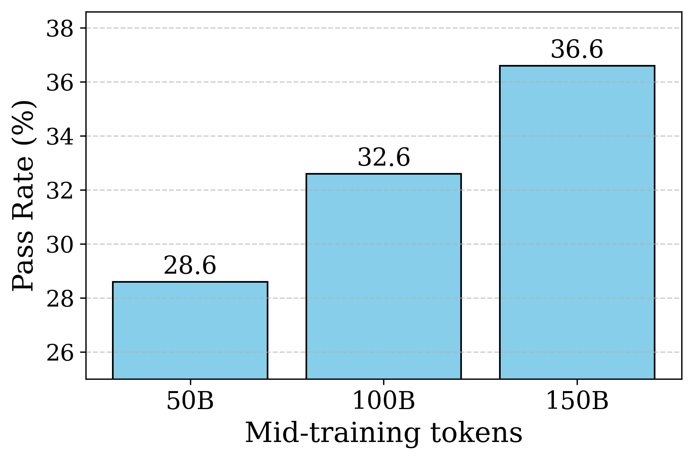

<figcaption>図2: 異なる訓練トークンの予算で中間訓練したあとの、SWE-bench Verified での性能。</figcaption>
</figure>

表 1 は、SWE-bench Verified（Jimenez et al., 2023）での Kimi-Dev の性能を示す。SWE-RL（Wei et al., 2025）で使われたテキストの類似度の報酬の代わりに、より信頼できる修正の品質のために実行にもとづくシグナルを採用する。私たちの 2 段階の TestWriter は、リポジトリのルートに置く単一のテストに頼る従来の Agentless のシステム（Xia et al., 2024; Guo et al., 2025; He et al., 2025）よりも、リポジトリの文脈をよりよく捉え、実際の開発者のワークフローを反映することで改善している（OpenAI, 2025c）。Kimi-Dev はオープンソースのモデルの中で最先端の性能を達成し、イシューの 60.4% を解決する。

#### 3.5.2 Mid-Training（中間訓練）

この節では、中間訓練で使うデータの量とモデルの性能の関係を評価する。具体的には、Qwen 2.5-72B-Base を 500 億、1,000 億、約 1,500 億トークンの中間訓練データの部分集合でファインチューニングし、次にこれらの中間訓練済みモデルを、SFT のコールドスタートのための同じ 2,000 組の BugFixer の入出力の対で軽く活性化した。評価を簡単にするため、ここでは BugFixer の pass@1 だけを報告する。

図 2 は、中間訓練のトークン数を増やすと一貫してモデルの性能が改善することを示しており、この段階の有効性を浮き彫りにしている。

#### 3.5.3 Reinforcement Learning（強化学習）

<figure>

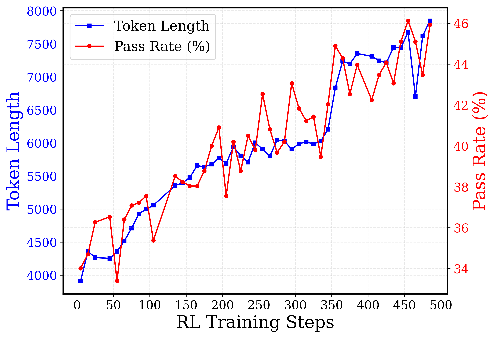

<figcaption>図3 (a): 72B の合同 RL、BugFixer。</figcaption>
</figure>

<figure>

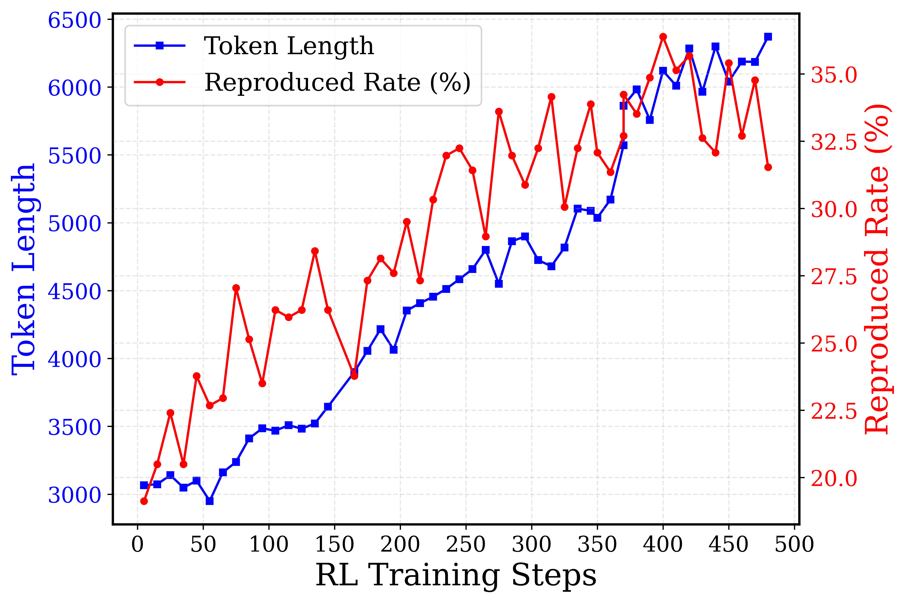

<figcaption>図3 (b): 72B の合同 RL、TestWriter。図3: 中間訓練とコールドスタート後のモデルでの、コード編集の合同 RL の実験。BugFixer の通過率と TestWriter の再現率は、温度 1.0 での pass@1 として報告する。出力が長くなるにつれて性能が一貫して改善する。</figcaption>
</figure>

##### Experimental setup（実験設定）

RL の反復ごとの訓練ステップを 5 とし、SWE-gym（Pan et al., 2024）と SWE-bench-extra（Badertdinov et al., 2024b）の和集合から 1,024 問のそれぞれについて 10 本のロールアウトをサンプリングする。タスクの難しさを徐々に上げるため、20 反復ごとにプロンプトセットを動的に調整する。プロンプトの入力には最初のモデルが事前に特定したファイル全体の内容が含まれるため、訓練の最大コンテキスト長を 64k トークンに固定する。

##### Results（結果）

図 3 は、RL の訓練中のテストセットでの性能と応答長の曲線を示す。通過率と再現率は、pass@1 と温度 1 から計算する。具体的には、モデルの性能と応答長の両方が着実に増加することを観察しており、RL のスケーリングに期待される利点を反映している。Qwen2.5-14B-Instruct モデルで行ったアブレーション実験でも同様の RL のスケーリング曲線が観察されており、異なる大きさのモデルにわたる RL の訓練レシピの有効性を示している。実験の詳細と、3.3 節の正例の強化についてのアブレーション研究は付録 C.2 に挙げる。

長い出力は、数学やコードの推論タスクのもの（Team et al., 2025; Guo et al., 2025）と同様の、深い問題分析と自己反省のパターンからなる。また、TestWriter について、再現の網羅性の不足のために、RL の訓練中にときおり偽陽性の例が起きることも観察した。事例研究は付録 E に置き、さらなる改善は今後の課題とする。

<figure>

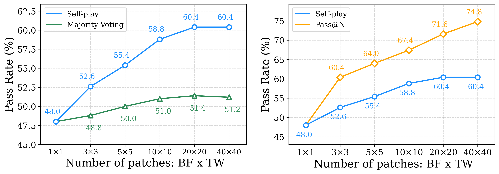

<figcaption>図4: SWE-bench Verified でのテスト時のセルフプレイ。生成するパッチとテストを増やすと性能が改善する。左: 実行にもとづくセルフプレイは、BugFixer の多数決を一貫して上回る。右: セルフプレイの性能は、正解のテストパッチを使う pass@N を下回ったままであり、TestWriter に改善の余地があることを示唆する。</figcaption>
</figure>

#### 3.5.4 Test-time Self-Play（テスト時のセルフプレイ）

3.4 節に従い、生成するパッチとテストの数とともに SWE-bench Verified での最終的な性能がどうスケールするかを評価する。温度は最初のロールアウトで 0 に固定し、続く 39 回のロールアウトでは 1.0 に設定する。図 4 の左に示すように、パッチとテストの組の数が 1 $\times$ 1 から 40 $\times$ 40 に増えるにつれて最終的な性能は 48.0% から 60.4% に改善し、BugFixer のパッチだけの多数決で得た結果を一貫して上回る。

具体的には、各インスタンスについて 3 個のパッチと 3 個のテストから得たセルフプレイの結果は、すでに 40 個の BugFixer のパッチによる多数決の性能を上回っている。これは、テスト時の実行から得る追加の情報の有効性を示している。しかし、より強力なセルフプレイのための TestWriter の改善の余地はまだ残っている。図 4 に示すように、セルフプレイの性能は、正解のテストケースがイシューの解決の基準となる pass@N を下回ったままである。この発見は、最後に境界ケースを確認する段階を導入してより多様なテストケースを生成し、それによって SWE-Agent のフレームワークにおける「TestWriter」の役割を強化した Anthropic (2024) と合致する。また、追加の訓練を必要とせず、スケーラブルな性能の改善を可能にしうる、並列スケーリングの潜在的な現象についての予備的な観察も報告する。この現象の詳細と分析は付録 F で扱う。

## 4 Initializing SWE-Agents from Agentless Training（Agentless の訓練から SWE-Agent を初期化する）

SWE-Agent（Yang et al., 2024a; Anthropic, 2024）や OpenHands（Wang et al., 2025a）のようなエンドツーエンドの多ターンのフレームワークは、エージェントがツールを活用し環境と相互作用することを可能にする。具体的には、SWE-Agent のフレームワーク（Anthropic, 2024）で用いられるシステムプロンプトは、5 段階のワークフローを概説している。(i) リポジトリの探索、(ii) テストスクリプトによるエラーの再現、(iii) バグ修復のためのコードの編集、(iv) 検証のためのテストの再実行、(v) 境界ケースの生成と確認である。Agentless と異なり、SWE-Agent のフレームワークは段階ごとの厳格なワークフローを強制しない。エージェントは、タスクが完了したと判断して提出するまで、自由に反省し、移行し、やり直すことができる。

したがって、固定された手順がないことで性能の潜在力はより高くなる。しかし、長い視野の信用の割り当てに対して結果報酬がまばらなため、SWE-Agent の訓練はより難しい。一方、私たちの Kimi-Dev モデルは Agentless の訓練を経ており、BugFixer と TestWriter のための位置の特定とコードの編集のスキルが入念に強化されている。この節では、それが多ターンの SWE-Agent のシナリオのための効果的な事前分布として役立つかどうかを調べる。

**表2**: エンドツーエンドのエージェントのフレームワークのもとでの、SWE-bench Verified での異なるモデルの単一試行の性能。プロプライエタリかオープンウェイトか、および 100B 以上か未満か（2025.09 時点）で分類する。「Internal」は社内のエージェントのフレームワークで達成された結果を表す。

| モデル | システム | パラメータ数 | 通過率（%） |
|---|---|---|---|
| **プロプライエタリ** | | | |
| Gemini 2.5 Pro（Comanici et al., 2025） | Internal | - | 60.3 |
| OpenAI-o3（OpenAI, 2025d） | Internal | - | 69.1 |
| GPT-5（OpenAI, 2025a） | Internal | - | 74.9 |
| Claude 3.5 Sonnet (241022)（Anthropic, 2024） | SWE-Agent | - | 49.0 |
| Claude 3.7 Sonnet（Anthropic, 2025a） | SWE-Agent | - | 62.3 |
| Claude 4.0 Sonnet（Anthropic, 2025b） | SWE-Agent | - | 72.7 |
| **オープンウェイト、100B 以上** | | | |
| gpt-oss-120b (High)（OpenAI, 2025b） | Internal | 120B | 62.4 |
| DeepSeek-v3.1（Guo et al., 2025） | Internal | 671B | 66.0 |
| Kimi-K2-0905（Kimi et al., 2025） | SWE-Agent | 1T | 69.2 |
| Qwen3-Coder（Yang et al., 2025a） | OpenHands | 480B | 69.6 |
| **オープンウェイト、100B 未満** | | | |
| Openhands-LM（Wang et al., 2025b） | OpenHands | 32B | 37.2 |
| Skywork-SWE（Zeng et al., 2025） | OpenHands | 32B | 38.0 |
| SWE-agent-LM（Yang et al., 2025b） | SWE-Agent | 32B | 40.2 |
| DeepSWE（Luo et al., 2025） | OpenHands | 32B | 42.2 |
| Devstral-Small-2507（AI and AI, 2025） | OpenHands | 24B | 53.6 |
| gpt-oss-20b (High)（OpenAI, 2025b） | Internal | 20B | 60.7 |
| Kimi-Dev（SFT 済み） | SWE-Agent | 72B | 48.6 |

### 4.1 Performance after SWE-Agent Fine-tuning（SWE-Agent のファインチューニング後の性能）

<figure>


<figcaption>図5: 素の Base、Agentless で中間訓練したもの（MT）、Agentless で中間訓練し推論を多く要するコールドスタートを行ったもの（SFT）、RL 後の Kimi-Dev モデルの、SWE-Agent への適応のための事前分布としての質の比較。SWE-Agent の SFT の軌跡のトークン数をさまざまな規模で振り、SWE-bench Verified での SWE-Agent の性能を pass@3 まで報告する。</figcaption>
</figure>

公開されている SWE-Agent の軌跡を使って Kimi-Dev をファインチューニングする。使ったファインチューニングのデータセットは SWE-smith（Yang et al., 2025b）が公開したもので、合成環境で Claude 3.7 Sonnet（Anthropic, 2025a）を使って集めた 5,016 本の SWE-Agent の軌跡からなる。Kimi-Dev に対して教師ありファインチューニングを行い、訓練中の最大コンテキスト長を 64K トークンとし、推論時には最大 128K トークンと 100 ターンを許す。

表 2 に示すように、現実的な環境でさらに軌跡のデータを集めることも、多ターンのエージェント的な RL を追加で行うこともなしに、ファインチューニングしたモデルは、追加のテスト時のスケーリングなしで、エージェントのフレームワークの設定のもとで SWE-bench Verified で pass@1 スコア 48.6% を達成する。同じ SFT データを使って、ファインチューニングした Kimi-Dev モデルは SWE-agent-LM（Yang et al., 2025c）を上回り、性能は Claude 3.5 Sonnet（241022 版で 49%）に匹敵する。SWE-Agent に適応させたモデルの pass@10 は 74.0% で、Agentless のもとでの私たちのモデルの pass@30（73.8%）を上回り、SWE-Agent のフレームワークの潜在力の高さを証明している。

### 4.2 Skill Transfer and Generalization（スキルの転移と汎化）

4.1 節に示した結果は、Agentless の訓練を広範に経たモデルである Kimi-Dev が、軽量な教師ありファインチューニングでエンドツーエンドの SWE-Agent に適応できることを示している。Agentless の訓練レシピは中間訓練、コールドスタート（SFT）、RL からなるので、適応後の SWE-Agent の能力に対するレシピの各部分の寄与を調べる。

これを明らかにするため、元の Qwen2.5-72B（Base）、中間訓練したモデル（MT）、その後 Agentless の形式の長い CoT データで活性化したモデル（SFT）、RL の訓練を終えた（Kimi-Dev）モデル（RL）に対して SWE-Agent の SFT を行う。これら 4 つのモデルを SWE-Agent のための事前分布¹として扱っており、良い事前分布は常に少数の例で素早く適応する能力を示すので（Finn et al., 2017; Brown et al., 2020）、SWE-Agent の SFT データの量も振って、SWE-Agent への適応における各事前分布の効率を測る。

¹ 以下の分析では、「事前分布（prior）」という語を、SWE-Agent の軌跡でファインチューニングされるモデルを指すのに少し拡大して使う。

具体的には、5,016 本の SWE-Agent の軌跡をランダムにシャッフルし、大きさ 100、200、500、1,000、2,000 の入れ子になった部分集合を構築する。小さい部分集合はそれぞれ大きいものに含まれる。さらに、2 つの極端なベースラインを前に加える。(i) ゼロショット。事前分布のモデルをファインチューニングなしで SWE-Agent のフレームワークのもとで直接評価する。(ii) 1 ステップの勾配降下。100 本の軌跡の部分集合を使って、1 回の勾配ステップでモデルを更新する。これにより、{ $0$, $2^{21}$, $2^{23}$, $2^{24}$, $1.1\times 2^{25}$, $1.1\times 2^{26}$, $1.1\times 2^{27}$, $1.5\times 2^{28}$ } にわたる SFT のトークン予算の範囲が得られる。これらの軽量な SFT の実験のあと、SWE-Agent のフレームワークのもとで pass@{1,2,3} の観点で性能を評価する。pass@1 の評価は温度 0 で、pass@2 と pass@3 の評価は温度 1.0 で行う。

図 5 は、異なる量のエージェント的な軌跡でファインチューニングしたあとの各事前分布（Base、MT、SFT、RL）の SWE-Agent の性能を示す。次の観察が得られる。

1. RL の事前分布は、ほぼすべての SWE-Agent の SFT の設定で、他のすべてのモデルを上回る。これは、Agentless の訓練レシピが SWE-Agent への適応の観点で事前分布を確かに強化することを示している。たとえば、Base の事前分布の最高の pass@1 の性能に達するのに、RL の事前分布は $2^{23}$ の SWE-Agent の SFT トークンしか必要としないのに対し、Base の事前分布は $1.5\times 2^{28}$ トークンを消費する。
2. MT の事前分布は、極端にデータが乏しい設定（ゼロショット（$0$）と 1 ステップの勾配降下（$2^{21}$））では SFT と RL のものに遅れるが、ファインチューニングに 200 本の軌跡（$2^{24}$）が使えるようになるとすぐにそれらと並ぶ。これは、Agentless の中間訓練を通じて事前分布が強化されたあと、適応の効率が同程度のままであることを示している。
3. SFT の事前分布の性能は、2 つの場合を除いて RL のものとほぼ同様である。(i) ゼロショットの設定では SFT の事前分布が RL のものを上回る。RL の事前分布は Agentless の入出力の形式に過適合しているかもしれず、SFT の事前分布はその影響を受けにくいので、これは理にかなっている。(ii) SFT の事前分布は、200 本の SWE-Agent の軌跡（$2^{24}$）で大きな劣化を示す。考えられる理由は、200 本の軌跡が単一のデータのモードに収束し、SFT の事前分布が記憶によって過適合したこと（Chu et al., 2025）かもしれない。RL の事前分布は代わりに、より強い転移可能なスキルを埋め込んでおり、そのためよりよく汎化する。

<figure>

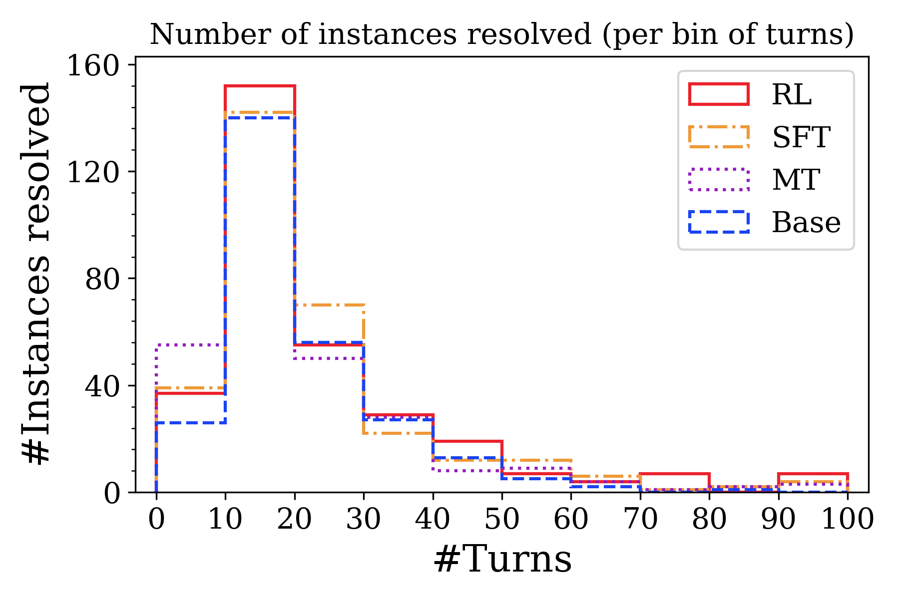

<figcaption>図6（左）: SWE-Agent への適応後の、ターン数の制限のもとでの 4 つの事前分布の性能。</figcaption>
</figure>

<figure>


<figcaption>図6（右）: 各事前分布の BugFixer と反省のスキルの特徴づけ。3 回の実行の、段階 3 で区切った時点での解決したケースを数え、それを最終的な成功ケースと比べる。</figcaption>
</figure>

##### From long CoT to extended multi-turn interactions.（長い CoT から長い多ターンの相互作用へ）

長い chain-of-thought の推論を通じて培われた反省的な振る舞いが、長い多ターンの相互作用を要する設定へ転移するかもしれない、という仮説を立てる。これを調べるため、4 つの事前分布（Base、MT、SFT、RL）を 5,016 本の軌跡でファインチューニングして評価し、さまざまなターン数の制限のもとで pass@3 を指標として SWE-bench Verified でテストする（図 6 左）。相互作用の長さの特徴の違いは、裏づけとなる証拠を示している。RL の事前分布はファインチューニング後、70 ターンを超えても進歩し続けるのに対し、SFT、中間訓練、素のモデルは、それぞれ約 70、60、50 ターンで収穫逓減を示す。

さらに、SWE-Agent に適応させたモデルにおける Agentless のスキル事前分布（BugFixer と反省）の有効性を評価する。BugFixer については、SWE-Agent は 5 つの段階の間で自律的に反省しうることから、各軌跡において、第 3 段階のバグの修正が最初に完了し、第 4 段階のテストの再実行にまだ入っていない時点を調べる。経験則として、SWE-Agent が第 3 段階を終えたばかりのときは、まだ第 4 段階からの実行のフィードバックを得ておらず、したがって実行の情報にもとづいてさらに反省したりバグの修正を洗練したりしていない。そこで、この区切りの時点でそのまま提出した場合の成功率を計算し、これが BugFixer のスキルの能力を反映するとする。反省については、各問題について区切りの時点での性能と完全に完了したあとの性能をさらに比べる。成功した問題の数の増分を、反省のスキルの能力を反映するものとして使う。

kimi-k2-0711-preview（Kimi et al., 2025）を使って SWE-Agent の軌跡にアノテーションし、各ターンがどの段階に属するかを特定する。図 6（右）は、両方のスキルが Agentless の訓練レシピの各段階を通じて強化されることを示している。BugFixer のスキルについては、4 つの適応後のモデルの SWE-Agent の相互作用の軌跡における段階 3 での区切りの性能が一貫して改善し、3 回の試行以内での成功した解決の数で測って、Base の事前分布が解決した 484 件から RL の事前分布の 605 件まで及ぶ。反省のスキルについては、段階 3 から軌跡の終わりまでの性能の増加を調べると同様の傾向が明らかになり、改善は Base の事前分布のもとでの +94 から RL の事前分布のもとでの +113 まで増加する。合わせると、RL の事前分布から適応したモデルが、両方のスキルにわたって最も強い全体の性能を達成する。反省のスキルの分析は依然として粗いことに注意すべきである。2 つのチェックポイントの間で測った性能の増加は、エージェント的な反省とやり直しの振る舞いだけでなく、SWE-Agent が行う途中のテストの作成の過程も捉えているからである。TestWriter のスキル事前分布を切り分けるより細かい評価は今後の課題とする。SWE-Agent の段階のアノテーションのためのプロンプト、拡張した定性的研究、スキルの転移と汎化についての追加の議論は付録 G で扱う。

<figure>

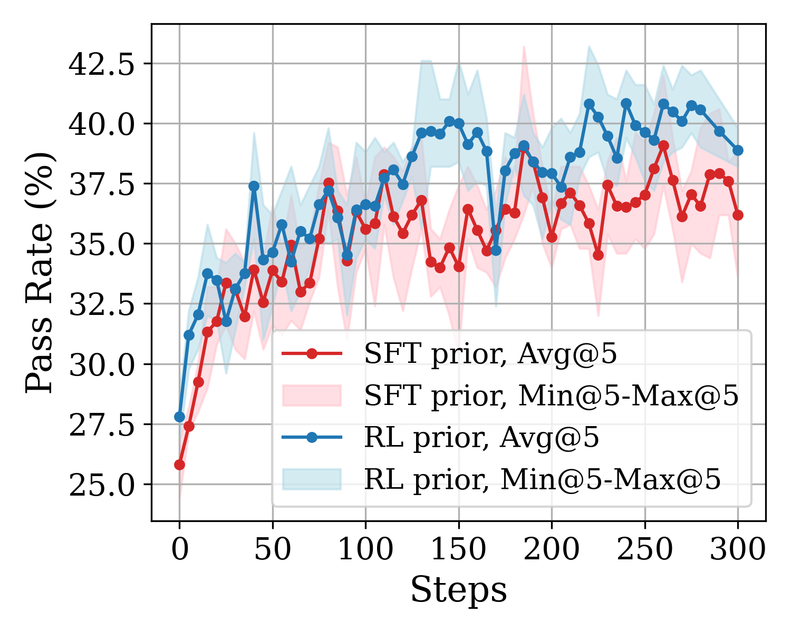

<figcaption>図7（左）: 5 回の実行で平均した Pass@1。</figcaption>
</figure>

<figure>

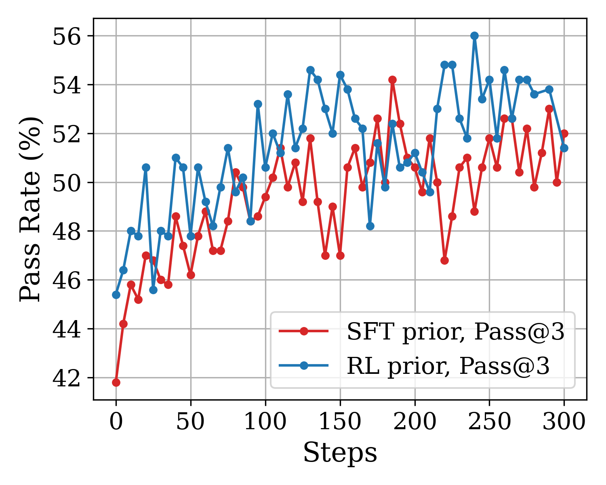

<figcaption>図7（中）: Pass@3。</figcaption>
</figure>

<figure>

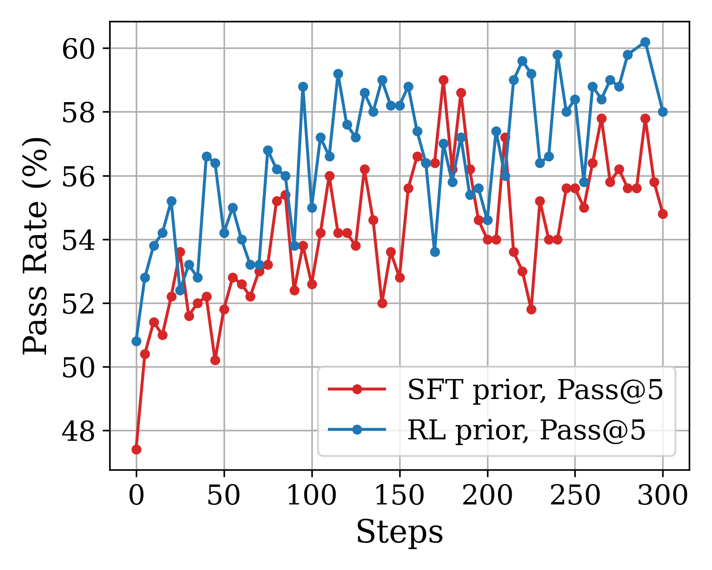

<figcaption>図7（右）: Pass@5。図7: エンドツーエンドの SWE-Agent の RL をさらに適用したときの、SFT の事前分布と RL の事前分布の比較。2 つの事前分布は、同じ 2²¹ の SWE-Agent の SFT トークン（図 5 の 2 列目）で活性化している。エンドツーエンドの RL のあと、RL の事前分布は Pass@1、Pass@3、Pass@5 のすべての設定で SFT の事前分布をわずかに上回り、これは図 5 での SWE-Agent の SFT の性能の比較と一致する。</figcaption>
</figure>

事前分布の比較のためのエンドツーエンドの SWE-Agent の RL。Agentless の訓練レシピによって焼き込まれた事前分布の有効性をさらに検証するため、コールドスタートした事前分布を初期モデルとして、エンドツーエンドの SWE-Agent の RL（Luo et al., 2025）を用いる。SWE-Smith の軌跡に含まれるプロプライエタリなモデルのパターンの影響を最大限に和らげるため、$2^{21}$ の SWE-Agent の SFT トークンの設定、つまり図 5 の 2 列目、各事前分布の上で 1 回の勾配降下のステップが行われる設定を活用する。最小限のコールドスタートの設定のもとで、エンドツーエンドの RL は、模倣という近道をとることを超えて、各事前分布の潜在力を明らかにする（Gudibande et al., 2024; Chu et al., 2025）。

事前分布の比較のためのエンドツーエンドの RL の訓練を行うため、SWE-Gym（Pan et al., 2024）と SWE-bench-extra（Badertdinov et al., 2024a）の部分集合を訓練セットとして使う。Agentless の RL のレシピと同様に、まず各初期モデルを使って Pass@8 = 0 の問題を除外する。MT の事前分布のモデルでは 6,202 問のうち 260 問が残る。SFT の事前分布と RL の事前分布のモデルでは、6,202 問から合計 2,062 問が残される。すべてのエンドツーエンドの RL の実行で、結果報酬だけを使い、最適化には KL や エントロピーの正則化なしで 3.3 節と同じ方策勾配のアルゴリズムを使い、バッチサイズは 256 とする。結果は次のとおりである。

MT の事前分布のモデルでは、pass@1 の性能が、エンドツーエンドの RL の 10 ステップ後に 2% 未満へ急速に悪化する。この潜在的な理由は、訓練に使える問題の不足であり、事前分布の劣位を反映している。SFT の事前分布と RL の事前分布のモデルでは、RL の実行は 300 ステップ続き、図 7 に性能の比較をプロットする。図 7 によれば、RL の事前分布のモデルは、SFT の事前分布のモデルより Pass@1、Pass@3、Pass@5 のスコアがわずかに高い。この現象は図 5 に示した SWE-Agent の SFT のもとでの性能の比較と一致するが、エンドツーエンドの SWE-Agent の RL によって誘因づけられたモデルの相互作用の軌跡のパターンは、プロプライエタリなモデルのパターンと大きく異なることを観察している（付録 G.3 に詳述）。これらの結果は、Agentless の訓練レシピが、プロプライエタリなエンドツーエンドの軌跡による最小限の教師のもとで、SWE-Agent のフレームワークのもとでのエンドツーエンドの学習のための強い事前分布を整えることを明らかにしている。さらなる改善のためのより高度なエージェント的な RL の技法の探索は今後の課題とする。

## 5 Conclusion and Future Work（結論と今後の課題）

本研究では、自動化されたソフトウェアエンジニアリングのための Agentless とエージェントのパラダイムを、競合するものではなく補完的なものとして捉え直した。Kimi-Dev を導入することで、構造化された Agentless の訓練が、バグの位置の特定、コードの修復、自己反省を含む転移可能なスキル事前分布を誘導できることを実証した。その結果、Kimi-Dev はワークフローベースの手法の中で SWE-bench Verified で最先端の結果を達成するだけでなく、効率的な SWE-Agent への適応も可能にする。これらの発見は、段階的な訓練を通じてより汎化可能なコーディングエージェントを構築する新しい道を確立する。

## Ethics and Reproducibility Statements（倫理と再現性に関する声明）

本研究は ICLR の会議が求める倫理規定に従う。本研究は人間の被験者や動物実験を含まない。生データの個人を特定できる情報は、プライバシーへの配慮のために除外している（付録 A に詳述する中間訓練のデータのレシピを参照）。本研究の範囲を超えて、私たちはコミュニティがエージェントの安全性についての体系的な研究を進め、それによってこの分野の責任ある進歩を確保することを強く提唱する。

すべての実験について、詳細な設定と議論を付録で扱っている。Agentless のための中間訓練は付録 A、使った Docker の詳細は付録 B、Agentless の RL は付録 C、エージェントの基盤は付録 D、Agentless のもとでの事例研究は付録 E、創発的なテスト時の並列スケーリングについての予備的な発見は付録 F、SWE-Agent についての拡張分析は付録 G である。

## Appendix A Details of Mid-training（中間訓練の詳細）

SWE の能力の強化に焦点を当てて、中間訓練のデータのレシピをキュレーションする。この取り組みの中心は GitHub からのプルリクエスト（PR）のデータの収集であり、これは現実世界のバグの修正、機能の要望、コードの改良を広く網羅する。データの品質を確保するため、2 つのフィルタを適用する。(i) GitHub のスターを少なくとも 5 つ集めたリポジトリだけを残し、それによってコミュニティの関与が限られた、まばらにしか保守されていないプロジェクトを除外する。(ii) 潜在的なデータの漏洩を防ぐため、SWE-bench ベンチマーク（Jimenez et al., 2023）と重なるリポジトリを取り除く。各候補のリポジトリについて、GitHub API で状態が MERGED のすべての PR を問い合わせ、放棄されたもの、置き換えられたもの、レビュー中のままのものは捨てる。より多くの文脈情報を保つため、PR の最初のコード変更の前のベースコミットでのコードベース全体のスナップショットもとる。

データを収集したあと、自然なコード変更のデータについて 2 つの補完的な形式を組み込む。(i) 自然な diff パッチと、(ii) PR のコミットパックである。自然な diff パッチは、PR のすべてのコミットを最終的なコードの差分にまとめたもので、通常 SEARCH–REPLACE のブロックとして表される。この形式は、モデルが最終的なパッチを直接出力しなければならない Agentless のパラダイムに合致する。対照的に、コミットパックは PR の中の人間が書いたコミットの列を捉え、各コミットメッセージ（テキストによる推論）が対応するコードの変更（行動）と組になっている。この構造は、途中の推論のステップが行動と交互に現れる SWE-Agent の設定に密接に対応する。しかし、2 種類のデータの有用性の区別は絶対的ではない。PR のコミットパックのコミットメッセージも、モデルの知識に情報を与え、Agentless の設定での推論能力を間接的に強化しうる。

自然な diff パッチ。中間訓練のデータのレシピで使う自然な diff パッチは、次の規則で処理する。

- Agentless のプロンプトのテンプレートを組み込み（Prompts 1、2、3、4 を参照。これら 4 つのプロンプトのテンプレートは、コールドスタート、RL、テスト時のセルフプレイを含む後の段階でも使われる）、プロンプトの部分に損失マスクを適用する。位置の特定のプロンプトについては、応答を、正解の diff パッチで変更されたファイルに設定する。
- PR に関連するイシューが存在する場合は、その関連するイシューの内容を使う。そうでない場合は、イシューの内容の代わりに PR のタイトルを使う。
- PR に関連するイシューが存在する場合は、コード編集の応答の出力の冒頭にイシューの議論を前置する。議論の内容を活用して、モデルのコード編集の推論の能力を強化することを狙っている。
- {.py, .md, .rst} 以外のファイルへの変更を含む PR は捨てる。
- {.md, .rst} のファイルの変更を含む PR については、Python の差分だけを残し、それを SEARCH–REPLACE のブロックに書き直す。
- ファイルの追加や削除を伴う PR を取り除く。
- 行の挿入や削除だけのコードの編集については、元の Git の diff のハンクを SEARCH–REPLACE のブロックの SEARCH の内容として保つ。
- PR ごとに変更される Python ファイルが 3 つ以下であることを保証する。
- {.py, .md, .rst} 以外の変更を含む PR、または 3 つより多くの Python ファイルを変更する PR を除外するフィルタのスクリプトを適用する。
- 5 つより多くの SEARCH–REPLACE のブロックを含む PR をさらに除外する。

これらのフィルタの規則を適用したあと、自然な diff パッチについて合計約 500 億トークンが得られる。

````text
Please look through the following GitHub problem description and Repository structure and provide a list of files that one would need to edit to fix the problem.

### GitHub Problem Description ###
{related issue / PR title content}

###

### Repository Structure ###
{file structure induced by the repo snapshot}


###

Please only provide the full path and return at most 5 files.
The returned files should be separated by new lines ordered by most to least important and wrapped with ```
For example:
```
file1.py
file2.py
```
````

**Listing 1**: Agentless のプロンプトのテンプレート。BugFixer のための位置の特定。

````text
Please look through the following GitHub problem description and Repository structure and provide a list of test files that should be run after applying the patch to fix the issue.

### GitHub Problem Description ###
{related issue / PR title content}

###

### Repository Structure ###
{file structure induced by the repo snapshot}


###

Please only provide the full path and return at most 5 files.
The returned files should be separated by new lines ordered by most to least important and wrapped with ```
For example:
```
file1.py
file2.py
```
````

**Listing 2**: Agentless のプロンプトのテンプレート。TestWriter のための位置の特定。

````text
We are currently solving the following issue within our repository. Here is the issue text:
--- BEGIN ISSUE ---
{related issue / PR title content}
--- END ISSUE ---


Below are some code segments, each from a relevant file. One or more of these files may contain bugs.

--- BEGIN FILE ---
```
### {filename1}
{content of filename1}

### {filename2}
{content of filename2}
{...}

```
--- END FILE ---

Please first localize the bug based on the issue statement, and then generate *SEARCH/REPLACE* edits to fix the issue.

Every *SEARCH/REPLACE* edit must use this format:
1. The file path
2. The start of search block: <<<<<<< SEARCH
3. A contiguous chunk of lines to search for in the existing source code
4. The dividing line: =======
5. The lines to replace into the source code
6. The end of the replace block: >>>>>>> REPLACE

Here is an example:

```python
### mathweb/flask/app.py
<<<<<<< SEARCH
from flask import Flask
=======
import math
from flask import Flask
>>>>>>> REPLACE
```

Please note that the *SEARCH/REPLACE* edit REQUIRES PROPER INDENTATION. If you would like to add the line '        print(x)', you must fully write that out, with all those spaces before the code!
Wrap the *SEARCH/REPLACE* edit in blocks ```python...```.
````

**Listing 3**: Agentless のプロンプトのテンプレート。BugFixer のためのコードの編集。

````text
We are currently solving the following issue within our repository. Here is the issue text:
--- BEGIN ISSUE ---
{related issue / PR title content}
--- END ISSUE ---


Below are some code segments, each from a relevant test file. One or more of these files may be added some new tests which can reproduce the issue.

--- BEGIN FILE ---
```
### {filename1}
{content of filename1}

### {filename2}
{content of filename2}
{...}

```
--- END FILE ---

Please first localize some possible locations in those test files within the repo, and then generate *SEARCH/REPLACE* edit updates to the **test** files in the repo, so that the erroneous scenario described in the problem is reproduced.

Every *SEARCH/REPLACE* edit must use this format:
1. The file path
2. The start of search block: <<<<<<< SEARCH
3. A contiguous chunk of lines to search for in the existing source code
4. The dividing line: =======
5. The lines to replace into the source code
6. The end of the replace block: >>>>>>> REPLACE

Here is an example:

```python
### mathweb/flask/app.py
<<<<<<< SEARCH
from flask import Flask
=======
import math
from flask import Flask

def test__rules__std_L060_raised() -> None:
    try:
        sql = "SELECT   IFNULL(NULL, 100),
            NVL(NULL,100);"
        result = lint(sql, rules=["L060"])
        assert len(result) == 2
    except:
        print("Other issues")
        return

    try:
        assert result[0]["description"] == "Use 'COALESCE' instead of 'IFNULL'."
        assert result[1]["description"] == "Use 'COALESCE' instead of 'NVL'."
        print("Issue resolved")
    except AssertionError:
        print("Issue reproduced")
        return

    return
>>>>>>> REPLACE
```

Please note that the *SEARCH/REPLACE* edit REQUIRES PROPER INDENTATION. If you would like to add the line '        print(x)', you must fully write that out, with all those spaces before the code!
Wrap the *SEARCH/REPLACE* edit in blocks ```python...```.
````

**Listing 4**: Agentless のプロンプトのテンプレート。TestWriter のためのコードの編集。

PR のコミットパック。中間訓練のデータのレシピで使う PR のコミットパックは、次の規則で処理する。

- {.py, .md, .rst} 以外のファイルへの変更を含む PR は捨てる。
- {.md, .rst} のファイルの変更については、「diff –git」の署名は残すが、実際の内容の変更は取り除く。
- 各 PR が変更する Python ファイルが最大 5 つ（少なくとも 1 つは必須）であることを保証する。この上限を超える PR は捨てる。
- {.py, .md, .rst} 以外のファイルの変更を含む PR、または 5 つより多くの Python ファイルを変更する PR を除外するフィルタのスクリプトを適用する。
- 倫理上の配慮のため、開発者の署名と GitHub の ID をすべて取り除く。

これらのフィルタの規則を適用したあと、PR のコミットパックについて合計約 200 億トークンが得られる。

さらに、モデルの推論とエージェント的な能力の両方をさらに強化するため、合成データを組み込む。重要な観察は、Agentless の設定における位置の特定の段階の正解の報酬は、変更が必要なファイルの集合が明示的に示されているので、diff パッチから直接導けるということである。

合成の推論データ。推論の質を改善するため、2,000 本の R1 の軌跡で Qwen-2.5-72B-Instruct モデルの軽量な SFT を行う。得られたモデルを使って、BugFixer と TestWriter の両方の位置の特定の段階について大規模なロールアウトを生成する。ファイルの位置の特定が完全に正しいロールアウトだけを残す。この手順により、中間訓練のレシピの中に、Agentless の位置の特定に特化した推論を多く含むデータが約 100 億トークン得られる。

合成のエージェント的な相互作用。エージェント的な能力を強化するため、実行なしでファイルシステムの操作をまねるよう設計した独自のツール群で、エージェントと環境の相互作用をシミュレートする。この設計は実際上の制約に動機づけられている。GitHub のリポジトリのスナップショットは手に入るが、すべてのスナップショットに実行可能な Docker 環境が備わっているわけではない。そのため、シェルのコマンドは無効にする。代わりに、エージェントがファイルの内容を見たり、位置の特定のためにキーワードにもとづく検索を行ったりできる合成のツールを導入する。これは Agentless の第 1 段階を、エージェント的なやり方で効果的に再現する。このツール群の仕様はシステムプロンプトで扱い、それを使って Qwen-2.5-72B-Instruct モデルからエージェント的な相互作用のロールアウトを引き出す。完全なシステムプロンプトは Prompt 5 に示す。損失マスクはシステムプロンプトにだけ適用し、Yang et al. (2024b) に着想を得て、モデルが軌跡に沿った行動と観測の両方を同時に学べるようにする。このアプローチは、方策と世界モデリングの両方を中間訓練に統合する。

````text
Your job is to look through the given GitHub problem description and Repository structure, and edit updates to the files in the repo to resolve the problem.
The job is divided into two stages:
+ In Stage 1, you should localize the files the files that you would need to edit to fix the problem.
+ In Stage 2, you should edit the updates to the repo.
Let's begin from Stage 1 to localize the bugs:

In Stage 1, besides reading the provided Repository structure, you can use the following skills for exploration. The skills are to be called in an environment wrapped by <execute> and </execute>, listed in the form of python functions as below:

open_file(path: str, is_all | None = False, line_number: int | None = 1, context_lines: int | None = 100) -> None:
    Opens the file at the given path in the editor for exploration.
    By default, only the first 100 lines of the file are displayed. To open the entire file, set `is_all` to `True`.
    The `context_lines` parameter determines the maximum number of lines to be displayed, with a cap of 100 lines. Use `scroll_up` and `scroll_down` to view more content up or down.
    If a `line_number` is provided, the window will be moved to include that line.
    Note: When `is_all` is set to `True`, the `line_number` and `context_lines` parameters will not take effect, as the entire file will be opened and displayed without any line-specific focus or context limitation.
    Args:
    path: str: The path to the file to open. the full path of the filename should be provided.
    is_all: bool | None = False: If set to `True`, the entire file will be opened. Defaults to `False`.
    line_number: int | None = 1: The line number to move to. Defaults to 1.
    context_lines: int | None = 100: Only shows this number of lines in the context window (usually from line 1), with line_number as the center (if possible). Defaults to 100.

goto_line(line_number: int) -> None:
    Moves the window to show the specified line number.
    Args:
    line_number: int: The line number to move to.

goto_class_or_func(class_or_func_name: str) -> None:
    Moves the window to show the specified class or function in the current open file.
    Args:
    class_or_func_name: str: The name of the given class, function, or method in a class to move to.

scroll_down() -> None:
    Moves the window down by 100 lines.
    Args:
    None

scroll_up() -> None:
    Moves the window up by 100 lines.
    Args:
    None

search_dir(search_term: str, dir_path: str | None) -> None:
    Searches for search_term in all files in dir. If dir is not provided, searches in the entire repository. Filename, fine-grained line number, and the relative class or function it is located in (if applied) will be shown for each found position.
    Args:
    search_term: str: The term to search for.
    dir_path: str: The path to the directory to search. Should be full path filename.

search_file(search_term: str, file_path: str | None = None) -> None:
    Searches for search_term in file. If file is not provided, searches in the current open file. Filename, fine-grained line number, and the relative class or function it is located in (if applied) will be shown for each found position.
    Args:
    search_term: str: The term to search for.
    file_path: str | None: The path to the file to search. Should be full path filename if provided.

find_file(file_name: str, dir_path: str | None) -> None:
    Finds all files with the given name in the specified directory. If dir is not provided, find in the entire repository.
    Args:
    file_name: str: The name of the file to find.
    dir_path: str: The path to the directory to search.

str_replace(path: str, old_str, new_str)
old_str=[the old content to be replaced]
new_str=[the new content after replacement]
-> None:
    Replace the old content (old_str) in the file at the given path with the new content (new_str). This is the skill that you will be using to edit the updates.
    Args:
    path: str: The path to the file to be updated. The full path of the filename should be provided.
    old_str: str: The old content to be replaced. Note that this argument should be written in a new line starting with "old_str=", and the string content should not be quoted.
    new_str: str: The new content after replacement. Note that this argument should be written in a new line starting with "new_str=", and the string content should not be quoted.

    Example:
    Assuming a call is shown as follows:
```
str_replace("filename.py", old_str, new_str)
old_str=    a

new_str=    b
c
```
    Then it will function as replacing the '    a\n' string with the '    b\nc ' string in the `filename.py` file.

insert(path: str, insert_line: int, new_str)
new_str=[the new content to be inserted]
-> None:
    Insert the new content (new_str) in the file at the given path. When you want to add an entirely new class/function to the file, it would be better to use this method.
    Args:
    path: str: The path to the file to be updated. The full path of the filename should be provided.
    insert_line: int: The Line number below which the new content is to be added. This Line number should be within the range of lines of the file: [0, Lines_of_the_File]. Specifically, when insert_line = 0, the added content starts from the top of the file.
    new_str: str: The new content to be inserted. Note that this argument should be written in a new line starting with "new_str=", and the string content should not be quoted.

    Example:
    Assuming a call is shown as follows:
```
insert("test_filename.py", 5, new_str)
new_str=    def test_add():
        assert add(1, 2) == 3
```
    Then it will function as inserting the string '    def test_add():\n        assert add(1, 2) == 3' below the Line 5 of the `test_filename.py` file.

stop() -> None:
    Terminate the editing process.
    Args:
    None

NOTE:
Responses should be concise.
When exploring, you should attempt fewer things at a time: Include ONLY ONE <execute> per response, and use a SINGLE skill listed above within the <execute> environment. DO NOT use other python functions, as the environment does not support them.
You should first reason in the verbal form, then use a skill with <execute> and </execute>.
You should avoid apologies and thanks in the responses.


When you finish exploring and analyzing with the provided skills, please return at most 3 files with the full path only. Each full path should be placed in a single line, INSTEAD OF BROKEN WITH MULTIPLE LINES.
The returned files should be separated by new lines ordered by most to least important, wrapped with ``` and NOTHING ELSE.
An example for a full output:
```
full_path_to_file1.py
full_path_to_file2.py
```

Now Let's start!

### GitHub Problem Description ###

{issue content}

### Repository Structure ###

{file structure}

###
````

**Listing 5**: エージェント的な相互作用の軌跡のシミュレーションを可能にする、実行を伴わないツール群。

最初の位置の特定の段階を終えたあと、エージェントは次の追加の指示によってコード編集の段階へ導かれる。「Now let’s move on to Stage 2 and edit the updates. Remember, you can still decide at any point whether a file actually requires modification.」（訳注: 「では Stage 2 に進んで更新を編集しましょう。ファイルに実際に変更が必要かどうかは、いつでも判断できることを忘れないでください。」）位置の特定の結果に正しいファイルが少なくとも 1 つ含まれていれば、Stage 1 からの部分的なロールアウトを残す。

Stage 2 では、まず、誤って特定したファイルをエージェントが開けるようにしてエージェントの相互作用をシミュレートし、ファイルの内容を調べたあとに「I realize that I do not need to modify this file」（訳注: 「このファイルは変更する必要がないと気づきました」）のようなエージェント的な推論のパターンを人為的に注入する。この手順は、解決すべきイシューについての偽陽性の文脈にエージェントをさらすことで、エージェントの自己反省の能力を強化するよう設計されている。

続いて、正解の PR のコミットパックを軌跡の形に書き写す。各コミットメッセージをエージェントの推論のステップとして扱い、各コードの更新を対応する行動として、「str_replace」または「insert」のツールを通じて表す。これらの相互作用を軌跡に追加し、最後に終了の「stop」の呼び出しを置く。リポジトリのスナップショットの保存容量の制約のため、この軌跡のシミュレーションは PR の一部にだけ適用する。全体として、この過程は中間訓練のレシピに約 100 億トークンのエージェント的な相互作用のデータを寄与する。データのレシピのこの構成要素をスケールさせる今後の方向には、環境のスケーリングの考え方（Yang et al., 2025c）の活用が含まれる。

訓練。Qwen2.5-72B-Base（Qwen et al., 2024）モデルから初期化し、標準的な次トークン予測のアプローチで中間訓練を行う。Grattafiori et al. (2024)、Qwen et al. (2024)、Gu et al. (2025) の実践に着想を得て、中間訓練中にデータの合成の部分を 4 倍にアップサンプリングする。現実世界のソフトウェアエンジニアリングのタスクに必要な長文脈の能力に向けて最適化し、グローバルバッチサイズ 256、最大系列長 32K トークンを使う。学習率は 2e-5 に設定し、コサイン減衰のスケジュールと最小学習率 2e-6 を使う。ウォームアップの段階は約 30 億トークンにわたり、その後、約 1,500 億トークンが処理されるまで学習率を減衰させる。

## Appendix B Docker environments（Docker 環境）

**表3**: Kimi-Dev の開発で使った Docker 環境の出どころ。

| データセット名 | データセットのリンク | Docker の数 |
|---|---|---|
| SWE-Gym（Pan et al. (2024)） | https://huggingface.co/datasets/SWE-Gym/SWE-Gym/ | 2,356 |
| SWE-bench-extra（Badertdinov et al. (2024a)） | https://huggingface.co/datasets/nebius/SWE-bench-extra/ | 3,846 |
| R2E-Gym-Lite（Jain et al. (2025)） | https://huggingface.co/datasets/R2E-Gym/R2E-Gym-Lite | 3,671 |

Docker 環境の構築。モデルのロールアウトが生成した正解でないパッチを検証し、データセットを広げるため、実行可能な Docker 環境が必要だった。公開されているデータセットと、独自に設定した Docker 環境を組み合わせた（表 3 を参照）。そのうち、SWE-Gym と R2E-Gym-Lite は Docker をオープンソースにしており、直接使える。

Docker のサポートがないデータセット（SWE-Bench-Extra）については、自動化した設定方法を実装した。

1. 依存関係を固定した Docker 環境を初期化する。
2. コミットの年にもとづいて Python のバージョンを選ぶ。
3. requirements.txt と「pip install -e .」で依存関係をインストールする。
4. テストの実行中の ModuleNotFound のエラーを解決する。
5. FAIL_TO_PASS のテストが（gt_patch なしで）失敗から（gt_patch ありで）成功に移れば、成功と判定する。

6,380 件の SWE-bench-extra のインスタンスのうち、3,846 の環境の構築に成功し、その後コールドスタートと RL の訓練に使った。

## Appendix C More Details of RL training（RL の訓練の詳細）

### C.1 Prompt set selection（プロンプトセットの選択）

<figure>

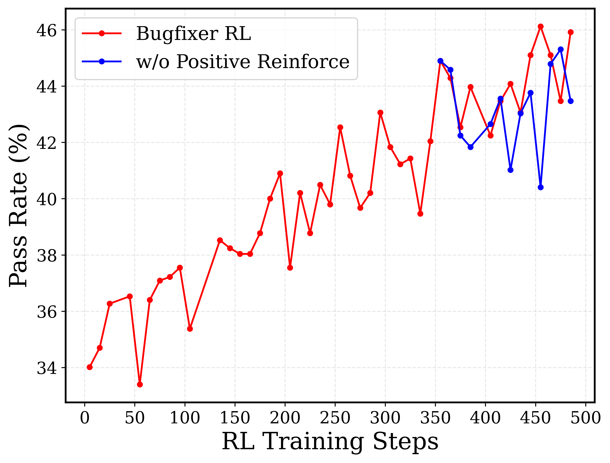

<figcaption>図8: 72B の BugFixer の RL における正例の強化のアブレーション。</figcaption>
</figure>

本文では、RL の訓練のための適応的なプロンプト選択の方法を導入した。具体的には、SWE-Gym（Pan et al., 2024）、SWE-bench-extra（Badertdinov et al., 2025）、R2E-gym（Jain et al., 2025）から pass@16 $>$ 0 のものを選んで、1,200 問の初期プロンプトセットを構築する。次に、100 訓練ステップごとに、500 の新しい問題を加えてプロンプトセットを広げる。これらの追加の問題は、現在のモデルの pass@16 = 0 の問題のプールからランダムにサンプリングして絞り込んだもので、それによって難しさを徐々に上げ、適切なカリキュラムをなす。

### C.2 RL experiment ablation（RL の実験のアブレーション）

図 9 は、RL の実験における Qwen2.5-14B モデルの性能を示しており、BugFixer と TestWriter の両方が明確なスケーリング則の振る舞いを示している。

<figure>

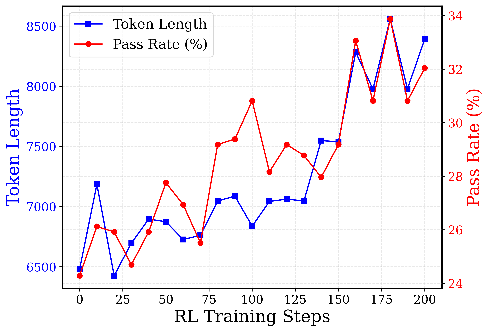

<figcaption>図9 (a): 14B の BugFixer。</figcaption>
</figure>

<figure>

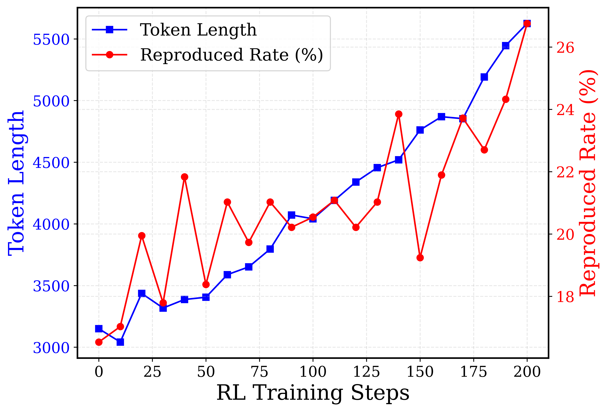

<figcaption>図9 (b): 14B の TestWriter。図9: Qwen2.5-14B モデルでの RL のスケーリングの実験。</figcaption>
</figure>

さらに、図 8 は私たちが提案した正例の強化の効果を示している。訓練の後期の段階でこの改善を組み込み、BugFixer の RL がこの工夫を使わない場合と比べてよりよい性能を達成したことを見出した。主な理由は、正例が正しい推論のパターンを強化し、特に後期の段階で探索の能力が弱まったときに、モデルがより速く収束できるようにすることである。同様の工夫が Seed1.5-thinking モデル（Seed et al., 2025）の開発でも適用されていたことに気づいた。

## Appendix D Agent Infrastructure（エージェントの基盤）

ハイブリッドクラウドのクラスタ環境のために設計した統一されたサンドボックスのアーキテクチャを示す。これは Kubernetes のオーケストレーションを活用し、研究者に柔軟で安全で高度にスケーラブルなコード実行のプラットフォームを提供する。このアーキテクチャは Python SDK を通じて利用でき、資源の効率とセキュリティの隔離を確保する、一時的な「使ったら破棄する」パラダイムを実装している。このシステムは際立ったスケーラビリティを示し、性能の安定を保ちながら 10,000 を超える同時のサンドボックスのインスタンスをサポートする。この基盤は、自動化されたコードの評価や RL の実験を含む多様な計算のシナリオの基礎的なプラットフォームとして役立つ。

このシステムは、複数のデータセットから集めた 25,000 を超える Docker イメージの異種の集まりを効率的に編成・管理するため、サイドカーコンテナのパターンを用いる。このアーキテクチャの選択は、異なる実行環境の間の隔離を保ちながら、最適な資源の利用を可能にする。さらに、サポートするイメージのリポジトリを継続的に広げる独自のソフトウェアエンジニアリング（SWE）のイメージ構築パイプラインを開発し、それによって多様な計算の負荷と研究の要件へのシステムの適応性を高めている。

## Appendix E Case Studies under Agentless（Agentless のもとでの事例研究）

### E.1 Bugfixer Traces（BugFixer の痕跡）

コードの修復の段階での BugFixer の応答の痕跡を示す（Listing 6 を参照）。ここから、最初に与えたコードは return self[i, j - pos - other.cols] だったが、モデルが素早く自分の誤りに気づき、return self[i, j - other.cols] に修正したことが観察できる。いくらか繰り返しの自己反省が続いたが、私たちの実験では、応答長の増加は確かに答えの正確さと頑健さを改善した。

````text
◁think▷
Okay, let's tackle this problem. The user reported an issue where the Matrix.col_insert() method isn't working correctly. The example given shows that after inserting a matrix V into M at position 3, the resulting matrix has the inserted columns shifted incorrectly. The expected result would have the inserted columns at positions 3 and 4, but the actual output shows them starting at position 3, but the original matrix's columns after the insert are shifted upwards instead of remaining in their original positions.

First, I need to understand how col_insert works. Looking at the code provided, especially in the MatrixShaping class in sympy/matrices/common.py, the _eval_col_insert method is responsible for inserting columns. The current implementation shifts the existing columns to the right by the number of columns inserted. However, the bug might be in how the original matrix's columns are being shifted.

Let me look at the existing code for _eval_col_insert:

def _eval_col_insert(self, pos, other):
    cols = self.cols

    def entry(i, j):
        if j < pos:
            return self[i, j]
        elif pos <= j < pos + other.cols:
            return other[i, j - pos]
        return self[i, j - pos - other.cols]

    return self._new(self.rows, self.cols + other.cols,
                     lambda i, j: entry(i, j))

Wait, the problem here is in the last case. When j is greater than or equal to pos + other.cols, the code subtracts (pos + other.cols) from j. But that's incorrect because the original columns after the inserted ones should start at j = pos + other.cols. So for the original matrix's columns that come after the inserted ones, their new positions should be j + other.cols. But in the current code, when j is in the original matrix's columns (after the inserted ones), the code is subtracting (pos + other.cols), which would incorrectly shift them.

Wait, let's think again. The original code for the entry function:

if j < pos:
    return self[i, j]  # original columns before pos
elif pos <= j < pos + other.cols:
    return other[i, j - pos]  # inserted columns
return self[i, j - pos - other.cols]  # original columns after the inserted ones

Wait, no. Let's say the original matrix has cols = 6. We insert 2 columns at pos=3. The new total cols is 6 + 2 = 8. The original columns after pos 3 (columns 3,4,5) should now be at positions 5,6,7. But according to the code, when j is >=3 +2=5 (since pos + other.cols =3+2=5), then the code returns self[i, j -5 -2] = self[i, j -7]. Wait, that's not right. For example, if j=5 (the new column 5), then j - pos - other.cols =5 -3 -2=0. So the original column 0 would be mapped to the new column 5. That's definitely wrong.

Ah, here's the mistake. The code is subtracting (pos + other.cols) from j, but that's incorrect. The original columns after the inserted ones should be shifted to the right by other.cols. So, the correct calculation should be j - other.cols. For example, original column 3 becomes 3 +2=5, original column 4 becomes 6, etc.

So the line in the code:

return self[i, j - pos - other.cols]

should be:

return self[i, j - other.cols]

Because the inserted columns have taken up 'other.cols' positions starting at 'pos', so the original columns after 'pos' are shifted by 'other.cols' to the right. Therefore, to get the correct original column index, we subtract 'other.cols' from the current j.

So the fix is to change the subtraction from (pos + other.cols) to other.cols. Let me check:

Original code:

return self[i, j - pos - other.cols]

Corrected code:

return self[i, j - other.cols]

Wait, no. Wait, the original columns after the inserted block (which starts at pos and has other.cols columns) would start at j = pos + other.cols. So for those j values, the original column index would be j - (pos + other.cols). Wait, no. Let's think with numbers.

Original matrix has 6 columns. Insert 2 columns at position 3. The new matrix has 8 columns. The original columns 0,1,2 remain in positions 0,1,2. The inserted 2 columns are at positions 3 and 4. The original columns 3,4,5 now become 5,6,7.

So for j in 5,6,7 (original columns 3,4,5), the mapping is:

5 $\rightarrow$ 3

6 $\rightarrow$ 4

7 $\rightarrow$ 5

So the formula should be original_column = j - inserted_columns. In this case, inserted_columns is other.cols. So the code should subtract other.cols from j when accessing the original matrix's columns after the inserted block.

Therefore, the line:

return self[i, j - pos - other.cols]

should be:

return self[i, j - other.cols]

Because pos is where the insertion starts, but the original columns after the inserted block are shifted by other.cols. Let's verify with the example:

pos =3, other.cols=2. For j=5 (new column 5), original column index is 5 -2=3, which is correct. For j=6, 6-2=4; j=7, 7-2=5. That's correct.

So the error in the original code was subtracting (pos + other.cols) instead of other.cols. The pos is the starting position of the insertion, but after inserting other.cols columns, the original columns after the inserted block are shifted by other.cols. Therefore, the correct subtraction is other.cols.

Thus, the fix is to change the line in the _eval_col_insert method from:

return self[i, j - pos - other.cols]

to:

return self[i, j - other.cols]

Now, looking back at the code in the _eval_col_insert function:

The code for the else clause is:

return self[i, j - pos - other.cols]

Which is incorrect. Changing that to j - other.cols should fix the problem.

So the SEARCH block would look for the lines:

    def _eval_col_insert(self, pos, other):
        cols = self.cols

        def entry(i, j):
            if j < pos:
                return self[i, j]
            elif pos <= j < pos + other.cols:
                return other[i, j - pos]
            return self[i, j - pos - other.cols]

        return self._new(self.rows, self.cols + other.cols,
                         lambda i, j: entry(i, j))

And the REPLACE block would change the last part to:

            elif pos <= j < pos + other.cols:
                return other[i, j - pos]
            return self[i, j - other.cols]

So the correction is in the return statement of the entry function. The original code subtracted (pos + other.cols) from j, but it should subtract other.cols instead.

Therefore, the correct SEARCH/REPLACE block would be:

### sympy/matrices/common.py
<<<<<<< SEARCH
    def _eval_col_insert(self, pos, other):
        cols = self.cols

        def entry(i, j):
            if j < pos:
                return self[i, j]
            elif pos <= j < pos + other.cols:
                return other[i, j - pos]
            return self[i, j - pos - other.cols]

        return self._new(self.rows, self.cols + other.cols,
                         lambda i, j: entry(i, j))
=======
    def _eval_col_insert(self, pos, other):
        def entry(i, j):
            if j < pos:
                return self[i, j]
            elif pos <= j < pos + other.cols:
                return other[i, j - pos]
            return self[i, j - other.cols]

        return self._new(self.rows, self.cols + other.cols,
                         lambda i, j: entry(i, j))
>>>>>>> REPLACE

This change corrects the column shifting calculation for the original matrix's columns after the inserted block. Instead of subtracting (pos + other.cols), we subtract other.cols, which properly shifts the original columns to the right by the number of inserted columns.
◁/think▷

```python
### sympy/matrices/common.py
<<<<<<< SEARCH
    def _eval_col_insert(self, pos, other):
        cols = self.cols

        def entry(i, j):
            if j < pos:
                return self[i, j]
            elif pos <= j < pos + other.cols:
                return other[i, j - pos]
            return self[i, j - pos - other.cols]

        return self._new(self.rows, self.cols + other.cols,
                         lambda i, j: entry(i, j))
=======
    def _eval_col_insert(self, pos, other):
        def entry(i, j):
            if j < pos:
                return self[i, j]
            elif pos <= j < pos + other.cols:
                return other[i, j - pos]
            return self[i, j - other.cols]

        return self._new(self.rows, self.cols + other.cols,
                         lambda i, j: entry(i, j))
>>>>>>> REPLACE
```
````

**Listing 6**: BugFixer の推論の軌跡の例。

### E.2 Testwriter False Positive Cases（TestWriter の偽陽性のケース）

RL の訓練の過程で、TestWriter の構成要素がいくらかの偽陽性を示し、ある種の抜けを含むテストになりうることを観察した。これにより、モデルが生成したテストパッチが誤って正しいと見なされることがある。その結果、TestWriter の性能の改善は実際の性能を正確には反映しない。この節では、この現象を説明する 2 つの直感的な例を示し、TestWriter のさらなる強化は今後の課題とする。

Listing 7 はインスタンス django__django-16877 の正解のテストパッチを示し、Listing 8 は TestWriter が生成したテストパッチを示す。詳しく比べると、モデルが生成したテストケースは網羅的でないことが分かる。2 か所をテストすべきだったのに 1 か所しか確かめておらず、mark_safe の効果が考慮されていなかった。実際には、これによりモデルが予測したパッチが TestWriter の報酬の確認を通ってしまい、偽陽性になった。

2 つ目の例のインスタンスは sympy__sympy-13974 で、Listing 9 と 10 が正解とモデルが生成したテストパッチを示す。この場合も、生成されたテストの網羅性は不十分である。生成されたテストは、たとえば assert tensor_product_simp(TP(A, B)**x) == TP(A**x, B**x) のような、結合性の性質を満たす必要を考慮していない。その結果、BugFixer の信頼できる判定役として機能しない。

````text
diff --git a/tests/template_tests/filter_tests/test_escapeseq.py b/tests/template_tests/filter_tests/test_escapeseq.py
new file mode 100644
--- /dev/null
+++ b/tests/template_tests/filter_tests/test_escapeseq.py
@@ -0,0 +1,59 @@
+from django.test import SimpleTestCase
+from django.utils.safestring import mark_safe
+
+from ..utils import setup
+
+
+class EscapeseqTests(SimpleTestCase):
+    """
+    The "escapeseq" filter works the same whether autoescape is on or off,
+    and has no effect on strings already marked as safe.
+    """
+
+    @setup(
+        {
+            "escapeseq_basic": (
+                '{{ a|escapeseq|join:", " }} -- {{ b|escapeseq|join:", " }}'
+            ),
+        }
+    )
+    def test_basic(self):
+        output = self.engine.render_to_string(
+            "escapeseq_basic",
+            {"a": ["x&y", "<p>"], "b": [mark_safe("x&y"), mark_safe("<p>")]},
+        )
+        self.assertEqual(output, "x&amp;y, &lt;p&gt; -- x&y, <p>")
+
+    @setup(
+        {
+            "escapeseq_autoescape_off": (
+                '{{ a|escapeseq|join:", " }}'
+                " -- "
+                '{{ b|escapeseq|join:", "}}'
+            )
+        }
+    )
+    def test_autoescape_off(self):
+        output = self.engine.render_to_string(
+            "escapeseq_autoescape_off",
+            {"a": ["x&y", "<p>"], "b": [mark_safe("x&y"), mark_safe("<p>")]},
+        )
+        self.assertEqual(output, "x&amp;y, &lt;p&gt; -- x&y, <p>")
+
+    @setup({"escapeseq_join": '{{ a|escapeseq|join:"<br/>" }}'})
+    def test_chain_join(self):
+        output = self.engine.render_to_string("escapeseq_join", {"a": ["x&y", "<p>"]})
+        self.assertEqual(output, "x&amp;y<br/>&lt;p&gt;")
+
+    @setup(
+        {
+            "escapeseq_join_autoescape_off": (
+                '{{ a|escapeseq|join:"<br/>" }}'
+            ),
+        }
+    )
+    def test_chain_join_autoescape_off(self):
+        output = self.engine.render_to_string(
+            "escapeseq_join_autoescape_off", {"a": ["x&y", "<p>"]}
+        )
+        self.assertEqual(output, "x&amp;y<br/>&lt;p&gt;")
````

**Listing 7**: django__django-16877 の正解のテストパッチ。

````text
diff --git a/tests/template_tests/filter_tests/test_safeseq.py b/tests/template_tests/filter_tests/test_safeseq.py
--- a/tests/template_tests/filter_tests/test_safeseq.py
+++ b/tests/template_tests/filter_tests/test_safeseq.py
@@ -20,3 +20,20 @@
     def test_safeseq02(self):
         output = self.engine.render_to_string("safeseq02", {"a": ["&", "<"]})
         self.assertEqual(output, "&, < -- &, <")
+
+    # New tests for escapeseq
+    @setup({"escapeseq01": '{{ a|escapeseq|join:", " }}'})
+    def test_escapeseq01(self):
+        output = self.engine.render_to_string("escapeseq01", {"a": ["&", "<"]})
+        self.assertEqual(output, "&amp;, &lt;")
+
+    @setup(
+        {
+            "escapeseq02": (
+                '{{ a|escapeseq|join:", " }}'
+            )
+        }
+    )
+    def test_escapeseq02(self):
+        output = self.engine.render_to_string("escapeseq02", {"a": ["&", "<"]})
+        self.assertEqual(output, "&amp;, &lt;")
````

**Listing 8**: django__django-16877 のモデルが予測したテストパッチ。

````text
diff --git a/sympy/physics/quantum/tests/test_tensorproduct.py b/sympy/physics/quantum/tests/test_tensorproduct.py
--- a/sympy/physics/quantum/tests/test_tensorproduct.py
+++ b/sympy/physics/quantum/tests/test_tensorproduct.py
@@ -10,7 +10,7 @@
 from sympy.physics.quantum.density import Density
 from sympy.core.trace import Tr

-A, B, C = symbols('A,B,C', commutative=False)
+A, B, C, D = symbols('A,B,C,D', commutative=False)
 x = symbols('x')

 mat1 = Matrix([[1, 2*I], [1 + I, 3]])
@@ -47,6 +47,11 @@ def test_tensor_product_commutator():

 def test_tensor_product_simp():
     assert tensor_product_simp(TP(A, B)*TP(B, C)) == TP(A*B, B*C)
+    # tests for Pow-expressions
+    assert tensor_product_simp(TP(A, B)**x) == TP(A**x, B**x)
+    assert tensor_product_simp(x*TP(A, B)**2) == x*TP(A**2,B**2)
+    assert tensor_product_simp(x*(TP(A, B)**2)*TP(C,D)) == x*TP(A**2*C,B**2*D)
+    assert tensor_product_simp(TP(A,B)-TP(C,D)**x) == TP(A,B)-TP(C**x,D**x)


 def test_issue_5923():
````

**Listing 9**: sympy__sympy-13974 の正解のテストパッチ。

````text
diff --git a/sympy/physics/quantum/tests/test_tensorproduct.py b/sympy/physics/quantum/tests/test_tensorproduct.py
--- a/sympy/physics/quantum/tests/test_tensorproduct.py
+++ b/sympy/physics/quantum/tests/test_tensorproduct.py
@@ -47,6 +47,27 @@

 def test_tensor_product_simp():
     assert tensor_product_simp(TP(A, B)*TP(B, C)) == TP(A*B, B*C)
+
+    # Test tensor product powers
+    a = symbols('a', commutative=False)
+    t1 = TP(1, 1) * TP(1, 1)
+    t1_simp = tensor_product_simp(t1)
+    assert t1_simp == TP(1, 1), f"Expected 1x1, got {t1_simp}"
+
+    # Test with Pauli matrices
+    from sympy.physics.paulialgebra import Pauli
+    t2 = TP(1, Pauli(3)) * TP(1, Pauli(3))
+    t2_simp = tensor_product_simp(t2)
+    assert t2_simp == TP(1, 1), f"Expected 1x1, got {t2_simp}"
+
+    # Test substitution cases from issue
+    expr1 = TP(1, 1) * TP(1, a)
+    result1 = expr1.subs(a, 1)
+    assert tensor_product_simp(result1) == TP(1, 1), f"Substitution 1 failed: {result1}"
+
+    expr2 = TP(1, Pauli(3)) * TP(1, a)
+    result2 = expr2.subs(a, Pauli(3))
+    assert tensor_product_simp(result2) == TP(1, 1), f"Substitution 2 failed: {result2}"


 def test_issue_5923():
````

**Listing 10**: sympy__sympy-13974 のモデルが予測したテストパッチ。

## Appendix F Emergent Parallel scaling in Kimi-Dev（Kimi-Dev における創発的な並列スケーリング）

<figure>

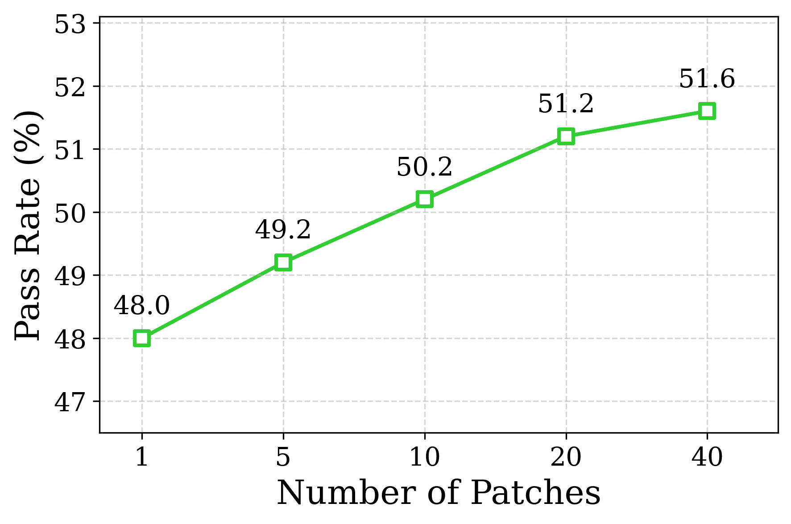

<figcaption>図10: SWE-bench Verified での創発的な並列スケーリングの結果。</figcaption>
</figure>

テスト時に実行を活用するセルフプレイの方法と比べて、並列スケーリング（Chen et al., 2025b; Pan et al., 2025）は、複数の独立したロールアウトを集約して追加の改善を得る、最近導入されたテスト時のスケーリングの方法である。先行研究は訓練を通じて並列スケーリングの能力を誘因づけるか、パッチの選択のために別の報酬モデルを訓練する（Pan et al., 2024; Jain et al., 2025）が、私たちは、特定の訓練なしに私たちのモデルで並列スケーリングの効果が創発することを観察した。

具体的には、BugFixer の並列のロールアウトからのパッチの候補を使い、モデルにそれらの違いを要約させ、新しいバグ修正のパッチを作らせる。Listing 11 は並列スケーリングのプロンプトのテンプレートである。テンプレートの中で、promblem_statement は GitHub のイシューで、trajs_content は複数のパッチの候補の内容を表す。

````text
We are currently solving the following issue within our repository. Here is the issue text:
--- BEGIN ISSUE ---
{problem_statement}
--- END ISSUE ---

Below are some thinking trajectories, each from llm reasoning model. Only one trajetory is right.
--- BEGIN FILE ---
```
{trajs_content}
```
--- END FILE ---

Please first summary and analyze the key differences between the trajectories, and then generate *SEARCH/REPLACE* edits to fix the issue.

Every *SEARCH/REPLACE* edit must use this format:
1. The file path
2. The start of search block: <<<<<<< SEARCH
3. A contiguous chunk of lines to search for in the existing source code
4. The dividing line: =======
5. The lines to replace into the source code
6. The end of the replace block: >>>>>>> REPLACE

Here is an example:

```python
### mathweb/flask/app.py
<<<<<<< SEARCH
from flask import Flask
=======
import math
from flask import Flask
>>>>>>> REPLACE
```

Please note that the *SEARCH/REPLACE* edit REQUIRES PROPER INDENTATION. If you would like to add the line '        print(x)', you must fully write that out, with all those spaces before the code!
Wrap the *SEARCH/REPLACE* edit in blocks ```python...```.
The summary of the key differences between the trajectories should be in the thinking part.
````

**Listing 11**: 並列スケーリングのためのプロンプトのテンプレート。

図 10 の結果は、プロンプト中のパッチの候補の数が増えるにつれて並列の集約の性能が改善することを示している。このスケーリングのパラダイムの多数決に対する利点は、複数の候補パッチを分析するモデル自身の能力を活用できることにあり、それによって、答えを単に出現頻度で重み付けする単純なアプローチを上回る。Listing 12 は、14 の異なる入力パッチの候補を含む完全なプロンプトの例である。

注: Listing 12 は長いので、Listing 13 に飛んでモデルの振る舞いを直接観察してもよい。

````text
We are currently solving the following issue within our repository. Here is the issue text:
--- BEGIN ISSUE ---
Data <@filename isn't relative to the YAML file
The [docs say](https://gabbi.readthedocs.io/en/latest/format.html#data):

> If the value is a string that begins with <@ then the rest of the string is treated as the name of a file to be loaded from the same directory as the YAML file.

But I haven't found it works like this unless I cd into the directory containing the yaml file.

`_load_data_file` says:
```python
path = os.path.join(self.test_directory, os.path.basename(filename))
```
this does a few things:
- makes the path begin with `self.test_directory` (defaults to `.`, the current working directory)
- disguards any folders in the <@ `filename` path
- appends `filename`

This means, if I'm in `/`, and I have a test that says `data: <@cake.jpg`, I cannot run my tests as advised in the docs:
`gabbi-run -- /my/test.yaml /my/other.yaml`

`FileNotFoundError: [Errno 2] No such file or directory: './cake.jpg'`

So in our test running script, we have to start with `cd tests/`.

My preference, would be to make the path relative to the location of the yaml file. That way, I can run my tests from whatever directory.

Obviously this isn't possible when redirecting with `<` as the filename is never seen by gabbi. So I'm happy is discuss other ideas.

---

Furthermore I can't keep my test data in a child directory, unless I cd into that directory like:
```shell
cd yaml_tests/test_data
gabbi-run -- ../test_things.yaml
```

So for that reason, I'd like to allow directories like `<@test_data/filename.txt` to be included in the path.

---

Happy to write the patch, if we come up with an approach here.
--- END ISSUE ---


Below are some thinking trajectories, each from llm reasoning model.

--- BEGIN FILE ---
```
(*@\textcolor{black}{\textbf{Answer 1:}}@*)
```python
### gabbi/runner.py
<<<<<<< SEARCH
import argparse
from importlib import import_module
import sys
import unittest
=======
import argparse
from importlib import import_module
import os
import sys
import unittest
>>>>>>> REPLACE
```
```python
### gabbi/runner.py
<<<<<<< SEARCH
def run_suite(handle, handler_objects, host, port, prefix, force_ssl=False,
              failfast=False):
    """Run the tests from the YAML in handle."""
    data = utils.load_yaml(handle)
    if force_ssl:
        if 'defaults' in data:
            data['defaults']['ssl'] = True
        else:
            data['defaults'] = {'ssl': True}

    loader = unittest.defaultTestLoader
    test_suite = suitemaker.test_suite_from_dict(
        loader, 'input', data, '.', host, port, None, None, prefix=prefix,
        handlers=handler_objects)

    result = ConciseTestRunner(
        verbosity=2, failfast=failfast).run(test_suite)
    return result.wasSuccessful()
=======
def run_suite(handle, handler_objects, host, port, prefix, force_ssl=False,
              failfast=False, test_directory='.'):
    """Run the tests from the YAML in handle."""
    data = utils.load_yaml(handle)
    if force_ssl:
        if 'defaults' in data:
            data['defaults']['ssl'] = True
        else:
            data['defaults'] = {'ssl': True}

    loader = unittest.defaultTestLoader
    test_suite = suitemaker.test_suite_from_dict(
        loader, 'input', data, test_directory, host, port, None, None,
        prefix=prefix, handlers=handler_objects)

    result = ConciseTestRunner(
        verbosity=2, failfast=failfast).run(test_suite)
    return result.wasSuccessful()
>>>>>>> REPLACE
```
```python
### gabbi/runner.py
<<<<<<< SEARCH
    else:
        for input_file in input_files:
            with open(input_file, 'r') as fh:
                success = run_suite(fh, handler_objects, host, port,
                                    prefix, force_ssl, failfast)
=======
    else:
        for input_file in input_files:
            test_directory = os.path.dirname(input_file) or '.'
            with open(input_file, 'r') as fh:
                success = run_suite(fh, handler_objects, host, port,
                                    prefix, force_ssl, failfast,
                                    test_directory=test_directory)
>>>>>>> REPLACE
```

(*@\textcolor{black}{\textbf{Answer 2:}}@*)
```python
### gabbi/runner.py
<<<<<<< SEARCH
def run_suite(handle, handler_objects, host, port, prefix, force_ssl=False,
              failfast=False):
=======
def run_suite(handle, handler_objects, host, port, prefix, force_ssl=False,
              failfast=False, test_directory='.'):
>>>>>>> REPLACE
```
```python
### gabbi/runner.py
<<<<<<< SEARCH
    test_suite = suitemaker.test_suite_from_dict(
        loader, 'input', data, '.', host, port, None, None, prefix=prefix,
        handlers=handler_objects)
=======
    test_suite = suitemaker.test_suite_from_dict(
        loader, 'input', data, test_directory, host, port, None, None, prefix=prefix,
        handlers=handler_objects)
>>>>>>> REPLACE
```
```python
### gabbi/runner.py
<<<<<<< SEARCH
                success = run_suite(fh, handler_objects, host, port,
                                    prefix, force_ssl, failfast)
=======
                test_directory = os.path.dirname(input_file) or '.'
                success = run_suite(fh, handler_objects, host, port,
                                    prefix, force_ssl, failfast, test_directory=test_directory)
>>>>>>> REPLACE
```

(*@\textcolor{black}{\textbf{Answer 3:}}@*)
```python
### gabbi/runner.py
<<<<<<< SEARCH
def run_suite(handle, handler_objects, host, port, prefix, force_ssl=False,
              failfast=False):
    """Run the tests from the YAML in handle."""
    data = utils.load_yaml(handle)
    if force_ssl:
        if 'defaults' in data:
            data['defaults']['ssl'] = True
        else:
            data['defaults'] = {'ssl': True}

    loader = unittest.defaultTestLoader
    test_suite = suitemaker.test_suite_from_dict(
        loader, 'input', data, '.', host, port, None, None, prefix=prefix,
        handlers=handler_objects)

    result = ConciseTestRunner(
        verbosity=2, failfast=failfast).run(test_suite)
    return result.wasSuccessful()
=======
def run_suite(handle, handler_objects, host, port, prefix, force_ssl=False,
              failfast=False, test_directory='.'):
    """Run the tests from the YAML in handle."""
    data = utils.load_yaml(handle)
    if force_ssl:
        if 'defaults' in data:
            data['defaults']['ssl'] = True
        else:
            data['defaults'] = {'ssl': True}

    loader = unittest.defaultTestLoader
    test_suite = suitemaker.test_suite_from_dict(
        loader, 'input', data, test_directory, host, port, None, None,
        prefix=prefix, handlers=handler_objects)

    result = ConciseTestRunner(
        verbosity=2, failfast=failfast).run(test_suite)
    return result.wasSuccessful()
>>>>>>> REPLACE
```
```python
### gabbi/runner.py
<<<<<<< SEARCH
        for input_file in input_files:
            with open(input_file, 'r') as fh:
                success = run_suite(fh, handler_objects, host, port,
                                    prefix, force_ssl, failfast)
            if not failure:  # once failed, this is considered immutable
                failure = not success
            if failure and failfast:
                break
=======
        for input_file in input_files:
            test_directory = os.path.dirname(input_file)
            with open(input_file, 'r') as fh:
                success = run_suite(
                    fh, handler_objects, host, port, prefix, force_ssl,
                    failfast, test_directory=test_directory)
            if not failure:  # once failed, this is considered immutable
                failure = not success
            if failure and failfast:
                break
>>>>>>> REPLACE
```

(*@\textcolor{black}{\textbf{Answer 4:}}@*)
```python
### gabbi/runner.py
<<<<<<< SEARCH
def run_suite(handle, handler_objects, host, port, prefix, force_ssl=False,
              failfast=False):
=======
def run_suite(handle, handler_objects, host, port, prefix, force_ssl=False,
              failfast=False, test_directory='.'):
>>>>>>> REPLACE
```
```python
### gabbi/runner.py
<<<<<<< SEARCH
    test_suite = suitemaker.test_suite_from_dict(
        loader, 'input', data, '.', host, port, None, None, prefix=prefix,
        handlers=handler_objects)
=======
    test_suite = suitemaker.test_suite_from_dict(
        loader, 'input', data, test_directory, host, port, None, None,
        prefix=prefix, handlers=handler_objects)
>>>>>>> REPLACE
```
```python
### gabbi/runner.py
<<<<<<< SEARCH
    for input_file in input_files:
        with open(input_file, 'r') as fh:
            success = run_suite(fh, handler_objects, host, port,
                                prefix, force_ssl, failfast)
=======
    for input_file in input_files:
        # Determine test directory based on input file's location
        test_directory = os.path.dirname(os.path.abspath(input_file)) or '.'
        with open(input_file, 'r') as fh:
            success = run_suite(fh, handler_objects, host, port,
                                prefix, force_ssl, failfast,
                                test_directory=test_directory)
>>>>>>> REPLACE
```

(*@\textcolor{black}{\textbf{Answer 5:}}@*)
```python
### gabbi/runner.py
<<<<<<< SEARCH
import sys
import unittest
=======
import os
import sys
import unittest
>>>>>>> REPLACE
```
```python
### gabbi/runner.py
<<<<<<< SEARCH
def run_suite(handle, handler_objects, host, port, prefix, force_ssl=False,
              failfast=False):
=======
def run_suite(handle, handler_objects, host, port, prefix, force_ssl=False,
              failfast=False, test_directory='.'):
>>>>>>> REPLACE
```
```python
### gabbi/runner.py
<<<<<<< SEARCH
    test_suite = suitemaker.test_suite_from_dict(
        loader, 'input', data, '.', host, port, None, None, prefix=prefix,
        handlers=handler_objects)
=======
    test_suite = suitemaker.test_suite_from_dict(
        loader, 'input', data, test_directory, host, port, None, None,
        prefix=prefix, handlers=handler_objects)
>>>>>>> REPLACE
```
```python
### gabbi/runner.py
<<<<<<< SEARCH
        for input_file in input_files:
            with open(input_file, 'r') as fh:
                success = run_suite(fh, handler_objects, host, port,
                                    prefix, force_ssl, failfast)
=======
        for input_file in input_files:
            test_directory = os.path.dirname(input_file) or '.'
            with open(input_file, 'r') as fh:
                success = run_suite(fh, handler_objects, host, port,
                                    prefix, force_ssl, failfast,
                                    test_directory=test_directory)
>>>>>>> REPLACE
```

(*@\textcolor{black}{\textbf{Answer 6:}}@*)
```python
### gabbi/driver.py
<<<<<<< SEARCH
        file_suite = suitemaker.test_suite_from_dict(
            loader, test_base_name, suite_dict, path, host, port,
            fixture_module, intercept, prefix=prefix,
            test_loader_name=test_loader_name, handlers=handler_objects,
            inner_fixtures=inner_fixtures)
=======
        test_file_dir = os.path.dirname(test_file)
        file_suite = suitemaker.test_suite_from_dict(
            loader, test_base_name, suite_dict, test_file_dir, host, port,
            fixture_module, intercept, prefix=prefix,
            test_loader_name=test_loader_name, handlers=handler_objects,
            inner_fixtures=inner_fixtures)
>>>>>>> REPLACE
```
```python
### gabbi/runner.py
<<<<<<< SEARCH
def run_suite(handle, handler_objects, host, port, prefix, force_ssl=False,
              failfast=False):
=======
def run_suite(handle, handler_objects, host, port, prefix, force_ssl=False,
              failfast=False, test_directory='.'):
>>>>>>> REPLACE
```
```python
### gabbi/runner.py
<<<<<<< SEARCH
    test_suite = suitemaker.test_suite_from_dict(
        loader, 'input', data, '.', host, port, None, None, prefix=prefix,
        handlers=handler_objects)
=======
    test_suite = suitemaker.test_suite_from_dict(
        loader, 'input', data, test_directory, host, port, None, None,
        prefix=prefix, handlers=handler_objects)
>>>>>>> REPLACE
```
```python
### gabbi/runner.py
<<<<<<< SEARCH
                success = run_suite(fh, handler_objects, host, port,
                                    prefix, force_ssl, failfast)
=======
                test_directory = os.path.dirname(input_file)
                success = run_suite(fh, handler_objects, host, port,
                                    prefix, force_ssl, failfast, test_directory)
>>>>>>> REPLACE
```

(*@\textcolor{black}{\textbf{Answer 7:}}@*)
```python
### gabbi/runner.py
<<<<<<< SEARCH
import argparse
from importlib import import_module
import sys
import unittest
=======
import argparse
from importlib import import_module
import os
import sys
import unittest
>>>>>>> REPLACE
```
```python
### gabbi/runner.py
<<<<<<< SEARCH
def run_suite(handle, handler_objects, host, port, prefix, force_ssl=False,
              failfast=False):
    """Run the tests from the YAML in handle."""
    data = utils.load_yaml(handle)
    if force_ssl:
        if 'defaults' in data:
            data['defaults']['ssl'] = True
        else:
            data['defaults'] = {'ssl': True}

    loader = unittest.defaultTestLoader
    test_suite = suitemaker.test_suite_from_dict(
        loader, 'input', data, '.', host, port, None, None, prefix=prefix,
        handlers=handler_objects)
=======
def run_suite(handle, handler_objects, host, port, prefix, force_ssl=False,
              failfast=False, test_directory='.'):
    """Run the tests from the YAML in handle."""
    data = utils.load_yaml(handle)
    if force_ssl:
        if 'defaults' in data:
            data['defaults']['ssl'] = True
        else:
            data['defaults'] = {'ssl': True}

    loader = unittest.defaultTestLoader
    test_suite = suitemaker.test_suite_from_dict(
        loader, 'input', data, test_directory, host, port, None, None,
        prefix=prefix, handlers=handler_objects)
>>>>>>> REPLACE
```
```python
### gabbi/runner.py
<<<<<<< SEARCH
            with open(input_file, 'r') as fh:
                success = run_suite(fh, handler_objects, host, port,
                                    prefix, force_ssl, failfast)
            if not failure:  # once failed, this is considered immutable
                failure = not success
            if failure and failfast:
                break
=======
            test_dir = os.path.dirname(os.path.abspath(input_file))
            with open(input_file, 'r') as fh:
                success = run_suite(fh, handler_objects, host, port,
                                    prefix, force_ssl, failfast, test_directory=test_dir)
            if not failure:  # once failed, this is considered immutable
                failure = not success
            if failure and failfast:
                break
>>>>>>> REPLACE
```

(*@\textcolor{black}{\textbf{Answer 8:}}@*)
```python
### gabbi/runner.py
<<<<<<< SEARCH
    data = utils.load_yaml(handle)
    if force_ssl:
        if 'defaults' in data:
            data['defaults']['ssl'] = True
        else:
            data['defaults'] = {'ssl': True}

    loader = unittest.defaultTestLoader
    test_suite = suitemaker.test_suite_from_dict(
        loader, 'input', data, '.', host, port, None, None, prefix=prefix,
        handlers=handler_objects)
=======
    data = utils.load_yaml(handle)
    if force_ssl:
        if 'defaults' in data:
            data['defaults']['ssl'] = True
        else:
            data['defaults'] = {'ssl': True}

    # Determine test directory based on input handle
    if hasattr(handle, 'name'):
        test_directory = os.path.dirname(os.path.abspath(handle.name))
    else:
        test_directory = '.'

    loader = unittest.defaultTestLoader
    test_suite = suitemaker.test_suite_from_dict(
        loader, 'input', data, test_directory, host, port, None, None,
        prefix=prefix, handlers=handler_objects)
>>>>>>> REPLACE
```

(*@\textcolor{black}{\textbf{Answer 9:}}@*)
```python
### gabbi/driver.py
<<<<<<< SEARCH
    for test_file in glob.iglob('%s/*.yaml' % path):
        if '_' in os.path.basename(test_file):
            warnings.warn(exception.GabbiSyntaxWarning(
                "'_' in test filename %s. This can break suite grouping."
                % test_file))
        if intercept:
            host = str(uuid.uuid4())
        suite_dict = utils.load_yaml(yaml_file=test_file)
        test_base_name = os.path.splitext(os.path.basename(test_file))[0]
        if all_test_base_name:
            test_base_name = '%s_%s' % (all_test_base_name, test_base_name)

        if require_ssl:
            if 'defaults' in suite_dict:
                suite_dict['defaults']['ssl'] = True
            else:
                suite_dict['defaults'] = {'ssl': True}

        file_suite = suitemaker.test_suite_from_dict(
            loader, test_base_name, suite_dict, path, host, port,
            fixture_module, intercept, prefix=prefix,
            test_loader_name=test_loader_name, handlers=handler_objects,
            inner_fixtures=inner_fixtures)
=======
    for test_file in glob.iglob('%s/*.yaml' % path):
        if '_' in os.path.basename(test_file):
            warnings.warn(exception.GabbiSyntaxWarning(
                "'_' in test filename %s. This can break suite grouping."
                % test_file))
        if intercept:
            host = str(uuid.uuid4())
        suite_dict = utils.load_yaml(yaml_file=test_file)
        test_base_name = os.path.splitext(os.path.basename(test_file))[0]
        if all_test_base_name:
            test_base_name = '%s_%s' % (all_test_base_name, test_base_name)

        if require_ssl:
            if 'defaults' in suite_dict:
                suite_dict['defaults']['ssl'] = True
            else:
                suite_dict['defaults'] = {'ssl': True}

        # Use absolute path of the YAML file's directory
        test_file_dir = os.path.dirname(os.path.abspath(test_file))
        file_suite = suitemaker.test_suite_from_dict(
            loader, test_base_name, suite_dict, test_file_dir, host, port,
            fixture_module, intercept, prefix=prefix,
            test_loader_name=test_loader_name, handlers=handler_objects,
            inner_fixtures=inner_fixtures)
>>>>>>> REPLACE
```

(*@\textcolor{black}{\textbf{Answer 10:}}@*)
```python
### gabbi/runner.py
<<<<<<< SEARCH
import argparse
from importlib import import_module
import sys
import unittest
=======
import argparse
from importlib import import_module
import os
import sys
import unittest
>>>>>>> REPLACE
```
```python
### gabbi/runner.py
<<<<<<< SEARCH
def run_suite(handle, handler_objects, host, port, prefix, force_ssl=False,
              failfast=False):
=======
def run_suite(handle, handler_objects, host, port, prefix, force_ssl=False,
              failfast=False, test_directory='.'):
>>>>>>> REPLACE
```
```python
### gabbi/runner.py
<<<<<<< SEARCH
    test_suite = suitemaker.test_suite_from_dict(
        loader, 'input', data, '.', host, port, None, None, prefix=prefix,
        force_ssl=force_ssl, failfast=failfast,
        handlers=handler_objects)
=======
    test_suite = suitemaker.test_suite_from_dict(
        loader, 'input', data, test_directory, host, port, None, None,
        prefix=prefix, force_ssl=force_ssl, failfast=failfast,
        handlers=handler_objects)
>>>>>>> REPLACE
```
```python
### gabbi/runner.py
<<<<<<< SEARCH
                success = run_suite(fh, handler_objects, host, port,
                                    prefix, force_ssl, failfast)
=======
                test_dir = os.path.dirname(input_file)
                success = run_suite(fh, handler_objects, host, port,
                                    prefix, force_ssl, failfast,
                                    test_directory=test_dir)
>>>>>>> REPLACE
```
```python
### gabbi/case.py
<<<<<<< SEARCH
    path = os.path.join(self.test_directory, os.path.basename(filename))
=======
    path = os.path.join(self.test_directory, filename)
>>>>>>> REPLACE
```

(*@\textcolor{black}{\textbf{Answer 11:}}@*)
```python
### gabbi/runner.py
<<<<<<< SEARCH
def run_suite(handle, handler_objects, host, port, prefix, force_ssl=False,
              failfast=False):
    """Run the tests from the YAML in handle."""
    data = utils.load_yaml(handle)
    if force_ssl:
        if 'defaults' in data:
            data['defaults']['ssl'] = True
        else:
            data['defaults'] = {'ssl': True}

    loader = unittest.defaultTestLoader
    test_suite = suitemaker.test_suite_from_dict(
        loader, 'input', data, '.', host, port, None, None, prefix=prefix,
        handlers=handler_objects)
=======
def run_suite(handle, handler_objects, host, port, prefix, force_ssl=False,
              failfast=False, test_directory='.'):
    """Run the tests from the YAML in handle."""
    data = utils.load_yaml(handle)
    if force_ssl:
        if 'defaults' in data:
            data['defaults']['ssl'] = True
        else:
            data['defaults'] = {'ssl': True}

    loader = unittest.defaultTestLoader
    test_suite = suitemaker.test_suite_from_dict(
        loader, 'input', data, test_directory, host, port,
        None, None, prefix=prefix, handlers=handler_objects)
>>>>>>> REPLACE
```
```python
### gabbi/runner.py
<<<<<<< SEARCH
                success = run_suite(fh, handler_objects, host, port,
                                    prefix, force_ssl, failfast)
=======
                test_dir = os.path.dirname(input_file)
                success = run_suite(fh, handler_objects, host, port,
                                    prefix, force_ssl, failfast,
                                    test_directory=test_dir)
>>>>>>> REPLACE
```

(*@\textcolor{black}{\textbf{Answer 12:}}@*)
```python
### gabbi/runner.py
<<<<<<< SEARCH
import argparse
from importlib import import_module
import sys
import unittest
=======
import argparse
from importlib import import_module
import os
import sys
import unittest
>>>>>>> REPLACE
```
```python
### gabbi/runner.py
<<<<<<< SEARCH
    else:
        for input_file in input_files:
            with open(input_file, 'r') as fh:
                success = run_suite(fh, handler_objects, host, port,
                                    prefix, force_ssl, failfast)
=======
    else:
        for input_file in input_files:
            test_dir = os.path.dirname(os.path.abspath(input_file))
            with open(input_file, 'r') as fh:
                success = run_suite(fh, handler_objects, host, port,
                                    prefix, force_ssl, failfast,
                                    test_directory=test_dir)
>>>>>>> REPLACE
```
```python
### gabbi/runner.py
<<<<<<< SEARCH
def run_suite(handle, handler_objects, host, port, prefix, force_ssl=False,
              failfast=False):
    """Run the tests from the YAML in handle."""
    data = utils.load_yaml(handle)
    if force_ssl:
        if 'defaults' in data:
            data['defaults']['ssl'] = True
        else:
            data['defaults'] = {'ssl': True}

    loader = unittest.defaultTestLoader
    test_suite = suitemaker.test_suite_from_dict(
        loader, 'input', data, '.', host, port, None, None, prefix=prefix,
        handlers=handler_objects)
=======
def run_suite(handle, handler_objects, host, port, prefix, force_ssl=False,
              failfast=False, test_directory='.'):
    """Run the tests from the YAML in handle."""
    data = utils.load_yaml(handle)
    if force_ssl:
        if 'defaults' in data:
            data['defaults']['ssl'] = True
        else:
            data['defaults'] = {'ssl': True}

    loader = unittest.defaultTestLoader
    test_suite = suitemaker.test_suite_from_dict(
        loader, 'input', data, test_directory, host, port, None, None,
        prefix=prefix, handlers=handler_objects)
>>>>>>> REPLACE
```

(*@\textcolor{black}{\textbf{Answer 13:}}@*)
```python
### gabbi/runner.py
<<<<<<< SEARCH
def run_suite(handle, handler_objects, host, port, prefix, force_ssl=False,
              failfast=False):
    """Run the tests from the YAML in handle."""
    data = utils.load_yaml(handle)
    if force_ssl:
        if 'defaults' in data:
            data['defaults']['ssl'] = True
        else:
            data['defaults'] = {'ssl': True}

    loader = unittest.defaultTestLoader
    test_suite = suitemaker.test_suite_from_dict(
        loader, 'input', data, '.', host, port, None, None, prefix=prefix,
        handlers=handler_objects)
=======
def run_suite(handle, handler_objects, host, port, prefix, force_ssl=False,
              failfast=False, test_directory='.'):
    """Run the tests from the YAML in handle."""
    data = utils.load_yaml(handle)
    if force_ssl:
        if 'defaults' in data:
            data['defaults']['ssl'] = True
        else:
            data['defaults'] = {'ssl': True}

    loader = unittest.defaultTestLoader
    test_suite = suitemaker.test_suite_from_dict(
        loader, 'input', data, test_directory, host, port, None, None,
        prefix=prefix, handlers=handler_objects)
>>>>>>> REPLACE
```
```python
### gabbi/runner.py
<<<<<<< SEARCH
        for input_file in input_files:
            with open(input_file, 'r') as fh:
                success = run_suite(fh, handler_objects, host, port,
                                    prefix, force_ssl, failfast)
=======
        for input_file in input_files:
            test_dir = os.path.dirname(os.path.abspath(input_file))
            with open(input_file, 'r') as fh:
                success = run_suite(fh, handler_objects, host, port,
                                    prefix, force_ssl, failfast,
                                    test_directory=test_dir)
>>>>>>> REPLACE
```

(*@\textcolor{black}{\textbf{Answer 14:}}@*)
```python
### gabbi/runner.py
<<<<<<< SEARCH
        for input_file in input_files:
            with open(input_file, 'r') as fh:
                success = run_suite(fh, handler_objects, host, port,
                                    prefix, force_ssl, failfast)
=======
        for input_file in input_files:
            with open(input_file, 'r') as fh:
                success = run_suite(input_file, fh, handler_objects, host, port,
                                    prefix, force_ssl, failfast)
>>>>>>> REPLACE
```
```python
### gabbi/runner.py
<<<<<<< SEARCH
def run_suite(handle, handler_objects, host, port, prefix, force_ssl=False,
              failfast=False):
    """Run the tests from the YAML in handle."""
    data = utils.load_yaml(handle)
    if force_ssl:
        if 'defaults' in data:
            data['defaults']['ssl'] = True
        else:
            data['defaults'] = {'ssl': True}

    loader = unittest.defaultTestLoader
    test_directory = '.'
    test_suite = suitemaker.test_suite_from_dict(
        loader, 'input', data, test_directory, host, port, None, None, prefix=prefix,
        handlers=handler_objects)
=======
def run_suite(input_file, handle, handler_objects, host, port, prefix, force_ssl=False,
              failfast=False):
    """Run the tests from the YAML in handle."""
    data = utils.load_yaml(handle)
    if force_ssl:
        if 'defaults' in data:
            data['defaults']['ssl'] = True
        else:
            data['defaults'] = {'ssl': True}

    loader = unittest.defaultTestLoader
    test_directory = os.path.dirname(input_file) if input_file else '.'
    test_suite = suitemaker.test_suite_from_dict(
        loader, 'input', data, test_directory, host, port, None, None, prefix=prefix,
        handlers=handler_objects)
>>>>>>> REPLACE
```
```python
### gabbi/runner.py
<<<<<<< SEARCH
    if not input_files:
        success = run_suite(sys.stdin, handler_objects, host, port,
                            prefix, force_ssl, failfast)
=======
    if not input_files:
        success = run_suite(None, sys.stdin, handler_objects, host, port,
                            prefix, force_ssl, failfast)
>>>>>>> REPLACE
```
```
--- END FILE ---

Please first summary and analyze the key differences between the trajectories, and then generate *SEARCH/REPLACE* edits to fix the issue.

Every *SEARCH/REPLACE* edit must use this format:
1. The file path
2. The start of search block: <<<<<<< SEARCH
3. A contiguous chunk of lines to search for in the existing source code
4. The dividing line: =======
5. The lines to replace into the source code
6. The end of the replace block: >>>>>>> REPLACE

Here is an example:

```python
### mathweb/flask/app.py
<<<<<<< SEARCH
from flask import Flask
=======
import math
from flask import Flask
>>>>>>> REPLACE
```

Please note that the *SEARCH/REPLACE* edit REQUIRES PROPER INDENTATION. If you would like to add the line '        print(x)', you must fully write that out, with all those spaces before the code!
Wrap the *SEARCH/REPLACE* edit in blocks ```python...```.
The summary of the key differences between the trajectories should be in the thinking part.
"
````

**Listing 12**: 創発的な並列スケーリングの例（SWE-bench-extra の cdent__gabbi-191）、プロンプトの入力の部分。

Listing 13 は、モデルが Listing 12 の中の正しい答えの候補をうまく認識し、追加の推論を伴う新しいパッチを生成してイシューを解く様子を示している。

````text
◁think▷
Okay, let's tackle this problem. The user is having an issue where when they specify a data file in their YAML test using the <@ syntax, the path isn't resolved relative to the YAML file's location. Instead, it's using the current working directory. They want the path to be relative to the YAML file so they can run tests from any directory.

First, I need to understand how the current code is handling the data file paths. The user mentioned that in _load_data_file, the code uses os.path.join(self.test_directory, os.path.basename(filename)). This takes the test_directory (which defaults to '.'), discards any directories in the filename, and appends the basename. That's why if the YAML is in /my/tests/test.yaml and the data is <@data.txt, it looks for ./data.txt instead of /my/tests/data.txt.

The key here is to make sure that the test_directory is set to the directory where the YAML file is located. Then, when joining with the filename (without basename), it would correctly resolve the relative path.

Looking at the provided code snippets, the main changes are in runner.py where the test_directory is determined. The user's proposed solutions involve modifying the run_suite function to accept a test_directory parameter, which is derived from the input file's directory.

In the original code, when running a suite from an input file, the test_directory is hardcoded to '.'. The various answers modify this by passing the directory of the input file as test_directory. For example, in Answer 10, they add the test_directory parameter to run_suite and set it to os.path.dirname(input_file). Then, in case.py, they change the path joining to use the filename directly instead of basename.

Wait, the critical part is in case.py's _load_data_file method. The original code uses os.path.basename(filename), which strips any directories from the filename. So if the YAML has <@test_data/file.txt, the basename is file.txt, and it's joined with test_directory. But if test_directory is the YAML's directory, then it should be YAML_DIR/test_data/file.txt. However, the current code would do test_directory + file.txt, which would be YAML_DIR/file.txt. That's incorrect. So the problem is that the code is taking the basename, thus ignoring any subdirectories in the filename.

Ah, so the fix here is to not take the basename. Instead, the filename after <@ should be treated as a relative path from the YAML's directory. So in case.py's _load_data_file, instead of using os.path.basename(filename), we should use the filename as-is. Then, os.path.join(self.test_directory, filename) would correctly resolve the path relative to the YAML's directory.

But wait, the filename could be an absolute path. For example, if the YAML has <@/absolute/path/file.txt, then os.path.join would just use the absolute path. However, the documentation says that the filename is relative to the YAML file. So absolute paths might not be intended. But the code should handle that.

So combining two changes: in runner.py, set test_directory to the YAML file's directory, and in case.py, stop using basename and use the full filename.

Looking at Answer 10, there's a change in case.py from os.path.basename(filename) to filename. That's exactly the fix needed. Then, in runner.py, when running the suite, pass the test_directory as the directory of the input file.

So the key files to modify are:

1. gabbi/runner.py: When calling run_suite, pass test_directory as the directory of the input file. This involves modifying the run_suite function to accept test_directory as a parameter and then passing it when the input file is processed.

2. gabbi/case.py: Change the path construction from using os.path.basename(filename) to using the filename directly. This allows subdirectories in the filename to be included in the path.

Looking through the provided code snippets, the one that does both is Answer 10. Let me check:

In Answer 10, the runner.py changes add the test_directory parameter and set it to os.path.dirname(input_file). Then, in case.py, the path is changed to os.path.join(self.test_directory, filename). That would correctly resolve the path relative to the YAML's directory, including any subdirectories in the filename.

But wait, the original code in case.py uses os.path.basename(filename). So changing that to filename means that if the input is 'test_data/file.txt', it's joined as test_directory/test_data/file.txt. If test_directory is the YAML's directory, that's correct.

(*@\textcolor{blue}{... [intermediate reasoning omitted for display brevity] ...}@*)

But perhaps better to use os.path.abspath and then dirname to handle relative paths correctly. But maybe the existing code already works. For example, if the input_file is 'tests/test.yaml', then os.path.dirname would return 'tests', which when joined with os.getcwd() would be correct. Wait, no. os.path.dirname just gives the directory part of the path. So if input_file is a relative path, like 'tests/test.yaml', then test_directory would be 'tests', and when os.path.join is called, it's relative to the current working directory. But the code in suitemaker.test_suite_from_dict might expect an absolute path. However, the original code uses '.' as the test_directory, which is relative. So perhaps using the directory of the input file as test_directory is sufficient.

Another thing to consider: when the YAML is loaded from stdin (like via redirect), the test_directory remains '.'. That's acceptable, as the documentation mentions that when using <, the filename isn't seen by Gabbi, so it's not possible to resolve the path relative to the YAML's original location. So in that case, the test_directory defaults to '.'.

Now, in case.py:

Original line:

path = os.path.join(self.test_directory, os.path.basename(filename))

Modified line:

path = os.path.join(self.test_directory, filename)

So the SEARCH/REPLACE block for case.py:

### gabbi/case.py
<<<<<<< SEARCH
    path = os.path.join(self.test_directory, os.path.basename(filename))
=======
    path = os.path.join(self.test_directory, filename)
>>>>>>> REPLACE

Putting all these together, the final edits are:

1. Add import os in runner.py.

2. Modify run_suite to accept test_directory and pass it to test_suite_from_dict.

3. In the loop over input_files, compute test_directory as the directory of input_file and pass it to run_suite.

4. Modify case.py's path construction.

So the final answer would include these four SEARCH/REPLACE blocks.
◁/think▷

```python
### gabbi/runner.py
<<<<<<< SEARCH
import argparse
from importlib import import_module
import sys
import unittest
=======
import argparse
from importlib import import_module
import os
import sys
import unittest
>>>>>>> REPLACE
```

```python
### gabbi/runner.py
<<<<<<< SEARCH
def run_suite(handle, handler_objects, host, port, prefix, force_ssl=False,
              failfast=False):
=======
def run_suite(handle, handler_objects, host, port, prefix, force_ssl=False,
              failfast=False, test_directory='.'):
>>>>>>> REPLACE
```

```python
### gabbi/runner.py
<<<<<<< SEARCH
    test_suite = suitemaker.test_suite_from_dict(
        loader, 'input', data, '.', host, port, None, None, prefix=prefix,
        handlers=handler_objects)
=======
    test_suite = suitemaker.test_suite_from_dict(
        loader, 'input', data, test_directory, host, port, None, None,
        prefix=prefix, handlers=handler_objects)
>>>>>>> REPLACE
```

```python
### gabbi/runner.py
<<<<<<< SEARCH
    else:
        for input_file in input_files:
            with open(input_file, 'r') as fh:
                success = run_suite(fh, handler_objects, host, port,
                                    prefix, force_ssl, failfast)
=======
    else:
        for input_file in input_files:
            test_directory = os.path.dirname(input_file) or '.'
            with open(input_file, 'r') as fh:
                success = run_suite(fh, handler_objects, host, port,
                                    prefix, force_ssl, failfast, test_directory=test_directory)
>>>>>>> REPLACE
```

```python
### gabbi/case.py
<<<<<<< SEARCH
    path = os.path.join(self.test_directory, os.path.basename(filename))
=======
    path = os.path.join(self.test_directory, filename)
>>>>>>> REPLACE
```

These changes:
1. Add `os` import needed for path handling
2. Modify run_suite to accept a test_directory parameter
3. Use the input file's directory as the test_directory when processing files
4. Update data file path resolution to preserve directory structure from YAML relative paths
5. Remove basename handling that was stripping directory information from data file paths

The net effect is that data files specified with `<@filename` in YAML tests will now be resolved relative to their YAML file's directory, supporting both flat and nested directory structures for test data. When tests are run from stdin (using `<`), the default directory remains the current working directory as before.
````

**Listing 13**: 創発的な並列スケーリングの例（SWE-bench-extra の cdent__gabbi-191）、モデルの応答の部分。

## Appendix G Analysis for SWE-Agents（SWE-Agent についての分析）

### G.1 Stage Annotation for SWE-Agent Trajectories（SWE-Agent の軌跡の段階のアノテーション）

この節では、軌跡のロールアウトの中の各相互作用のターンがどの SWE-Agent の段階に属するかを、最先端の LLM を使ってどうアノテーションするかを示す。4 節で SWE-Agent のプロンプトが示す 5 つの段階を簡単に紹介したが、より明確にするため、Listing 14 に抜粋を添付する。

````text
...
Follow these steps to resolve the issue:
1. As a first step, it might be a good idea to find and read code relevant to the <pr_description>
2. Create a script to reproduce the error and execute it with `python <filename.py>` using the bash tool, to confirm the error
3. Edit the source code of the repo to resolve the issue
4. Rerun your reproduce script and confirm that the error is fixed!
5. Think about edgecases and make sure your fix handles them as well
...
````

**Listing 14**: SWE-Agent のプロンプトにおける 5 段階の宣言の抜粋。

エージェントは作業の過程で 5 つの段階を柔軟に行き来しうることに注意すべきである。たとえば、エージェントがテストスクリプトを再実行する段階 4 のあと、誤った情報が残っている可能性があり、そのときエージェントは段階 3 に戻って反省とともにコードの修復を洗練する。同様の後戻りの振る舞いは段階 5 から段階 3 へも観察されうる。最初のコードの修復は、エージェントが段階 2 で作った最初のテストスクリプトのもとでは正しいと証明されたが、エージェントが段階 5 で提案した境界のテストケースで失敗する場合である。

BugFixer と反省のスキル事前分布をさらに分析するには、SWE-Agent の軌跡に沿った各ターンがどの段階に属するかを把握する必要がある。連続する段階の間には厳格な境界や特別なプロンプトの注記が設けられていないので、アノテーションには LLM を活用する。kimi-k2-0711-preview に設定したアノテーションのシステムプロンプトを Listing 15 に示す。

````text
You are a professional inspector that can analyze the provided agentic interaction trajectory.

The trajectory you are going to analyze is made by an agent that interacts with a computer to solve tasks. This agent has access to the following functions:

---- BEGIN FUNCTION #1: bash ----
Description: Execute a bash command in the terminal.

Parameters:
  (1) command (string, required): The bash command to execute. Can be empty to view additional logs when previous exit code is `-1`. Can be `ctrl+c` to interrupt the currently running process.
---- END FUNCTION #1 ----

---- BEGIN FUNCTION #2: submit ----
Description: Finish the interaction when the task is complete OR if the assistant cannot proceed further with the task.
No parameters are required for this function.
---- END FUNCTION #2 ----

---- BEGIN FUNCTION #3: str_replace_editor ----
Description: Custom editing tool for viewing, creating and editing files
* State is persistent across command calls and discussions with the user
* If `path` is a file, `view` displays the result of applying `cat -n`. If `path` is a directory, `view` lists non-hidden files and directories up to 2 levels deep
* The `create` command cannot be used if the specified `path` already exists as a file
* If a `command` generates a long output, it will be truncated and marked with `<response clipped>`
* The `undo_edit` command will revert the last edit made to the file at `path`

Notes for using the `str_replace` command:
* The `old_str` parameter should match EXACTLY one or more consecutive lines from the original file. Be mindful of whitespaces!
* If the `old_str` parameter is not unique in the file, the replacement will not be performed. Make sure to include enough context in `old_str` to make it unique
* The `new_str` parameter should contain the edited lines that should replace the `old_str`

Parameters:
  (1) command (string, required): The commands to run. Allowed options are: `view`, `create`, `str_replace`, `insert`, `undo_edit`.
Allowed values: [`view`, `create`, `str_replace`, `insert`, `undo_edit`]
  (2) path (string, required): Absolute path to file or directory, e.g. `/repo/file.py` or `/repo`.
  (3) file_text (string, optional): Required parameter of `create` command, with the content of the file to be created.
  (4) old_str (string, optional): Required parameter of `str_replace` command containing the string in `path` to replace.
  (5) new_str (string, optional): Optional parameter of `str_replace` command containing the new string (if not given, no string will be added). Required parameter of `insert` command containing the string to insert.
  (6) insert_line (integer, optional): Required parameter of `insert` command. The `new_str` will be inserted AFTER the line `insert_line` of `path`.
  (7) view_range (array, optional): Optional parameter of `view` command when `path` points to a file. If none is given, the full file is shown. If provided, the file will be shown in the indicated line number range, e.g. [11, 12] will show lines 11 and 12. Indexing at 1 to start. Setting `[start_line, -1]` shows all lines from `start_line` to the end of the file.
---- END FUNCTION #3 ----

The agent was instructed with the following:

* A python code repository has been uploaded in the directory /testbed.
* Implement the necessary changes to the repository so that the requirements specified in the <pr_description> are met.
* All changes to any of the test files described in the <pr_description> have already been taken care of. This means no need to modify the testing logic or any of the tests in any way.
* Make the minimal changes to non-tests files in the /testbed directory to ensure the <pr_description> is satisfied.

The agent was suggested to follow the following steps to resolve the issue:
1. As a first step, it might be a good idea to find and read code relevant to the <pr_description>
2. Create a script to reproduce the error and execute it with `python <filename.py>` using the bash tool, to confirm the error
3. Edit the source code of the repo to resolve the issue
4. Rerun your reproduce script and confirm that the error is fixed!
5. Think about edgecases and make sure your fix handles them as well
The agent was encouraged to think thoroughly, and it's fine if it's very long.

You are going to inspect this agent's interaction trajectory with a computer to solve the given task in the <pr_description>. One turn of interaction contains a pair of OBSERVATION and ACTION, where the OBSERVATION comes from the computer, and the ACTION is taken by the agent.

For each turn of interaction, determine which step (of the aforementioned five) this turn belongs to. Output a single number (1~5) ONLY in a separate line as your classification (DO NOT OUTPUT ANY OTHER WORDS THAN THE DIGIT).

You can think before make the inspection. When thinking, wrap your thought with <think> and </think>. Don't forget to output your final inspection after thinking.
````

**Listing 15**: SWE-Agent の段階のアノテーションのためのプロンプト。

軌跡をより明確に理解させるため、SWE-Agent のシステムプロンプトのツールの説明と指示の大部分をアノテーションのシステムプロンプトに組み込む。アノテーションは複数ラウンドのやり方で行い、エージェントの以前の行動と観測、および以前のターンの段階の分類を活用して、文脈の情報をよりよく利用する。アノテーションの $i$ 番目のラウンドでは、SWE-Agent の軌跡のターン $i$ の観測と行動の組を入力として追加し、アノテーターは対応する段階の分類を出力することが期待される。

### G.2 Comparative Study（比較研究）

上の節の自動の段階のアノテーションにもとづき、Agentless のもとでの Kimi-Dev と、SWE-Agent に適応させた Base、MT、SFT、RL の各事前分布について、sympy__sympy-20590 での性能を調べることで比較研究を示す。

sympy__sympy-20590 の問題文を Listing 16 に挙げる。

````text
Symbol instances have __dict__ since 1.7?
In version 1.6.2 Symbol instances had no `__dict__` attribute
```python
>>> sympy.Symbol('s').__dict__
------------------------------------------------------------------------
AttributeError Traceback (most recent call last)
<ipython-input-3-e2060d5eec73> in <module>
----> 1 sympy.Symbol('s').__dict__

AttributeError: 'Symbol' object has no attribute '__dict__'
>>> sympy.Symbol('s').__slots__
('name',)
```

This changes in 1.7 where `sympy.Symbol('s').__dict__` now exists (and returns an empty dict)
I may misinterpret this, but given the purpose of `__slots__`, I assume this is a bug, introduced because some parent class accidentally stopped defining `__slots__`.
````

**Listing 16**: sympy__sympy-20590 の問題文。

このイシューを解決する主な難しさは、問題の中で言及される「ある親クラス」を突き止めることにあると観察される。実際、元のイシューの下での開発者の議論を反映するこの問題のヒントのテキストは、イシューについてのはるかに深い調査を明らかにしている（Listing 17）。

````text
It seems that Basic now inherits `DefaultPrinting` which I guess doesn't have slots. I'm not sure if it's a good idea to add `__slots__` to that class as it would then affect all subclasses.

...

Using slots can break multiple inheritance but only if the slots are non-empty I guess. Maybe this means that any mixin should always declare empty slots or it won't work properly with subclasses that have slots...

I see that `EvalfMixin` has `__slots__ = ()`.
I guess we should add empty slots to DefaultPrinting then.
````

**Listing 17**: sympy__sympy-20590 のヒントのテキストの抜粋。

議論によれば、コードの修復が「DefaultPrinting に空の slots を加える」ことであるのは明らかで、それは自然にプリンタの実装に関係するファイル（sympy/core/_print_helpers.py。これは正解のパッチが更新するファイルでもある）への誘導につながる。しかし、テストセットの hints_text の情報は問題を解く過程で使うことが許されておらず、そのため推論者やエージェントは「`__slots__` の定義をやめた親クラス」を自律的に突き止めることを求められる。

まず Agentless のもとでの Kimi-Dev を調べる。40 回の実行のどれも、正しいファイルの位置の特定に成功しなかった。ほとんどの場合、更新は sympy/core/symbol.py に行われている。報告された問題は sympy.Symbol('s') によって引き起こされ、symbol.py は Symbol クラスの定義を含むはずなので、これはもっともらしい選択である。しかし、この推論の筋は正しい解から外れている。少数の実行は sympy/core/{basic.py, expr.py} のような別の位置の特定を試みるが、これらも誤っている。

Agentless のフレームワークの限界は、焦点を SWE-Agent の軌跡の検討に移すとより明白になる。SWE-Agent に適応させた Base、MT、SFT、RL のすべての事前分布について、得られた軌跡には常にテストを再現する段階（アノテーターが段階「2」と印づけたもの）が含まれ、生成されたスクリプトは次のようなものである。

````text
from sympy import Symbol

# Try to access __dict__ on a Symbol instance
s = Symbol('s')
print("Symbol.__slots__:", s.__slots__)
try:
    print("Symbol.__dict__:", s.__dict__)
except AttributeError as e:
    print("Error:", e)
````

**Listing 18**: sympy__sympy-20590 の SWE-Agent の軌跡の中の、段階 2 における再現スクリプトの例。

この形の再現スクリプトを生成するのは、問題文に記述されたケースを直接書き写すだけなので、エージェントにとって自明である。このスクリプトを実行すると、イシューが解決したかどうかについての曖昧さのないシグナルが得られる。属性 s.__dict__ はもはや存在すべきでなく、期待される Error: のメッセージが標準エラー出力に現れるべきである。実際、すべての軌跡で段階 3 が最初に完了した時点を観察すると、どのエージェントも最初の試みでは成功しなかったことが分かる。しかし、未完了の状態は、スクリプトが再実行されて s.__dict__ がまだ残っている段階 4 で一貫して露わになる。この進行は、エージェントが 1 回の試みに限られず、反復的な洗練の追加の機会を与えられる点で、Agentless のパラダイムに対する SWE-Agent のフレームワークの利点を浮き彫りにしている。

Base、MT、SFT の事前分布から適応させたエージェントの振る舞いの分析を続ける。イシューの難しさのため、エージェント的な推論を通じて誤りの位置を正しく特定するのは簡単ではない。相互作用は、エージェントがいくつかのファイルの候補の間を行き来したが、正しいものにたどり着けなかったことを示している。唯一の例外は RL の事前分布から適応させたエージェントで、正確なエージェント的推論を通じてこのインスタンスで唯一の成功を記録している。成功した軌跡の中で、最初の段階 3 の時点から段階 3 の再訪（最初のコードの修復を洗練する）までの途中の過程を、段階のアノテーターによるタグ付きで添付する。

````text
...

(*@\textcolor{black}{\textbf{OBSERVATION:}}@*)
Symbol.__slots__: ('name',)
Symbol.__dict__: {}

(*@\textcolor{black}{\textbf{ACTION:}}@*)
Hmm, it seems like the issue is still there. Let's check if there are any other classes in the hierarchy that might be missing `__slots__`:

<function=bash>
<parameter=command>python -c "from sympy import Symbol; s = Symbol('s'); for cls in type(s).__mro__: print(cls.__name__, 'has __slots__:', hasattr(cls, '__slots__'))"</parameter>
</function>

(*@\textcolor{black}{\textbf{OBSERVATION:}}@*)
File "<string>", line 1
    from sympy import Symbol; s = Symbol('s'); for cls in type(s).__mro__: print(cls.__name__, 'has __slots__:', hasattr(cls, '__slots__'))
                                               ^
SyntaxError: invalid syntax

(*@\textcolor{black}{\textbf{ACTION:}}@*)
Let's try a different approach:

<function=str_replace_editor>
<parameter=command>create</parameter>
<parameter=path>/testbed/check_slots.py</parameter>
<parameter=file_text>
from sympy import Symbol

s = Symbol('s')
for cls in type(s).__mro__:
    print(f"{cls.__name__:15} has __slots__: {hasattr(cls, '__slots__')}")
    if hasattr(cls, '__slots__'):
        print(f"{' '*16}__slots__ value: {cls.__slots__}")
</parameter>
</function>

(*@\textcolor{black}{\textbf{OBSERVATION:}}@*)
File created successfully at: /testbed/check_slots.py

(*@\textcolor{black}{\textbf{ACTION:}}@*)
<function=bash>
<parameter=command>python /testbed/check_slots.py</parameter>
</function>

(*@\textcolor{black}{\textbf{OBSERVATION:}}@*)
Symbol          has __slots__: True
                __slots__ value: ('name',)
AtomicExpr      has __slots__: True
                __slots__ value: ()
Atom            has __slots__: True
                __slots__ value: ()
Expr            has __slots__: True
                __slots__ value: ()
Boolean         has __slots__: True
                __slots__ value: ()
Basic           has __slots__: True
                __slots__ value: ('_mhash', '_args', '_assumptions')
Printable       has __slots__: False
EvalfMixin      has __slots__: True
                __slots__ value: ()
object          has __slots__: False

(*@\textcolor{black}{\textbf{ACTION:}}@*)
Now I see the issue! `Printable` doesn't have `__slots__` defined. Let's check the `Printable` class:

<function=str_replace_editor>
<parameter=command>view</parameter>
<parameter=path>/testbed/sympy/core/_print_helpers.py</parameter>
<parameter=view_range>[1, 30]</parameter>
</function>

(*@\textcolor{black}{\textbf{OBSERVATION:}}@*)
Here's the result of running `cat -n` on /testbed/sympy/core/_print_helpers.py:
     1	"""
     2	Base class to provide str and repr hooks that `init_printing` can overwrite.
     3	
     4	This is exposed publicly in the `printing.defaults` module,
     5	but cannot be defined there without causing circular imports.
     6	"""
     7	
     8	class Printable:
     9	    """
    10	    The default implementation of printing for SymPy classes.
    11	
    12	    This implements a hack that allows us to print elements of built-in
    13	    Python containers in a readable way. Natively Python uses ``repr()``
    14	    even if ``str()`` was explicitly requested. Mix in this trait into
    15	    a class to get proper default printing.
    16	
    17	    This also adds support for LaTeX printing in jupyter notebooks.
    18	    """
    19	
    20	    # Note, we always use the default ordering (lex) in __str__ and __repr__,
    21	    # regardless of the global setting. See issue 5487.
    22	    def __str__(self):
    23	        from sympy.printing.str import sstr
    24	        return sstr(self, order=None)
    25	
    26	    __repr__ = __str__
    27	
    28	    def _repr_disabled(self):
    29	        """
    30	        No-op repr function used to disable jupyter display hooks.

(*@\textcolor{black}{\textbf{ACTION:}}@*)
We need to add `__slots__ = ()` to the `Printable` class as well:

<function=str_replace_editor>
<parameter=command>str_replace</parameter>
<parameter=path>/testbed/sympy/core/_print_helpers.py</parameter>
<parameter=old_str>
class Printable:
    """
    The default implementation of printing for SymPy classes.

    This implements a hack that allows us to print elements of built-in
    Python containers in a readable way. Natively Python uses ``repr()``
    even if ``str()`` was explicitly requested. Mix in this trait into
    a class to get proper default printing.

    This also adds support for LaTeX printing in jupyter notebooks.
    """
</parameter>
<parameter=new_str>
class Printable:
    """
    The default implementation of printing for SymPy classes.

    This implements a hack that allows us to print elements of built-in
    Python containers in a readable way. Natively Python uses ``repr()``
    even if ``str()`` was explicitly requested. Mix in this trait into
    a class to get proper default printing.

    This also adds support for LaTeX printing in jupyter notebooks.
    """

    __slots__ = ()
</parameter>
</function>

...
````

**Listing 19**: sympy__sympy-20590 の成功した軌跡の、2 つの段階 3 の時点の間の途中の反省の過程。

Listing 19 は、クラス階層全体にわたって slots を確かめることによる高度な反省の能力を示しており、それが誤った Printable の観察にうまくつながっている。エージェントのその後の振る舞いには、テストの再実行の手順と、テストスクリプト（Listing 18）が通ることの観察が含まれる。この一連の行動は hints_text（Listing 17）の中の開発者の議論を再現し、それと呼応しており、RL の事前分布の反省のスキルが他の事前分布より優れていることを示している。

### G.3 Pattern Comparison between SFT with Expert Data and End-to-End RL（専門家データでの SFT とエンドツーエンドの RL のパターンの比較）

この節では、図 7 の定性的な研究として、(i) $1.5\times 2^{28}$ の SWE-Agent の専門家の SFT トークン（以下「重い SFT」と呼ぶ）と、(ii) $2^{21}$ の SWE-Agent の専門家の SFT トークン＋エンドツーエンドの SWE-Agent の RL（以下「軽い SFT ＋エンドツーエンドの RL」と呼ぶ）を経た RL の事前分布の、相互作用の軌跡のパターンを比べる。

両方の方法が解いたインスタンス matplotlib__matplotlib-13989 を事例研究として選ぶ。比較のため、2 つの相互作用の軌跡に沿った行動を添付する。

重い SFT のモデルの行動のパターンは Listing 20 のとおりである。

````text
(*@\textcolor{black}{\textbf{ACTION 0:}}@*)
I'll help you implement the necessary changes to fix the issue where `hist()` doesn't respect `range=...` when `density=True`. Let's follow the steps:

1. First, let's find and read the relevant code:

<function=bash>
<parameter=command>find /testbed -type f -name "*.py" | grep -v "test_"</parameter>
</function>

(*@\textcolor{black}{\textbf{ACTION 1:}}@*)
Let's look for the histogram implementation since that's what we need to fix. The PR mentions that the bug is in the `hist()` function when `density=True` and `range=...` is specified.

<function=bash>
<parameter=command>grep -r "def hist" --include="*.py" /testbed | grep -v "test_"</parameter>
</function>

(*@\textcolor{black}{\textbf{ACTION 2:}}@*)
The main histogram implementation appears to be in `/testbed/lib/matplotlib/axes/_axes.py`. Let's look at that file:

<function=str_replace_editor>
<parameter=command>view</parameter>
<parameter=path>/testbed/lib/matplotlib/axes/_axes.py</parameter>
</function>

(*@\textcolor{black}{\textbf{ACTION 3:}}@*)
Let me look at the histogram implementation specifically:

<function=str_replace_editor>
<parameter=command>view</parameter>
<parameter=path>/testbed/lib/matplotlib/axes/_axes.py</parameter>
<parameter=view_range>[6365, 6899]</parameter>
</function>

(*@\textcolor{black}{\textbf{ACTION 4:}}@*)
Let me also look at the `histogram_bin_edges` function since it's used in the code:

<function=str_replace_editor>
<parameter=command>view</parameter>
<parameter=path>/testbed/lib/matplotlib/axes/_axes.py</parameter>
<parameter=view_range>[40, 60]</parameter>
</function>

(*@\textcolor{black}{\textbf{ACTION 5:}}@*)
2. Let's create a script to reproduce the error:

<function=str_replace_editor>
<parameter=command>create</parameter>
<parameter=path>/testbed/reproduce.py</parameter>
...

(*@\textcolor{black}{\textbf{ACTION 6:}}@*)
Let's run it to confirm the issue:

<function=bash>
<parameter=command>python /testbed/reproduce.py</parameter>
</function>

(*@\textcolor{black}{\textbf{ACTION 7:}}@*)
The issue is confirmed: when `density=True` is specified, the `range=(0, 1)` parameter is not respected. The bins should start at 0 and end at 1, but they don't.

3. Let's fix the issue. Looking at the code, the problem is in the `hist` method and specifically around line 6689-6690:

```python
if density and not stacked:
    hist_kwargs = dict(density=density)
```

The issue is that when `density=True`, the `range` parameter gets lost because we're not including it in the `hist_kwargs`. Let's modify the code to fix this:

<function=str_replace_editor>
<parameter=command>str_replace</parameter>
<parameter=path>/testbed/lib/matplotlib/axes/_axes.py</parameter>
...

(*@\textcolor{black}{\textbf{ACTION 8:}}@*)
4. Let's run the reproduce script again to confirm the fix:

<function=bash>
<parameter=command>python /testbed/reproduce.py</parameter>
</function>

(*@\textcolor{black}{\textbf{ACTION 9:}}@*)
Great! The fix works. Now the bins start at 0 and end at 1 as expected.

5. Let's think about edge cases:

1. When `range=None` - This should use the min/max of the data, which is already handled correctly by the existing code
2. When `range` is specified but `density=False` - The range should be respected, which it already is
3. When `range` is specified and `density=True` - The range should be respected, which our fix now ensures
4. When `bins` is a sequence - The range should be ignored, which is already handled by the code
5. When `range` includes values outside the data range - The histogram should include empty bins for the range outside the data, which is already handled by numpy's histogram function

Let me test some of these edge cases to be sure:

<function=str_replace_editor>
<parameter=command>str_replace</parameter>
<parameter=path>/testbed/reproduce.py</parameter>
...

(*@\textcolor{black}{\textbf{ACTION 10:}}@*)
<function=bash>
<parameter=command>python /testbed/reproduce.py</parameter>
</function>

(*@\textcolor{black}{\textbf{ACTION 11:}}@*)
All test cases look good:

1. When `range=(0, 1)` and `density=True`, the bins start at 0 and end at 1
2. When `range=None` and `density=True`, the bins use the min/max of the data
3. When `range=(0, 1)` and `density=False`, the bins start at 0 and end at 1
4. When `bins` is a sequence, the range parameter is ignored and the sequence is used directly
5. When `range=(-0.5, 1.5)`, the bins start at -0.5 and end at 1.5

The fix looks good and handles all edge cases correctly. Let me submit the changes:

<function=submit>
</function>
````

**Listing 20**: matplotlib__matplotlib-13989 での、$1.5\times 2^{28}$ の SWE-Agent の SFT トークンを経た RL の事前分布による相互作用。

軽い SFT ＋エンドツーエンドの RL のモデルの行動のパターンは Listing 21 のとおりである。

````text
(*@\textcolor{black}{\textbf{ACTION 0:}}@*)
Understood. Let's tackle this problem step by step.

First, I need to find the relevant code in the /testbed directory. The user mentioned that the code is in /testbed, so I'll start by listing the files there.

<function=str_replace_editor>
<parameter=command>view</parameter>
<parameter=path>/testbed</parameter>
</function>

(*@\textcolor{black}{\textbf{ACTION 1:}}@*)
Hmm, the /testbed directory has a lot of files, but I need to focus on the code related to the hist function. The hist function is part of matplotlib.pyplot, so I should look for the pyplot module in the /testbed/lib/matplotlib directory.

<function=str_replace_editor>
<parameter=command>view</parameter>
<parameter=path>/testbed/lib/matplotlib/pyplot.py</parameter>
</function>

(*@\textcolor{black}{\textbf{ACTION 2:}}@*)
Okay, I'll look at the hist function in pyplot.py.

<function=str_replace_editor>
<parameter=command>view</parameter>
<parameter=path>/testbed/lib/matplotlib/pyplot.py</parameter>
<parameter=view_range>[2610, 2625]</parameter>
</function>

(*@\textcolor{black}{\textbf{ACTION 3:}}@*)
The hist function in pyplot.py simply calls the hist method of the current axes. So the actual implementation is in the Axes class.

I'll look for the Axes.hist method in the /testbed/lib/matplotlib/axes directory.

<function=str_replace_editor>
<parameter=command>view</parameter>
<parameter=path>/testbed/lib/matplotlib/axes</parameter>
</function>

(*@\textcolor{black}{\textbf{ACTION 4:}}@*)
The Axes.hist method is likely in _axes.py, which is where most of the plotting methods are defined.

<function=str_replace_editor>
<parameter=command>view</parameter>
<parameter=path>/testbed/lib/matplotlib/axes/_axes.py</parameter>
</function>

(*@\textcolor{black}{\textbf{ACTION 5:}}@*)
I'll look at the hist method in _axes.py.

<function=str_replace_editor>
<parameter=command>view</parameter>
<parameter=path>/testbed/lib/matplotlib/axes/_axes.py</parameter>
<parameter=view_range>[6365, 6400]</parameter>
</function>

(*@\textcolor{black}{\textbf{ACTION 6:}}@*)
I'll look at more of the hist method to see where the range is handled.

<function=str_replace_editor>
<parameter=command>view</parameter>
<parameter=path>/testbed/lib/matplotlib/axes/_axes.py</parameter>
<parameter=view_range>[6400, 6450]</parameter>
</function>

(*@\textcolor{black}{\textbf{ACTION 7:}}@*)
I'll look at the code where the bins are calculated.

<function=str_replace_editor>
<parameter=command>view</parameter>
<parameter=path>/testbed/lib/matplotlib/axes/_axes.py</parameter>
<parameter=view_range>[6450, 6500]</parameter>
</function>

(*@\textcolor{black}{\textbf{ACTION 8:}}@*)
I'll look at the code where the bins are calculated.

<function=str_replace_editor>
<parameter=command>view</parameter>
<parameter=path>/testbed/lib/matplotlib/axes/_axes.py</parameter>
<parameter=view_range>[6500, 6550]</parameter>
</function>

(*@\textcolor{black}{\textbf{ACTION 9:}}@*)
I'll look at the code where the bins are calculated.

<function=str_replace_editor>
<parameter=command>view</parameter>
<parameter=path>/testbed/lib/matplotlib/axes/_axes.py</parameter>
<parameter=view_range>[6550, 6600]</parameter>
</function>

(*@\textcolor{black}{\textbf{ACTION 10:}}@*)
I'll look at the code where the bins are calculated.

<function=str_replace_editor>
<parameter=command>view</parameter>
<parameter=path>/testbed/lib/matplotlib/axes/_axes.py</parameter>
<parameter=view_range>[6600, 6650]</parameter>
</function>

(*@\textcolor{black}{\textbf{ACTION 11:}}@*)
I'll look at the code where the bins are calculated.

<function=str_replace_editor>
<parameter=command>view</parameter>
<parameter=path>/testbed/lib/matplotlib/axes/_axes.py</parameter>
<parameter=view_range>[6650, 6700]</parameter>
</function>

(*@\textcolor{black}{\textbf{ACTION 12:}}@*)
Ah, here's the key part. The code calculates the bins using np.histogram, and if the range is specified, it's passed to histogram_bin_edges. But when density is True, the code may be overriding the range.

Wait, in the code:

if not input_empty and len(x) > 1:
    if weights is not None:
        _w = np.concatenate(w)
    else:
        _w = None

    bins = histogram_bin_edges(np.concatenate(x),
                               bins, bin_range, _w)
else:
    hist_kwargs['range'] = bin_range

But when density is True, the code may be using the default range of the data, not the specified range.

Wait, no. The code for calculating the bins is:

if bins is None:
    bins = rcParams['hist.bins']

if bin_range is not None:
    bin_range = self.convert_xunits(bin_range)

if bin_range is None:
    xmin = np.inf
    xmax = -np.inf
    for xi in x:
        if len(xi):
            xmin = min(xmin, np.nanmin(xi))
            xmax = max(xmax, np.nanmax(xi))
    if not np.isnan([xmin, xmax]).any() and not (xmin > xmax):
        bin_range = (xmin, xmax)

# If bins are not specified either explicitly or via range,
# we need to figure out the range required for all datasets,
# and supply that to np.histogram.
if not input_empty and len(x) > 1:
    if weights is not None:
        _w = np.concatenate(w)
    else:
        _w = None

    bins = histogram_bin_edges(np.concatenate(x),
                               bins, bin_range, _w)
else:
    hist_kwargs['range'] = bin_range

density = bool(density) or bool(normed)
if density and not stacked:
    hist_kwargs = dict(density=density)

# List to store all the top coordinates of the histograms
tops = []
mlast = None
# Loop through datasets
for i in range(nx):
    # this will automatically overwrite bins,
    # so that each histogram uses the same bins
    m, bins = np.histogram(x[i], bins, weights=w[i], **hist_kwargs)
    m = m.astype(float)  # causes problems later if it's an int
    if mlast is None:

But when density is True, the code passes density=True to np.histogram. However, when density is True, np.histogram normalizes the counts, but the bin edges are still determined by the range.

Wait, but the problem is that when density=True, the range is not respected. The user's code is:

_, bins, _ = plt.hist(np.random.rand(10), "auto", range=(0, 1), density=True)
print(bins)

and the output is:

[0.00331535 0.18930174 0.37528813 0.56127453 0.74726092 0.93324731]

which is not from 0 to 1. But when density=False, the range is respected.

This suggests that when density=True, the code is not using the specified range for the bins.

But why?

Let me look at the code again.

When the code calculates the bins:

if not input_empty and len(x) > 1:
    if weights is not None:
        _w = np.concatenate(w)
    else:
        _w = None

    bins = histogram_bin_edges(np.concatenate(x),
                               bins, bin_range, _w)
else:
    hist_kwargs['range'] = bin_range

But when len(x) is 1 (as in the user's code), the code enters the else clause and sets hist_kwargs['range'] = bin_range.

Then, in the loop:

for i in range(nx):
    m, bins = np.histogram(x[i], bins, weights=w[i], **hist_kwargs)

But wait, if bins is None, then np.histogram will use the range. But if bins is a string (like 'auto'), then np.histogram will calculate the bins based on the data and the range.

Wait, in the user's code, bins is 'auto' and range is (0, 1). When density=True, the code should calculate the bins based on the range (0, 1).

But in the code, when len(x) is 1, the code sets hist_kwargs['range'] = bin_range. Then, in the loop, the code calls np.histogram(x[i], bins, weights=w[i], **hist_kwargs).

But if bins is a string (like 'auto'), then np.histogram will calculate the bins based on the data and the range. So the range should be respected.

But in the user's code, the bins are not from 0 to 1. This suggests that the code is not passing the range to np.histogram when density=True.

But why?

This is puzzling. Let me try to reproduce the error.

I'll create a script in the /testbed directory.

<function=str_replace_editor>
<parameter=command>create</parameter>
<parameter=path>/testbed/reproduce_error.py</parameter>
...

(*@\textcolor{black}{\textbf{ACTION 13:}}@*)
I'll run the script.

<function=bash>
<parameter=command>python /testbed/reproduce_error.py</parameter>
</function>

(*@\textcolor{black}{\textbf{ACTION 14:}}@*)
Hmm, the output is not from 0 to 1. This confirms the error.

Now, I need to find where in the code the range is not being passed when density=True.

Let me look at the code again.

When len(x) is 1, the code sets hist_kwargs['range'] = bin_range. Then, in the loop:

for i in range(nx):
    m, bins = np.histogram(x[i], bins, weights=w[i], **hist_kwargs)

But if bins is a string (like 'auto'), then np.histogram will calculate the bins based on the data and the range. So the range should be respected.

But in the user's code, the bins are not from 0 to 1. This suggests that the code is not passing the range to np.histogram when density=True.

But why?

This is confusing. Let me look at the code for np.histogram.

The np.histogram function has a range parameter. If range is specified, the bin edges are calculated based on that range. If the data is outside the range, it is ignored.

In the user's code, the data is between 0 and 1, so the range (0, 1) should be respected.

But when density=True, the code is not respecting the range. This suggests that the code is not passing the range to np.histogram when density=True.

But why?

This is puzzling. Let me try to modify the code in _axes.py.

I'll look for the line where hist_kwargs is set.

In the code:

density = bool(density) or bool(normed)
if density and not stacked:
    hist_kwargs = dict(density=density)

This line is overwriting hist_kwargs, which may include the range.

Ah, here's the problem. If density is True and stacked is False, the code sets hist_kwargs to dict(density=density), which overwrites any previous hist_kwargs, including the range.

This is the root of the problem. The code is overwriting hist_kwargs, which includes the range, when density is True and stacked is False.

So, in the code:

density = bool(density) or bool(normed)
if density and not stacked:
    hist_kwargs = dict(density=density)

This line is overwriting hist_kwargs, which may include the range. So the range is not passed to np.histogram.

This is the cause of the problem. The solution is to add the range to hist_kwargs in this case.

So, the code should be:

density = bool(density) or bool(normed)
if density and not stacked:
    hist_kwargs.setdefault('density', density)

But wait, hist_kwargs may already have the range. So, the code should not overwrite hist_kwargs, but add to it.

The code is:

density = bool(density) or bool(normed)
if density and not stacked:
    hist_kwargs = dict(density=density)

This line is overwriting hist_kwargs, which may include the range. So the range is lost.

The solution is to modify this code to add to hist_kwargs, not overwrite it.

So, the code should be:

density = bool(density) or bool(normed)
if density and not stacked:
    hist_kwargs.setdefault('density', density)

But wait, hist_kwargs may not exist. Let me look at the code.

The code for hist_kwargs is:

hist_kwargs = dict()

# if the bin_range is not given, compute without nan numpy
# does not do this for us when guessing the range (but will
# happily ignore nans when computing the histogram).
if bin_range is None:
    xmin = np.inf
    xmax = -np.inf
    for xi in x:
        if len(xi):
            xmin = min(xmin, np.nanmin(xi))
            xmax = max(xmax, np.nanmax(xi))
    # make sure we have seen at least one non-nan and finite
    # value before we reset the bin range
    if not np.isnan([xmin, xmax]).any() and not (xmin > xmax):
        bin_range = (xmin, xmax)

# If bins are not specified either explicitly or via range,
# we need to figure out the range required for all datasets,
# and supply that to np.histogram.
if not input_empty and len(x) > 1:
    if weights is not None:
        _w = np.concatenate(w)
    else:
        _w = None

    bins = histogram_bin_edges(np.concatenate(x),
                               bins, bin_range, _w)
else:
    hist_kwargs['range'] = bin_range

density = bool(density) or bool(normed)
if density and not stacked:
    hist_kwargs = dict(density=density)

# List to store all the top coordinates of the histograms
tops = []
mlast = None
# Loop through datasets
for i in range(nx):
    # this will automatically overwrite bins,
    # so that each histogram uses the same bins
    m, bins = np.histogram(x[i], bins, weights=w[i], **hist_kwargs)
    m = m.astype(float)  # causes problems later if it's an int
    if mlast is None:

Ah, here's the problem. The code sets hist_kwargs = dict(density=density), which overwrites any previous hist_kwargs, including the range.

So, if density is True and stacked is False, the code overwrites hist_kwargs with dict(density=density), which does not include the range. So the range is not passed to np.histogram.

This is the cause of the problem. The solution is to modify this code to add to hist_kwargs, not overwrite it.

So, the code should be:

density = bool(density) or bool(normed)
if density and not stacked:
    hist_kwargs.setdefault('density', density)

But hist_kwargs may not exist. Wait, hist_kwargs is initialized as:

hist_kwargs = dict()

So, the code can be:

density = bool(density) or bool(normed)
if density and not stacked:
    hist_kwargs['density'] = density

This way, hist_kwargs includes the density and the range.

This would fix the problem. Let me test this.

I'll modify the code in _axes.py.

<function=str_replace_editor>
<parameter=command>str_replace</parameter>
<parameter=path>/testbed/lib/matplotlib/axes/_axes.py</parameter>
...

(*@\textcolor{black}{\textbf{ACTION 14:}}@*)
I'll run the reproduce_error.py script again.

<function=bash>
<parameter=command>python /testbed/reproduce_error.py</parameter>
</function>

(*@\textcolor{black}{\textbf{ACTION 15:}}@*)
Great, the fix works. The bins are now from 0 to 1.

Now, I can submit the changes.

<function=submit>
</function>
````

**Listing 21**: matplotlib__matplotlib-13989 での、$2^{21}$ の SWE-Agent の SFT トークンとエンドツーエンドの SWE-Agent の RL を経た RL の事前分布による相互作用。

2 種類のパターンが互いに大きく異なることが分かる。

- 重い SFT のモデルのパターンはより規則立って見え、途中の推論の過程に沿ってステップ 1 から 5 が明示的にラベル付けされている。推論の内容も概して短い。これは、プロプライエタリなモデルからの重い SFT のデータによって形づくられたモデルの振る舞いを反映している。
- 対照的に、軽い SFT ＋エンドツーエンドの RL のモデルのパターンははるかに規則立っていない。リポジトリの探索により多くの相互作用のターンが費やされ、行動が行われる前のコード編集のステップで、はるかに多くのトークンが生成される。これはエンドツーエンドの RL によって形づくられた（そして専門家のデータの影響をより受けていない）反省の振る舞いであり、推論を多く要するスキル事前分布の兆候がエージェント的なシナリオでも保たれていることを示している。

### G.4 Generalization to Other Tasks（他のタスクへの汎化）

この節では、Agentless の訓練と SWE-Smith の軌跡による SWE-Agent への適応によって誘因づけられたスキルが、他の SWE タスクへ転移しうるかを調べる。SWE-bench-live と SWE-bench Multilingual をテストベッドとして使う。

SWE-bench-live（Zhang et al., 2025）は、現実世界のイシューの解決のためのベンチマークで、ソフトウェアエンジニアリングのタスクで AI システムを評価する。自動化したキュレーションのパイプラインを使い、新鮮なタスクと厳密で汚染のない評価を確保するため毎月更新される。実験では、2024 年 10 月から 2025 年 3 月の間に集められたデータの、既定の 300 タスクのセットを選んだ。SWE-bench Verified と比べて、SWE-bench-live はより高い程度の分布のずれを示す。

SWE-bench Multilingual（Yang et al., 2025c）は、Rust、Java、PHP、Ruby、JavaScript/TypeScript、Go、C/C++ を含む 9 つのプログラミング言語にわたる 42 の GitHub リポジトリから、キュレーションした 300 のタスクを導入する。ウェブフレームワーク、データのツール、中核のユーティリティ、ライブラリのような領域を扱う。Python だけに焦点を当てる SWE-bench Verified と比べて、SWE-bench Multilingual はより大きな言語と領域の多様性を示し、言語をまたいだ汎化とソフトウェアエンジニアリングの能力の転移可能性に追加の課題を課す。

以前の実験と同様に、4 つのモデルの段階を事前分布として評価した。元の Qwen2.5-72B（Base）、中間訓練したモデル（MT）、推論データで教師ありファインチューニングによって活性化したモデル（SFT）、RL の訓練後のモデル（RL）である。各事前分布のエージェント的な能力を活性化するには、引き続きオープンソースの SWE-smith の軌跡を使う。

図 11 と 12 は、適応のためのエージェント的な軌跡の量を変えたとき（1 ステップの勾配降下としての $2^{21}$、100、2,000、5,016 本の訓練軌跡としての $2^{23}$、$1.1\times 2^{27}$、$1.5\times 2^{28}$）の、SWE-bench-Live と SWE-bench Multilingual での 4 つの事前分布の性能を示す。各 SWE-Agent への適応の実験は軽量な教師ありファインチューニングによって行い、その訓練時間は数分から最大 2 時間である。

Base の事前分布と比べて、Agentless のスキルで特に強化されたもの（SFT と RL）は、特にデータが乏しい設定で、より強いタスクの汎化を示す。しかし、適応により多くの SWE-Smith の軌跡を使うと、Base と MT の事前分布の性能は SFT と RL の事前分布のものに近づく。これは、異なる SWE タスクの間の隔たりに起因するかもしれない。より強い分布外かつタスクに依存しない汎化を可能にするレシピの探索は今後の課題とする。

<figure>

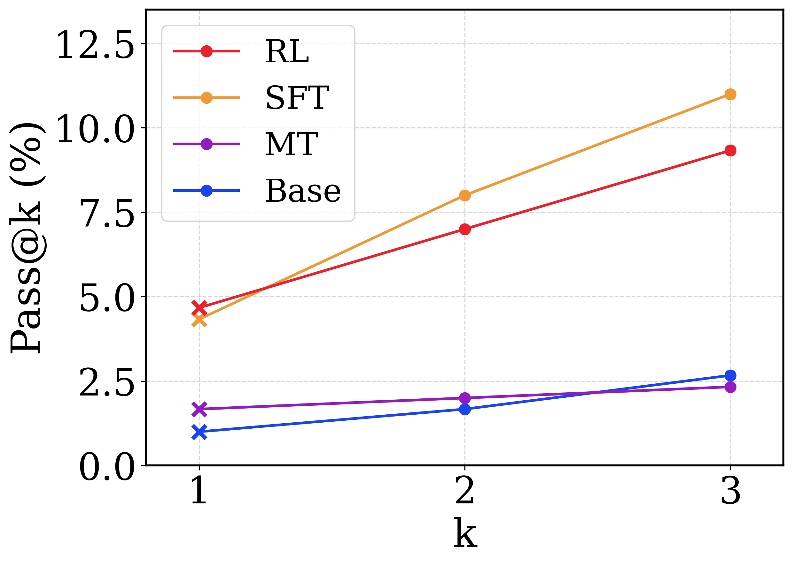

<figcaption>図11 (a): #SFT = 2²¹。</figcaption>
</figure>

<figure>

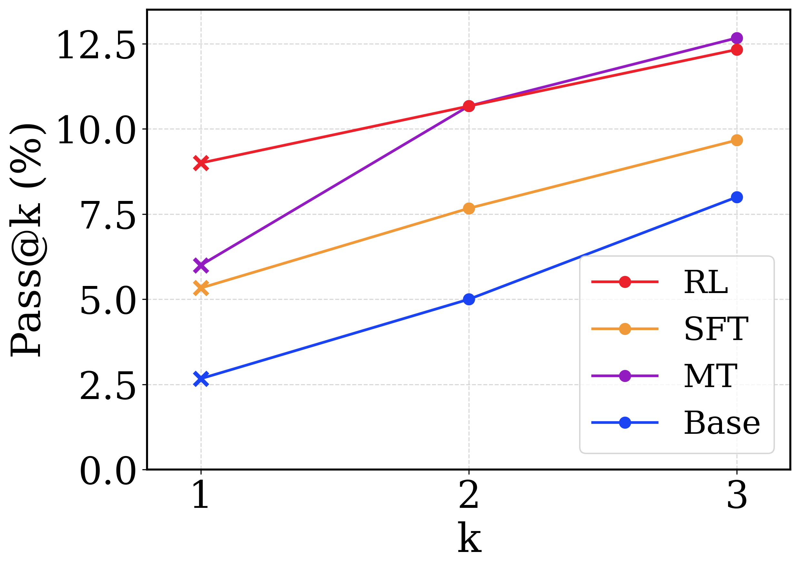

<figcaption>図11 (b): #SFT = 2²³。</figcaption>
</figure>

<figure>

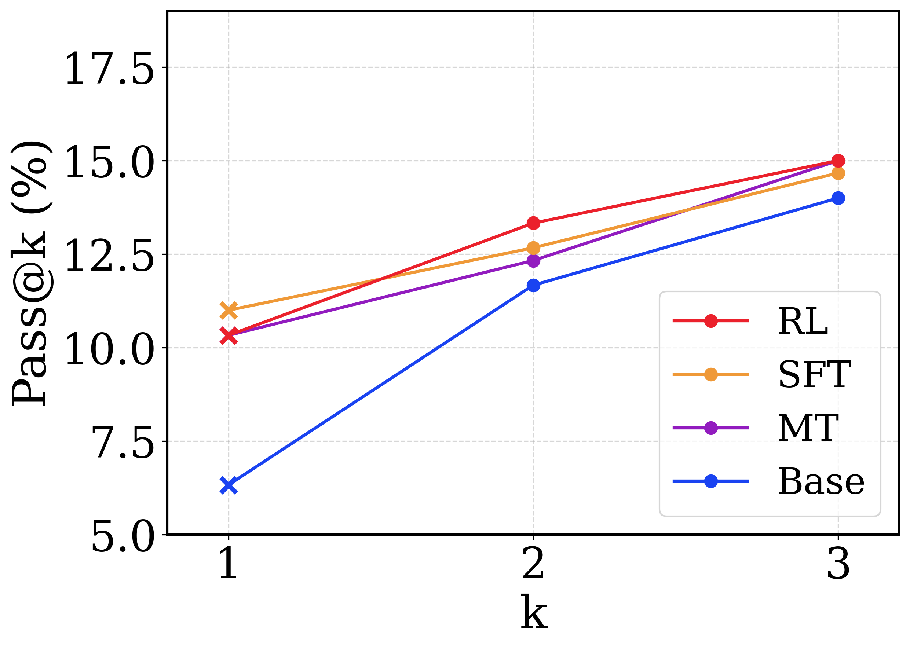

<figcaption>図11 (c): #SFT = 1.1×2²⁷。</figcaption>
</figure>

<figure>

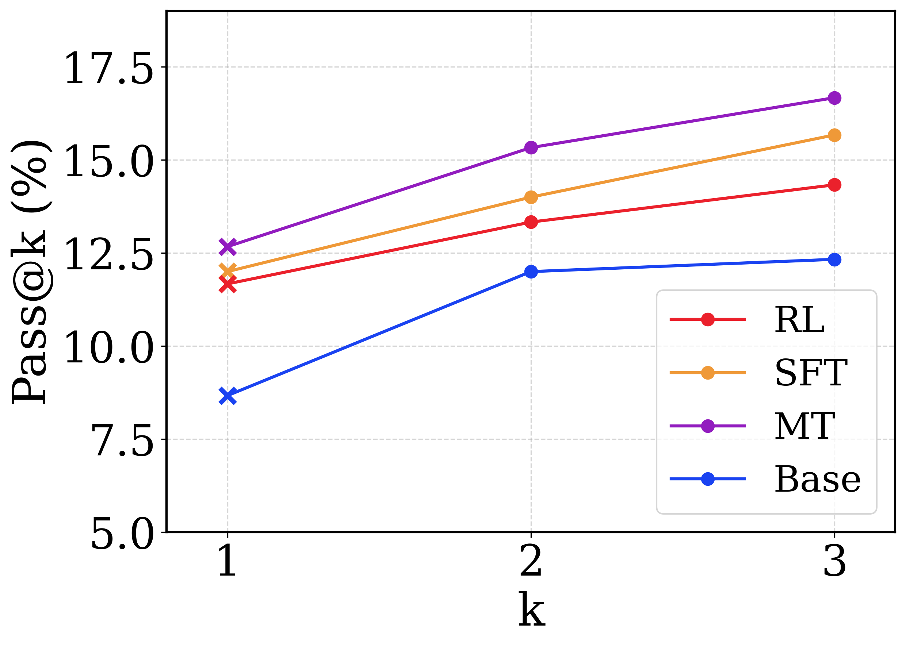

<figcaption>図11 (d): #SFT = 1.5×2²⁸。図11: SWE-bench-Live での汎化の分析。</figcaption>
</figure>

<figure>

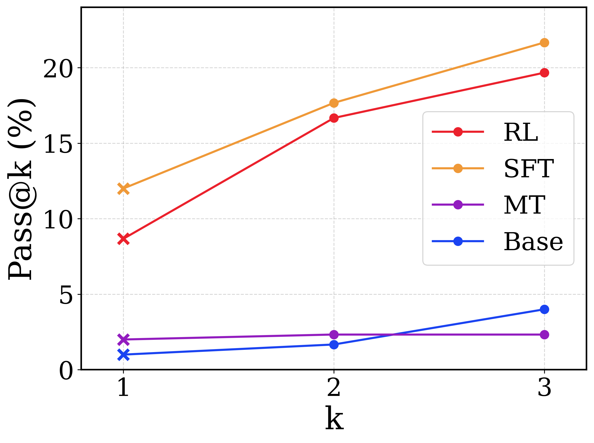

<figcaption>図12 (a): #SFT = 2²¹。</figcaption>
</figure>

<figure>

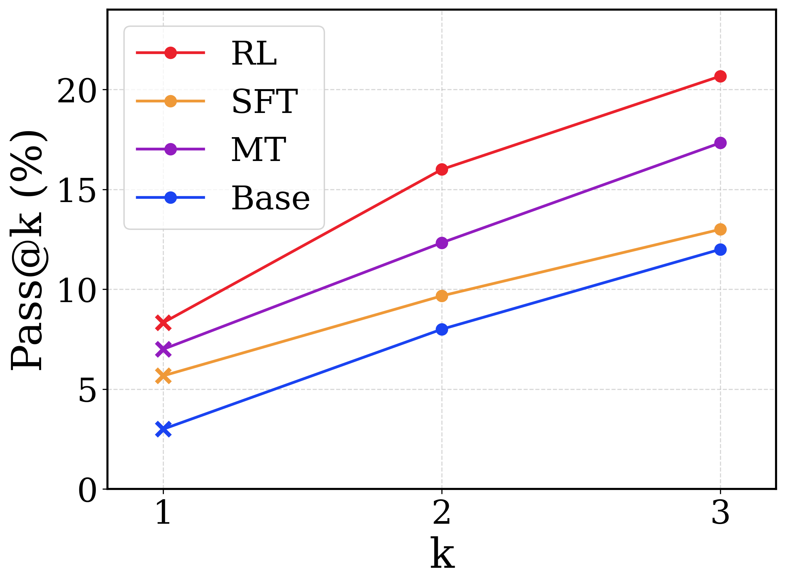

<figcaption>図12 (b): #SFT = 2²³。</figcaption>
</figure>

<figure>

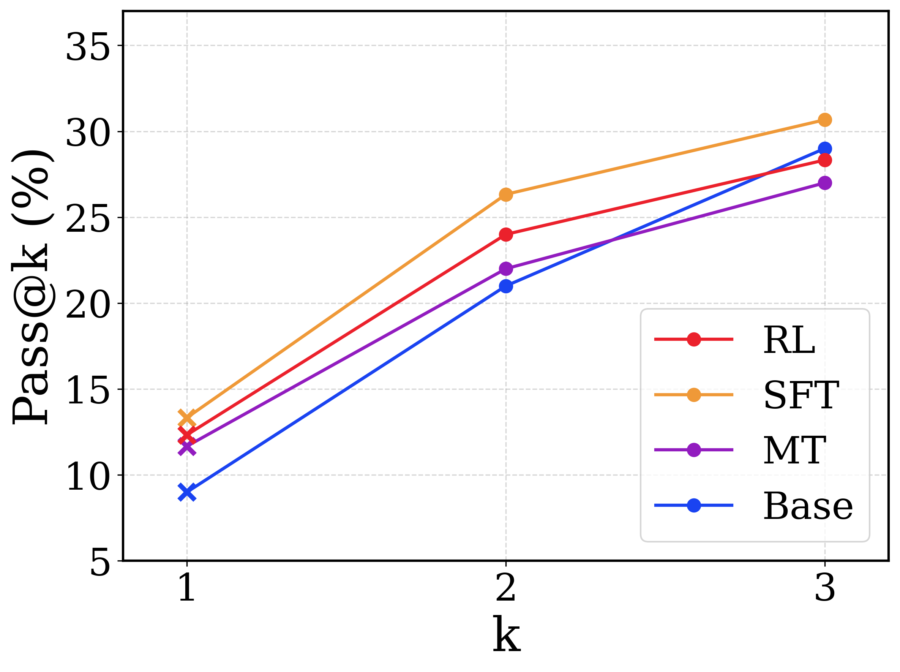

<figcaption>図12 (c): #SFT = 1.1×2²⁷。</figcaption>
</figure>

<figure>

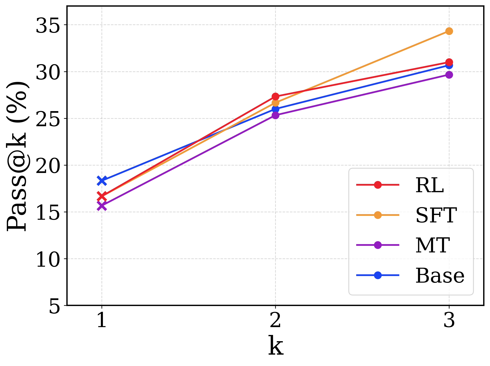

<figcaption>図12 (d): #SFT = 1.5×2²⁸。図12: SWE-bench Multilingual での汎化の分析。</figcaption>
</figure>

## Appendix H Use of Large Language Models（大規模言語モデルの使用）

本論文の最初の草稿は、すべて著者らが書いた。大規模言語モデル（gpt-5）は、言語の推敲（例: 文法と明瞭さ）を助けるためだけに使った。概念上の貢献、実験の設計、分析、結論はすべて著者らの成果である。
