# R2E-Gym: オープンウェイトの SWE エージェントをスケールさせるための手続き的な環境とハイブリッド検証器

> 原題: R2E-Gym: Procedural Environments and Hybrid Verifiers for Scaling Open-Weights SWE Agents
> 著者: Naman Jain¹⋆, Jaskirat Singh²⋆, Manish Shetty¹, Liang Zheng², Koushik Sen¹, Ion Stoica¹（¹UC Berkeley, ²Australian National University。⋆ 同等の貢献）
> 出典: arXiv:2504.07164 v1（2025-04-09）。プロジェクトページ: https://r2e-gym.github.io

> 訳注（底本と復元）: `raw/` のクリップ（ar5iv 経由）には、図 1 の (b)(c) と図 1 のキャプション、表 1（データセット統計）の本体、表 2 のキャプション（円グラフの画像に表 1 のキャプションが結びついていた）、図 3（思考の有無と実／合成の比較表）、図 4・図 5・図 6・図 14 の 2 枚目以降の画像、図 16 の (b)〜(f)、脚注 2〜5 と † の本文が欠けていた。また付録のコード（Listing）は 1 行ごとに分断され、Listing 5（イシュー生成のテンプレート）の冒頭行と Listing 7 のタイトル行が落ちていた。arXiv の HTML 版 v1（arxiv.org/html/2504.07164v1、版は v1 のみ）を取得して底本にし、本文・表・脚注・図 23 枚をすべて復元した。Listing は HTML に埋め込まれた base64 のソースから復元した。図 10〜12 は HTML 上で SVG の箱図なので、箱の中の文字をテキストで起こした。参考文献と謝辞は訳していない。
>
> 訳注（原典内の番号の食い違い）: 本文の参照番号と実際の図表番号が一部食い違っている。本文の「Table 2 はデータセットの統計」は表 1 を、「Figure 3（学習サンプル数とのスケーリング）」は図 2 を、「Table 3 の 34.2% 対 30.4%」は図 3 の表（34.4 対 30.4）を、4.4 節の「Figure 5 (right)」（アブレーション）は図 8 を指すと読める。また図 8 の棒グラフの値（実行なし 42.7%、実行ベース 43.8%）と本文（42.8%、43.7%）、付録 B の「R2E-Gym-lite・4538」と本文の「R2E-Gym-Subset・4578」も食い違っている。訳文は原典の記載どおりに訳した。

## Abstract（要旨）

実世界の Swe タスク（GitHub のイシューの解決）でオープンソースのモデルを改善するには、2 つの重要な課題がある。1) これらのモデルを訓練するための実行環境をスケーラブルに収集すること、2) テスト時計算（test-time compute）を最適にスケールさせること、である。
我々は、実世界の Swe エージェントを訓練するための、手続き的に収集された実行可能な gym 環境として最大の R2E-Gym を導入する。これは $8.1$ K を超えるタスクからなる。
R2E-Gym は 2 つの主要な貢献に支えられている。1) SweGen: コミットから直接、テスト生成と逆翻訳（back-translation）を用いて実行可能な環境をスケーラブルに収集できる合成データ収集のレシピであり、人間が書いたイシューやユニットテストへの依存を減らす。
これにより、よりスケーラブルな訓練が可能になり、我々の 32B モデルで SWEBench-Verified ベンチマークの Pass@1 が 34.4% に達することを示す。
2) ハイブリッドなテスト時スケーリング: 次に、テスト時スケーリングの 2 つの軸、すなわち実行ベース（execution-based）と実行なし（execution-free）の検証器について詳細な分析を行い、両者が相補的な強みと限界を持つことを示す。
テストベースの検証器は判別性（distinguishability）が低いという問題を抱え、一方で実行なしの検証器は偏りがあり、しばしば文体的な特徴に頼る。
驚くべきことに、それぞれの手法は単独では 42〜43% 付近で飽和するが、両者の相補的な強みを活用すると、はるかに大きな利得が得られることが分かった。
全体として、我々の手法は SWEBench-Verified ベンチマークで 51% を達成し、オープンウェイトの Swe エージェントとしての新たな最高性能（state-of-the-art）となり、o1 やツール付きの sonnet のようなプロプライエタリなシステムと初めて肩を並べた。

## 1 Introduction（はじめに）

GitHub のイシューのような実世界のソフトウェア工学の問題を解くことを目指す自律的なソフトウェア工学（Swe）は、近年大きく進歩してきた（Wang et al., 2024; Yang et al., 2024b）。
LLM ベースの Swe エージェントは目覚ましい改善を示してきたが、最高性能は主にプロプライエタリなモデルによってもたらされており（Anthropic, 2025; Jaech et al., 2024）、オープンなモデルは遅れをとっている（Xie et al., 2025）。

<figure>

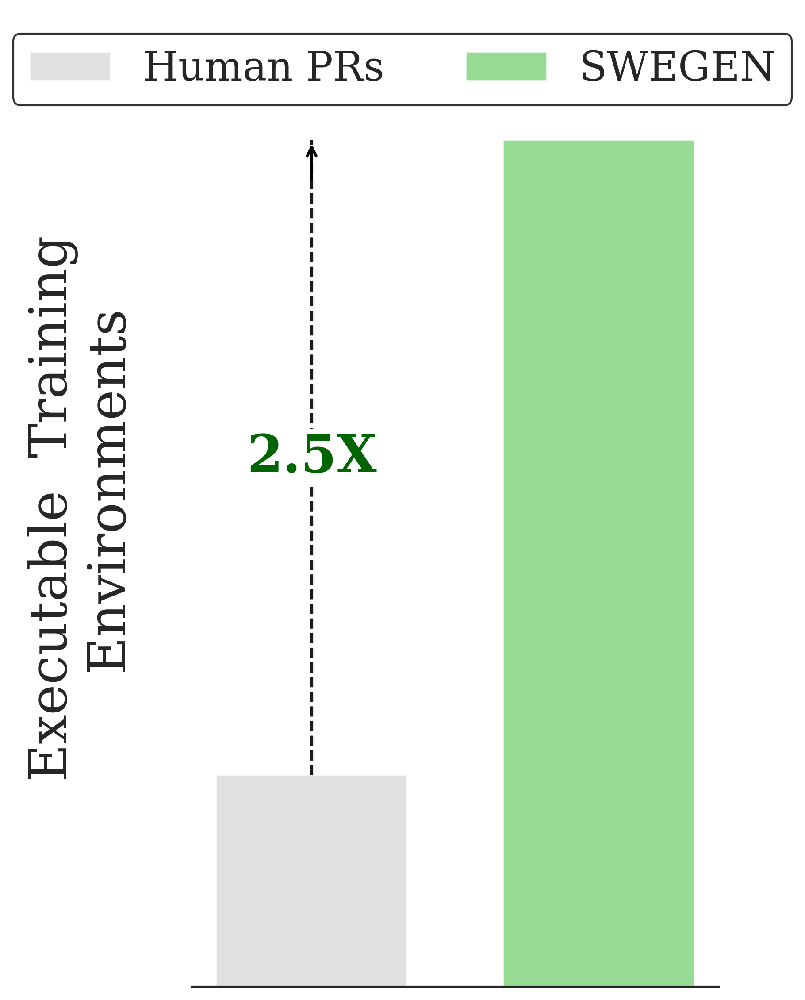

<figcaption>(a) 合成データ</figcaption>
</figure>

<figure>

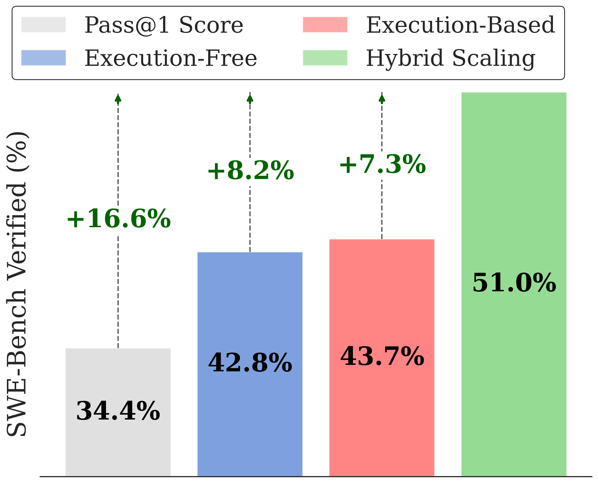

<figcaption>(b) ハイブリッドなテスト時スケーリング</figcaption>
</figure>

<figure>

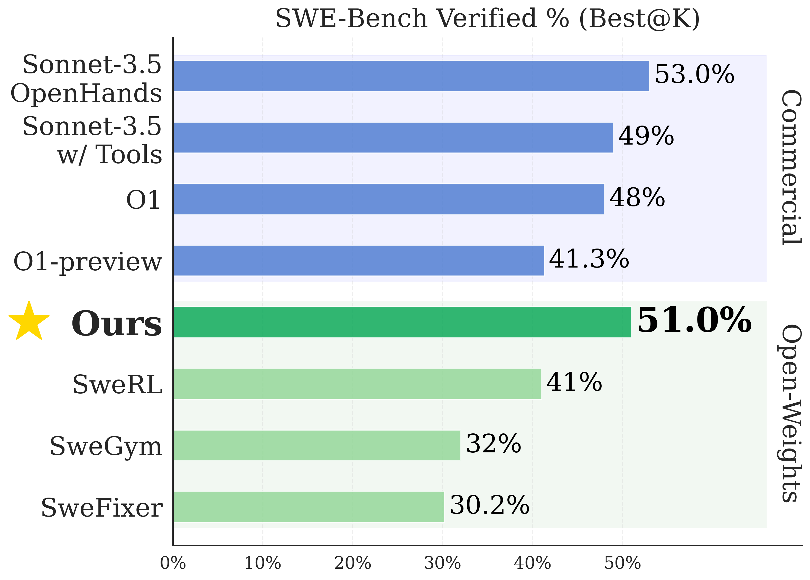

<figcaption>(c) オープンウェイトでの SOTA 性能。図1: 概要。本論文では、オープンウェイトの Swe エージェントを訓練するための、最大の gym 環境かつ訓練フレームワークである R2E-Gym を導入する。R2E-Gym は 2 つの主要な貢献に支えられている。(a) SweGen: 人間のテストやイシューに頼らずに、実行可能な訓練環境を収集するための合成データ収集レシピ（§2）。(b) ハイブリッドな推論時スケーリング: 実行ベースと実行なしの検証器はどちらも推論時の利得を引き出すが、両者の強みを活用することで大幅に良い性能が得られることを示す（§4）。(c) 全体として、最終的な手法はオープンウェイトの Swe エージェントとして SOTA の性能を示し、いくつかのプロプライエタリなモデルのベースラインとも肩を並べる²。脚注2: オープンウェイトのモデルの結果はすべてテスト時スケーリングを用いて報告している。</figcaption>
</figure>

このギャップを埋めるには、2 つの根本的な課題を解く必要がある。
第一に、これらのモデルを訓練するための高品質な実行環境をスケーラブルに収集すること。
第二に、テスト時の性能を最大化するための効率的な集約戦略を開発することである。
GitHub のイシューで Swe エージェントを評価するベンチマークはいくつか存在するが（Jimenez et al., 2023; Zhao et al., 2024）、高品質な訓練環境をスケーラブルに収集することは依然として困難な問題である。
例えば、SWE-Bench（Jimenez et al., 2023）の訓練用分割は出力パッチを含むが、実行可能な環境を欠いている。
Pan et al. (2024) は実行可能なテスト環境を収集しているが、人間が書いたイシューとテストケースに依存しており、サンプル数が制限される。

本論文では、実世界の Swe エージェントを訓練するための、手続き的に収集された最大の環境である R2E-Gym を導入する。これは、実行可能な gym 環境、ユニットテスト、自然言語のタスク記述を備えた $8.1$ K を超える問題からなる（§2）。
R2E-Gym は、2 つの主要な貢献を通じて両方の重要な課題に取り組む（図 1(a) と 1(b)）。

**合成データがよりスケーラブルな訓練を可能にする。**
我々は SweGen を提案する。これは、人間が書いたプルリクエスト（PR）やユニットテストに頼らずに、大量の実行可能な訓練環境を収集できる新しい合成データ収集レシピである。
人間が書いた PR を使う代わりに、逆翻訳（Li et al., 2023; Wei et al., 2023）とテストの収集または生成によって、*コミット*から直接良質な実行環境を収集できることを示す（§2）。
PR ベースのデータ収集（Pan et al., 2024）と比べて、この手法はよりスケーラブルなデータ収集（図 1(a)）とエージェントの訓練を可能にし、難しい SWEBench-Verified ベンチマークで Pass@1 性能 34.4% をもたらす。

**ハイブリッドな推論時スケーリング。**
次に、R2E-Gym を使って、テスト時計算をスケールさせる 2 つの相補的な軸を調べる（§4）。
1) テストケースを通じてパッチを評価する実行ベースの検証器（Xia et al., 2024b）、
2) 学習済みモデルを通じて軌跡（trajectory）を評価する実行なしの検証器（Pan et al., 2024）である。
先行研究はこれらの手法を個別に研究してきたが、それぞれの相対的な強みと弱みについての包括的な分析を欠いている。
我々はまず、それらの動作の仕組みについて独自かつ詳細な分析を示し、実行なしの手法と実行ベースの手法が実際には相補的な強みと弱みを持つことを示す。
2 つの重要な知見を得た（§4.2 で検討）。
a) 実行ベースの手法はパッチの正しさについて直接的な信号を与えるが、解同士を判別することに苦労する。
b) 実行なしの検証器はより良い判別を与えるが、最終的なパッチよりも他のヒューリスティクス（*例えば*エージェントの思考）によって偏りうる。
上記の知見に基づき、両方の手法の強みを活用するハイブリッドなスケーリング手法を提案する。
驚くべきことに、実行ベースと実行なしの手法の性能はどちらも 42〜43% 付近で頭打ちになるが、ハイブリッドな手法ははるかに大きな利得をもたらし、SWEBench-Verified で最終性能 51% を達成する（図 1(b) と §4.3）。

本論文の主要な貢献は次のとおりである。
1) 実世界の Swe エージェントを訓練するための、手続き的に収集された最大の環境である R2E-Gym を導入し、実行可能な環境の数を $3$ 倍以上に増やす。
2) テスト時計算をスケールさせる実行ベースと実行なしの軸が相補的な強みと弱みを持つことを示す、詳細な分析を提供する。
3) 上記の知見に基づき、両方の手法の強みを活用する*ハイブリッドなスケーリング*手法を提案し、テスト時の性能を大幅に改善する。
4) 最後に、SWEBench-Verified で 51% を達成するオープンウェイトの 32B モデルを公開する。これはオープンウェイトの Swe エージェントとしての新たな最高性能であり、同時に、商用モデル（*例えば* o1（Jaech et al., 2024）や sonnet-3.5-v2（Anthropic, 2024））と比べて同等以上の性能を初めて示すものである（図 1(c)）。

## 2 R2E-Gym: Procedural Synthetic Data Generation（R2E-Gym: 手続き的な合成データ生成）

**表1**: データセットの統計。Swe エージェントの訓練のために実行可能な訓練環境を収集する、さまざまなデータセットの統計を比較する。R2E-Gym は我々の全データセットを指し、R2E-Gym-Subset は SWE-Bench とリポジトリが重ならないようにフィルタしたタスクの部分集合を指す。

| データセット（分割） | リポジトリ? | 実行可能? | インスタンス数 |
|---|---|---|---|
| APPS (Hendrycks et al., 2021) | ✗ | ✓ | 10,000 |
| R2E (Jain et al., 2024b) | ✓ | ✓ | 246 |
| SWE-Bench(train) (Jimenez et al., 2023) | ✓ | ✗ | 19,008 |
| SWE-Gym Raw (Pan et al., 2024) | ✓ | ✗ | 66,894 |
| SWE-Bench (test) (Jimenez et al., 2023) | ✓ | ✓ | 2,294 |
| SWE-Gym (Pan et al., 2024) | ✓ | ✓ | 2,438 |
| R2E-Gym-Subset (Ours) | ✓ | ✓ | 4,578 |
| R2E-Gym (Ours) | ✓ | ✓ | 8,135 |

<figure>

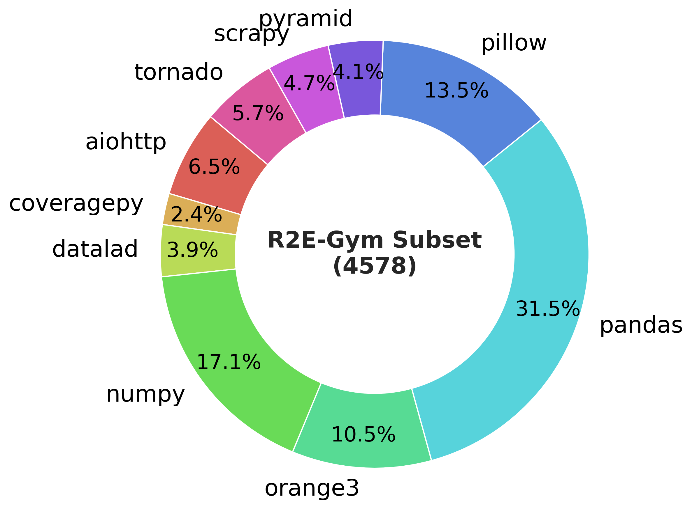

<figcaption>表2: 訓練に用いる R2E-Gym の部分集合（SWE-Bench と重ならない）のリポジトリの分布（§3 を参照）。</figcaption>
</figure>

**概要。**
Swe のタスク収集手法（Jimenez et al., 2023）は、問題文と評価関数として人間が書いたイシューとユニットテストに依存している。
しかし、規模が人間の書いた PR によって制限されるため、これはデータ収集をスケールさせるうえで課題となる。
この制限を克服するため、我々は逆翻訳とテスト生成を用いた合成データ収集レシピである SweGen を提案する。
GitHub リポジトリのコミットだけを使って手続き的に環境を生成し、人間が書いたイシューとテストケースの両方への依存を減らす。

**リポジトリとコミットの収集。**
SEART GitHub search³ を使い、コミット数の多い Python リポジトリを特定する。
脚注3: https://seart-ghs.si.usi.ch/
次に、各リポジトリのコミット履歴と、それに関連するコードの変更を抽出する。
ルールベースと LLM ベースのヒューリスティクスを組み合わせて関連するコミットをフィルタし、興味深いコードの変更を特定する。
次に、関連する各コミットについて、依存関係の固定バージョン（dependency pins）を半手動で探索してビルドスクリプトを収集する。
ヒューリスティクスとインストール手順の詳細は付録 A で述べる。

**環境収集のためのテストの検証と生成。**
Jimenez et al. (2023) にならい、収集したコミットに含まれる既存のテストケースを使って Fail $\rightarrow$ Pass（F2P）テストケース、すなわち元のバグのあるコミットでは失敗し、修正後のコミットでは通るテストケースを特定する。
収集したコミットに関連するテストがなく、訓練環境として使えない場合には、そうしたコミットを自動生成した Fail $\rightarrow$ Pass テストケースで補う。
テスト生成の手法は付録 A で詳しく述べる。

**逆翻訳: GitHub のイシューに依存しない。**
上記の手順で、多数のコミット、それに関連するビルド環境、F2P（Fail $\rightarrow$ Pass）テストケースを収集する。
次に、コミットに対応する問題文を収集する必要がある。
先行研究（Jimenez et al., 2023; Pan et al., 2024）は、人間が書いた GitHub のイシューを問題文として使っている。
人間が書いたイシューはすべてのコミットに存在するわけではないため、これではどうしてもコミット履歴全体を使えない。
そこで、Li et al. (2023); Wei et al. (2023) にならい、コミットに対応する問題文を収集するための逆翻訳の手法を提案する。
しかし、コードの変更を素朴に逆翻訳するとかなりノイズが多い。モデルはしばしば、コードの変更の本質を捉えない一般的な問題文を生成するからである。
代わりに我々は、人間が書いたイシューにはバグ報告の一部として失敗するテストや実行トレースが含まれていることが多い点に着目した。
この観察を使い、F2P テストケースを逆翻訳のプロンプトの一部に含めることで、高品質な問題文を収集する。
既存の研究（Jain et al., 2024b; Zhuo et al., 2024）と同様に、テストの実行情報を使うと、的確で方向性のある問題文を生成できることが分かった。
プロンプトと例は付録を参照されたい。

この手法で $8.1$ K を超える問題文を収集する（R2E-Gym と呼ぶ）。
この集合から SWE-Bench のテストセットのリポジトリと重なるリポジトリを除いて汚染を取り除き、4578 件の問題（R2E-Gym-Subset と呼ぶ）を得て、特に断らない限りすべての実験でそれを使う。
表 2 はさまざまなデータセットの統計を示し、図 2 と図 9 はそれぞれ R2E-Gym-Subset と R2E-Gym のリポジトリの分布を示す。
特筆すべきこととして、SweGen の手法を使うと、GitHub のイシューに頼るデータ収集より $2.5$ 倍以上多くの問題を収集できる（図 1(a)）。

## 3 Training SWE-Agents using R2E-Gym Environments（R2E-Gym 環境を用いた SWE エージェントの訓練）

**表3**: SWEBench-Verified と SWEBench-Lite ベンチマークにおける解決率（%）の比較。合成データ収集（SweGen）により、我々の手法はさまざまなモデルサイズでより良くスケールすることが観察される。すべての実験は Qwen-2.5-Coder をベースモデルとして用いる。

| モデルサイズ | Lite: ベースモデル | Lite: SWE-Gym | Lite: Ours | Lite: Δ | Verified: ベースモデル | Verified: SWE-Gym | Verified: Ours | Verified: Δ |
|---|---|---|---|---|---|---|---|---|
| 7B | 1.0 (±1.0) | 10.0 (±2.4) | 11.0 (±0.8) | +1.0 | 1.8 (±1.3) | 10.6 (±2.1) | 19.0 (±1.0) | +8.4 |
| 14B | 2.7 (±1.9) | 12.7 (±2.3) | 20.67 (±0.7) | +7.97 | 4.0 (±1.6) | 16.4 (±2.0) | 26.8 (±1.4) | +10.4 |
| 32B | 3.0 (±1.4) | 15.3 (±2.5) | 23.77 (±0.8) | +8.47 | 7.0 (±1.3) | 20.6 (±2.1) | 34.4 (±1.2) | +13.8 |

**エージェントの足場（scaffolding）。**
多様な Swe タスクでエージェントを実験するため、OpenHands（Wang et al., 2024）の上に最小限の足場を設計する。
これは特別なワークフローを持たない伝統的な ReAct の枠組み（Yao et al., 2022）を用い、LLM に bash ターミナル、ファイルエディタ、検索ツールだけを与える。
図 16 はコード編集の軌跡の例を示す。

**軌跡の収集と SFT による訓練。**
次に、R2E-Gym 環境から SFT の軌跡を収集する。汚染を避けるため、SWE-Bench のデータセットと重ならないリポジトリからなる R2E-Gym の部分集合だけを使う。得られた部分集合（R2E-Gym-Subset）は、10 リポジトリにまたがる 4578 の実行可能な環境からなる（図 2）。
各タスク環境について、我々のエージェントの足場で Sonnet-3.5-v2 を使い、成功したエージェントの軌跡を収集する。
この過程で、$2048$ の異なるタスク環境から $3321$ 本の軌跡を収集する。
次に、これらの軌跡を使い、エージェントの思考と行動について教師ありファインチューニング（supervised fine-tuning）でエージェントを訓練する。
訓練には LLaMA-Factory（Zheng et al., 2024）を使い、Qwen-2.5-Coder モデル（7B、14B、32B）をベースモデルとする。
実験の詳細な設定とハイパーパラメータは付録 B を参照されたい。

### 3.1 Results and Analysis（結果と分析）

**モデル規模ごとのオープンウェイト SWE エージェントとの比較。**
表 3 に、R2E-Gym で訓練したモデルの SWEBench-Verified と SWEBench-Lite での Pass@1 を報告する。我々の研究に最も近い、最近提案された SWE-Gym（Pan et al., 2024）との比較も報告する。表 3 に見られるように、我々の手法はすべてのモデルサイズで Swe エージェントの訓練をより良くスケールさせる。例えば SWEBench-Verified では、同じベースモデルの種類と規模で、我々の 32B モデルは Pass@1 性能を約 $14\%$ 大きく改善し、最終性能を 20.6（SWE-Gym）から 34.4% に押し上げる。

**軌跡の数によるスケーリング。**
図 3 で、訓練サンプル数（軌跡の数）とエージェントの性能の関係を調べる。
$100$ から $3,200$ までの軌跡数で訓練した $14$ B と $32$ B のモデルを評価する。
軌跡数が増えるにつれて性能は向上するが、どちらのモデルでも収穫逓減が見られる。
特筆すべきこととして、$14$ B モデルは約 $800$ サンプルで飽和し始めるが、$32$ B モデルはまだ改善を示しており、これはおそらく容量が大きいためである。
これらの結果は、データセットのスケーリングを約 $500$ サンプルまで調べた Pan et al. (2024) の知見を拡張する。
我々の分析は、サンプル数が増えると性能は確かに向上するが、小さいモデルでは改善の速度が鈍るか、頭打ちにさえなることを示している。

<figure>

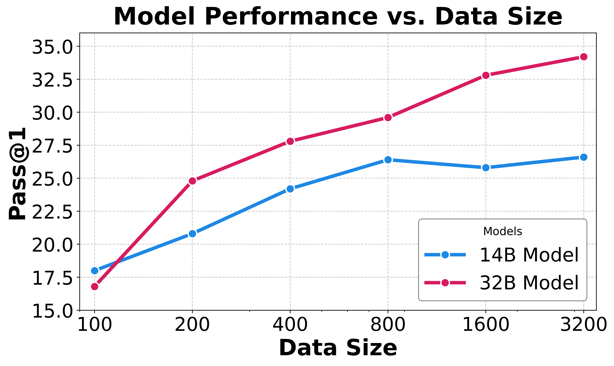

<figcaption>図2: 訓練サンプル数を増やしたときの Pass@1 のスケーリング曲線。SweGen の手法によって可能になった、より多くの訓練サンプルによる性能の改善。</figcaption>
</figure>

**図3**（表形式）: 上: ReAct エージェントの軌跡に思考を使うと、性能が大きく改善する。下: SweGen で合成したイシューとテストケースを使うと、実世界のイシューと同程度の性能を達成し（上の比較では実データ・合成データともに 400 本の軌跡）、同時にデータ収集のスケーラビリティが高い。

| アブレーション | 設定 | Pass@1 (%) |
|---|---|---|
| 思考を加える | あり | 34.4 |
| | なし | 30.4 |
| 実データ対合成データ | 実データ | 28.0 |
| | 合成データ | 27.8 |

**実際の問題文と合成した問題文。**
R2E-Gym の手法により、人間が書いた記述やテストケースに頼らずに問題文を生成でき、より高いスケーラビリティが得られる。
実際の GitHub のイシューで訓練したモデルと、我々の合成した問題文で訓練したモデルの性能を比較する（どちらの集合からも $400$ 本の軌跡を収集）。
注目すべきことに、合成データで訓練したモデルは、実データで訓練したモデル（28.0%）とほぼ同じ性能（Pass@1 27.8%）を達成する。
この結果は、我々の合成データ生成の方法の有効性を裏づけ、手続き的に生成した環境が、スケーラビリティを提供しつつ実世界の例と同等の訓練価値を持ちうることを示している。

**明示的な思考の痕跡は重要である。**
SFT では、エージェントの思考過程と行動の両方を訓練の目標として使う。
思考の手本を含めて訓練したモデルは、含めずに訓練したモデルより大幅に良い性能を達成する（表 3 で 34.2% 対 30.4%）。
これは、段階的な推論過程をモデルに見せることが、複雑な環境で信頼できる問題解決を行うために必要であることを示唆している。

## 4 Efficient Inference Time Scaling With Hybrid Verifiers（ハイブリッド検証器による効率的な推論時スケーリング）

コーディングエージェントによる推論時スケーリングの実験に R2E-Gym（§2）を使う。
§4.1 では、テスト時計算をスケールさせるさまざまな軸を探り、2 つの異なる手法、すなわち 1) 実行ベースの検証器と 2) 実行なしの検証器に焦点を当てる。
それぞれの手法の相対的な強みと弱みを分析し、両者が相補的であることを示す（§4.2）。
この知見に基づき、両者の強みを活用してテスト時の性能を大幅に改善するハイブリッドな手法を提案する（§4.3）。
最後に、我々の手法の重要な設計上の選択を調べる詳細なアブレーションと分析を示す（§4.4）。

### 4.1 Exploring Different Axes for Training Verifiers（検証器を訓練するさまざまな軸の探索）

入力のタスク記述 $\mathcal{D}$、エージェントの軌跡の集合 $\{\mathcal{T}_{i}\}_{i=1}^{K}$、候補となる出力パッチ $\{\mathcal{P}_{i}\}_{i=1}^{K}$ が与えられたとき、我々の目的は、出力を順位づけるためのスコア $\mathbf{S}=\{s_{i}\}_{i=1}^{K}$ を割り当てる検証器を作ることである。
このために、2 種類の検証器を調べる。

**実行ベースの検証器。**
候補のパッチがイシューを解決するかどうか（*すなわち*、パッチが生成されたテストスイートを通るかどうか）を判定するために、再現テストケースを生成する専用の*テストエージェント*を訓練する。
加えて、Xia et al. (2024b) にならい、既存の回帰テストを利用して、後方互換性を保てないパッチを除外する。
したがって、我々の実行ベース（EB）の検証器は 2 つの構成要素からなる。
1) バグ修正を評価するための的を絞ったテストを生成する*テストエージェント*と、
2) 既存の機能を損なうパッチを取り除く回帰テストのフィルタである。
具体的には、さまざまな入力やコーナーケース*など*をカバーする $M=10$ 個の多様なテストを含む包括的なテストスクリプトを生成するように、テストエージェント（Qwen-Coder-32B をベースモデルとして使用）を訓練する。
生成されたテストの例は付録 D を参照されたい。
各パッチ $\mathcal{P}_{k}$ の実行ベースのスコア $s^{EB}_{k}$ は、次のように計算する。

$$
s^{EB}_{k}=\begin{cases}\mathrm{TestScore}_{k},&\text{if }RS_{k}=\max\limits_{j\in[1,K]}RS_{j},\\
0,&\text{otherwise},\end{cases};\text{ where }\quad\mathrm{TestScore}_{k}=\sum_{i}\mathrm{Pass}(\mathcal{P}_{k},Test_{i}) \tag{1}
$$

ここで $RS_{k}$ は $k$ 番目のパッチの回帰テストのスコアを表し、回帰テストのスコアが最も高いパッチを選ぶのに役立つ（Xia et al., 2024b）。
$\mathrm{TestScore}_{k}$ は単に、各パッチ $\mathcal{P}_{k}$ について通ったテストの数の合計である。
詳細は付録 §C を参照されたい。

特筆すべきこととして、Agentless（Xia et al., 2024b）によるゼロショットのテスト生成とは異なり、我々のテストエージェントは環境と対話して既存のテストケースを調べ、それらの例と実行フィードバックに基づいて新しいテストを生成する。
この環境を意識した手法がゼロショットの手法に比べて追加の利点をもたらすことを、§4.4 で示す。

<figure>

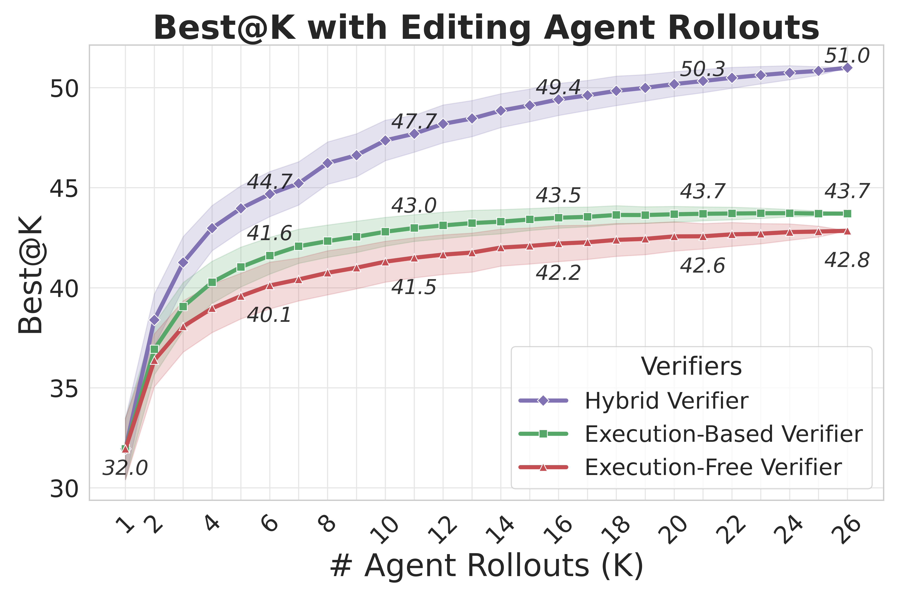

<figcaption>図4（左）: 編集エージェントのロールアウト数を増やしたときの Best@K。</figcaption>
</figure>

<figure>

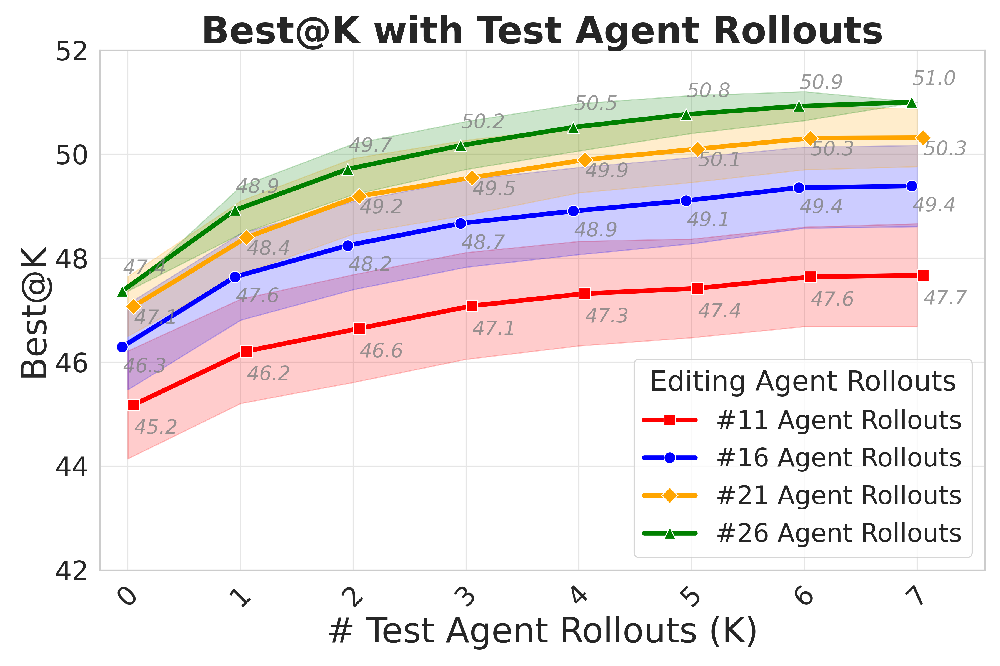

<figcaption>図4（右）: テストエージェントのロールアウト数を増やしたときの Best@K。図4: 左。編集エージェントのロールアウト数を増やしたときの Best@K。推論時スケーリングは、実行ベースと実行なしの両方の検証器で最終性能を改善する。実行ベースと実行なしの検証器を組み合わせたハイブリッド検証器は、大幅に優れたスケーリングを示す。右。テストエージェントのロールアウト数を増やしたときの Best@K。テストエージェントのロールアウトを増やしても最終性能は改善し、編集エージェントのロールアウトだけを素朴に増やすよりも計算効率の良いスケーリングになりうる。</figcaption>
</figure>

**表4**: SWE-Bench Verified におけるさまざまなモデル／手法の性能。

| 手法 | モデル | 種類 | Verified |
|---|---|---|---|
| *プロプライエタリなモデル* | | | |
| Agentless-1.5 (Xia et al., 2024b) | GPT-4o | Pipeline | 34.0 |
| Agentless (Xia et al., 2024b) | O1 | Pipeline | 48.0 |
| Claude + Tools | Claude-3.6-Sonnet | Agent | 49.0 |
| Agentless-1.5 (Xia et al., 2024b) | Claude-3.6-Sonnet | Pipeline | 50.8 |
| OpenHands (Wang et al., 2024) | Claude-3.6-Sonnet | Agent | 53.0 |
| Claude + Tools | Claude-3.7-Sonnet | Agent | 62.3 |
| Claude + Tools (Best@Any) | Claude-3.7-Sonnet | Agent | 70.3 |
| *オープンソースのモデル* | | | |
| SWE-SynInfer (Ma et al., 2024) | Lingma-SWE-GPT-72B | Agent | 30.2 |
| SWE-Fixer (Xie et al., 2025) | SWE-Fixer-72B | Pipeline | 30.2 |
| SWE-Gym (Best@16 w/ Verifier) (Pan et al., 2024) | SWE-Gym-32B | Agent | 32.0 |
| SWE-RL (Best@500 w/ Tests) (Wei et al., 2025) | SWE-RL-70B | Pipeline | 41.0 |
| Agentless (Xia et al., 2024b) | DeepSeek-R1 | Pipeline | 49.2 |
| R2E-Gym (Ours) (Pass@1) | R2E-Gym-32B | Agent | 34.4 |
| R2E-Gym (Ours) (Best@16 w / Hybrid) | R2E-Gym-32B | Agent | 49.4 |
| R2E-Gym (Ours) (Best@26 w / Hybrid) | R2E-Gym-32B | Agent | 51.0 |

**実行なしの検証器。**
次に、コード編集エージェント（§3）からサンプリングした軌跡の集合から最良の軌跡を選ぶために、実行なし（EF）の検証器を訓練する。
具体的には、(Pan et al., 2024) にならい、タスク記述 $\mathcal{D}$、エージェントの軌跡 $\mathcal{T}$（思考・行動・観測の列）、出力パッチ $\mathcal{P}$ が与えられたとき、正しい軌跡と誤った軌跡での SFT によって、軌跡の正しさを判定する YES と NO のトークンを予測するように Qwen2.5-Coder-14B モデルをファインチューニングする。
実行なしのスコアは、YES トークンの相対確率を正規化して $s^{EF}=\mathrm{P}(\texttt{YES})/(\mathrm{P}(\texttt{YES})+\mathrm{P}(\texttt{NO}))$ として計算する。ここで P(YES) と P(NO) は、対応するトークン予測の対数確率から推定する。

### 4.2 Comparative Analysis of Execution-Based and Execution-Free Verifiers（実行ベースと実行なしの検証器の比較分析）

**実験の方法。**
複数の候補から正しいパッチを特定する各検証器の能力を定量化する Best@K 指標を使って、検証器の性能を評価する。
具体的には、$K$ 本の軌跡が与えられたとき、Best@K 指標は、検証器がそのスコアリングの仕組みで正しいパッチを選ぶことに成功した問題の割合を表す。
実験では、SWEBench-Verified の問題について、R2E-Gym-32B モデルから温度 $T=0$ で $1$ 本、温度 $T=0.8$ と $T=0.9$ で $25$ 本の軌跡をサンプリングする。
これらの軌跡は Pass@26 = $64.4$ % を達成する（図 14）。
次に、テストエージェントを使い温度 $T=0.8$ で $7$ 個のテストをサンプリングする。
テストを生成するとき、テストエージェントには、テストケースを書くためのサンプルの開始コードと形式を示す*固定の*文脈内の例（Django から）を与える。文脈内の例を使うと、出力の書式の改善と、ベースの LM に欠けているドメイン知識の補完に役立ち、約 $2$ % の問題でテスト生成が改善することを経験的に確認した。詳細と文脈内の開始コードは Listing C.1 を参照されたい。

**どちらの検証器も推論時の利得を引き出す。**
図 4 は、SWEBench-Verified ベンチマークにおける両方の種類の検証器の Best@K 性能を、編集エージェントのロールアウト数の関数として示す。
実行ベースと実行なしの検証器はどちらも、ロールアウト数を増やすと大きな性能向上を示す。
しかし、Best@K 率はどちらの手法でもすぐに頭打ちになり、それぞれ $43.7\%$ と $42.8\%$ に同様に収束する。

**実行ベースの検証器の限られた判別性。**
これらの検証器はテストの合格数に基づいてスコアを出力するので、テストの合格率が同じパッチを区別できず、判別能力が制限されることを思い出してほしい。
この判別能力を、我々の $32$ B テストエージェント、プロンプトで指示した Sonnet-3.5-v2 モデル、Agentless-1.5 の再現テスト（Xia et al., 2024b）⁴ が生成したテストについて、SWEBench-Verified の問題の部分集合で調べる。
脚注4: テストケースは公式の成果物リポジトリ（Xia et al., 2024a）のものを使う。
図 5（左）は、判別率（distinguishability rate）、すなわち上位に順位づけられた正しいパッチと誤ったパッチを区別することに成功するテストの割合について、問題の密度分布を示す。
結果は、大半の問題で、判別の信号を与えるテストが $20\%$ 未満であり、再順位づけを制約していることを示している。
図 6 はさらに、生成されたテストの多くが、主に生成されたテストケースのバグや例外のために、バグを再現しない（6-左の Pass $\rightarrow$ Pass の値が高い）か、正解パッチを通さない（6-中央の Fail $\rightarrow$ Fail の値が高い）ことを示している。

**テストの毒性（test toxicity）に対する脆弱性。**
(Chen et al., 2022) にならい、毒性のあるテスト、すなわち誤ったパッチを通すが正しいパッチを通さないテストの多さを調べる。
図 5（右）は、さまざまなテスト生成の手法にわたる、毒性のあるテストの割合の分布を示す。
毒性のあるテストは一般にまれだが、小さいながら無視できない問題の部分集合で、テストエージェントが毒性のあるテスト（全テストの最大 $10\%$）を生成し、誤ったパッチを正しいパッチより上に誤って順位づけ、実行ベースの検証の信頼性を損ないうることが分かった。

<figure>

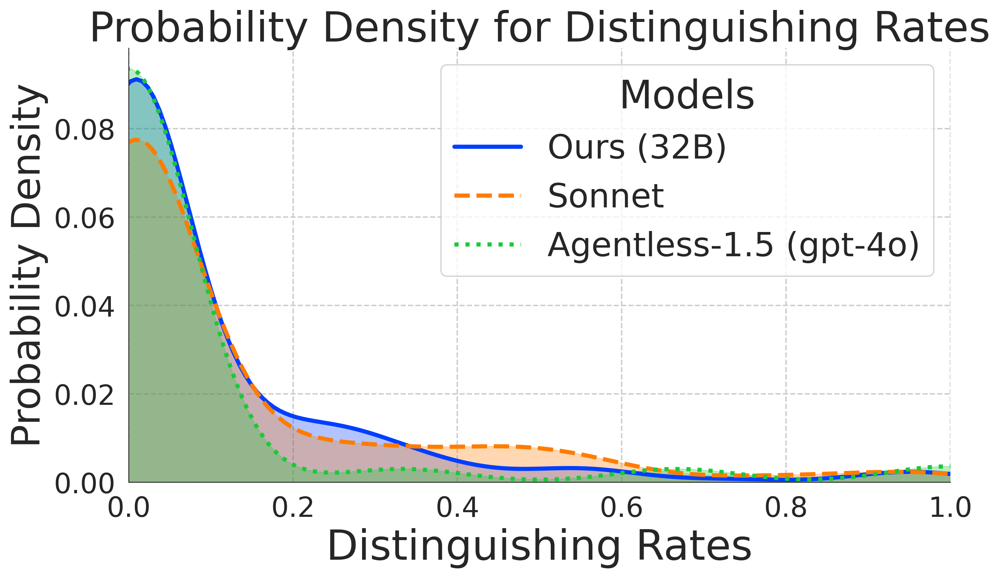

<figcaption>図5（左）: 判別率の確率密度。</figcaption>
</figure>

<figure>

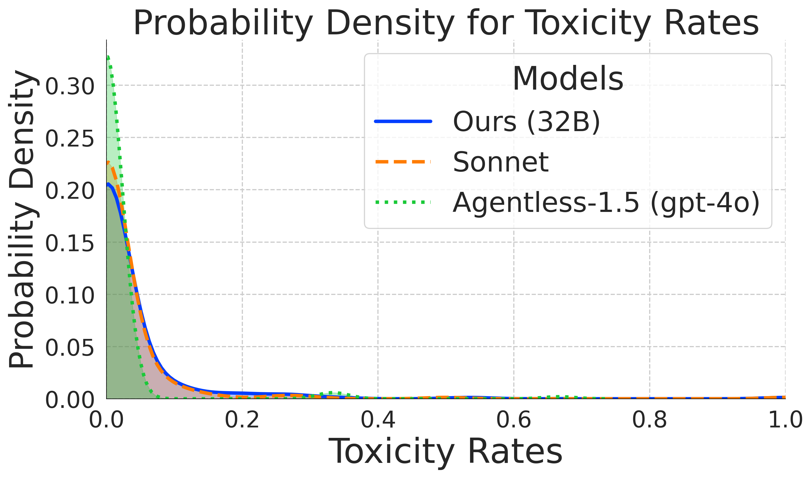

<figcaption>図5（右）: 毒性率の分布。図5: 実行ベースの検証器の限界の分析。左: テストの判別能力の弱さを示す、判別率についての問題の確率分布。大半の問題で、判別の信号を与えるテストは 20% 未満であり、テストベースのエージェントの再順位づけ能力を制約していることが観察される。右: 毒性のあるテストの（まれな）生成を示す、毒性率の分布。実行ベースの検証器は、毒性のあるテスト（誤ったパッチを通すが正しいパッチを通さないテスト）の（まれな）生成にも脆弱であり、それが実行ベースの検証器の信頼性を損ないうることが分かった。</figcaption>
</figure>

<figure>

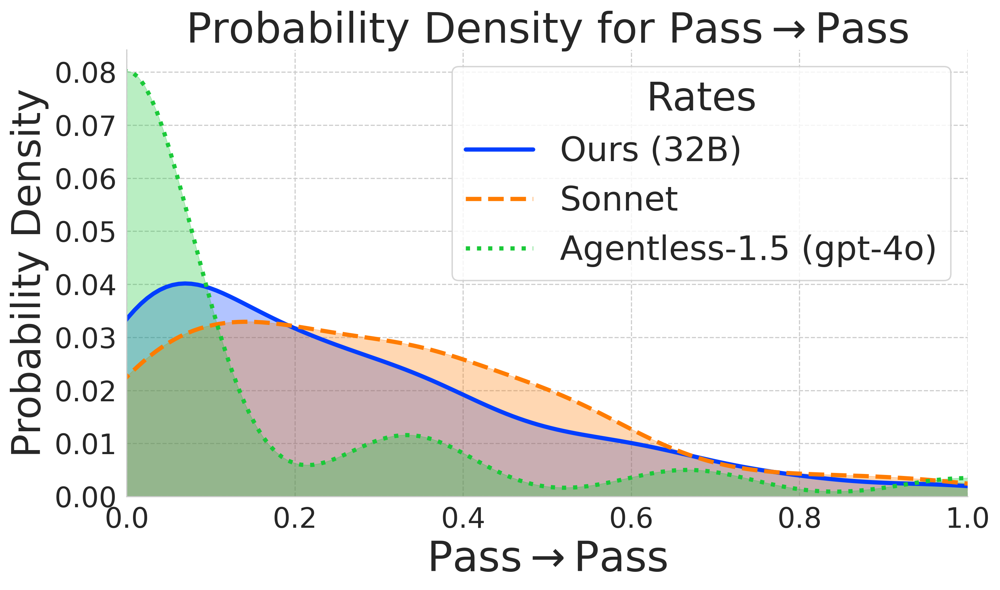

<figcaption>図6（左）: Pass → Pass の割合。</figcaption>
</figure>

<figure>

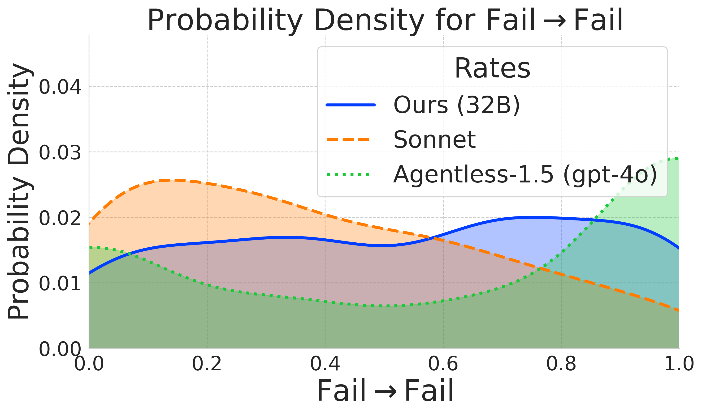

<figcaption>図6（中央）: Fail → Fail の割合。</figcaption>
</figure>

<figure>

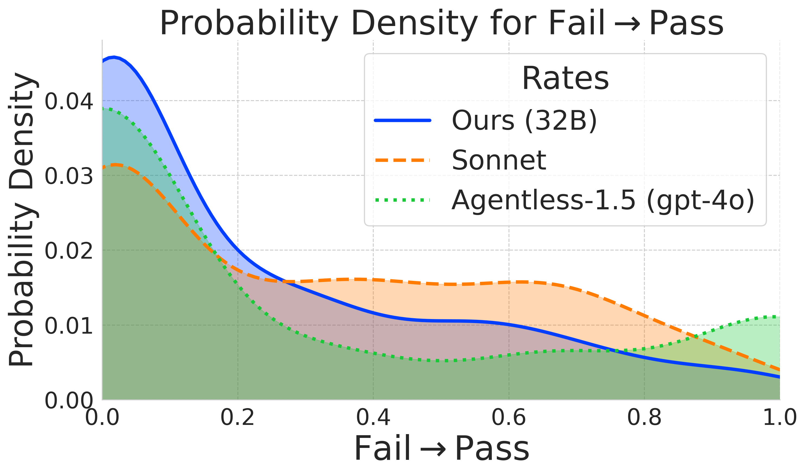

<figcaption>図6（右）: Fail → Pass の割合。図6: さまざまな手法について、生成されたテストのうち Pass → Pass、Fail → Fail、Fail → Pass になるものの割合の問題ごとの確率分布。生成されたテストの大部分が、バグを再現しない（左）か、正しい解さえ通さない（中央）ことが分かる。</figcaption>
</figure>

**実行なしの検証器はヒューリスティクスに頼りうる。**
次に、実行なしの検証器の動作と限界を調べる。
具体的には、まず定量的なアブレーション研究を行い、軌跡のさまざまな構成要素（例えば出力パッチ、エージェントの思考）が検証器の性能に与える影響を調べる。このために、検証器を訓練するときに軌跡の異なる構成要素を除外した複数の実行なしの検証器（§4.1）を訓練する。
結果を図 7-a に示す。
エージェントの思考が検証器の性能を決めるうえでかなりの役割を果たすことが分かった。
驚くべきことに、検証器の入力から軌跡を取り除く（*すなわち*最終的なパッチだけを使う）と、最終的な Best@26 は $42.8\%$ から $37.6\%$ に下がる。
これは、正しさを決めるのはパッチだけであるにもかかわらず、実行なしの検証器は予測のためにエージェントの思考のような軌跡の特徴に大きく依存していることを意味する。

この現象をさらに調べるため、実行なしの検証器で出力の成否を予測するときに入力の軌跡のどの部分が最も関係しているかを可視化しようとする、注意（attention）の分析も行う。具体的には、入力の軌跡の上でスライディングウィンドウの探索を行い、最終的な出力トークン（YES: 正しい、NO: 誤り）を予測するときの、ウィンドウ内のトークンに対する平均の注意スコアを計算する。
図 7（右）は、最も高い注意スコアを受けた上位 2 つのウィンドウを示し、検証器がエージェントの思考に不釣り合いに注意を向けていることを示している。検証器は、解の技術的な良し悪し（*すなわち*出力パッチ）を評価する代わりに、これらの思考の中の感情的な信号を正しさの代理として使いうるので、これは誤解を招きうる。

**図7(a)**: 実行なしの検証器に対するパッチと思考の影響。パッチだけでは性能が下がり、モデルが再順位づけのために他のヒューリスティクス（例えばエージェントの思考）に頼っていることを示している。それは誤解を招きうる（パート b: 右を参照）。

| 手法 | 正解率 (%) | Best@26 (%) |
|---|---|---|
| Final Patch + Traj. | 71.82 | 42.8 |
| Patch Only | 68.01 | 37.6 |
| Traj. - Thoughts | 68.77 | 41.4 |

```text
 1. Successfully reproduced the issue
 2. Implemented a fix [...]
 4. Ensured edge cases are handled
 5. Maintained backward compatibility   [...]
 <function=finish>submit</function> [...]
```

```text
Great! The fix works. Let's see what we did to fix the issue:
1. We identified that the original code was failing because it was trying to use the `.inverse()` method directly on permutations, which  [...]
```

(b) 誤った軌跡について YES を予測するときの上位 2 つの注意ウィンドウ。ヒューリスティクス（エージェントの思考）に注目すると、検証器が誤りうることが分かる。

図7: 実行なしの検証器の限界についての定量的・定性的な分析。
2 つの実験を行う。
a) 出力パッチが検証器の性能に与える影響についての定量的なアブレーション。実行ベースの検証器が最終的なパッチよりも他のヒューリスティクス（例えばエージェントの思考）に頼っていることを示す。
b) *誤った*エージェントの軌跡（sympy__sympy-24443: SWE-Bench (Yang et al., 2024b)）について、出力トークン YES を予測するとき（§4.2）に平均の注意スコアが最も高い上位 $k=2$ のスライディングウィンドウを分析する定性的な可視化。
ヒューリスティクス（*例えば*エージェントの思考）への注目は誤解を招きうるもので、検証器はその軌跡を正しいと予測する。
可視化は紙面の都合で要約している。さらなる可視化と結果は付録を参照されたい。

> 訳注: キャプション a) の「実行ベースの検証器が…頼っている」は原文どおり（execution-based）。本文の文脈からは実行なし（execution-free）の検証器の話である。

### 4.3 Hybrid Inference Time Scaling（ハイブリッドな推論時スケーリング）

**検証器の強みを組み合わせる。**
§4.2 の分析から、2 つの重要な知見をまとめることができる。
1) 実行ベースの手法は、実行を通じてパッチの正しさについて直接的な信号を与えるが、判別するテストの不足に悩まされる。
2) 実行なしの手法は、連続的な報酬スコア $s^{EF}$ を通じてパッチ同士のより良い判別性を提供するが、最終的な出力パッチよりもヒューリスティクス（例えばエージェントの思考）により多くの注意を払うように偏りうる。

上記の知見を踏まえ、我々は両方の手法の強みを活用するハイブリッド検証器を提案する。
具体的には、スコア $s^{H}_{k}$ を持つハイブリッド検証器を次のように定義する。

$$
s_{k}^{H}=\mathrm{Top}_{n}(s_{k}^{EF})+s_{k}^{EB},\text{ where }\mathrm{Top}_{n}(s_{k}^{EF})=\begin{cases}s_{k}^{EF},&\text{if }s_{k}^{EF}\text{ is among the top }n\text{ scores},\\
-\infty,&\text{otherwise}.\end{cases} \tag{2}
$$

ここで $s^{EB}_{k}$ は実行フィードバックを与え、$s_{k}^{EF}$ は実行ベースのテストスコアが同点の場合に判別性を与え（$s_{k}^{EF}$ は $0$ と $1$ の間の連続的なスコアを与えるため）、$\mathrm{Top}_{n}$ はハイブリッド検証器が検証器によって上位に順位づけられたパッチだけを考慮するように制限する。実際には、スコアが非ゼロになるように、上位 n のフィルタの後に回帰フィルタを行う。

**主な結果。**
結果を表 4 と図 4 に示す。
実行ベースと実行なしの手法はどちらも、エージェントのロールアウトを増やすとすぐに性能の頭打ち（約 $43\%$ で飽和）に達するが、我々のハイブリッドな手法ははるかに優れたスケーリング特性を示し、大きな性能向上（さらに 7〜8%）をもたらし、難しい SWEBench-Verified ベンチマークで Best@26 の性能 $51\%$ を達成する。

**オープンなシステムとの比較。**
提案手法は他のオープンウェイトの選択肢を大きく上回り、この領域での新たな最高性能を示す。
他の汎用エージェントの手法の中では、SWE-Gym（Pan et al., 2024）が最近 Best@16 で $32.0$ % の性能を達成している。
同様に、並行研究（Wei et al., 2025）は最近、RL と Best@500（Agentless を使用）で $41.0$ % を達成した。
対照的に、訓練は主に教師ありファインチューニングに頼っているにもかかわらず、提案手法は Pass@1 そのもので $34.4$ %、Best@26 で $51.0$ % を達成しており、単によりスケーラブルなデータ収集（§2）とより良いテスト時スケーリング（図 4）によって大きな性能向上を達成している。

### 4.4 Ablation Studies on Hybrid Verification Design（ハイブリッド検証の設計についてのアブレーション研究）

<figure>

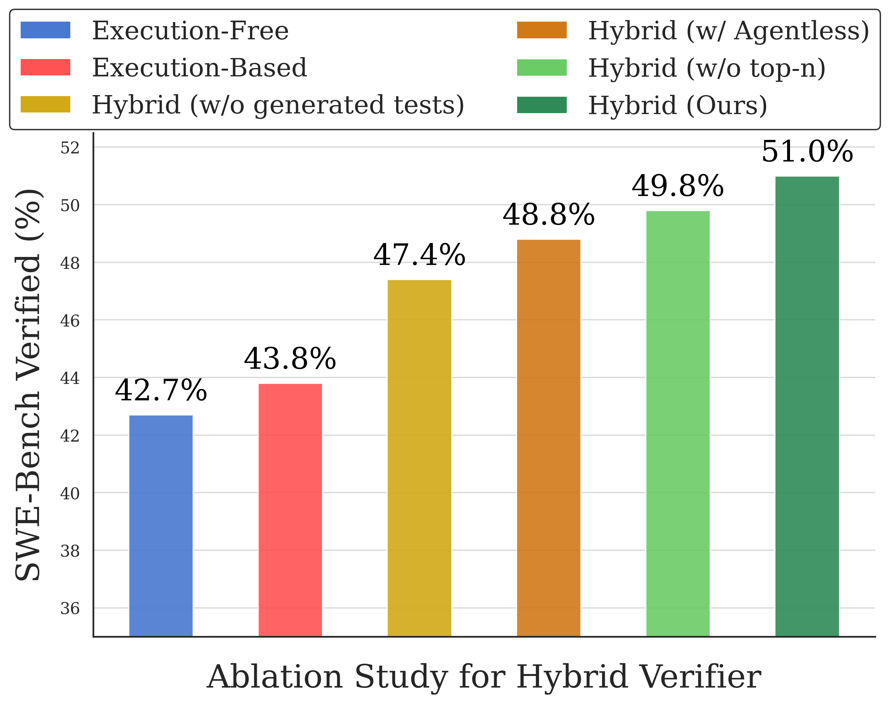

<figcaption>図8: ハイブリッド検証器のアブレーション研究。3 つの重要な知見を得た。1) 実行ベースと実行なしの検証器はどちらも 42〜43% 付近で飽和するが、ハイブリッドな手法ははるかに大きなテスト時の利得（51%）をもたらす。2) 回帰テストだけではハイブリッドなスケーリングに不十分で、集約の性能は 47.4% にとどまる。3) エージェント型対 Agentless: 専用のテストエージェントを訓練することが重要で、性能を 48.8% から 51% に改善する。</figcaption>
</figure>

**テストエージェントのロールアウト数による変化。** 4.2 のとおり、実行ベースのテスト生成は判別するテストの不足に悩まされうる。これに対処する 1 つの方法は、テストエージェントのロールアウトをより多くサンプリングすることである。この効果を図 4（右）で定量化する。
テストエージェントのロールアウト数を増やすと、ハイブリッドな手法の性能が一貫して改善することが観察される。

**計算効率の良いロールアウト。**
図 4（右）は、テストエージェントとコード編集エージェントの両方のロールアウト数の関数として Best@K 性能を示す。
興味深いことに、テストエージェントのロールアウトをより多くサンプリングするほうが、編集エージェントのロールアウトを素朴に増やすよりも計算的に最適な推論スケーリングになりうることが分かった。
例えば、編集エージェントのロールアウト数を 16 から 21 に増やすと、Best@K 性能は 47.6% から 48.4% に改善する。
対照的に、単にテストのロールアウトを 5 つ多くサンプリングするだけで、より大きな利得が得られうる（Best@K 49.3%）⁵。
脚注5: テストエージェントのロールアウトは通常、編集エージェントのロールアウトよりかなり安価でもあることに注意されたい。

**回帰テストだけでは不十分である。**
我々の実行ベースの検証の枠組みは、回帰テストと生成された再現テストの両方を統合している。
図 5（右）は、回帰テストだけが最終性能に与える影響を切り分けている。
回帰テストだけで性能は 42.9% から 47.4% に改善するが、生成されたテストを使うとさらに 51.0% まで性能が上がり、両方の種類のテストが不可欠で相補的な信号を提供することを示している。

**エージェント型のテストと Agentless のテスト。**
我々の手法の際立った特徴は、Xia et al. (2024b) のゼロショットの手法ではなく、テスト生成のための専用のエージェントを訓練することである。
この設計上の選択を評価するため、SWEBench-Verified ベンチマークで、我々のハイブリッド検証の枠組みの中で、公開された成果物（Xia et al., 2024a）の公式の Agentless のテストを使った対照比較を行った。
図 5（右）は、Agentless のテストも意味のある性能向上をもたらすが、我々のエージェントが生成したテストのほうが優れた結果（$51.0$ % 対 $48.8$ %）をもたらすことを示し、テスト生成へのエージェントベースの手法の妥当性を裏づけている。

**$\mathrm{Top}_{n}$ の役割。**
式 (2) で導入した $\mathrm{Top}_{n}$ のフィルタの仕組みの影響を評価する。
図 5（右）は、この選択的な適用の戦略が性能を $49.8$ % から $51.0$ % に改善することを示している。
この改善はおそらく、毒性のあるテスト（§4.2）の適用を（実行なしの報酬スコア $s^{EF}_{k}$ によって特定される）より高品質なパッチに制限することで、その影響を緩和し、検証過程の信頼性を高めることから生じている。

## 5 Related Work（関連研究）

**プログラミングエージェント。**
GitHub のイシュー解決に関する最近の研究には、SWE-agent（Yang et al., 2024b）、Autocoderover（Zhang et al., 2024b）、OpenHands（Wang et al., 2024）、AgentLess（Xia et al., 2024b）、Moatless（Orwall, 2024）がある。
これらはすべて、データセットとオープンウェイトのモデルが不足しているため、プロプライエタリなモデルに依存している。我々の研究はこのギャップに取り組む。

**エージェントの訓練環境。**
既存の SWE エージェントの環境には重要な限界がある。
SWE-Bench（Jimenez et al., 2023）は実行可能な訓練環境を欠いており、
R2E（Jain et al., 2024b）は関数の補完を伴う 246 インスタンスしか提供しない。
SWE-Gym（Pan et al., 2024）は我々と同様に実行可能な GitHub 環境を収集しているが、人間が書いたイシューとテストケースに依存している。
合成データ生成はさまざまな領域で研究されてきたが、我々の研究は実行可能な GitHub 環境の収集にそれを適用した最初のものである。
SweGen の手法では、逆翻訳（Li et al., 2024）とテスト生成を用いる。
合成データ生成の手法の包括的なサーベイは Long et al. (2024) を参照されたい。

**SWE エージェントの訓練。**
Ma et al. (2024) と Xie et al. (2025) は、合成したコード編集タスクで訓練している。
Pan et al. (2024) は、我々の研究と同様に、エージェントの軌跡での SFT と推論スケーリングを研究している。
Wei et al. (2025) は、実世界の GitHub のイシューから集めた大規模データで、実行フィードバックなしの強化学習を探っている。

**SWE のコーディングタスクのための検証器。**
さまざまな研究が、SWE タスクへの検証器の使用を探ってきた。
AgentLess（Xia et al., 2024b）は、複数のエージェントから最良のパッチを選ぶために多数決を使った。
Agentless-1.5 は、生成したパッチの正しさを検証するために再現テストと回帰テストに頼った。
Zhang et al. (2024a) は、複数のエージェントから最良のパッチを選ぶためのマルチエージェントの委員会レビュー（LLM ジャッジ）を提案した。
Pan et al. (2024) は、LLM のスコアに基づいて生成されたパッチを再順位づけする軌跡の検証器を提案した。

**一般的なコーディングタスクのための検証器。**
さまざまな研究が、孤立したパズル（HumanEval（Chen et al., 2021））、面接問題（Jain et al., 2024a）、競技・オリンピックの問題（Hendrycks et al., 2021; Li et al., 2022）といった一般的なコーディングタスクへの検証器の使用を探ってきた。
Gu et al. (2024) は、LLM のジャッジが生成されたコードの正しさの確認で性能が低いことを示した。
Chen et al. (2022); Ridnik et al. (2024); Key et al. (2022); Zhang et al. (2023a) は、生成されたコードのサンプルを再順位づけするためにテスト生成をどう使えるかを研究している。
Inala et al. (2022); Zhang et al. (2023b); Ni et al. (2023) は、ニューラルなコードの再順位づけモデルを用いている。

本研究では、まず SWE のコーディングにおける実行ベースと実行なしの両方の手法の課題と機会について新しい知見を示すことで、これらの研究の流れを拡張する。
これらの知見を使い、両者の強みを効果的に組み合わせてより良い性能（SWEBench-Verified で $51.0$ %）を達成する新しいハイブリッドな手法も提案する。

## 6 Conclusion（結論）

本論文では、オープンウェイトの Swe エージェントをスケールさせるための、最大の gym 環境かつ訓練フレームワークである R2E-Gym を導入する。我々は 2 つの重要な知見を共有する。1) 合成データの収集は、Swe タスクでのよりスケーラブルな訓練を可能にしうる。2) ハイブリッドなテスト時スケーリング: テスト時スケーリングの異なる軸（実行ベースのテストエージェントと実行なしの検証器）は相補的な強みを持ち、それを活用するとはるかに大きなテスト時の利得を達成できる。全体として、我々の最終的な手法は SWE-Bench Verified で 51% を達成し、オープンウェイトの Swe エージェントとしての新たな最高性能を示すと同時に、いくつかのプロプライエタリなモデルと肩を並べる性能を初めて示す。我々の研究が、実世界の応用でオープンソースの Swe エージェントをスケールさせるための独自の知見を提供できることを願う。

## Appendix A Dataset Details（付録 A データセットの詳細）

<figure>

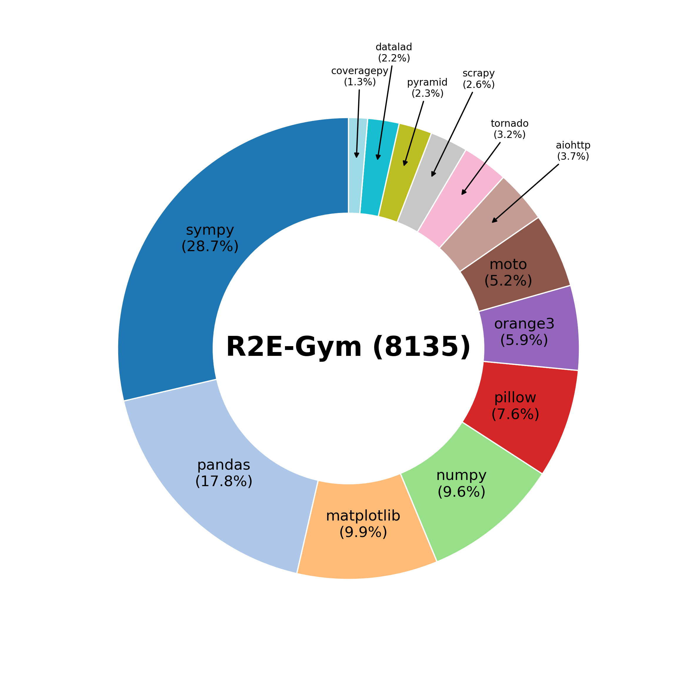

<figcaption>図9: 8135 インスタンスからなる R2E-Gym の全データセットのリポジトリの分布。</figcaption>
</figure>

**コミットのフィルタのヒューリスティクス。**
我々のコミットのフィルタ手法は、訓練データに適した高品質なバグ修正と改善を特定するために、複数のヒューリスティクスを用いる。
特に、範囲の小さい変更、ドキュメント以外の更新を優先すること、コードとテストの対応がとれていることでフィルタする。
このフィルタを行単位と AST のエンティティ単位の両方で行う。
一貫性と品質を確保するため、フィルタの過程で次の具体的なしきい値を用いる。

- 1 つのコミットで変更されるテスト以外のファイルは最大 5 個
- テスト以外のすべてのファイルで編集される行は最大 100 行
- 変更を絞るため、パッチの長さは最大 2000 文字
- テスト以外のファイルで削除されるエンティティは 1 個以下
- テスト以外のファイルで追加されるエンティティは最大 3 個
- テスト以外のファイルで編集されるエンティティは最大 3 個
- 扱いやすさを保つため、文単位の変更は 10 個以下

加えて、データセットをさらに絞り込むため、LLM をジャッジとして使うフィルタを用いる。

**リポジトリのインストール。**
GitHub リポジトリの過去のコミットをインストールすることは、依存関係の要件や API の変化のために大きな課題となる。
各コミットについて再現可能な環境を作るため、探索ベースの依存関係の解決戦略を伴う Docker ベースの手法を用いる。
インストールの過程は次の手順に従う。

1. requirements.txt、setup.py などから依存関係の情報を抽出する
2. 潜在的なバージョンの競合と互換性の問題を反復的に特定する
3. 依存関係の構成の候補を複数生成する
4. 動く環境が見つかるまで各構成を試す

この過程は半手動でスケールさせるのが難しく、将来はより LLM に頼ることを目指している。
インストールスクリプトの例は、複数の依存関係の組み合わせを順に試し、最初にビルドが成功した時点で終了する。

```bash
build_and_check_pandas(){
    local python_version=$1;
    local numpy_version=$1;
    local setuptools_version=$3$
    ...
}

# Attempt with first configuration
if build_and_check_pandas "3.7" "1.17.*" "<0.30" "62.*" "0.23"; then
  echo "[INFO] First combo succeeded. Exiting."
  exit 0
fi

# Attempt with second configuration
if build_and_check_pandas "3.8" "1.20.*" "<0.30" "62.*" "0.23"; then
  echo "[INFO] Second combo succeeded. Exiting."
  exit 0
fi

# Attempt with third configuration
if build_and_check_pandas "3.10" "1.26.*" "===3.0.5" "62.*" "0.23"; then
  echo "[INFO] Third combo succeeded. Exiting."
  exit 0
fi
```

Listing 1: インストールスクリプトの抜粋の例

> 訳注: Listing 1 の `local numpy_version=$1;`（`$2` ではない）と `$3$` は原典のまま。

この手法により、過去のコミットについて動く環境を作ることができ、データセットを実行ベースで検証できるようになる。

**テスト生成。**
Agentless に似た再現テストの生成手法を用いる。
重要な違いは、テストを生成するときに正解パッチを文脈として使うことである。

**イシュー生成。**
本文で述べたとおり、人間が書いた GitHub のイシューを持たないコミットについて合成のイシューを生成するために、逆翻訳を用いる。
我々の手法は、コミットのコード変更とテストの実行結果の両方を活用して、現実的で情報量の多いイシューの記述を作る。
イシュー生成の過程は次の手順に従う。

1. 実行結果から失敗するテスト関数を抽出する
2. テストの出力を分析して、エラーメッセージと期待される振る舞いを特定する
3. LLM にコミットメッセージ、コードのパッチ、テストの実行結果を与える
4. 解決策を明かさずにバグを説明する、簡潔で情報量の多いイシューを生成するよう LLM を導く

各コミットについて、次の具体的な構成要素を抽出して利用する。

- コミットのメタデータ: ハッシュとコミットメッセージが変更についての文脈を与える
- コードのパッチ: テスト以外のファイルの変更（何が修正されたかを示す）とテストファイルの変更（修正をどう検証するかを示す）を分ける
- テストの実行: 古い（失敗する）実行と新しい（通る）実行の両方を含める
- テスト関数: バグを示す関連するテスト関数を抽出する
- アサーションの失敗: エラーの詳細を示すため、古いコミットで失敗したアサーションを抽出して整形する

プロンプトの構成は、これらの構成要素を注意深く整理し、LLM に十分な文脈を与えながら、イシュー生成に最も関係する情報に注意を向けさせる。
生成されたイシューが人間の書いたものに似るように、明確さ、自然さ、バグを理解するのに十分な情報の提供に焦点を当ててプロンプト戦略を注意深く設計する。

```python
# Build the complete prompt with all components
def get_prompt(commit, execution_result, issues=None):
    # Include commit hash and message
    # Include commit patch (non-test files)
    # Include test file changes
    # Include execution results from old and new commits
    # Include improved test functions
    # Include test function code
    # Include assertion failures
    # Include example issues and instructions
```

Listing 2: イシュー生成のコードの構造

以下のテンプレートは、我々のプロンプトのガイドラインを示す。

```text
As you are trying to generate synthetic issues, you will follow these guidelines:

1. Keep the issue concise and informative.
2. Describe the failing test, including the input that causes the failure, the nature of the failure, and the expected behavior. Do NOT mention test functions or files directly.
3. Do not reveal the solution to the problem in the issue. Only describe the bug and the expected behavior.
4. If there are multiple failing tests, focus on the most informative one or a subset that best describes the general nature of the failure.
5. Describe the expected output of the failing test:
   - For errors, describe the error message.
   - For failing tests, mention what is supposed to happen.
6. Write the issue as a human would, using simple language without excessive formatting.
7. Use concrete terms to describe the nature of the failure. Avoid vague terms like "specific output" or "certain data".
8. INCLUDE test code to describe the bug but keep it brief and relevant. Truncate or simplify tests longer than 5-6 lines.
9. Do not mention external files unless absolutely necessary.
10. Format code snippets using triple backticks.

The issue should include:
1. A clear and concise title
2. A description of the problem with detailed example buggy code
3. Expected behavior
4. Actual behavior or error message
```

Listing 3: イシュー生成のテンプレート

> 訳注（Listing 3 の要旨）: 合成イシューを書くための指示。簡潔に書く、失敗するテストの入力・失敗の性質・期待される振る舞いを書くがテスト関数やファイル名には直接触れない、解決策を明かさない、人間が書くように平易に書く、曖昧な語を避ける、バグを示すテストコードを短く含める、などの 10 項目と、イシューに含めるべき 4 要素（題、バグのあるコード例つきの説明、期待される振る舞い、実際の振る舞いまたはエラーメッセージ）。

この手法により、人間が書いたイシューを持たないコミットについても、訓練データに明確な問題文を与える高品質な合成イシューを生成できる。
以下は、我々の手法で生成した合成イシューの例である。

````markdown
**Title:** Calling `load()` Before `draft()` Causes `draft()` to Fail for JPEG Images

**Description:**
When generating a thumbnail for a JPEG image using the `thumbnail()` method, the method calls `load()` before `draft()`. This sequence results in the `draft()` method returning `None`, which prevents the thumbnail from being properly optimized.

**Example Code:**
```python
from PIL import Image

with Image.open("Tests/images/hopper.jpg") as im:
    im.thumbnail((64, 64))
```

**Expected Behavior:**
The `thumbnail()` method should utilize the `draft()` method to optimize the image size before loading, ensuring that the thumbnail is resized correctly and efficiently.

**Actual Behavior:**
The `draft()` method returns `None` because `load()` is invoked before it. This prevents the thumbnail from being optimized, potentially leading to incorrect thumbnail sizes or unnecessary memory usage.
````

Listing 4: PIL の画像のサムネイルのバグについての合成イシューの例

````markdown
**Title:** Unable to Register Route with Names Containing Both Dots and Colons

**Description:**
After merging branch '0.18', attempting to register a route with a name that includes both dots (`.`) and colons (`:`) results in a `ValueError`. The recent changes were intended to allow route names to be a sequence of Python identifiers separated by dots or colons, but this combination is still causing issues.

**Example Code:**
```python
from aiohttp.web import UrlDispatcher, PlainRoute

def handler(request):
    return 'Hello'

router = UrlDispatcher()

# Attempting to register a route with both dots and colons in the name
route = PlainRoute('GET', handler, 'test.test:test', '/handler/to/path')
router.register_route(route)
```

**Expected Behavior:**
Registering a route with a name like `'test.test:test'` should succeed without errors, as the name follows the updated rules allowing multiple identifiers separated by dots or colons.

**Actual Behavior:**
A `ValueError` is raised with the message:
```
ValueError: Incorrect route name value, Route name should be a sequence of python identifiers separated by dot or column
```
This prevents the registration of route names that include both dots and colons, contrary to the intended flexibility introduced in the recent commit.
````

Listing 5: ルート名の検証のバグについての合成イシューの例

> 訳注（Listing 4・5 の要旨）: Listing 4 は、Pillow で JPEG のサムネイルを作るとき `thumbnail()` が `draft()` より前に `load()` を呼ぶため `draft()` が `None` を返し、サムネイルが最適化されないというイシュー。Listing 5 は、aiohttp でドットとコロンの両方を含む名前のルートを登録すると `ValueError` になるというイシュー。どちらも題・説明・コード例・期待される振る舞い・実際の振る舞いの形式で書かれている。

**パッチの最小化。**
正解パッチには、バグの修正に必要のない無関係なコード変更が含まれることが多く、プログラムのスタイルや構造に手を加えていることがよくある。
コード変更を反復的に取り除いてテストがまだ通るかを確かめることで、バグの修正に必要な最小限のコード変更の集合を特定するパッチ最小化の手法を実装する。
これにより、LLM の位置特定（localization）の能力を評価するための細かい信号を収集できる。

## Appendix B SFT Training（付録 B SFT による訓練）

**エージェントの詳細。**

```text
[Issue + Code] ──▶ [Editing Agent] ──(Trajectory)──▶ [Patch]
```

図10: コード編集エージェントのアーキテクチャ。エージェントはイシューの記述とコードベースを入力として受け取り、イシューを修正するパッチを出力する。

> 訳注: 図 10〜12 は原ページでは SVG の箱図。箱の中の文字と矢印をテキストで起こした。

R2E-Gym を使って、汎用のプロンプティングエージェントを訓練する。具体的には、実行可能な環境 $\mathcal{E}$ と問題記述 $\mathcal{D}$ が与えられ、あらゆる手段を使って与えられたイシューを解くよう求められる R2E-Gym のタスクで、コード編集エージェントを訓練する。特に (Orwall, 2024) とは異なり、専用のワークフローの使用には頼らない。エージェントは、自分で再現スクリプトを書き、バグを見つけ、修正を提案し、その正しさをテストすることまでを含め、タスク全体を end-to-end で解くことを課される。(Wang et al., 2024) と同様に、エージェントには finish ツールも与えられ、タスクを完了したと考えたら解を提出できる。

**エージェントとツール。** (Aleithan et al., 2024; Wang et al., 2024) と同様に、エージェントの設計には伝統的な ReAct の形式（Yao et al., 2022）を採用する。AgentHub では、エージェントが多様な SWE タスクを行えるよう、最小限の 4 つのツールを使う。1) file_editor: ファイルの閲覧と編集のため、2) search_tool: 指定したファイルやフォルダの中で関連する語を検索するため、3) execute_bash: 非対話的な bash コマンドの実行を可能にする（*例えば*テストスクリプトの実行のため）、4) submit: 期待される出力を返しつつ現在の軌跡を終えるため。訓練の過程で、エージェントにはインターネットやブラウザへのアクセスは与えない。

**データの収集。** 訓練には、sonnet-3.5 モデルの軌跡を教師として、棄却サンプリング（rejection sampling）つきの教師ありファインチューニングを用いる。汚染を避けるため、SWE-Bench のデータセットと重ならないリポジトリからなる R2E-Gym の部分集合だけを使う。得られた部分集合（R2E-Gym-lite）は、10 リポジトリにまたがる 4538 の実行可能な環境からなる（図 2）。全体として、2048 の異なるテスト環境から合計 3321 本の成功した軌跡を収集する。棄却サンプリングには、R2E-Gym の環境のユニットテスト（合成したものと既存のものの両方）を使う。各軌跡について、最大 $N=40$ ステップを使う。また、軌跡あたりのトークン数を最大 32K トークンに制限する。最後に、エージェントが長時間動くバックグラウンドプロセスを起動するような場合を避けるため、軌跡全体で最大 10 分、各行動の実行で 90 秒のタイムアウトを使う。訓練データはすべて温度 0.2 で収集する。

**訓練の設定とハイパーパラメータ。** 訓練では、R2E-Gym で Swe エージェントを訓練するためのベースモデルとして Qwen-2.5-Coder の 7B、14B、32B のシリーズを使う。訓練では、上で収集した軌跡を使い、LLaMA-Factory（Zheng et al., 2024）で全パラメータの SFT を行う。モデル全体を合計 2 エポック、バッチサイズ 8、学習率 $1e^{-5}$ で訓練する。訓練のウォームアップ比は 0.1 とした。計算資源の制約のため、エージェントの訓練には最大コンテキスト長 20K を使った。将来は、コンテキスト並列（context-parallelism）を使うことで、より長いコンテキスト長を必要とするより複雑なタスクで Swe エージェントを訓練するときに、性能をさらに押し上げられるだろう。

## Appendix C Inference Time Scaling（付録 C 推論時スケーリング）

### C.1 Execution-Based Testing Agents（実行ベースのテストエージェント）

```text
[Issue + Code] ──▶ [Testing Agent] ──(Trajectory)──▶ [Test Patch]
```

図11: テストエージェントのアーキテクチャ。エージェントは、候補のパッチがイシューを解決するかどうかを検証するための包括的なテストケースを生成する。

**エージェントの詳細。** 候補のパッチがイシューを解決するかどうか（*すなわち*、パッチが生成されたテストスイートを通るかどうか）を判定するために、再現テストケースを生成する専用の*テストエージェント*を訓練する。具体的には、さまざまな入力やコーナーケースなどをカバーする $M=10$ 個の多様なテストを含む包括的なテストスクリプトを生成するよう、テストエージェント（Qwen-Coder-32B をベースモデルとして使用）を訓練する。テストエージェントの訓練には、3 節と同じエージェントの足場を使う。

**データの収集。** 訓練には、sonnet-3.5 モデルの軌跡を教師とした教師ありファインチューニングを用いる。全体として、sonnet から合計 2203 本のテスト生成の軌跡を収集する（棄却サンプリングを最小限にした、正例と負例の両方の軌跡）。各軌跡について最大 $N=40$ ステップを使う。また、軌跡あたりのトークン数を最大 20K トークンに制限する。最後に、エージェントが長時間動くバックグラウンドプロセスを起動するような場合を避けるため、軌跡全体で最大 5 分、各行動の実行で 60 秒のタイムアウトを使う。

**訓練の設定とハイパーパラメータ。** 訓練では、Qwen-Coder-32B モデルをベースモデルとして使う。次に、上で収集した SFT の訓練軌跡を使い、LLaMA-Factory（Zheng et al., 2024）で Qwen-Coder-32B モデルの全パラメータのファインチューニングを行う。モデル全体を合計 2 エポック、バッチサイズ 8、学習率 $1e-5$ で訓練する。エージェントの訓練には最大コンテキスト長 20K を使った。訓練のウォームアップ比は 0.1 とした。

**文脈内の開始コードの手本。**
テストエージェントには、次の文脈内の開始コードの手本（Django リポジトリから）を与える。

```python
    frame=shadowbox,
    backgroundcolor=\color{blue!5},
    rulecolor=\color{purple!40!black},
    basicstyle=\small\ttfamily,
    keywordstyle=\color{purple!70!black},
    commentstyle=\color{green!50!black},
    stringstyle=\color{red!60!black},
    breaklines=true,
    captionpos=b,
caption=Incontext Demonstration for Testing Agent]
import os
import django
from django.conf import settings
from django.db import models
from django.test import TestCase
from django.test.utils import setup_test_environment

# Configure Django settings before setup
os.environ.setdefault('DJANGO_SETTINGS_MODULE', 'tests.test_sqlite')

# Override settings
settings.configure(
    DATABASES={
        "default": {
            "ENGINE": "django.db.backends.sqlite3",
            "NAME": "test.db",
            "TEST": {
                "NAME": "test.db",
            },
        }
    },
    INSTALLED_APPS=["tests"],
    MIGRATION_MODULES={"tests": None},  # Disable migrations for the tests app
)

# Setup Django
django.setup()
setup_test_environment()

# Define test models
class ExampleModel(models.Model):
    example_char = models.CharField(max_length=255)
    example_int = models.IntegerField()

    class Meta:
        app_label = 'tests'  # Set the app_label to 'tests'

# Create the database tables
from django.core.management import call_command
call_command('migrate', run_syncdb=True)

def add_test_data():
    """Create test instances of the model"""
    ExampleModel.objects.create(example_char="Test 1", example_int=1)
    ExampleModel.objects.create(example_char="Test 2", example_int=2)

# Add test data
add_test_data()
```

> 訳注: 冒頭の `frame=shadowbox,` から `caption=…]` までの行は、LaTeX の listings の書式指定が原ページに漏れ出たもので、原典のまま残した。

### C.2 Execution-Free Verifiers（実行なしの検証器）

```text
[Trajectory (Issue + React-Loop + Patch)] ──▶ [Trajectory Verifier] ──▶ [YES/NO]
```

図12: 実行なしの検証器のアーキテクチャ。検証器は、コードを実行せずに、軌跡全体に基づいてパッチが正しいかどうかを予測する。

**検証器の詳細。** 実行ベースの「テストエージェント」に加えて、実行なしの結果教師つき報酬モデル（outcome-supervised reward models、別名 検証器）（Cobbe et al., 2021）も探る。具体的には、R2E-Gym 環境でのコード編集エージェントの問題文 $\mathcal{D}$、エージェントの軌跡 $\mathcal{T}=\{a_{1},o_{1},a_{2},o_{2},\ldots,a_{n},o_{n}\}$、出力パッチ $\mathcal{O}$ が与えられたとき、出力パッチが正しい確率を予測するスカラーのスコア値 $s^{EF}\in[0,1]$ を出力するよう Qwen2.5-Coder-14B モデル（Yang et al., 2024a）を訓練する。具体的には、(Pan et al., 2024) にならい、各パッチの正しさを出力トークン YES（正しい）と NO（誤り）で出力する。全体の報酬スコアは、YES トークンの相対確率を正規化して $r=\mathrm{P}(\texttt{YES})/(\mathrm{P}(\texttt{YES})+\mathrm{P}(\texttt{NO}))$ として計算する。ここで P(YES) と P(NO) は、対応するトークン予測の対数確率から推定する。

**訓練データ。** まず、検証器の訓練のための正例と負例の集まりを得るため、コード編集エージェントの訓練（§3）のために収集した軌跡を使う。
(Pan et al., 2024) の最良の構成にならい、訓練した 32B モデルを使ってオンポリシーの軌跡も生成する。
次に、正例と負例の数が等しくなるように収集したサンプルをフィルタする。データセット全体は、正例と負例の両方を含む合計 5700 本の軌跡からなる。訓練では (Pan et al., 2024) のテンプレートにならい、正例の軌跡には YES、負例の軌跡には NO と出力を予測するよう LLM に求める。

**訓練の設定とハイパーパラメータ。** 訓練では、Qwen-Coder-14B モデルをベースモデルとして使う。次に、上で収集した SFT の訓練軌跡を使い、LLaMA-Factory（Zheng et al., 2024）でファインチューニングを行う。(Pan et al., 2024) と同様に、ランク 64 の LORA ファインチューニングを行う。モデル全体を合計 2 エポック、バッチサイズ 8、学習率 $1e-5$ で訓練する。訓練には最大コンテキスト長 32K を使った。訓練のウォームアップ比は 0.1 とした。

### C.3 Execution-Based Analysis（実行ベースの分析）

実行ベースのテストエージェントの分析では、生成されたテストの判別性と毒性という 2 つの重要な指標に注目する。これらの指標は、実行ベースの検証の有効性と限界を理解するのに役立つ。

**判別率（Distinguishability Rate）。** 判別率は、正しいパッチと誤ったパッチを区別するテストの能力を測る。正しいパッチに適用したときと誤ったパッチに適用したときで振る舞いが異なるなら、そのテストは「判別する」とみなす。実際的には、そのテストがどのパッチが正しくどれが正しくないかを特定する助けになることを意味する。

例えば、すべての正しいパッチで通り、すべての誤ったパッチで失敗するテストを考えると、このテストは完全な判別性を持つ。逆に、正しいパッチと誤ったパッチの両方で通る（または失敗する）テストは、両者を区別するための有用な信号を与えない。
数学的には、あるテスト $t$ と、正しいパッチ $P_{c}$ と誤ったパッチ $P_{i}$ に分けたパッチの集合 $P$ について、判別性の指標を次のように計算する。

$$
\text{Distinguish}(t)=\mathbb{1}\left[\max_{p\in P_{i}}\text{Pass}(p,t)\neq\max_{p\in P_{c}}\text{Pass}(p,t)\right] \tag{3}
$$

ここで $\text{Pass}(p,t)$ はパッチ $p$ がテスト $t$ を通るかどうかを示し、$\mathbb{1}[\cdot]$ は指示関数である。この式は、最も成績の良い誤ったパッチが、最も成績の良い正しいパッチと比べて、そのテストで異なる振る舞いをするかどうかを確かめる。テストの集合 $T$ の判別率は、すべてのテストにわたる判別性の平均である。

$$
\text{DistinguishRate}(T)=\frac{1}{|T|}\sum_{t\in T}\text{Distinguish}(t) \tag{4}
$$

分析の結果、生成されたテストの多くは判別率が低く、典型的には正しいパッチと誤ったパッチを効果的に区別できるテストは 20% 未満であることが分かった。この限界は、特に候補のパッチの数が増えるにつれて、実行ベースの検証が最良のパッチを特定する能力に大きく影響する。

**毒性率（Toxicity Rate）。** 毒性のあるテストを、正しいパッチより誤ったパッチを誤って有利にするテストと定義する。毒性率は、この振る舞いを示すテストの割合である。数学的には次のとおりである。

$$
\text{Toxic}(t)=\mathbb{1}\left[\max_{p\in P_{i}}\text{Pass}(p,t)>\max_{p\in P_{c}}\text{Pass}(p,t)\right] \tag{5}
$$

テストの集合 $T$ の毒性率は次のとおりである。

$$
\text{ToxicityRate}(T)=\frac{1}{|T|}\sum_{t\in T}\text{Toxic}(t) \tag{6}
$$

毒性のあるテストは一般にまれだが、存在すると検証の信頼性に大きく影響しうり、一部の問題では毒性率が最大 10% に達する。これらの結果は、多様で高品質なテストを生成することの重要性と、より頑健な結果を得るために実行ベースの検証を実行なしの検証器のような他の手法と組み合わせることの価値を浮き彫りにしている。

> 訳注: 式 (3)・(5) の指示関数は、原典では `\mathbbm{1}` で書かれている。表示のため `\mathbb{1}` に置き換えた。

### C.4 Execution-Free Analysis（実行なしの分析）

図 13 は、実行なしの検証器の限界を示す。

```text
Since we've:
 1. Successfully reproduced the issue
 2. Implemented a fix
 3. Verified the fix works
 4. Ensured edge cases are handled
 5. Maintained backward compatibility

I believe we can now submit this as the solution:

<function=finish>
  <parameter=command>submit</parameter>
  <parameter=result>Fixed the `_check_homomorphism` function...
```

```text
[ASSISTANT]
Great! The fix works. Let's analyze what we did:

1. We identified the original code was failing because
   it was using a `.inverse()` method directly, which
   doesn't exist for permutations.
2. We fixed the issue by:
   - Using `**-1` for inverses, which works for both
     Permutations and FreeGroupElements
```

```text
[ASSISTANT]
The changes look good. I've made the following improvements:
1. Simplified logic to check both the generator and inverse
2. Used the `**-1` operator for Permutation and FreeGroupElement
3. Maintained robust handling of inverted generators

Let's run the reproduce script again:

<function=execute_bash>
  <parameter=cmd>python reproduce_issue.py</parameter>
</function>
[/ASSISTANT]
```

```text
[USER]
Exit code: 0
Execution output of [execute_bash]:
[STDOUT]

Testing with DihedralGroup(3):
SUCCESS: Homomorphism created successfully

Testing with SymmetricGroup(3):
SUCCESS: Homomorphism created successfully
```

図13: 実行なしの検証器の限界の分析。エージェントの軌跡の上で平均の注意スコアが最も高い上位 $k=4$ のスライディングウィンドウ（§4.2 を参照）を分析する定性的な可視化（sympy__sympy-24443: SWE-Bench）。報酬モデル（RM）が、最終的な出力パッチに頼る代わりに、エージェントの思考／行動によって偏りうることが観察される。

> 訳注（図 13 の 4 つの窓の要旨）: 1 つ目は「問題を再現し、修正を実装し、修正が動くことを確かめ、エッジケースを扱い、後方互換性を保ったので提出できる」とエージェントが述べて finish を呼ぶ箇所。2 つ目と 3 つ目は「修正はうまくいった」「変更は良さそうだ」と自分の変更をまとめる箇所。4 つ目は再現スクリプトが `SUCCESS` を出力した実行結果。いずれも正しさを主張する文で、この軌跡のパッチ自体は誤りである。

<figure>

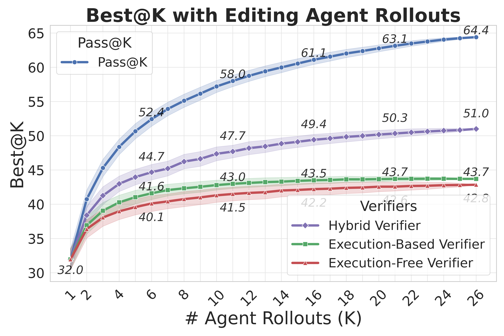

<figcaption>図14（左）: 我々のエージェントのテストを使った場合の Pass@K と Best@K。</figcaption>
</figure>

<figure>

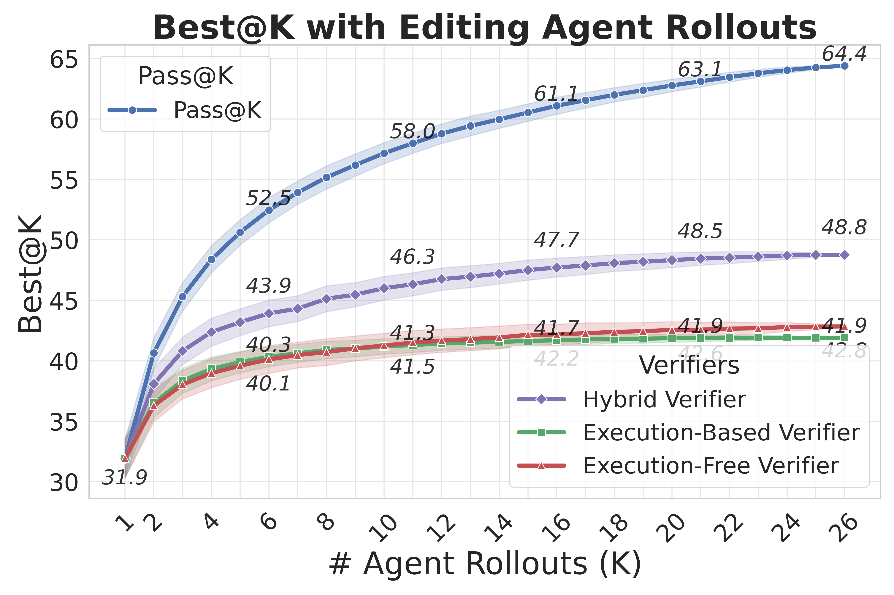

<figcaption>図14（右）: Agentless のテストを使った場合。図14: それぞれ、我々のエージェントを使った場合と Agentless のテストを使った場合の Pass@K のプロット。</figcaption>
</figure>

## Appendix D Example Testing Agent Outputs（付録 D テストエージェントの出力例）

この節では、我々の手法で生成したテストケースの例を示す。

### D.1 Example 1: SymPy Relational Parsing Tests（例 1: SymPy の関係演算子のパースのテスト）

次の例は、SymPy の関係演算子のパースを検証するテストスイートを切り詰めたもので、我々の手法が複数のテストケースを生成できることを示している。このテストは、SymPy ライブラリの関係演算子のパースを修正する [SymPy PR #24661](https://github.com/sympy/sympy/pull/24661) のイシューに対処するために生成された。

```python
from sympy import Lt, Gt, Le, Ge, Eq, Ne

def test_relational_parsing():
    # Test case 1: Basic less than operation
    try:
        result = parse_expr('1 < 2', evaluate=False)
        expected = Lt(1, 2, evaluate=False)
        if str(result) == str(expected):
            print("Test Case 1: Issue resolved")
        else:
            print("Test Case 1: Issue reproduced")
    except Exception as e:
        print("Test Case 1: Other issues")

    # Test case 2: Greater than operation
    try:
        result = parse_expr('3 > 2', evaluate=False)
        expected = Gt(3, 2, evaluate=False)
        if str(result) == str(expected):
            print("Test Case 2: Issue resolved")
        else:
            print("Test Case 2: Issue reproduced")
    except Exception as e:
        print("Test Case 2: Other issues")

    # ... [6 more test cases omitted for brevity] ...

    # Test case 9: Chained comparisons
    try:
        result = parse_expr('1 < x < 2', evaluate=False)
        if isinstance(result, bool):
            print("Test Case 9: Issue reproduced")
        else:
            print("Test Case 9: Issue resolved")
    except Exception as e:
        print("Test Case 9: Other issues")
```

Listing 6: SymPy の関係演算子のパースのテストケース（切り詰め）。誤ったコードを正しいコードから見分けることに成功する。

### D.2 Example 2: Django Model Choice Field Validation Tests（例 2: Django の ModelChoiceField の検証のテスト）

次の切り詰めた例は、適切なセットアップとティアダウンのコードを伴う、Django の ModelChoiceField の検証のテストを示す。このテストは、ModelChoiceField の検証のエラーメッセージを改善する [Django PR #13933](https://github.com/django/django/pull/13933) のイシューに対処するために生成された。

```python
from django.forms import ModelChoiceField, ModelMultipleChoiceField
from django.db import models
from django.core.exceptions import ValidationError
from django.test import TestCase
from django.db import connection

# Create a simple test model
class TestModel(models.Model):
    name = models.CharField(max_length=100)

    def __str__(self):
        return self.name

    class Meta:
        app_label = 'test_app'

def setup_test_environment():
    # Create the test table
    with connection.schema_editor() as schema_editor:
        schema_editor.create_model(TestModel)

    # Create some test data
    TestModel.objects.create(name="Option 1")
    TestModel.objects.create(name="Option 2")
    TestModel.objects.create(name="Option 3")

def cleanup_test_environment():
    # Drop the test table
    with connection.schema_editor() as schema_editor:
        schema_editor.delete_model(TestModel)

def test_modelchoice_validation():
    try:
        # Test Case 1: Basic invalid choice for ModelChoiceField
        field = ModelChoiceField(queryset=TestModel.objects.all())
        try:
            field.clean(999)  # Non-existent ID
            print("Test Case 1: Issue resolved")
        except ValidationError as e:
            if "999" not in str(e):  # Value should be in error message
                print("Test Case 1: Issue reproduced")
            else:
                print("Test Case 1: Issue resolved")

        # ... [4 more test cases omitted for brevity] ...

        # Test Case 6: Valid choice
        obj = TestModel.objects.first()
        try:
            result = field.clean(obj.id)
            if result == obj:
                print("Test Case 6: Issue resolved")
            else:
                print("Test Case 6: Issue reproduced")
        except ValidationError:
            print("Test Case 6: Issue reproduced")
    except Exception as e:
        print(f"Unexpected error: {e}")
```

Listing 7: Django の ModelChoiceField の検証のテストケース（切り詰め）。ほとんどのテストケースは処理されない例外のためにエラーになり、判別しない。

## Appendix E Agent Trajectory Example（付録 E エージェントの軌跡の例）

この節では、ソフトウェア工学のタスクを解くときのエージェントの軌跡の視覚的な例を示す。この流れは、問題文から解までの段階的な過程を示し、我々のエージェントが実世界のプログラミングのイシューにどう取り組み、どう解くかを示している。

<figure>

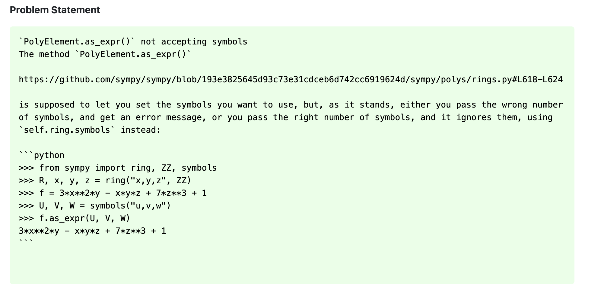

<figcaption>図15: エージェントに与えられた問題文。解決すべきイシューを記述している。</figcaption>
</figure>

<figure>

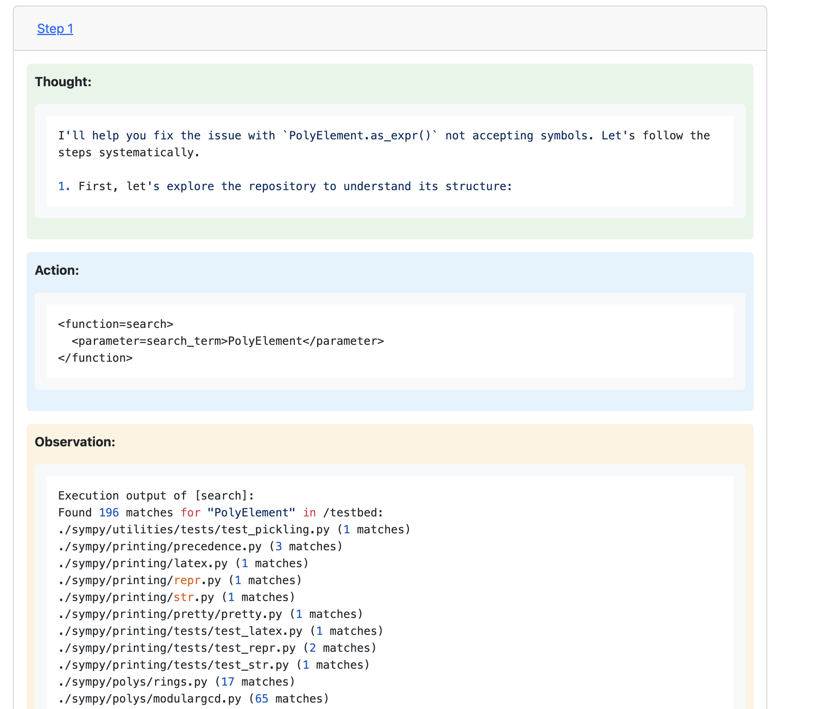

<figcaption>(a) ステップ 1: 最初の分析と探索</figcaption>
</figure>

<figure>

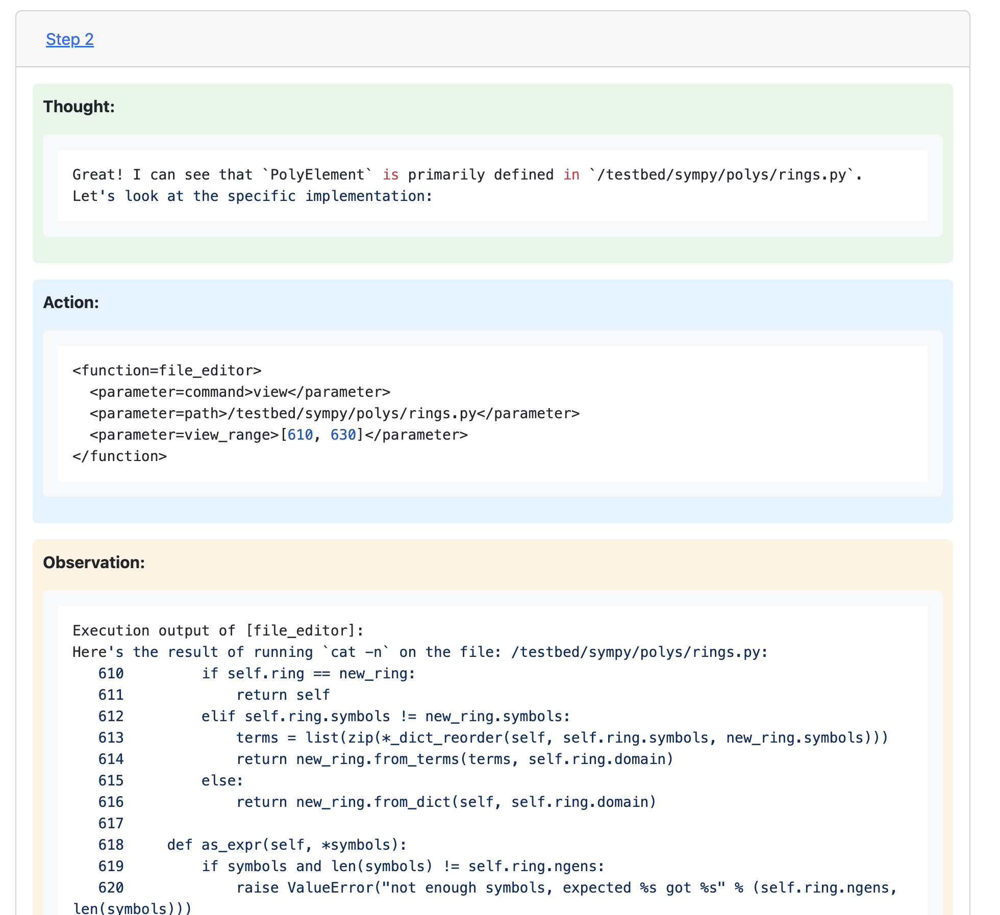

<figcaption>(b) ステップ 2: 詳細な探索</figcaption>
</figure>

<figure>

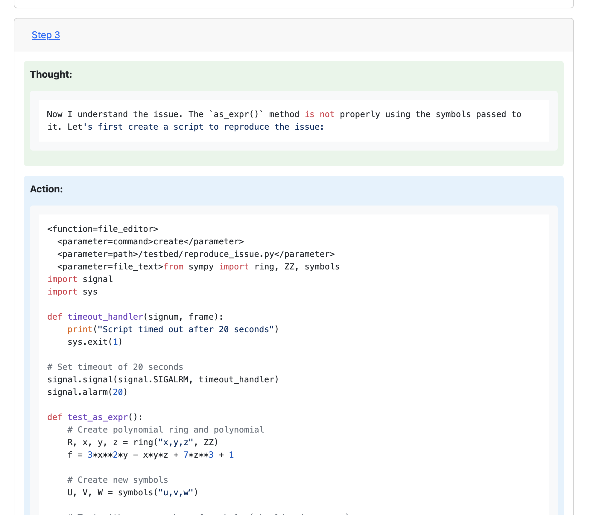

<figcaption>(c) ステップ 3: イシューの再現</figcaption>
</figure>

<figure>

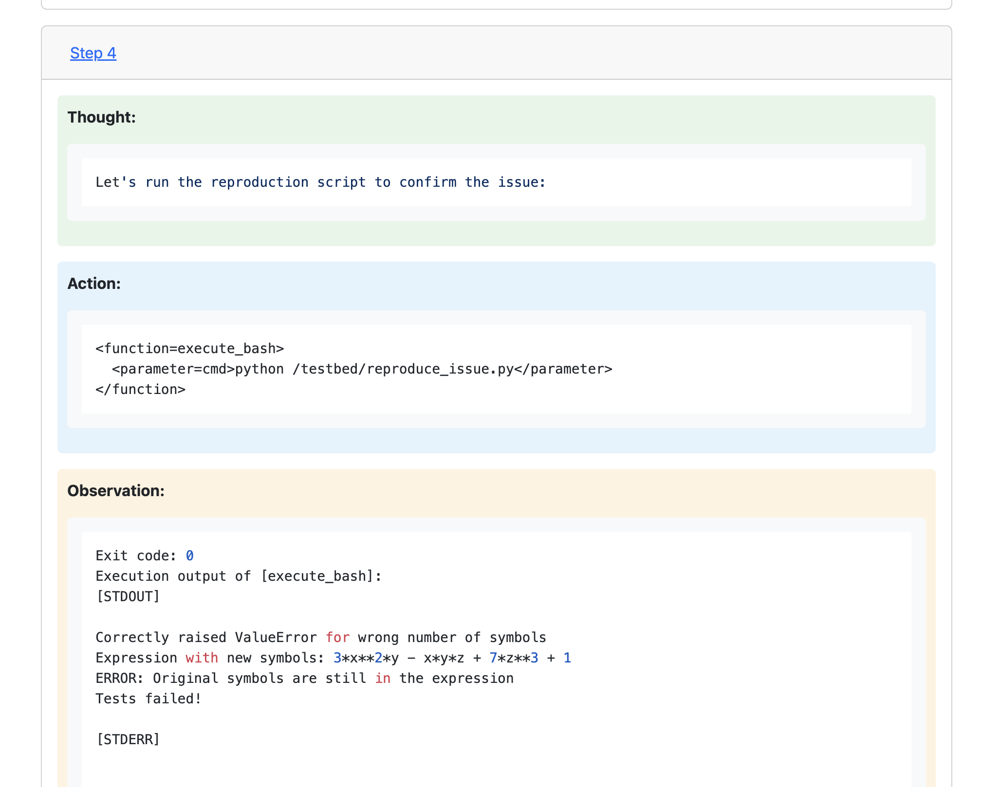

<figcaption>(d) ステップ 4: 再現テストの実行</figcaption>
</figure>

<figure>

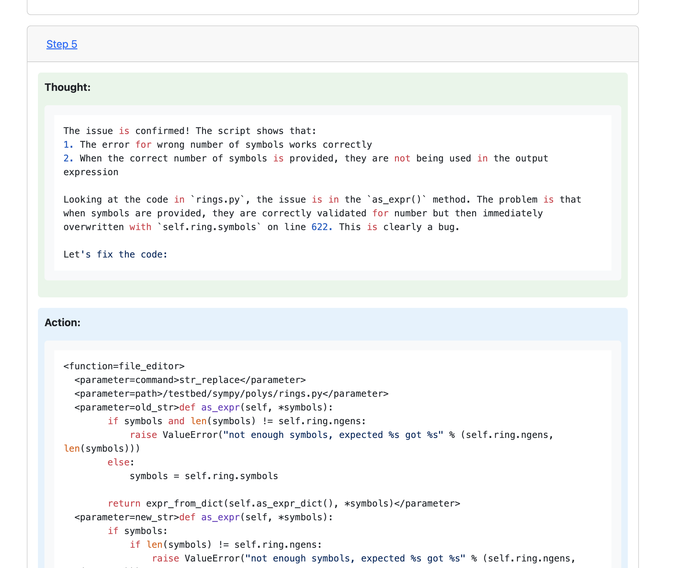

<figcaption>(e) ステップ 5: 修正の実装</figcaption>
</figure>

<figure>

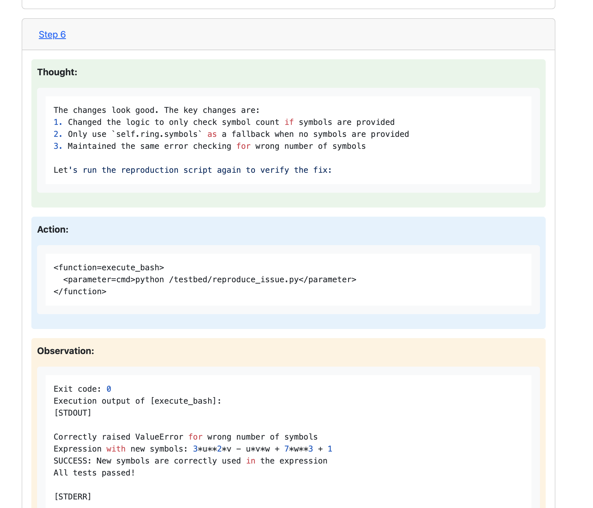

<figcaption>(f) ステップ 6: 修正の検証。図16: ソフトウェア工学のタスクを解く段階的な過程を示す、短い成功したエージェントの軌跡（我々の 32B モデルを使用）。エージェントは問題を分析し、根本原因を特定し、解を実装し、それをテストし、イシューが解決したことを検証する。</figcaption>
</figure>

この軌跡の例は、我々のエージェントの問題解決の手法のいくつかの重要な側面を示している。

- 体系的な探索: エージェントは、文脈を理解しイシューの場所を特定するために、コードベースを順序立てて探索する。
- 根本原因の分析: 症状に対処するのではなく、エージェントは test_issue.py を使って問題の根底にある原因を特定する。
- 解の策定: エージェントは、変更を実装する前に明確な計画を立てる。

これらの能力により、我々のエージェントは、コードの構造、プログラミング言語の意味論、ソフトウェア設計の原則を深く理解する必要がある複雑なソフトウェア工学のタスクに効果的に取り組める。
