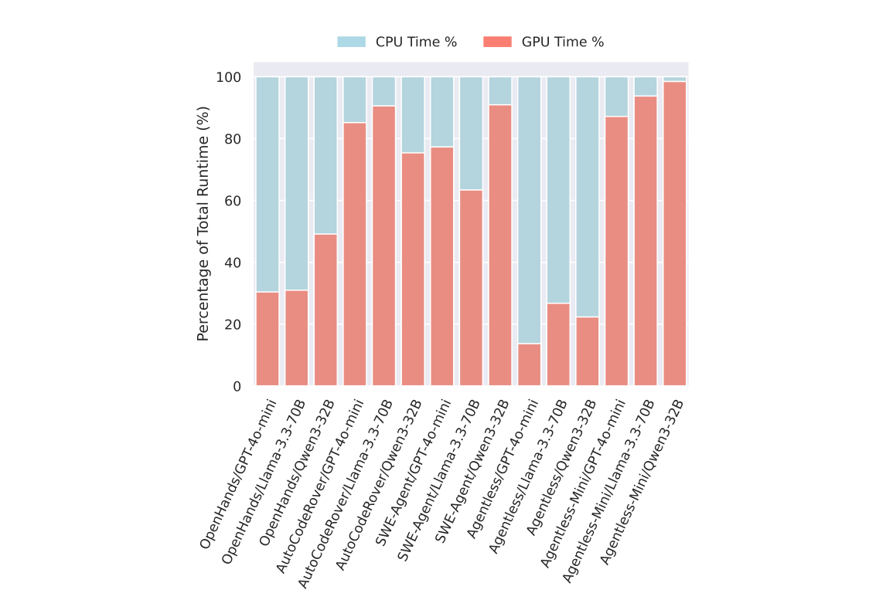
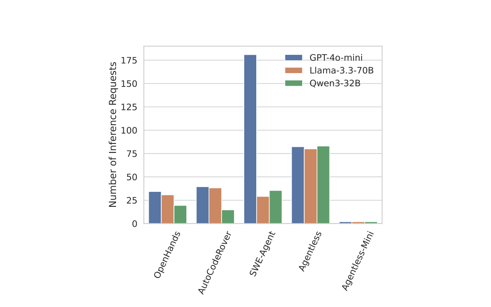
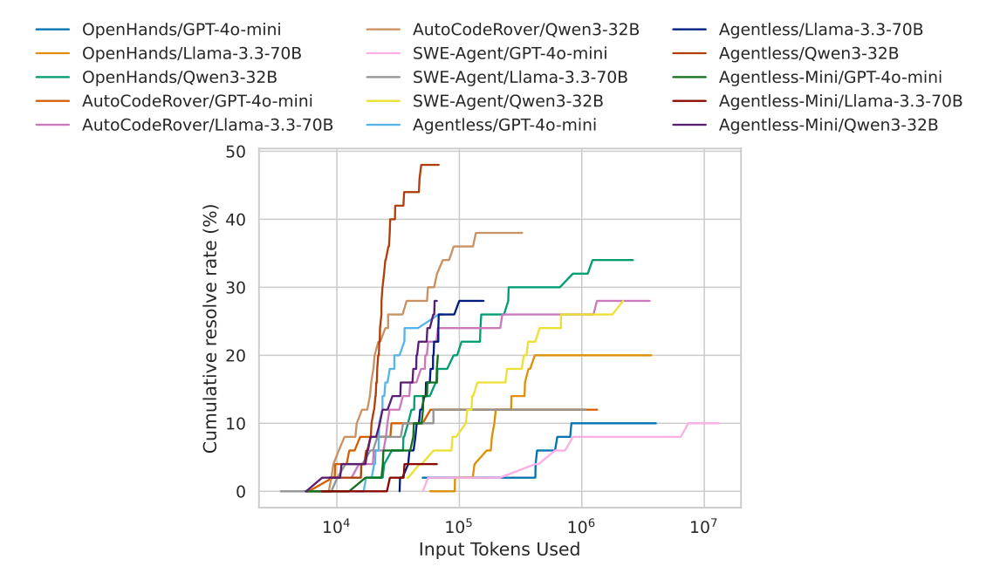
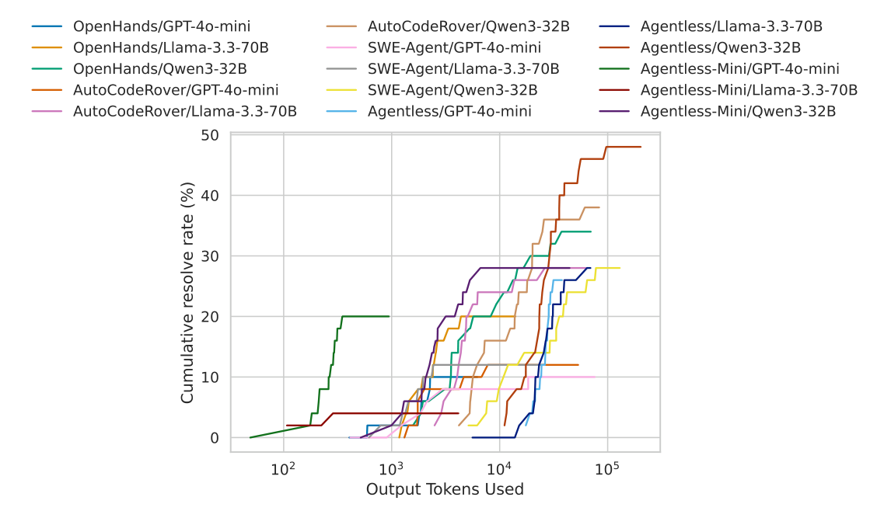
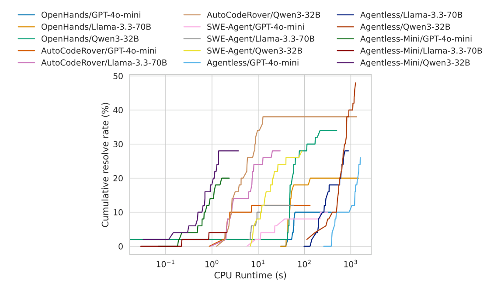

# SWE-Effi: 資源制約のもとでソフトウェア AI エージェントシステムの有効性を評価し直す

> 原題: SWE-Effi: Re-Evaluating Software AI Agent System Effectiveness Under Resource Constraints
> 著者: Zhiyu Fan, Kirill Vasilevski, Dayi Lin, Boyuan Chen, Yihao Chen（Huawei / Huawei Canada）, Zhiqing Zhong, Pinjia He（The Chinese University of Hong Kong, Shenzhen）, Jie M. Zhang（King’s College London）, Ahmed E. Hassan（Queen’s University）
> 出典: arXiv:2509.09853（ar5iv）・リーダーボード、データ、コード: https://centre-for-software-excellence.github.io/SWE-Effi/

> ［訳注］ar5iv のクリップを底本とした。クリップの不良を 2 点復元している。(1) **図 7 点（Figure 1 の 3 パネルと Figure 2〜7）の画像がすべて欠落**し、キャプションだけが残っていた。ar5iv の原ページにも画像がなかったため、arXiv の PDF（arXiv:2509.09853）から図の範囲を切り出して `raw/assets/2025-swe-effi/` に保存した。Figure 1 は 3 パネルを 1 枚にまとめている。(2) **脚注 1・2 の本文が欠落**していた（本文にマーカーだけが残っていた）ので、ar5iv の原ページから復元した。表 1〜3 は HTML の表を markdown に直した。参考文献の一覧は既定どおり訳出せず、本文の `[^N]` は原典の番号のまま残した。

###### Abstract（要旨）

大規模言語モデル（LLM）とコードエージェントの進歩は、自律的なイシュー解決や機能追加といったソフトウェアエンジニアリング（SWE）のタスクを支援する大きな可能性を示してきた。既存のソフトウェアエンジニアリング向け AI のリーダーボード（例: SWE-bench）は解の正確さだけに焦点を当てており、資源が制約された世界における有効性という決定的に重要な要因を無視している。これはソフトウェアエンジニアリングのタスクを超えても存在する普遍的な問題である。どんな AI システムも、正しいだけでは足りず、費用対効果が高くなければならない。この欠落に対処するため、私たちは SWE-Effi を導入する。これは、AI システムを総合的な有効性のスコアの観点から評価し直すための、新しい指標の集まりである。私たちは有効性を、結果の正確さ（例: イシュー解決率）と消費される資源（例: トークンと時間）の均衡として定義する。本論文では特にソフトウェアエンジニアリングのシナリオに焦点を当て、SWE-bench ベンチマークの部分集合で、イシュー解決のための人気のある AI システムを、私たちの新しい多次元の指標を使って順位づけし直す。その結果、AI システムの有効性は足場（scaffold）それ自体だけでなく、それが基盤モデルとどれだけうまく統合されているかに依存し、それが資源効率の良い方法で強い性能を達成する鍵であることがわかった。また私たちは、「トークンの雪だるま（token snowball）」効果や、より重大なものとして「高くつく失敗（expensive failures）」のパターンといった、体系的な課題も特定した。後者の場合、エージェントは解けないタスクに行き詰まりながら過剰な資源を消費する。これは実際の展開を制限するだけでなく、RL の訓練中に失敗したロールアウトのコストも押し上げる問題である。最後に、トークン予算のもとでの有効性と時間予算のもとでの有効性の間に明確なトレードオフがあることを観察した。これはプロジェクトの予算を管理するうえでも、速い応答が不可欠なスケーラブルな強化学習を可能にするうえでも、決定的な役割を果たす。リーダーボード、データ、コードは [https://centre-for-software-excellence.github.io/SWE-Effi/](https://centre-for-software-excellence.github.io/SWE-Effi/) にある。（∗ 同等の貢献）

## 1 Introduction（はじめに）

SWE-bench [^1] のようなベンチマークのリーダーボードは、開発者が提出したイシューを解決するといった、リポジトリ規模の SWE（ソフトウェアエンジニアリング）タスクにおける AI コーディングアシスタントの進歩を測る基盤を提供している。しかし、これらのリーダーボードの注目は、ほぼもっぱら単一の指標、すなわち解決率（resolve rate）に向けられている。現在の評価の枠組みは、資源が無制限であるという暗黙の前提のもとで動いていることが多いが、企業や開発者は資源の制約された現実の中で生きている。その解決策は数分で見つかったのか、それとも高価な GPU 時間を何時間も燃やしたのか。チームはこのエージェントを毎日回す余裕さえあるのか。こうした問いを無視することで、現在のベンチマークは実際の AI の展開の現実から乖離している。私たちの焦点はソフトウェアエンジニアリングにあるが、これは普遍的な問題である。どんな AI システムの解も、正しいだけでは足りず、費用対効果が高くなければならない。

この視点の転換は、AI 主導のソフトウェア開発における 2 つの重要な最前線にとって決定的に重要である。第一に、エージェントが特定の 1 つの SWE タスクを解くために大量の LLM トークンを（例えばテストタイム計算によって）消費し、リーダーボードでわずかな利得を得るという傾向が現れている。これは収穫逓減の法則について重大な問いを投げかける。解決率の 1% の改善は、5 倍のコスト増に見合うのか。私たちは、この道が真にスケーラブルで手の届くツールを作るうえで最も有望な方向ではないかもしれないと主張する。第二に、SWE エージェントの足場は、研究チームが強化学習（RL）を通じて SWE タスクに特化した、より賢く自己改善するモデルを訓練するための土台として、ますます使われるようになっている。長期ホライズンの RL（DeepResearch Agent [^2] や SkyRL [^3] の訓練のような）では、RL の過程が永遠に続かないよう、通常は有効性の要件がある。SWE タスクのシナリオでは、RL の各訓練ステップ、すなわち「ロールアウト」は、プロジェクト環境のセットアップ、LLM の推論、コードの実行、テストによる検証を含む。SWE エージェントの足場が遅かったり高価だったりすれば、RL の過程全体を妨げる。ロールアウトあたりの高いレイテンシは効果的な RL 訓練の重大な障壁となり、コミュニティ全体の進歩を制限する。例えば DeepSWE [^4] は、RL のための低レイテンシの性能を確保するために独自の足場を開発した。Sky-RL [^3] プロジェクトは OpenHands [^5] を使っているが、訓練を実現可能にするために大規模な最適化を必要としている。同様に、SWE-RL [^6] は軽量な Agentless-Mini [^6] を採用しているが、おそらく実行コストの高さのために、RL において直接の実行フィードバックを避けている。これらの課題が生じるのは、RL が大規模な試行錯誤に依存しており、それが足場の性能に直接影響されるためである。

この欠落を埋めるため、私たちは SWE-Effi を導入する。これは、AI システムを総合的な有効性のスコアの観点から評価し直すための、新しい指標の集まりである。新しいベンチマークではなく、私たちは確立された SWE-bench [^1] の上で AI システム[^n1]を評価し直し、分析する。はっきりさせておくと、SWE-Effi は SWE-bench [^1] のような既存のベンチマークを補完するよう設計されている。SWE-Effi は AI システムの評価に総合的な視点を提供し、資源制約のもとでの性能を浮き彫りにし、コスト予算のもとでの有効性を重視する。さらに SWE-Effi は、SWE タスクのための強化学習の有望な土台を見分けるための価値ある指標としても役立つ。

[^n1]: 「AI システム」とは、与えられたタスクを解くために協働する、AI モデル（LLM）とソフトウェアの足場（例: エージェント）を含む単一のソフトウェアシステムを指す。［訳注: 脚注本文はクリップで欠落していたため ar5iv から復元］

この視点で人気のある AI システムを評価し直すと、決定的で、しばしば直観に反する知見が得られる。システムの有効性は、その足場に固有の性質ではなく、基盤 LLM との相乗効果から生まれることがわかった。例えば、SWE-Agent の足場は Qwen3-32B モデルとの組み合わせでトークン予算のもとでの有効性（EuTB）が 21.8% というまずまずのスコアを達成するが、GPT-4o-mini と組み合わせるとその有効性は崩れ、EuTB スコアはわずか 5.1% になる。この劇的な低下は、私たちが特定したより大きな問題、すなわち「高くつく失敗」の症状である。私たちの分析は、この同じシステムについて、未解決の試行が平均で成功した試行の 4 倍を超える資源を消費することを明らかにしている。従来の解決率の指標からは完全に見えないこうした隠れたコストは、私たちの総合的な評価の枠組みが決定的に必要であることを示している。

私たちの主な貢献は、新しい評価の視点、指標、そして公開リーダーボードである。私たちは探索的な研究を行い、よく知られた 5 つの SWE エージェントの足場（AutoCodeRover [^7]、SWE-agent [^8]、OpenHands [^5]、Agentless [^9]、Agentless-Mini [^6]）を 3 つの異なる LLM（GPT-4o-mini [^10]、Llama-3.3-70B [^11]、Qwen3-32B [^12]）と組み合わせ、SWE イシューの代表的な部分集合で分析した。最終的な解決率も追跡したが、私たちの主な焦点は、イシュー解決における AI システム全体の時間と資源の有効性を評価し、その背後にある特性を分析することにあった。私たちが提示する知見は、これら 5 つの足場についての最終的で決定的な判定を意図したものではない。むしろそれは、同じ問題を別の視点から見ることで、より深い理解を引き出せることの一例である。

## 2 Related Work（関連研究）

### 2.1 AI System Evaluation on Software Engineering Tasks（ソフトウェアエンジニアリングのタスクにおける AI システムの評価）

LLM の発展にともない、研究者たちは、LLM が直接のコード生成を超えた、より複雑なソフトウェアエンジニアリングのタスクを遂行できるかを調べ始めた。Jimenez ら [^1] は、実際の GitHub のイシューを解決する LLM の能力を評価するために SWE-bench を初めて導入した。これは通常、イシューを理解し、編集すべきファイルの位置を特定し、それらを変更することを含む。後続の研究である SWE-bench-Verified [^13] は、人間の専門家による手作業での評価と高品質なインスタンスの選別を通じて、ベンチマークの品質と頑健性の改善を助けた。Baterdinov ら [^14] も、高品質な SWE データの限られた数を拡大し、SWE タスクのより良い評価を確保するために、21,000 件の新しい現実世界のタスクを提供して SWE-bench の研究を拡張した。同時に、Zan ら [^15] と Guo ら [^16] は、より多くのプログラミング言語を含み、図や画像のようなマルチモーダルなデータも含む SWE タスクの評価を提案した。GitHub のイシュー解決を超えて、ソフトウェアエンジニアリングのさまざまな側面に LLM を使うことを目指した研究は数多くある。Mündler ら [^17] は、自然言語で記述されたイシューを再現するテストケースを生成する LLM コーディングエージェントの能力を評価する SWT-BENCH を提案した。一方、He ら [^18] は、コードの性能改善と最適化における LLM の熟達度を評価するベンチマーク SWE-Perf を提供した。Zhao ら [^19] は、エンドツーエンドの自動 GUI テストのためにマルチモーダル LLM エージェントを評価する GTArena を導入した。Zhu ら [^20] は、脆弱な Web アプリケーションを悪用することを LLM エージェントに課す CVE-Bench を提案した。しかし、LLM とエージェントの性能を評価するこうした広範なベンチマークがあるにもかかわらず、それらのどれも SWE の AI システムの効率を体系的に測定しておらず、生成された解の正しさだけに焦点を当てていることが多い。

### 2.2 LLM-based methods for GitHub Issue Resolution（LLM にもとづく GitHub イシュー解決の手法）

近年、LLM で GitHub のイシューを解決することは、きわめて活発な研究テーマとなっている [^8] [^7] [^21] [^9] [^22] [^23] [^24] [^5] [^25]。最近のサーベイ [^26] [^27] に従うと、これらの手法は 2 種類に分類できる。エージェント型の手法（agentic methods）と手続き型の手法（procedural methods）である。エージェント型の手法は、LLM を使って自律的に計画し、意思決定し、ツールを使ってタスクを完了することでイシューを解決する。この枠組みでは、Yang ら [^8] が SWE-Agent を提案した。これは ReAct [^28] のループの中で LLM に基本的な編集とテストのツールを備えさせ、エージェントが一連のツールを用いて推論し、観察し、環境と相互作用できるようにするものである。元の論文以降、著者らは Mini-SWE-Agent [^29] も公開した。これは元の SWE-Agent を大幅に簡素化し、エージェントに bash コマンドを実行するための 1 つのツールだけを与え、実装を 100 行の Python コードにまで簡略化したものである。別のエージェント型の足場である OpenHands [^5] は、IPython サーバー、Web ブラウザ、編集ツールを含む、より広範なツール群で LLM を強化する。また、ReAct のループに人間が関与できる相互作用の仕組みも実装している。LLM に計画と実行の流れの決定の自由を与えるエージェント型の手法と比べて、手続き型の手法は、イシュー解決を、過程の中の決められたチェックポイントで LLM を呼び出す固定のパイプラインとして扱う。例えば Xia らが提案した Agentless [^9] は、まず階層的な位置特定を用いて編集すべきコードを特定し、次にいくつかの候補パッチを作成し、テスト結果にもとづいて 1 つを選ぶ。Zhang らが提案した AutoCodeRover [^7] は、抽象構文木にもとづく位置特定ツールの集まりを使って疑わしい関数の位置を特定し、複数のパッチを生成し、そのうえで 1 つを選ぶ。Yang らは KGCompass [^22] を導入した。これは、位置特定を助けるためにコードベース、リポジトリのイシュー、プルリクエストから知識グラフを構築し、その後パッチを生成して選択する。どちらのアプローチが優れているかについて合意はないが、足場の性能と資源効率は、基盤となる LLM の長所と短所に強く結びついている。

## 3 The SWE-Effi Resource Effectiveness Evaluation Metrics（SWE-Effi の資源有効性の評価指標）

従来の単一指標による評価の限界に対処するため、私たちは SWE-Effi を導入する。これは、ソフトウェアエンジニアリングのための AI システムの総合的な評価を提供するよう設計された多次元の枠組みである。この枠組みは 2 つの層で構成される。各実験試行からの直接の生の測定値である中核性能指標（Core Performance Metrics）の基礎層と、全体の効率を評価する導出スコアである資源有効性指標（Resource Effectiveness Metrics）の上位層である。

### 3.1 Core Performance Metrics: The Foundational Measurements（中核性能指標: 基礎となる測定値）

この最初の指標の集まりは、各試行について収集される基本的な生データを表す。これらの直接の測定値が、後続の効率分析の構成要素になる。

**解決率（Resolve Rate, %）**

主要な結果指標で、AI システムがうまく解決したイシューの割合を表す。

**CPU 時間（CPU Time, s）**

AI システムの足場がローカルの操作（例: ファイル操作、テストの実行）に消費した生の計算時間で、LLM の推論レイテンシは含まない。

**LLM 呼び出し、入力・出力トークン（LLM Calls, Input & Output Tokens）**

試行中に LLM に対して行われた API リクエストの生の回数と、モデルに送られた（入力）トークン数およびモデルが生成した（出力）トークン数。

**正規化推論時間（Normalized Inference Time, s）**

LLM に関わるレイテンシの、標準化されたハードウェア非依存の尺度。公正な比較を確保するため、生の実時間（wall-clock time）を、3.1.1 節で詳述する線形回帰モデルが予測した値で置き換える。

#### 3.1.1 Derivation of Normalized Inference Time（正規化推論時間の導出）

外部 API に依存するシステムを評価するうえでの重要な課題は、生の実時間が信頼できない指標であることである。ネットワークの状態やプロバイダ固有のハードウェアといった外部要因に大きく影響されるからである。推論時間の標準化された尺度を確立するため、私たちは予測のための線形回帰モデルを開発した。安定しており広く代表的な性能を持つことから、OpenAI の GPT-4o-mini [^10] API を性能の基準として選んだ。このモデルを、第 4 節の実験で収集した 515,041 件の個々の生の API 呼び出しログからなるデータセットで訓練し、90% の訓練集合と 10% の検証集合に分割した。モデルは検証集合で 0.79 という強い決定係数（R²）を達成し、良好な当てはまりを示した。得られた式は次のように定義される。

$$
\small\begin{split}\text{Normalized Inference Time (s)}=&\underbrace{1.457}_{\text{Fixed Overhead }(\alpha)}+\underbrace{4.266\times 10^{-5}}_{\text{Per-Input-Token Latency }(\beta_{1})}\times(\text{Input Tokens})\\
&+\underbrace{4.999\times 10^{-3}}_{\text{Per-Output-Token Latency }(\beta_{2})}\times(\text{Output Tokens})\end{split}
$$

このモデルの各成分は、API 呼び出しの異なる段階を表す。

- 固定オーバーヘッド（$\alpha$）: 1.457 秒という一定の基礎レイテンシで、ネットワークの往復や最初のリクエスト処理のような固定コストを説明する。
- 入力トークンあたりのレイテンシ（$\beta_{1}$）: 各入力トークンを処理する時間コストで、モデルの「プレフィル（prefill）」段階に対応する。
- 出力トークンあたりのレイテンシ（$\beta_{2}$）: 各出力トークンを生成する時間コストで、「デコード（decoding）」段階に対応する。

この検証済みの回帰モデルが、時間を標準化するための私たちの普遍的な物差しになる。どのシステムが行ったどの LLM 呼び出しについても、その入力・出力トークン数に式 1 を適用して正規化推論時間を計算する。これにより、異なるサービスからの生のレイテンシを単一のハードウェア非依存の値に変換し、すべての実験にわたる公正で直接的な比較を可能にする。

### 3.2 Resource Effectiveness Metrics: Scoring Efficiency（資源有効性指標: 効率の採点）

中核指標は生のデータ点を与えるが、それ自体では効率を測らない。例えば、高い CPU 時間は、解いた問題の数と比べたときにだけ意味を持つ。この関係を捉えるため、私たちは有効性の指標を導入する。これらは、曲線下面積（Area Under the Curve, AUC）を使って、資源の消費をタスクの成功と照らし合わせて文脈づける導出スコアである。

各有効性指標について、解決したタスクの累積数（*解決率*から導出）を、特定の中核指標（例: *CPU 時間*、*総トークン数*。曲線の例は付録に示す）の消費量に対してプロットする。得られた AUC を 0 から 1 の間のスコアに正規化し、定めた予算のもとでの効率の、単一で比較可能な尺度を与える。私たちのリーダーボードは、次の 4 つの有効性スコアの上に構築されている。

- **トークン予算のもとでの有効性（Effectiveness under Token Budget, EuTB）**: イシューあたりの総トークン数に対する解決率の曲線の AUC を計算することで、*トークン使用*の効率を採点する。上限は 200 万トークン。
- **コスト予算のもとでの有効性（Effectiveness under Cost Budget, EuCB）**: イシューあたりのドル建てコストに対する解決率の曲線の AUC を計算することで、*金銭的支出*の効率を採点する。上限は 1.00 USD[^n2]。
- **CPU 時間予算のもとでの有効性（Effectiveness under CPU Time Budget, EuCTB）**: イシューあたりの CPU 時間に対する解決率の AUC を計算することで、*ローカルの計算時間*の効率を採点する。上限は 30 分。
- **推論時間予算のもとでの有効性（Effectiveness under Inference Time Budget, EuITB）**: イシューあたりの正規化推論時間に対する解決率の AUC を計算することで、システムによる *LLM 推論時間*の使用の効率を採点する。上限は同じく 30 分。

[^n2]: 使用したトークンあたりのコストは付録 7.1 に示す。［訳注: 脚注本文はクリップで欠落していたため ar5iv から復元］

この設定を詳細な測定と組み合わせることで、私たちは成功だけでなく、その成功の真のコストを反映するリーダーボードを作った。以下の節では、詳細な実験設定と、収集したデータにもとづく最初の観察を示す。

## 4 Experiment Setup（実験設定）

リーダーボードが意味のある公正な比較を提供することを確保するため、私たちは以下に述べるように、基準となる SWE の足場と LLM を入念に選び、実験環境を統制した。

**SWE の足場の選択と設定:** 私たちは、SWE-bench [^1] のリーダーボード上位（2025 年 5 月時点）から、人気があり活発に保守されている 5 つのオープンソースの SWE の足場を選んだ。AutoCodeRover [^7]、OpenHands [^5]、SWE-Agent [^8]、Agentless [^9]、Agentless-Mini [^6] である。AutoCodeRover、Agentless、Agentless-Mini は、構造化されたワークフローの中で LLM を使ってソフトウェアエンジニアリングの問題を解く手続きベースの足場であり、一方 OpenHands と SWE-Agent は、ソフトウェアエンジニアリングのタスクのために設計された代表的なエージェント型の足場である。これらは、外部のツール（例: bash）と相互作用することで、LLM が自律的に計画し、コードを編集し、コマンドを実行できるようにし、それによってエンドツーエンドのタスク完了を促す。私たちはこれらの足場を公式のガイドラインにもとづいて設定し、「そのまま使える（out-of-the-box）」性能の基準を与えるために、既定の反復回数や生成回数の上限に従った。ただし SWE-Agent の終了条件は例外で、その API 予算をイシューあたり厳格に 1 ドルに調整した。これにより、エージェントは実際のチームが直面するのと同じ種類の金銭的圧力のもとで動作することを強いられる。時間の測定が正確で偏りのないものになるよう、5 つの足場の並列処理の機能を明示的に無効にした。これにより、各足場の中核ロジックの真の逐次処理時間を測定でき、時間にもとづく比較を直接的で公正なものにできた。分析のための細かいデータを捉えるため、各 SWE の足場のログ機能を拡張し、独自のプロファイリングのコードを加えて、各 AI システムについてローカルの CPU 計算とバックエンドの LLM 推論に関する正確な時間コストを収集した。

**LLM の選択:** 私たちは、性能とコストの均衡を代表し、予算が重要な考慮事項となる本番環境に適した LLM の部分集合を選んだ。異なる資源条件にわたる性能を分析するため、私たちの選択はさまざまな種類と規模にまたがっている。

- GPT-4o-mini-2024-07-18 [^10]: 高い効率と速度のために設計された、OpenAI のプロプライエタリなモデル。コストに敏感なシナリオにおける性能の基準として用いる。
- Llama-3.3-70B-Instruct [^11]: Meta の、より大きなオープンソースのモデル。70B のパラメータ規模は強力な汎用能力を提供し、オープンソースのエコシステムにおける高性能な選択肢を代表する。このモデルは FP8 形式に量子化されていることに注意されたい。
- Qwen3-32B [^12]: Alibaba の、中規模の 32B パラメータのオープンソースのモデルで、推論能力で知られる。その規模のわりに推論能力が強いことを理由に、特にこのモデルを選んだ。これにより、より軽量だが有能な代替手段——資源の制約された環境にとって魅力的な特性——の性能を評価できる。

これらのモデルを使うため、GPT-4o-mini には OpenAI API 経由で、Llama-3.3-70B には Together.AI の推論サービス経由で、Qwen3-32B には Alibaba Cloud の API 経由でアクセスした。一貫した動作を確保するため、Together.AI の Qwen3-32B がストリーミング出力しかしないことなど、特定の API の挙動に対応する必要がある箇所では、選んだ 5 つの SWE の足場を修正した。

**ベンチマーク:** すべての足場とモデルの組み合わせを、評価の高い SWE-bench-Verified [^13] データセットからランダムに抽出した 50 件のイシューからなる絞り込んだ部分集合で評価した。この部分集合が全体の公正な代表となるよう、層化抽出を用い、異なるソフトウェアプロジェクトにわたるイシューの元の分布を保った。このアプローチにより、実験を扱える規模に保ちつつ、知見の代表性を確保できる。この部分集合は HuggingFace で公開する予定である。

## 5 Evaluation of AI System SWE Capability and Efficiency（AI システムの SWE 能力と効率の評価）

**表1**: SWE の AI システム（足場＋LLM）の性能比較。最終的な解決率（%）と、私たちの SWE-Effi の有効性スコア（第 3 節で詳述）を報告する。値が大きいほど性能が良い。各指標で最も良い性能の SWE AI システムを太字で示す。

| SWE の足場 | 基盤モデル | EuTB (%) | EuITB (%) | EuCTB (%) | EuCB (%) | 解決率 (%) |
|---|---|---|---|---|---|---|
| AutoCodeRover | GPT-4o-mini | 11.9 | 11.6 | 12.0 | 10.2 | 12.0 |
| | Llama-3.3-70B | 17.3 | 26.2 | 27.9 | 27.4 | 28.0 |
| | Qwen3-32B | 37.1 | **33.1** | **37.9** | **37.0** | 38.0 |
| OpenHands | GPT-4o-mini | 6.8 | 9.5 | 9.7 | 6.1 | 11.9 |
| | Llama-3.3-70B | 17.0 | 19.3 | 19.4 | 19.3 | 20.0 |
| | Qwen3-32B | 22.7 | 30.7 | 32.7 | 26.3 | 34.0 |
| SWE-agent | GPT-4o-mini | 5.1 | 8.3 | 9.7 | 2.5 | 10.0 |
| | Llama-3.3-70B | 11.8 | 11.8 | 11.9 | 12.0 | 12.0 |
| | Qwen3-32B | 21.8 | 19.7 | 27.7 | 21.7 | 28.0 |
| Agentless | GPT-4o-mini | 25.3 | 20.5 | 11.9 | 25.5 | 26.0 |
| | Llama-3.3-70B | 26.8 | 21.3 | 22.1 | 27.8 | 28.0 |
| | Qwen3-32B | **46.7** | 29.9 | 30.3 | 47.1 | **48.0** |
| Agentless-mini | GPT-4o-mini | 19.6 | 19.8 | 20.0 | 19.4 | 20.0 |
| | Llama-3.3-70B | 3.9 | 4.0 | 4.0 | 4.0 | 4.0 |
| | Qwen3-32B | 27.5 | 27.2 | 28.0 | 27.3 | 28.0 |

> ［訳注］クリップでは太字の指定が失われていたので、ar5iv の原ページに合わせて太字を戻した。なお原典では EuCB 列の太字が AutoCodeRover＋Qwen3-32B の 37.0 に付いているが、同じ列の Agentless＋Qwen3-32B は 47.1 でより大きい。原典側の不整合であり、太字は原典のままにした。

**表2**: SWE の AI システムの資源性能指標の比較。SWE-bench-Verified のすべてのイシューインスタンス（解決・未解決の両方）にわたる平均の結果。Inf. は正規化推論時間、k は千。T_IN / T_OUT はそれぞれ入力・出力トークン。

| SWE の足場 | 基盤モデル | 平均 CPU 時間 (s) | 平均 Inf. 時間 (s) | 平均 T_IN (k) | 平均 T_OUT (k) | 平均 LLM リクエスト数 |
|---|---|---|---|---|---|---|
| AutoCodeRover | GPT-4o-mini | 14.7 | 84.3 | 276.7 | 14.2 | 39.5 |
| | Llama-3.3-70B | 9.5 | 91.7 | 416.1 | 14.5 | 38.3 |
| | Qwen3-32B | 34.5 | 105.6 | 55.5 | 20.4 | 14.7 |
| OpenHands | GPT-4o-mini | 94.7 | 41.4 | 737.4 | 1.7 | 34.1 |
| | Llama-3.3-70B | 142.8 | 64.1 | 897.1 | 4.9 | 30.8 |
| | Qwen3-32B | 102.5 | 99.1 | 335.4 | 16.7 | 19.5 |
| SWE-agent | GPT-4o-mini | 138.1 | 470.7 | 8143 | 24.4 | 181 |
| | Llama-3.3-70B | 15 | 25.9 | 193.7 | 3.2 | 29.1 |
| | Qwen3-32B | 22.4 | 225.2 | 440.2 | 41 | 35.5 |
| Agentless | GPT-4o-mini | 889 | 141.1 | 29.4 | 27.7 | 82.3 |
| | Llama-3.3-70B | 454.8 | 166.2 | 63.9 | 32.4 | 80.0 |
| | Qwen3-32B | 727.9 | 209.4 | 26 | 41.4 | 83.1 |
| Agentless-mini | GPT-4o-mini | 0.7 | 4.6 | 35.2 | 1.7 | 2.0 |
| | Llama-3.3-70B | 0.8 | 11.3 | 37.5 | 4.0 | 2.0 |
| | Qwen3-32B | 0.8 | 49.4 | 34.1 | 9.3 | 2.0 |

この節では、第 4 節で述べた 3 つの異なる LLM と組み合わせた、選んだ 5 つの足場についての主な実験上の観察を示す。表 1 と表 2 は、それぞれ資源効率（3.2 節）と中核性能（3.1 節）の指標を示しており、これらが私たちの SWE-Effi による評価の基礎となる。報告するすべての値は、私たちが選んだ SWE-bench-Verified [^1] ベンチマークの部分集合上で、解決・未解決の両方の試行を含むすべてのイシューインスタンスにわたって集計・平均したものである。加えて、性能が高く効率的な AI ソフトウェアエンジニアリングシステムを構築・展開・研究しようとする誰にとっても重要な、いくつかの決定的な傾向とトレードオフについての分析を示す。最後に、追加の評価データを付録に示す。

### 5.1 Observation 1: SWE Scaffold Performance Is Highly Model-Dependent（観察 1: SWE の足場の性能はモデルに強く依存する）

表 1 と表 2 は、基盤モデルの選択が、SWE の足場の設計だけよりも結果の品質に強い影響を与えることを浮き彫りにしている。OpenHands や SWE-Agent のような SWE の足場は以前 SWE-bench で上位の性能を示したものの一つだったが、別の LLM と組み合わせるとその性能は大きく低下する。例えば、Qwen3-32B と組み合わせた SWE-Agent は、35.5 回の API 呼び出しと 44 万の入力トークンで 28% の解決率を達成するが、GPT-4o-mini を使うと、181 回の呼び出しと 810 万を超える入力トークン——トークンコストで 18 倍以上——を要するにもかかわらず、わずか 10% に落ちる。同様に、OpenHands は Qwen3-32B で 34% の解決率と、トークン予算のもとでの有効性（EuTB）22.7% というまずまずの値を達成するが、GPT-4o-mini と組み合わせると 11.9% に落ち、その EuTB スコアはわずか 6.8% に崩れる。

対照的に、より単純な SWE の足場である AutoCodeRover は、一貫して競争力のある性能を示す。Qwen3-32B では、わずか 14.7 回の API 呼び出しと 5.55 万の入力トークンで 38% の解決率を達成し、同等のものよりはるかに効率的である。GPT-4o-mini でも 12% の解決率を保ち、同じモデル設定の OpenHands と SWE-Agent を上回る。これらの結果は、LLM と足場の相乗効果の重要性を強調している。足場の有効性は、その基盤となる LLM の推論能力とトークン予算のもとでの有効性（EuTB）に強く結びついている。

もう一つの重要なパターンは Agentless の性能である。Agentless は解決率ですべての SWE の足場をリードする（Qwen3-32B で 48%）が、それは大きな計算と引き換えである。平均 83.1 回の API 呼び出し、209.4 秒の推論時間、727.9 秒の CPU 時間を消費し、表の中で最も高いものの一つである。これは、多数の修正パッチとテストを生成し、さらに各試行で回帰テストと再現テストを実行するという既定の設計によるもので、頑健性のために有効性を犠牲にしている。

これらの観察は、解決率だけでは成功の真のコストが覆い隠されうるため、資源有効性の指標を取り入れることが必要であることを強調している。

### 5.2 Observation 2: High-Quality Reasoning Minimizes Iterations and Saves Tokens（観察 2: 質の高い推論は反復を最小化し、トークンを節約する）

直観に反して、呼び出しあたりのトークン消費がかなり多い推論モデルが、より少ない総トークンでイシューインスタンスを解決できることを観察した。表 1 は、Qwen3-32B のような、より小さく特化した「推論」モデルを使うほうが、Llama-3.3-70B のようなより大きな汎用モデルを使うよりもトークン効率が大幅に良かったことを示している。AutoCodeRover を考えてみよう。Qwen3-32B の特化した推論により、すべての区分で優れたスコアを達成する。EuTB（37.1%）、EuITB（33.1%）、EuCTB（37.9%）、EuCB（37.0%）である。より大きな汎用の Llama-3.3-70B モデルを使うと、その有効性スコアはすべてほぼ半分に削られる。

主な理由は、推論モデルは呼び出しあたりの負荷が大きいかもしれないが、AI システムがより少ない API 呼び出しで問題を解けるようにすることである（例: AutoCodeRover で Qwen が 15 回に対し Llama が 38 回）。これは決定的な洞察を明らかにする。AI システムの総コストの主な駆動要因は相互作用の回数であって、各相互作用の強度ではない。より簡潔な戦略を立てられる賢いモデルは、不要なやり取りを避けることで、膨大な量のトークンと時間を節約する。

### 5.3 Observation 3: Token Snowball: Cascading Amplification of Invalid Context（観察 3: トークンの雪だるま——無効な文脈の連鎖的な増幅）

<figure>

<figcaption>図1: 入力トークン数と LLM 呼び出し回数の関係。(a) AutoCodeRover、(b) OpenHands、(c) SWE-Agent のそれぞれから、SWE-Bench のタスクインスタンスを 1 つ（scikit-learn-14496）選んで例示する。</figcaption>
</figure>

図 1 は、インスタンスあたりの API 呼び出しの回数と、そのインスタンスが消費した入力トークンの総数の関係を示しており、3 つの足場、AutoCodeRover、OpenHands、SWE-Agent を比較している。呼び出しの回数が増えるにつれ、どの場合も入力トークンの消費は着実に増える——だが決定的なのは、この増加が呼び出しごとにおおむね線形であることである。これは、今日のほとんどのエージェントの枠組みが素朴な記憶の蓄積戦略を採用しており、新しい LLM の応答がそれぞれ次の入力プロンプトに付け加えられるためである。実装は単純だが、これはプロンプトの単調な増大につながり、エージェントが意味のある進展を遂げられないときでさえ、API 呼び出しのたびに数千トークンが加わる。私たちはこの持続的な設計上の非効率を「トークンの雪だるま効果（Token Snowball Effect）」と呼ぶ。プロンプトへの呼び出しごとの小さな追加でさえ、長い相互作用の軌跡にわたって積み重なり、大きく、しばしば不要な文脈になる。雪だるま効果は、過剰な LLM のコストとレイテンシを生むだけでなく、モデルに認知的な負担も生む。文脈ウィンドウが古い情報で散らかるにつれ、LLM は関連する手がかりへの集中を失い、推論の質と成功率が下がり、その結果さらに多くの反復と、継続的なトークンの雪だるま効果につながりうる。

「トークンの雪だるま効果」は、GPT-4o-mini を使う SWE-Agent（図 1(c)）で特に顕著であり、修正に収束しないまま長く高トークンの軌跡に頻繁に入り込む。対照的に、Qwen3-32B を使う AutoCodeRover（図 1(a)）は早く終了する傾向があり、全体としてより少ない API 呼び出しと低いトークン使用量でイシューを解決することが多い。これは、より良い予算管理の戦略と高度な記憶の抽象化技術を開発する必要性を示唆している。より良い予算管理の戦略は、足場のイシュー解決能力と予算の均衡をとることができ、トークンの雪だるまが受け入れられない水準まで育ちながらほとんどイシューを解決できない場合にはタスクを停止できる。一方、より良い記憶の抽象化技術は、トークンの雪だるまの成長を緩和できる。

### 5.4 Observation 4: Failing is Far More Expensive Than Succeeding（観察 4: 失敗は成功よりはるかに高くつく）

**表3**: 解決（R）・未解決（U）のイシューにわたる AI システムの資源性能指標の比較。サンプルにわたる平均。Inf. は正規化推論時間、k は千。

| SWE の足場 | 基盤モデル | 総時間 (s) U | 総時間 (s) R | CPU 時間 (s) U | CPU 時間 (s) R | Inf. 時間 (s) U | Inf. 時間 (s) R | 総トークン (k) U | 総トークン (k) R | LLM リクエスト U | LLM リクエスト R |
|---|---|---|---|---|---|---|---|---|---|---|---|
| AutoCodeRover | GPT-4o-mini | 109.5 | 21.4 | 16.3 | 2.9 | 93.0 | 25.4 | 328 | 25 | 43.5 | 10.0 |
| | Llama-3.3-70B | 122.7 | 45.9 | 10.8 | 6.1 | 111.9 | 39.8 | 540 | 147 | 45.0 | 20.9 |
| | Qwen3-32B | 173.5 | 85.4 | 52.2 | 5.5 | 121.4 | 51.2 | 91 | 51 | 16.1 | 12.4 |
| OpenHands | GPT-4o-mini | 142.9 | 86.0 | 99.9 | 55.6 | 42.9 | 30.3 | 775 | 472 | 34.2 | 35.2 |
| | Llama-3.3-70B | 238.9 | 79.0 | 164.5 | 56.0 | 74.4 | 23.0 | 1068 | 238 | 34.9 | 14.3 |
| | Qwen3-32B | 237.4 | 131.8 | 118.0 | 72.2 | 119.4 | 59.6 | 424 | 211 | 22.5 | 13.6 |
| SWE-agent | GPT-4o-mini | 658.0 | 167.2 | 146.8 | 59.9 | 51.1 | 107.3 | 8867 | 1865 | 192.0 | 81.6 |
| | Llama-3.3-70B | 43.9 | 19.0 | 15.8 | 8.4 | 28.0 | 10.6 | 220 | 28 | 31.4 | 12.7 |
| | Qwen3-32B | 274.8 | 177.8 | 22.8 | 21.4 | 251.9 | 156.4 | 519 | 383 | 37.4 | 30.4 |
| Agentless | GPT-4o-mini | 998.4 | 1120.7 | 852.5 | 993.0 | 145.9 | 127.7 | 58 | 54 | 81.8 | 83.9 |
| | Llama-3.3-70B | 653.0 | 538.5 | 479.8 | 390.6 | 173.3 | 147.9 | 101 | 83.7 | 78.5 | 83.8 |
| | Qwen3-32B | 1037.3 | 829.0 | 774.3 | 677.7 | 263.0 | 151.3 | 79.3 | 54.4 | 82.6 | 83.5 |
| Agentless-mini | GPT-4o-mini | 5.2 | 5.4 | 0.64 | 0.78 | 4.5 | 4.6 | 33.5 | 44 | 2.0 | 2.0 |
| | Llama-3.3-70B | 12.4 | 4.3 | 0.76 | 0.54 | 11.6 | 3.8 | 39.4 | 31.6 | 2.0 | 2.0 |
| | Qwen3-32B | 62.6 | 18.3 | 0.76 | 0.77 | 61.8 | 17.5 | 46 | 36.8 | 2.0 | 2.0 |

<figure>

<figcaption>図2: 解決・未解決の試行に使われた入力・出力トークンの合計。インスタンスにわたる平均（対数軸）。平均すると、未解決の試行のほうが解決した試行より多くのトークンを使った。</figcaption>
</figure>

表 3 は、解決（R）・未解決（U）のイシューの試行の間で、中核性能指標と資源使用量を比較している。未解決のイシューのほうが平均してより多くの資源を消費する傾向が観察できる。より長い推論時間、より多いトークン使用量（図 2）、より多くの実行ステップを含み、失敗のケースにおける非効率を示している。GPT-4o-mini を使う SWE-Agent を例にとると、失敗した試行は 880 万を超えるトークンと 658 秒を消費するのに対し、成功した試行は 180 万トークンと 167.2 秒しか要しない。エージェントが軌道を外れると、推論時間とトークンコストの両方が 4 倍を超えて増えるということである。同じパターンは他でも成り立つ。Llama-3.3-70B を使う OpenHands は、失敗したとき平均 238.9 秒かかるのに対し、成功したときは 79 秒である。AutoCodeRover のような効率的な足場でさえ免れない。失敗にはしばしば成功のほぼ 3 倍の時間がかかる。

この「高くつく失敗」の振る舞いは、決定的な能力の欠落、すなわち不毛さの検知（futility detection）の欠如を浮き彫りにする。AI システムは、生産的な道筋にいるときには、しばしば効率的に解に到達する。しかし行き詰まると、高くつく反復的なループに入り込み、外部の予算上限に達するまで膨大な計算を消費する。こうした隠れたコストは、現実世界での展開にとって深刻な課題となる。今後の研究では、足場がどのように進捗を認識できるようになるか——ソフトウェアエンジニアリングにおけるコードの臭い（code smells）に類似した、停滞の兆候を見分け、問題解決が制御不能に陥る前に、非生産的な軌跡を中止したり方向転換したりすることを学ぶこと——を探究しうる。

## 6 Discussion and Conclusion（議論と結論）

本研究では、解決率という主要な指標を超えた、AI ソフトウェアエンジニアリングシステムのための評価の枠組みを探究した。5 つの人気のある足場と 3 つの人気のある LLM の組み合わせの分析から、今後の研究に直接の含意を持ついくつかの重要な観察が浮かび上がった。AI システムの成功は足場だけで決まるのではなく、基盤モデルとの相乗効果によって決まることを観察した。これは高い性能を効率的に達成するうえで決定的に重要である。また、コスト予算（トークン）のもとでの有効性と、時間予算（レイテンシ）のもとでの有効性の間に明確なトレードオフがあることも特定した。これはプロジェクトの予算にも、低レイテンシが訓練にとって決定的に重要な大規模強化学習の実現可能性にも、直接影響する。最後に、「トークンの雪だるま」効果のような体系的な問題と、最も決定的なものとして、AI システムが資源集約的なループに行き詰まり「高くつく失敗」をする傾向を観察した。これは現実世界での利用を妨げるだけでなく、効果的な RL 訓練にとっても重大な障壁となる。

本研究は、AI システムの有効性の評価への導入と最初の洞察を提供することを意図したものであり、決して網羅的ではないことに注意することが重要である。膨大な資源・時間・コストの要求のため、私たちは評価の範囲を、より大きな最初の候補群から、足場と LLM の組み合わせの 15 通りの順列にまで制限せざるをえなかった。同じ理由で、SWE-bench-Verified のデータセットを最初の 500 件から 50 件のサンプルに絞った（例: 最初の実行は、完了までに 2 週間以上と数百ドルの API コストがかかることがあった）。今後は、コード・データを公開し、公開リーダーボードをホストすることで、より広い研究コミュニティの助けを借りて、より多くの AI システムを評価することを目指す。

私たちの実験は SWE-bench ベンチマーク上で行ったが、得られた洞察はソフトウェアエンジニアリングに限られないことを強調することが決定的に重要である。私たちが特定した体系的な問題——「トークンの雪だるま」効果や「高くつく失敗」のパターンなど——は、どの領域であれ、複雑で多段の問題を解くよう設計されたあらゆる自律的な AI システムにとって、おそらく根本的な課題である。私たちの知見に照らして、高くつく失敗のモードを避ける軽量な枠組みは、今日より実用的なツールであるだけでなく、ソフトウェアエンジニアリングにおける AI の未来を形づくる強化学習のアプローチにとって、より「進化可能な」土台でもあると私たちは考える。SWE-Effi の枠組みがコミュニティに価値ある貢献をもたらし、強力で実用的でもある AI システムを構築する方向へ私たちを導くことを願っている。

## 7 Appendix（付録）

### 7.1 Costs used for Effectiveness under Cost Budget (EuCB) Calculations（EuCB の計算に使ったコスト）

EuCB を計算するため、2025 年 7 月 11 日時点で openrouter.ai に掲載されていた百万トークンあたりの USD 建てコストを用い、最も安いプロバイダを選んだ。GPT-4o-mini は入力 0.15 ドル・出力 0.6 ドル、LLama-3.3-70B-Instruct は入力 0.38 ドル・出力 0.12 ドル、Qwen3-32B は入力 0.10 ドル・出力 0.30 ドルである。

### 7.2 Additional Resource Efficiency Evaluation（資源効率の追加評価）

<figure>

<figcaption>図3: 実行時間のうち CPU と推論（GPU）の操作に費やされた割合。足場 AutoCodeRover、SWE-Agent、Agentless-Mini は概して総実行時間の大部分を推論の操作に費やした一方、OpenHands と Agentless は実行時間の大部分を CPU のタスク（例: テストの実行）に費やした。Agentless-Mini の推論時間が多いのは、CPU 律速の重い計算がほとんどない 2 段階の設計のためである。Agentless の場合は、多数の再現テストと回帰テストの実行を含むため、CPU 時間が支配的である。</figcaption>
</figure>

<figure>

<figcaption>図4: 足場とモデルの組み合わせごとの LLM リクエスト数。選んだ集合のすべてのインスタンスにわたる平均。SWE-Agent の足場で GPT-4o-mini の推論リクエスト数が急増したのは、他のモデルに比べて USD 建てのトークン単価が大幅に低く、コスト予算に達するまでにより多くの試行ができたためである。SWE-Agent を除けば、GPT-4o-mini と Llama-3.3-70B は足場をまたいで同程度の API 推論リクエスト数だった。同時に、Qwen3 は概して同程度からより少ないリクエスト数で、とりわけ OpenHands と AutoCodeRover の足場でそうだったが、これは Qwen3 がより効果的な応答を返したためと考えられる。</figcaption>
</figure>

<figure>

<figcaption>図5: イシューあたりの入力トークン使用量に対する解決率。この曲線と図 6 の曲線を EuTB 指標の計算に用いた。このプロットの対話版はリーダーボードの Web サイトで提供する予定である。</figcaption>
</figure>

<figure>

<figcaption>図6: イシューあたりの出力トークン使用量に対する解決率。この曲線と図 5 の曲線を EuTB 指標の計算に用いた。このプロットの対話版はリーダーボードの Web サイトで提供する予定である。</figcaption>
</figure>

<figure>

<figcaption>図7: イシューあたりの CPU 実行時間に対する解決率。タスクが CPU 律速の処理にどれだけの時間を費やしたかを示す。このプロットの対話版はリーダーボードの Web サイトで提供する予定である。</figcaption>
</figure>
