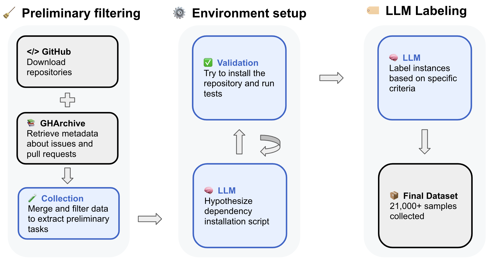
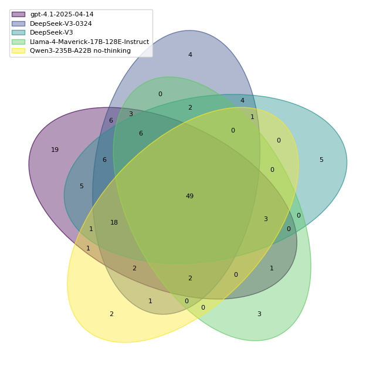

# SWE-rebench：ソフトウェアエンジニアリング・エージェントのためのタスク収集と汚染除去評価の自動パイプライン

> 原題: SWE-rebench: An Automated Pipeline for Task Collection and Decontaminated Evaluation of Software Engineering Agents
> 著者: Ibragim Badertdinov*, Alexander Golubev*, Maksim Nekrashevich, Anton Shevtsov, Simon Karasik, Andrei Andriushchenko, Maria Trofimova, Daria Litvintseva, Boris Yangel（全員 Nebius。* は同等の貢献。連絡先 ibragim-bad@nebius.com）
> 出典: arXiv:2505.20411（v1: 2025-05-26、v2: 2025-11-04）。NeurIPS 2025。

> **訳注（底本と復元）**
> - `raw/` のクリップは ar5iv 経由の **v1** で、付録 B.2 のプロンプトの途中で切れている（付録 B.3〜M が欠落）。また 3.2 節の「中心となる原則」の箇条書き 3 項目が丸ごと欠けている。このため本翻訳は arXiv の HTML 版 **v2**（`https://arxiv.org/html/2505.20411v2`）を底本とし、本文・付録 A〜M をすべて訳した。
> - v1 との違い（v2 で加わった箇所）: 1 節の寄与 3 の脚注に一文、2.2 節末の一文と付録 B.5、3.3 節の DeepSeek の観察の最後の一文、4 節の「言語の多様性の限界」の書き換え、付録 A の最後の一文、付録 F の第 2 段落。
> - 付録のプロンプト・データ例・システムプロンプト・軌跡は、原ページの各リスティングに埋め込まれた原文テキストから字下げごと復元し、訳さずに原文のまま収録した。
> - 引用は v2 の表記（著者, 年）のまま残した。参考文献一覧は訳していない。
> - 図 1・図 2 は原ページから保存した。

## Abstract（要旨）

LLM にもとづくエージェントは、ますます広がるソフトウェアエンジニアリング（SWE）のタスクで有望な能力を示してきた。しかし、この分野を前進させるには 2 つの重大な課題がある。第一に、質の高い訓練データが乏しい。特に、エージェントが開発環境と相互作用し、コードを実行し、自らの行動の結果にもとづいて振る舞いを適応させなければならない、現実世界の SWE のシナリオを反映したデータが乏しい。既存のデータセットは、一回きりのコード生成に限られているか、人手でキュレーションされた小規模な対話型タスクの集まりからなり、規模と多様性の両方を欠いている。第二に、新鮮な対話型 SWE タスクの不足は、急速に改善するモデルの評価に影響する。静的なベンチマークは汚染の問題によってすぐに時代遅れになるからである。これらの限界に対処するため、私たちは、多様な GitHub リポジトリから現実世界の対話型 SWE タスクを継続的に抽出する、新しく自動化されたスケーラブルなパイプラインを導入する。このパイプラインを用いて、2 万 1,000 件を超える Python ベースの対話型 SWE タスクからなる公開データセット SWE-rebench を構築する。これは SWE エージェントの大規模な強化学習に適している。さらに、SWE-rebench の方法論で集めた新鮮なタスクの継続的な供給を用いて、エージェント型ソフトウェアエンジニアリングのための汚染のないベンチマークを構築する。このベンチマークでのさまざまな LLM の結果を SWE-bench Verified での結果と比較し、一部の言語モデルの性能が汚染の問題によって水増しされている可能性があることを示す。

## 1 Introduction（はじめに）

大規模言語モデル（LLM）は、コード生成、デバッグ、自動化された開発ワークフローを含む SWE のタスクで印象的な能力を示してきた。これらの能力の上に、研究者たちは、実際のコードベースや開発環境と相互作用し、行動を行ってフィードバックを受け取る、LLM 駆動のエージェントを作り始めている（Jin et al., 2025）。SWE-bench（Jimenez et al., 2024）のような主要なベンチマークでは、最先端のプロプライエタリなモデルが最も競争力のあるエージェント（例: OpenHands（Wang et al., 2024）、Moatless Tools（Antoniades et al., 2024）、Agentless（Xia et al., 2024））の性能を牽引しているが、オープンソースのモデルを強化する大きな機会がある（Wang, 2025; Yang et al., 2025a; Wang et al., 2025; Aggarwal et al., 2025; Ma et al., 2025; Wei et al., 2025; Golubev et al., 2024）。この方向の進歩、特に複雑なエージェント的振る舞いに向けた進歩は、現実世界のソフトウェア開発に固有の対話性を反映した、大規模で質の高い訓練データを利用できれば加速しうる。DeepSeek-V3（DeepSeek-AI, 2024）、LLaMa 4（Meta AI, 2025）、Qwen3（Team, 2025）のような既存の強力なオープンソースのモデルは、特定の SWE の領域で同等の性能を達成するようファインチューニングできる可能性があるが、それは適切な対話型タスクのデータが利用できるかどうかにかかっている。

プログラミングのために LLM を訓練する現在のアプローチは、しばしばオープンソースのリポジトリのコードデータ（Lozhkov et al., 2024）や、指示チューニングに使われる合成の指示データセット（Wei et al., 2024）に頼っている。しかし、現実世界のシナリオのための頑健なソフトウェアエンジニアリング・エージェントを訓練するには、単純なコード生成を超えるデータセットが必要である。試行錯誤で力を発揮する強化学習（RL）のような方法による学習を本当に可能にするには、エージェントには自動的な検証の仕組みと組になった対話型タスクが要る。そのようなデータは、エージェントが多様な行動を行い、各ステップのあとに環境の応答を観測し、タスクの成功を決める最終的な検証結果を受け取れるものでなければならない。数学（Shao et al., 2024）やウェブのナビゲーション（Pan et al., 2024a）のような領域と異なり、ソフトウェアエンジニアリングには、多様で実行可能な環境を大規模に設定することの複雑さのために、そのような大規模な対話型データセットが歴史的に欠けていた。SWE-Gym（Pan et al., 2024b）や SWE-PolyBench（Rashid et al., 2025）のような最近の取り組みは有望な一歩だが、人手のキュレーションの過程と限られた数のリポジトリへの依存が、その範囲・多様性・スケーラビリティを制約している。

さらに、急速に進歩する LLM ベースのエージェントの評価も大きな課題に直面している。静的なベンチマークは、当初は価値があっても、新しいモデルが大規模な事前／事後訓練のあいだにテストのインスタンスに触れることで、データ汚染によって損なわれうる。さらに、標準化された評価プロトコルの欠如、エージェントの足場（scaffold）のばらつき、一貫しない報告の慣行が、モデル間の直接の比較を難しくし、その真の能力を見えにくくしうる。

訓練データの入手しやすさと評価の信頼性の両方におけるこれらの課題に対処するため、私たちは、現実世界の GitHub リポジトリからソフトウェアエンジニアリングのタスクを継続的に収集する、スケーラブルで完全に自動化されたパイプラインを提示する。コミュニティに好意的に受け入れられ、すでにオープンソースのソフトウェアエンジニアリング・エージェントの訓練に使われている（Wang et al., 2025）SWE-bench Extra（Badertdinov et al., 2024）のような私たちの先行研究の上に構築し、私たちのアプローチは人手の介入をなくし、タスクの多様性と規模を大きく広げる。私たちの知る限り、これは、現実世界の幅広いリポジトリから実行可能なタスクを完全に自動かつスケーラブルに収集することを可能にする最初のシステムであり、対話型エージェントの訓練と頑健なベンチマークを支えるために特に設計されている。

私たちの主な貢献は次のとおりである。

- GitHub から現実世界のソフトウェアエンジニアリングのタスクを採掘する、スケーラブルで完全に自動化されたパイプライン。環境の設定、ビルドのセットアップ、テストの検証を含む。
- SWE-rebench¹。多様な実行可能環境でエージェントを訓練し、ベンチマークするために設計された、2 万 1,000 件を超える Python ベースの対話型 SWE タスクの公開データセット。特に強化学習ベースのアプローチに適している。
- 公開の SWE-rebench リーダーボード²。LLM ベースのエージェントについて、継続的に更新され、汚染が除去され、標準化された評価を提供し、オープンソースとクローズドソースの両方のモデルにわたって透明性と公正な比較を促す。

¹ Hugging Face Datasets で入手可能: https://huggingface.co/datasets/nebius/SWE-rebench
² アクセス先: https://swe-rebench.com/leaderboard 。リーダーボードは継続的に更新されるため、現在評価されているモデルの集合はリーダーボードのウェブサイトで確認できる。

規模と自動化に焦点を当てることで、SWE-rebench は LLM エージェントのエコシステムにおける重大な空白を埋めることを目指す。私たちは、これがオープンソースの研究を加速し、LLM ベースのソフトウェアエンジニアリング・エージェントの信頼性と性能を改善するための基礎的な資源になると信じている。

## 2 An automated pipeline for collecting software engineering tasks（ソフトウェアエンジニアリングのタスクを集める自動パイプライン）

この節では、検証可能なソフトウェアエンジニアリングのタスクを大規模に採掘する自動パイプラインを説明する。私たちはこれを用いて、3,468 の異なる GitHub リポジトリからの 21,336 件の検証可能な SWE タスクのデータセットである SWE-rebench を構築した。私たちのパイプラインは 4 つの段階からなる。予備的なタスク収集、インストール手順の自動設定、実行にもとづくインストールの検証、品質評価であり、この節ですべてを説明する。私たちの方法論は SWE-bench のいくつかの技法を取り入れているが、自動化とスケーラビリティを高めるための革新も導入している。元の SWE-bench の方法論と比べた私たちのアプローチの違いと新しい点は付録 G で詳しく述べる。パイプラインの計算集約的な性質は、分散ストレージ・計算プラットフォームの TractoAI（TractoAI, 2025）で管理している。これは効率的な並列処理とデータ管理の機能を提供し、各段階のスループットを最適化して、パイプラインを変えるたびに素早く再処理できるようにしてくれる。

### 2.1 Preliminary task collection（予備的なタスク収集）

最初の段階では、複数の出どころから生の入力データをダウンロードし、統合し、予備的な絞り込みを行う。データの主な出どころは GitHub Archive（Grigorik, 2011）と GitHub である。

- GitHub Archive。GitHub Archive は GitHub 上の公開イベントの主要な出どころである。毎日、その日のすべての GitHub イベントを列挙した JSON のアーカイブを公開している。私たちはこのアーカイブを使って、イシューについての詳しいデータを集める。イシューの記述、議論、リンクされたプルリクエスト、作成日やラベルのようなメタデータである。プルリクエストについての情報も抽出する。マージの状態、最後のコミット、議論を含む。
- GitHub。関連する GitHub リポジトリを、完全なコミット履歴とともにローカルのストレージに clone する。ローカルのコピーは、リポジトリのデータへの効率的なアクセスを可能にし、GitHub API のレート制限を避けるのに役立つ。保存したコミット履歴を使って、プルリクエストに関連する変更を特定し、後の段階での依存関係の自動セットアップのためにバージョンの分析を行う。

データセットの構築過程を始めるため、2025 年 5 月 1 日より前に作成されたイシューにリンクされた、約 45 万件のプルリクエストをダウンロードする。これらは、広い利用権を認める寛容なライセンス（含めたライセンスの種類の一覧は付録 D を参照）を持ち、コードベースのコード行数の 75% 超を Python が占める、3 万を超えるリポジトリから来ている。

次に、タイトルや説明でイシューの解決に言及しているプルリクエストとイシューを結びつけ、次の条件を満たすインスタンスを選ぶ絞り込みを適用する。

- イシューが、寛容なライセンスを持つ Python のリポジトリのものである。
- イシューが解決済みとされている。
- PR がメインブランチにマージされている。
- PR が複数のイシューにリンクされていない。
- イシューの記述が 10 文字より長い。
- PR がテストを導入または変更し、かつテストファイル以外のコードの変更を含む。
- 変更が 1〜15 ファイルに及ぶ。

この絞り込みは、不適切な候補、特にテストを欠く候補を取り除くことを狙っている。テストを導入または変更するプルリクエストを要求するのは、提案されたコードのパッチが記述されたイシューを解決するかどうかを自動で評価するのに、それらが決定的に重要だからである。選んだ各プルリクエストについて、全体のパッチを 2 つの部分に分ける。イシューに対処することを意図したテスト以外のファイルへの変更を含む解のパッチ（solution patch）と、テストファイルへの変更だけからなるテストパッチ（test patch）である。すべての絞り込みの基準を適用したあと、約 15 万 3,400 件の潜在的なタスクインスタンスが残る。

<figure>



<figcaption>図1: ソフトウェアエンジニアリングのデータを集める自動パイプラインの概要。</figcaption>
</figure>

### 2.2 Automated installation instructions configuration（インストール手順の自動設定）

SWE-bench（Jimenez et al., 2024）や SWE-Gym（Pan et al., 2024b）のようなデータセットは、各リポジトリの実行可能な環境を設定するのに人手のキュレーションに頼っている。このアプローチは本質的にスケーラビリティを制限し、そのようなデータセットをしばしばよく知られたリポジトリの小さな選択に閉じ込める。主なステップには通常、プロジェクトのバージョン付け（複数のタスクインスタンスを 1 つの有効な環境に対応づけること）と、セットアップ手順の定義（依存関係をインストールしてテストを走らせること）が含まれる。これらのステップを大規模で多様なタスクの集まりに対して人手で行うのは実行不可能なので、私たちは完全に自動化されたアプローチを用いる。

2.1 節で述べた予備的な絞り込みのあと、残ったイシューをタスクインスタンスとして扱う。これらのタスクインスタンスを、`git tag` の出力から推定したプロジェクトのバージョンでグループ化し、バージョンを `major.minor` の形式に正規化する（例: `1.2.3` は `1.2` に正規化される）。各バージョンのグループについて、`base_commit` の日付が最も新しいタスクインスタンスにリンクされたプルリクエストの `base_commit` を選ぶ。この最も新しい `base_commit` を優先するのは、開発者は通常マイナーバージョンの中では依存関係の互換性を保ち、後のコミットにはしばしば重要な環境の修正が含まれるからである。このアプローチは一般に安定した依存関係の集合を与え、そのグループのすべてのタスクのテストパッチを共有の環境で実行するのに十分なことが多い。`git tag` コマンドは、タスクインスタンスの約 95% にバージョンを与える。残りのタスクには一意のバージョンを割り当て、それぞれが自分の環境を使うようにする。候補となる環境のセットアップ手順を生成するには、（Xia et al., 2024）に着想を得た agentless のアプローチを用いる。この過程はいくつかの LLM 駆動のステップを含む。

- 関連ファイルの特定: LLM がリポジトリのファイル（例: `README.md`、`Dockerfile`、`setup.py`）を調べ、インストール情報の潜在的な出どころを見つける。
- インストールレシピの抽出: LLM が前の段階で特定したファイルを連結した内容を処理し、インストールレシピを詳述する構造化された JSON オブジェクトを作る。ファイルは `<filename>F.ext</filename>\n<content>CONTENT</content>` の形式で LLM に与えられる。LLM の推論と結果の JSON レシピの例は付録 B.3 に示す。

Qwen2.5-72B-Instruct モデル（Qwen et al., 2025）（プロンプトは付録 B.2）を使い、タスクごとに最大 3 つの候補 JSON レシピを生成する。その後の（レシピから導いた）スクリプトによるインストールやテストの実行でエラーが起きた場合、LLM はエラーログと元の手順を分析してそのレシピを改良しようとする（修正のプロンプトは付録 B.4 を参照）。この反復的な改良により、ライブラリの欠落や誤ったセットアップのような問題を持つタスクでも環境の設定に成功し、最終的なデータセットに含められるようになる。私たちのアプローチは、全リポジトリの 31% で、少なくとも 1 つのタスクについて動作するインストールレシピを作ることに成功する。インストールが失敗する主な理由（例: 固定されていない依存関係や flaky なテスト）も分類し、付録 B.5 で簡単に振り返る。

Docker 環境と直接相互作用してプロジェクトをインストールしテストを走らせる、対話型のエージェントによる依存関係のインストールも検討した。この対話型エージェントはときに環境をより効果的に設定したが、資源の要求が大幅に大きいことがわかった。選んだ agentless の方法は大規模な処理に対して計算効率が高く、複数の候補レシピを生成することでその有効性をさらに高められるため、これを主なアプローチとした。SWE-bench のタスクのキュレーションした部分集合でのこれらのアプローチの比較評価は付録 C に詳述する。

### 2.3 Execution-based installation verification（実行にもとづくインストールの検証）

タスクが解けることと、与えられたテストの完全性を確認するため、実行にもとづくインストールの検証を行う。この段階では、各タスクの環境をコンテナ内にインストールし、プルリクエストのテストパッチのテストを実行する。次にテスト実行の出力を解析し、次のことを確かめる。(1) 解のパッチ（つまり、元のプルリクエストのテスト以外のファイルへの変更）を適用する前に、テストパッチの少なくとも 1 つのテストが失敗する。(2) 当初失敗したテストパッチのすべてのテストが、解のパッチを適用したあとに通る。(3) 当初通っていたテストパッチのテストは、解のパッチを適用したあとも通り続ける。これらの条件を満たす場合にのみ、タスクを有効とみなす。

それぞれインストール・テスト・ログ記録を要する複数の候補レシピを持ちうる多数のタスクインスタンスを処理するには、負荷を効率的に管理する分散実行が必要になる。この目的には TractoAI を使う。これは、クラスタ全体で、コンテナの分散ビルドと、ビルドしたコンテナ内での検証タスクの並列実行を可能にする。

インストールの検証には、基本的な依存関係（例: conda、gcc）をあらかじめインストールした既定のベースコンテナを使う。私たち独自のイメージレジストリと内部の PyPI／APT のミラーが人気のある依存関係をキャッシュするのを助け、コンテナの起動を速め、外部の出どころへの依存を減らす。タスクの検証では次のステップを行う。

- buildah を使って、隔離されたコンテナ内にプロジェクトの依存関係をインストールする。ディスク I/O を最小にしてビルドを速めるため、ファイルシステムの操作には tmpfs を使う。
- テストを実行してログを解析し、解を検証するテストを特定する。
- 検証に成功したら最終的なコンテナイメージをビルドする。
- セットアップの成功後に正確な依存関係のバージョンを記録し（`pip freeze`、`conda env export` による）、Python プロジェクトの固定されていない依存関係から来る再現性の問題を和らげ、将来も一貫して環境を再作成できるようにする。

### 2.4 Automated instance quality assessment（インスタンスの品質の自動評価）

集めたタスクを強化学習に効果的に使うには、それらが一定の性質を持つ必要がある。そうでないと、RL のエージェントが、失敗に見えて実際にはタスクの不完全さ（例: 説明が不十分でタスクが解けないイシューや、正しい解でも通らない欠陥のあるテスト）による軌跡を生成し、エージェントを誤って罰することにつながりうる。SWE-bench Verified はこれらの性質を人手の検証で確保しているが、私たちの収集の規模では、これらの確認を自動で近似する必要がある。これらの性質を自動で評価するため、SWE-bench Verified の人手のアノテーションを用いて指示追従モデルをファインチューニングし、次のものを予測させる。

- イシューの明確さ（Issue Clarity）: GitHub のイシューの記述が、開発者が問題を理解して解くのに十分詳しいかどうか。
- タスクの複雑さ（Task Complexity）: 推論、コードの変更、コードベースへの習熟を考慮した、イシューを解決するのに推定される労力。
- テストパッチの正しさ（Test Patch Correctness）: プルリクエストのテストが、特定の実装の詳細に過度に依存せずに、意図した修正を正確に検証しているかどうか。

SWE-bench Verified のアノテーションを使って Qwen 2.5-72B-Instruct をファインチューニングする。3,800 を超える各例について、モデルはイシューの記述、正解の解のパッチ、テストパッチを入力として受け取る。次に、3 つの二値の品質ラベル（イシューの明確さ、タスクの複雑さ、テストパッチの正しさ）のうちの 1 つを予測するようプロンプトされる。各ラベルは独立に予測するようモデルを訓練する。各タスクインスタンスは、各品質の特性について別々に、訓練／検証を 75／25 に分けて評価する（検証例は計 413）。

タスクの複雑さ（「high-score」は解くのに 1 時間超を意味する。検証では high-score 100 例、low-score 313 例）について、ファインチューニングしたモデルは正解率 81%、重み付き F1 スコア 0.82 を達成した。これは、正解率 68% だったベースラインの Qwen-72B-Instruct からの改善である。テストパッチの正しさ（high-score 180 例、low-score 233 例）については、正解率 67%（重み付き F1: 0.65）を達成した。イシューの明確さ（high-score 84 例、low-score 329 例）については、正解率 79%（重み付き F1: 0.76）を達成した。クラスごとの適合率と再現率を含む、より詳しい予測品質の分析は付録 F の表 4 にある。

LLM が生成したイシューの明確さ・タスクの複雑さ・テストパッチの正しさのラベルは、各タスクインスタンスのメタデータとして提供される。この自動評価は完全ではないが、これらのラベルは、利用者が自分の基準に従ってデータセットを絞り込み、タスクインスタンスを選ぶ手段を与える。たとえば、これらのラベルは、変更されたファイルの数（例えば SWE-bench Lite の部分集合で使われている）のような経験則よりも精密なタスクの難易度の制御を可能にする。変更されたファイルの数は誤解を招きうるからである。複数ファイルの変更が単純なこともあれば（例: 繰り返しのパラメータの更新）、単一ファイルの変更が、明確なイシューの記述や完全な検証のための十分なテストを欠くこともある。したがって、難易度と、記述およびテストの明確さについてのこれらの LLM ベースのスコアは、利用者がより細やかにタスクを選べるようにし、特定のモデルの訓練や評価のニーズに有益な、難しいが解けて明確に規定されたタスクを見つける助けとなり、ベンチマークの飽和を和らげるのにも役立ちうる。

この 4 段階のパイプラインは、対話型ソフトウェアエンジニアリングのタスクの収集と処理を自動化する。この過程から、21,336 件のアノテーション付きタスクインスタンスからなる SWE-rebench データセットが得られ、Hugging Face Datasets（https://huggingface.co/datasets/nebius/SWE-rebench）で公開されている。タスクの評価のスクリプトを含む、データセットを利用するための付随コードは GitHub（https://github.com/SWE-rebench/SWE-bench-fork）で入手できる。完全なアノテーション付きのタスクインスタンスの例は付録 E に示す。

## 3 SWE-rebench benchmark（SWE-rebench ベンチマーク）

この節では、LLM ベースのソフトウェアエンジニアリング・エージェントの既存の評価設定の主な限界と、2 節で述べた自動データパイプラインがそれらにどう対処するのに役立つかを論じる。このパイプラインを活用して、数百の現実世界の実行可能な SWE タスクから構築したベンチマーク SWE-rebench（http://swe-rebench.com/）を構築する。これは、付録 H に詳述する絞り込みの基準で選んだ、169 の多様なリポジトリからの 294 件の実行可能なタスクからなり、より広い SWE-rebench データセットの公開の一部である。信頼できる標準化された評価を確保するため、このベンチマークにもとづく非公開のリーダーボードを維持している。

### 3.1 Challenges in SWE agent benchmarking（SWE エージェントのベンチマークにおける課題）

私たちは、改善すべき次の主要な領域を特定した。

- データ汚染の可能性: SWE エージェントの事実上の評価標準である SWE-bench は、2023 年後半から公開されている。その後に公開されたモデルは、訓練中にそのデータに触れていた可能性があり、スコアの水増しと、汎化と記憶の混同の危険がある。
- 足場のばらつきによる比較できない結果: 現在の評価の慣行は、幅広い設定を許している。SWE-bench での性能は、しばしば、高度に作り込まれたプロンプト、複雑なマルチエージェントのフレームワーク、リトライの仕組み、best-of-N のサンプリング戦略、検証ループに大きく左右される。これらの技法は LLM を中心に構築したシステムの潜在力を示すものの、異なる LLM の素の能力を切り分けて比べることを難しくする。さらに、足場はしばしば SWE-bench の部分集合で開発・調整されており、意図せずベンチマーク固有の特性への暗黙の過適合の可能性につながっている。
- 標準化され検証可能な評価の欠如: SWE-bench の結果は通常、個々のチームが実行し報告する。この分散したアプローチは独立した検証の仕組みを欠き、不整合や、pass@N を pass@1 として報告したり、最終テストから得た情報を暗黙に使ったりといった誤解を招く報告の慣行につながりうる。多くの提出がクローズドソースのフレームワークに頼っていることも、評価の過程の透明性と再現性をさらに下げる。
- 実行間でのエージェントの性能の大きな分散: エージェントの軌跡は確率的な性質を持つため、1 回の実行の結果は大きく変動しうる。これには、モデルがある実行では正しい行動を生成したり誤りから回復したりできても、別の実行ではできないような場合が含まれる。複数の実行にわたって平均したり性能を報告したりしなければ、結果は代表的でなくなりうる。特に、エージェントを複数回評価して最も性能のよい実行だけを報告することは、モデルの実際の能力と解決率を過大に述べる危険がある。

### 3.2 Principles of SWE-rebench（SWE-rebench の原則）

SWE-rebench は、上記の課題に対処し、いくつかの中心となる原則を通じて、厳密でモデル中心の評価を支えるように設計されている。

- 中央集権化され標準化された評価のフレームワーク: SWE-rebench でのすべての評価は、固定した足場を使って私たちのチームが行う。つまり、すべてのモデルを、同じ最小限の ReAct 型のエージェントのフレームワーク（Yao et al., 2023）、同一のプロンプト、モデル開発者が推奨する既定の生成ハイパーパラメータを使って評価する。モデルがより短いコンテキストしかサポートしない場合を除き、すべての評価でコンテキスト長を 128K トークンに標準化する。
  この厳格な標準化は平等な環境を確保し、定められた汎用の相互作用の構造の中で SWE タスクを理解し解く、異なるモデルの中核的な能力を直接比較できるようにする。モデル固有の調整や別の足場を使えば、あるモデルでより高いスコアが得られる可能性はあるが、私たちの焦点は、共通の設定でのモデルの能力の信頼できるベースラインを確立することにある。
  開発環境との相互作用は、プロンプトに記述された相互作用の形式に従ってモデルがテキストのコマンドを生成することにもとづいている点に注意することが重要である。評価をそろえるため、テストした一部のモデルがサポートする関数呼び出し（function calling）の機能は使わない。透明性のため、すべてのモデルの評価に使った正確なシステムプロンプトを付録 I で共有する。
- データセットの継続的な更新と汚染の除去: SWE-rebench は、新鮮なタスクを継続的に供給するために 2 節の自動パイプラインを使う。イシューとそれに対応するプルリクエストの作成日を、モデルの公開日と照らして正確に追跡しているので、モデルの公開日より前に作成されたイシューを含む評価に、汚染の可能性があることを明示的に印づけられる。これらの評価はリーダーボード上で明示的に印づけ、データ漏洩の可能性についての透明性を確保する。
- エージェントの振る舞いの確率性の考慮: 性能のばらつきを捉えるため、各モデルをベンチマーク全体で 5 回走らせる。さらに、平均の標準誤差（SEM）と pass@5 の両方の指標を報告し、各モデルの性能について統計的な根拠のある、より信頼できる評価を提供する。

この標準化されたアプローチにより、SWE-rebench はモデルの性能の 2 つの根本的な側面を測ることに集中できる。

- 現実世界のソフトウェアのイシュー（GitHub のイシューとして提示される）を理解し、計画を立て、正しいコードのパッチを実装し、場合によっては解を検証する能力。
- 指示に従い、私たちの ReAct の足場が表す構造化されたエージェントのフレームワークの中で動作する能力。

### 3.3 Result analysis（結果の分析）

**表1**: SWE-rebench の 2025 年 1 月と SWE-rebench（2025 年 3〜4 月）でのモデルの性能の比較。すべての指標はパーセントで報告する。2025 年 3 月 1 日より後に公開されたモデルにはアスタリスク（\*）を付けた。

| モデル | 1 月 Resolved | 1 月 SEM | 1 月 Pass@5 | 3〜4 月 Resolved | 3〜4 月 SEM | 3〜4 月 Pass@5 |
|---|---|---|---|---|---|---|
| gpt-4.1-2025-04-14\* | 31.1 | 0.79 | 44.4 | 26.7 | 1.09 | 39.0 |
| DeepSeek-V3-0324\* | 21.7 | 1.64 | 35.0 | 21.3 | 0.98 | 32.4 |
| DeepSeek-V3-1226 | 19.1 | 0.58 | 33.3 | 21.9 | 1.44 | 31.4 |
| Qwen3-235B-A22B no-think\* | 15.2 | 1.76 | 29.9 | 16.6 | 0.93 | 25.7 |
| Qwen3-235B-A22B think\* | 13.7 | 1.81 | 29.9 | 12.2 | 1.33 | 25.7 |
| Qwen3-32B no-think\* | 13.2 | 1.17 | 23.9 | 13.7 | 1.03 | 26.7 |
| Qwen3-32B think\* | 11.8 | 0.99 | 22.2 | 11.2 | 0.56 | 21.0 |
| Llama-4-Maverick-Instruct\* | 8.5 | 0.90 | 20.5 | 12.2 | 1.69 | 27.6 |
| Qwen2.5-72B-Instruct | 8.2 | 0.79 | 18.8 | 9.3 | 1.26 | 19.0 |
| Llama-3.3-70B-Instruct | 8.2 | 0.44 | 15.4 | 11.2 | 0.47 | 22.9 |
| Llama-4-Scout-Instruct\* | 5.0 | 0.63 | 12.8 | 5.3 | 0.38 | 14.3 |
| gemma-3-27b-it\* | 4.3 | 0.81 | 9.4 | 4.8 | 0.30 | 10.5 |
| Qwen2.5-Coder-32B-Instruct | 2.7 | 0.57 | 7.7 | 3.2 | 0.77 | 9.5 |

SWE-rebench の汚染が除去された性質を活用して、時間を通じた性能の傾向を分析し、以前のベンチマークにおける汚染の影響の兆候の可能性を特定する。具体的には、時期の異なる 2 つのタスクの部分集合でモデルを評価する。2025 年 1 月に作成されたものと、2025 年 3〜4 月のものである。表 1 は、これらの時間の窓にわたるモデルの性能を示す。

SWE-bench Verified のデータセットへの過適合の可能性を調べるため、SWE-rebench のタスクでのモデルの性能を、同じモデルの SWE-bench Verified での性能と比較する。この比較は、Verified の部分集合からのデータ漏洩の危険がより高い、2024 年または 2025 年初めに公開されたオープンソースのモデルに焦点を当てる。表 2 は、SWE-bench Verified と SWE-rebench の 2025 年 3〜4 月の切り出しでの比較結果をまとめる。

この評価の結果は、いくつかの注目すべき観察を示している。

- GPT-4.1 は、3〜4 月の部分集合での性能が 1 月の部分集合と比べて目立って下がった唯一のモデルである。
- LLaMa-4-Maverick は、平均の解決率が同程度のモデルに比べて高い pass@5 スコアを示すが、解決率は比較的控えめである。これは、このモデルがより複雑な問題への正しい解を生成できる一方で、実行間の信頼性に欠けることを示しており、高い潜在力と一貫しない実行を示している。
- Qwen2.5-Coder-32B-Instruct は、その強いコード生成能力を考えると特に、期待を下回る。その軌跡を分析すると、指示追従の問題が明らかになった。このモデルは頻繁に環境の応答を幻覚したり、書式エラーのループに入ったりし、最終的に意味のある解の試みを生み出さずに失敗する。
- Qwen3 のモデルは、think モードの有無にかかわらず同程度の性能を示し、場合によっては no-think の変種が think の版をわずかに上回ることさえある。これは、ベースモデルの能力が十分に強く、熟慮的な計画が測定できる利点をもたらさないことを示唆する。ほぼ同一の pass@5 のスコアは、明示的な推論の仕組みがなくても、モデルの問題解決の効率が一貫したままであることをさらに示している。
- DeepSeek のモデルは、SWE-rebench の両方の部分集合と SWE-bench Verified ベンチマークで、オープンソースのモデルの中で最も強い性能を示す。特に、DeepSeek-V3 の 12 月と 3 月の両方のリリースは、解決率と pass@5 で他のオープンなモデルを一貫して上回り、タスクの分布の変化に対する頑健性を際立たせている。興味深いことに、両方の版は SWE-rebench では同程度の性能を示す一方、SWE-bench Verified ではスコアが分かれており、これは古いベンチマークでの汚染の影響の可能性を示唆しうる。

**表2**: SWE-bench Verified と SWE-rebench（2025 年 3〜4 月）でのモデルの性能の比較。すべての指標はパーセントで報告する。

| モデル | Verified Resolved | Verified SEM | Verified Pass@5 | rebench 3〜4 月 Resolved | rebench SEM | rebench Pass@5 |
|---|---|---|---|---|---|---|
| DeepSeek-V3-0324 | 39.7 | 0.35 | 57.4 | 21.3 | 0.98 | 32.4 |
| DeepSeek-V3-1226 | 35.2 | 0.52 | 51.0 | 21.9 | 1.44 | 31.4 |
| LLaMA-3.3-70B-Instruct | 18.1 | 0.66 | 31.6 | 11.2 | 0.47 | 22.9 |
| LLaMA-4-Maverick-Instruct | 16.0 | 0.79 | 39.2 | 12.2 | 1.69 | 27.6 |
| Qwen2.5-72B-Instruct | 11.3 | 0.35 | 27.8 | 9.3 | 1.26 | 19.0 |
| LLaMA-4-Scout-Instruct | 8.8 | 0.48 | 22.2 | 5.3 | 0.38 | 14.3 |
| Qwen2.5-Coder-32B-Instruct | 4.9 | 0.46 | 16.0 | 3.2 | 0.77 | 9.5 |

評価の詳細と実験設定は付録 J を参照のこと。

## 4 Discussion and limitations（議論と限界）

私たちの自動パイプラインとその結果の SWE-rebench データセットは、エージェントベースの訓練のための大規模な現実世界のタスクの不足と、データ汚染のない最新のベンチマークの必要に対処するよう設計されている。実行可能なタスクの抽出と検証を自動化することで、広い範囲と新鮮なデータの継続的な供給を可能にする。しかし、スケーラビリティを重視することはトレードオフをもたらす。特に、個々のタスクの品質と明確さを人手でキュレーションし検証する能力が下がる。

多様な現実世界の GitHub リポジトリから一貫して質の高い検証可能な SWE タスクを抽出すること（2 節）は、本質的に不完全な過程である。私たちの多段階の絞り込み、既存の方法論への改良、依存関係の自動インストールは大規模での頑健性のために設計されているが、経験則と LLM 駆動の解釈に頼っている。たとえば、リポジトリのファイルからインストール手順を生成する LLM ベースのアプローチ（Qwen2.5-72B-Instruct、2.2 節）は、人手の方法よりはるかにスケーラブルだが、プロンプトエンジニアリングのために限られた 18 リポジトリの集合で検証したにすぎず、すべてのプロジェクトの微妙な点を捉えられるとは限らない。同様に、SWE-bench Verified のタスクのラベルでファインチューニングした LLM が複雑さと妥当性を予測する、タスクの品質の自動評価（2.4 節）は、価値のあるスケーラブルな代理指標として役立つが、人間の細やかな判断を完全には再現できず、そのため誤りを含み、データセットの品質を下げる。

最後に、私たちのベンチマークは SWE エージェントの評価の透明性と標準化を支えることを意図しているが、ソフトウェアエンジニアリングにおけるますます自律的な AI システムの開発を加速するかもしれない。この進歩は、AI が生成したコードへの過度の依存や、脆弱性を持ち込むための自動エージェントの悪用のような、潜在的な危険をもたらす。私たちは、開かれた姿勢、汚染を除去した評価、厳密なベンチマークの慣行を育むことが、これらの懸念を和らげ、この分野の責任ある前進に貢献すると信じている。

私たちの研究の主な限界を次に挙げる。

- タスクの品質の自動評価: 自動の品質評価を用いているが、完全に自動化されたパイプラインの結果、一部のタスクは記述が不完全だったり、イシューだけからは解けなかったりしうる。これは、人手でキュレーションしたベンチマークと比べて、絶対的な成功率を下げることにつながりうる。
- 言語の多様性の限界: SWE-rebench の最初の公開は Python に限られており、他の言語のエコシステムへの直接の適用性を制限している。基盤となるパイプラインは言語に依存しないが、他の言語（Go、Java、Rust、JavaScript／TypeScript など）をサポートするよう適応させるには言語固有の部品を実装する必要があり、これは今後の作業として計画している。

## 5 Conclusion and future work（結論と今後の作業）

私たちは、オープンソースのリポジトリからソフトウェアエンジニアリングのタスクを継続的に収集する、新しい完全に自動化されたパイプラインを導入した。このパイプラインは、新鮮で汚染が除去されたデータのスケーラブルで信頼できる供給源を提供し、特に LLM ベースのエージェントの訓練と評価に適している。これは、SWE-rebench の公開データセットと、現実的な SWE のシナリオでのエージェントの性能を頑健かつ透明に評価するよう設計された、継続的に更新されるベンチマークの基盤となる。自動化されたデータ収集と動的なベンチマークへとパラダイムを移すことで、既存の静的なベンチマークの重大な限界に対処し、それによってソフトウェアエンジニアリングのための AI の分野でより速く開かれた進歩を促す。今後の作業はいくつかの主要な領域に集中する。

- データの範囲と量の拡大: 収集の方法論を、GitHub のイシューに厳密に結びついたタスクから、任意のプルリクエストで表されるより広いコード変更の集合へと広げることで、データセットの量を大きく増やすことを目指す。
- タスクの絞り込みのパイプラインの改善: 抽出したタスクの全体的な品質を改善するため、パイプラインで使う絞り込みの経験則を洗練させることを目指す。
- 新しいプログラミング言語のサポート: 同じ中核の方法論を適用して、他の人気のある言語（例: JavaScript、Java、C++）のプロジェクトのデータセットを集めることを計画しており、それによって SWE-rebench の言語的・技術的な多様性を広げる。
- SWE-rebench ベンチマークを最新に保つ: 既存のモデルについて新鮮なタスクでの評価の過程を維持し、より幅広い LLM を評価し、詳しい性能の分析をコミュニティと共有する。

私たちは、私たちの自動データ収集パイプラインと SWE-rebench ベンチマークが、現実世界のソフトウェアエンジニアリングの課題のための次世代の LLM ベースのエージェントを開発し評価するための、不可欠な基盤を提供すると信じている。

## Appendix A Related work（関連研究）

#### Benchmarks for software engineering（ソフトウェアエンジニアリングのベンチマーク）

LLM の能力の進歩とともに、そのコーディングの性能を評価するベンチマークの必要が高まってきた。HumanEval [Chen et al., 2021]、MBPP [Austin et al., 2021]、APPS [Hendrycks et al., 2021] は関数レベルの単独の評価に価値があることが示されてきたが、最先端のモデルに対してはその有用性はほぼ飽和している。その結果、LLM の進化する能力を反映するよう継続的に更新される LiveCodeBench [Jain et al., 2024] が登場した。しかし、これらのベンチマークはしばしば、通常リポジトリレベルの文脈と相互作用を伴う、現実世界の開発ワークフローでの LLM の使われ方と大きく異なる。SWE-bench [Jimenez et al., 2024] は、現実世界のリポジトリから集めた、実行にもとづくリポジトリレベルのタスクを導入し、より現実的な評価のパラダイムを提供した。SWE-bench の課題は、その構築後に多くの新しい LLM が公開されたことであり、それが継続的な妥当性と汚染の可能性についての懸念を生んでいる。SWE-bench+ [Aleithan et al., 2024] や Multi-SWE-bench [Zan et al., 2025] のようないくつかの後続の研究は、カットオフ後の絞り込みや多言語のアノテーションのような特定の欠点に対処している。それでも、これらの拡張はすべて、根本的に人手でキュレーションした構築過程に頼っている。この人手の要素は、適時の更新を複雑にし、急速に進歩する LLM の能力にベンチマークを一貫して合わせ続けることを難しくする。対照的に、SWE-rebench は現実世界のリポジトリからのタスク作成の過程全体を大規模に自動化する。この自動化は新しい種類のデータセットとベンチマークを可能にする。タスクが豊富で、多様で、定期的に更新され、人手のキュレーションのボトルネックなしに訓練と評価の両方に適したものである。

#### Training datasets for code generation（コード生成のための訓練データセット）

コードのための LLM を改善するデータを集める先行研究の大半は、教師ありファインチューニングに焦点を当ててきた [Muennighoff et al., 2024, Luo et al., 2023, Liu et al., 2024]。しばしば、より強力なプロプライエタリなモデルのサンプルを活用している。一方、数学の推論タスクでの大規模な強化学習（RL）の目覚ましい成功 [DeepSeek-AI, 2025, Seed et al., 2025, OpenThoughts, 2025] は、両方の領域が検証可能な結果を持ちうる豊かな多段階のワークフローを伴うことから、RL がソフトウェアエンジニアリングでも優れた成果を上げるはずだと示唆する。しかし、この設定で RL を効果的に活用するには、現実世界の対話型 SWE タスクの大きな集まりを集める必要があり、それは各タスクに適切で信頼できる実行環境の構築が必要なため難しい。いくつかの研究は、コードに人為的にバグを注入する [Yang et al., 2025a] ことや、合成のテストを生成する [Xie et al., 2025] ことで、そのようなタスクを集めようとしている。これらのアプローチは大規模にデータを生成できるが、現実世界のソフトウェアのイシューの微妙さと複雑さを完全には捉えられないかもしれない。元の SWE-bench のデータセットとその訓練用の拡張 [Pan et al., 2024b] は価値ある現実世界のタスクを提供するが、人手の構築に頼るため、依然として多様性と規模の限界に苦しんでいる。対照的に、SWE-rebench は現実世界の開発過程を反映し、実際のリポジトリに根ざすことで高いタスクの品質を保ちつつ、自動化された構築パイプラインによって大幅に大きな規模と多様性を達成する。これにより、自動化された構築パイプラインを通じたエージェントの訓練に特に適したものになっている。実際、このアプローチの価値は、ソフトウェアエンジニアリング・エージェントの訓練に強化学習をうまく適用した研究 [Luo et al., 2025, Cao et al., 2025] によって示されており、その中には私たちの SWE-rebench データセットを直接利用した研究 [Yang et al., 2025b] も含まれる。

## Appendix B Automated dependency installation（依存関係の自動インストール）

念のため繰り返すと、依存関係の自動インストールの目標は、人手のキュレーションを使わずに、各タスクインスタンスについて正しい環境のセットアップ手順を生成することである。この過程は完全に LLM 駆動で、次の下位段階からなる。

1. 関連ファイルの特定: LLM に、リポジトリのファイルの一覧を分析し、README.md、setup.py、requirements.txt のような、インストール手順を含む可能性が最も高いものを選ぶよう求める。
2. インストールレシピの抽出: 前の段階で見つかったファイルの内容にもとづき、モデルが、依存関係のインストールとリポジトリのテストの実行の方法を指定する構造化された JSON のレシピを生成する。
3. レシピの更新（必要なら）: レシピが失敗した場合、失敗を分析してレシピを改良するために別の LLM 呼び出しを行う。

以下の小節では、これらの各段階で使った正確なプロンプトを、LLM が生成した出力の例とともに示す。これらの資料は、環境セットアップのパイプラインの透明性を提供し、再現性を促すことを意図している。

### B.1 Identifying installation-related files（インストールに関係するファイルの特定）

2.2 節で述べた agentless のアプローチの主要な部分であるインストールレシピの自動生成は、セットアップ手順を含みそうなリポジトリのファイルを特定することから始まる。これを達成するため、LLM にリポジトリに存在するすべてのファイルの一覧を与える。LLM のタスクは、この一覧を分析し、インストール・依存関係・テストの情報を抽出するのに最も関連が深いとみなしたファイルパスの選別した部分集合を返すことである。以下のプロンプトは、このファイル特定のステップで LLM に与えた指示を詳述する。このステップの出力（ファイルパスの JSON 配列）は、続いて、実際のインストールのコマンドを抽出する次の LLM 呼び出しの入力として使われる。

**Listing 1**: インストールに関係するファイルを特定するための LLM のプロンプト

````text
You are tasked with identifying files that likely contain installation instructions for a GitHub repository.

Repository: {{ repo_name }}

Below is a list of files in the repository that may be helpful for understanding the installation and setup process:

{{ list_of_files }}

Please analyze this list and identify the files that are most likely to contain information about:
  * Installation instructions
  * Dependencies or requirements
  * Setup procedures
  * Development environment configuration
  * Testing setup

Think step by step:
  * Identify README files, as they often contain installation instructions.
  * Look for setup.py, pyproject.toml, requirements.txt, environment.yml.
  * Consider files in directories like \texttt{docs} that might contain installation guides.
  * Look for test configuration files that might help understand how to run tests.
  * Consider \textbf{only} files from the list provided above.
  * Prioritize files in the repository root (top-level directory).
  * Only include files from subdirectories if they are clearly relevant to installation or setup.

Return **only** a JSON array containing the paths to the most relevant files for installation and setup. Include only files that are directly relevant to the tasks above. Sort the files from most to least relevant and limit your response to no more than 10 files, preferring fewer files that are truly essential.

For example:
[
    "README.md",
    "setup.py",
    "requirements.txt"
]
````

### B.2 Extracting installation recipe（インストールレシピの抽出）

関連ファイルの特定に続き、自動パイプライン（2.2 節）の次のステップは、具体的なインストールレシピを抽出することである。このため、LLM はあらかじめ選ばれた関連ファイルを連結した内容を受け取る。LLM の主なタスクは、この内容を分析し、プロジェクトの環境をセットアップし、依存関係をインストールし、テストを実行するのに必要なすべてのコマンドと設定を包む、構造化された JSON オブジェクト、すなわちインストールレシピを合成することである。以下に示すプロンプトは、期待される JSON の構造を強調し、生成されたレシピが下流の自動化スクリプトでどう利用されるかの文脈を与えながら、この抽出の過程を通じて LLM を導く。

**Listing 2**: インストールレシピを抽出するための LLM のプロンプト

````text
You are tasked with extracting detailed installation instructions from the following repository files. Repository: {{ repo_name }}

Please analyze the content of these files and extract comprehensive installation instructions: {{ rendered[:100000] }}

First, think step by step. After your analysis, return your findings in the following JSON format:

{
  "python": "3.9",
  "packages": "requirements.txt",
  "install": "pip install -e .[dev]",
  "test_cmd": "pytest --no-header -rA --tb=line --color=no -p no:cacheprovider -W ignore::DeprecationWarning",
  "pre_install": ["apt-get update", "apt-get install -y gcc"],
  "reqs_path": ["requirements/base.txt"],
  "env_yml_path": ["environment.yml"],
  "pip_packages": ["numpy>=1.16.0", "pandas>=1.0.0"]
}


Here is how this JSON will be used:

```bash
git clone <repo_url> repo
cd repo
git checkout <base_sha>
bash <pre_install>
conda create -n <repo> python=<python> -y
conda activate <repo>
if <packages> == requirements.txt; then
  for path in <reqs_path>:
      pip install -r $path
elif <packages> == environment.yml; then
  for path in <env_yml_path>:
      conda env update -f $path
else:
  pip install <packages>
pip install <pip_packages>
bash <install>
bash <test_cmd>
```

**IMPORTANT:**
  * For the "install" field, always use local install commands like pip install -e .[dev]
  * Do NOT include packages in pip_packages that will be installed by pip install -e .
  * Include only explicitly needed packages in pip_packages.
  * reqs_path and env_yml_path must match filenames from the provided files (e.g., [File: filename]).
  * If "packages" is requirements.txt, you must provide at least one reqs_path.
  * Add relevant test frameworks to pip_packages (e.g., pytest, nose).
  * Use -y in all conda commands.
  * Prefer direct and specific pytest commands over general wrappers.
  * Avoid test commands with placeholders like {test_name}.
  * If a Makefile runs tests, extract the actual test command (e.g., pytest).

You must ensure the final JSON includes required fields (, install, test_cmd), and optionally packages, pre_install, reqs_path, env_yml_path, pip_packages if relevant.

Base your reasoning on all provided files and return it followed by the JSON output in a Markdown code block (without comments).
````

### B.3 Example of LLM-generated installation recipe（LLM が生成したインストールレシピの例）

以下は、推論と最終的な JSON の両方を含む、インストールレシピの抽出段階の出力の例示である。

**Listing 3**: LLM が生成したインストールレシピ

````text
1. Python version. The setup.py file specifies that the project requires Python 3.6 or greater. The README.rst and setup.py files also indicate that the project supports Python 3.6, 3.7, 3.8, 3.9, and 3.10. For a safe middle-ground, Python 3.9 is chosen.

2. Installation Method. The README.rst and DEVELOPMENT.md files both mention using pip to install the project. Specifically, the development installation command is pip install -e .[dev]

3. Dependencies. The setup.py file lists flake8 >= 3.0.0 and attrs >= 19.2.0 as dependencies. The DEVELOPMENT.md file also mentions additional development dependencies: coverage, hypothesis, hypothesmith >= 0.2, and pre-commit. These are included in the pip_packages field.

4. Test command. The README.rst and DEVELOPMENT.md files both mention running tests with coverage run tests/test_bugbear.py. However, for simplicity and to follow the guidelines, the test command is simplified to pytest tests/test_bugbear.py.

5. Pre-install steps. No system-level pre-install steps are mentioned in the provided files.

6. Additional packages. The pytest package is needed for running tests, and it is not explicitly listed in the project's dependencies. Therefore, it is added to the pip_packages field.

{
  "python": "3.9",
  "install": "pip install -e .[dev]",
  "test_cmd": "pytest tests/test_bugbear.py",
  "pip_packages": [
    "pytest",
    "coverage",
    "hypothesis",
    "hypothesmith>=0.2",
    "pre-commit"
  ]
}
````

### B.4 Updating installation recipe（インストールレシピの更新）

2.2 節で述べたように、私たちの agentless のインストールレシピ生成には反復的な改良のステップが含まれる。LLM が生成したレシピを使って環境をセットアップする最初の試みが失敗した場合、修正の仕組みを起動する。この仕組みは、元の（失敗した）インストールレシピ、失敗したセットアップやテスト実行のあいだに生成されたエラーログ、および関連ファイルの内容を与えて、続けて LLM を呼び出すことを伴う。LLM の目的は、ログにもとづいてエラーを診断し、これらの問題を解決するためのレシピの変更を提案することである。以下に詳述するプロンプトは、このエラー分析を行い、同じ構造化 JSON の形式で更新・修正されたインストールレシピを生成する方法を LLM に指示する。

**Listing 4**: インストールレシピを更新するための LLM のプロンプト

````text
You are an expert in fixing software installation and testing issues. Analyze the installation logs provided and update the installation configuration to fix any errors.

Install config fields:

{
  "python": "3.9",
  "packages": "requirements.txt",
  "install": "pip install -e .[dev]",
  "test_cmd": "pytest --no-header -rA --tb=line --color=no -p no:cacheprovider -W ignore::DeprecationWarning",
  "pre_install": ["apt-get update", "apt-get install -y gcc"],
  "reqs_path": ["requirements/base.txt"],
  "env_yml_path": ["environment.yml"],
  "pip_packages": ["numpy>=1.16.0", "pandas>=1.0.0"]
}

Current installation configuration:
{{ install_config }}

Error logs from installation/testing (last relevant lines): {{ cut_logs }}

Your task:
  * Identify the root causes of the errors in the logs.
  * Modify the installation configuration to address these issues.
  * You might need to:
    - Add missing dependencies
    - Fix command syntax errors
    - Change installation order
    - Add environment variables
    - Modify test commands

First, provide brief reasoning (<100 words) about what's causing the errors and your planned fixes.

Then return the complete updated installation configuration as a valid JSON object.
````

### B.5 Failure modes during execution validation and mitigation strategies（実行による検証のあいだの失敗の型と緩和の戦略）

実行による検証のあいだに、本来は有効なタスクがデータセットに含められなくなる、繰り返し起きるいくつかの失敗の型を特定した。

- 外部 API の呼び出しや浮動小数点の精度の問題を伴う flaky なテスト: 多くの失敗は、断続的に利用できなくなるエンドポイントへの外部 API の呼び出しを伴うテストや、浮動小数点数の厳密な等しさを確かめるテストによるものだった。これらの失敗は非決定的で、タスクの品質を確実には反映しない。一貫した検証にそのようなテストを頼れないので、テストを複数回走らせ、少なくとも 1 回の実行で失敗したインスタンスを除外する。
- インストール中の対話性の欠如: 一部のプロジェクト、特に古いものは、インストールの過程で対話的なアプローチを必要とする。依存関係を段階的にインストールしたり、途中のエラーメッセージにもとづいて設定を調整したりしなければならない。そのような反復的なトラブルシューティングは、あらかじめ定めた少数のステップを持つエージェントでは確実には達成できず、基盤となるタスクが有効でもインストールの失敗につながる。
- 固定されていない、および廃れた依存関係: README の手順は正確だが、依存関係のバージョンが固定されていなかったり、もはや公開されていなかったりする古いリポジトリで、環境のセットアップが頻繁に失敗した。これを緩和するため、セットアップの成功後にすべての依存関係のバージョンを凍結し、一般的な依存関係について内部のパッケージミラーを維持して、再試行時のセットアップの失敗を大きく減らしている。

これらの失敗の型が検証での却下の大部分を占め、それらに対処すること、特により対話的なインストールの仕組みや高度な依存関係の解決によって対処することは、パイプラインの歩留まりを改善する主要な機会である。

## Appendix C Evaluation of automated installation recipe generation（インストールレシピの自動生成の評価）

インストールレシピの自動生成の有効性を評価し、効果的なプロンプトを選ぶため、検証の研究を行った。元の SWE-bench のデータセットの中の、それぞれ異なるリポジトリからの 18 件のタスクインスタンスのキュレーションした集合を利用した。これらのインスタンスを選んだのは、その環境のインストール手順がもともと人手で作られており、信頼できるベースラインを与えるからである。各インスタンスについて、インストールレシピを自動で生成し、対応する環境をセットアップし、そのテストを実行することを試みた。

agentless の LLM ベースのレシピ生成（候補の生成数を変えたもの）の性能を、同じ目的のために設計した対話型エージェントと比較した。結果は表 3 にまとめる。設定の試みの一部の不成功は、検証中の自動ログ解析の限界によるもので、特に Django のような独自のテストフレームワークを持つリポジトリで起きた。私たちの汎用のパーサ（例: pytest 用）は、高度にカスタマイズされたテストの出力からテスト結果を抽出できないことがある。それでも、この小規模な検証は健全性の確認として役立ち、主パイプラインでの agentless のアプローチのプロンプトと候補の生成数の選択の参考になった。この検証に使った具体的な SWE-bench のインスタンスの一覧は付録 C.1 にある。

**表3**: 18 件の SWE-bench のタスクでのインストール方法の成功率の比較。

| アプローチ | 候補数／試行数 | 設定に成功 |
|---|---|---|
| Agentless | 1 | 18 件中 6 件 |
| Agentless | 3 | 18 件中 8 件 |
| Agentless | 10 | 18 件中 9 件 |
| エージェントベース | 1 | 18 件中 8 件 |

### C.1 List of instances to validate automatic installation instruction extraction（インストール手順の自動抽出を検証するためのインスタンスの一覧）

- astropy\_\_astropy-12907
- django\_\_django-15315
- marshmallow-code\_\_marshmallow-1164
- matplotlib\_\_matplotlib-20826
- mwaskom\_\_seaborn-3069
- pallets\_\_flask-5014
- psf\_\_requests-2317
- pvlib\_\_pvlib-python-1160
- pydata\_\_xarray-6744
- pydicom\_\_pydicom-996
- pylint-dev\_\_astroid-1741
- pylint-dev\_\_pylint-4604
- pytest-dev\_\_pytest-7982
- pyvista\_\_pyvista-4853
- scikit-learn\_\_scikit-learn-13142
- sphinx-doc\_\_sphinx-8721
- sqlfluff\_\_sqlfluff-4764
- sympy\_\_sympy-22080

## Appendix D Permissive licenses included in data collection（データ収集に含めた寛容なライセンス）

私たちのデータ収集の過程は、寛容なオープンソースのライセンスのもとにあるリポジトリだけを対象とした。一般的な寛容なライセンスに合致するリポジトリを、利用可能な場合は SPDX 識別子を使って特定した。この事前に定めた一覧に合致しないライセンスや、独自のライセンス文を持つ（「Other」に分類した）リポジトリについては、その条項が私たちの研究に関係する用途を許すことを確認するため、人手の確認を行った。含めた主な寛容なライセンスの種類は次のとおりである。

- MIT
- Apache-2.0
- BSD-4-Clause
- BSD-3-Clause
- BSD-2-Clause
- ISC
- CC0-1.0
- ZPL-2.1
- Other（人手で確認した寛容なライセンス）

## Appendix E Example of a task instance with annotations（アノテーション付きのタスクインスタンスの例）

以下は SWE-rebench データセットの 1 つのタスクインスタンスの例で、パイプラインが集めた、または生成した構造と主要なアノテーションのいくつかを示す。簡潔さのため、ファイルの全内容や依存関係の完全な一覧のような長いフィールドの一部は切り詰めるか要約した。インスタンスは Python の辞書の形で示す。

**Listing 5**: SWE-rebench のタスクインスタンスの内容の例

````text
{
  'instance_id': 'tarohi24__typedflow-68',
  'repo': 'tarohi24/typedflow',
  'base_commit': '2127e74314d2b97d596cfc12ed8fb257bb688d6f',
  'version': '1.0',
  'created_at': '2019-12-10 15:26:34',
  'problem_statement': "The new syntax doesn't work\nIt doesn't accept args in the correct way. For instance, life of cache tables are never incremented.",
  'patch': """diff --git a/typedflow/nodes/base.py b/typedflow/nodes/base.py
index ece0895..b9853f9 100644
--- a/typedflow/nodes/base.py
+++ b/typedflow/nodes/base.py
@@ -113,7 +113,8 @@ class ConsumerNode:
         None
         """
         assert len(self.precs) == 0, 'Some arguments have been already set'
-        self.precs: Dict[str, ProviderNode] = args
+        for name, prec in args.items():
+            self.set_upstream_node(name, prec)
         return self


""",
  'test_patch': """diff --git a/typedflow/tests/flow/test_flow.py b/typedflow/tests/flow/test_flow.py
index aa31917..7682475 100644
--- a/typedflow/tests/flow/test_flow.py
+++ b/typedflow/tests/flow/test_flow.py
@@ -209,3 +209,4 @@ def test_declare_inputs_when_definition_with_multiple_args():
     node_dump = DumpNode(dump)({'a': node_task})
     flow = Flow([node_dump, ])
     flow.typecheck()
+    assert node_task.cache_table.life == 1
""",
  'meta': {
    'commit_name': 'head_commit',
    'num_modified_files': 1,
    'llm_score': {'issue_text_score': 3, 'test_score': 1, 'difficulty_score': 1}
    # Other meta fields like 'failed_lite_validators', 'has_test_patch', 'is_lite'
  },
  'install_config': {
    'python': '3.8',
    'packages': 'requirements.txt',
    'reqs_path': ['requirements.txt'],
    'install': 'pip install -e .',
    'pip_packages': ['pytest', 'pytest-runner', ...], // Truncated for brevity
    'pre_install': ['apt-get update', 'apt-get install -y gcc build-essential ...'], // Truncated
    'test_cmd': 'pytest --no-header -rA --tb=line --color=no -p no:cacheprovider ...' # Truncated
    # Other install_config fields like 'env_vars', 'env_yml_path', 'log_parser'
  },
  'FAIL_TO_PASS': ['typedflow/tests/flow/test_flow.py::test_declare_inputs_when_definition_with_multiple_args'],
  # Other test outcome fields like 'FAIL_TO_FAIL', 'PASS_TO_PASS', 'PASS_TO_FAIL'
  'license_name': 'MIT License'
  # Fields like 'requirements', 'environment', 'hints_text', 'total_len' also exist.
}
````

この例は、タスクの中核の構成要素を示している。問題の記述、コードの変更（patch と test_patch）、そして LLM が生成した品質のスコアとインストールの設定を含む関連メタデータである。完全なデータセットは、各インスタンスについてより豊富な情報を含む。

## Appendix F Comparison of models for automatic task quality assessment（タスクの品質の自動評価のためのモデルの比較）

2.4 節で述べたように、SWE-bench Verified の人手のアノテーションを使って Qwen 2.5-72B-Instruct モデルをファインチューニングし、3 つの品質評価のラベル、テストパッチの正しさ・タスクの複雑さ・イシューの明確さを予測させた。表 4 は、検証集合での、ファインチューニングしたモデルと素の Qwen 2.5-72B-Instruct モデルの性能を比較した、詳しい分類品質の報告を示す。

難易度の経験則としてのファイル数の有用性を検証するため、SWE-rebench リーダーボードのタスク（2025 年 1〜7 月）での DeepSeek-V3-0324 の性能を、変更されたファイルの数で区分して実証的に分析した。(i) 1 ファイル: 28.6% ± 0.8%（n=201）、(ii) 2 ファイル: 20.6% ± 0.4%（n=144）、(iii) 3 ファイル以上: 17.5% ± 2.2%（n=64）。これらの結果は、変更されたファイルの数が増えるにつれて性能が下がることを確かめ、この指標が粗い難易度の代理指標であることを支持する。しかし、上で述べたように、タスクの難易度はファイル数だけよりも直接の品質評価でよりよく捉えられる。複数ファイルの変更が単純なこともあれば（例: 繰り返しのパラメータの更新）、単一ファイルの変更が、不明確なイシューの記述や不十分なテストのために難しいこともある。

**表4**: タスクのラベル予測の分類レポート。素の Qwen-2.5-72B-Instruct モデルと、そのファインチューニング版を比較する。

| ラベル | クラス／集計 | Instruct Prec | Instruct Rec | Instruct F1 | Fine-tuned Prec | Fine-tuned Rec | Fine-tuned F1 | Support |
|---|---|---|---|---|---|---|---|---|
| Test Patch Correctness | low-score | 0.59 | 0.97 | 0.73 | 0.66 | 0.85 | 0.74 | 233 |
| | high-score | 0.76 | 0.12 | 0.21 | 0.69 | 0.42 | 0.52 | 180 |
| | accuracy | | | 0.60 | | | 0.67 | 413 |
| | macro avg | 0.67 | 0.55 | 0.47 | 0.67 | 0.64 | 0.63 | 413 |
| | weighted avg | 0.66 | 0.60 | 0.51 | 0.67 | 0.67 | 0.65 | 413 |
| Task Complexity | low-score | 0.90 | 0.64 | 0.75 | 0.90 | 0.85 | 0.87 | 313 |
| | high-score | 0.41 | 0.78 | 0.54 | 0.60 | 0.71 | 0.65 | 100 |
| | accuracy | | | 0.68 | | | 0.81 | 413 |
| | macro avg | 0.66 | 0.71 | 0.64 | 0.75 | 0.78 | 0.76 | 413 |
| | weighted avg | 0.78 | 0.68 | 0.70 | 0.83 | 0.81 | 0.82 | 413 |
| Issue Clarity | low-score | 0.83 | 0.94 | 0.88 | 0.82 | 0.94 | 0.88 | 329 |
| | high-score | 0.51 | 0.26 | 0.35 | 0.47 | 0.20 | 0.28 | 84 |
| | accuracy | | | 0.80 | | | 0.79 | 413 |
| | macro avg | 0.67 | 0.60 | 0.61 | 0.65 | 0.57 | 0.58 | 413 |
| | weighted avg | 0.77 | 0.80 | 0.77 | 0.75 | 0.79 | 0.76 | 413 |

## Appendix G Refinements to the original SWE-bench methodology（元の SWE-bench の方法論への改良）

私たちの目標は、評価だけでなく強化学習にも適したデータセットを作ることである。理想的には、そのタスクが解けずに残るのは、欠陥のあるテストや誤った問題の規定によってではなく、エージェントに固有の限界によってのみであるべきだ。このため、SWE-bench の構築に使われたものと比べて、タスクの妥当性を確保する仕組みを強化した。

- git の履歴からのパッチの生成: 元の SWE-bench では、base_commit（PR のブランチが始まる点）と merge_commit（PR がメインブランチにマージされる点）の差分が解のパッチとテストパッチを形づくる。しかし、その間にメインブランチへ入ったマージがこの差分に無関係な変更を持ち込み、PR に対して外部の機能のテストを含めることで、タスクを無効にしうる。例として、sympy\_\_sympy-14821 はこの理由で SWE-bench Verified に含まれなかった。この問題を緩和するため、パッチの生成には head_commit（PR のブランチの最後のコミット）と base_commit の差分を優先する。これはブランチの中で直接行われた変更を切り出すからである。head_commit が利用できない場合（例: マージ後にブランチが削除されたため）は merge_commit に戻り、この選択をタスクのメタデータに記録する。
- テストの指定の生成: SWE-bench は、正規表現を使ってテストパッチからテストの指定（検証のために特定のテストを走らせるコマンド）を生成する。これは削除されたテストファイルを誤って含め、無効なコマンドにつながることがある。私たちの改良は、削除されたファイルをテストの指定から取り除く。
- AttributeError／ImportError の確認: テストがまだ存在しない新しい属性や import を確かめるタスクは問題になりうる。エージェントは解を実装するときに正確なシグネチャを推測しなければならないからである。そのようなエラーは多くの場合検出できるが、トレースバックの詳細度を下げてテストを走らせている場合（例: SWE-bench が一部のリポジトリで使っている Pytest の tb=no フラグ）には隠れることがある。これらのケースを正確に特定するため、完全なエラー出力（tb=line）でテストを走らせる。一部のインスタンス（例: import エラーの修正）は有効なので、この情報はタスクのメタデータに記録し、任意で絞り込めるようにする。
- 依存関係の固定: Python のプロジェクトは、依存関係のバージョンを明示的に固定していないことが多い。インストール時に既定で最新版を使うと、時間とともにパッケージの互換性が変わることでテストの失敗につながりうる。再現性を確保するため、タスク（または同じ環境を共有するタスクのグループ）について最初に環境のセットアップに成功したあと、すべての依存関係のバージョンを凍結して記録する（pip freeze と conda env export を使う）。これらの固定したバージョンを、その後の再ビルドで再利用する。

## Appendix H Filtering criteria for the SWE-rebench benchmark subset（SWE-rebench ベンチマークの部分集合の絞り込みの基準）

3 節で述べた LLM ベースのエージェントの評価に使う SWE-rebench ベンチマークの部分集合は、一連の特定の絞り込みの基準を適用して、より大きな SWE-rebench データセットからキュレーションしたものである。これらの絞り込みは、よく定義され、現在のモデルにとって扱える複雑さのタスクを選び、一貫した評価環境を確保するよう設計されている。タスクインスタンスがベンチマークの部分集合に含まれるには、次の条件を満たさなければならない。

- きれいなテスト実行: 解のパッチを適用する前のテスト実行のログに、AttributeError や ImportError のような重大なエラーがない。
- コード変更の範囲: 解のパッチが変更するファイルの数が 3 以下である。
- パッチの大きさ: 解のパッチの総単語数が 500 を超えない。
- 問題文の長さ: 問題文（GitHub のイシューの記述）が 16〜1,000 語（両端を含む）である。
- 問題文の言語: 問題文が英語である。
- 新しさ: タスクのもとになった GitHub のイシューが 2025 年に作成されている。
- 評価された難易度: LLM が評価したタスクの難易度のラベルが 3 未満であり、低〜中程度の複雑さを示す。
- テストケースの数: 失敗から成功に移るテスト（fail-to-pass テスト）の数が 50 以下である。

## Appendix I System prompt for agent runs（エージェントの実行のためのシステムプロンプト）

**Listing 6**: SWE-rebench リーダーボードのタスクでの LLM の評価実行のためのシステムプロンプト

````text
 # SETTING

 You are an autonomous programming agent. Your goal is to resolve the issue given to you.
 You are given access to a terminal environment with some special tools to make your job easier.
 You must use the terminal to gain information about the codebase, find or modify the relevant files in order to resolve the issue.
 In this environment, all standard unix commands (e.g. grep, sed, echo etc.) will be available to you.
 However, the environment does NOT support interactive session commands that expect user input (e.g. vim), so please do not invoke them, it will result in an error
 You can however create python scripts and run them, this is very useful to reproduce errors or test something.
 If some packages are missing, you can install them using an appropriate package manager (e.g. pip, apt, etc.).
 Do not ask any questions to the environment, it's an automated system that can only execute your commands.
 When you are satisfied with the changes you made, you should explicitly submit them using a special command. This will terminate your session.

 # SPECIAL TOOLS

 In addition to standard unix commands you can use special tools described below.
 Please note that some of these commands work with the currently open file, so pay attention to what file is open.

 Usage: create [OPTIONS] FILENAME
   Creates and opens a new filename with the given name.

 Usage: edit [OPTIONS] LINE_RANGE [REPLACEMENT_TEXT]
   Replaces lines in LINE_RANGE=<start_line>:<end_line> (inclusive) with the
   given text in the currently open or specified file. The REPLACEMENT_TEXT
   will be used as provided including all whitespaces, so make sure your
   indentation is correct.
   To input multiple lines into REPLACEMENT_TEXT, you may use the following
   syntax:
   ```
   edit 1:1 << 'EOF'
   Line1
   Line2
   EOF
   ```
   You can also provide the file to edit via `--file` option.
   ```
   edit --file path/to/file 1:1 "Your Replacement Text Here"
   ```
   Please note that THIS COMMAND REQUIRES PROPER INDENTATION. If you'd like to
   add the line '        print(x)' you must fully write that out, with all
   those spaces before the print statement!
 Options:
   --file PATH  The file to edit. (If not provided, edits the currently open
                file)

 Usage: goto [OPTIONS] LINE_NUMBER
   Navigates the current window to a given line in the currently open file.

 Usage: open [OPTIONS] [FILE] [LINE_NUMBER]
   Opens the file at the given path in the editor. If file is not specified,
   the last open file will be reopened. If line_number is provided, the current
   window will move to show that line.

 Usage: replace [OPTIONS] SEARCH REPLACE
   Replaces a given string with another string in the currently open file.
 Options:
   --replace-all  Replace all occurrences of the SEARCH text.

 Usage: scroll_down [OPTIONS]
   Scroll down the window in the currently open file and output its contents.

 Usage: scroll_up [OPTIONS]
   Scroll up the window in the currently open file and output its contents.

 Usage: search_file [OPTIONS] SEARCH_TERM [FILE]
   Searches for SEARCH_TERM in file. If FILE is not provided, searches in the currently open file.

 Usage: submit [OPTIONS]
   Submits your current code and terminates the session.


 # ENVIRONMENT RESPONSE

 At the very beginning the environment will provide you with an issue description. In response to every command that you invoke,
 the environment will give you the output of the command or an error message followed by a shell prompt.
 The shell prompt will be formatted as follows:
 ```
 (Current directory: <current_dir>, current file: <current_file>) bash-$
 ```
 so that you always know what the current directory is and what file is currently open.

 # YOUR RESPONSE

 Your response should consist of two parts: reasoning (arbitrary text) and command (surrounded by triple ticks and a special 'command' keyword).
 Your response should always include A SINGLE reasoning and A SINGLE command as in the following examples:

 <response example>
 First I'll start by using ls to see what files are in the current directory. I'll look at all files including hidden ones.
 ```command
 ls -a
 ```
 </response example>

 <response example>
 Let's search the file `models.py` for the UserEntity class definition.
 ```command
 search_file "class UserEntity" models.py
 ```
 </response example>

 Everything you include in the reasoning will be made available to you when generating further commands.
 If you'd like to issue two command blocks in a single response, PLEASE DO NOT DO THAT! THIS WILL RESULT IN AN ERROR.

 # HANDLING TESTS

 * You can run existing tests to validate the changes you made or make sure you didn't break anything.
 * If missing packages or some environment misconfiguration is preventing you from running the tests, you can install missing packages or fix the environment.
 * However UNDER NO CIRCUMSTANCES should you modify existing tests or add new tests to the repository.
   This will lead to an error in the system that evaluates your performance. Instead, you can just create a temporary script, use it to test changes and remove it before submitting.
 * If existing tests break because they need to be updated to reflect the changes you made, just ignore it. Evaluation system will not take it into account.
 * However if existing tests are broken because your fix is incorrect, you should fix your code and make sure all tests pass before submitting the change.

 # USEFUL ADVICE

 * As a first step, it might be a good idea to explore the repository to familiarize yourself with its structure.
 * You should also come up with a rough plan of how to resolve the issue and put it into your reasoning.
 * If the issue description reports some error, create a script to reproduce the error and run it to confirm the error. THIS IS USUALLY A VERY GOOD FIRST STEP!
 * Edit the source code of the repo to resolve the issue
 * Rerun your reproduce script and confirm that the error is fixed! THIS IS QUITE IMPORTANT!
 * Think about edge cases and make sure your fix handles them as well.
 * Make sure your solution is general enough and not hardcoded to the specific cases reported in the issue description.
 * It might be a good idea to ensure that existing tests in the repository pass before submitting the change. Otherwise it's easy to break existing functionality.

 # DEMONSTRATION

 Here is a very simple demonstration of how agent can interact with the environment using the provided interface.

 <demonstration><environment>
 # ISSUE DESCRIPTION

 Here is a script that is supposed to print out first 10 prime numbers, but it seems to have a bug. Can you fix it?

 ```
 def is_prime(n):
     if n <= 1:
         return False
     for i in range(2, int(n**0.5)):
         if n % i == 0:
             return False
     return True

 primes = []
 num = 2
 while len(primes) < 10:
     if is_prime(num):
         primes.append(num)
     num += 1

 print("First 10 prime numbers:", primes)
 ```

 # ADDITIONAL ADVICE

 Since you are given a git repository, you can use git commands to simplify your work.
 For example, if you made a mistake and want to revert your changes, you can use `git checkout <file>` to restore the file to its original state.
 You can also reset all changes in the repository using `git reset --hard` command.
 Additionally, you can use `git stash` and `git stash pop` to temporarily save your changes and restore them later.
 Finally, you can see the changes that you've made (which will be submitted when you call `submit`) using `git status` or `git diff` commands.
 However you don't need to use `git add` or `git commit` before submitting your changes. In fact,
 `submit` only submits currently unstaged changes because it uses `git diff` to get the changes that need to be submitted.

 # CHECKLIST

 Before submitting your solution, please go over the following checklist and make sure you've done everything:
 - [ ] If an error was reported in the issue description, I have successfully reproduced it.
 - [ ] If an error was reported in the issue description, I have confirmed that my fix resolves the error.
 - [ ] I have thought about edge cases and made sure my fix handles them as well.
 - [ ] I have run existing tests in the repository that might have been affected by the change I made and confirmed that they pass.
 I want you to list every bullet from this checklist and write your reasoning for why you think you did it or didn't need to.

 Repository has been uploaded and your shell is currently at the repository root. Time to solve the issue!

 (Current directory: /project, current file: none) bash-$
 </environment>
 <agent>
 Let me analyze the issue and fix the prime number generator script step by step.

 First, let's create a Python script to reproduce the reported issue and verify the current behavior.

 ```command
 create prime_numbers.py
 ```
 </agent>
 <environment>
 [File: prime_numbers.py (1 lines total)]
 1:

 (Current directory: /project, current file: none) bash-$
 </environment>
 <agent>
 Now I'll add the provided code to the file to test it and see what output it produces. The issue description mentions there's a bug, but doesn't specify what exactly is wrong. First we need to identify the issue.

 ```command
 edit 1:1 << 'EOF'
 def is_prime(n):
     if n <= 1:
         return False
     for i in range(2, int(n**0.5)):
         if n % i == 0:
             return False
     return True

 primes = []
 num = 2
 while len(primes) < 10:
     if is_prime(num):
         primes.append(num)
     num += 1

 print("First 10 prime numbers:", primes)
 EOF
 ```
 </agent>
 <environment>
 File updated. Please review the changes and make sure they are correct (correct indentation, no duplicate lines, etc). Edit the file again if necessary.
 [File: /project/prime_numbers.py (16 lines total)]
 1:def is_prime(n):
 2:    if n <= 1:
 3:        return False
 4:    for i in range(2, int(n**0.5)):
 5:        if n % i == 0:
 6:            return False
 7:    return True
 8:
 9:primes = []
 10:num = 2
 11:while len(primes) < 10:
 12:    if is_prime(num):
 13:        primes.append(num)
 14:    num += 1
 15:
 16:print("First 10 prime numbers:", primes)

 (Current directory: /project, current file: none) bash-$
 </environment>
 <agent>
 Now let's run the script to see what output it produces and identify the bug.

 ```command
 python prime_numbers.py
 ```
 </agent>
 <environment>
 First 10 prime numbers: [2, 3, 4, 5, 6, 7, 8, 9, 11, 13]

 (Current directory: /project, current file: none) bash-$
 </environment>
 <agent>
 Ah, I see the issue! The script incorrectly includes numbers 4, 6, 8, and 9 in the output as "prime" numbers when they're actually not prime. The bug is in the `is_prime()` function - the range should go up to `int(n**0.5) + 1` because the upper bound in Python's range is exclusive. Let's fix this by modifying the range in the `is_prime()` function.

 ```command
 edit 4:4 << 'EOF'
     for i in range(2, int(n**0.5) + 1):
 EOF
 ```
 </agent>
 <environment>
 File updated. Please review the changes and make sure they are correct (correct indentation, no duplicate lines, etc). Edit the file again if necessary.
 [File: /project/prime_numbers.py (16 lines total)]
 1:def is_prime(n):
 2:    if n <= 1:
 3:        return False
 4:    for i in range(2, int(n**0.5) + 1):
 5:        if n % i == 0:
 6:            return False
 7:    return True
 8:
 9:primes = []
 10:num = 2
 11:while len(primes) < 10:
 12:    if is_prime(num):
 13:        primes.append(num)
 14:    num += 1
 15:
 16:print("First 10 prime numbers:", primes)

 (Current directory: /project, current file: none) bash-$
 </environment>
 <agent>
 Now let's run the script again to verify that the fix works and produces the correct list of prime numbers.

 ```command
 python prime_numbers.py
 ```
 </agent>
 <environment>
 First 10 prime numbers: [2, 3, 5, 7, 11, 13, 17, 19, 23, 29]

 (Current directory: /project, current file: none) bash-$
 </environment>
 <agent>
 The output now correctly shows the first 10 prime numbers. Let's go through the checklist:

 1. Reproduced the error: Yes, we saw the script incorrectly included non-prime numbers in its output.
 2. Confirmed the fix resolves the error: After modifying the range, the script now correctly lists only prime numbers.
 3. Edge cases considered: The fix handles all cases correctly - numbers <=1 are non-prime, and the +1 ensures we check all potential divisors up to the square root.
 4. Existing tests: Since this is a standalone script and there are no existing tests mentioned in the repository, this point isn't applicable.

 The fix is complete and correct. We can now submit the changes.

 ```command
 submit
 ```
 </agent>
 </demonstration>
````

## Appendix J Evaluation details and experimental setup（評価の詳細と実験設定）

オープンソースのモデルを評価するため、vLLM [Kwon et al., 2023] 推論エンジンを使って内部に展開した。各モデルは、それぞれ 8×H200 GPU を備えた 2 ノードから提供し、各モデルの開発者が推奨する生成ハイパーパラメータ（例: temperature、top-p の p、最大コンテキスト長など）を使った。すべての評価は、同じ ReAct 型の足場と付録 I に記したシステムプロンプトを使って行った。

すべての評価は、同じ 294 件の SWE-rebench のタスクの集合を使って行った。分散を減らし pass@k の計算を可能にするため、各モデルを異なる乱数シードでベンチマーク全体で 5 回走らせた。評価したモデルのうち DeepSeek-V3 が最大で最も資源を要し、タスク集合全体の 1 回の実行に約 7 時間かかった。

分析の一部として、モデル間で解けたタスクの重なりを調べ、それらの相対的な能力と潜在的な相補性を理解しようとした。図 2 は、選んだモデルにわたる、少なくとも 1 回解けたタスクの重なりを可視化している。全体の性能は異なるが、この図は特定のモデルだけが解いたタスクがあることを浮き彫りにし、相補的な強みを示唆している。

<figure>



<figcaption>図2: 選んだモデルにわたる、解けたタスクの重なり。</figcaption>
</figure>

### J.1 GPT-4.1 Trajectory Example（GPT-4.1 の軌跡の例）

SWE-rebench のタスクでのエージェントの振る舞いをよりよく理解するため、モデルがイシューを解決しようとする様子（関連ファイルを探し、編集し、テストを走らせ、フィードバックに反応する）を示す軌跡の例を示す。簡潔さのため、ファイルの内容を含むものなど、観測の一部は切り詰めた。

**システムプロンプト（System Prompt）**: 付録 I を参照。

**環境の観測（Environment Observation）**

````text
I've uploaded a python code repository, your shell is currently at the repository root. Consider the following PR description:

DESCRIPTION:
Network.plot_attribute
I find something wrong with:

```python
    if attribute[0].lower() == "z":
        y_label = "Z (Ohm)"
        y[x ==  1.] =  1. + 1e-12  # solve numerical singularity
        y[x == -1.] = -1. + 1e-12  # solve numerical singularity
        y = self.z0[0].real * (1+y) / (1-y)
```


I think it should be:
```python
    if attribute[0].lower() == "z":
        y_label = "Z (Ohm)"
        y[y ==  1.] =  1. + 1e-12  # solve numerical singularity
        y[y == -1.] = -1. + 1e-12  # solve numerical singularity
        y = self.z0[0].real * (1+y) / (1-y)
```

Am I right?

Can you help me implement the necessary changes to the repository so that the requirements specified in the <pr_description> are met? I've already taken care of all changes to any of the test files described in the <pr_description>. This means you DON'T have to modify the testing logic or any of the tests in any way!

Your task is to make the minimal changes to non-tests files in the {location} directory to ensure the <pr_description> is satisfied.

Follow these steps to resolve the issue:
1. As a first step, it might be a good idea to explore the repo to familiarize yourself with its structure.
2. If <pr_description> reports some error, create a script to reproduce the error and execute it with python <filename.py>, to confirm the error
3. Edit the sourcecode of the repo to resolve the issue
4. Rerun your reproduce script and confirm that the error is fixed!
5. Think about edgecases and make sure your fix handles them as well

Your thinking should be thorough and so it's fine if it's very long.
(Current directory: /scikit-rf)
bash-$
````

**エージェントの出力（Agent Output）**

````text
Let's start by searching for the plot_attribute method
in the repository to locate where the code exists
and verify the current implementation that is in
question.
````

````text
grep -rn "def plot_attribute"
````

**環境の観測（Environment Observation）**

````text
skrf/network.py:4830:  def plot_attribute(        self,

(Current directory: /scikit-rf)
bash-$
````

**エージェントの出力（Agent Output）**

````text
The plot_attribute function is located in skrf/network.
py at line 4830. Let's open the surrounding lines
to inspect the relevant section and verify the code
snippet described in the issue.
````

````text
open skrf/network.py 4830
````

**環境の観測（Environment Observation）**

````text
[File: skrf/network.py (8517 lines total)]
...
(Current directory: /scikit-rf, Current file: /scikit-rf/skrf/network.py)
bash-$
````

**エージェントの出力（Agent Output）**

````text
We can see in the plot_attribute function, around line
4872, the code matches the initial suggestion:

if attribute[0].lower() == "z":
    y_label = "Z (Ohm)"
    y[x ==  1.] =  1. + 1e-12  # solve numerical singularity
    y[x == -1.] = -1. + 1e-12  # solve numerical singularity}
    y = self.z0[0].real * (1+y) / (1-y)

The issue points out that y[x == 1.] should really be
y[y == 1.], as the intent is to fix elements of y
with possible singularity issues, not x.
The correction is:

y[y ==  1.] = 1. + 1e-12
y[y == -1.] = -1. + 1e-12

Let's replace these two lines with the correct ones.
````

````text
edit 4872:4873 << 'EOF
            y[y ==  1.] = 1. + 1e-12 # solve numerical singularity
            y[y == -1.] = -1. + 1e-12 # solve numerical singularity
EOF
````

**環境の観測（Environment Observation）**

````text
File updated. Please review the changes and make sure
they are correct (correct indentation, no duplicate
lines, etc). Edit the file again if necessary.

[File: /scikit-rf/skrf/network.py (8517 lines total)]
...
(Current directory: /scikit-rf, Current file: /scikit-rf/skrf/network.py)
bash-$
````

**エージェントの出力（Agent Output）**

````text
The code has been updated as intended. Now, I need
to ensure that the fix behaves as expected and
doesn't cause any regressions. I'll check if there are
tests that might cover this situation and run them.
Let's look for a tests directory or test files
in the repository.
````

````text
ls -l
````

**環境の観測（Environment Observation）**

````text
total 52
...
(Current directory: /scikit-rf, Current file: /scikit-rf/skrf/network.py)
bash-$
````

**エージェントの出力（Agent Output）**

````text
There is a skrf directory which is likely where the
main package code lives, but there is no obvious
tests directory here. Let's look inside the skrf
directory to see if the tests are located there.
````

````text
ls -l skrf
````

**環境の観測（Environment Observation）**

````text
total 812
...
(Current directory: /scikit-rf, Current file: /scikit-rf/skrf/network.py)
bash-$
````

**エージェントの出力（Agent Output）**

````text
There is a tests directory inside skrf. Let's list its
contents to see what test files are available and
determine if there is test coverage for plotting or
the plot_attribute method.
````

````text
ls -l skrf/tests
````

**環境の観測（Environment Observation）**

````text
total 7272
...
(Current directory: /scikit-rf, Current file: /scikit-rf/skrf/network.py)
bash-$
````

**エージェントの出力（Agent Output）**

````text
The skrf/tests directory contains several test files,
including test_network.py and test_plotting.py,
both of which are likely candidates for testing the
(now-fixed) code. To ensure nothing is broken, let's
run the tests in this directory.

I'll use pytest to run all tests in skrf/tests.
````

````text
pytest skrf/tests
````

**環境の観測（Environment Observation）**

````text
======== test session starts ========

...

======== 612 passed, 3 skipped, 4 xfailed in 91.69s (0:01:31) ========
(Current directory: /scikit-rf, Current file: /scikit-rf/skrf/network.py)
bash-$
````

**エージェントの出力（Agent Output）**

````text
1. If an error was reported in the issue description, I have successfully reproduced it.
The issue was a logic mistake in the code, not a
runtime error, so reproduction was via code
inspection.

2. If an error was reported in the issue description, I have confirmed that my fix resolves the error.
I updated the lines so the fix is implemented exactly
as intended, addressing the correct variable (y).

3. I have thought about edge cases and made sure my fix handles them as well.
The fix only adjusts y values exactly at 1.0 or -1.0,
so it specifically targets the singularity and doesn't
affect other cases. Edge cases are thus preserved
as intended.

4. I have run existing tests in the repository that might have been affected by the change I made and confirmed that they pass.
All tests in the skrf/tests directory were run. There
were no new errors, and the status quo was
maintained (some expected skips/xfails), with all
others passing.

This solution is correct and safe to submit.
````

````text
submit
````

### J.2 Qwen2.5-32B Coder hallucination example（Qwen2.5-32B Coder の幻覚の例）

以下は Qwen2.5-Coder-32B-Instruct の代表的な失敗のケースである。さまざまなコード生成のベンチマークで強い性能を示しているにもかかわらず、このモデルは SWE-rebench で評価されると、環境の応答を繰り返し幻覚し、書式と構文のエラーのループにはまり込む。この振る舞いは、モデルの指示追従の能力の低さと、フィードバックにもとづいて進路を修正する限られた能力を反映している。この失敗の型は私たちのベンチマークで性能の低いモデルに共通しているが、Qwen2.5-Coder で特に顕著であり、そのような振る舞いが解への意味のある進歩をしばしば妨げる。

**環境の観測（Environment Observation）**

````text
Error: Multiple commands were extracted, but only one
is allowed: ...

(Current directory: /sqlacodegen)
bash-$
````

**エージェントの出力（Agent Output）**

````text
It seems there is still an issue with multiple commands
being extracted. Let's ensure that we only include a
single command block to modify the get_adapted_type
method in generators.py.

Here is the single command block again:
````

````text
edit 183:183 << 'EOF'
    def get_adapted_type(self, coltype: TypeEngine) -> TypeEngine:
        if isinstance(coltype, TypeDecorator) and not hasattr(coltype.__class__, 'impl'):
            log.warning(f'TypeDecorator implementation {coltype.__class__.__name__} lacks a class-level variable \'impl\'. Setting to default type TEXT.'
            coltype.__class__.impl = TEXT  # Set to default type TEXT at the class level
        try:
            supercls = self.get_super_class(coltype)
            if supercls is not None:
                new_coltype = coltype.adapt(supercls)
                if new_coltype.__class__ is not coltype.__class__:
                    return new\_coltype
        except AssertionError as e:
            log.error(f'Error adapting type {coltype.__class__.__name__}: {e}. Using original type.')
            return coltype
        return coltype
EOF
````

````text
</agent> <environment>
File updated. Please review the changes and make sure
they are correct (correct indentation, no duplicate
lines, etc). Edit the file again if necessary.

[File: /sqlacodegen/sqlacodegen/generators.py (1016 lines total)]
...
(Current directory: /sqlacodegen, current file: /sqlacodegen/sqlacodegen/generators.py)
bash-$
````

## Appendix K Dataset schema and fields（データセットのスキーマとフィールド）

タスクインスタンスは、ライセンスの種類、依存関係のバージョン管理、タスクの品質に関係するいくつかの追加のアノテーションを加えた SWE-bench のスキーマで記述する。標準の SWE-bench のスキーマと比べた主な違いと追加は次のとおりである。

- ライセンス情報（license_name）: ソースのリポジトリのオープンソースのライセンスを指定する新しいフィールド。
- 拡張されたメタデータ（meta）: この JSON の辞書は、「lite」の基準への準拠を超えるより豊かな情報を含むようになった。パッチの生成に使った特定のコミットの種類（commit_name）、変更されたファイルの数（num_modified_files）、LLM が予測したタスクの難易度・イシューの明確さ・テストの品質のスコア（llm_score）などである。
- 固定された依存関係（requirements、environment）: 環境のセットアップの成功後に取得した正確な依存関係のバージョン（例: pip freeze や conda env export による）を保存する 2 つの新しいフィールドで、高い再現性を確保する。

表 5 は、各 SWE-rebench のタスクインスタンスに含まれるすべてのメタデータのフィールドを列挙する。

**表5**: SWE-rebench のデータセットのスキーマ。

| フィールド名 | 型 | 説明 |
|---|---|---|
| instance_id | str | 書式化されたインスタンスの識別子。通常は repo_owner\_\_repo_name-PR_number。 |
| patch | str | イシューを解決した、正解の解のパッチ（テストファイルを除く PR のコード変更）。 |
| repo | str | GitHub のリポジトリの owner/name の識別子。 |
| base_commit | str | 解の PR が適用される前のリポジトリの HEAD を表すコミットハッシュ。 |
| hints_text | str | 解の PR の最初のコミットの作成より前にイシューに付いたコメント。 |
| created_at | str | プルリクエストの作成のタイムスタンプ（ISO 形式）。 |
| test_patch | str | 解の PR が提供した、テストファイルへの変更だけを含むパッチ。 |
| problem_statement | str | GitHub のイシューのタイトルと本文を連結したもの。 |
| version | str | グループ化と環境のセットアップに使う、正規化したプロジェクトのバージョン（例: "1.2"）。 |
| environment_setup_commit | str | このタスクのバージョングループについて、環境のセットアップと依存関係のインストールの基礎として使う特定のコミットハッシュ。 |
| FAIL_TO_PASS | list[str] | 解のパッチを適用する前に失敗し、適用後に通ったテストの識別子の JSON リスト。 |
| PASS_TO_PASS | list[str] | 解のパッチを適用する前も後も通ったテストの識別子の JSON リスト。 |
| meta | dict (JSON) | 拡張されたメタデータを含む辞書。次を含む。commit_name: (str) パッチの生成に使った 'head_commit' または 'merge_commit'。failed_lite_validators: (list[str]) インスタンスが「lite」でない理由のリスト。has_test_patch: (bool) テストパッチが存在するかどうか。is_lite: (bool) インスタンスが「lite」の基準を満たすかどうか。num_modified_files: (int) 解のパッチが変更したファイルの数。llm_score: (dict) LLM が予測したスコア。difficulty_score: (int) 予測したタスクの難易度。issue_text_score: (int) 予測したイシューの明確さ。test_score: (int) 予測したテストパッチの正しさ。 |
| license_name | str | リポジトリのライセンスの SPDX 識別子または一般的な名前（例:「MIT」「Apache-2.0」）。 |
| install_config | dict (JSON) | 自動の環境セットアップに使った設定の辞書。Python のバージョン、インストールのコマンド、test_cmd、依存関係のファイルのパスなどのフィールドを含む。 |
| requirements | str | 特定の環境について凍結した Python の依存関係（例: pip freeze の出力）を含む文字列。 |
| environment | str | 特定の環境についての完全な環境の仕様（例: conda env export の出力）を含む文字列。 |

## Appendix L Data collection funnel and potential enhancements（データ収集のファネルと改善の可能性）

私たちの自動パイプラインは、最終的な SWE-rebench データセットをキュレーションするため、いくつかの段階を通じて大量の生データを処理する。表 6 はデータの流れをまとめ、主要な各段階でのおおよその入力と出力の大きさを、受け入れ率とともに示す。このファネルを理解することは、タスクインスタンスの歩留まりを上げるためのボトルネックと今後の改善の領域を特定するのに役立つ。

**表6**: SWE-rebench のデータ収集のファネルのまとめ。

| 段階 | 入力の大きさ | 出力の大きさ | 受け入れ率 |
|---|---|---|---|
| PR とイシューの照合 | 1,000 万 PR、600 万イシュー、3 万 2,000 リポジトリ | 45 万のタスク候補 | 5%（PR に対して） |
| タスクの絞り込み | 45 万の候補 | 15 万の絞り込んだタスク | 33% |
| インストールと検証 | 15 万タスク | 2 万 1,000 の有効なタスク | 14% |
| アノテーション | 2 万 1,000 タスク | 2 万 1,000 のアノテーション付きタスク | 100% |

このパイプラインのさまざまな段階で歩留まりを上げるために、いくつかの戦略を使える可能性がある。

- 言語の範囲の拡大: 現在、パイプラインは Python のプロジェクトだけに焦点を当てている。他の人気のあるプログラミング言語（例: JavaScript、Java、C++）へのサポートを広げれば、潜在的なリポジトリとタスクの母集団を大きく広げるだろう。
- タスクの出どころの一般化
  - イシューにリンクした PR を超えて: PR が正式なイシューにリンクしていることを厳密に要求する代わりに、PR の説明の中で問題と解を直接記述している一般のプルリクエストを考慮できる。これにより、より幅広いコード変更を捉えられる。
  - 既存のテストのないタスクの利用: 問題を解決するが新しいテストや変更したテストを含まない PR について、イシューの記述と与えられた解のパッチにもとづいてテストケースを生成するのに LLM を使える可能性がある。これには LLM が生成したテストの検証が必要になる。
- 依存関係のインストールの改善: 現在の成功率が約 14% の依存関係の自動インストールの段階は、ボトルネックになっている。インストールレシピを生成する LLM をさらに改善することで（例: より広範なファインチューニング、強化したプロンプト、より有能なベースモデルの採用によって）、大きな改善が得られうる。さらに、タスクインスタンスを多く生むリポジトリや特に人気のあるリポジトリについては、より資源を要する対話型エージェントを選択的に投入して、複雑なインストールのシナリオを扱える。

## Appendix M SWE-rebench dataset statistics（SWE-rebench データセットの統計）

表 7 は SWE-rebench データセットの主要な統計を示し、そのタスクの特性についての洞察を与える。21,336 件のすべてのインスタンスにわたって計算したこれらの統計は、タスクの記述の長さ、コード変更の大きさ、テストスイートの変更、LLM が評価した品質のスコアの尺度を含む。

**表7**: SWE-rebench データセットの統計。

| 指標 | 平均 | p50 | p75 | p95 |
|---|---|---|---|---|
| イシューの長さ（語） | 141.67 | 91 | 173 | 412.25 |
| 編集したファイル | 3.46 | 2 | 4 | 10 |
| 編集した行 | 142.17 | 37 | 112 | 500 |
| Fail-to-Pass テスト | 14.56 | 2 | 5 | 37 |
| Pass-to-Pass テスト | 85.81 | 22 | 64 | 351 |
| テストの総数 | 105.43 | 31 | 82.25 | 428 |
| 難易度スコア | 1.13 | 1 | 2 | 2 |
| イシューの文章のスコア | 1.04 | 1 | 2 | 3 |
| テストのスコア | 1.38 | 2 | 2 | 3 |

平均して、SWE-rebench のタスクインスタンスは約 142 語のイシューの記述を持ち、タスクの 75% は 173 語以下の記述を持つ。これは、大半のタスクが簡潔な問題文を持つことを示唆する。コードの変更については、タスクは通常約 3〜4 ファイルの変更を伴い（編集したファイルの平均は 3.46）、75 パーセンタイルは 4 ファイルである。追加された行の数は平均約 97 で、75 パーセンタイルは 76 行であり、大半の解が過度に大きくはないことを示している。

テストの動態については、失敗から成功に移るテスト（F2P テスト）の平均数は約 15 である。F2P テストの 75 パーセンタイルは 5 であり、多くのタスクが修正を検証する重要なテストの焦点を絞った集合を持つことを示唆する。パッチの前後で一貫して通るテスト（P2P テスト）の平均数は約 86 で、タスクあたり平均約 105 のテストが関わることに寄与している。

LLM が評価した品質のスコア（一般に、低いスコアほど高い品質または低い難易度を示す）は、平均して、タスクが比較的低い難易度（難易度スコアの平均は 1.13）と明確なイシューの記述（イシューのスコアの平均は 1.04）を持つと見なされていることを示す。これらのスコアの 75 パーセンタイルは 2 であり、大半のタスクが自動評価のモデルによってよく定義され過度に複雑ではないと見なされていることを裏づけている。これらの統計は SWE-rebench のタスクの典型的な特性を示し、ソフトウェアエンジニアリング・エージェントの訓練と評価への適性を浮き彫りにしている。
