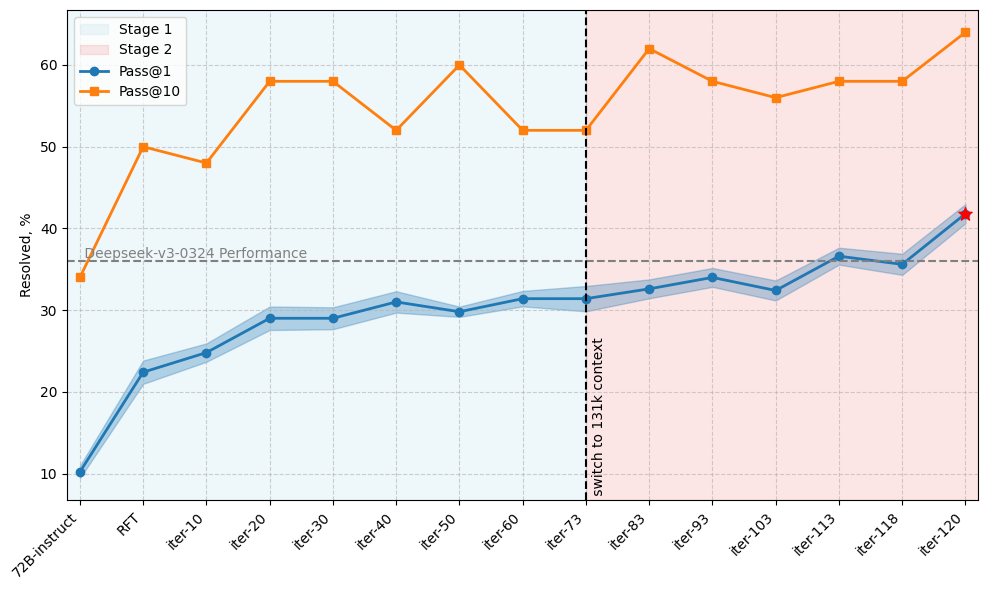
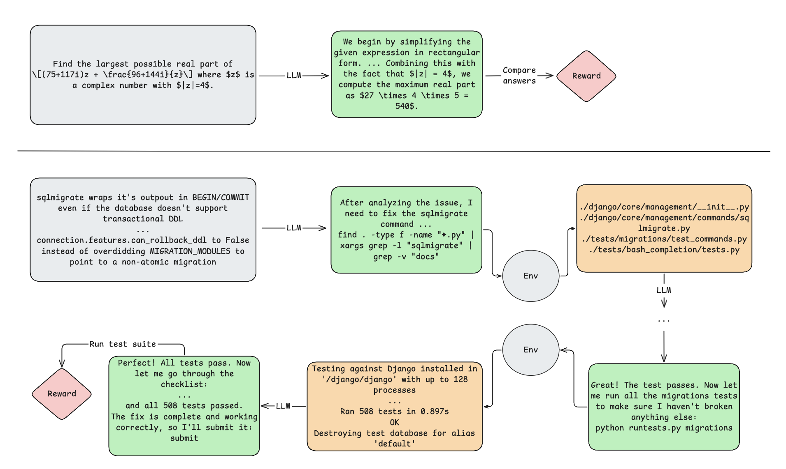
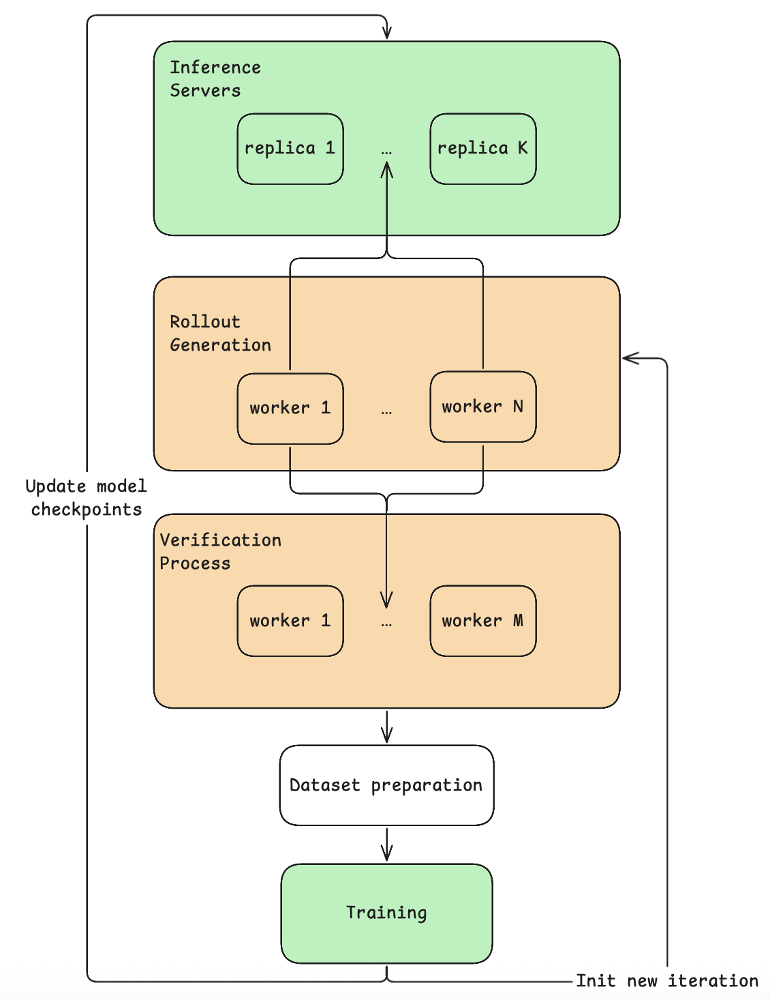

# 長文脈・多ターンのソフトウェアエンジニアリングエージェントを強化学習で訓練する

> 原題: Training Long-Context, Multi-Turn Software Engineering Agents with Reinforcement Learning
> 著者: Alexander Golubev, Maria Trofimova, Sergei Polezhaev, Ibragim Badertdinov, Maksim Nekrashevich, Anton Shevtsov, Simon Karasik, Sergey Abramov, Andrei Andriushchenko, Filipp Fisin, Sergei Skvortsov, Boris Yangel
> 出典: arXiv:2508.03501（ar5iv）

> ［訳注］ar5iv のクリップを底本とし、原ページ（2026-10-25 取得）と照合した。本文・表・図の欠落はない。図 5 枚は ar5iv から取得して `raw/assets/2025-swe-rl-long-context/` に保存した。著者の所属は ar5iv の原ページにも記載がない。表 1 は HTML の表を markdown に直した。付録 B の問題一覧はクリップでは 1 行ずつ空行で区切られていたので、コードブロックにまとめた。参考文献の一覧は既定どおり訳出せず、本文の `[^N]` は原典の番号のまま残した。

###### Abstract（要旨）

大規模言語モデル（LLM）への強化学習（RL）の応用研究は、数学的推論や一発のコード生成といった単一ターンの問題にほぼ集中してきた。これらの問題はトークンレベルの多ターン MDP とみなすこともできるが、この見方は、環境がフィードバックを返さない、多ターン相互作用の退化した場合にあたる。これは、ソフトウェアエンジニアリング（SWE）のような現実世界の多くの領域と対照的である。そうした領域では、各行動に自明でない観測で応答する、状態を持つ環境との豊かな多ターンの相互作用が必要になる。

この溝を埋めるため、私たちはこの一般的な状況への RL の応用を成功させたことを示す。改変した Decoupled Advantage Policy Optimization（DAPO）アルゴリズムを用いて、Qwen2.5-72B-Instruct にもとづくエージェントを、現実世界のソフトウェアエンジニアリングのタスクを解くよう訓練する。私たちのアプローチは、教師モデルに一切頼ることなく、SWE-bench Verified ベンチマークでのエージェントの成功率を、棄却ファインチューニング（rejection fine-tuning）したベースラインの 20% から 39% に引き上げる。SWE-rebench では、私たちのエージェントは、同一の足場（scaffolding）を用いた場合に、DeepSeek-V3-0324 や Qwen3-235B-A22B のような主要なオープンウェイトモデルに匹敵するか上回る。これは、オープンなモデルにもとづいて、複雑な現実世界の問題のためのより有能な自律エージェントを構築する現実的な道筋を示している。

## 1 Introduction（はじめに）

<figure>



<figcaption>図1: 訓練の反復にわたる、RL で訓練したエージェントの性能。評価を速めるため、Pass@1/10 は SWE-bench Verified からランダムに選んだ 50 タスクの部分集合で計算し、ばらつきを減らすために 10 回の独立な実行で平均している。Pass@1 は平均の標準誤差とともに示す。</figcaption>
</figure>

大規模言語モデルは、複雑な現実世界の領域で自律エージェントの中に組み込まれることが増えている。ソフトウェアエンジニアリングは特に魅力的な応用分野であり、デバッグ、コード生成、ソフトウェア保守のタスクの自動化を通じて大きな経済的影響が期待される。しかし、効果的な SWE エージェントを開発する現在のアプローチは、主に 3 つの戦略のいずれかに依存している。(i) 洗練された足場をプロプライエタリな LLM と組み合わせる [^2] [^13] [^18]、(ii) 大規模な推論時のスケーリング技法を活用する [^1]、(iii) より強い教師モデルのデモンストレーションを使ってオープンウェイトモデルを教師ありファインチューニング（SFT）する [^23] [^27] [^12]。これらの手法は最初の段階で強い結果を出してきたが、資源集約的であることが多く、強力でプロプライエタリなモデルに依存している。この現実は、より小さなオープンウェイトモデルから同等に効果的なシステムを構築できる手法の必要性を浮き彫りにしている。強化学習は、応答する環境との相互作用を通じてエージェントの方策を直接最適化することで、教師モデルに頼らずにより強い性能を達成しうる、有望な代替手段を提供する。

行動が観測可能な遷移と検証可能な結果を生む、SWE の相互作用的で構造化された性質は、SWE を RL にとって理想的な領域にしている。しかしこれまで、LLM への RL の応用のほとんどは、数学的推論や一発のコード生成のような単一ターンのタスクに限られてきた。こうしたタスクは、多腕バンディットや、途中の環境フィードバックのない退化した MDP として自明にモデル化できる（図 2）。

<figure>



<figcaption>図2: バンディット型の問題（上、例: 数学）と POMDP（下、例: ソフトウェアエンジニアリング）のタスク構造の違いの図解。バンディットの設定では、エージェントは最初の観測にもとづいて、最終的な解を出す単一の行動をとる。対照的に POMDP では、エージェントが繰り返し行動をとり、新しい環境フィードバックを解釈して次の決定を導く、多段の相互作用ループが必要になる。</figcaption>
</figure>

対照的に、SWE のシナリオでは、エージェントは状態を持つ多ターンの相互作用を管理する必要がある。この文脈で RL をうまく適用するには、いくつかの重要な課題がある。

- **長期ホライズン・多ターンの相互作用**: エージェントは、数十万トークンにわたるコンテキストウィンドウの中で、数十のステップにわたって一貫性を保たなければならない。
- **複雑で情報量の多いフィードバック**: 行動は豊かな出力（例: コンパイラのトレース、テストのログ）を引き出し、それを解釈して後続の決定を効果的に導かなければならない。
- **データのスケーラビリティと忠実度**: 質の高い軌跡を生成するには、統制された環境の中で特定のリポジトリの状態を再現する必要があり、これがデータセットの規模を制限する。SWE-smith [^23] や SWE-rebench [^3] のような大規模なデータセットがこの溝に取り組み始めている。私たちは主に後者の上に構築する。
- **疎で遅延した報酬**: 成功の信号は通常、長い行動列の最後にしか現れず、信用割当（credit assignment）を難しくする。
- **高価でノイズの多い評価**: 軌跡の展開とその後の評価は高くつき、テストの不安定さ（flakiness）が報酬信号にノイズを持ち込む。

本論文では、相互作用的な SWE タスクのために明示的に作り込んだ完全な RL パイプラインを開発することで、これらの課題に取り組む。私たちの中核的な貢献は次のとおりである。

- 改変した DAPO アルゴリズム [^25] にもとづく、スケーラブルな RL の枠組み。長期ホライズン・多ターンの SWE シナリオの要求を扱えるよう特に適応させた。
- RL の有効性の実証。SWE-bench Verified ベンチマークで約 39% の成功を達成し、棄却ファインチューニングしたエージェントのベースライン性能を倍にする Qwen2.5-72B-Instruct エージェントを訓練した。さらに私たちのエージェントは、SWE-rebench ベンチマークで、DeepSeek-V3-0324 や Qwen3-235B-A22B のような上位のオープンウェイトモデルに匹敵するか上回る（表 1）。
- 私たちの RL 訓練の方法論の詳細な分析。アルゴリズムの改変、ハイパーパラメータの設定、主要な知見、そして状態を持つ相互作用的な環境で LLM ベースのエージェントに RL を適用するための有望な今後の方向の議論を含む。

私たちの結果は、RL が一般的な相互作用的環境にうまく適用でき、オープンウェイトの LLM エージェントの能力を、単一ターンのベンチマークを超えて、将来の自律エージェントが動作すると期待される現実世界のシナリオへと進められることを示している。

## 2 Preliminaries（準備）

### 2.1 Task Formulation（タスクの定式化）

私たちは、自律 SWE エージェントのタスクを、組 $\langle\mathcal{Z},\mathcal{A},\Omega,T,\mathcal{O},R,\gamma\rangle$ で定義される部分観測マルコフ決定過程（Partially Observable Markov Decision Process, POMDP）[^11] として形式化する。

- $\mathcal{Z}$: 真の、潜在的な環境状態の集合。
- $\mathcal{A}$: エージェントが利用できる行動の集合。
- $\Omega$: エージェントが受け取りうる観測の集合。
- $T(z^{\prime}|z,a)$: 状態 $z$ から行動 $a$ をとったあと状態 $z^{\prime}$ へ遷移する確率。
- $\mathcal{O}(o|z^{\prime})$: 状態 $z^{\prime}$ から観測 $o$ を受け取る確率。
- $R(z,a)$: 状態 $z$ から行動 $a$ をとることで与えられる報酬。
- $\gamma\in[0,1]$: 割引率。

各ステップ $t$ で、環境の潜在状態 $z_{t}$ は観測できない。代わりにエージェントは、過去のすべての行動と観測の履歴 $h_{t}=(o_{0},a_{0},o_{1},a_{1},\dots,a_{t-1},o_{t})$ を保持する。完了したエピソードに対応する完全な履歴を軌跡（trajectory）$\tau$ と呼ぶ。$\theta$ でパラメータ化されたエージェントの方策は、この履歴にもとづいて次の行動を選ぶ: $\pi_{\theta}(a_{t}|h_{t})$。LLM の自己回帰的な性質により、方策の確率は 1 つの行動の中のトークンにわたって分解される。

$$
\pi_{\theta}(a_{t}|h_{t})=\prod_{k=1}^{|a_{t}|}\pi_{\theta}(a_{t,k}|h_{t},a_{t,<k}).
$$

ここで $a_{t,k}$ は行動 $a_{t}$ の $k$ 番目のトークン、$|a_{t}|$ はトークン単位での行動の長さである。

私たちの SWE の設定では、これらの構成要素は次のように具体化される。

- **環境状態（$z_{t}$）**: ファイルシステム、ソースコード、実行中のプロセスを含む、完全で隠れたソフトウェア環境の状態。
- **行動（$a_{t}$）**: LLM が自己回帰的に生成するコマンド文字列（推論とツール呼び出しを含みうる）。
- **観測（$o_{t}$）**: コマンドの実行出力（通常は stdout、stderr、終了コード）。最初の観測 $o_{0}$ は、GitHub のイシューにあるタスクの自然言語による記述を含む。
- **履歴（$h_{t}$）**: 過去の行動と観測の完全な観測可能な履歴で、方策の次の決定を条件づける。

私たちの目標は、期待累積報酬を最大化する方策 $\pi_{\theta}$ を見つけることである。軌跡 $\tau$ の累積報酬は、全ステップにわたる報酬の和 $G(\tau)=\sum_{t=0}^{|\tau|-1}R(z_{t},a_{t})$ であり、$|\tau|$ は軌跡の中の行動の数を表す。終端でないすべてのステップで即時報酬 $R(z_{t},a_{t})$ がゼロである疎な報酬構造のもとでは、これは終端報酬に単純化され、それを $R(\tau)$ と書く。$R(\tau)$ は、最終的に提案されたパッチが検証用のテストスイートを通れば $1$、そうでなければ $0$ である。私たちはこの終端報酬を、方策最適化の唯一の信号として用いる。

### 2.2 From PPO to DAPO（PPO から DAPO へ）

強化学習は伝統的に *Proximal Policy Optimization*（PPO）[^14] が主流であり、これは学習された critic を用いて、生成された各行動の advantage を推定する。強力ではあるが、PPO は追加のオーバーヘッドとハイパーパラメータ調整への敏感さを持ち込む。私たちの設定では、PPO の目的関数は次のようになりうる。

$$
\mathcal{J}_{\text{PPO}}(\theta)=\mathbb{E}_{\begin{subarray}{c}o_{0}\sim\mathcal{D},\\
\tau\sim\pi_{old}(\cdot|o_{0})\end{subarray}}\Biggl[\frac{1}{|\tau|}\sum_{t=0}^{|\tau|-1}\frac{1}{|a_{t}|}\sum_{k=1}^{|a_{t}|}\min\Bigl(\\
\rho_{t,k}(\theta)A_{t,k},\text{clip}(\rho_{t,k}(\theta),1-\varepsilon,1+\varepsilon)A_{t,k}\Bigr)\Biggr],
$$

ここで $o_{0}\sim\mathcal{D}$ は、最初の観測が私たちのデータセットのタスクの分布からサンプリングされることを示す。$\rho_{t,k}(\theta)\triangleq\frac{\pi_{\theta}(a_{t,k}|h_{t},a_{t,<k})}{\pi_{\theta_{\text{old}}}(a_{t,k}|h_{t},a_{t,<k})}$ は行動 $a_{t}$ の $k$ 番目のトークンの確率比であり、$A_{t,k}$ はそれに対応する advantage の推定値である。

*Group-Relative Policy Optimization*（GRPO）[^16] は、学習された advantage の推定器を不要にする。代わりに、同じ方策からサンプリングした軌跡のグループの報酬の平均と標準偏差に対して終端報酬を正規化することで、各軌跡の advantage のモンテカルロ推定を計算する。

与えられた最初の観測について、GRPO は方策から $G$ 本の完全な軌跡のグループ $\{\tau^{(1)},\dots,\tau^{(G)}\}$ をサンプリングし、それらの終端報酬 $\{R(\tau^{(1)}),\dots,R(\tau^{(G)})\}$ を集める。軌跡 $\tau^{(i)}$ の advantage は、グループの平均報酬 $\bar{R}=\frac{1}{G}\sum_{i=1}^{G}R(\tau^{(i)})$ に対して相対的に計算される。

$$
\hat{A}^{(i)}=\frac{R(\tau^{(i)})-\bar{R}}{\sigma_{R}+\delta},
$$

ここで $\sigma_{R}$ はグループの報酬の標準偏差、$\delta$ は数値的安定性のための小さな定数である。この単一の advantage の値 $\hat{A}^{(i)}$ が、軌跡 $\tau^{(i)}$ の中のすべてのトークンに適用される。

GRPO の目的関数は、PPO と同じクリップされた代理目的を用いるが、critic にもとづく advantage をこのグループ単位の advantage の推定値で置き換える。

$$
\mathcal{J}_{\text{GRPO}}(\theta)=\mathbb{E}_{\begin{subarray}{c}o_{0}\sim\mathcal{D},\\
\{\tau^{(i)}\}_{i=1}^{G}\sim\pi_{old}(\cdot|o_{0})\end{subarray}}\Biggl[\\
\frac{1}{G}\sum_{i=1}^{G}\frac{1}{|\tau^{(i)}|}\sum_{t=0}^{|\tau^{(i)}|-1}\frac{1}{|a_{t}^{(i)}|}\sum_{k=1}^{|a_{t}^{(i)}|}\min\Bigl(\\
\quad\rho_{t,k}^{(i)}(\theta)\hat{A}^{(i)},\text{clip}(\rho_{t,k}^{(i)}(\theta),1-\varepsilon,1+\varepsilon)\hat{A}^{(i)}\Bigr)\Biggr].
$$

DAPO は、安定性と効率を高めるいくつかの実践的な改良を導入することで GRPO を拡張する。主な変更は次のとおりである。

- **Clip higher**: 対称なクリップ範囲 $(1-\varepsilon,1+\varepsilon)$ の代わりに、DAPO は非対称な境界 $(1-\varepsilon_{low},1+\varepsilon_{high})$ を使う。方策のエントロピーの崩壊をよりよく防ぐため、通常 $\varepsilon_{high}$ は $\varepsilon_{low}$ より大きく設定する。
- **Dynamic sampling（動的サンプリング）**: 学習信号を持たないサンプリングされたコマンド（すなわち $\hat{A}^{(i)}=0$）を除外し、計算を有効な更新に集中させる。
- **Soft overlong punishment（ソフトな長すぎ罰）**: 具体的には、応答があらかじめ定めた長さのしきい値を超えると、指定した区間の中で段階的な罰が適用される。この区間の中では、応答が長いほど大きな罰を受ける。この罰は元のテストにもとづく報酬に加算され、それによってモデルに過度に長い応答を避けるよう信号を送る。
- **Token-level loss（トークンレベルの損失）**: 元の GRPO アルゴリズムはサンプルレベルの平均を用い、各軌跡が等しい重みを持つ。DAPO は、式 5 に示すように、バッチ内のすべてのトークンにわたって損失を平均することを提案する。この方法により、バッチ全体のすべてのトークンが勾配に等しく寄与し、より長い軌跡により大きな影響を与える。

$$
\mathcal{J}_{\text{DAPO}}(\theta)=\mathbb{E}_{\begin{subarray}{c}o_{0}\sim\mathcal{D},\\
\{\tau^{(i)}\}_{i=1}^{G}\sim\pi_{old}(\cdot|o_{0})\end{subarray}}\Biggl[\\
\frac{1}{\sum_{i=1}^{G}\sum_{t=0}^{|\tau^{(i)}|-1}|a_{t}^{(i)}|}\sum_{i=1}^{G}\sum_{t=0}^{|\tau^{(i)}|-1}\sum_{k=1}^{|a_{t}^{(i)}|}\min\Bigl(\\
\quad\rho_{t,k}^{(i)}(\theta)\hat{A}^{(i)},\text{clip}(\rho_{t,k}^{(i)}(\theta),1-\varepsilon_{low},1+\varepsilon_{high})\hat{A}^{(i)}\Bigr)\Biggr].
$$

私たちの実装は DAPO の上に構築するが、多ターンの SWE の設定のためにいくつかの変更を導入する。それらは以下で詳しく論じる。

### 2.3 Agent Scaffolding（エージェントの足場）

私たちの研究における SWE エージェントは、ReAct 型のループ [^24] を用い、あらかじめ定めたツールの集合を通じて環境と相互作用する。行動と観測の履歴の全体が、すべての決定を条件づける。私たちは、それぞれ自然言語によるイシューの記述と再現可能な環境を持つ、7,000 を超える精選された SWE タスクをサポートする評価基盤を提供する。

私たちの SWE エージェントは、次のツールを使って環境と相互作用する。

- 任意のシェルコマンド（ls、cat、grep など）。
- ファイル内の指定した行範囲を新しいテキストで置き換える edit コマンド。このコマンドは、正確なインデントを持つ置換テキストをエージェントが与えることを要求し、現在開いているファイルにも、ファイルパスで指定したファイルにも作用できる。
- 引数をとらない submit コマンド。エージェントが作業を終えたことを知らせる。この行動でエピソードが終了する。

各 SWE タスクは、自然言語の記述を持つ GitHub 形式のイシュー、最終的なパッチの正しさを評価する失敗中のテストスイート、そしてリポジトリのスナップショットから初期化されたサンドボックス環境を含む。

## 3 Reinforcement Learning for Multi-Turn Agents（多ターンエージェントのための強化学習）

この節では、慎重に精選したデータと、多ターンの SWE タスクのために明示的に最適化した 2 段階の訓練パイプラインからなる、私たちの訓練の方法論の概要を述べる。

### 3.1 Data（データ）

私たちは、約 3,400 の Python の GitHub リポジトリから集めた 21,336 のタスクを含む、公開されている SWE-rebench データセットから出発する。各タスクは、GitHub のイシュー、正解の解のパッチ、検証用のテストスイート、再現可能な環境を含む。

質が高く安定した訓練を確保するため、厳格な絞り込みの基準を適用し、次の基準に従って 7,249 のタスクを選んだ。

- **タスクの正しさ**: タスクのメタデータに示されているとおり、無効な参照やインポート（例: AttributeError、ImportError）のためにテストの失敗を引き起こすタスクを除く。こうしたケースでは、エージェントが特定の識別子の名前を推測しなければならなくなる。
- **複雑さの統制**: 扱える複雑さを保つため、変更するファイルが最大 7 つで、コードが 500 行未満のタスクだけを含める。
- **LLM による品質評価**: 元のデータセットの LLM 生成スコアによれば、イシューの記述が不明瞭なタスク、過度に複雑なタスク、テストパッチに欠陥のあるタスクを除外する。これは、メタデータのフィールドで LLM スコア $3.0$ が割り当てられたすべての問題を除くことで行う。
- **決定的なテスト**: テストを繰り返し実行したとき（50 回の試行）に不安定さを示すタスクを除き、安定した訓練信号を確保する。非決定的なテストの挙動は、主に外部サービスの呼び出しや浮動小数点の不正確さのために起きる。

評価には、標準の SWE-bench Verified ベンチマーク、途中の評価を速めるための 50 問のランダムな部分集合（Verified-50 と呼ぶ）、そして訓練集合に含まれていない SWE-rebench の最新の月次分割（5〜6 月）を用い、公正で汚染のない比較を確保する。Verified-50 の問題の完全な一覧は付録 B にある。

### 3.2 Phase 1: Rejection Fine-Tuning (RFT)（第 1 段階: 棄却ファインチューニング）

私たちはオープンウェイトの Qwen2.5-72B-Instruct モデルから出発する。そのままでは SWE-bench Verified で約 11% にしか届かず、主な失敗は指示追従の誤りで、適切な形式になっていないコマンドが生じる。

この問題に対処し、RL の段階に向けてモデルを慣らすため、棄却ファインチューニング（RFT）を行う。まず、最初のチェックポイントを 7,249 の SWE-rebench タスクで 10 回ずつ走らせ、パッチがテストスイートを通った軌跡だけを残す。これにより 6,548 の成功した軌跡の集合が得られ、それに対して教師ありファインチューニングを 1 エポック行う。このエポックの間、環境の形式エラーを引き起こしたエージェントのターンをすべてマスクし、それによって損失を有効な行動に集中させ、ツールの構造への準拠を改善する（図 3 参照）。RFT のあと、モデルの正解率は約 20% に上がる（表 1）。この段階と後続の段階のすべてのハイパーパラメータは、訓練の詳細の節に示す。

<figure>


<figcaption>図3: RFT で使った、エージェントの相互作用の軌跡の例。緑の（成功した）アシスタントのターンだけが訓練の損失に寄与する。</figcaption>
</figure>

### 3.3 Phase 2: Multi-Turn RL（第 2 段階: 多ターン RL）

私たちの研究の中核は、反復的なループの中で何千もの問題に RL を適用することである。各 RL の反復は次を含む。

- **問題のサンプリング**: 訓練用のプールから問題の部分集合を選ぶ。
- **ロールアウトの生成**: 現在の方策を使って、問題ごとに $G=10$ 本の完全な軌跡をサンプリングする。
- **報酬の計算**: 最終的な報酬信号 $R_{\text{final}}(\tau)$ は、テストによる二値の成功報酬と、軌跡の長さに対する罰を組み合わせる。一定のステップ数を超えた場合に線形の罰を加える。報酬は次のように計算される。

  $$
  R_{\text{final}}(\tau)=R(\tau)+R_{\text{length}}(\tau)
  $$

  $$
  R_{\text{length}}(\tau)=\begin{cases}0,&\text{if }|\tau|<L_{\text{thr}}\\
  \frac{L_{\text{thr}}-|\tau|}{T_{\text{max}}-L_{\text{thr}}},&\text{if }|\tau|\geq L_{\text{thr}}\end{cases}
  $$

  ここで $R(\tau)\in\{0,1\}$ は前節で定義した終端報酬であり、$L_{\text{thr}}$ と $T_{\text{max}}$ はそれぞれ罰のしきい値と最大のエピソード長を表すハイパーパラメータである。
- **advantage の推定**: 各 10 サンプルのグループの中で報酬を平均・正規化し、advantage がゼロのサンプルは捨てる。
- **最適化**: DAPO のクリップされたトークンレベルの目的関数を使って、モデルの全パラメータを更新する。

私たちは RL の訓練を 65k のコンテキスト長で始める。これはほとんどのオープンウェイト LLM の既定の 32k をすでに超えているが、長いスタックトレースや差分の履歴を持つリポジトリにはまだ足りない。性能がおよそ 32% で頭打ちになったところで、より長いコンテキストの設定に切り替え、コンテキストウィンドウを 131k に増やし、エージェントの最大ターン数 $T_{\text{max}}$ を 40 から 80 に倍増させる。この第 2 段階での安定した更新のため、高い側のクリップ境界 $\epsilon_{\text{high}}$ を下げ、バッチサイズを増やし、各反復でサンプリングするインスタンスの数を減らす。すなわち、訓練をよりオンポリシーに近い形へ移す（表 3 参照）。

段階間の移行の一部として、訓練用のプールを入れ替えることで、一度限りのカリキュラム調整を行う。タスクの累積解決率を、それまでのすべての訓練の反復にわたる成功率と定義する。累積解決率が $\frac{2}{3}$ を超える（そのタスクを確実に解けることを示す）か、ゼロのままである（おそらく解けないことを示す）タスクを、プールから取り除く。この絞り込みにより、訓練用のプールは 7,249 から 2,028 のタスクに減る。この戦略により、第 2 段階の計算資源を、学習に最も有益な問題に集中させる。

この第 2 段階で、SWE-bench Verified での性能は 39.0% に上がる。保留した SWE-rebench の評価集合では、5 月の分割で 35.0%、6 月の分割で 31.7% を達成する。最終的な Pass@1 のスコア（39.0%）と Pass@10 のスコア（58.4%）の大きな差は、エージェントの最良の単一の推測が誤っていることがあっても、有効な解がその上位の提案の中にしばしば存在することを示唆している。これは、性能をさらに改善するために、再ランキングや best-of-$n$ の選択の仕組みを適用する大きな可能性を示している。

**表1**: SWE-bench Verified と SWE-rebench での、私たちのモデルとオープンウェイトのベースラインの比較。Pass@1 の指標は 10 回の実行で平均し、平均の標準誤差とともに報告する。私たちの最終モデルとベースラインのモデルは 131k のコンテキスト長で評価し、途中のモデルはそれぞれの訓練段階で使ったコンテキスト長（65k）で評価した。すべてのモデルは、Hugging Face の設定で指定された既定のデコーディングパラメータを使う。

| モデル | SWE-bench Verified Pass@1 | Pass@10 | SWE-rebench 5 月 Pass@1 | Pass@10 | SWE-rebench 6 月 Pass@1 | Pass@10 |
|---|---|---|---|---|---|---|
| Qwen2.5-72B-Instruct | 11.42 ± 0.24 | 31.0 | 14.50 ± 1.33 | 40.0 | 14.63 ± 1.03 | 36.6 |
| + RFT @ 65k（本研究） | 20.46 ± 0.42 | 43.0 | 22.50 ± 1.18 | 45.0 | 20.98 ± 1.51 | 43.9 |
| + Stage 1 RL @ 65k（本研究） | 35.74 ± 0.28 | 54.6 | 36.50 ± 1.59 | 55.0 | 31.22 ± 0.80 | 53.7 |
| + Stage 2 RL @ 131k（本研究） | 39.04 ± 0.50 | 58.4 | 35.00 ± 1.54 | 52.5 | 31.71 ± 1.31 | 53.7 |
| DeepSeek-V3-0324 | 39.56 ± 0.47 | 62.2 | 36.75 ± 0.92 | 60.0 | 31.46 ± 1.38 | 58.5 |
| Qwen3-235B no-thinking | 25.84 ± 0.37 | 54.4 | 27.25 ± 1.15 | 57.5 | 22.93 ± 2.16 | 48.8 |
| Qwen3-32B no-thinking | 20.40 ± 0.34 | 44.0 | 21.75 ± 1.54 | 50.0 | 17.56 ± 1.30 | 36.6 |
| Llama4 Maverick | 15.84 ± 0.54 | 47.2 | 19.00 ± 1.72 | 50.0 | 13.66 ± 1.79 | 39.0 |

## 4 Training Details and Results（訓練の詳細と結果）

### 4.1 Main Results（主な結果）

私たちの 2 段階の手順は大きな改善をもたらす。棄却ファインチューニングは、環境と正しく相互作用するモデルの能力を高めることで最初の性能向上をもたらす。これに続く 100 回を超える RL の反復が、エージェントの方策を段階的に洗練する。最終モデルは SWE-bench Verified の全体で $39.0\%$ を達成する。性能の推移を図 4 に示す。

直接比較のため、DeepSeek-V3-0324、Llama-4 Maverick、Qwen3-235B no-thinking、Qwen3-32B no-thinking を、同じ環境とツールの設定（表 1 参照）の中で、SWE-bench Verified と SWE-rebench の両方で評価する。私たちの最終モデルを特化した SWE エージェントと比べるため、最近の結果を表 2 にまとめる。

**表2**: SWE-bench Verified での特化した SWE エージェントの比較。「訓練前」の列は訓練前の基盤モデルの Pass@1 のスコアを、「訓練後」の列は完全に訓練したエージェントの最終的な性能を示す。

| エージェント | 基盤モデル | SWE-bench Ver. 訓練前 | SWE-bench Ver. 訓練後 | 教師からの蒸留 |
| --- | --- | --- | --- | --- |
| 本研究 | Qwen2.5-72B-Instruct | 11.4% | 39.0% | なし |
| DeepSWE-32B, [^9] | Qwen3-32B | 23% | 42.2% | なし |
| SkyRL-Agent-14B-v0, [^4] | Qwen3-14B | 18.0% | 21.6% | なし |
| SWE-Fixer-72B, [^21] | Qwen2.5-72B-Base | – | 30.2% | あり |
| SWE-agent-LM-32B, [^23] | Qwen2.5-Coder-32B-Instruct | 14.3% | 40.2% | あり |
| Skywork-SWE-32B, [^27] | Qwen2.5-Coder-32B-Instruct | 6.4% | 38.0% | あり |
| SWE-Gym-32B, [^12] | Qwen2.5-Coder-32B-Instruct | 7.0% | 20.6% | あり |
| SWESynInfer-72B, [^10] | Qwen2.5-72B-Instruct | 25.4% | 30.2% | あり |
| R2EGym-Agent-32B, [^6] | Qwen2.5-Coder | 7.0% | 34.4% | あり |

<figure>


<figcaption>図4: RL で訓練したエージェントの、全反復にわたる詳細な性能の推移。統計には Pass@1、Pass@10、submit コマンドの数、軌跡あたりの平均ステップ数を含む。すべての指標は Verified-50 で計算した。</figcaption>
</figure>

### 4.2 Infrastructure（基盤）

記述したプロセスは完全に同期的な RL の訓練プロセスにもとづいている。つまり、推論と訓練の段階が交互に行われる。ロールアウトの生成が完了すると、軌跡が訓練に使われる。この設定により、サンプリングと更新の間に方策の遅れのない、完全にオンポリシーな訓練が可能になる。ただし、前述のとおり問題ごとに 10 本の軌跡をサンプリングする。その結果、バッチサイズと $\hat{A}^{(i)}\neq 0$ の軌跡の数に応じて、反復ごとに 2〜8 回の最適化ステップになる。

私たちは、非同期の枠組みのほうがより大きなスケーラビリティを提供しうると考えているが、軌跡の遅れのような複雑さを排除するため、これらの実験には同期的な枠組みが妥当な選択である。同期的なアプローチの主な欠点は「落伍者（straggler）」問題である。各生成の反復の時間は、完了するのが最も遅い単一の軌跡によって決まり、全体のスループットを下げうる。

最大 131k トークンの系列で全パラメータの訓練を可能にするため、長い系列を GPU にまたがって分割するコンテキスト並列化（context parallelism）を活用する。すべての訓練と推論は 16 台の H200 ノードで行う。

基盤についてのさらなる詳細は付録 C で述べる。

### 4.3 Hyperparameters（ハイパーパラメータ）

#### Inference.（推論）

ロールアウトの生成では、温度 1.0 でモデルを走らせ、top_p、top_k、min_p、repetition_penalty などの他のすべてのデコーディングパラメータを明示的に無効にする。これにより偏りのないサンプリングが確保される。これは、訓練中に使う重要度サンプリングの比の妥当性にとって決定的に重要である。偏ったサンプリング手順の危険性は、後の知見で示す。

#### Training.（訓練）

RFT では、65k のコンテキスト長で 1 エポックの訓練を行い、学習率は $5\times 10^{-6}$、重み減衰 0.1 の AdamW オプティマイザ、10 ステップのウォームアップ、$\textit{end\_lr}=0.0$ のコサイン減衰スケジューラを用いる。バッチサイズは 64 で、50 回の勾配更新ステップになる。

RL のパイプラインについては、段階をまたいで変えたすべてのハイパーパラメータを表 3 に示す。両方の設定は共通の設定を共有する: $\textit{gradient\_clipping}=1.0$、$\beta_{1}=0.9$・$\beta_{2}=0.999$・$\varepsilon=1\times 10^{-8}$・重み減衰 0.1 の AdamW、学習率 $10^{-6}$、$\textit{num\_epochs}=1$。

**表3**: 2 つの RL の訓練段階にまたがる主要なハイパーパラメータ。

| 訓練段階 | 反復あたりの問題数 | 問題の総数 | バッチサイズ | クリップ範囲 |
| --- | --- | --- | --- | --- |
| Stage 1 | 300 | 7249 | 128 | [0.2, 0.3] |
| Stage 2 | 100 | 2028 | 256 | [0.2, 0.26] |

Qwen2.5-72B-instruct のモデルでは、131k のコンテキスト長での訓練と推論を可能にするため、$\textit{factor}=4.0$ の YaRN 位置符号化を用いる。

### 4.4 Findings（知見）

データセットの準備で一般に採用されている慣行で、DeepSWE [^9] でも言及されているものに、モデルの最大コンテキスト長を超える軌跡を除外またはマスクすることがある。これは多くの場合、報酬のノイズを減らしたいという動機による。しかし私たちは、これを慎重に適用しなければならないことを見出した。手作りのヒューリスティクスは偏りを持ち込み、訓練データが最適化される方策と同じ分布からサンプリングされているという仮定を壊しうる。私たちの設定では、こうした長い軌跡は、エージェントが反復的なループに行き詰まったときに起きることが多い。これらの軌跡を捨てることで、この失敗モードの具体的な負例も捨てることになる。その結果、エージェントはこのループする振る舞いに対して罰されず、そうしたサイクルから抜け出す方法を学べなくなり、訓練中にそれがより頻繁に起きることにつながりうる。

また、サンプリングと訓練の間の食い違いに関係する、より微妙な不安定さも観察した。訓練の途中で vLLM [^8] のランタイムをアップグレードしたところ、デコーディングパラメータに内部的な変更が入り、top_k と min_p が既定で有効になった。これは当初評価指標を改善したが、5〜10 回の訓練の反復のあとで性能の劣化を引き起こした。私たちはこれを、ロールアウトの分布と訓練の分布の不一致によるものと考える。DAPO の目的関数は、advantage の項に重みをつけるのに重要度サンプリングの比 $\rho_{t,k}(\theta)$ に依存する。これはロールアウトが $\pi_{old}$ からサンプリングされている場合にのみ有効である。異なるデコーディングパラメータを使うことは、修正された分布 $\pi_{\text{rollout}}\neq\pi_{old}$ からサンプリングすることに等しく、これは比を誤った推定量にし、偏った勾配の更新につながる。サンプリングの設定を元に戻すと、安定性は回復した。

## 5 Discussion and Future Work（議論と今後の研究）

私たちの研究は、現代の強化学習アルゴリズム、具体的には改変した DAPO が、複雑で相互作用的なソフトウェアエンジニアリングのタスクのために有能なエージェントを訓練できることを示すことに成功した。しかしこのプロセスは、エージェントにもとづく学習の根本的な課題を浮き彫りにし、今後の研究のいくつかの重要な方向を明らかにしている。

- **疎な報酬と信用割当**: 根本的な課題は、エージェントが長い軌跡の最後に単一の二値の成功信号しか受け取らないことである。この疎さが、信用割当、すなわち長い系列の中のどの特定の行動が結果にとって決定的だったかを特定することを難しくする。単一の advantage の推定値を先行する何千ものトークンにわたって一斉に適用すると、ノイズが多く非効率な方策の更新になりうる。これに対処しうる研究の方向がいくつかある。(i) 報酬整形（reward shaping）。テストの一部が通る、コンパイラのエラーが減るといった信号にもとづいて中間の報酬を設計する。(ii) 補助的な critic や価値ヘッドを訓練してステップレベルの advantage の推定値を与え、より細かい更新を可能にする。(iii) プレフィックスサンプリング（prefix sampling）。空でない共有の軌跡のプレフィックスからロールアウトを始め、後の決定の影響をよりよく切り分ける。
- **不確実性とリスクの認識**: 二値の成功にもとづく報酬の目的関数は、エージェントに「何としても」パッチを提出するよう促し、解ける見込みが低いときでさえ自信を持って行動させる。現実世界での展開のためには、エージェントはいつ手を引くべきかを認識しなければならない。これにはより良い不確実性の推定が必要であり、例えば、モデルが信頼度のスコアを明示的に出力するよう訓練したり、方策の出力のエントロピーを不確実性の代理として使ったりする。こうした推定があれば精度と再現率のトレードオフが可能になり、外部の結果監督モデルなしに、エージェントがいつ止めるか、あるいは best-of-$n$ の選択にさらに計算を投じるかを決められるようになる。

## Appendix A Related Work（付録 A: 関連研究）

#### Software engineering agents.（ソフトウェアエンジニアリングのエージェント）

初期のシステム、特に SWE-agent [^22] は、大規模言語モデル（LLM）が、あらかじめ定めたツールキット（例: シェルコマンド、コードエディタ）を使ってサンドボックス化されたソフトウェア環境の中で効果的に動作し、自動化された単体テストで評価されうることを示した [^7]。後続の枠組みは、モデルの相互作用を強化するための別の足場とプロンプトの戦略を導入した。Agentless [^20]、OpenHands [^19]、Moatless [^1] などである。私たちの研究は元の SWE-agent の設計に近く、類似のプロンプトの構造とツールの構成を活用しており、この確立された文脈の中で強化学習による改善を直接評価できる。

#### Strategies to improve SWE agents.（SWE エージェントを改善する戦略）

足場の改善を超えて SWE エージェントの性能を高める先行研究は、大きく*テスト時の探索*か、教師ありの訓練による*モデルレベルの改善*のどちらかに焦点を当てている。モンテカルロ木探索（MCTS）[^1] や誘導された 1 ステップの先読み [^26] のようなテスト時の探索戦略は、複数の解の軌跡を探索することでタスクの成功を大きく高める。しかし、これらの手法は計算コストが高く、環境のロールバックや並列の実行経路のような操作のために、基盤の複雑さを持ち込むことがある。

別の方向として、多くの取り組みは、専門家が精選したデモンストレーションを使った教師ありファインチューニング（SFT）による、モデルレベルの改善を目標としてきた。代表的な例には SWE-smith [^23]、SWE-Fixer [^21]、Skywork-SWE [^27] があり、いずれも大規模なデモンストレーションデータでオープンウェイトモデルを訓練することで成功を収めた。対照的に、私たちの手法は、直接の RL 訓練を通じて得られる、自己生成した相互作用データだけに依存する。このアプローチはデータ収集を単純にし、強い教師モデルを不要にし、反復的な自己改善への道を開く。

#### Reinforcement learning for coding.（コーディングのための強化学習）

強化学習（RL）は、DeepSeekMath [^16] や Seed-Thinking-v1.5 [^15] に例示されるように、数学のような構造化された推論の領域で顕著な成功を示してきた。特にコーディングの領域では、RL の応用は伝統的に単一ターンのコード生成タスクに焦点を当てており [^5]、多ターンの相互作用と長いコンテキストが持ち込む複雑さを無視してきた。

しかし最近の進展は、こうした複雑さに取り組み始めている。私たちの研究と並行して、DeepSWE [^9] は critic を使わない RL の訓練を 32B パラメータのモデル（Qwen3-32B）にスケールすることに成功し、Sky-RL [^4] は長いコンテキストのタスクのための非同期の RL パイプラインを導入した。私たちの研究は、131k トークンのコンテキストを持つより大きな 72B パラメータのモデルに RL をうまく適用するための、完全で多段階の方法論を示すことで、この新しい分野に貢献する。

## Appendix B Verified-50 Problems（付録 B: Verified-50 の問題）

SWE-bench Verified から問題をランダムに選んで私たちが精選した Verified-50 データセットは、次の問題インスタンスを含む。

```
sympy__sympy-22080
django__django-15315
django__django-11333
matplotlib__matplotlib-20826
django__django-11532
django__django-16642
django__django-14855
sphinx-doc__sphinx-8721
pylint-dev__pylint-4604
sympy__sympy-13615
django__django-13089
django__django-15987
django__django-14725
sympy__sympy-14248
pytest-dev__pytest-7982
django__django-15280
scikit-learn__scikit-learn-13142
pytest-dev__pytest-5809
matplotlib__matplotlib-23299
django__django-16560
django__django-15103
sympy__sympy-16792
django__django-14007
psf__requests-2317
django__django-11880
django__django-16136
django__django-16661
sympy__sympy-17139
sphinx-doc__sphinx-8595
sympy__sympy-14531
django__django-10880
sympy__sympy-19346
sphinx-doc__sphinx-9229
django__django-11265
matplotlib__matplotlib-25332
scikit-learn__scikit-learn-13135
pydata__xarray-6744
pydata__xarray-6461
sympy__sympy-15017
django__django-13417
matplotlib__matplotlib-24870
django__django-15368
django__django-11095
django__django-15554
pydata__xarray-6992
django__django-15863
django__django-13363
sympy__sympy-13852
django__django-14017
pylint-dev__pylint-4661
```

## Appendix C Infrastructure Details（付録 C: 基盤の詳細）

<figure>



<figcaption>図5: RL パイプラインの 1 回の同期的な反復（緑: GPU 負荷が重い、黄: CPU 負荷が重い）。推論サーバー（複数のレプリカ）→ ロールアウトの生成（N 個のワーカー）→ 検証の処理（M 個のワーカー）→ データセットの準備 → 訓練、の順に進み、訓練後にモデルのチェックポイントを更新して次の反復を始める。</figcaption>
</figure>

分散したエージェントの実行と評価のパイプライン全体は、Kubernetes と Tracto AI [^17] を使って大規模に統制される。主な計算単位はポッドで、それぞれに 8 基の H200 GPU、32 個の CPU、960 GiB の CPU メモリが割り当てられている。

この環境の中で、モデルの訓練は JAX の上に構築した社内の枠組みを使って行い、推論は vLLM の枠組み [^8]（バージョン 0.7.4）で高速化する。

図 5 は 1 回の同期的な反復のワークフローを示している。図示されているとおり、新しい方策の訓練プロセスは、バッチ内のすべての軌跡の検証が完了してから初めて始まる。
