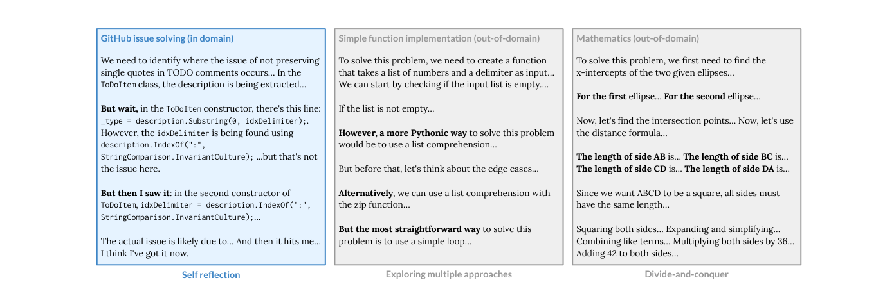
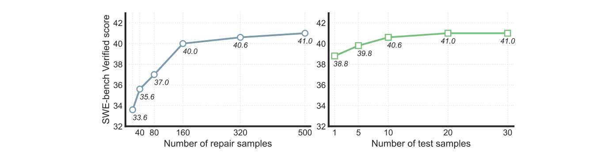

# SWE-RL: オープンなソフトウェアの進化に対する強化学習による LLM の推論の向上

> 原題: SWE-RL: Advancing LLM Reasoning via Reinforcement Learning on Open Software Evolution
> 著者: Yuxiang Wei¹², Olivier Duchenne¹, Jade Copet¹, Quentin Carbonneaux¹, Lingming Zhang², Daniel Fried¹³, Gabriel Synnaeve¹, Rishabh Singh¹, Sida I. Wang¹（¹Meta AI、²University of Illinois Urbana-Champaign（イリノイ大学アーバナ・シャンペーン校）、³Carnegie Mellon University（カーネギーメロン大学））
> 出典: NeurIPS 2025（39th Conference on Neural Information Processing Systems）。arXiv:2502.18449 v2（2025-12-01。v1 は 2025-02-25）

> 訳注（底本）: クリップ（`raw/papers/` の ar5iv 由来の markdown）は v1 で、著者の行とタイトルの行が崩れていた。arXiv の HTML 版 v2 は途中で切れていたので、NeurIPS 2025 の最終版にあたる PDF v2 を底本にした。数式・プロンプト・きれいな本文は HTML 版 v1 で補い、v1 と v2 で違うところは v2 に従った。式と表は PDF v2 の画像で確かめた。図は PDF v2 のベクタ図を、キャプションの位置を境界にして切り出した。図 2（プロンプトのテンプレート）は文字だけの箱なので、画像にせず中身をコードブロックに起こした。付録 D のプロンプトは英語のまま収録した。謝辞・参考文献・NeurIPS Paper Checklist は訳していない。
>
> 訳注（v1 から v2 への主な変更）:
>
> - 構成: v1 の 2.1 節「Raw pull request data curation」が付録 A に移り、2.2 節（報酬のモデリング）と 2.3 節（aha moment）が 2.1 節と 2.2 節になった。v1 の付録 C「Midtraining on large-scale PR data」は削除され、付録の記号と図の番号が振り直された（v1 の図 2 → v2 の図 6、v1 の図 3〜6 → v2 の図 2〜5。v1 の図 9・10 は削除）。
> - 表 1: SWE-Fixer-72B が 30.2 から 32.8 になり、Llama3-Midtrain-8B (beta)（31.0）の行が削除され、Llama3-SWE-SFT-70B（36.2）の行が追加された。表 2・表 3 の値は v1 と同じである。
> - 追加: 種データの件数（27.3 万件）、学習の条件（Adam、H100 512 枚で約 32 時間）、3.5 節の統計的有意性の段落、アドバンテージの式。式のロールアウトの記号は $\tau$ から $o$ に変わった。
> - 削除: 限界の節の「最適な結果には大きなサンプリング予算が要る」という文と、Future work の段落。
>
> 訳注（原典内の食い違い）: 原典の中で次の食い違いを確認した。本文は原文どおりに訳した。
>
> - 3.1 節は SFT のベースラインを 3.3・3.4・3.5 節の実験に使うとするが、3.4 節（図 4）に SFT は出てこず、v2 で SFT の行を加えた 3.2 節（表 1）は挙がっていない。
> - SFT の学習データについて、3.1 節は合成した編集データと Llama 3 の SFT データとし、付録 C は合成した位置特定のデータも含めている。
> - 3.5 節の有意性の段落は HumanEval を「1〜2 ポイントの小さな向上」の例に挙げるが、表 3 の HumanEval+ の差は元のモデル比で +3.7 である。同じ段落が示す単独で有意になる閾値（MMLU で 0.8 ポイント超、MATH で 3 ポイント超）に照らすと、MMLU（+0.33）と MATH（lenient、+2.8）の差は単独では届かない（段落はまとめると 5% 水準で有意だとしている）。

## Abstract（要旨）

最近の DeepSeek-R1 のリリースは、大規模言語モデル（large language models, LLM）の汎用的な推論能力を高めるうえで、強化学習（reinforcement learning, RL）が持つ非常に大きな可能性を示した。
DeepSeek-R1 やその後続研究が主に競技プログラミングと数学の問題への RL の適用に焦点を当てているのに対し、本論文では、RL に基づく LLM の推論を現実世界のソフトウェアエンジニアリングへとスケールさせる初めての手法である SWE-RL を提案する。
軽量なルールベースの報酬（例：正解の解と LLM が生成した解の類似度スコア）を活用することで、SWE-RL は、大規模なオープンソースのソフトウェア進化データ（software evolution data）——コードのスナップショット、コード変更、そしてイシューやプルリクエストといったイベントを含む、ソフトウェア開発サイクル全体の記録——から学習し、開発者の推論過程と解決策を LLM が自律的に再現できるようにする。
Llama 3 をベースに学習した我々の推論モデル Llama3-SWE-RL-70B は、現実世界の GitHub イシューを人手で検証して集めたデータセットである SWE-bench Verified において、41.0% の解決率を達成した。
我々の知る限り、これは中規模（<100B）の LLM としてこれまでに報告された中で最高の性能であり、GPT-4o のような主要なプロプライエタリ LLM にも匹敵する。
驚くべきことに、ソフトウェア進化データのみで RL を行ったにもかかわらず、Llama3-SWE-RL には汎化した推論スキルさえ創発した。
例えば、関数コーディング、ライブラリ利用、コード推論、数学、一般的な言語理解という 5 つのドメイン外（out-of-domain）タスクで結果の改善が見られた一方、教師ありファインチューニング（supervised fine-tuning, SFT）のベースラインでは平均してむしろ性能が低下した。
全体として、SWE-RL は、大規模なソフトウェアエンジニアリングデータ上での強化学習によって LLM の推論能力を高めるという新たな方向性を切り拓くものである。

<figure>


<figcaption>図1: SWE-RL の概要。GitHub の PR から、イシューの記述、コードコンテキスト、正解パッチ（oracle patch）を含むシード RL データセットを作成する。方策 LLM（policy LLM）は推論を通じてコード編集を生成する。報酬は正解パッチとの類似度に基づき、フォーマットの誤りにはペナルティが科される。方策の最適化には GRPO を用いる。</figcaption>
</figure>

## 1 Introduction（はじめに）

大規模言語モデル（LLM）をソフトウェアエンジニアリング（software engineering, SE）タスクに応用することは大きな注目を集めており、研究者たちは、ライブラリレベルの複雑なコード生成（Zhuo et al., 2024; Zhao et al., 2024）、現実世界のバグ／イシューの解決（Xia and Zhang, 2022; Jimenez et al., 2023; Yang et al., 2024c）、ソフトウェアテスト（Deng et al., 2023; Jain et al., 2024a）といった、さまざまな複雑な SE タスクを自動化する LLM の可能性を探ってきた。
これらのタスクの中でも、現実世界のソフトウェアイシューを解決するベンチマークである SWE-bench（Jimenez et al., 2023）は研究の焦点となっており、LLM の現実世界のイシュー解決能力を押し上げるために、エージェント型（agentic）（Yang et al., 2024b; Wang et al., 2024b; Gauthier, 2024）およびパイプライン型（pipeline-based）（Xia et al., 2024; Örwall, 2024; Zhang et al., 2024）のさまざまな手法が提案されてきた。
しかし、現在の手法の大半は GPT-4o（OpenAI, 2024a）や Claude-3.5-Sonnet（Anthropic, 2024a）のような強力なプロプライエタリ LLM に依存しており、その進歩は基盤となる LLM の改善よりも、むしろプロンプト戦略の強化によってもたらされている。

DeepSeek-R1（DeepSeek-AI, 2025）のリリースにより、ルールベースの報酬を用いた強化学習（RL）は、コーディング（Zeng et al., 2025）や数学（Yeo et al., 2025）を含むさまざまな下流タスクにおいて LLM の推論能力を高めるための重要な技術となった。
しかし、SE タスクにおけるその有効性は依然として限定的であり（DeepSeek-AI, 2025）、またその大きな総パラメータ数（671B）は、それを学習しようとする研究者にとって課題となっている。
数学では、報酬は一般に、LLM が予測した答えが正解と完全に一致するかどうかとして定義される（DeepSeek-AI, 2025）。
一方コーディングでは、既存の RL 研究は典型的には実行フィードバック（DeepSeek-AI, 2025; Gehring et al., 2025）を報酬信号として利用しており、コードが自己完結していて容易に実行できる競技プログラミングのタスク（Li et al., 2022; Jain et al., 2024b）に限られている。
これは、実行コストと実行可能な環境の欠如のために、現実世界の SE タスクに適用するのが難しい（Pan et al., 2024）。
一方で、先行研究（Ma et al., 2024; Pan et al., 2024; Xie et al., 2025）はプロプライエタリな教師モデルに依存し、主に教師ありファインチューニング（SFT）に焦点を当ててきたが、本論文で示すように、SFT は効果が低く汎化性も低い。

これらの限界に対処するため、我々は SWE-RL を提案する。これは、ルールベースの報酬とソフトウェア進化データ——すべてのコードスナップショット、変更、そして PR やイシューのようなイベントを含む、ソフトウェアのライフサイクル全体の記録——を直接用いて、SE タスクにおける LLM を改善する初めての RL 手法である。
図1に示すように、我々はまず GitHub のプルリクエスト（pull request, PR）の包括的なデータセットを収集・整備し、それを RL 用のシードデータセットに変換する。
各データ項目は、イシュー、対応するコードコンテキスト、そしてその PR によってマージされた正解パッチ（oracle patch）を含む。
RL の間、方策 LLM（policy LLM）は、与えられたイシューを推論によって解決し、コード変更を生成するというタスクを課される。
そのコード変更は、報酬計算のために一貫したパッチ形式に変換される。
応答のフォーマットが誤っていれば報酬は $-1$ となり、そうでなければ報酬は、Python の `difflib.SequenceMatcher`（Ratcliff and Metzener, 1988）で計算した、予測パッチと正解パッチの類似度スコア（0 から 1 の間）となる。
特筆すべきこととして、我々は入力プロンプトに各ファイルの完全な内容を与えており、これにより、修正編集を提案する前に正確な障害箇所について推論することを暗黙的にモデルに教えている。

SWE-RL を Llama-3.3-70B-Instruct（Dubey et al., 2024）に適用した我々のモデル Llama3-SWE-RL-70B は、SWE-bench を人手で検証したサブセットである SWE-bench Verified（OpenAI, 2024）のイシューの 41.0% を解決した。このとき使用したのは、Agentless（Xia et al., 2024）をベースに構築した我々のパイプライン型 scaffold である Agentless Mini であり、これは我々の RL プロセスに合わせた簡略化とスケーリングのための拡張を特徴とする。
この性能は GPT-4o（OpenAI, 2024a）のような主要なプロプライエタリ LLM に匹敵し、総パラメータ数 100B 未満の中規模 LLM の中では最先端（state-of-the-art）である。
我々のアブレーション研究は、Llama3-SWE-RL-70B がその Llama ベースラインを大きく上回ることを示している。
さらに我々は、思考の連鎖（chain-of-thought）（Wei et al., 2022）過程を強化するために Magicoder（Wei et al., 2024）の方式で生成した合成データを用いて、SWE-RL と同じシードを用いつつ、Llama-3.3-70B-Instruct から競争力のある教師ありファインチューニング（SFT）モデルを開発した。
我々は、イシュー解決のためだけに SWE-RL で学習した Llama3-SWE-RL-70B が、SWE-bench で SFT モデルを上回るだけでなく、関数レベルのコーディング（Chen et al., 2021; Liu et al., 2023）、ライブラリ利用を伴う実践的なコード生成（Zhuo et al., 2024）、コード推論（Gu et al., 2024）、数学（Hendrycks et al., 2021c）、一般的な言語理解（Hendrycks et al., 2021b）を含む、他のドメイン外（out-of-domain, OOD）タスクでも優れていることを示す。
これらの OOD タスクにおいて、Llama3-SWE-RL-70B は Llama-3.3-70B-Instruct さえも上回る一方、SFT モデルは性能低下を招く。

まとめると、我々の貢献は以下のとおりである。

- ソフトウェア進化データ（例：PR）とルールベースの報酬を用いて SE タスク向けに LLM を強化するよう特別に設計された、初めての RL 手法である SWE-RL を提案する。
- Llama-3.3-70B-Instruct 上で SWE-RL によって学習した Llama3-SWE-RL-70B を開発する。これは SWE-bench Verified で **41.0%** を達成し、中規模言語モデル（<100B）の中で最高の性能であり、GPT-4o のような主要なプロプライエタリモデルにさえ匹敵する。
- イシュー解決のような現実世界の SE タスクのみに RL を適用するだけで、すでに LLM の汎用的な推論能力が高まり、数学、コード生成、一般的な言語理解のようなドメイン外タスクでの改善が可能になることを、初めて示す。

## 2 SWE-RL（SWE-RL）

RL 用の初期データセットを準備するため、我々は GitHub から収集した生の PR データセットから、273k 件の高品質な PR シードを抽出する。
これらのシードは特定のヒューリスティクスに基づいて選択される。
例えば、PR インスタンスは少なくとも 1 つのリンクされたイシューを含むべきであり、そのイシューはバグ修正の依頼を記述しているべきであり、コード変更はプログラミング言語のファイルに関わるものであるべきである。
各シードについて、イシューの記述と、変更されたすべてのファイルおよび関連はあるが変更されていないいくつかのファイルを含むコードコンテキストを抽出する。
これらは方策 LLM への入力プロンプトに変換される。
また、各シードから正解パッチを取り出し、これを報酬計算に用いる。
詳細は §A で説明する。

### 2.1 Reward modeling（報酬のモデリング）

```
[System] A user will ask you to solve a task. You should first draft your thinking process (inner monologue). Then, generate the solution. Your response format must follow the template below:
<think>
Your thoughts or/and draft, like working through an exercise on scratch paper. Be as casual and as long as you want until you are confident to generate a correct solution.
</think>
<solution>
Final solution presented to the user.
</solution>
[User] …here is the issue text: {issue}
…here is the code context: {context}
…generate search/replace edits to fix the issue…
[Assistant]
```

**図2**: Llama3-SWE-RL を SWE-RL で学習するために用いたプロンプトテンプレート。イシューの記述と対応するコードコンテキストが与えられると、方策 LLM は推論を通じてこのイシューを修正するための search/replace 編集（Xia et al., 2024）を生成する必要がある。これは RL の学習に組み込んだ唯一のサブタスクである。推論時には、LLM は学習ドメイン外のタスク（例：ファイルレベルの障害箇所特定やテスト生成）にも汎化できる。簡潔さのため、プロンプトの一部の詳細は省略しており、完全なプロンプトテンプレートは §D にある。

我々は、図2に示すプロンプトテンプレートで方策 LLM をブートストラップする。
LLM が、イシューとそのコードコンテキストを与えられてロールアウト（rollout）$o$ を生成したとすると、報酬関数は次のように定義される。

$$
\mathcal{R}(o)=\begin{cases}-1, & \text{if } o \text{ has wrong format},\\[2pt] \mathit{compare}(\mathsf{patch_{pred}},\mathsf{patch_{gt}}), & \text{otherwise}.\end{cases} \tag{1}
$$

ここで、$\mathsf{patch_{pred}}$ は、LLM の生成 $o$ のフォーマットが正しい場合にそこから抽出されたパッチであり、$\mathsf{patch_{gt}}$ はこのイシューの正解パッチを意味する。
実装では、$\mathit{compare}$ 関数として、系列の類似度を示す 0 から 1 の間の浮動小数点数を返す Python の `difflib.SequenceMatcher` を用い、方策の最適化には Group Relative Policy Optimization（GRPO）（Shao et al., 2024）を採用する。

シード RL データセット $\mathcal{D}_{\mathsf{seed}}$ が与えられ、その各項目は (1) イシューの記述である $\mathsf{issue}$、(2) このイシューを解決するのに必要なコードコンテキストで、修正対象のファイルと編集を意図しない関連ファイルの両方を含む $\mathsf{ctx}$、(3) 正解パッチである $\mathsf{patch_{gt}}$ を含むとする。
各データ項目の入力プロンプトは、図2のプロンプトテンプレートをイシューの記述とコードコンテキストでインスタンス化することで作られ、これを $q=\mathsf{form\text{-}prompt}(\mathsf{issue},\mathsf{ctx})$ と表す。
方策 LLM $\pi_\theta$ は、推論を通じてコード変更を生成することでイシューの解決を試み、グループサイズ $G$ のもとで、各入力プロンプト $q$ に対して複数の出力 $o_i$ を生成する。
そして、方策 LLM は次の GRPO 目的関数を最大化することを目指す。

$$
\begin{gathered}
\mathcal{J}(\theta)=\mathbb{E}\left[\frac{1}{G}\sum_{i=1}^{G}\left(\min\left(\frac{\pi_\theta(o_i\mid q)}{\pi_{\theta_{\mathrm{old}}}(o_i\mid q)}A_i,\ \mathrm{clip}\left(\frac{\pi_\theta(o_i\mid q)}{\pi_{\theta_{\mathrm{old}}}(o_i\mid q)},1-\epsilon,1+\epsilon\right)A_i\right)-\beta D_{\mathrm{KL}}\left(\pi_\theta\,\|\,\pi_{\mathrm{ref}}\right)\right)\right],\\
\text{where } (\mathsf{issue},\mathsf{ctx},\mathsf{patch_{gt}})\sim\mathcal{D}_{\mathsf{seed}},\ q=\mathsf{form\text{-}prompt}(\mathsf{issue},\mathsf{ctx}),\ \text{and } \{o_i\}_{i=1}^{G}\sim\pi_{\theta_{\mathrm{old}}}(\cdot\mid q).
\end{gathered} \tag{2}
$$

$\epsilon$ と $\beta$ はハイパーパラメータであり、$\pi_{\theta_{\mathrm{old}}}$ と $\pi_{\mathrm{ref}}$ は旧方策と参照方策である。
報酬 $r_i=\mathcal{R}(o_i)$ とアドバンテージ $A_i=\dfrac{r_i-\mathrm{mean}(r_1,\ldots,r_G)}{\mathrm{std}(r_1,\ldots,r_G)}$ は、GRPO に従って各グループ内で正規化された報酬を用いて計算される。
$D_{\mathrm{KL}}$ は推定された KL ダイバージェンス（Schulman, 2020）を表す。

我々の学習手法は、各ファイルの完全なコンテキストでモデルを条件づけることで、修正編集を生成する前に詳細な障害箇所を特定することを暗黙的にモデルに強いる。
このプロセスは、本質的に、バグの診断と修正の生成の両方をモデルに教える。
しかし、SWE-bench での評価においては、Agentless Mini は、ファイルレベルの障害箇所特定（fault localization）、再現テスト（reproduction test）の生成、回帰テスト（regression test）の選択など、修正編集の生成を超える能力を必要とする。
注目すべきことに、これらのサブタスクについて明示的に学習しなくても、Llama3-SWE-RL は RL のプロセスを通じてそれらに汎化できる。

### 2.2 Aha moments and generalized reasoning capabilities（「アハ体験」と汎化した推論能力）

<figure>



<figcaption>図3: SWE-RL の適用後に Llama3-SWE-RL-70B に創発した推論スキル。RL は、ドメイン内タスク（例：イシュー解決）とドメイン外タスク（例：関数の実装や数学）の両方について、自己反省（self-reflection）、代替案の探索、分割統治（divide-and-conquer）戦略といった推論スキルをモデルが身につけるのを助ける。</figcaption>
</figure>

**ソフトウェアエンジニアリングにおける「アハ体験（aha moments）」。**
SWE-RL を適用すると、Llama3-SWE-RL が創発的な推論スキルを示す「アハ体験（aha moments）」（DeepSeek-AI, 2025）が観察される。
我々の知る限り、これは、現実世界のソフトウェアエンジニアリングタスクの領域においてこのようなアハ体験が存在することを示した初めての研究であり、主に競技プログラミングと数学に焦点を当てた DeepSeek-R1（DeepSeek-AI, 2025）の知見を裏付けるものである。
図3に示すように、RL を通じて、Llama3-SWE-RL-70B は、イシュー解決の過程で自らの初期の仮定を振り返るために、より多くの思考時間を割り当てることができるようになる。
この振る舞いは、明示的にプログラムされたものではなく、モデルと RL との相互作用から自然に創発する。

**汎用的な推論能力。**
驚くべきことに、RL はソフトウェアのイシュー解決にのみ適用されているにもかかわらず、Llama3-SWE-RL が、関数レベルのコード生成や数学といったさまざまなドメイン外タスクに転移可能な汎用的推論能力を獲得するという、さらなるアハ体験を我々は特定した。
図3は、Llama3-SWE-RL が、自己反省、代替アプローチの探索、そして複雑な問題をより小さなサブタスクに分解して解くことによって推論できることを示している。
§3.5 では、Llama3-SWE-RL が、ライブラリ利用、コード推論、一般的な言語理解を含む、さらに多くのドメイン外タスクで改善することを示す。

## 3 Evaluation（評価）

### 3.1 Experimental setup（実験設定）

**学習設定。**
Llama3-SWE-RL-70B は、Llama-3.3-70B-Instruct（Dubey et al., 2024）をベースに、16k のコンテキストウィンドウで 1,600 ステップにわたり SWE-RL を用いて学習される。
グローバルバッチサイズは 512 とし、各バッチで 32 問のそれぞれから 16 個のロールアウトをサンプリングする。
各グローバルステップごとに、Adam（Kingma and Ba, 2017）を用いて 1 回の最適化ステップを行う。
我々は 512 基の NVIDIA H100 GPU でモデルを学習し、1 回の学習実行には実時間でおよそ 32 時間かかる。

**Scaffold の構築。**
我々は、基盤となる scaffold として、Agentless（Xia et al., 2024）の上に Agentless Mini を開発した。
Agentless の多段階の障害箇所特定（localization）とは異なり、Agentless Mini はファイルレベルの障害箇所特定のみに注力し、ファイルの内容全体を入力に与えることで、詳細な推論を修正（repair）ステップに委ねる。
これにより、Llama3-SWE-RL は SWE-RL の間により多くの推論を行えるようになり、また RL のプロセスが 1 つのイシュー解決タスクだけに集中するよう単純化される。
この単純化にもかかわらず、Llama3-SWE-RL は、RL によるドメイン外への汎化の恩恵を受けて、パイプラインの他のステップもなお滞りなく完了できる。
さらに、Agentless が再ランキング（reranking）のためにイシューごとに 1 つの再現テストしか用いないのに対し、Agentless Mini は複数の再現テストを用いることができ、これは我々のスケーリング分析（§3.4）で有効であることが示されている。
Agentless Mini の詳細は §B にある。

**評価設定。**
我々は、現実世界のソフトウェアイシューを解決する AI モデルの能力をより信頼性高く評価できる、人手で検証された 500 問からなる SWE-bench のサブセットである SWE-bench Verified（OpenAI, 2024）で評価を行う。
主評価（§3.2）では、各問題について温度 1.0 で 500 個のパッチを生成し、上位 30 個の再現テストを実行と再ランキングに用いる。
最終的に、各イシューについて最上位にランク付けされたパッチのみが SWE-bench の評価に提出され、pass@1 スコアが計算される。

**SFT ベースライン。**
SWE-RL の利点を理解するため、我々は §3.3、§3.4、§3.5 の実験のために、Llama3-SWE-SFT-70B という名前の SFT ベースラインも学習した。
これは、合成コード編集データ、Llama 3（Dubey et al., 2024）のコーディング SFT データ、Llama 3 の汎用 SFT データの混合を用いて、Llama-3.3-70B-Instruct（Dubey et al., 2024）をベースに学習される。
合成データは Magicoder（Wei et al., 2024）に着想を得た手法で生成され、そこでは高品質な PR データが、思考の連鎖（chain-of-thought）とそれに続く編集を作るためのシードとして機能するとともに、フィルタリングのためのオラクル（正解）としても機能する。
この生成プロセスには Llama-3.3-70B-Instruct が用いられる。
RL ループを起動するのにシード PR データセットしか必要としない我々の RL モデルとは対照的に、SFT ベースラインは、思考の連鎖のための合成データ生成と、データセットの多様性とモデルの汎化性を確保するための追加のデータ混合を必要とする。
詳細は §C で説明する。

### 3.2 Main results（主要な結果）

表1は、オープンソースの scaffold を用いるモデルについて、SWE-bench Verified における pass@1 の結果を、モデルをサイズ別に分類して示している。
表から、Llama3-SWE-RL-70B がイシューの 41.0% を解決し、小規模および中規模の言語モデル（<100B）の中で最先端の結果を達成していることがわかる。
加えて、我々が比較した他のすべてのオープンソースのベースライン、例えば Lingma-SWE-GPT（Ma et al., 2024）、SWE-Gym（Pan et al., 2024）、SWE-Fixer（Xie et al., 2025）は、学習データに GPT-4o または Claude-3.5-Sonnet から蒸留した出力を含んでいる。
対照的に、Llama3-SWE-RL は、パイプラインのどこにもプロプライエタリ LLM に頼ることなく、我々の強化学習手法 SWE-RL を通じて、公開されているデータのみで学習されている。
Llama3-SWE-RL はまた、SWE-bench における Llama ベースの手法として新記録を樹立している。
さらに、このエンドツーエンドの設定において、我々の RL 済みモデルが SFT ベースラインよりも大幅に優れていることを示しており、これは SWE-RL が、イシューを解決するための LLM の汎用的な推論能力を高めることを示している。

**表1**: SWE-bench Verified における主要な結果。オープンソースの scaffold を用いる代表的な手法を含めている。スコアは SWE-bench リーダーボード（Jimenez et al., 2024）または対応する参考文献から収集したものである。

| モデル | Scaffold | SWE-bench Verified | 参考文献 |
|---|---|---|---|
| ***クローズドソース、またはサイズ ≫ 100B のモデル*** | | | |
| GPT-4o | SWE-agent | 23.2 | Yang et al. (2024b) |
| Claude-3.5-Sonnet | SWE-agent | 33.6 | Yang et al. (2024b) |
| GPT-4o | Agentless | 38.8 | Xia et al. (2024) |
| o1-preview | Agentless | 41.3 | OpenAI (2024b) |
| DeepSeek-V3¹ | Agentless | 42.0 | DeepSeek-AI (2024) |
| Claude-3.5-Sonnet | AutoCodeRover-v2.0 | 46.2 | Zhang et al. (2024) |
| Claude-3.5-Sonnet | Tools | 49.0 | Anthropic (2024b) |
| DeepSeek-R1¹ | Agentless | 49.2 | DeepSeek-AI (2025) |
| Claude-3.5-Sonnet | Agentless | 50.8 | Xia et al. (2024) |
| Claude-3.5-Sonnet | OpenHands | 53.0 | Wang et al. (2024b) |
| ***サイズ ≤ 100B のモデル*** | | | |
| SWE-Llama-13B | RAG | 1.2 | Jimenez et al. (2023) |
| SWE-Llama-7B | RAG | 1.4 | Jimenez et al. (2023) |
| Lingma-SWE-GPT-7B | SWE-SynInfer | 18.2 | Ma et al. (2024) |
| Lingma-SWE-GPT-72B | SWE-SynInfer | 28.8 | Ma et al. (2024) |
| SWE-Gym-32B | OpenHands | 32.0 | Pan et al. (2024) |
| SWE-Fixer-72B | SWE-Fixer | 32.8 | Xie et al. (2025) |
| Llama3-SWE-SFT-70B | Agentless Mini | 36.2 | 本論文 |
| **Llama3-SWE-RL-70B** | **Agentless Mini** | **41.0** | **本論文** |

¹ 総パラメータ数 671B、アクティブパラメータ数 37B のオープンソースの Mixture-of-Experts モデル

### 3.3 Baseline comparison（ベースラインとの比較）

**表2**: SWE-bench Verified におけるベースラインとの比較。この実験では、テストの生成と実行を行わずに、オラクルとして障害箇所が特定されたファイル（oracle localized files）を入力コンテキストに与えることで、ベースライン LLM の修正のみ（repair-only）の性能を比較する。デフォルトでは貪欲デコーディング（greedy decoding）を用いるが、Llama-3.3-70B-Instruct については、フォーマットの正確さを高めるために、温度 0.6 での 20 サンプルの多数決（majority voting）の結果も含める。

| モデル | 設定 | 正しいフォーマット | 修正性能（オラクル） |
|---|---|---|---|
| Llama-3.3-70B-Instruct | 貪欲デコーディング | 12.2% | 5.4 |
| Llama-3.3-70B-Instruct | 多数決 | 44.6% | 16.6 |
| Llama3-SWE-SFT-70B | 貪欲デコーディング | **96.2%** | 29.6 |
| **Llama3-SWE-RL-70B** | **貪欲デコーディング** | 95.6% | **34.8** |

ソフトウェアイシューの解決において SWE-RL がどれだけ LLM を改善するかを理解するため、Agentless Mini を基盤となる scaffold として用い、表2で Llama3-SWE-RL を対応する Llama-3 および SFT ベースラインと比較する。
この実験でも SWE-bench Verified で評価するが、モデルの修正能力に焦点を当てる。
これを実現するため、オラクルのファイルをコンテキストに与え、障害箇所特定やテスト生成といった追加のパイプラインステップを組み込まずに、貪欲デコーディングでモデルに 1 つの修正編集を生成させる。
表から、ベースの Llama-3.3 モデルは、誤ったフォーマットの出力を事前に除外する 20 サンプルの多数決を用いた場合でさえ、正しいフォーマットのコード編集を生成するのに苦労していることがわかる。
SFT を行うと、言語モデルが生成するコード編集のほとんどが正しいフォーマットになり、修正性能も大幅に向上する。
しかし、Llama3-SWE-RL-70B は、フォーマットの正確さこそ SFT 版よりわずかに低いものの、修正能力においてさらに大きな向上を示す。
これは、SWE-RL が、イシュー解決とコード編集について LLM がより良く推論するのを助けていることを示している。

### 3.4 Scaling analysis with more samples（サンプル数を増やしたときのスケーリング分析）

Agentless Mini は、修正サンプルの数と生成される再現テストの数の両方のスケーリングをサポートする。
サンプル数の違いは、再ランキングの精度に影響しうる。
本節では、SWE-bench Verified における最終的な pass@1 性能が、これら 2 つの要因に対してどのようにスケールするかを評価する。

<figure>



<figcaption>図4: 修正サンプルと再現テストを増やしたときのスケーリング分析。左図は、テストサンプル数を 30 に固定したまま、修正サンプル数に対する SWE-bench Verified の解決率を示す。逆に、右図は、修正サンプル数を 500 に固定したうえで、再現テストのサンプル数に応じて解決率がどのように変化するかを示す。</figcaption>
</figure>

図4は、修正サンプルとテストサンプルの数をどちらも増やすと、SWE-bench での性能が向上することを示している。
特に修正サンプルについては、サンプル数を 20 から 160 に拡大すると、スコアが 33.6 から 40.0 へと大きく上昇する。
しかし、160 サンプルを超えると改善傾向は頭打ちになり始め、サンプル数を 320、500 と増やしても、スコアは 40.0 から 41.0 へとわずかに上昇するのみである。
再現テストのサンプルを増やすことの影響はそれほど明確ではないが、テストサンプル数を 20 まで増やすにつれて、スコアは 38.8 から 41.0 へとなお徐々に向上する。
テストサンプル数 20 と 30 の間には差がなく、性能の飽和点に達したことを示唆している。

### 3.5 Generalizability of RL（RL の汎化性）

**表3**: SWE-bench を超えた Llama3-SWE-RL-70B の汎化性。この表は、Llama-3.3-70B-Instruct、SFT 版、RL モデルを 5 つのドメイン外タスクで比較し、RL による改善と SFT による低下を強調している。すべての実験は、ゼロショットの貪欲デコーディングを用いた一貫した設定で行っている。MMLU についてはカテゴリ別正解率のマクロ平均を、その他については pass@1 を報告する。MATH では、simple-evals の「`Answer: ...`」というプロンプト形式（OpenAI, 2024）を用いる。しかし、フォーマットの要件に一貫して従うのは RL モデルのみであるため、制約を緩めて「`\boxed...`」も含めるようにした MATH（lenient）も報告する。

| カテゴリ | ベンチマーク | Llama-3.3-70B-Instruct | Llama3-SWE-SFT-70B | **Llama3-SWE-RL-70B** |
|---|---|---|---|---|
| 関数コーディング | HumanEval+ | 76.2 | 73.2 | **79.9** |
| ライブラリ利用 | BigCodeBench-Hard (I) | **28.4** | 25.7 | **28.4** |
| | BigCodeBench-Hard (C) | **29.1** | 24.3 | **29.1** |
| コード推論 | CRUXEval-I | 60.5 | 68.4 | **71.6** |
| | CRUXEval-O | 61.9 | 75.1 | **75.5** |
| 数学 | MATH (strict) | 63.2 | 54.0 | **73.7** |
| | MATH (lenient) | 70.9 | 71.7 | **73.7** |
| 一般 | MMLU | 86.49 | 85.26 | **86.82** |

Llama3-SWE-RL は、イシュー解決データ上で SWE-RL によってのみ学習されている。
このことから、そのようなドメイン特化の学習が他のタスクでの性能を損なうのではないかという自然な疑問が生じる。
これに答えるため、我々は表3の実験を行い、5 つのドメイン外ベンチマーク、すなわち、関数レベルのコード生成のための HumanEval+（Chen et al., 2021; Liu et al., 2023）、ライブラリ利用を伴う実践的なコード生成のための BigCodeBench（Zhuo et al., 2024）、コード実行の推論のための CRUXEval（Gu et al., 2024）、数学的推論のための MATH（Hendrycks et al., 2021c）、そして一般的な言語理解のための MMLU（Hendrycks et al., 2021b）で LLM を評価する。
また、同じ Llama-3.3-70B-Instruct モデルを、イシュー解決データに汎用のコーディングデータと対話データを組み合わせてファインチューニングした SFT ベースラインも含める。

表から、RL で学習した Llama3-SWE-RL-70B が、そのベースモデルと SFT ベースラインの両方を上回っていることは明らかである。
最終的な答えに到達するのに相当な推論の労力を要する CRUXEval と MATH では、顕著な改善が見られる。
SWE-RL を通じて、モデルは推論スキルを高め、他のベースラインと比べて問題の解決により多くの思考の労力を費やすようになる。
単一のタスクで学習されているにもかかわらず、SWE-RL は、モデルがその推論能力をさまざまなドメインにわたって汎化させることを可能にする。
対照的に、SFT 版は、平均して元のモデルを下回る性能となる。

全体として、我々の結果は、PR のような現実世界のソフトウェアデータ上での強化学習がモデルに汎化した推論スキルを獲得させる一方で、教師ありファインチューニングは、入念に収集・整備したデータ混合を用いた場合でさえ、言語モデルを特定のタスク分布へと誘導し、重視度の低いタスクで性能低下を招くことを、初めて示唆している。

**統計的有意性の分析。**
HumanEval や CRUXEval における小さな絶対的な向上（1〜2 ポイント）は、それ単独では統計的に有意である可能性は低いが、我々は複数のベンチマークにわたって評価し、証拠を集約することで、一貫して RL に有利な改善を観察している。
Eval Arena（Wang et al., 2024a）を用いると、MMLU では $> 0.8$ ポイント、CRUXEval では 3 ポイント、MATH データセット全体では $> 3$ ポイントの改善が、それぞれ単独で有意であることが示される。これらをまとめると、結果は 0.05 水準で有意となる。

### 3.6 Reward ablation（報酬のアブレーション）

式(1)によれば、SWE-RL の報酬設計では、$\mathit{compare}$ 関数をさまざまにインスタンス化できる。
本論文を通じて、我々は予測パッチと正解パッチの間の系列類似度を採用しており、これは 0 から 1 までの連続値である。
この種類の報酬を連続（continuous）報酬と呼ぶ。
この連続報酬を、予測パッチと正解パッチが完全に一致すれば $\mathit{compare}$ 関数が 1 を、そうでなければ 0 を出力する離散（discrete）報酬と比較するのは自然である。
我々は、連続報酬の場合と同じ学習設定を用いて、離散報酬関数で Llama3-SWE-RL の変種を学習した。

<figure>


<figcaption>図5: SWE-RL の報酬関数とその学習ダイナミクスに関するアブレーション。デフォルトの連続報酬関数を用いた SWE-RL を、離散報酬と比較する。Repair (oracle) は、オラクルのファイルを入力コンテキストに与えたうえで、貪欲デコーディングを用いて修正のみの性能を評価したものである。</figcaption>
</figure>

図5に示すように、離散報酬関数と連続報酬関数はフォーマットの正確さについては同程度になる一方、修正性能を高めるうえでは連続報酬の方が効果的である。
学習ダイナミクスからは、離散報酬が連続報酬よりもゆっくりと増加することがわかる。
さらに、学習の完了時点でも離散報酬の平均はほぼゼロのままであり、これは正解と完全に一致するパッチを得るのに苦労していることを意味する。
これは、現実世界のパッチは非常に多様であり、容易には一致させられないことが多いためである。
連続報酬関数は、部分的な正しさと段階的な改善をより良く捉え、モデルがより細やかで効果的な修正戦略を学習できるようにする。

## 4 Related work（関連研究）

### 4.1 Language models for software engineering（ソフトウェアエンジニアリングのための言語モデル）

数十億から数兆のコードトークンで学習された大規模言語モデル（LLM）は、コード生成（Chen et al., 2021; Li et al., 2023; Rozière et al., 2023; Guo et al., 2024; Wei et al., 2024; Lozhkov et al., 2024; DeepSeek-AI et al., 2024）、コード最適化（Cummins et al., 2024; Liu et al., 2024a）、プログラム修正（Xia and Zhang, 2022; Xia et al., 2023b; Jiang et al., 2023; Wei et al., 2023）、ソフトウェアテスト（Xia et al., 2023a; Deng et al., 2023; Yuan et al., 2023; Schäfer et al., 2023; Lemieux et al., 2023）を含む、幅広いコーディングタスクで卓越した性能を示してきた。
当初、研究者は主に、関数レベル（Chen et al., 2021; Austin et al., 2021; Hendrycks et al., 2021a; Li et al., 2022; Jain et al., 2024b）、クラスレベル（Du et al., 2023）、リポジトリレベルのコード補完（Ding et al., 2023; Liu et al., 2024b; Zhang et al., 2023）といった、単発（single-shot）のコード生成タスクに焦点を当てていた。
しかし、LLM の急速な発展に伴い、HumanEval（Chen et al., 2021）、MBPP（Austin et al., 2021）、EvalPlus（Liu et al., 2023）のような多くの一般的な単発コード生成ベンチマークでの性能は飽和してしまった。
現実世界の GitHub イシューを解決することを求める SWE-bench（Jimenez et al., 2023）が開発されて以来、研究者は LLM の現実世界のイシュー解決能力の向上に取り組み始め、SWE-bench 向けのさまざまな scaffold を設計してきた。
一般的な 2 つの種類は、(1) LLM が、環境とのツールベースのやり取りを通じて、過去の行動と観測に基づいて意思決定プロセスを駆動するエージェント型 scaffold（Yang et al., 2024b; Wang et al., 2024b; Gauthier, 2024）と、(2) LLM が、与えられたイシューを解決するために人間が定義した段階を順に進むパイプライン型 scaffold（Xia et al., 2024; Örwall, 2024; Zhang et al., 2024）である。
一般に、エージェント型の手法はより汎用的であるが、自律的なプロセスを駆動するために強い指示追従能力を持つ高性能な LLM を必要とし、複数ラウンドのやり取りのために計算量が大きくなりうる。
対照的に、パイプライン型の手法はより特化しているが効率的であり、LLM の純粋なコード編集能力に焦点を当てている。
そのため我々は、Llama3-SWE-RL の中核的なコード編集能力の強化に焦点を当てるべく、最小限のパイプライン型 scaffold である Agentless Mini を設計した。

### 4.2 Training software agents（ソフトウェアエージェントの学習）

既存の scaffold は、プロプライエタリな言語モデルをうまく活用して現実世界のソフトウェアエンジニアリングタスクに取り組んできたが、オープンなモデルはこうした設定では典型的に水準以下の結果しか出せない。
さらに、学習を通じて現実世界のソフトウェアエンジニアリング能力を高める最も効果的なアプローチは、依然として明らかになっていない。
最近、研究者は、SWE-bench のようなベンチマークでの性能向上を目指して、ソフトウェアエンジニアリングタスクに特化してオープンな LLM を学習する可能性を探り始めている。
例えば、Lingma-SWE-GPT（Ma et al., 2024）は、反復的な開発プロセス中心のアプローチを用いて、Qwen2.5-Coder-7B（Hui et al., 2024）と Qwen2.5-72B-Instruct（Yang et al., 2024a）を基にした 7B と 72B のモデル変種を提案している。
SWE-Gym（Pan et al., 2024）は、ソフトウェアエンジニアリングエージェントのための初めてのオープンな学習環境を提示し、SWE-bench における Qwen2.5-Coder の 7B と 32B の変種の性能を大幅に向上させている。
さらに最近では、SWE-Fixer（Xie et al., 2025）が Qwen2.5 のベースシリーズをファインチューニングし、効率的なイシュー解決に焦点を当てた 7B のコード検索器（code retriever）と 72B のコード編集器（code editor）を作り出して、best@1 で顕著な改善を達成している。
特筆すべきこととして、これらの研究はすべて、学習データに GPT-4o または Claude-3.5-Sonnet から蒸留したサンプルを取り入れており、Qwen2.5 モデルを基に構築されている。
それらの学習目的はすべて教師ありファインチューニングに基づいている。
対照的に、Llama3-SWE-RL は Llama 3（Dubey et al., 2024）を基にしており、SWE-RL を用いた強化学習（RL）によって学習される。
RL 用のシードデータセットは公開リポジトリのみから取得されており、これにより Llama3-SWE-RL は、RL のインセンティブを通じてイシュー解決能力を自己改善できる。
注目すべきことに、Llama3-SWE-RL は SWE-bench Verified（OpenAI, 2024）で 41.0% の解決率を達成してこれらのモデルの中で最高の性能を示しており、現実世界のソフトウェア成果物上での RL を通じて、LLM がすでに現実世界のイシューに効果的に対処できることを初めて示している。

## 5 Conclusion（結論）

我々は、ソフトウェア進化データ（例：PR）とルールベースの報酬を用いて、ソフトウェアエンジニアリングタスクにおける言語モデル（LLM）を改善する初めての強化学習（RL）手法である SWE-RL を提案した。
その結果得られたモデル Llama3-SWE-RL-70B は、高品質な GitHub イシューを人手で検証して集めたデータセットである SWE-bench Verified で 41.0% の解決率を達成した。
この性能は中規模モデルの中で最先端であり、GPT-4o のような多くのプロプライエタリ LLM に匹敵する。
SWE-RL はイシュー解決タスクに特化して適用されているが、Llama3-SWE-RL は RL を通じて汎化した推論スキルを身につけ、コード推論、数学、一般的な言語理解といったドメイン外タスクで性能の向上を示している。
全体として、SWE-RL は、RL によって LLM のソフトウェアエンジニアリング能力を高めるという新たな方向性を切り拓くものである。

**限界。**
有望な結果にもかかわらず、我々のアプローチにはいくつかの限界がある。
第一に、我々の報酬の実装は、予測パッチと正解パッチの意味的な等価性ではなく、系列の類似度を比較している。
これにより、方策 LLM が、機能的に等価な代替の解決策を探索することが妨げられる可能性がある。
加えて、Agentless Mini では、障害箇所特定のプロセスが、リポジトリ構造をファイルパスに対応づけることへと単純化されており、包括的なコンテキストを欠いている。
さらに、パイプライン型の手法である Agentless Mini は、すべてのステップを別々の推論段階に分割している。
この「外部構造（external structure）」は、モデルがやり取りのフィードバックを通じて学習することを妨げ、問題全体を全体的に考慮する能力を阻害する。

## Appendix A Raw pull request data curation（生のプルリクエストデータの収集・整備）

<figure>


<figcaption>図6: SWE-RL における生のプルリクエストデータの収集・整備プロセスの概要。収集した git クローンと GitHub イベントは、汚染除去（decontamination）、集約、関連ファイルの予測、フィルタリングを経て、自己完結した PR インスタンスに変換される。</figcaption>
</figure>

図6は、Llama3-SWE-RL のための生の PR データセットを収集・整備するプロセスの高レベルな概要を示している。
以下の段落では、収集・整備プロセスの各ステップを詳しく説明する。
データ処理の間、データ汚染（data contamination）を防ぐため、SWE-bench（Jimenez et al., 2023）で使用されているすべてのリポジトリを除外する。

**GitHub イベントとクローン。**
この段階の目的は、人間の開発者が GitHub 上で確認できるプルリクエストの詳細をすべて復元することである。
これを達成するには、(1) PR 内で発生するすべてのイベントと、(2) PR によって導入される変更がマージされる前のリポジトリのソースコード、という 2 つの情報源が必要である。
我々は、GitHub のすべてのアクティビティイベントデータを含む GHArchive（Grigorik, 2025）から、すべての GitHub（GitHub, 2025）イベントを取得する。
我々の収集には、2015 年 1 月 1 日から 2024 年 8 月 31 日までのすべての GitHub イベントが含まれる。

ソースコードを得るにあたっては、プルリクエストはしばしばリポジトリの異なるコミット段階で発生するため、特定のコードスナップショットをダウンロードするために GitHub API（GitHub, 2022）に頼るのではなく、`git clone` を使ってコミット履歴付きでリポジトリ全体を取得することにした。
最終的に、我々は 460 万（4.6M）のリポジトリのクローンと処理に成功した。

**PR データの集約。**
収集したイベントと git クローンはばらばらの存在であり、学習に使えるようにするにはさらなる処理が必要である。
この段階では、各 PR を個別に扱い、それに関連するすべての情報を集約する。
これには、言及されたイシュー、ユーザーの議論、レビューコメント、初期のコード内容、そしてその後のコミットとコード変更が含まれる。

まず、マージされた PR のみを残し、各 PR について関連するすべての会話イベントを収集して時系列順に並べる。
次に、PR の `base_commit` と `head_commit` のハッシュを用いて、そのパッチが示す変更されたすべてのファイルの内容を、2 つのコミットのマージベース（merge base）の時点で取得する。
その理由は、多くの PR はメインブランチにマージし戻すことを目指しているが、メインブランチは PR が作成されてから変更を受けている可能性があるためである。
マージベースを、PR に取り組む開発者にとっての実際の出発点とみなすことで、変更のコンテキストをより正確に理解できる。
マージベースと head コミットの間に行われたすべての中間コミットとコード変更を保存する。
加えて、開始から終了までの累積的な変更を表す完全なパッチを抽出する。
最後に、集約した各 PR を走査してイシューに似たパターンを特定し、一致したイシューを対応する PR に関連づける。
最終的に、2,400 万（24M）件の集約済み PR インスタンスが得られる。

**関連ファイルの予測。**
現状では、各プルリクエストには変更されたコードファイルのみが含まれている。
初期の実験で、このやり方では LLM がバイアスを学習してしまうことに気づいた。すなわち、モデルは提示されたすべてのコードファイルに対して一貫して編集を生成し、コンテキスト中に提示されたノイズとなるファイルを扱えなかった。
この問題は、SWE-bench の論文（Jimenez et al., 2023）で論じられたファインチューニング実験でも言及されていた。
この問題を緩和するため、我々は Llama-3.1-70B-Instruct（Dubey et al., 2024）にプロンプトを与え、各 PR の説明と変更されたファイルをもとに、関連はあるが変更されていないファイルのリストを生成させ、それらのファイルの内容を最終的なデータセットに含める。

**データのフィルタリング。**
GitHub の PR はかなりノイズが多いため、潜在的に有害な PR を取り除くためのさまざまなフィルタリング戦略を実装した。
これらのフィルタリングルールを設計するにあたり、我々の目標は、一定程度のノイズを許容しつつ、高品質な PR の再現率（recall）を最大化することである。
まず、タイトル、説明、またはユーザー名に「[bot]」「dependabot」「renovate」「bump」「automerge」というキーワードを含む、ボットが生成した PR を除去する。
また、変更が空の PR や、変更数が極端に多い PR（例：ある PR では、開発者が誤ってデータファイルのディレクトリをアップロードしていた）を除去する。
さらに、各コード変更のハンク（hunk）を検査するために、CodeLlama（Rozière et al., 2023）で使われた、よりきめ細かいフィルタ群を実装した。
そして、これらのフィルタによってすべてのコード変更がフラグ付けされた PR を除去した。
例えば、これによってロックファイルの変更やバージョン更新のみを含む PR を除外できる。
最終的に、これにより約 1,100 万（11M）件の一意な PR インスタンスが得られる。
強化学習を適用する前に、§2 で述べたように、これらの生の PR から 273k 件の高品質な PR を選択する。

## Appendix B Agentless Mini（Agentless Mini）

<figure>


<figcaption>図7: Agentless Mini の scaffold。この設計は、容易な分解、並列化、スケーラビリティを重視している。</figcaption>
</figure>

コード編集に熟達したモデルに加えて、SWE-bench（Jimenez et al., 2023）に見られるようなソフトウェアエンジニアリングタスクに効果的に取り組むには、堅牢な scaffold も必要である。
Agentless（Xia et al., 2024）は、本稿執筆時点で SWE-bench における最先端の scaffold の 1 つである。
我々は、Agentless をベースにさまざまな簡略化と拡張を加えて、構成要素の単純な分解、並列化、スケーラビリティを優先するフレームワークである Agentless Mini を開発した。
Agentless Mini では、各ステップの推論または実行の計算量を独立にスケールさせて、SWE-bench での性能を高めることができる。
図7では、Agentless Mini の動作原理を詳しく図示している。
以下の段落では、各ステップを詳しく説明し、Agentless との違いを強調する。

**障害箇所特定と修正。**
障害箇所特定（localization）には、与えられたイシューとリポジトリの構造に基づいて、モデルに関連するファイルパスを予測させる、プロンプトベースのアプローチを用いる。
関連する要素やファイルを特定するための 2 つの追加の詳細なステップと、別個の埋め込みモデル（embedding model）を伴う Agentless とは異なり、Agentless Mini はこのプロセスを単純化している。
Agentless Mini は、問題を含む可能性のあるファイルについてモデルから複数のサンプルを生成し、それらを修正用の一意な集合へと統合する。

修正（repair）フェーズでは、LLM はファイルの完全な内容で条件づけられ、search/replace 編集を予測する。
異なる位置集合から複数の修正サンプルを生成することで、パッチの探索空間を網羅的に探索することを保証する。

**再現テストの生成と選択。**
Agentless は、パッチ選択のために再現テストをサンプリングする。
まず、イシューの記述に基づいて複数の再現テストが生成され、フィルタリングの後に 1 つの多数派サンプルが選択される。
これらのテストは、イシューが再現された場合と解決された場合にそれぞれ `"Issue reproduced"` と `"Issue resolved"` を出力する、区別されたロジックを持たなければならない。
テストは、元のコードベースで実行したときに正しく `"Issue reproduced"` を出力するかどうかに基づいてフィルタリングされる。
Agentless Mini は、このパイプラインを 2 つの主要な改善によって強化している。
第一に、イシューの記述のみに頼るのではなく、モデルは関連するテストファイルを検索して、テスト生成の指針とする。
加えて、多数派サンプルを 1 つだけ選択するのではなく、Agentless Mini は投票結果に基づいて上位の複数のテストサンプルを選択できる。
我々の評価では、より多くのテストサンプルを用いることが再ランキングに有益であることが示されている（§3.4）。

**回帰テストの選択。**
回帰テストは Agentless と同じ方法で選択する。
まず、何も変更を加える前のコードを実行することで、各イシューについて通過するすべてのテストを収集する。
このステップはモデルの推論を必要とせず、一度だけ実行すればよい。
続いて、イシューが修正された後には失敗するはずの通過テストを除外するために、追加の任意の推論ステップを行う。
残りのテストが回帰テストとしてマークされる。

**再ランキング。**
Agentless Mini は、再ランキングのために回帰テストと再現テストの両方を利用する。
各イシューについて、適用された各パッチを回帰テストに対して実行する。
既存テストの失敗数が最小となるパッチが選択される。
各イシューについて、上位 $N$ 個の再現テストを選び、各パッチをこれらのテストに対して実行する。
実行結果が `"Issue resolved"` を出力した場合、そのパッチはこのテストに通過したものとマークする。
次に、CodeT（Chen et al., 2023）の二重実行一致（dual execution agreement）の目的関数を採用する。
具体的には、同じ再現テストの集合 $\mathcal{T}$ に通過するパッチ $\mathcal{P}$ を、コンセンサスグループ（consensus group）と呼ぶ。
各コンセンサスグループは、$|\mathcal{P}|\times|\mathcal{T}|^{2}$ という式でスコア付けされる。
この目的関数のもとでは、より多くのテストに通過するパッチを持つコンセンサスグループがより高いスコアを得る。
加えて、より多くのパッチがテストに通過するグループもより高くスコア付けされるが、より多くのテストに通過することが、より多くのパッチを持つことよりも優先される。
最後に、最も高いスコアを持つコンセンサスグループを特定し、多数決を用いてこのグループから最良のパッチを選択する。

## Appendix C Synthesizing supervised-finetuning data（教師ありファインチューニングデータの合成）

<figure>


<figcaption>図8: SFT データを構築するための合成データパイプライン。まずヒューリスティクスを用いて高品質なシード PR を収集し、次に障害箇所特定とコード編集の合成サンプルを生成し、最後に正解の編集済みファイルとパッチを用いて誤ったサンプルを除外する。</figcaption>
</figure>

図8は、合成の教師ありファインチューニング（SFT）データを生成する我々の手法を示している。
このデータ生成パイプラインは Magicoder（Wei et al., 2024）に着想を得たものであり、そこでは OSS-Instruct 手法が、オープンソースのシードとなるコード片から高品質なコード指示データを生成する。
我々は同様の方法論を適用し、高品質な PR シードを用いて、障害箇所特定データとコード編集データの両方を生成する。

**高品質なシード PR の収集。**
まず、§A で詳述したように、収集した生のデータセットから高品質な PR シードを抽出する。
これらのシードは特定のヒューリスティクスに基づいて選ばれる。
例えば、PR インスタンスは少なくとも 1 つのリンクされたイシューを含むべきであり、そのイシューはバグ修正の依頼を記述しているべきであり、コード変更はプログラミング言語のファイルに関わるものであるべきである。

**障害箇所特定データと編集データの合成。**
データ合成には Llama-3.3-70B-Instruct（Dubey et al., 2024）を採用する。
障害箇所特定データについては、イシューの記述、リポジトリ構造、そしてヒントとして編集されたファイルと関連ファイルのパスをモデルに与える。
次に、思考過程を生成させたうえで、優先順位付きのファイルパスのリストを生成させることで、変更またはレビューの対象となる関連ファイルを特定するようモデルに求める。
フィルタリングでは、モデルの応答に PR で実際に編集されたすべてのファイルが含まれていること、そしてそれらのファイルがランキングで優先されていることを確認する。

同様に、コード編集については、正解の PR とパッチを指針として Llama-3.3-70B-Instruct に与えることで、与えられたイシューに対するコード編集を search/replace 形式（Xia et al., 2024）で合成する。
フィルタリングの過程では、すべての search/replace ブロックが正しいフォーマットに従っていること、そしてすべての検索パスとブロックが入力ファイルのコンテキスト内で正確に一致させられることを確認する。

**SFT ベースライン。**
§3.1 で述べたように、我々は強力な SFT ベースラインとして Llama3-SWE-SFT-70B を入念に構築した。
この SFT ベースラインは 16k のコンテキストウィンドウで 2B トークン分学習されており、その学習データは、前述の合成した障害箇所特定データと編集データ、そして Llama 3（Dubey et al., 2024）のコーディング SFT データセットと汎用 SFT データセットの混合からなる。

## Appendix D Complete prompt（完全なプロンプト）

以下は図2の完全版である。

````
PROMPT_TEMPLATE = """<|begin_of_text|><|start_header_id|>system<|end_header_id|>

A user will ask you to solve a task. You should first draft your thinking process (inner monologue). Then, generate the solution.

Your response format must follow the template below:
<think>
Your thoughts or/and draft, like working through an exercise on scratch paper. Be as casual and as long as you want until you are confident to generate a correct solution.
</think>
<solution>
Final solution presented to the user.
</solution><|eot_id|><|start_header_id|>user<|end_header_id|>

We are currently solving the following issue within our repository. Here is the issue text:
--- BEGIN ISSUE ---
{problem_statement}
--- END ISSUE ---

Below are some code segments, each from a relevant file. One or more of these files may contain bugs.

--- BEGIN FILE ---
```
{content}
```
--- END FILE ---

Please first localize the bug based on the issue statement, and then generate *SEARCH/REPLACE* edits to fix the issue.

Every *SEARCH/REPLACE* edit must use this format:
1. The file path
2. The start of search block: <<<<<<< SEARCH
3. A contiguous chunk of lines to search for in the existing source code
4. The dividing line: =======
5. The lines to replace into the source code
6. The end of the replace block: >>>>>>> REPLACE

Here is an example:

```python
### mathweb/flask/app.py
<<<<<<< SEARCH
from flask import Flask
=======
import math
from flask import Flask
>>>>>>> REPLACE
```

Please note that the *SEARCH/REPLACE* edit REQUIRES PROPER INDENTATION. If you would like to add the line ’        print(x)’, you must fully write that out, with all those spaces before the code!
Wrap each *SEARCH/REPLACE* edit in a code block as shown in the example above. If you have multiple *SEARCH/REPLACE* edits, use a separate code block for each one.<|eot_id|><|start_header_id|>assistant<|end_header_id|>

"""
````
