# SWE-smith: ソフトウェアエンジニアリングのエージェントのためのデータをスケールする

> 原題: SWE-smith: Scaling Data for Software Engineering Agents
> 著者: John Yang¹, Kilian Lieret², Carlos E. Jimenez², Alexander Wettig², Kabir Khandpur³, Yanzhe Zhang¹, Binyuan Hui⁴, Ofir Press², Ludwig Schmidt¹, Diyi Yang¹（¹ Stanford University、² Princeton University、³ 独立、⁴ Alibaba Qwen）
> 出典: arXiv:2504.21798（ar5iv のクリップ。arXiv の最新版は v2, 2025-05-21）。すべての成果物: https://swesmith.com

> ［訳注］ar5iv のクリップを底本とし、ar5iv の原ページ、arXiv の HTML 版 v2、PDF 版 v2 で照合した。復元・正規化した点は次のとおり。(1) **図 1〜8・12・14・15・17・19・21〜25・27 の画像が欠落**し、キャプションだけが残っていた（HTML 版にも画像がなかった）ので、PDF v2 から図の範囲を切り出した。図 9・16・26 は HTML 版の画像を保存した。保存先は `raw/assets/2025-swe-smith/`。(2) **表 2 の「Exec?」列の ✓・✗ の印が欠落**していた（HTML 版でも空）ので、PDF から読み取って補った。(3) **脚注 1〜4 の本文が欠落**していたので HTML 版から復元した。(4) 金額の表記が `$ $1360$` のように崩れていたので「1,360 ドル」のように直した。(5) **クリップ（HTML 版）の本文の図表の参照番号が PDF とずれていた**（例: 表 4 を「表 5」、図 4 を「図 5」、図 6 を「図 7」と参照し、プロンプトの図を「Figure B」「Figure D」「Figure A.2」「Figure F.1」と参照する）。図表のキャプションの番号は両者で一致しているので、**本文の参照は PDF v2 に合わせて直した**。(6) 付録 E の難しさのラベル（「15 分未満」など）が数式の崩れで欠落していたので PDF から復元した。(7) 付録 B.3 のアルゴリズム 1・2 は擬似コードとしてコードブロックにまとめた。プロンプトの囲み（図 10・11・13・18・20）は SVG の中のテキストだったので、原文のままコードブロックに起こした。**ユーザーの指示により、リポジトリ名を並べただけの大きなデータ表（表 6: ライセンスの一覧、表 9: リポジトリの一覧と説明、表 15: SWE-bench Multilingual のリポジトリ別のインスタンス数）は訳出を省き、その位置に訳注を置いた**。参考文献の一覧と謝辞は既定どおり訳出せず、本文の `[^N]` は原典の番号のまま残した。

## Abstract（要旨）

ソフトウェアエンジニアリングのための言語モデル（LM）の最近の進歩にもかかわらず、訓練データの収集は依然として大きな悩みの種である。既存のデータセットは小さく、11 以下の GitHub のリポジトリから多くても数千の訓練インスタンスしかない。そうしたデータセットを精選する手順はしばしば複雑で、何百時間もの人手の労働を必要とする。付随する実行環境も数テラバイトのストレージを占め、それらのスケーラビリティと使いやすさを大きく制限している。この悩みの種に対処するため、私たちは、ソフトウェアエンジニアリングの訓練データを大規模に生成するための新しいパイプラインである SWE-smith を導入する。任意の Python のコードベースが与えられると、SWE-smith は対応する実行環境を構築し、次にコードベースの既存のテストを壊す数百から数千のタスクインスタンスを自動で合成する。SWE-smith を使って、128 の GitHub のリポジトリから得た 50k のインスタンスのデータセットを作る。これは、すべての先行研究より 1 桁大きい。私たちは SWE-agent-LM-32B を訓練し、SWE-bench Verified ベンチマークで 40.2% の Pass@1 の解決率を達成し、オープンソースのモデルの中で最先端となる。自動化されたソフトウェアエンジニアリングのための LM システムの研究への参入障壁を下げるため、SWE-smith（収集の手順、タスクインスタンス、軌跡、モデル）をオープンソースとして公開する。すべての成果物は [https://swesmith.com](https://swesmith.com/) で入手できる。

## 1 Introduction（はじめに）

<figure>

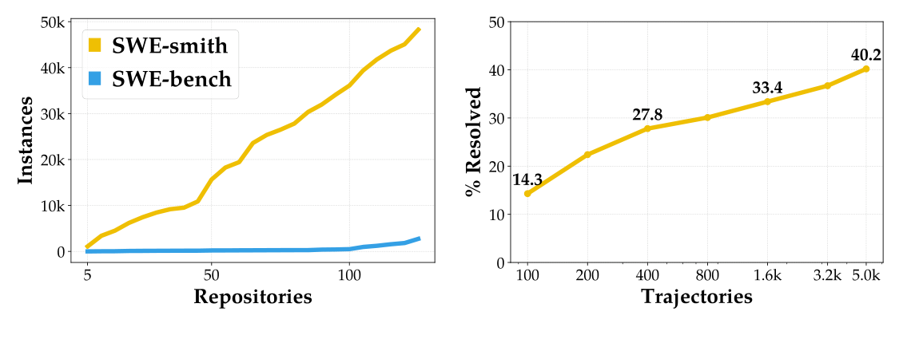

<figcaption>図1: SWE-smith による、SWE-agent のためのタスクインスタンスのスケーリング（左）と性能（右）。SWE-smith を使うと、任意の Python のコードベースについて数百から数千のインスタンスを作ることができ、SWE-bench Verified で 40.2% を達成する SWE-agent-LM-32B を訓練できる。［訳注: 画像はクリップで欠落していたため PDF から切り出した］</figcaption>
</figure>

SWE-agent [^49] や OpenHands [^38] のような言語モデル（LM）のエージェントは、SWE-bench [^18] のようなベンチマークで追跡されるとおり、ソフトウェアエンジニアリング（SE）のタスクの自動化に向けて目覚ましい進歩を遂げてきた。しかし、最も効果的なエージェントはなおプロプライエタリな LM に頼っている。SE のためのオープンソースの LM の構築が、大規模で高品質な訓練データの欠如によってボトルネックになっているからである。この分野でオープンな研究が意義を保ち続けるためには、ソフトウェアエンジニアリングの訓練データを大規模に収集するための基盤を開発することが決定的に重要である。

現在のオープンソースのエコシステムは、SE のタスクで LM を訓練するための 2 種類のデータ源を提供している。1 つの単純なアプローチは、GitHub のリポジトリからプルリクエスト（PR）とイシューをクロールすることである。しかし、実行環境やテストがなければ、これらのインスタンスは生成された解を検証する信頼できる方法を提供せず、LM はコードの表面的な形から学ぶか [^44]、表面的な文字列の類似度にもとづく報酬によって学ぶか [^41] に限られる。

対照的に、SWE-bench は、提案された解に対して単体テストを実行することで信頼できる検証を提供する。別の研究の流れは、訓練の目的のために、SWE-bench の収集戦略を新しいリポジトリの集合に単に拡張している [^31]。これは LM エージェントを訓練し蒸留するための柔軟な環境を作る。エージェントの軌跡を生成し、単体テストの結果にもとづいてそれらを絞り込めるからである。しかし、このアプローチのスケーラビリティは、SWE-bench の収集戦略に関連する課題によって大きく制限される。SWE-bench の絞り込みの過程は、GitHub のイシューを解決するだけでなく単体テストに意味のある変更も加える、少数の PR だけを残す。また、各インスタンスのために実行環境をセットアップするには、相当な量の人手の介入が必要である。

本論文では、SWE-bench の柔軟な実行環境とスケーラブルなインスタンスの収集を結びつける SWE-smith のツールキットを導入する（図 1）。SWE-smith は、既存の GitHub のリポジトリでバグを自動で合成するいくつかの技法を特徴とする。例えば、(1) LM で関数の誤った書き換えを生成する、(2) 関数の抽象構文木（AST）を手続き的に変更する、(3) PR を元に戻す、(4) バグを組み合わせる、である。私たちの重要な洞察は、実行にもとづく検証は、提案された解を検証できるだけでなく、大きなソフトウェアの退行を引き起こす（すなわちテストを壊す）バグの候補を特定することもできるということである。

<figure>


<figcaption>図2: SWE-smith は、実際のコードベースにバグを作り込むことで、ソフトウェアエンジニアリングのエージェントのための訓練データを作る。コードベースが与えられると、既存のテストを壊すタスクインスタンスを作るためにいくつかの戦略を用いる。SWE-smith を使って、128 の現実世界のリポジトリから、実行環境つきの 50k 超のタスクインスタンスを作る。［訳注: 画像はクリップで欠落していたため PDF から切り出した］</figcaption>
</figure>

要するに、SWE-smith は、図 2 に示すとおり、次のタスク作成のワークフローを提示する。コードベースが与えられると、SWE-agent [^49] を使って対応する環境を自動でセットアップする。この環境の中で、上述の技法を使って数百から数千のタスクインスタンスを合成する。最後に、LM で現実的なイシューの記述を自動で作る。SWE-smith の設計は、実行環境の構築に必要な人手の労働とストレージの量を大幅に減らす。SWE-smith を使って、128 の現実世界の GitHub のリポジトリにわたる 50k のタスクインスタンスのデータセットを作る。

SWE-smith のデータセットを使って、SWE-bench Verified でオープンウェイトの新たな最先端の結果を達成する。SWE-smith のタスクインスタンスを使って Claude 3.7 Sonnet で 5,016 のエキスパートの軌跡を生成し、Qwen 2.5 Coder Instruct 32B をファインチューニングする。結果として得られる LM である SWE-agent-LM-32B は、推論時スケーリングなしの単一の試行で、SWE-bench Verified で 40.2%（+33.4%）を達成する。これは、オープンウェイトのモデルの新たな最先端を打ち立てる。

SWE-smith のデータセットの規模と多様性は、SWE エージェントを開発することについての真実を確立し始め、興味深い現象を調べることを可能にする。より多くのインスタンス、バグの種類、リポジトリで訓練することは役に立つ。LM が生成したイシューのテキストは、本物のものを効果的に近似する。SWE-smith を使うと、汎化のわずかな損失しか被らずに、特定のリポジトリでよく機能するよう LM を最適化できることを見出す。

より強いオープンソースの LM エージェントの開発を促進するため、インスタンス、環境、軌跡を含むオープンソースのツールキットとして SWE-smith を公開する。

## 2 SWE-smith: Software Task Generation at Scale（SWE-smith: 大規模なソフトウェアのタスク生成）

SWE-smith の収集戦略の中核の原理は、まず実行環境を定義し、次にその環境の中でタスクインスタンスを合成することである。概念的には、これは SWE-bench のアプローチの単純な反転である。SWE-bench は代わりに、タスクインスタンスの特定を優先し、次にそれぞれのために環境の構築を試みる。本節では、手順を詳しく述べ、実際に SWE-smith がリポジトリ、タスクインスタンス、ストレージの点で大幅によくスケールすることを示す。

### 2.1 Collection（収集）

**テストが通るリポジトリの実行環境を構築する。** リポジトリが与えられると、最新のコミット上で SWE-agent [^49] を最大 100 ステップ実行し、コードベースをインストールしてテストスイートを実行するよう指示する。次に、インストールとテストの指示を手作業で検証し、既存のテストの 80% 超が通るかを確認し、最後にリポジトリの Docker イメージを作る。2024 年 11 月 18 日時点で Python Package Index（PyPI）に掲載されている最もダウンロードされた 5,000 のパッケージのリポジトリを対象とし、PyPI のパッケージを GitHub のスター数で並べ、スターが 1,000 未満の PyPI のパッケージと、SWE-bench のテストの 12 のリポジトリすべてを検討から除く。詳しくは §A.2 にある。

**タスクインスタンスの候補を作る。** リポジトリごとに、候補を作るために 4 つの異なる戦略を用いる。図 2 に示すとおり、各戦略はリポジトリを入力として受け取り、.diff ファイルとして表されるタスクインスタンスの候補を出力する。詳細は §B にある。

- **LM による生成**: リポジトリごとに、すべてのプログラム上の実体（関数、クラス）を特定し、次に 2 つのアプローチをとる。(1) LM に関数を与えて、誤った変更を導入するようプロンプトで指示する（以下「LM Modify」と呼ぶ）。(2) 関数の見出しと docstring だけを与えて、LM にそれを書き直させる（「LM Rewrite」）。詳しくは §B.1 にある。
- **手続き的な変更**: 関数ごとに、コードの抽象構文木（AST）の表現を取得し、次に 1 つ以上の変換をランダムに行う（例: 条件分岐・ループを削除する、演算子を変更する、ほか 11 種類。表 8 を参照）。詳しくは §B.2 にある。
- **バグの組み合わせ**: LM による生成と手続き的な変更のタスクインスタンスは、もっぱら 1 つの関数またはクラスを編集する。コードベースの複数の部分の編集を必要とする、より複雑なタスクを作るため、同じファイルまたはモジュールの候補を集約してタスクインスタンスを作る「パッチの組み合わせ」の戦略を考案する。詳しくは §B.3 にある。
- **PR の反転（または「PR ミラー」）**: リポジトリごとに、Python のファイルを変更するすべての PR を集める。PR ごとに、リポジトリの現在のバージョンでその変更を *元に戻す* ことを試みる。これを達成するため、LM に PR のコードの変更（.diff のプレーンテキスト）を与え、PR の編集が元に戻されるように影響を受ける各ファイルを書き直すようプロンプトで指示する。SWE-bench とは異なり、PR のベースのコミットをチェックアウトしない。前のステップで決めたインストールの指定が、リポジトリの古いバージョンと互換でない可能性があるからである。詳しくは §B.4 にある。

**候補の実行にもとづく検証。** 各候補のパッチを対応するリポジトリに適用し、テストスイートを実行し、既存の通るテストを 1 つ以上壊すパッチだけを残す（Fail-to-Pass、または F2P のテストと呼ぶ）。効率のため、テストの実行時間も 2 分に制限する。テストの実行時間がこの制限を超えるバグの候補は捨てる。わずかな追加の詳細は §A.3 にある。

**問題文を生成する。** バグに関連するイシューのテキストは、タスクインスタンスの難しさと解ける可能性を大きく変えうる。イシューのテキストの中の「期待される」振る舞いと「観測された」振る舞いの詳細な記述やバグの再現コードは、エージェントがバグの位置を特定したり、提案する解を反復したりする能力に大きく影響する。§D で完全に扱ういくつかの技法を探り、最終的に単純な戦略に落ち着く。タスクインスタンスごとに、LM に .diff のパッチ、ランダムな F2P テストのソースコード、バグのパッチを適用してリポジトリのテストスイートを実行した実行出力を与える。F2P テストにもとづく再現コードを含む、GitHub のイシュー形式のテキストを LM に求める。

**どんな人手の労働が残るのか？** 手作業を必要とするステップは、(1) エージェントの軌跡から正しいインストールのセットアップ手順を解析すること（リポジトリあたり約 7 分）と、(2) テスト出力のパーサーを実装すること（リポジトリあたり約 1 分）である。ステップ 2 にはほとんど時間がかからない。パーサーは同じテストの基盤（例: pytest）を持つリポジトリで再利用できるからである。SWE-smith は、時間をまたいだコードベースの複数のバージョンのインストールの指定を決めるための手作業、すなわち SWE-bench の収集で最も高くつくステップの必要をなくす。SWE-smith の作成には、1 人の著者の約 20 時間の人手の労働がかかった。

### 2.2 Features（特徴）

SWE-smith を 128 の Python のリポジトリに適用し、合計 50k のインスタンスを生成する。表 1 が主要な統計を捉えている。平均して、リポジトリあたり 381 のタスクインスタンスを生成し、pandas-dev/pandas では 2277 にものぼる。リポジトリあたりのタスクインスタンスの分布を図 3 にまとめ、そこではリポジトリを 6 つの一般的なカテゴリのいずれかにまとめている。SWE-smith の作成には 1,360 ドルかかった（バグの生成に 1,000 ドル、SWE-agent によるリポジトリの自動インストールに 160 ドル、10K のバグのイシューの生成に 200 ドル）。イシューを 1 つ生成するのに平均 2.54 セントかかる。さらなるデータセットの分析は §C にある。

<figure>

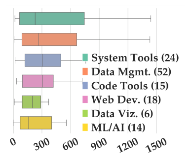

<figcaption>図3: 6 つのカテゴリにまとめた 128 のリポジトリの、リポジトリあたりのインスタンス数の分布。［訳注: 画像はクリップで欠落していたため PDF から切り出した］</figcaption>
</figure>

**表1**: SWE-smith の統計のまとめ。「Yield %」は、ある戦略が生成した候補のうち 1 つ以上のテストを壊すものの割合である。「Cost」は候補を 1 つ生成する平均のコストである。「F2P」（Fail to Pass のテスト）と「Lines [Edited]」は中央値である。

| バグの種類 | Yield % | インスタンス数 | コスト | F2P | 行数 |
| --- | --- | --- | --- | --- | --- |
| Combine | 96.9% | 10,092 | 0.00¢ | 15 | 11 |
| LM Modify | 56.0% | 17,887 | 0.38¢ | 4 | 3 |
| LM Rewrite | 35.0% | 4,173 | 3.93¢ | 4 | 24 |
| PR Mirror | 33.8% | 2,344 | 5.53¢ | 3 | 14 |
| Procedural | 40.2% | 15,641 | 0.00¢ | 7 | 5 |
| 合計 | 50.1 | 50,137 | 2.32¢ | 6 | 5 |

**バグの生成戦略は、コストと生成率（yield rate）が異なる。** LM に頼る方法のうち、PR ミラーはより高価である。そのタスクは、LM Modify と LM Rewrite の個々の関数ではなく、ファイル全体を書き直すことをともなうからである。生成率は、変更に対するテストの網羅の不足か、バグの候補が実際には関連する問題を導入しなかったことによって制限される。例えば、LM Rewrite では、LM は関数を再実装するよう求められ、明示的にバグを求められてはいない。率直にそれを求めると（LM Modify）、生成率は高くなる。

**表2**: ソフトウェアエンジニアリングのタスクのためのオープンソースの訓練データセットの比較。既存のデータセットと比べて、SWE-smith は、以前のストレージのコストのわずかで、タスクインスタンス、リポジトリ、環境の数が数倍ある。SWE-fixer と SWE-bench-train のタスクインスタンスは実行環境を持たないので、「Env. Size」は空欄である。［訳注: 「Exec?」列の印はクリップと HTML 版で欠落していたため PDF から読み取った］

| データセット | タスク数 | リポジトリ数 | 実行可能？ | 出所 | 環境のサイズ |
| --- | --- | --- | --- | --- | --- |
| R2E [^15] | 0.25k | 137 | ✓ | 合成 | 270 GB |
| R2E-gym（部分集合）[^16] | 4.6k | 10 | ✓ | 合成 | 4 TB |
| SWE-bench-extra [^5] | 6.38k | 2k | ✗ | 実 | - |
| SWE-bench-train [^18] | 19k | 37 | ✗ | 実 | - |
| SWE-fixer [^44] | 115k | 856 | ✗ | 実 | - |
| SWE-gym [^31] | 2.4k | 11 | ✓ | 実 | 6 TB |
| SWE-smith | 50k | 128 | ✓ | 両方 | 295 GB |

**SWE-smith のタスクインスタンスはどれくらい難しいのか？** SWE-smith が作るタスクインスタンスが現実的で難しいかどうかを判断するため、[^9] の 1,699 の人手で注釈した（タスク、ラベル）の対で Qwen 2.5 32B モデルを訓練し、タスクを（易しい、中程度、難しい）と評価させる。難しさを定量化するため、各難しさのラベルは 1 / 5 / 9 の値に対応させる。このモデルは 75.3% のテスト正解率を達成する。次に、SWE-smith と以前の SWE-bench 形式のデータセット [^9] [^18] [^31] [^50] の両方のタスクインスタンスの難しさを評価する。SWE-smith のタスクインスタンスは、SWE-bench や SWE-gym と同様に、広い範囲の難しさにまたがる。SWE-smith の平均の難しさのスコア（バグの生成戦略にわたって 5.27〜5.72）は、SWE-bench（5.01）や SWE-gym（5.62）と同程度である。これは、SWE-smith が現実的で適切に難しい評価を可能にすることを示唆している。バグの戦略が異なる水準の難しさを生む理由を論じ、データセットごとの難しさを §E で可視化する。

**実行環境をスケールする。** タスクインスタンスごとに Docker イメージを作る SWE-bench とは異なり、SWE-smith は同じリポジトリのタスクが同じ環境を共有するより単純な設計を活用し、表 2 に示すとおり、ストレージのオーバーヘッドを大幅に減らす。このアプローチは、タスクインスタンスのスケーリングをより手頃にするだけでなく、SWE-smith を既存のデータセットよりアクセスしやすく保守しやすくもする。SWE-bench を使って同様の量（50k）のタスクインスタンスを作るには、環境のために 50〜150 TB のストレージが必要になり、500 倍の差になると見積もる。拡張した議論は §C.1 にある。

## 3 Experiments（実験）

ソフトウェアエンジニアリングのエージェントを訓練するための SWE-smith の有用性を探るため、SWE-smith で基盤の LM を改善する主な手順として、棄却サンプリングファインチューニング [^54] を用いる。私たちの実験のワークフローは次のとおりである。まず、SWE-smith のタスクインスタンスの部分集合を精選する。次に、この部分集合でエキスパートのモデルを使ってエージェントシステムを実行する。このステップで、各実行に対応する軌跡を記録する。次に、解決したインスタンスに対応する軌跡で、基盤の（または「生徒の」）モデルをファインチューニングする。最後に、生徒のモデルで実行するエージェントシステムを、別のテスト分割で評価する。

**モデル。** エキスパートのモデルには claude-3-7-sonnet-20250219 [^2] を使う。先行研究 [^31] との公平な比較のため、claude-3-5-sonnet-20240620 と gpt-4o-2024-08-06 も使う。基盤モデルとして Qwen-2.5-Coder-Instruct [^14] の 7B と 32B のシリーズを使う。訓練とハイパーパラメータの詳細は §F.1 にある。

**エージェントシステム。** GitHub のイシューを解くためのエージェントシステムである SWE-agent [^49] を使う。SWE-agent は基盤の LM に、コードベースとのより効果的な相互作用を可能にするエージェントとコンピュータのインターフェース（ACI）を提供する。各ターンで、SWE-agent は LM に ReAct [^52] 形式の（思考、行動）の対を生成するようプロンプトで指示し、その行動はファイルを編集するかシェルコマンドを実行する。SWE-agent を選ぶのは、執筆時点で、Claude 3.7 Sonnet を使う SWE-agent が SWE-bench で最上位のオープンソースの解決策だからである。エキスパートのモデルで軌跡を生成するときは、SWE-agent を最大 75 ステップ、コストの上限 2.00 ドルで実行する。生徒のモデルの推論には、同じ 75 ステップの上限を課し、温度を 0.0 に固定する。完全な設定の詳細は §F.1 にある。

**評価指標。** SWE-bench の Lite と Verified [^9] の部分集合で評価する。SWE-bench は、12 の現実世界の GitHub のリポジトリのソフトウェアのイシューを解く能力で AI システムを評価する。Lite の分割は 300 のインスタンスの部分集合で、実行のコストが低い、より易しい評価集合として精選されている。Verified の分割は人間が精選した 500 のインスタンスの部分集合で、より明確な問題文とより信頼できる評価のために選ばれている。Python を超えた汎化を評価するため、本論文で導入する新しいデータセットである SWE-bench Multilingual でも評価する。SWE-Bench Multilingual は、9 つの追加のプログラミング言語をカバーする 300 のタスクインスタンスからなる。詳しくは §F.2 を参照されたい。成功裏に解決したインスタンスの割合である % resolved の指標を報告する。

## 4 Results（結果）

表 3 は、5,016 の SWE-smith の軌跡でファインチューニングした Qwen 2.5 Coder Instruct のモデル（7B と 32B）の性能を比較している。これらを SWE-agent-LM-7B と SWE-agent-LM-32B と呼ぶ。後者は最先端の性能を達成する。

**表3**: SWE-bench Lite と Verified での既存の解決策の解決率（[^17] から収集）と、SWE-smith でファインチューニングしたモデルの比較。すべての性能の数値は pass@1 である。テスト時に検証器や複数の試行を使うシステムとは比較しない。

| モデル | システム | 訓練の規模 | Lite | Verified |
|---|---|---|---|---|
| *クローズドウェイトのモデル* | | | | |
| GPT-4o | Agentless | - | 32.0 | 38.8 |
| | OpenHands | - | 22.0 | - |
| | SWE-agent | - | 18.3 | 23.0 |
| Claude 3.5 Sonnet | Agentless | - | 40.7 | 50.8 |
| | AutoCodeRover | - | - | 46.2 |
| | OpenHands | - | 41.7 | 53.0 |
| | SWE-agent | - | 23.0 | 33.6 |
| Claude 3.7 Sonnet | SWE-agent | - | 48.0 | 58.2 |
| Llama3-SWE-RL-70B | Agentless | 11M | - | 41.0 |
| *オープンウェイトのモデル* | | | | |
| Lingma-SWE-GPT-72B | SWE-SynInfer | - | - | 28.8 |
| Qwen3-235B-A22B | OpenHands | - | - | 34.4 |
| R2E-Gym-32B | OpenHands | 3.3k | - | 34.4 |
| SWE-fixer-72B | SWE-Fixer | 110k | 24.7 | 32.8 |
| SWE-gym-32B | OpenHands | 491 | 15.3 | 20.6 |
| SWE-agent-LM-7B | SWE-agent | 2k | 11.7 | 15.2 |
| SWE-agent-LM-32B | SWE-agent | 5k | 30.7 | 40.2 |

5,016 の訓練点の最終的なデータセットは次のように精選した。まず、エキスパートの軌跡の大きなプールを集めることから始める。最初に、4.1 節の各アブレーションを行い、最初の 5,105 の軌跡の集合を得た。次に、PR ミラーと LM Rewrite のタスクインスタンスが最も効果的なエキスパートの軌跡を生むという観察（後述）にもとづいて、これらの種類のすべてのタスクインスタンスでエキスパートのモデルを実行し、総数を 6,457 のタスクインスタンスに引き上げた。最終的に、8,686 の一意なタスクインスタンス、すなわち SWE-smith のデータセットの 17.3% について、エキスパートの軌跡の生成を試みた。2.2 節の難しさの評価の知見を補強して、SWE-smith のタスクインスタンスは今日の最上位のエージェントシステムにとって自明でないことを観察する。最終的な 6,457 のプールは、8,686 のタスクインスタンスのいずれかを解く 17,906 回の試行すべてのうち 36% の解決率を表している。

次に、この集まりにわずかな絞り込みを行う。[^31] で報告されたとおり、「より易しい」軌跡、すなわち複数の実行にわたって繰り返し解かれるタスクインスタンスがモデルの性能を劣化させることを私たちも観察する。そこで、任意の SWE-smith のタスクインスタンスが訓練集合に表される回数を 3 つの軌跡に制限する。これにより最終的な 5,016 の訓練集合が得られる。詳しくは §F.3 にある。

**データ点が増えると性能が改善する。** [^16] [^31] の同様のグラフを拡張して、図 1 は、軌跡が増えるにつれて性能が上がることを示している。

**同じ訓練集合の規模での比較。** 先行研究 [^16] [^31] と比較するため、1000 のランダムな SWE-smith のタスクインスタンスで、SWE-agent ＋ Claude 3.5 Sonnet（800）または GPT-4o（200）でエキスパートの軌跡の生成を実行する。次に、両方の研究が報告している訓練集合の規模である 500 の成功した軌跡で 32B モデルをファインチューニングする。私たちのモデルは SWE-bench Verified で 28.2% の解決率を達成し、[^31] とは +8.2%、[^16] とは +0.7% の相対的な差である。

### 4.1 Ablations of SWE-smith（SWE-smith のアブレーション）

SWE-smith のバグと問題文の生成戦略が訓練データの質にどう影響するかについて、いくつかのアブレーションを行う。Qwen 2.5 7B Coder Instruct をファインチューニングするためのエキスパートとして Claude 3.7 Sonnet を使い、SWE-bench Verified での性能を報告する。

**LM Rewrite と手続き的なバグは PR ミラーと同程度である。** バグの生成戦略（LM Modify、LM Rewrite、手続き的な変更、PR ミラー）ごとに 1000 のインスタンスをランダムに抽出する。インスタンスごとに、LM でイシューのテキストを生成し、エキスパートの軌跡の生成を実行する。次に、戦略ごとに生徒のモデルをファインチューニングし、公平な比較のために、訓練点をどの戦略の成功した軌跡の最小の数（507）に制限する。

表 4 が結果をまとめている。PR ミラーから生成した軌跡が経験的に最も効果的な訓練データである。これは予想どおりで、SWE-bench を最もよく反映しているからである。注目に値するのは、手続き的な変更と LM Rewrite のインスタンスからの軌跡が競争力のあるモデルにつながることである。LM Modify のバグでは急な落ち込みがある。

**LM が生成したイシューは本物のイシューと同程度である。** 600 の PR ミラーのタスクインスタンスをランダムに抽出する。LM が生成したイシューを 3 つの代替案、すなわち固定のイシューのテンプレート、ランダムな Fail-to-Pass テストのソースコード＋テストのログ、PR に関連する元のイシューのテキストと比較する。公平のため、再び訓練点を成功した軌跡の最小の数（259）に制限する。

表 5 に示すとおり、LM が生成したイシューを持つタスクインスタンスで訓練することは、元のイシューのテキストを使うことと経験的に同程度である。固定のイシューのテンプレートを使うことは、成功した軌跡が最も少なくなるだけでなく、比較的均質な問題解決の流れにもつながる。固定のイシューのテンプレートからのエキスパートの軌跡は、LM が生成したテキストと比べて一意な行動が 31% 少ない（379 対 550）。Fail-to-Pass のテストケースを提供すると、成功したエキスパートの軌跡は増えるが、評価の基準を漏らすことでモデルが再現スクリプトを書くのを飛ばすようになり、それが性能の低下の原因になる。500 の SWE-bench Verified のインスタンスのうち、LM が生成したイシューで訓練した生徒のモデルは 379 の実行でバグの再現を試みる。テストにもとづくイシューで訓練したモデルは 127 のケースでしかそうせず、66% の減少である。

**表4**: 異なる戦略で作った 1000 の SWE-smith のインスタンスでの訓練の比較。

| 戦略 | 軌跡数 | % Resolved |
| --- | --- | --- |
| LM Modify | 802 | 5.7（±1.5） |
| LM Rewrite | 507 | 8.8（±1.7） |
| Procedural | 745 | 8.6（±1.8） |
| PR Mirror | 557 | 9.2（±1.7） |

**表5**: さまざまなイシューのテキストを持つ 600 の PR ミラーのインスタンスでの訓練の比較。

| イシュー | 軌跡数 | % Resolved |
| --- | --- | --- |
| Fixed | 259 | 6.4（±1.5） |
| F2P Test | 390 | 7.3（±1.9） |
| LM | 328 | 7.7（±1.5） |
| Original | 319 | 7.8（±1.8） |

［訳注: 表 4 の LM Modify の軌跡数は 802 だが、付録の表 16 では 605 になっている。どちらも原文のまま］

**タスクの難しさは解ける可能性と相関するが、訓練データとしての有効性とは相関しない。** まず、難しさの評価モデルを、ランダムに選んだ 10k の SWE-smith のタスクインスタンスで実行する。このプールから、3 つの難しさの水準に対応する 1000 インスタンスの部分集合を精選し、部分集合ごとにエキスパートの軌跡の生成を 3 回実行する。易しい／中程度／難しい部分集合について、エキスパートのモデルの解決率はそれぞれ 58.6%、41.0%、17.0% である。

次に、すべての成功した軌跡から、難しさのスコア 2、4、6、8 に対応するそれぞれ 500 の軌跡の 4 つのファインチューニングのデータセットを作る。2.2 節で述べたとおり、易しい／中程度／難しいに対応するスコアは 1 / 5 / 9 である。したがって、スコア 2 の SFT のデータセットは、易しい 375 と中程度 125 のインスタンスに対応する軌跡からなり、以下同様である。いくぶん驚いたことに、難しさの増加と下流の性能の間に強い相関は観察されない。難しさ 2 / 4 / 6 / 8 の SFT のデータセットで訓練した生徒のモデルについて、SWE-bench Verified で 12.4%、10.8%、13.6%、12.2% の pass@1 のスコアを得る。

<figure>

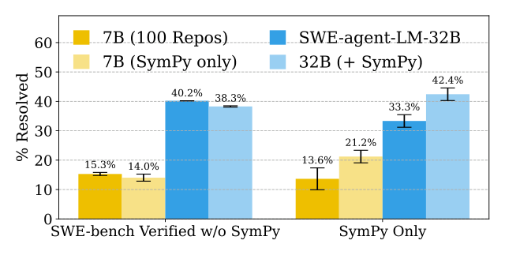

<figcaption>図4: 7B の基盤モデルと私たちの 32B のモデルを、SymPy の 700 の軌跡でファインチューニングする。特化は、汎化のわずかな損失とともに性能を押し上げる。［訳注: 画像はクリップで欠落していたため PDF から切り出した］</figcaption>
</figure>

<figure>

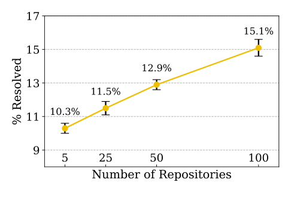

<figcaption>図5: 700 の訓練標本で、性能がリポジトリの数とともに対数的に増えることを観察する。［訳注: 画像はクリップで欠落していたため PDF から切り出した］</figcaption>
</figure>

**より多くのリポジトリで訓練すると一般的な性能が改善する。** 4、25、50、100 のリポジトリのプールから、手続き的な変更のタスクで 700 のエキスパートの軌跡を抽出することで、4 つの設定でモデルを訓練する。コード生成のタスクについての同様の知見 [^46] と呼応して、図 5 に示すとおり、訓練集合に表されるリポジトリを増やすと性能が改善し、モデルの性能とリポジトリの数の間におおよそ対数的な関係があることを見出す。

**リポジトリに特化したモデルは、汎化のわずかな損失とともに対象のリポジトリで優れる。** 特定の 1 つのリポジトリの専門家になるようモデルを訓練する実験を行う。性能を評価するため、(1) SymPy からの、(2) 2022 年 1 月 1 日以降に作成された SWE-bench Verified のタスクの部分集合、合計 22 のインスタンスでモデルを評価する。SymPy に特化した訓練データを作るため、まずカットオフの日付の直前の SymPy のベースのコミットを選ぶ。次に、1276 の手続き的な変更のタスクインスタンスを作り、700 のエキスパートの軌跡を生成する。図 4 にともに示す 2 つの設定、(1) 単一リポジトリのファインチューニングと、(2) 専門家段階のファインチューニングで、特化を評価する。単一リポジトリのチューニングでは、Qwen-2.5-Coder-Instruct 7B で初期化し、100 のリポジトリから抽出した 700 のインスタンスで訓練したモデルを、同じ Qwen の基盤モデルを 700 の SymPy のインスタンスだけでファインチューニングしたものと比較する。専門家段階のファインチューニングでは、単に SWE-agent-LM-32B を、同じモデルを 700 の SymPy のインスタンスでさらにファインチューニングしたものと比較する。

単一リポジトリのファインチューニング（21.2% 対 13.6%）と専門家段階のファインチューニング（42.4% 対 33.3%）の両方の設定で、特化は対象のリポジトリでの性能を大きく押し上げ、一般的な性能はわずかにしか下がらない。

### 4.2 Analysis of Agent Behavior（エージェントの振る舞いの分析）

<figure>

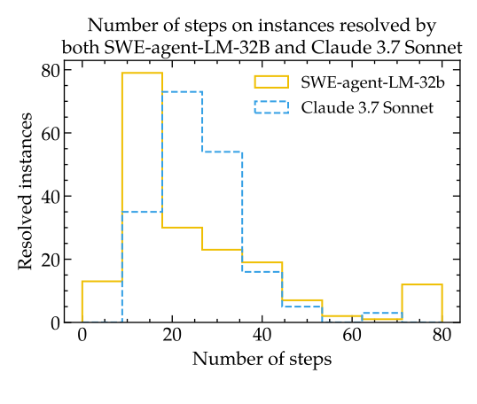

<figcaption>図6: 両方のモデルが解決したインスタンスについて、SWE-agent-LM-32B は Claude 3.7 Sonnet と比べて提出までのステップが少ない。［訳注: 画像はクリップで欠落していたため PDF から切り出した］</figcaption>
</figure>

<figure>

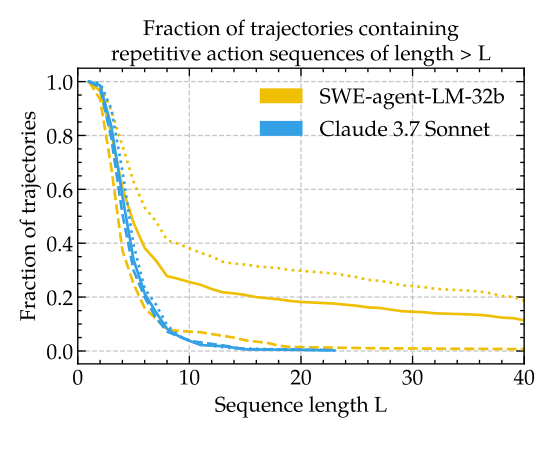

<figcaption>図7: 解決に失敗したタスクについて、よくある失敗モードは、SWE-agent-LM-32B が行動を繰り返すことである。［訳注: 画像はクリップで欠落していたため PDF から切り出した］</figcaption>
</figure>

本節では、SWE-bench verified で SWE-agent-LM-32B または Claude 3.7 Sonnet で実行したときの SWE-agent の振る舞い、失敗モード、効率を分析する。

**SWE-agent-LM-32B はタスクを効率的に解ける。** SWE-agent-LM-32B は、平均して Claude 3.7 Sonnet（29.1）より少ないステップ（24.9）でタスクを解決するが、解決したタスクの平均の難しさの違いを考慮すると差はわずかになる。両方の LM が解決したタスクの重なりでは、SWE-agent-LM-32B は 24.8 ステップを使い、Claude 3.7 Sonnet は 25.6 を使う（図 6 参照）。短い軌跡が常に好ましいわけではないが（例えば、追加の行動は追加の検証の目的に使える）、これは SWE-agent-LM-32B がタスクを非常に効率的に解くことを示している。同時に、SWE-agent-LM-32B は長い軌跡を通じて集中を保てることも示しており、31 のインスタンスが 40 ステップ以上のあとで解決されている。さらに、SWE-agent-LM-32B の自然に終了した[^n1]エージェントの提出の正解率は、Claude 3.7 Sonnet のものにほぼ匹敵し（60% 対 63%）、SWE-agent-LM-32B がインスタンスが解決されたかどうかを判断するのに長けていることを示していることを強調しておく。全体のコストとターン数の平均はコストとターンの上限に強くスケールするので、より徹底した分析は §F.5.1 に譲る。

[^n1]: すなわち、エラーやコスト・ステップ数の上限のために終了したエージェントの実行を除く。こうした場合でも SWE-agent はエージェントが行った変更を抽出して提出し、その一部は成功しうることに注意されたい（例えば、すでに行った編集をテストしている間にコストのためにエージェントが終了した場合）。［訳注: 脚注本文はクリップで欠落していたため HTML 版から復元］

**繰り返しの行動が主要な問題である。** SWE-agent-LM-32B には、繰り返しの行動の長い列に陥る傾向、特に、検索のコマンドを使う代わりにファイルの異なる部分を表示する呼び出しの長い列に陥る傾向が観察される[^n2]。SWE-agent-LM-32B の軌跡の 25% 超が長さ 10 以上の繰り返しの列を持つのに対し、Claude 3.7 Sonnet では 4% 未満である（図 7 参照）。長い繰り返しの列の発生は、対応するタスクインスタンスを解くエージェントの能力と強く相関する。主に、LM がエージェントのコストかターンの上限に達するまで同様のコマンドを出し続け、その時点で実行が終了されるからである。例えば、長さ 10 の繰り返しの列は 89% の失敗の確率に対応する。エージェントの足場からの単純な介入は繰り返しの行動を緩和できるが、解決率を改善するようには見えない（§F.5 参照）。

[^n2]: 実際、これらの str_replace_editor の view コマンドは、最長の繰り返しの列の 73% を占める。この分析では、基本コマンド、すなわち引数を除いたものの繰り返しを見る。詳しくは §F.5 を参照。［訳注: 脚注本文はクリップで欠落していたため HTML 版から復元］

<figure>

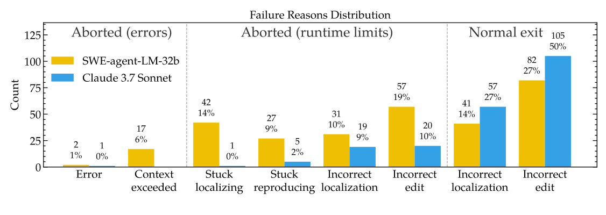

<figcaption>図8: SWE-agent-LM-32B の未解決のインスタンスの半分超は、コスト・ステップの上限によって終了した実行に対応し、これらの上限はソースコードが変更される前にしばしば達せられる。詳しくは §F.5 を参照。［訳注: 画像はクリップで欠落していたため PDF から切り出した］</figcaption>
</figure>

**位置の特定が支配的な失敗モードである。** システムプロンプトの中の短い計画に導かれて、SWE-agent は通常、ソースファイルを変更して修正を検証する前に、*位置の特定*（検索と読み取りの行動）、*再現*（テストファイルの作成と実行）から始める。エージェントがこれらの段階のいずれかで行き詰まるか、反復し続けると、エージェントのループは最終的に実行時の上限（コスト、LM の呼び出し回数、実行時間）によって中断される。Claude 3.7 Sonnet ではこれはまれにしか起きないが、SWE-agent-LM-32b の失敗の 53% はそうした上限に関連している（図 8）。エージェントはしばしば、位置の特定やバグの再現の最初の取り組みの間にすでに行き詰まり、際限なく繰り返される行動が持続的な問題である。失敗モードについて詳しくは §F.5 にある。

## 5 Related Work（関連研究）

**ソフトウェアエンジニアリングのための LM。** 現代の LM が従来のコード生成のタスクを飽和させたので [^4] [^8]、ソフトウェアエンジニアリングのベンチマーク [^15] [^18] [^50] [^58] [^55]、特に SWE-bench が、その多様で複雑な現実世界のプログラミングの課題のために、新たな事実上の評価の設定になった。SWE-bench でのオープンソースの進歩の最も大きな源は、LM にもとづくワークフロー [^29] [^42] [^57] とエージェント [^3] [^38] [^49] [^56] の開発であった。ワークフローにもとづくシステムは通常、人間が設計した、タスクの下位目標の列への分解である。[^50] は、そうしたパイプラインが Python 以外のリポジトリに効果的に汎化せず、再適応のための追加の人手の介入が必要になる可能性があることを示唆している。そこで私たちは、LM エージェントのシステムで、またそのために軌跡を生成することに焦点を当てることを選ぶ [^36] [^48] [^52]。ワークフローが課されないので、エージェントのシステムは本質的に、行動を計画し洗練するのにより LM に頼り、推論の足場ではなく LM の能力により焦点を当てる。

**コーディングのための訓練データセット。** 訓練データについての先行研究は、コード補完のタスクのための指示追従 [^21] [^24] [^35] [^39] [^40] [^53] と選好学習 [^19] [^20] に焦点を当ててきた。いくつかの最近の研究は、SWE-bench への検索拡張生成 [^18] [^44]、ワークフロー [^41]、エージェント [^5] [^22] [^31] [^16] のアプローチのための訓練集合を導入している。私たちの研究は [^12] をリポジトリのレベルで適用する。LM にコードベースを壊させることで、タスクを定義しその環境を構築するのに必要な人手の労力を劇的に減らす。私たちの研究と並行して、[^46]（RePOST）もリポジトリの関数のための実行環境を構築するが、方法論と評価で大きく異なる。RePOST は関数とその依存関係を別のスクリプトにサンドボックス化し、次に LM でテストを生成し、元のコードベースを文脈から取り除く。タスクの出所はリポジトリレベルであるが、環境とタスクはそうではない。RePOST はコード生成（例: HumanEval [^8]）でのみ評価する。[^16]（R2E-Gym）は、推論時スケーリングと検証器で SWE-bench でのオープンソースの LM の性能を改善する。R2E-gym の 51% の解決率は表 3 の結果と比較できない。各インスタンスが 26 回試行されるからである。R2E-gym の 4.6k の訓練インスタンスは、LM を使ってイシューのテキストとテストを合成するいくつかの拡張をともなって、SWE-bench のパイプラインを使って集められている。私たちの知る限り、以前のアプローチの限られたスケーラビリティに対処したのは私たちが初めてである。

## 6 Discussion（議論）

**限界と今後の方向。** 第一に、SWE-smith の収集のパイプラインは Python 中心である。プログラム上のオブジェクト（例: 関数、クラス）を特定し変換を行う仕組みは、Python に固有の ast ライブラリに大きく依存している。とはいえ、SWE-smith の収集戦略は他の言語に転用可能である。第二に、計算・予算の制約と、データセットの貢献としての私たちの研究の主な立場の両方のために、SWE-smith の有効性の実演としてファインチューニングだけを含めた。強化学習によって引き出される推論の能力のような他の訓練の技法は探っていない。

**結論。** 128 の現実世界の GitHub のリポジトリにわたる 50k のソフトウェアエンジニアリングのタスクインスタンスのデータセットである SWE-smith を導入する。SWE-smith の収集のパイプラインは、オープンソースのソフトウェア開発の慣行への忠実さを犠牲にすることなく、以前のコストのわずかで、タスクインスタンス、環境、軌跡をスケールすることを可能にする。SWE-smith を使って SWE-agent-LM-32B を訓練し、SWE-bench Verified で最先端の 40.2% を達成する。私たちの実験は、SWE エージェントを開発することについての基本的な傾向を特定するのに SWE-smith がどう使えるかを示している。SWE-smith が、真にスケーラブルなやり方でソフトウェアエンジニアリングのエージェントを訓練するのに必要な基盤のデータと基盤を提供すると信じる。

## Appendix（付録）

付録はおおむね次のように構成されている。付録 A〜D では、SWE-smith のタスクインスタンスと実行環境を精選するための SWE-smith の基盤と収集戦略の詳細を振り返り、その過程で SWE-bench や SWE-gym のような既存のデータセットとの比較を示す。付録 E 以降では、軌跡のデータセットをどう作ったかについてさらに論じ、次にデータセットとしての SWE-smith の有効性を示す追加のアブレーションと結果を示す。

<figure>

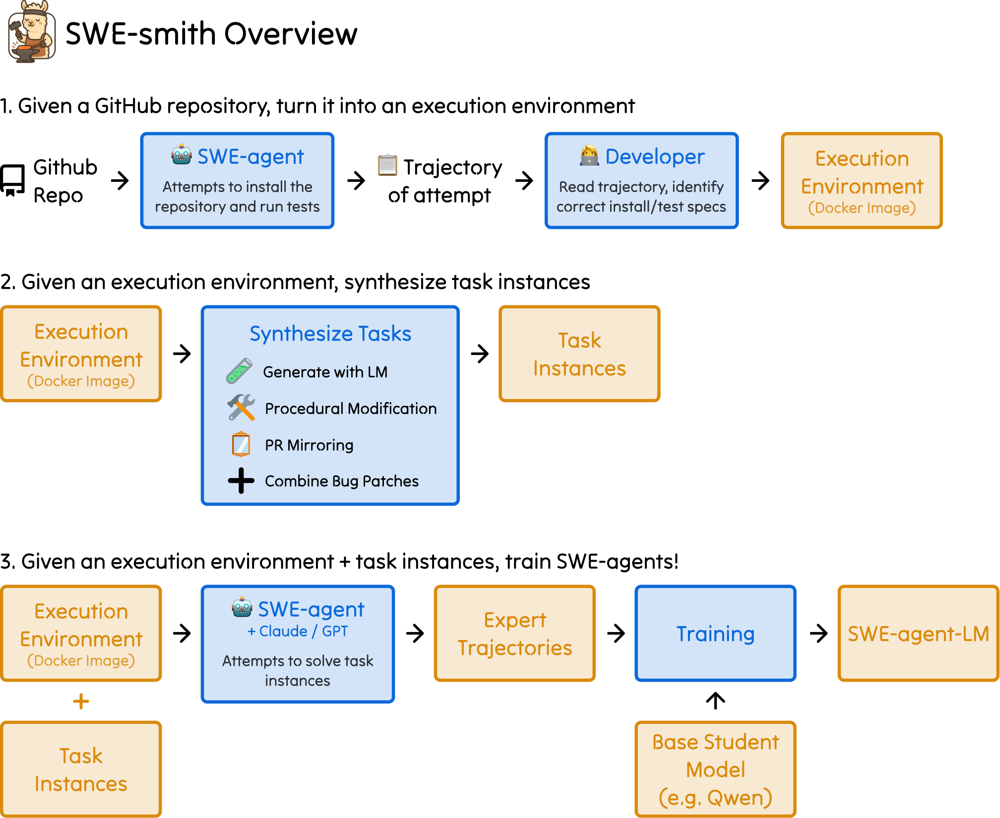

<figcaption>図9: SWE-smith のパイプラインの概観。スクリプト・関数と手作業のステップは青で強調している。これらのスクリプトの入力と出力でもある成果物はオレンジである。SWE-smith は SWE-bench と SWE-agent のエコシステムにシームレスに収まる。SWE-smith を使って実行環境を構築し、タスクインスタンスを生成する。SWE-agent を使って SWE-smith のタスクインスタンスでエキスパートの軌跡を生成し、これらの軌跡で訓練したモデルで推論を実行する。SWE-bench を使って、自分のモデルが GitHub のイシューを解決しソフトウェアエンジニアリングのタスクを行うのがどれくらい上手かを評価する。</figcaption>
</figure>

## Appendix A Infrastructure（付録 A: 基盤）

SWE-smith がどう動くかについての追加の詳細を扱う。具体的には次のとおりである。

- SWE-smith のタスクインスタンスの形式。
- リポジトリをどう特定するか、およびそれらを自動でインストールするのに使う SWE-agent の設定。
- タスクの検証と評価のハーネスがどう動くか。

### A.1 SWE-smith Task Instance（SWE-smith のタスクインスタンス）

SWE-smith のタスクインスタンスの形式を簡単に振り返り、それが SWE-bench のタスクインスタンスとどう異なるかを強調し、SWE-bench と比べて SWE-smith の比較的単純な基盤がタスクの収集をはるかに効率的にスケールさせる理由を論じる。

SWE-smith のタスクインスタンスは、いくつかの小さな違いを除いて、SWE-bench のタスクインスタンスの形式に非常によく似ている。SWE-smith のタスクインスタンスは次のフィールドを含む。

- repo: タスクインスタンスの出所のリポジトリ。
- instance\_id: 一意な識別子（通常は (repo).(bug\_type).(hash)）。
- base\_commit: バグのパッチを適用したリポジトリを指す GitHub のブランチのハッシュ。
- patch: バグを引き起こす差分。元のコードベースに適用してバグを作る。このパッチを元に戻すことが、実質的に解である。
- problem\_statement: バグを伝える生成されたイシューのテキスト。修正を試み始める前にモデルまたはシステムに提供される。
- created\_at: バグが成功裏に検証され、ブランチとしてミラーのリポジトリにプッシュされた時点に一致するタイムスタンプ。
- FAIL\_TO\_PASS: バグのパッチを適用してテストスイートを実行したときに壊れる単体テスト。
- PASS\_TO\_PASS: 壊れない単体テスト。これらは、すべてのテストの集合から FAIL\_TO\_PASS のテストを引いたものに対応する。

SWE-smith と SWE-bench のタスクインスタンスの主要な違いをまとめる。

- SWE-smith のタスクインスタンスは version と environment\_setup\_commit のフィールドを含まない。SWE-bench はこれらを、時間をまたいだリポジトリに固有のインストールの指示を指定するための追加の識別子として必要とする。SWE-smith では、一意なインストールの指示は（リポジトリ、コミット）ごとに指定される。
- hints\_text フィールドは含まれない。SWE-bench では、これは対応する PR の最初のコミットのあとに書かれたイシューと PR のスレッドのコメントを指す。
- created\_at フィールドには、バグが成功裏に検証された時点を反映するタイムスタンプが割り当てられる。元々、created\_at は PR が作成された時点を指す。
- test\_patch フィールドはない。SWE-smith の収集のパイプラインは隠しテストを作成も合成もしないからである。すべての FAIL\_TO\_PASS のバグは、推論時にリポジトリの中で見え、実行可能である。

### A.2 Repository Selection（リポジトリの選択）

2.1 節で論じた基準に加えて、リポジトリがプロプライエタリでない利用を許すライセンスを持つことも確かめる。ソフトウェアのライセンスの大多数は寛容なもの（BSD、MIT、Apache）であり、残りは主に、非商用の利用はなお許す保護的なライセンス（GPL）である。独自のライセンスを持つリポジトリを調べ、それらが本研究で行う用途を許すことを確認した。各リポジトリのライセンスは表 6 に完全に挙げる。

**表6**: 2025 年 4 月 8 日時点の各リポジトリに関連するライセンス。すべてのライセンスは寛容で、公開の非営利の利用を許す。［訳注: ユーザーの指示により、リポジトリ名をライセンスごとに並べたこの表の本体は訳出を省いた。分類は Apache License 2.0（17）、BSD 2-Clause（4）、BSD 3-Clause（20）、GPL v3.0（2）、LGPL v2.1（3）、LGPL v3.0（1）、ISC（1）、MIT（56）、その他（24）。原典の表を参照されたい］

検索の範囲を、主に Python で書かれたリポジトリに意図的に限定する。先例に従い、Python のリポジトリに焦点を当てることで、インストールとテストの手順について仮定を置くことができ（例: リポジトリは PyPI のパッケージとして組織され、pytest がテストの枠組みである）、それが SWE-agent によるリポジトリの自動セットアップのスケールアップをより扱いやすくした。今後の研究で検討する価値のある方向は、[^50] が SWE-bench 形式の評価をマルチモーダルな入力をともなう JavaScript のリポジトリに広げているように、リポジトリの網羅を広げて、異なるプログラミング言語で書かれたコードベースをより包括的にすることである。

**リポジトリの自動インストール。** このステップの目標は、まず、リポジトリのインストールとテストの指示を得ること、次に、開発環境をセットアップしたリポジトリを含む Docker イメージを作ることである。

リポジトリをインストールするよう求める、SWE-agent に与えるシステムプロンプトを図 10 に示す。各リポジトリのインストールのタスクは、元のリポジトリのクローンで初期化される。追加のステップ（例: pypi のパッケージのダウンロード、conda の環境のセットアップ）は行わない。

claude-3-5-sonnet-20241022 で SWE-agent を、コストの上限 2 ドル、呼び出しの上限 150 で実行する。インストールの実行は、これらの条件のいずれかを満たした時点で終了する。すべての実行について、相互作用を記録する。次に、軌跡を手作業でレビューし、適切なインストールとテストの指定を特定する。

各実行は、SWE-agent が submit コマンドを出すまでに平均 0.72 ドルのコストと平均 17 ステップを要する。実行は通常 2 分以内に終わる。Python のリポジトリの大多数はより少ないステップしか必要としない。通常、SWE-agent は CONTRIBUTING.md を閲覧し、そのテキストに書かれたインストールのコマンドをそのまま実行し、次に pytest を実行して、すべてのテストが通ることを示す。少数のリポジトリは、追加の依存関係を apt-get でインストールしなければならないので、いくつかのステップを必要とする。それに続く手作業のレビューの過程には 3〜20 分かかる。1 人の著者が 128 のリポジトリについてこの作業を行い、推定 18 人時がかかった。128 のリポジトリに達する過程で、著者は手作業のレビューの段階で 17 のリポジトリを諦めた。

```
System prompt for generating bugs with an LM

<uploaded_files>
{{working_dir}}
</uploaded_files>
I've uploaded a python code repository in the directory {{working_dir}}.
Can you please install this repository? Your goal should be to configure the repository's development environment such that existing tests pass. You are currently in the root directory of the repository, and nothing has been installed yet. You in an Ubuntu 22.04 environment.
The repository is predominantly written in Python. Here are several tips for installing it:
1. A good place to start is to look for a CONTRIBUTING.[md|rst] file, which will often contain instructions on how to install the repository and any dependencies it may have. Occasionally, the README.md file may also contain installation instructions.
2. Usually, a repository may have setup.py or pyproject.toml files which can be used to install the package. pip install -e . is commonly used, although many packages will also require an additional specifier that installs development packages as well (e.g. pip install -e .[dev]).
3. To check whether the repository was installed successfully, run tests and see if they pass. You can usually find tests in a tests/ or test/ directory. You can run tests using pytest or unittest, depending on the framework used by the repository.
4. Sometimes, you will need to install additional packages, often listed in a requirements.txt or environment.yml file. Also, be mindful of Ubuntu system dependencies that may need to be installed via apt-get (e.g. sudo apt-get install <package>).
Once you are finished with installing the repository, run the submit command to submit your changes for review.
```

図10: リポジトリをインストールするよう求める、SWE-agent ＋ LM に与えるプロンプト。［訳注: 囲みの見出し「System prompt for generating bugs with an LM」は内容（インストールの指示）と合わないが、PDF でも同じであり原文のまま残した］

### A.3 Validation, Evaluation Harnesses（検証と評価のハーネス）

各バグのパッチを SWE-bench 形式のタスクインスタンスに変換するために、SWE-bench の検証スクリプトを適応させる。このステップは、SWE-smith が既存の SWE-bench の解決策で実行できることを保証する。変換は 2 つのステップをともなう。まず、バグのパッチを適用し、リポジトリのミラーのクローンにブランチとしてプッシュする。次に、バグのパッチから SWE-bench 形式のタスクインスタンスを作り、Fail-to-Pass と Pass-to-Pass のテストのような重要なフィールドを検証のログの情報で埋める。

## Appendix B Bug Generation Strategies（付録 B: バグの生成戦略）

本節では、私たちが用いる各バグの生成戦略を詳しく振り返る。いくつかのバグの生成戦略を試したが、含めることを選んだのは、いくつかの望ましい性質を満たすことがわかったものである。

1. そのアプローチがコードベースに依存しないやり方で動く。
2. そのアプローチが、使えるタスクインスタンス（1 つ以上の通るテストが壊れることを意味する）を確実に生む。
3. そのアプローチが制御可能である。各戦略のパラメータを通じて、生成されるバグの量と質に影響を与えられる。

~~~~
System prompt for generating bugs with an LM

You are a software developer doing chaos monkey testing. Your job is to rewrite a function such that it introduces a logical bug that will break existing unit test(s) in a codebase.
To this end, some kinds of bugs you might introduce include:
(Per inference call, only 3 of the following tips are randomly selected and shown)
- Alter calculation order for incorrect results: Rearrange the sequence of operations in a calculation to subtly change the output (e.g., change (a + b) * c to a + (b * c)).
- Introduce subtle data transformation errors: Modify data processing logic, such as flipping a sign, truncating a value, or applying the wrong transformation function.
- Change variable assignments to alter computation state: Assign a wrong or outdated value to a variable that affects subsequent logic.
- Mishandle edge cases for specific inputs: Change handling logic to ignore or improperly handle boundary cases, like an empty array or a null input.
- Modify logic in conditionals or loops: Adjust conditions or loop boundaries (e.g., replace <= with <) to change the control flow.
- Introduce off-by-one errors in indices or loop boundaries: Shift an index or iteration boundary by one, such as starting a loop at 1 instead of 0.
- Adjust default values or constants to affect behavior: Change a hardcoded value or default parameter that alters how the function behaves under normal use.
- Reorder operations while maintaining syntax: Rearrange steps in a process so the function produces incorrect intermediate results without breaking the code.
- Swallow exceptions or return defaults silently: Introduce logic that catches an error but doesn't log or handle it properly, leading to silent failures.
Tips about the bug-introducing task:
(At inference time, tips are randomly shuffled)
- It should not cause compilation errors.
- It should not be a syntax error.
- It should be subtle and challenging to detect.
- It should not modify the function signature.
- It should not modify the documentation significantly.
- For longer functions, if there is an opportunity to introduce multiple bugs, please do!" - Please DO NOT INCLUDE COMMENTS IN THE CODE indicating the bug location or the bug itself.
Your answer should be formatted as follows:
Explanation: <explanation>
Bugged Code:
```
<bugged_code>
```
~~~~

図11: 既存の動作する関数を変更することでバグを生成するために、LM に与えるシステムプロンプト。赤字のテキスト（訳注: 上の 2 つの丸括弧の行）は実際のプロンプトには含まれない。

### B.1 Generating with an LM（LM による生成）

LM でバグを生成するためのワークフローを述べる。コードベースの各関数またはクラスについて、バグを導入する書き換えか、一からの完全な再実装のどちらかを生成するよう LM にプロンプトで指示する。この戦略を図 12 に示す。

<figure>

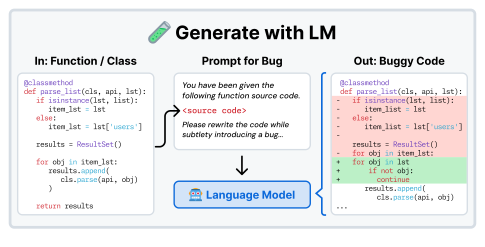

<figcaption>図12: LM で関数またはクラスのバグを生成するワークフロー。まずコードベースからすべての関数またはクラスを抽出し、次にすべての候補にわたって列挙し、バグを仕込んだ書き換えか再実装のどちらかを生成するよう LM にプロンプトで指示する。［訳注: 画像はクリップで欠落していたため PDF から切り出した］</figcaption>
</figure>

**既存の関数を変更する。** Python のコードベースが与えられると、ast ライブラリを使って、テストに関連するディレクトリ（例: tests、testing）の下にある関数を除く、すべての一意な関数を特定する。次に、関数が与えられると、LM は論理的な実行時のバグを導入する新しいバージョンを書くよう求められる。図 11 に示すプロンプトの中では、バグの種類のいくつかの提案と、書き換えの実演が提供される。

```
Prompts for reimplementing bugs with an LM

System Prompt
You are a software developer and you have been asked to implement a function.
You will be given the contents of an entire file, with one or more functions defined in it. Please implement the function(s) that are missing. Do NOT modify the function signature, including the function name, parameters, return types, or docstring if provided. Do NOT change any other code in the file. You should not use any external libraries.
Task Instance Prompt
Please implement the function func_signature in the following code:
{file_src_code}
Remember, you should not modify the function signature, including the function name, parameters, return types, or docstring if provided. Do NOT change any other code in the file. Format your output as:
[explanation]
{func_to_write}
```

図13: 既存の対象の関数を再実装することでバグを生成するために、LM に与えるシステムプロンプト。file\_src\_code は、対象の関数の元の実装を除いた元のソースファイルを指す。func\_to\_write は、対象の関数のシグネチャと docstring を指す。

実験では、バグの生成の主な基盤モデルとして OpenAI の o3 mini モデル [^28]（o3-mini-2025-01-31）を使う。LM の傾向についての経験的な観察にもとづいて、書き換えがすべきでないことについてのいくつかの明示的な指針をプロンプトに含める。特に、バグの位置を示すインラインのコメントを生成しないよう LM に求めることが重要である。これを明示的に指定しないと、モデルの生成出力がバグを指摘するインラインのコメントを持つ傾向があることを観察する。また、ファイルの差分の表現からそうしたコメントを特定して取り除く複雑さも避けたい。第二に、コンパイルや構文のエラー（例: 宣言されていない変数、関数の定義の変更）を引き起こす書き換えは避けるべきだと述べる。そうしたバグは比較的自明に解けるからである。異なるプロンプトや、関数ごとに複数のバグのある書き換えを生成することは、あまり試していない。

**既存のクラスを変更する。** この方法は、関数の書き換えのアプローチへの単純な修正をともなう。一意な関数（ast.FunctionDef）を特定する代わりに、コードベースを辿るロジックはクラス（ast.ClassDef）を探す。それ以外では、実装のすべての側面は関数の書き換えとほぼ同一で、バグの提案と実演をよりクラス向けにするためのプロンプトへの小さな変更がある。

**既存の関数を書き直す。** LM に元の関数を提供する代わりに、関数を一から再実装するよう LM に求める代替の戦略を探る。上と同様に、再び ast ライブラリを使ってすべての一意な関数を特定する。しかし、直接バグを求める代わりに、関数の実装を取り除き、関数を含むファイル全体（元の実装を除く）を LM にプロンプトとして与える。タスクの記述では、関数のシグネチャを変えずに関数を実装するよう明示的に LM に求める。

### B.2 Procedural Modification（手続き的な変更）

関数またはクラスの ast の表現にランダムな変更を行うことでバグを作る、コストゼロのアプローチを探る。「手続き的な変更」は、ast を受け取って、ループを取り除いたり if/else 節のブロックを入れ替えたりといった固定の変換を適用する関数を指す。この戦略を図 14 に示す。

<figure>

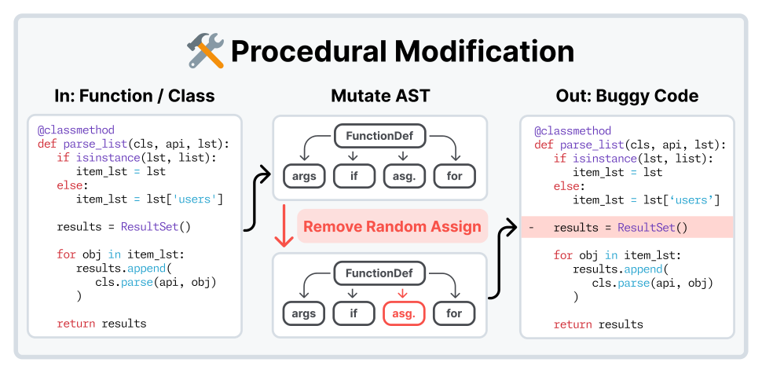

<figcaption>図14: 手続き的な変更によってバグを生成するワークフロー。関数・クラスごとに、ソースコードをまず ast に変換する。次に変更が ast を変異させる（例: 代入文を取り除く）。次に ast を、特定の変更が導入されたソースコードに戻す。［訳注: 画像はクリップで欠落していたため PDF から切り出した］</figcaption>
</figure>

LM でバグを生成するワークフローと同様に、まずリポジトリのすべての関数またはクラスを特定する。手続き的な変更ごとに、まずその変更が不可能になる候補を除外する基準の集合を課す。例えば、手続き的な変更が関数からランダムな条件分岐を取り除くものであれば、その変更の基準は、関数でないか条件分岐を持たない候補を除外する。残った候補について、手続き的な変更を制御された尤度（likelihood）で適用する。ここで尤度は、候補の中で手続き的な変更がどれくらいの頻度で適用されるかを示す割合である。例えば、手続き的な変更が尤度 0.5 でランダムな関数を取り除く［訳注: 原文のまま。文脈上は「条件分岐」］ものであれば、関数の中で宣言された各条件分岐について、50% の確率で取り除かれる。手続き的な変更が難しすぎる変更につながらないよう、尤度を導入する。最後に、変更した ast をソースコードに戻す。

表 7 は、任意の手続き的な変更に使われる絞り込みの基準の完全な一覧である。filter\_min\_complexity と filter\_max\_complexity の基準について、「複雑さ」の単純な定義を、関数の中の条件ブロック、ループ、ブール演算子、例外処理のブロック、比較演算子の数の合計として定める。filter\_min\_complexity の目的は、単純で面白みのない関数（例: getter、setter のメソッド）を検討から取り除くことである。filter\_max\_complexity は、長い一枚岩の関数を変更しないために時折使われる。

**表7**: 特定の性質を持つ関数またはクラスを絞り込むのに使う基準のプール。手続き的な変更ごとに、まずこれらの基準の部分集合を使ってコードベースから関数・クラスを絞り込む。次に残りに対して変更を実行する。

| 番号 | 基準 | 説明 |
| --- | --- | --- |
| 1 | filter\_functions | ast は関数の定義か |
| 2 | filter\_classes | ast はクラスの定義か |
| 3 | filter\_classes\_has\_base | ast は親を持つクラスの定義か |
| 4 | filter\_loops | ast は For または While のループを含むか？ |
| 5 | filter\_conditionals | ast は条件ブロックを含むか？ |
| 6 | filter\_assignments | ast は代入を持つ関数の定義か？ |
| 7 | filter\_wrappers | ast は try または with のブロックを含むか？ |
| 8 | filter\_if\_else | ast は if-else のブロックを含むか？ |
| 9 | filter\_operators | ast は二項演算子・ブール演算子を含むか？ |
| 10 | filter\_min\_complexity | ast は複雑さのスコア以上か？ |
| 11 | filter\_max\_complexity | ast は複雑さのスコア以下か？ |

表 8 は、コードベースにバグを作るのに使うすべての手続き的な変更の網羅的な一覧である。

**表8**: コードベースにバグを作るのに使う 13 の手続き的な変更の技法。「基準」の列は、表 7 で定義した対応する絞り込みを参照する番号を含む。4 つの非公式なカテゴリ——クラス、制御フロー、式、削除——があり、行われる変更の一般的な種類を示す。［訳注: 「Shuffle Lines」の基準「11, 12」は原文のまま。表 7 に 12 番はない］

| カテゴリ | 手続き的な変更 | 基準 | 説明 |
|---|---|---|---|
| クラス | Remove Functions | 2, 10 | メソッドとその参照を取り除く。 |
| | Remove Parent | 3, 10 | クラスの見出しから基底クラスを取り除く。 |
| | Shuffle Methods | 2, 10 | クラスの中のメソッドの定義を並べ替える。 |
| 制御フロー | Invert If/Else | 8 | 条件の if-else の本体を反転する。 |
| | Shuffle Lines | 11, 12 | 関数の行を並べ替える。 |
| 式 | Change Constants | 1, 9, 10 | 数値の定数に ±1 する。 |
| | Break Chains | 1, 9, 10 | 演算子、演算子を取り除く。［訳注: 原文のまま。文脈上は「演算子と被演算子」］ |
| | Swap Operands | 1, 9, 10 | 被演算子の順序を入れ替える。 |
| | Change Operator | 1, 9, 10 | 演算子を変える（例: + を − に）。 |
| 削除 | Loops | 1, 4, 10 | ループを取り除く（例: for、while）。 |
| | Conditionals | 1, 5, 10 | 条件分岐（if）を取り除く。 |
| | Assignments | 1, 6, 10 | 代入文を取り除く。 |
| | Wrappers | 1, 7, 10 | 例外（try）、文脈（with）を取り除く。 |

### B.3 Combine Bug Patches（バグのパッチの組み合わせ）

同じファイルまたは同じモジュールのバグのパッチを組み合わせるのに使う 2 つの戦略を論じる。実際には、使えるタスクインスタンスとして成功裏に検証された、LM と手続き的に生成したバグを組み合わせる。

<figure>

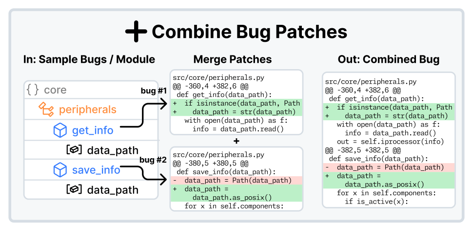

<figcaption>図15: バグのパッチを組み合わせることでバグを生成するワークフロー。（LM または手続き的な変更で生成した）n 個のパッチをとり、各バグのパッチを順にコードベースに適用する。個々のパッチがすべて成功裏に適用されれば、今や n 個のバグすべてを組み合わせたものを表す、結果の単一のパッチを保存する。［訳注: 画像はクリップで欠落していたため PDF から切り出した］</figcaption>
</figure>

**同じファイルから。** 2 つ以上の関数が 1 つのファイルの中で定義されていれば、この戦略は関数レベルのバグのパッチをまとめる。$n$ 個の関数レベルのバグと、組み合わせるバグの数 $k$ が与えられると、${n\choose k}$ 個の一意なファイルレベルの候補のバグのパッチがあり、それは網羅するには大きな探索空間になりうる。探索空間を扱いやすくし、単一の関数レベルのバグが繰り返し使われないことを保証し、確実に 1 つ以上の Fail to Pass のテストを持つインスタンスを生成するため、アルゴリズム 1 に述べる次のアプローチを実装する。

```
Algorithm 1  Combine multiple patches from the same file.
Input: codebase, bugs; num_bugs, limit_per_file; max_combos
Require: min_bugs >= 2; max_bugs >= min_bugs
procedure CombineFileBugs
  for each file in codebase do
    file_bugs <- bugs that apply to file
    combinations <- get_combos(file_bugs, num_bugs, max_combos)
    for each combo in combinations do
      Apply combo to codebase
      if success then
        Save combo to disk
        if limit_per_file reached then
          break
        end if
        combinations <- [c for c in combinations if c ∩ combo = ∅]
      end if
    end for
  end for
end procedure
```

コードベースの各ファイルについて、まずそのファイルを編集する関数レベルのバグ（またはバグのパッチ）を特定する。引き出すバグのプールは検証済みであり、つまり、そのバグに関連する 1 つ以上の Fail to Pass のテストがあることをすでに確かめている。これらの file\_bugs のプールから、get\_combos 関数が、各集合のサイズが num\_bugs である最大 max\_combos のバグの集合を生成する。各 combo、すなわちバグの集合について、バグを 1 つずつコードベースに適用する。すべてのパッチが成功裏に組み合わされれば、それはそれらが成功裏にマージされたことを意味し、複数の関数レベルのバグからなるマージされたパッチを保存し、単一のバグとして再検証する。パッチのマージは、git でのマージの衝突と同様に、2 つのファイルの間に重なる衝突があると時折失敗する。これは通常、関数が別の関数の中で宣言されている場合に起きる。関数レベルのバグが一度しか使われないことを保証するため、combo の任意のパッチを使う combinations の残りのバグの集合は取り除かれる。

limit\_per\_file と max\_combos のパラメータは、どの 1 つのファイルも過度に表されないようにし、さもなければ組み合わせ的に大きな探索空間を制約する。このアルゴリズムをすべてのコードベースのファイルにわたって実行し、通常は num\_bugs $=[2,4]$、limit\_per\_file $=3$、max\_combos $=40$ に設定する。num\_bugs を減らすか他の 3 つのパラメータを増やすと、生成率が改善する。

**同じモジュールから。** 同じテストを壊すものや、プログラム上の関係を持つもの（例: 関数 a が関数 b を呼ぶ）を組み合わせるなど、複数のバグから関数レベルのバグを構成するいくつかの方法が想像できる。同じ「モジュール」を編集するファイルを組み合わせることが、比較的率直で効果的なアプローチであることを見出した。「モジュール」とは、ソースコードの中のサブディレクトリ（例: sklearn/feature\_extraction、astropy/convolution）を指す。2 つ以上のファイルを編集するすべての SWE-bench のインスタンスのうち、75% が同じサブモジュールの中のファイルを変更しており、モジュール内のコードの変更の度合いが高いことを示唆している。私たちのアプローチの実装はアルゴリズム 2 に述べる。

```
Algorithm 2  Combine multiple patches from the same module.
Input: bugs; num_bugs; limit_per_module; max_combos; depth
Require: num_bugs >= 2
procedure CombineModuleBugs
  map_path_to_bugs <- {}
  for each bug in bugs do
    path <- get_path_from(bug)
    map_path_to_patches[path] <- [bug]
  end for
  Collapse nested paths based on depth
  for all (path, patches) in map_path_to_patches do
    combinations <- get_combos(patches, num_bugs, max_combos)
    for each combo in combinations do
      Apply combo to codebase
      if success and num_files_changed(combo) >= 2 then
        Save combo to disk
        if limit_per_module reached then
          break
        end if
        combinations <- [c for c in combinations if c ∩ combo = ∅]
      end if
    end for
  end for
end procedure
```

このアプローチの実装はアルゴリズム 1 と似ているが、2 つの重要な変更がある。第一に、ファイルごとやフォルダごとの走査は行わない。代わりに、差分のパッチを使って、コードベースのファイル構造をまねた辞書 map\_path\_to\_bugs を作る。例えば、バグがパス a/b/c/d.py を変更する場合、それは map\_path\_to\_bugs[a][b][c][d.py] $=$ [bug] として表される。同じパスを変更する追加のバグはリストに追加される。すべてのバグは関数レベルのバグなので、複数のリストに登録されるバグは決してない。次に、depth の添字まで「折り畳む」。例えば、depth $=3$ では、上のデータ構造は map\_path\_to\_bugs[a/b/c][d.py] $=$ [bug] に折り畳まれる。最後に、入れ子の辞書は単一のパッチのリストに折り畳まれる（例: map\_path\_to\_bugs[a/b/c] $=$ [bug]）。アルゴリズム 1 の手順をなぞって、次にこの辞書の値（バグのリスト）にわたって反復する。第二に、2 つ以上のファイルを変更するパッチだけを保存する。単一のファイルを変更する集約したバグ（combo で表される）は考慮しない。

再び、この戦略をすべての 100 のリポジトリ［訳注: 原文のまま］にわたって、パラメータ num\_bugs $=[2,5]$、limit\_per\_module $=10$、max\_combos $=100$、depth $=2$ で実行する。num\_bugs と depth を減らし、他のパラメータを増やすと、より多くのバグが得られる。depth を 2 に選ぶのは、経験的に、意味のあるモジュールは通常、主なソースコードのフォルダの直下のサブフォルダとして宣言されることがわかるからである（例: sklearn/feature\_extraction では、sklearn がソースコードのフォルダで、feature\_extraction がモジュールである）。より浅い depth は意味の薄いグループ分けにつながり、一方で depth を 1 段上げるごとに、特に小さなリポジトリで生成率が大きく下がる。

### B.4 Pull Request Mirroring（プルリクエストのミラーリング）

最後に、バグを生成する 4 つ目で最後の戦略——現実世界のプルリクエスト（PR）のミラーリング——を論じる。この過程を図 16 に可視化する。

<figure>

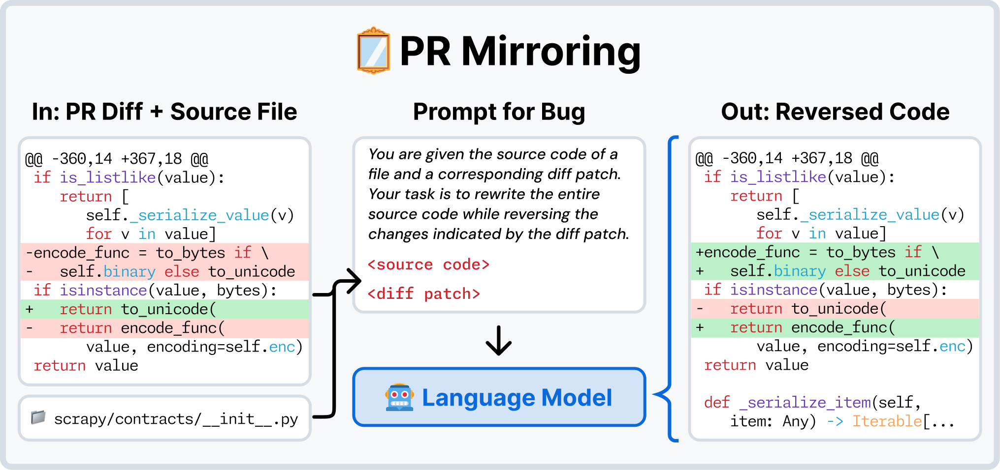

<figcaption>図16: 実際の GitHub のプルリクエスト（PR）に対応する差分のパッチで行われた変更を元に戻すことでバグを生成するワークフロー。パッチとパッチが変更したファイルが与えられると、PR で行われた変更を逆にする各ファイルの完全な書き換えを生成するよう LM にプロンプトで指示する。変更をコードベースに適用し、今や PR の変更の反転を捉えているパッチを抽出する。</figcaption>
</figure>

**なぜ LM を使うのか？** このアプローチを最初に実装したとき、コードベースに対して git apply --reverse [patch] を直接行うことを試みた。しかし、パッチの大多数についてこれは失敗する。sqlfluff/sqlfluff のリポジトリの 100 の PR のパッチを調べることで問題の解決に取り組み、2 つの観察に至った。

1. これらの PR の大多数は、今日もコードベースに残っている変更を反映している（バグの作成を有望にしている）。
2. しかし、多くのパッチは、関連するコードの正確な位置（例: 行、ファイル）が他の変更のために変わったので、逆にできない。

そこで、パッチの反転を行うのに LM を用い、推論モデル（例: o3-mini [^28]）が特に効果的であることを見出す。

**方法の記述。** 2023 年 1 月 1 日以降に作成された PR をクロールする SWE-bench の方法論に従い、いくつかのリポジトリについては、古い PR もクロールするという小さく恣意的な例外がある。PR ごとに、パッチが変更したファイルにわたって反復する。ファイルごとに、パッチのファイルに固有の変更を、リポジトリの現在の状態でのファイルのソースコード（PR が適用されたときに対応するリポジトリの状態、すなわち SWE-bench で base\_commit と呼ばれるものではない）とともに LM にプロンプトとして与える。LM は、PR に反映された変更を元に戻すファイルの書き換えを生成するよう求められる。すべてのファイルにわたる変更を単一のパッチに集約する。

私たちのエキスパートの軌跡の生成の方法（SWE-agent ＋ Claude 3.7 Sonnet）が解ける見込みのある問題に関心があるので、8 つより多くのファイルを変更する PR の再現は試みない。この制約を課すのは、6 つより多くのファイルを編集する SWE-bench のインスタンスがこれまで一度も解かれたことがないからである [^17]。

**PR のミラーリングはどれくらいうまく機能するのか？** django/django の GitHub のリポジトリからランダムに選んだ 100 の SWE-bench のタスクインスタンスに対応する PR をスクレイプし、SWE-smith の収集の過程でこれらのタスクインスタンスを再作成することを試みる。100 のタスクインスタンスのうち 92 を成功裏に回復した。これらのうち、84 は同一の F2P テストを壊し、残りの 8 は、時間とともに一部のテストが取り除かれたために部分集合を壊す。この健全性チェックは、PR のミラーリングの戦略がその名に恥じないという確信を与える。

**SWE-bench との比較。** このアプローチには、SWE-bench の収集のパイプラインと比べていくつかの利点と欠点がある。第一に、インスタンスに固有の Docker イメージを作る必要をなくす。すべての PR はリポジトリの同じバージョンに対してミラーされる。これはまた、リポジトリの過去のバージョンのためのインストールの指定を書く必要がないことも意味し、それは通常、SWE-bench でのタスクの構築で最も労力のかかるステップである。最後に、この戦略は、どの PR をタスクインスタンスに変換しようとするかの要件を緩めることも可能にする。SWE-bench では、どの PR をタスクインスタンスに変換しようとするかの中核の要件は次のとおりである。

1. 1 つ以上のコードのファイルを編集しなければならない（例: .md、.rst のファイルだけではない）。
2. 問題文として機能する 1 つ以上の GitHub のイシューを参照しなければならない。
3. 1 つ以上のテストに関連するファイル（テストに関係するキーワードを含む 1 つ以上のファイル）を編集しなければならない。

この収集戦略と、訓練データへの SWE-smith の焦点により、2 つ目と 3 つ目の要件はもはや必要ない。関連するイシューがなければ、イシューのテキストは単に生成できる。パッチがテストに関連する変更を含まなくても、検証の段階が PR がテストを壊すかどうかを判断するので、これは許容できる。これらの考慮により、SWE-smith の PR のミラーリングの戦略は、現実世界のコードの変更のより高い割合を訓練の目的に転用できると主張する。

主な欠点は、リポジトリの残りの部分が、PR が適用されたときのコードベースの状態と同期していないことである。その結果、コードベースの残りの部分の振る舞いの変化が、イシューの再現性やイシューの記述の正確さに影響する可能性がある（例: イシューのテキストで参照される行番号は、コードベースに対していくらかずれている可能性が高い）。しかし、これの単純な緩和策は、イシューの元の作成日により近い、より早いコミットでリポジトリの Docker イメージを作ることである。対象を絞った実験は行っていないが、SWE-smith を使えば、10 分の 1 の人時で、推定 2294 × 0.055 ドル ＝ 126.17 ドルのコストで、SWE-bench を完全に再現できるという仮説を立てる。

## Appendix C Dataset Statistics（付録 C: データセットの統計）

SWE-smith のデータセットの追加の内訳と分析を示し、どんな種類のリポジトリとバグが表されているかに焦点を当てる。

**リポジトリの分類。** SWE-smith で使うリポジトリの網羅的な一覧を表 9 に示す。リポジトリを 7 つの一般的な区分に分類する。データの解析と変換（39）、Web と API の開発（11）、コードの品質とテスト（12）、可視化と提示（8）、システムツールとプロトコル（17）、自然言語処理（7）、その他（6）である。分類は、まず、各リポジトリに関連する記述と GitHub のトピックに支えられた手作業の調査にもとづいて、適切なカテゴリの集合を決めることで行った。区分を決めたあと、リポジトリのメタデータと README の内容にもとづいてラベルを提供するよう GPT-4o に求めた。SWE-smith は、先行研究のどれと比べても、ソフトウェアのツールと応用のより広く多彩な網羅を表している。

［訳注: ユーザーの指示により、表 9（SWE-smith の全リポジトリの一覧と各リポジトリの説明）の訳出は省いた。原典の表を参照されたい。なお、本文中の区分の数の合計は 100 で、128 のリポジトリの数とは一致しない。原文のまま］

### C.1 Bug Generation Statistics（バグの生成の統計）

各バグの生成戦略のさまざまな側面について、生成率、労働・金銭のコスト、データセットの特徴を含む詳細を広範に示す。

**生成率。** 表 10 に、SWE-smith のすべてのリポジトリにわたる各バグの生成方法の生成率を示す。一般に、PR のミラーリングの生成率が 13.18% で最も低いことがわかる（ただしこの率は、SWE-bench の生成率 2294/93139 ＝ 2.46% よりいくらか高い）［訳注: 原文のまま。表 1 と表 10 では PR ミラーの生成率は 33.8%］。LM を使ってバグを生成する場合、意図的にバグを導入するよう関数を変更するほうが、LM に最善の努力の書き換えを行わせるより生成率が高い。手続き的な変更の有効性は戦略によって異なる。例えば、クラスの中で宣言された関数を並べ替えることは、既存のテストを 1.93% の割合でしか壊さないが、条件分岐を反転すると、変更の 47.04% でタスクインスタンスにつながる［訳注: 原文のまま。表 10 の値はそれぞれ 1.88% と 49.44%］。最後に、バグのパッチを組み合わせることは極めて高い生成率を持つ。1 つ以上のテストを壊す使えるタスクインスタンスとして検証済みのバグのパッチだけを組み合わせようとするので、これは予想どおりである。

**表10**: 付録 B で扱った異なるバグの生成戦略の生成率。各戦略を実行したリポジトリの数、各戦略が生成したバグの候補の数、インスタンスの数、すなわち 1 つ以上の Fail to Pass のテストを持つと検証された候補の数を示す。生成率は［訳注: キャプションはここで途切れている。PDF でも同じ］

| 戦略 | リポジトリ数 | 候補数 | インスタンス数 | 生成率 |
| --- | --- | --- | --- | --- |
| Combine (file) | 124 | 6020 | 5865 | 97.43% |
| Combine (module) | 65 | 4396 | 4227 | 96.16% |
| LM (Modify) | 108 | 31950 | 17887 | 55.98% |
| LM (Rewrite) | 128 | 11908 | 4173 | 35.04% |
| PR Mirroring | 108 | 6934 | 2344 | 33.8% |
| Procedural (Class Rm Base) | 103 | 1401 | 463 | 33.05% |
| Procedural (Class Rm Funcs) | 103 | 2506 | 1180 | 47.09% |
| Procedural (Class Shuffle Funcs) | 103 | 2504 | 47 | 1.88% |
| Procedural (Ctrl Invert If) | 105 | 4695 | 2321 | 49.44% |
| Procedural (Ctrl Shuffle) | 104 | 9055 | 4015 | 44.34% |
| Procedural (Op Break Chains) | 71 | 747 | 225 | 30.12% |
| Procedural (Op Change Const) | 77 | 723 | 257 | 35.55% |
| Procedural (Op Change) | 81 | 1507 | 450 | 29.86% |
| Procedural (Op Swap) | 87 | 2141 | 483 | 22.56% |
| Procedural (Remove Assign) | 121 | 5470 | 2661 | 48.65% |
| Procedural (Remove Cond) | 120 | 5288 | 2311 | 43.7% |
| Procedural (Remove Loop) | 110 | 1945 | 860 | 44.22% |
| Procedural (Remove Wrapper) | 80 | 884 | 368 | 41.63% |
| すべて | 129 | 100074 | 50137 | 50.1% |

各バグの生成技法が捉えるリポジトリの数は、各戦略に固有の前提条件のために異なり、それは時に一部のリポジトリで効果がないことがある。例えば、Procedural (Class \*) の一連の方法は Python のクラスだけを変異させる。この戦略は、クラスを一切定義しない少数の SWE-smith のリポジトリでは実りがない。Procedural (Op Break Chains) の方法は、2 つ以上の演算を持つ式から演算と被演算子をランダムに取り除く（例: $a+b+c\rightarrow a+b$）。そうした式は SWE-smith のリポジトリに常に存在するわけではない。

SWE-smith のバグの生成戦略にわたる全体の生成率は、SWE-bench の収集戦略より大幅に高い。

**表11**: SWE-smith に表される異なるリポジトリの生成率。

| 生成率 | リポジトリ数 |
| --- | --- |
| 0〜25% | 10 |
| 25〜50% | 31 |
| 50〜75% | 60 |
| 75〜100% | 27 |

生成率は、それを適用するリポジトリによっても異なる。リポジトリごとの生成率のまとめを表 11 に示す。一般に、テストの網羅が低いほど生成率が低いことと相関することを観察する。

**データセットの特徴。** 表 12 に、異なるバグの生成戦略が作った検証済みのタスクインスタンスについての統計を示す。本研究の LM にもとづく戦略は、1 つのファイルの 1 つの関数を書き直す。手続き的な変更も 1 つのファイルしか変えないが、戦略によっては 1 つ以上の関数またはクラスが変わりうる。同じファイルの複数のパッチを組み合わせると、常に 2 つ以上の関数を編集したパッチが作られる。モジュールにまたがって組み合わせると、2 つ以上のファイルを編集したパッチが作られる。各バグの作成戦略の的を絞った性質は、各戦略が作るバグが編集する関数とファイルの典型的な数に反映されている。

**表12**: 異なるバグの生成戦略にわたる SWE-smith のタスクインスタンスの属性の統計。中央値（IQR）として報告し、IQR は四分位範囲（25〜75 パーセンタイル）である。

| 戦略 | インスタンス数 | F2P 数 | Δ 行数 | Δ 関数数 | Δ ファイル数 |
| --- | --- | --- | --- | --- | --- |
| Combine | 10092 | 15 (5-48) | 19 (12-36) | 2 (2-3) | 1 (1-2) |
| LM | 22060 | 4 (1-17) | 6 (3-15) | 1 (1-1) | 1 (1-1) |
| PR Mirroring | 2344 | 3 (1-14) | 20 (8-55) | 2 (2-4) | 1 (1-2) |
| Procedural | 15641 | 7 (2-32) | 7 (5-15) | 1 (1-1) | 1 (1-1) |

図 17 に、SWE-smith のさまざまな属性の分布を、他の SWE-bench 形式のデータセットと比べて示す。先行研究と比べて、複数の Fail-to-Pass のテストを持つタスクインスタンスの割合がはるかに高い。任意の 1 つのリポジトリについて、SWE-smith のタスクインスタンスは全体として、他のデータセットよりはるかに高い割合のテストスイートの失敗を引き起こすことがわかる。これの潜在的な利益は、SWE-smith にもとづく軌跡で訓練すると、モデルがコードベースのはるかに広い機能の集合にさらされる可能性があることである。SWE-smith のタスクインスタンスが編集する行とファイルの数は、SWE-bench Verified の傾向線と非常によく似ている。

<figure>

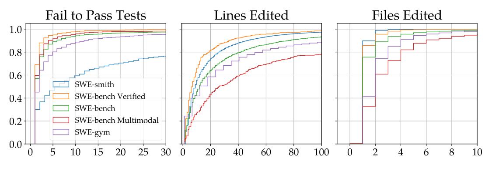

<figcaption>図17: SWE-smith と 4 つの SWE-bench 形式のデータセットにわたる、Fail-to-Pass のテストと、正解パッチが編集する行とファイルの累積分布の比較。［訳注: 画像はクリップで欠落していたため PDF から切り出した］</figcaption>
</figure>

他のデータセットとは異なり、SWE-smith のタスクインスタンスの傾向線は「調整可能」であることを記しておく。言い換えれば、図 17 の分布は、SWE-smith の今回の公開で提供されるタスクインスタンスを捉えたものである。しかし、SWE-smith の柔軟なバグの作成の技法のために、分布は必要に応じて「形作る」ことができる。例えば、バグのパッチの組み合わせの方法を使ってより多くのタスクインスタンスを生成すると、図 17 の 3 つの曲線がすべてずれる。この点を述べるのは、SWE-bench のタスクインスタンスの属性が、ある意味で現実世界のソフトウェア開発の振る舞いに制約されているという事実を強調するためである。他方、SWE-smith は、既存のどのプルリクエストにもまったく反映されていないかもしれないテストとコードを壊すのに使える。この意味で、SWE-smith で訓練した LM は、プルリクエストだけで訓練するのと比べて、コードベースへのよりよい「露出」を持つと主張する。

**実行環境のスケーリングの続き。** SWE-smith の検証と評価の手順は、SWE-bench のハーネスからわずかに外れる。これらの違いの主な理由は、主にインストールの指定の粒度に帰せられる。SWE-bench では、各タスクインスタンスは一意なベースのコミットに対応し、インスタンスを正しいインストールとテストの指示の集合に対応づけるための間接参照として、追加の version と environment\_setup\_commit のキーが必要になる。時間をまたいで、リポジトリとその依存関係の継続的な進化は、リポジトリを正しくインストールする方法に信じられないほど高い多様性をもたらす。この多様性を解決するため、[^9] で行われたように、コミュニティはタスクインスタンスごとにイメージを作ることに頼ってきた。そのため、2294 の SWE-bench のタスクインスタンスについて、2294 の一意な Docker イメージがあり、それぞれが少なくとも数ギガバイト（約 5〜6 GB）のサイズである。

他方、SWE-smith の設計の単純さとスケーラビリティは、比較的はるかに少ない Docker イメージで多くのタスクインスタンスをサポートすることを可能にする。上で述べたとおり、インストールとテストの手順は（リポジトリ、コミット）に固有である。そのため、各（リポジトリ、コミット）からバグを生成すると、すべてのバグは同じ Docker イメージから成功裏に再現しテストできる。言い換えれば、あるコミットのリポジトリについて 100 のバグを生成すると、100 の Docker イメージの代わりに、100 のタスクインスタンスのいずれかで推論を実行するのに単一の Docker イメージだけが必要になる。

この設計が、SWE-smith を SWE-bench より大幅に空間効率の良いものにしている。公開されているイメージにもとづくと、SWE-bench の 2294 のタスクインスタンスについて、すべての Docker イメージをローカルにダウンロードするには 1.2 TB のストレージが必要である。SWE-bench Multimodal の 517 のタスクインスタンスについては、1.2 TB が必要である。SWE-bench Multimodal のインスタンスあたりの Docker イメージのサイズが大きいのは、JavaScript の依存関係の管理のツール（例: npm）が、同等の Python の基盤（例: pypi）と比べてより多くのストレージを必要とするからである。[^31] は、2438 のインスタンスの各イメージが平均 2.6 GB で、合計 6 TB のストレージになると述べている。そうしたストレージの要件は、学術的な実務者にとって大きな障壁になりうる。

他方、20 倍を超える数のバグで、SWE-smith は合計 125 の Docker イメージしか必要とせず、これは一意な（リポジトリ、コミット）の対の数に対応する（本研究では、各リポジトリについて 1 つのコミットについてだけインストールとテストの指定を決める）。125 のイメージは合計 290.54 GB を必要とする。要するに、SWE-bench のタスクの収集戦略と比べて、SWE-smith の設計は、タスクインスタンスを作ることだけでなく、それらで訓練することも容易にする。

### C.2 Case Study: SWE-bench & SWE-smith（事例研究: SWE-bench と SWE-smith）

SWE-bench と SWE-smith の収集戦略の違いをよりよく理解するため、元の SWE-bench ベンチマークの 12 のテスト分割のリポジトリの 1 つである pallets/flask の GitHub のリポジトリで SWE-smith の収集を行う。2.1 節で扱ったステップを pallets/flask に適用したものを詳しく振り返る。まず、コミット bc09840 での pallets/flask のリポジトリのインストールとテストの指定を定義した。次に、リポジトリのこのバージョンに LM による変更のバグの生成戦略を適用し、267 の一意なバグを生成した。

いくつかの違いを観察する。第一に、SWE-smith の収集戦略は、そもそもはるかに多くのバグを生む。SWE-bench からは、11 のタスクインスタンスが pallets/flask のリポジトリのものである。タスクインスタンスは元々 2434 のプルリクエスト（PR）から絞り込まれ、107 が SWE-bench の絞り込みの基準、(1) 1 つ以上のイシューにリンクされていること、(2) 1 つ以上の新しいテストを含むこと、を満たした。これら 107 のうち、11（2434 の 0.45%）のタスクインスタンスが、実行環境を成功裏に構築できた PR の割合を表す。他方、バグの生成のための関数レベルの書き換えの戦略を実行すると、元々 402 の候補が得られ、そのうち 267 が有効なタスクインスタンスと判断された。

第二に、SWE-smith は、わずかなコストしか生じずに、大幅に少ない人手の労力しか必要としない。11 の pallets/flask のタスクインスタンスを集めること（ステップには、PR のスクレイプ、時間をまたいだリポジトリのバージョンの決定、バージョンに固有のインストール・テストの指定の定義、実行にもとづく検証の複数回の実行が含まれる）には、推定 38 時間分の人手の労働がかかった。対照的に、pallets/flasks の最新のコミットのインストールとテストの指定を定義するのには 10 分かかった。それに続くバグのための関数レベルの書き換えの戦略は実行に 23 分かかり、合計わずか 2.47 ドル（インスタンスあたり約 0.00613 ドル）のコストしか生じなかった。402 − 267 ＝ 135 の条件を満たさないバグの候補を除外する最終的な実行にもとづく検証のステップは 14 分で実行された。バグと問題文の生成戦略はどちらもリポジトリに依存しないので、これらのステップには追加の人手の介入は必要ない。直接比べると、pallets/flask のリポジトリについてインスタンスあたり、SWE-bench 形式の収集は 38 × 60/11 ＝ 207.27 分を必要とするのに対し、SWE-smith を使うと 0.176 分（約 10.6 秒）と 0.00613 ドルの API のコストである。

第三に、全体として、SWE-smith のタスクインスタンスは、コードベースの既存のテストの大幅に大きな割合を壊す。「バグの網羅率」を、すべてのタスクインスタンスにわたって 1 つ以上のインスタンスによって壊されるテストの割合として定義する。pallets/flask の SWE-bench の分割では、11 のインスタンスすべてにわたって 207 の一意なテストがある。これら 207 のテストのうち、15 が 1 つ以上のインスタンスによって壊され、バグの網羅率 7.25% に対応する。pallets/flask の SWE-smith の分割では、267 のインスタンスにわたって 474 の一意なテストがある。テストの量が多いのは、2023 年 6 月（SWE-bench が収集されたとき）と比べて 2024 年 11 月 28 日（SWE-smith が収集されたとき）時点の pallets/flask のリポジトリのテストの網羅が増えたためである。これら 474 のテストのうち、422 が 1 つ以上のインスタンスによって壊され、バグの網羅率は 89.03% である。この大きな違いは、現実世界のオープンソースのソフトウェア開発のワークフローの一貫した傾向、すなわち、リポジトリの既存の誤った振る舞いを捉えるために導入されるテストは少数派であるという傾向に帰せられる。テストの大多数は動作するコードとともにコミットされ、すでに正しい振る舞いが維持されることを保証する。よく保守されたリポジトリは通常、そうしたテストを失敗させるコミットをマージしない。これにより、そのテストの失敗に対応するコミットがほとんどまたはまったくないテストが多数生じる。

最後に、SWE-smith は評価に適したインスタンスを生まない。ここで示した SWE-smith のパイプラインは隠しテストを作らず、これは SWE-bench を評価により適したものにする決定的な違いである。その結果、エキスパートの軌跡を生成するとき、Fail-to-Pass のテストは推論時にリポジトリの中に存在する。さらに、私たちのイシューの生成戦略は、記述が不十分なテキストや解の漏洩 [^9] のような既知の問題のチェックを含まない。Fail-to-Pass のテストの関数やファイルを削除し、イシューのテキストの曖昧さと漏洩についての検証の手順を加えるといった単純な修正で、SWE-smith のタスクインスタンスを評価に適したものにできるだろう。最後に、合成のバグを評価に使うことを正当化するには、SWE-smith のタスクインスタンスが現実世界のイシューと PR にどれくらい忠実かについての徹底した分析が必要だろう。

## Appendix D Issue Generation（付録 D: イシューの生成）

イシューのテキストが、SWE-smith のインスタンスがどれくらい解けるかと、訓練データ点としての軌跡の価値に与える効果を判断するために試した、4 つのイシューの生成戦略を扱う。

**LM で生成する。** ランダムに選んだ SWE-bench Verified の問題文、バグのパッチ、Fail-to-Pass のテストの一覧、1 つの Fail-to-Pass のテストのソースコード、すべての Fail-to-Pass のテストを実行した実行ログを LM にプロンプトとして与える。パッチが伝えるバグを、SWE-bench Verified の実演のスタイルで記述するイシューを生成するよう LM に求める。図 18 がこの戦略のシステムプロンプトを示す。

**固定のイシューのテンプレート。** 表 13 に挙げる 7 つの事前に定めたイシューのテンプレートの集合を作る。各テンプレートは、すべてのタスクインスタンスに関連するバグのパッチまたは Fail-to-Pass のテストの情報を使う。タスクインスタンスのデータセットが与えられると、表 13 に挙げた確率に従って、テンプレートの 1 つを問題文として使うためにランダムに選ぶ。4 つのカテゴリの情報（バグの種類、変更されたファイル、変更された関数、Fail-to-Pass のテスト）をすべて提供するプロンプトに最も高い尤度を割り当てる理由は、より高い割合のタスクインスタンスが十分に指定されるようにするためである。

**表13**: 問題文を生成するのに使うイシューのテキストのテンプレートの一覧。すべてのテンプレートにわたって、4 種類の情報——バグのあるファイル、バグのある関数、Fail-to-Pass のテスト、バグの種類——が含まれる。提供する情報が少ないテンプレートには、一般に低い確率が割り当てられる。［訳注: 本文は「7 つ」のテンプレートとしているが、表には 9 行ある。原文のまま］

| テンプレート | 確率 | 提供する情報 |
| --- | --- | --- |
| Basic | 0.05 | なし |
| Files | 0.1 | どのファイルにバグがあるかを述べる。 |
| Funcs | 0.15 | どのファイルと関数にバグがあるかを述べる。 |
| Tests | 0.1 | いくつかのテストが失敗していることを述べる。 |
| F2P Tests | 0.1 | どのテストが失敗しているかを述べる。 |
| Bug Type | 0.05 | 失敗の種類を述べる。 |
| Bug Type + Files | 0.15 | 失敗の種類と、どのファイルにバグがあるかを述べる |
| Bug Type + Files + Test | 0.15 | 失敗の種類、どのファイルにバグがあるか、ランダムな F2P テストを述べる。 |
| Bug Type + Files + Funcs + Test | 0.15 | 失敗の種類、どのファイルと関数にバグがあるか、ランダムな F2P テストを述べる。 |

**Fail-to-Pass のテストのコードと実行ログ。** もう 1 つのアプローチは、ランダムに選んだ Fail-to-Pass のテストのソースコードとテストの実行ログを示すことである。このアプローチは、固定のイシューのテンプレートでは再現コードやコードの期待される・実際の振る舞いが伝えられないことに動機づけられている。単一の Fail-to-Pass のテストについてだけコードと実行ログを示す。タスクインスタンスが複数の Fail-to-Pass のテストを持つ場合、残りのテストは開示しない。

**元のイシューのテキスト。** この戦略は、PR のミラーリングを使って生成した一部のタスクインスタンスにだけ使える。PR が成功裏にミラーされた場合、SWE-bench で行われるのとまったく同じように、関連するイシューのテキストを問題文として使う。現実世界の PR からミラーされた SWE-smith の 2345 のタスクインスタンスのうち、708、すなわち 30.19% が、SWE-bench 形式の問題文を作るための 1 つ以上の関連する GitHub のイシューを持つ。

```
System prompt for generating issues with an LM

You are a software engineer helping to create a realistic dataset of synthetic GitHub issues.
You will be given the following input:
1. Demonstration: A realistic GitHub issue to mimic (included in the <demonstration> tag).
2. Patch: A git diff output/PR changes that introduces a bug (included in the <patch> tag).
3. Test output: The output of running the tests after the patch is applied (included in the <test_output> tag).
4. Test source code: Source code for one or more tests that failed (included in the <test_source_code> tag).
Output: A realistic GitHub issue for the patch.
Guidelines:
- Mimic the style and structure of the demonstration issues. If the demonstration issues are not well structured, your output should also be not well structured. If the demonstrations use improper or no markdown, your output should also use improper or no markdown. If the demonstrations are short/long, your output should also be short/long (if possible). If the demonstrations include human "flavor text" or "fluff", your output should also include human "flavor text" or "fluff". Do this even if it conflicts with your default behavior of trying to be extremely concise and helpful.
- DO NOT explain the fix/what caused the bug itself, focus on how to reproduce the issue it introduces
- Do not mention pytest or what exact test failed. Instead, generate a realistic issue.
- If possible, include information about how to reproduce the issue. An ideal reproduction script should raise an error
or print an unexpected output together with the expected output.
However, still include this information in a style very similar to the demonstration issues.
```

図18: タスクインスタンスのバグのパッチとテストの情報、および SWE-bench Verified からランダムに選んだ実演の問題文にもとづいてイシューを生成するために、LM に与えるシステムプロンプト。

## Appendix E Difficulty Rating（付録 E: 難しさの評価）

タスクに 3 つの難しさのラベル、15 分未満（易しい）、15 分〜1 時間（中程度）、1 時間超（難しい）のいずれかを付けるモデルを訓練する。このモデルにより、個々のタスクインスタンスの難しさと、集計してデータセット全体の難しさを定量化できる。［訳注: ラベルの部分はクリップと HTML 版で欠落していたため PDF から復元］

このモデルを訓練するため、Chowdhury et al.（2024）［訳注: 本文の参照は [^9]］の 1699 の注釈を使う。SWE-bench Verified を精選する彼らの研究で、1699 の SWE-bench のタスクインスタンスの部分集合に、4 つの難しさの水準、15 分未満、15 分〜1 時間、1〜4 時間、4 時間超のラベルが付けられた。一般に、各インスタンスに 3 人の注釈者が割り当てられ、難しさの注釈は、標本の多数決をとるか、多数がない場合は中央値をとることでまとめられた。注釈された難しさの分布は、易しいものから難しいものへ、24.5%、53.5%、19.4%、2.8% である。

4 時間超のカテゴリの標本は非常に少ないので、1〜4 時間と 4 時間超のインスタンスを単一の 1 時間超のカテゴリに分類し直す。次に、インスタンスをランダムに並べ替えつつ、訓練とテストの分布が元から大きく外れないようにして、80/20% の分割で対応する訓練とテストのデータセットを作る。インスタンスの問題文と解のパッチを入力として提供し、3 つの難しさのラベルの 1 つを目標の出力とする。Unsloth（Daniel Han & team, 2023）のライブラリを使って、Qwen 2.5 32B Instruct モデルで LoRA ファインチューニング（Hu et al., 2021）を行う。このモデルはテスト集合で 75.3% の正解率を達成する。誤った予測はすべて 1 段階ずれている。言い換えれば、モデルはラベルが 1 時間超のときに 15 分未満と予測したことはなく、その逆もない。

このモデルを使えば、バグのパッチと対応するイシューのテキストが作られたら、SWE-smith のインスタンスの難しさを評価できる。SWE-bench 形式のタスクインスタンスのデータセットの難しさを簡潔にまとめるため、「難しさのスコア」の指標を提案する。各ラベルは、易しいものから難しいものへ、1、5、9 の数値の難しさのスコアに対応する。したがって難しさのスコアは、すべてのタスクインスタンスにわたる難しさのスコアの平均である。

<figure>

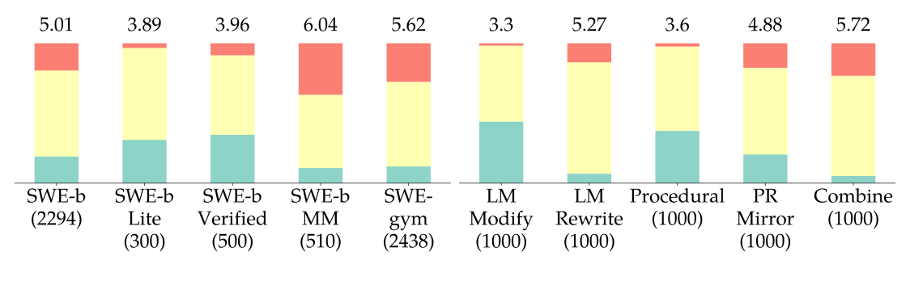

<figcaption>図19: 私たちの難しさの評価モデルで評価した、既存の SWE-bench 形式のデータセット（左の 5 本の棒）と SWE-smith（右の 5 本の棒）のタスクインスタンスの難しさ（易しい／中程度／難しい）の分布。各データセットの平均の難しさのスコアを各棒の上に挙げる。SWE-smith については、バグの戦略ごとに、LM が生成したイシューのテキストを持つ 1000 のタスクインスタンスを抽出する。［訳注: 画像はクリップで欠落していたため PDF から切り出した］</figcaption>
</figure>

**表14**: スコアはすべてのタスクインスタンスにわたって平均し、易しい／中程度／難しいは 1 / 5 / 9 に対応する。SWE-smith については、バグの戦略ごとに 1000 のタスクインスタンスを抽出する。

| データセット | インスタンス数 | スコア | 易しい | 中程度 | 難しい |
|---|---|---|---|---|---|
| SWE-bench | 2294 | 5.014 | 438 | 1408 | 446 |
| 　Lite | 300 | 3.893 | 93 | 197 | 10 |
| 　Verified | 500 | 3.960 | 173 | 284 | 43 |
| SWE-bench Multimodal | 510 | 6.036 | 55 | 265 | 186 |
| SWE-gym | 2438 | 5.625 | 288 | 1456 | 664 |
| 　Lite | 230 | 3.890 | 67 | 156 | 4 |
| SWE-smith (LM Modify) | 1000 | 3.304 | 441 | 542 | 17 |
| SWE-smith (LM Rewrite) | 1000 | 5.272 | 68 | 796 | 136 |
| SWE-smith (Procedural) | 1000 | 3.596 | 374 | 603 | 23 |
| SWE-smith (PR Mirror) | 1000 | 4.876 | 206 | 619 | 175 |
| SWE-smith (Combine) | 1000 | 5.720 | 52 | 716 | 232 |

図 19 は、異なる SWE-bench 形式のデータセットにわたる難しさについての私たちの知見をまとめている。難しさの水準ごとのタスクインスタンスのより徹底した概要を表 14 に示す。SWE-smith の異なるバグの生成方法は、異なる水準の難しさを生むことがわかる。LM Modify は一貫して易しいと評価される。いくつかの手作業の抜き取り検査から、LM Modify のプロンプトはバグの種類のいくつかの例を提供し、作るべき特定のイシューを名指ししないが、この戦略が作るバグの大多数は単純な変数の代入の誤り（例: a=a; b=b が a=b; b=a に変えられる）であることに気づく。私たちのような自由形式のプロンプトは、作られる誤りの点で実際には高い多様性を生まない。手続き的な変更は、予想どおり、次に易しい。この戦略が作るバグの種類は有限だからである。PR ミラーと LM Rewrite ははるかに難しいタスクを生み、これは私たちのバグの評価モデルによってだけでなく、私たちのエキスパートのモデル（SWE-agent ＋ Claude 3.7 Sonnet）によるこれらのタスクでのより低い平均の解決率によっても確認される。最後に、より小さな関数をまとめることは、より複雑と評価されるバグを作るための単純だが効果的な戦略である。この効果は私たちの当初の予想と一致する。一般に、より多くの関数とファイルの編集を必要とするバグは、より難しいと評価される傾向がある。SWE-smith は、さまざまな難しさのタスクインスタンスを作るのに使える。

## Appendix F Experiments（付録 F: 実験）

本節では、エキスパートのモデルで軌跡を生成し、ファインチューニングしたモデルで推論を実行するのに使った設定とパラメータについての追加の詳細を示す。次に、SWE-smith のデータセットと、SWE-smith で訓練したエージェントについての追加のアブレーションと分析を示す。

### F.1 Training Details（訓練の詳細）

**棄却サンプリングファインチューニング。** 私たちのファインチューニングのセットアップは、Pan et al.（2024）［訳注: SWE-Gym］の研究を大きく受け継いでいる。torchtune（PyTorch, 2024）のライブラリを使って、学習率 5e-5、最大 3 エポック、最大のコンテキスト長 32768 で全パラメータのファインチューニングを行う。訓練は Modal（Modal, 2025）上で、2〜8 台の NVIDIA H100 80G GPU で行った。第 3 節で論じたとおり、棄却サンプリングファインチューニング（RFT）の手順は次のとおりである。まず、SWE-smith のタスクインスタンスで、SWE-agent と「強い」モデル（例: Claude 3.7 Sonnet、GPT 4o）を使ってエキスパートの実演・軌跡を生成する。これらのうち、解決したインスタンスに対応する軌跡だけで生徒のモデルを訓練する。

**SWE-agent の設定。** 2 つの異なる設定を使う。1 つはエキスパートのモデルで軌跡を生成するためのもので、もう 1 つはファインチューニングした Qwen の生徒のモデルで推論を実行するための別のものである。設定は一般にかなり似ており、LM の応答の引き出し方、LM の応答の解析の仕組み、メッセージのサイズについての制約、システムプロンプトについて小さな違いがある。

まず、両方の設定に共通する情報を振り返る。タスクの性質と問題文をエージェントに知らせるプロンプトのテンプレートを図 20 に含める。このプロンプトは、Yang et al.（2024a）で使われた元の SWE-agent のプロンプトに非常によく似ている。環境のフィードバックを示すためのプロンプトのテンプレートも同一である。実行出力があれば、テキストの前に単に OBSERVATION: [output] が付く。出力がなければ（例: rm -r が黙って成功した場合）、エージェントには「Your command ran successfully and did not produce any output」と知らされる。提供されるエージェントとコンピュータのインターフェース（ACI）も同一である。SWE-agent は LM に 3 つの汎用のツールへのアクセスを提供する。

- bash: 端末で bash コマンドを実行する。
- str\_replace\_editor: ファイルを閲覧、作成、編集するためのツール。
- submit: タスクが完了したこと、またはタスクをそれ以上進められないことを LM が示すための特別なキーワード。

```
Task Instance Prompt provided to SWE-agent

<uploaded_files>
{{working_dir}}
</uploaded_files>
I've uploaded a python code repository in the directory {{working_dir}}. Consider the following PR description:

<pr_description>
{{problem_statement}}
</pr_description>

Can you help me implement the necessary changes to the repository so that the requirements specified in the <pr_description> are met?
I've already taken care of all changes to any of the test files described in the <pr_description>. This means you DON'T have to modify the testing logic or any of the tests in any way!
Your task is to make the minimal changes to non-tests files in the {{working_dir}} directory to ensure the <pr_description> is satisfied.
Follow these steps to resolve the issue:
1. As a first step, it might be a good idea to find and read code relevant to the <pr_description>
2. Create a script to reproduce the error and execute it with `python <filename.py>` using the bash tool, to confirm the error
3. Edit the source code of the repo to resolve the issue
4. Rerun your reproduce script and confirm that the error is fixed!
5. Think about edgecases and make sure your fix handles them as well
Your thinking should be thorough and so it's fine if it's very long.
```

図20: タスクの性質、タスクの記述そのもの、進め方についてのいくつかのヒントを LM に知らせる、SWE-agent を介して LM に与えるプロンプトの写し。［訳注: クリップと HTML 版では山括弧のタグ名が欠落していたため、PDF の文字列に合わせて復元した］

違いを簡単に振り返る。第一に、ツールの呼び出しはエキスパートのモデルと生徒のモデルで異なる働き方をする。エキスパートとして使う Claude と GPT のシリーズのモデルについては、モデルが前述のツールを呼び出すのに関数呼び出し（function calling）を使う。他方、生徒のモデルは、思考と行動を区切る XML のタグを持つ応答を生成するよう求められる。そのため、エキスパートの軌跡でファインチューニングするとき、重要な処理のステップは、エキスパートの軌跡の関数呼び出しの形式を XML 形式の応答に変換することである。エキスパートの軌跡で直接ファインチューニングしてもうまくいかない。

本論文の公開時点で、このツールの設定が、オープンソースのエージェントシステム（SWE-agent）と既存の任意の LM（Claude 3.7 Sonnet）で達成される絶対的な最先端の性能を反映しているので、これらの特定の設定を使うことを記しておく。多くの既存の先行研究、特に Yang et al.（2024a）が行ってきたように、より多くのツールの設計を探り、異なる形式の呼び出しを試すことは確かに可能である。しかし、私たちの研究の焦点を踏まえると、エージェントシステムの設定にわたるそうした「ハイパーパラメータの探索」を繰り返すことはしない。この取り組みは高価であり、私たちが使っている設定がエキスパートの水準の性能に理想的であることを示唆するためにすでに行われているからである。

エキスパートのモデルで軌跡を生成するときは、最大 75 ステップ、コストの上限 2.00 ドルで実行する。実行は、これらの上限のいずれかに達するか、エキスパートのモデルのコンテキストウィンドウを超えると自動的に終了する。自動的な終了の圧倒的多数は 75 の最大ステップの上限による。

生徒のモデルで推論を実行するときは、最大 75 ステップまたはコストの上限[^n3] 2.00 ドルで実行し、ステップ、コスト、コンテキストウィンドウの上限のいずれかに達すると同様に実行が終了する。生徒のモデルについては、LM の推論の呼び出しごとに、メッセージの履歴を切り詰めて、最新の 5 つのツールの出力だけを残す。エキスパートのモデルでは時折さまざまな温度で軌跡を抽出するが、生徒のモデルについては温度を 0.0 に固定する。

[^n3]: 長い文脈の処理について現実的な振る舞いを提供するため、ステップの上限に加えてコストの上限を含める。私たちのモデルのコストの値を計算するため、2025 年 4 月時点の gpt-4o のコスト関数を使う。［訳注: 脚注本文はクリップで欠落していたため HTML 版から復元］

### F.2 Evaluation Datasets（評価用データセット）

**SWE-bench。** SWE-bench は、GitHub のイシューを解決する能力で AI システムを評価する、広く使われているベンチマークである（Jimenez et al., 2024b）。コードベースと、バグまたは機能の記述が与えられると、AI システムは、記述に示されたイシューが解決されるようにコードベースを変更するよう求められる。SWE-bench は、主に Python の 12 の GitHub のリポジトリの、現実世界のプルリクエスト（PR）とイシューから集めた 2294 のそうしたタスクインスタンスからなる。第 3 節で論じたとおり、Lite と Verified の部分集合は、評価をより効率的にするか、より信頼できるものにすることを目標に、主な SWE-bench のリポジトリから精選されている。SWE-bench の全体での評価はかなり高価で、比較できる参照もそれほど多くないので、SWE-agent-LM-32B を SWE-bench のテスト集合の全体では評価しない。

**SWE-bench Multimodal。** SWE-bench Multimodal は、SWE-bench の収集戦略を、主に JavaScript と TypeScript の 12 の追加の GitHub のリポジトリに適用したもので、そこではタスクインスタンスが視覚的な資源を含むイシューに関連づけられている（Yang et al., 2024b）。評価用データセットは 510 のタスクインスタンスからなる。元の研究は特に視覚言語モデル（VLM）を評価するが、Qwen 2.5 Coder Instruct にもとづき、画像を入力として処理する能力を持たない SWE-agent-LM-32B は評価しない。

**表15**: SWE-bench Multilingual の評価集合における、リポジトリと言語ごとのタスクインスタンスの数。データセット全体は 9 つの言語をカバーする 300 のタスクインスタンスを含む。［訳注: ユーザーの指示により、リポジトリ名を並べたこの表の本体は訳出を省いた。言語ごとの合計は C/C++ 42、Go 42、PHP 43、Java 43、JS/TS 43、Ruby 44、Rust 43。原典の表を参照されたい］

**SWE-bench Multilingual。** SWE-bench Multilingual は、本研究で導入する 300 のタスクインスタンスからなる評価用データセットである。1 人の著者が、42 の追加の GitHub のリポジトリについて SWE-bench の収集戦略を行い、次の 9 つのプログラミング言語をカバーした。JavaScript、TypeScript、C、C++、Go、Java、PHP、Ruby、Rust である。これらのリポジトリは、Web の枠組み、データの保存と処理のツール、中核のユーティリティ、広く使われるライブラリを含む、広い範囲の応用領域にまたがる。データセットの簡単なまとめを表 15 に示す。

SWE-bench Verified と同様に、3 人の著者のチームが曖昧または記述が不十分なイシューのテキストを持つと判断したタスクインスタンスを除外することで、データセットを精選する。各タスクインスタンスは、平均 48 行のコードを編集する（追加と削除を意味する）。SWE-bench や SWE-smith と同様に、Fail-to-Pass のテストの数の中央値は 1 である。

SWE-bench Multilingual を導入するのは次のためである。

1. さまざまなプログラミング言語と応用領域にわたってモデルとエージェントの性能を評価するベンチマークを提供する。既存のエージェントシステムはしばしば Python に固有のツールに頼り、実質的に元の SWE-bench に過適合している（Yang et al., 2024b）。SWE-bench Multimodal はある程度これに対処しているが、その視覚的な入力への焦点は、ソフトウェアエンジニアリングの能力のテキストのみの評価にとって交絡要因である。
2. SWE-bench と完全な互換性を保ち、現在の利用者が基盤を変えずに採用できるようにする。
3. データセットを素早く実行できる程度に小さく保つ。Zan et al.（2025）のような並行研究は複数の言語でより多くのタスクインスタンスを提供しているが、データセットを素早く実行しやすいよう、タスクインスタンスの数を意図的に制限する。

§F.4 では、SWE-bench の既存の最先端の方法の性能が SWE-bench Multilingual では著しく悪いことを簡単に論じ、次に、SWE-smith を拡張することをともなう、より良いエージェント的なコーディングのモデルを構築するための潜在的な次のステップの明確な方向をいくつか示す。

### F.3 Trajectory Dataset Breakdown（軌跡のデータセットの内訳）

**表16**: SWE-smith から抽出した軌跡の内訳。軌跡は、アブレーションまたは性能の目的のいずれかのための SWE-smith の部分集合から生成した。すべての軌跡は、最大 75 ステップ、コストの上限 2 ドルで生成した。［訳注: 2 つ目のモデル名「claude-3-5-sonnet-20250219」は原文のまま。本文 §3 では claude-3-5-sonnet-20240620］

| 目的 | バグの生成 | イシューの生成 | インスタンス数 | 温度 | 軌跡数 |
|---|---|---|---|---|---|
| *claude-3-7-sonnet-20250219* | | | | | |
| アブレーション（バグの種類） | LM (Modify) | LM | 1000 | 0 | 605 |
| | LM (Rewrite) | LM | 1000 | 0 | 507 |
| | Procedural | LM | 1000 | 0 | 745 |
| | PR Mirrors | LM | 1000 | 0 | 557 |
| アブレーション（イシューの種類） | PR Mirrors | Fixed | 600 | 0 | 259 |
| | PR Mirrors | F2P Test | 600 | 0 | 390 |
| | PR Mirrors | Original | 600 | 0 | 328 |
| | PR Mirrors | LM | 600 | 0 | 319 |
| アブレーション（リポジトリ） | Procedural | LM | 1000 | 0 | 721 |
| | Procedural | LM | 1000 | 0 | 709 |
| | Procedural | LM | 1000 | 0 | 723 |
| | Procedural | LM | 1000 | 0 | 707 |
| 最終的なデータセットの精選 | LM (Rewrite) | LM | 3574 | 0 | 1003 |
| | PR Mirrors | LM | 1049 | 0 | 349 |
| *claude-3-5-sonnet-20250219* | | | | | |
| 先行研究との比較 | All | LM | 800 | 0 | 535 |
| *gpt-4o-2024-08-06* | | | | | |
| 先行研究との比較 | All | LM | 200 | 0 | 89 |

［訳注: 表 5 では Original 319・LM 328 だが、表 16 では Original 328・LM 319 と入れ替わっている。原文のまま］

**表17**: 最終的な訓練データセットに表されるバグの種類。

| バグの種類 | 件数 |
| --- | --- |
| Combine (File) | 123 |
| Combine (Module) | 7 |
| LM (Modify) | 11 |
| LM (Rewrite) | 1532 |
| Procedural | 1495 |
| PR Mirror | 1848 |

**表18**: 主な結果のための最終的なデータセットに表される、軌跡の数が上位 10 のリポジトリ。［訳注: 表には 12 のリポジトリがある。原文のまま］

| リポジトリ | 件数 | リポジトリ | 件数 |
| --- | --- | --- | --- |
| getmoto/moto | 378 | sqlfluff/sqlfluff | 122 |
| pandas-dev/pandas | 320 | pylint-dev/astroid | 110 |
| conan-io/conan | 243 | pydicom/pydicom | 103 |
| pydantic/pydantic | 209 | tobymao/sqlglot | 101 |
| iterative/dvc | 181 | pygments/pygments | 99 |
| dask/dask | 139 | scanny/python-pptx | 98 |

本研究で公開する SWE-agent の軌跡のデータセットの徹底した概要を表 16 に示す。大多数は claude-3-7-sonnet-20250219 で生成した。先行研究と比較するため、少数は claude-3-5-sonnet-20240620 と gpt-4o-2024-08-06 で生成した。第 4 節で述べたとおり、易しいデータへの偏りの現象を防ぐため、インスタンスごとの上限 3 を課す。つまり、任意のタスクインスタンスについて、そのタスクインスタンスを成功裏に解決する軌跡をファインチューニングのデータセットに最大 3 つまで含める。表 16 に反映された軌跡のプールから、5000 の軌跡の集合を精選し、それを使って SWE-agent-LM-32B を訓練する。

表 17 と表 18 は、最終的な訓練データセットにどのリポジトリとバグの種類が表されているかを示す。合計で 123 のリポジトリが表され、91 のリポジトリから少なくとも 10 の軌跡がある。軌跡は平均 58 ターンの長さで、つまり LM は通常、与えられた実演の軌跡について 29 の行動をとる。この分布を図 21 に可視化する。

<figure>

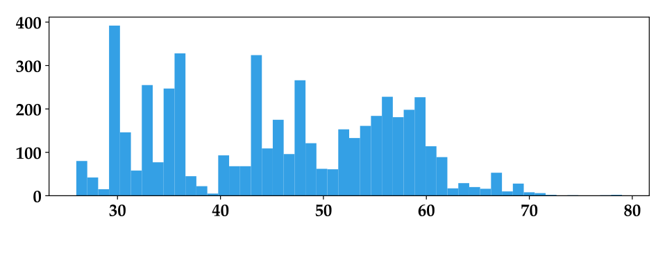

<figcaption>図21: 最終的なデータセットに表される軌跡のターン数の分布。［訳注: 画像はクリップで欠落していたため PDF から切り出した］</figcaption>
</figure>

### F.4 Training Analyses（訓練の分析）

SWE-agent-LM-32B の訓練についての追加の実験と議論を示す。

**Pass@k の傾向線。** 主な結果で論じた Pass@1 のスコアを計算するため、SWE-agent-LM-32B で SWE-agent を 6 回実行した。図 22 では、k の値が高いほど性能が上がることを観察する。これは、ソフトウェアエンジニアリング、コード生成、Web のナビゲーション、定理証明のための LM にわたる先行研究の観察を反映する現象である。Pan et al.（2024）や Jain et al.（2025）で行われたような、推論時スケーリングや、複数のロールアウトが生成した最良の解の候補を選ぶための別の検証器のモデルを訓練することについての研究は探っていないが、SWE-agent-LM-32B は、そうした研究が探った生成してから選ぶパイプラインと完全に互換である。その強い Pass@1 の性能を踏まえると、SWE-agent-LM-32B は Best@k の結果でもかなり競争力がある可能性が高い。前述のとおり、SWE-smith の過程で生成したすべての軌跡は公開しており、コミュニティはより良い検証器を訓練するのにそれが有用だと思うかもしれない。

**棄却サンプリングファインチューニングのアブレーション。** 棄却サンプリングファインチューニングが下流のタスクでのより良い性能につながることを確かめるため、絞り込みの基準なしに n 個の訓練点をランダムに抽出する設定と、n = [100, 200, 400, 800, 1600] で比較し、同じ生徒のモデル（Qwen 2.5 Coder Instruct 32B）をファインチューニングする。次に、各生徒のモデルで SWE-bench Verified のデータセットで SWE-agent を 3 回実行し、「% Resolved」は Pass@1 のスコアに対応する。結果を図 23 に示し、成功裏に解決したタスクに対応する軌跡だけでファインチューニングするほうが、軌跡をランダムに抽出するより良いことを確認する。

**SWE-bench Multilingual での性能。** SWE-agent-LM-32B と既存のモデルが Python 以外のコーディングの領域にどれくらいよく汎化するかを評価するため、私たちのモデル、Qwen 2.5 Coder Instruct 32B、Claude 3.7 Sonnet の性能を、F.2 節で導入した新しいデータセットで SWE-agent を使って評価する。300 のタスクインスタンスのうち、Claude 3.7 Sonnet は 43% の Pass@1 の解決率を達成し、これは SWE-agent-LM-32B（8.4%）と Qwen 2.5 Coder Instruct（6.5%）よりかなり良いことがわかった。SWE-agent-LM-32B は、基盤モデルに対して大きな改善を示さない。異なる軌跡のいくつかの抜き取り検査を通じて、棄却サンプリングファインチューニングの過程はこのタスクの設定で多ターンの相互作用を行う能力を改善したが、以前のステップで閲覧したコードとファイルが明らかに Python で書かれていないにもかかわらず、コードの編集が Python に近い構文を反映しているインスタンスがある、という作業仮説に至った。

SWE-bench Multilingual での SWE-agent-LM-32B の結果は明らかに標準以下であるが、私たちはこの発見に興奮している。SWE-smith の上での今後の研究を動機づけるからである。詳しく述べると、多くのリポジトリと言語に汎化できるオープンなエージェントのコーディングモデルへの道は、より多くのデータとより良い訓練の技法によって開かれると予想しており、SWE-smith はその両方を非常によく促進できる。第一に、データについては、SWE-smith は Python 中心に書いたが、収集の方法論とバグの生成の技法（特に LM にもとづく方法）は、他のリポジトリにもすぐに転用できるはずである。第二に、SWE-bench Multilingual での否定的な結果は、1 つのコードの領域（例: Python）で訓練したモデルが、多くの言語とリポジトリに汎化できるようにするより良い訓練の技法がありうるかを探るための明確な推進力を提供する。

<figure>

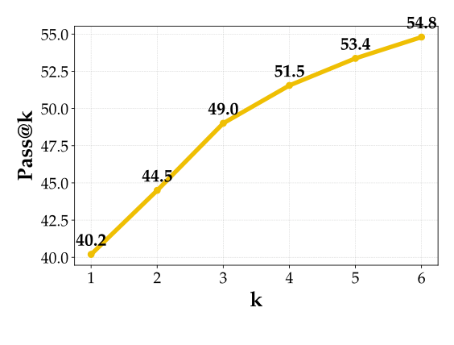

<figcaption>図22: SWE-bench Verified での SWE-agent-LM-32B の Pass@k の曲線。より多くの実行を考慮すると、より高い % resolved が観察される。［訳注: 画像はクリップで欠落していたため PDF から切り出した］</figcaption>
</figure>

<figure>

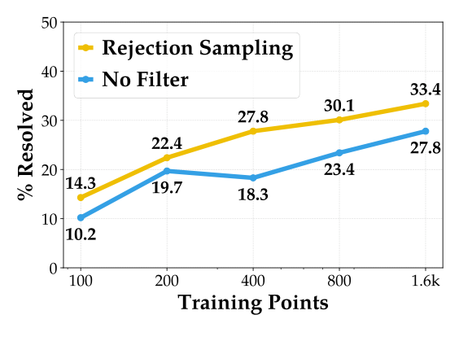

<figcaption>図23: 棄却サンプリングファインチューニングは、訓練のために軌跡をランダムに抽出するより良い性能につながる。［訳注: 画像はクリップで欠落していたため PDF から切り出した］</figcaption>
</figure>

### F.5 Agent Behavioral Studies（エージェントの振る舞いの研究）

#### F.5.1 Turn counts and cost（ターン数とコスト）

エージェントはしばしば単一のインスタンスあたりのコストの数字で引用されるが、SWE-agent-LM-32B の場合、これは非常に誤解を招きうる。失敗したインスタンスのほとんどはコストまたはターン数の上限による終了のために失敗するので、平均のコストとターン数はこれらの上限に強く依存する（図 24 参照）。

解決したインスタンスの数をステップの上限に対してグラフにすることもできる。複数のステップの上限でエージェントを再評価するのを避けるため、ステップの上限 75 の 1 回の実行を使い、ステップ $n$ のあとで終了した成功したエージェントの実行は、$n$ より小さい上限で制限されていれば失敗していたと仮定する。このグラフは第 3 節［訳注: 原文のまま。文脈上は 4.2 節］で述べた点を裏づける。SWE-agent-LM-32B は、非常に低いステップの上限ではより高い解決率を持つ。

<figure>

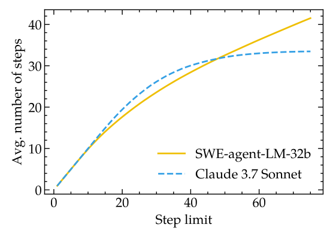

<figcaption>図24: 平均のステップ数は、定めたステップの上限に強く依存する。［訳注: 画像はクリップで欠落していたため PDF から切り出した］</figcaption>
</figure>

<figure>

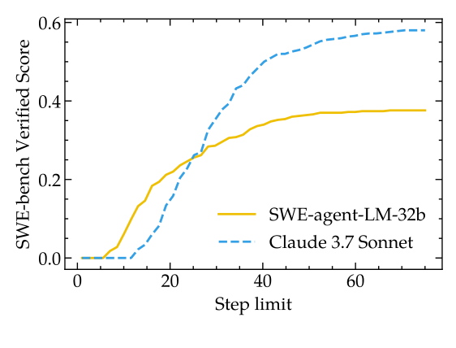

<figcaption>図25: 与えられたステップの上限より前に提出された成功したインスタンスの数。［訳注: 画像はクリップで欠落していたため PDF から切り出した］</figcaption>
</figure>

#### F.5.2 Analysis of agent action space（エージェントの行動空間の分析）

**基本コマンドへの還元。** エージェントとコンピュータのインターフェース（F.1 節）の一部としてエージェントに提供される専用のツールに加えて、エージェントは任意の bash コマンドを実行できる。これにより、エージェントの行動空間の定量的な分析が難しくなる。例えば、エージェントは PYTHONPATH=/testbed/repo cd /testbed/repo && python3 reproduce.py のようなコマンドを出すかもしれない。行動を意味のある形で記述する基本コマンドを決めるのに、次の手順が効果的であることを見出した。

1. コマンドの先頭から環境変数の操作を取り除く。
2. 複数のコマンドが && やセミコロンで連結されている場合は、最後のコマンドだけを考慮する。
3. すべての引数を取り除く。一部のコマンドはサブコマンドを持つので（例: git checkout）、最初の語を残すか最初の 2 語を残すかを判断するために、いくつかの基本的なヒューリスティクスを適用する。

**繰り返しの行動。** エージェントの行動の中で同一の基本コマンドの最長の列を求めることで、行動の最長の繰り返しの列を求める。これは、例えば、異なるファイルを対象とする str\_replace\_editor の view の行動も、この分析に関する限り繰り返しの行動とみなされることを意味する点に注意されたい。

#### F.5.3 Failure mode analysis（失敗モードの分析）

失敗モードの分類は図 26 に示すように進める。

1. **エラーの条件**: エージェントがエラー（環境のエラー、LM がメッセージを正しく整形できないことなど）のために終了したか、最大のコンテキストウィンドウを超えたために終了した場合、error または context のカテゴリを返す。
2. **早期の終了**: エージェントがステップまたはコストの上限のために終了した場合、stuck … の下位カテゴリの 1 つを返す。SWE-agent はなお提出（変更の一覧・パッチ）の抽出を試みることに注意されたい。エージェント的なループのワークフローのどの部分が終了したかにもとづいて下位カテゴリを決める。
   - (a) ソース（すなわちテスト以外の）ファイルが変更されておらず[^n4]、テストの試みも行われていなければ、stuck at localization を返す。テストのコマンド（すなわち python、pytest、… などのコマンド）が実行されていれば、stuck at reproduction を返す。
   - (b) ソースファイルが変更されていれば、その変更が正解パッチで変更されたすべてのソースファイルへの変更を含むかを確かめる。含まなければ incorrect localization (stuck) を返し、そうでなければ incorrect edit (stuck) を返す。
3. **成功裏の提出**: エージェントが自然に終了して解を提出した場合、提出したパッチの変更が SWE-bench の正解パッチのすべてのファイルへの変更を含んでいたかどうかに応じて、incorrect localization か incorrect edit を返す。

[^n4]: SWE-bench のインスタンスを解くには常に既存のファイルへの変更が必要なので、追加されたファイルは除外する。［訳注: 脚注本文はクリップで欠落していたため HTML 版から復元］

<figure>

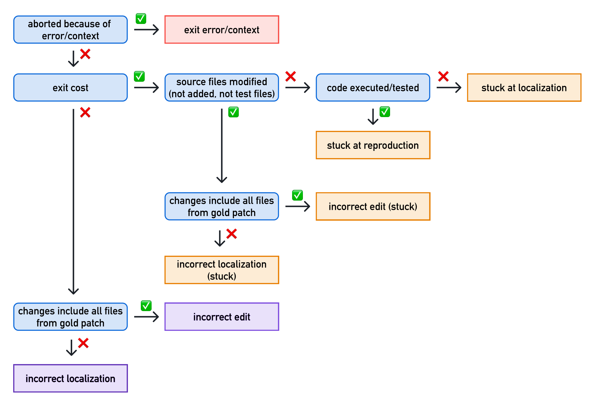

<figcaption>図26: 失敗モードの分類。</figcaption>
</figure>

#### F.5.4 Mitigating repetitive actions（繰り返しの行動の緩和）

第 4 節で述べたとおり、SWE-agent-LM-32B は未解決のインスタンスで非常に繰り返しの多い行動をしばしば示す。これを踏まえると、エージェントの足場の介入を使って問題を緩和し、成功率を上げられるかを調べることは有望に思える。

エージェントの足場に次の変更を加える。

- 基本コマンドが 4 回（str\_replace\_editor の view）または 6 回（他の任意の基本コマンド）繰り返されたら、観測（コマンドの出力）に警告メッセージを追加する。警告メッセージは異なるコマンドを試すよう助言し、特に find や grep を使って関連する文脈を見つけるよう提案する。
- 警告メッセージが繰り返しの基本コマンドの列を断ち切らず、繰り返しの長さが 6（str\_replace\_editor の view）または 8（他の任意の基本コマンド）に達したら、続く各行動を最大 10 回再サンプリングし、以前のものと異なる最初の基本コマンドで止める。循環を断ち切る可能性をさらに高めるため、繰り返しの長さが 7 または 9 に達したら、アシスタントのメッセージを注入するか温度を上げる。

これは繰り返しの行動の数を効果的に減らす（図 27 参照）。しかし、解決したインスタンスの全体の数は 192（38.4%）にわずかに下がる。上の戦略の変種も同様の結果をもたらす。繰り返しは抑えられるが、成功率は大きくは改善しない。これは、繰り返しの行動は、本質的な失敗モードをなすというより、インスタンスを解くことについてのモデルの困難（インスタンスが分布外であるか特に難しい場合など）の症状として理解するほうがよいことを示唆しているのかもしれない。

<figure>

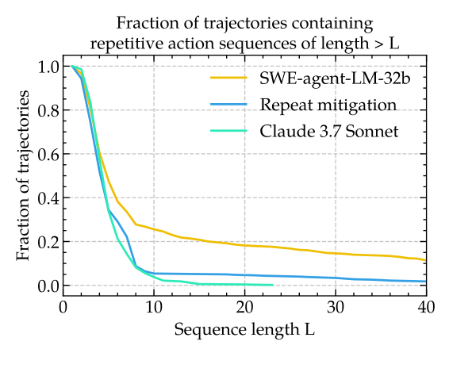

<figcaption>図27: 足場の介入は、繰り返しの行動の数を劇的に減らせる。［訳注: 画像はクリップで欠落していたため PDF から切り出した］</figcaption>
</figure>

## Appendix G Miscellaneous（付録 G: その他）

**ティーザーの図の説明。** SWE-smith と SWE-bench のタスクインスタンスの収集のスケーリングを描く図 1 の左側のグラフをどう作ったかを簡単に述べる。SWE-smith については、各リポジトリのタスクインスタンスの数を単に集めた。SWE-bench については、128 のリポジトリすべてで SWE-bench のタスクインスタンスの候補の収集スクリプトを実行した。これはまず、与えられたリポジトリからすべての PR をクロールする。次に、1 つ以上の Python のファイルを編集し、1 つ以上のテストに関連するファイルを変更する各 PR が、候補のタスクインスタンスに変換される。最後に、Jimenez et al.（2024b）で報告された平均のタスクインスタンスの生成率にもとづいて、実行可能なタスクインスタンスの数を候補の 20% と見積もる。次に、5 から 250 にわたる 5 リポジトリの間隔で、n 個のリポジトリのタスクインスタンスの数を決める。ここでリポジトリはスターの数で並べる。言い換えれば、図で最初に考慮する 5 つのリポジトリは、使った 128 のリポジトリのうちスターの数が最も少ない 5 つである。

**拡張した関連研究。** LM エージェントを訓練するための軌跡を合成することについての同様の研究、ただし Web のタスクの領域についての研究を主に簡単に論じる。オープンソースの LM の対話的な能力を改善するため（Chen et al., 2023）、先行研究は Web のベンチマークと設定のための軌跡の生成の技法も探ってきた（Xie et al., 2024; Yao et al., 2023a; Zhou et al., 2024）。Web のナビゲーションについては、既存の戦略は、(1) ランダムウォークを行い、それに事後的に指示のラベルを付ける（Xiang et al., 2023; Murty et al., 2024）、(2) オンラインの Web のチュートリアルを、合成の軌跡を生成するための間接的な教師の源として使う（Ou et al., 2024）、(3) 人間の実演を集める（Shen et al., 2024; Xu et al., 2024）ことに頼っている。これらの手順はソフトウェアエンジニアリングの設定にうまく移らない。コマンドラインの相互作用のランダムな列は、通常、コードベースに意味のある効果を達成しない。オンラインのコードの編集の列（例: GitHub のコミットの履歴）から合成した軌跡を再生することについての私たちのざっとした取り組みは、利用できる情報が限られているためにうまくいかなかった。それらは主にファイルレベルの変更を捉え、ソフトウェア開発の過程の根底にある技能、意思決定、より広い文脈を反映しないからである。

リポジトリのインストールとテストの指定を自動で決めるために SWE-agent を使う私たちの探究は、2 つの研究の方向——LM を使った実行環境の自動構築（Bogin et al., 2024; Eliseeva et al., 2025; Vergopoulos et al., 2025）と、LM を使った単体テストの生成（Mündler et al., 2025）——に大きく影響されている。SWE-bench 形式の収集と比べれば比較的はるかに少ないが、SWE-smith はなお最小限の量の人手の労働（リポジトリあたり合計約 8 分）を必要とする。SWE-smith をより多くのリポジトリと言語に広げるにつれて、環境の構築の過程をエンドツーエンドで完全に自動化する方法を引き続き検討している。
