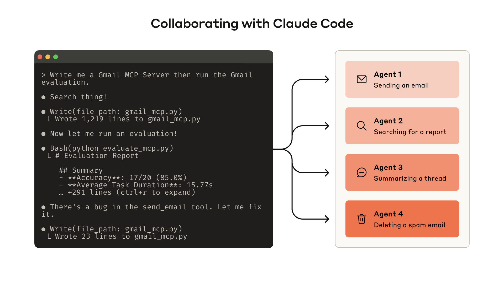
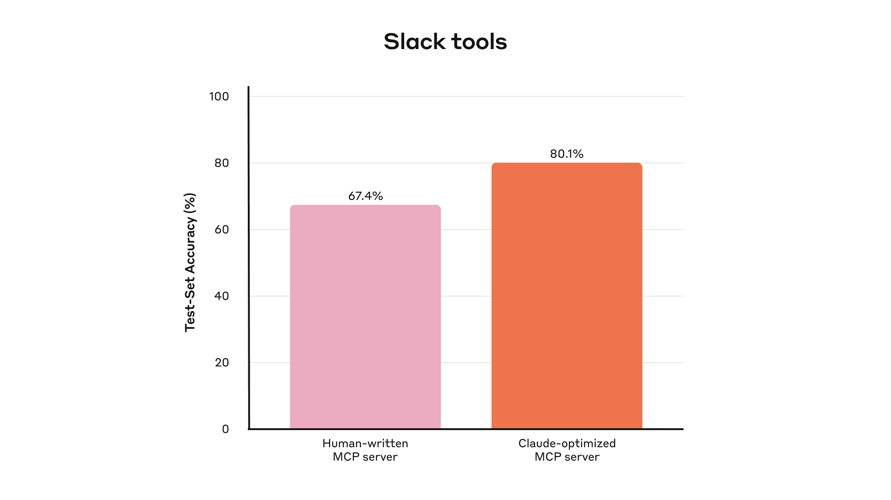
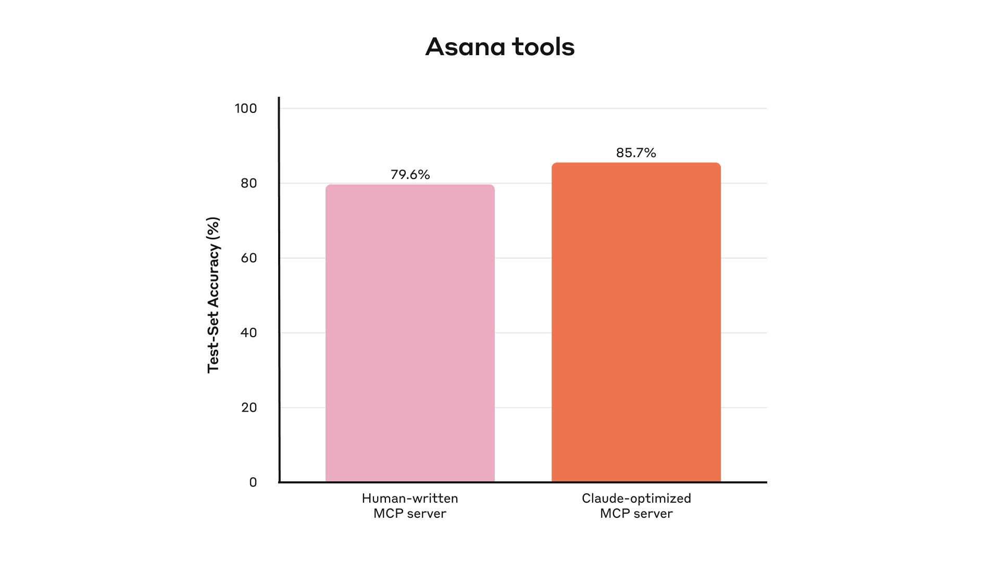
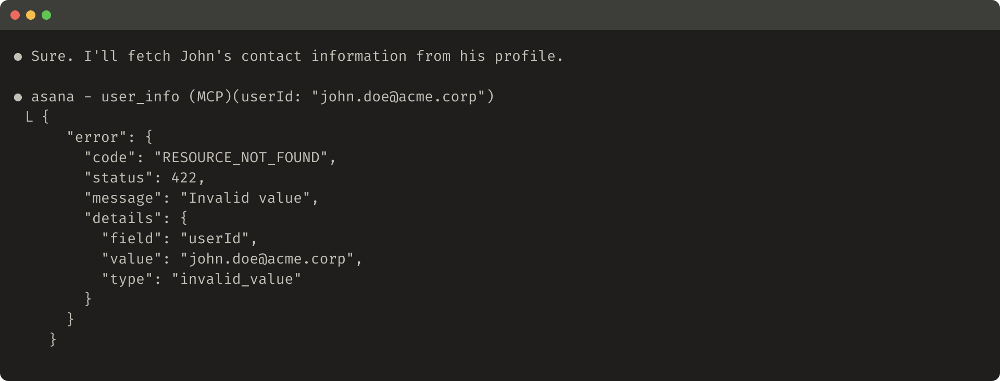
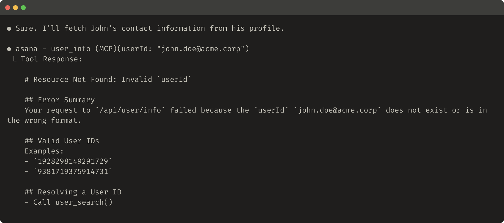

# AI エージェントのための効果的なツールを書く——エージェントと一緒に

> 原題: Writing effective tools for AI agents（原ページの見出しは "Writing effective tools for agents — with agents"）
> 著者: Anthropic（執筆は Ken Aizawa。謝辞より）
> 出典: https://www.anthropic.com/research/writing-tools-for-agents ・ 2025-09-11

> ［訳注］Obsidian Web Clipper のクリップを底本とし、原ページ（2026-10-25 取得）と照合した。本文の欠落はない。**脚注 1 の本文がクリップから欠落していた**（本文に `<sup>1</sup>` のマーカーだけが残っていた）ので、原ページから "Beyond training the underlying LLMs themselves." を復元し、該当箇所に置いた。本文の画像 8 枚は原ページの CDN から取得して `raw/assets/2025-writing-effective-tools/` に保存した。うち図 4〜8 はツール応答のスクリーンショットなので、画像の直後に内容をテキストでも起こしている（画像とテキストが食い違う場合は画像が正）。原ページの装飾イラストは収録していない。末尾の謝辞は既定どおり訳出しない。

[Model Context Protocol（MCP）](https://modelcontextprotocol.io/docs/getting-started/intro) は、現実世界のタスクを解くために、LLM エージェントに潜在的には数百ものツールを与えることを可能にする。しかし、そうしたツールを最大限に効果的にするにはどうすればよいのだろうか。

本稿では、さまざまなエージェント的 AI システムの性能を改善するために私たちが用いてきた、最も効果的な技法を説明する[^1]。

[^1]: 基盤となる LLM そのものを訓練すること以外で（Beyond training the underlying LLMs themselves.）。［訳注: 復元］

まず、次の方法を扱う。

- ツールのプロトタイプを作ってテストする
- エージェントを使って、ツールの包括的な評価を作成し実行する
- Claude Code のようなエージェントと協働して、ツールの性能を自動的に高める

最後に、その過程で私たちが見出した、質の高いツールを書くための主要な原則で締めくくる。

- 実装すべき（そして実装すべきでない）ツールを選ぶ
- ツールに名前空間を与え、機能の境界を明確に定める
- ツールからエージェントへ意味のある文脈を返す
- ツールの応答をトークン効率のために最適化する
- ツールの説明文と仕様をプロンプトエンジニアリングする

<figure>



<figcaption>図1: エンジニアが Claude Code を使ってエージェント用ツールの有効性を評価する様子を描いた画像。左のターミナルでは「Gmail MCP サーバーを書いて、Gmail の評価を実行して」という指示に対し、Claude Code が gmail_mcp.py（1,219 行）を書き、評価（正解率 17/20 = 85.0%、平均タスク時間 15.77 秒）を実行し、send_email ツールのバグを見つけて 23 行を修正する。右は評価で並行に走るエージェント（メール送信・レポート検索・スレッド要約・スパム削除）。</figcaption>
</figure>

評価を構築すれば、ツールの性能を体系的に測定できる。Claude Code を使って、この評価に照らしてツールを自動的に最適化することもできる。

## What is a tool?（ツールとは何か）

計算の世界では、決定論的なシステムは同一の入力に対して毎回同じ出力を生み出すが、エージェントのような*非決定論的*なシステムは、同じ開始条件であっても多様な応答を生成しうる。

従来ソフトウェアを書くとき、私たちは決定論的なシステム同士の間に契約を定めている。たとえば `getWeather(“NYC”)` のような関数呼び出しは、呼び出されるたびに毎回まったく同じ方法でニューヨーク市の天気を取得する。

ツールは、決定論的なシステムと非決定論的なエージェントの間の契約を反映する、新しい種類のソフトウェアである。ユーザーが「今日は傘を持っていくべき？」と尋ねたとき、エージェントは天気ツールを呼ぶかもしれないし、一般知識から答えるかもしれないし、あるいはまず場所について確認の質問をするかもしれない。ときにはエージェントが幻覚を起こしたり、ツールの使い方すら把握できなかったりすることもある。

これは、エージェント向けのソフトウェアを書くアプローチを根本から考え直すことを意味する。ツールや [MCP サーバー](https://modelcontextprotocol.io/) を、他の開発者やシステム向けに関数や API を書くのと同じやり方で書くのではなく、エージェントのために設計する必要がある。

私たちの目標は、ツールを使ってさまざまな成功戦略を追求できるようにすることで、エージェントが幅広いタスクを解くうえで効果を発揮できる範囲を広げることである。幸いなことに、私たちの経験では、エージェントにとって最も「使いやすい（ergonomic）」ツールは、人間にとっても驚くほど直観的に理解できるものになる。

## How to write tools（ツールの書き方）

この節では、エージェントに与えるツールを書くことと改善することの両方で、エージェントとどう協働できるかを説明する。まずツールの手早いプロトタイプを立ち上げ、ローカルでテストする。次に、その後の変更を測定するための包括的な評価を実行する。エージェントと並んで作業しながら、エージェントが現実世界のタスクで強い性能を達成するまで、ツールの評価と改善のプロセスを繰り返せる。

### Building a prototype（プロトタイプを作る）

自分で手を動かしてみなければ、エージェントがどのツールを使いやすいと感じ、どのツールをそう感じないかを予測するのは難しい。まずはツールの手早いプロトタイプを立ち上げよう。ツールを書くのに [Claude Code](https://www.anthropic.com/claude-code) を使っている場合（場合によっては一発で書ける）、ツールが依存するソフトウェアライブラリ・API・SDK（場合によっては [MCP SDK](https://modelcontextprotocol.io/docs/sdk) も含む）のドキュメントを Claude に与えると役立つ。LLM に優しいドキュメントは、公式ドキュメントサイトにあるフラットな `llms.txt` ファイルで見つかることが多い（私たちの [API のもの](https://docs.anthropic.com/llms.txt)はこちら）。

ツールを[ローカルの MCP サーバー](https://modelcontextprotocol.io/docs/develop/connect-local-servers)や [Desktop extension](https://www.anthropic.com/engineering/desktop-extensions)（DXT）で包めば、Claude Code や Claude Desktop アプリでツールを接続してテストできるようになる。

ローカルの MCP サーバーを Claude Code に接続するには、`claude mcp add <name> <command> [args...]` を実行する。

ローカルの MCP サーバーまたは DXT を Claude Desktop アプリに接続するには、それぞれ `Settings > Developer` または `Settings > Extensions` に移動する。

ツールは、プログラムによるテストのために [Anthropic API](https://docs.anthropic.com/en/docs/agents-and-tools/tool-use/overview) の呼び出しに直接渡すこともできる。

ツールを自分でテストして、粗い部分を見つけよう。ユーザーからフィードバックを集め、ツールで可能にしたいと想定しているユースケースとプロンプトについての直観を育てよう。

### Running an evaluation（評価を実行する）

次に、評価を実行して、Claude があなたのツールをどれだけうまく使えるかを測定する必要がある。まず、現実世界の用途に根ざした評価タスクを大量に生成することから始める。結果を分析し、ツールをどう改善するかを決めるのにエージェントと協働することを推奨する。このプロセスの全体像は、私たちの[ツール評価の cookbook](https://platform.claude.com/cookbook/tool-evaluation-tool-evaluation) で見られる。

<figure>



<figcaption>図2: 私たちの社内 Slack ツールの held-out テスト集合での性能。人手で書いた MCP サーバーのテスト集合正解率 67.4% に対し、Claude が最適化した MCP サーバーは 80.1%。</figcaption>
</figure>

#### Generating evaluation tasks（評価タスクを生成する）

初期のプロトタイプがあれば、Claude Code はツールを素早く探索し、何十ものプロンプトと応答の対を作ることができる。プロンプトは現実世界の用途に着想を得たもので、現実的なデータソースやサービス（たとえば社内のナレッジベースやマイクロサービス）に基づくべきである。十分な複雑さでツールに負荷をかけない、単純すぎたり表面的だったりする「サンドボックス」環境は避けることを推奨する。強い評価タスクは複数回のツール呼び出し——場合によっては数十回——を要するかもしれない。

強いタスクの例を挙げる。

- Schedule a meeting with Jane next week to discuss our latest Acme Corp project. Attach the notes from our last project planning meeting and reserve a conference room.（来週 Jane と、最新の Acme Corp プロジェクトについて話し合う会議を設定して。前回のプロジェクト計画会議のメモを添付し、会議室を予約して。）
- Customer ID 9182 reported that they were charged three times for a single purchase attempt. Find all relevant log entries and determine if any other customers were affected by the same issue.（顧客 ID 9182 が、1 回の購入で 3 回請求されたと報告した。関連するログエントリをすべて見つけ、同じ問題で影響を受けた他の顧客がいないか判断して。）
- Customer Sarah Chen just submitted a cancellation request. Prepare a retention offer. Determine: (1) why they're leaving, (2) what retention offer would be most compelling, and (3) any risk factors we should be aware of before making an offer.（顧客の Sarah Chen が解約申請を出したところだ。引き留めの提案を準備して。(1) なぜ離れるのか、(2) どの引き留め提案が最も説得力があるか、(3) 提案する前に把握しておくべきリスク要因、を判断して。）

そして、より弱いタスクの例を挙げる。

- Schedule a meeting with jane@acme.corp next week.（来週 jane@acme.corp との会議を設定して。）
- Search the payment logs for `purchase_complete` and `customer_id=9182`.（支払いログから `purchase_complete` と `customer_id=9182` を検索して。）
- Find the cancellation request by Customer ID 45892.（顧客 ID 45892 の解約申請を見つけて。）

各評価プロンプトには、検証可能な応答または結果を対にするべきである。検証器は、正解とサンプリングされた応答の間の厳密な文字列比較のような単純なものでもよいし、Claude に応答を判定させるような高度なものでもよい。書式・句読点・妥当な別表現といった本質的でない違いを理由に正しい応答を却下してしまう、厳しすぎる検証器は避けよう。

各プロンプトと応答の対について、タスクを解く際にエージェントが呼ぶと期待するツールを任意で指定しておくこともできる。そうすれば、評価中にエージェントが各ツールの目的を把握できているかどうかを測れる。ただし、タスクを正しく解く妥当な経路は複数ありうるので、戦略を過剰に指定したり、それに過適合したりすることは避けるようにしよう。

#### Running the evaluation（評価を実行する）

評価は、LLM API を直接呼び出してプログラムで実行することを推奨する。単純なエージェントループ（LLM API の呼び出しとツールの呼び出しを交互に行う `while` ループ）を、評価タスクごとに 1 つずつ使う。各評価エージェントには、1 つのタスクプロンプトとあなたのツールを与える。

評価エージェントのシステムプロンプトでは、（検証のための）構造化された応答ブロックだけでなく、推論とフィードバックのブロックも出力するようエージェントに指示することを推奨する。これらをツール呼び出しと応答のブロックの*前に*出力するよう指示すると、思考の連鎖（chain-of-thought, CoT）の振る舞いを引き起こすことで、LLM の実効的な知能が高まる可能性がある。

Claude で評価を実行しているなら、[interleaved thinking](https://docs.anthropic.com/en/docs/build-with-claude/extended-thinking#interleaved-thinking) を有効にすれば、同様の機能を「そのまま」得られる。これは、エージェントがなぜ特定のツールを呼ぶ（または呼ばない）のかを探り、ツールの説明文や仕様のどこを改善すべきかを浮き彫りにする助けになる。

最上位の正解率に加えて、個々のツール呼び出しとタスクの合計実行時間、ツール呼び出しの総数、トークンの総消費量、ツールのエラーといった他の指標も集めることを推奨する。ツール呼び出しを追跡すると、エージェントがたどる共通のワークフローが明らかになり、ツールを統合する機会が見つかることがある。

<figure>



<figcaption>図3: 私たちの社内 Asana ツールの held-out テスト集合での性能。人手で書いた MCP サーバーのテスト集合正解率 79.6% に対し、Claude が最適化した MCP サーバーは 85.7%。</figcaption>
</figure>

#### Analyzing results（結果を分析する）

エージェントは、矛盾したツールの説明文から非効率なツールの実装、紛らわしいツールのスキーマまで、あらゆる問題を見つけてフィードバックを返してくれる頼もしいパートナーである。ただし、エージェントがフィードバックや応答で*書かなかったこと*のほうが、書いたことよりも重要な場合が多いことを覚えておこう。LLM は必ずしも[思っていることを言う](https://www.anthropic.com/research/tracing-thoughts-language-model)わけではない。

エージェントがどこで行き詰まったり混乱したりするかを観察しよう。評価エージェントの推論とフィードバック（または CoT）を読み通して、粗い部分を特定しよう。生のトランスクリプト（ツール呼び出しとツールの応答を含む）をレビューして、エージェントの CoT に明示的に書かれていない振る舞いを捉えよう。行間を読もう。評価エージェントは正解や正しい戦略を必ずしも知っているわけではないことを忘れないように。

ツール呼び出しの指標を分析しよう。冗長なツール呼び出しが多ければ、ページネーションやトークン上限のパラメータを適正な大きさに調整すべきことを示唆しているかもしれない。不正なパラメータによるツールエラーが多ければ、ツールにより明確な説明文やより良い例が必要なことを示唆しているかもしれない。Claude の [web 検索ツール](https://www.anthropic.com/news/web-search)を公開したとき、私たちは Claude がツールの `query` パラメータに不必要に `2025` を付け加えており、それが検索結果を偏らせて性能を劣化させていることに気づいた（私たちはツールの説明文を改善することで Claude を正しい方向へ導いた）。

### Collaborating with agents（エージェントと協働する）

結果を分析してツールを改善する作業を、エージェントに任せることさえできる。評価エージェントのトランスクリプトを単純に連結して、Claude Code に貼り付ければよい。Claude はトランスクリプトの分析と、多数のツールの一括リファクタリングの専門家である——たとえば、新しい変更が加えられたときに、ツールの実装と説明文が自己一貫性を保つようにすることができる。

実際、本稿の助言の大半は、Claude Code で私たちの社内ツールの実装を繰り返し最適化する中から得られたものである。私たちの評価は社内のワークスペースの上に作られ、実際のプロジェクト・文書・メッセージを含む、私たちの社内ワークフローの複雑さを反映していた。

私たちは「訓練」用の評価に過適合しないよう、held-out テスト集合に頼った。これらのテスト集合は、「専門家」によるツールの実装——研究者が手で書いたものであれ、Claude 自身が生成したものであれ——で達成した水準をさらに超えて、追加の性能改善を引き出せることを明らかにした。

次の節では、このプロセスから学んだことの一部を共有する。

## Principles for writing effective tools（効果的なツールを書くための原則）

この節では、私たちの学びを、効果的なツールを書くためのいくつかの指導原則に凝縮する。

### Choosing the right tools for agents（エージェントにとって適切なツールを選ぶ）

ツールが多ければ常に良い結果につながるわけではない。私たちが観察してきたよくある誤りは、既存のソフトウェア機能や API エンドポイントを——そのツールがエージェントに適切かどうかにかかわらず——単に包んだだけのツールである。これは、エージェントが従来のソフトウェアとは異なる「アフォーダンス（affordances）」を持つためである。つまり、エージェントはそれらのツールでとりうる行動を、異なる仕方で知覚する。

LLM エージェントは限られた「コンテキスト」を持つ（つまり、一度に処理できる情報の量には限りがある）のに対し、コンピュータのメモリは安価で豊富である。アドレス帳から連絡先を探すタスクを考えてみよう。従来のソフトウェアプログラムは、連絡先のリストを 1 件ずつ効率的に格納・処理し、各件を確認してから次へ進むことができる。

しかし、LLM エージェントがすべての連絡先を返すツールを使い、そのあと 1 件 1 件をトークン単位で読み通さなければならないとしたら、限られたコンテキスト空間を無関係な情報に浪費していることになる（アドレス帳で連絡先を探すのに、各ページを上から下まで読む——つまり総当たり探索をする——ことを想像してほしい）。より良く自然なアプローチは（エージェントにとっても人間にとっても）、まず関連するページへ飛ぶ（たとえばアルファベット順で見つける）ことである。

私たちは、評価タスクに合致する、特定の影響の大きいワークフローを狙った少数のよく考えられたツールを作り、そこから規模を広げていくことを推奨する。アドレス帳の例なら、`list_contacts` ツールの代わりに `search_contacts` や `message_contact` ツールを実装することを選ぶかもしれない。

ツールは機能を統合し、内部で潜在的には*複数の*個別の操作（または API 呼び出し）を扱うことができる。たとえば、ツールは関連するメタデータでツールの応答を充実させたり、頻繁に連鎖する多段のタスクを 1 回のツール呼び出しで処理したりできる。

いくつか例を挙げる。

- `list_users`・`list_events`・`create_event` のツールを実装する代わりに、空き状況を見つけて予定を入れる `schedule_event` ツールの実装を検討する。
- `read_logs` ツールを実装する代わりに、関連するログ行と周辺の文脈だけを返す `search_logs` ツールの実装を検討する。
- `get_customer_by_id`・`list_transactions`・`list_notes` のツールを実装する代わりに、顧客の最近の関連情報をすべて一度にまとめる `get_customer_context` ツールを実装する。

作るツールそれぞれが、明確で他と区別された目的を持つようにしよう。ツールは、同じ基盤リソースへのアクセスを与えられた人間がそうするのとほぼ同じ仕方で、エージェントがタスクを分割して解けるようにすべきであり、同時に、本来なら中間出力で消費されていたであろうコンテキストを減らすべきである。

ツールが多すぎたり重複していたりすると、エージェントが効率的な戦略を追求する妨げにもなりうる。作る（あるいは作らない）ツールを慎重かつ選択的に計画することは、大きな見返りをもたらしうる。

### Namespacing your tools（ツールに名前空間を与える）

あなたの AI エージェントは、他の開発者によるものも含め、何十もの MCP サーバーと何百もの異なるツールへのアクセスを得る可能性がある。ツールの機能が重複していたり、目的が曖昧だったりすると、エージェントはどれを使うべきか混乱しうる。

名前空間（関連するツールを共通のプレフィックスの下にまとめること）は、多数のツールの間の境界を描き分ける助けになる。MCP クライアントは既定でこれを行うこともある。たとえば、サービス別（例: `asana_search`、`jira_search`）やリソース別（例: `asana_projects_search`、`asana_users_search`）にツールの名前空間を分けると、エージェントが適切なときに適切なツールを選ぶ助けになる。

プレフィックス方式とサフィックス方式の名前空間のどちらを選ぶかが、私たちのツール利用評価に無視できない影響を与えることがわかっている。効果は LLM によって異なるので、自分自身の評価に従って命名方式を選ぶことを勧める。

エージェントは、誤ったツールを呼んだり、正しいツールを誤ったパラメータで呼んだり、呼ぶツールが少なすぎたり、ツールの応答を誤って処理したりする可能性がある。名前がタスクの自然な分割を反映するツールを選択的に実装することで、エージェントのコンテキストに読み込まれるツールとツール説明文の数を減らすと同時に、エージェント的な計算をエージェントのコンテキストからツール呼び出しそのものへと移すことができる。これにより、エージェントが誤りを犯す全体的なリスクが減る。

### Returning meaningful context from your tools（ツールから意味のある文脈を返す）

同じ流れで、ツールの実装は、信号の強い情報だけをエージェントに返すよう注意すべきである。柔軟性よりも文脈上の関連性を優先し、低レベルの技術的な識別子（たとえば `uuid`、`256px_image_url`、`mime_type`）を避けるべきである。`name`、`image_url`、`file_type` のようなフィールドのほうが、エージェントの下流の行動や応答に直接役立つ可能性がはるかに高い。

エージェントはまた、暗号のような識別子よりも、自然言語の名前・用語・識別子のほうをはるかにうまく扱える傾向がある。任意の英数字の UUID を、意味的により意味がありより解釈しやすい言語（あるいは 0 始まりの ID 方式でさえ）に解決するだけで、幻覚が減ることにより、検索タスクにおける Claude の精度が大きく向上することがわかっている。

場合によっては、たとえ下流のツール呼び出しを起動するためだけであっても、エージェントが自然言語と技術的識別子の両方の出力を扱える柔軟性を必要とすることがある（たとえば `search_user(name=’jane’)` → `send_message(id=12345)`）。ツールに単純な `response_format` の列挙型パラメータを公開し、ツールが `“concise”`（簡潔）と `“detailed”`（詳細）のどちらの応答を返すかをエージェントが制御できるようにすれば、両方を可能にできる（下の画像を参照）。

GraphQL で受け取りたい情報を正確に選べるのと同様に、さらに柔軟にするためにより多くの形式を追加することもできる。以下は、ツールの応答の冗長さを制御する ResponseFormat 列挙型の例である。

```
enum ResponseFormat {
   DETAILED = "detailed",
   CONCISE = "concise"
}
```

以下は詳細なツール応答の例である（206 トークン）。

<figure>


<figcaption>図4: 詳細なツール応答の例を示すコードスニペット（206 トークン）。Slack 検索ツールを responseFormat: "detailed" で呼び、各結果にチャンネル ID・ユーザー ID・タイムスタンプ（TS）を含めて返している。</figcaption>
</figure>

```
● I'll search slack for recent bug reports and use the detailed format to see which channel IDs and threads to investigate further.

● slack - search (MCP)(query: "bug", sort: "timestamp", sortDir: "desc", limit: 100, responseFormat: "detailed")
  L Search results for: "bug"

    === Result 1 of 89 ===
    Channel: #dev (C1234567890)
    From: @jane.doe (U123456789)
    Time: 2024-01-15 10:30:45 UTC
    TS: 1705316445.123456
    Text: Found a critical bug in the login flow.

    === Result 2 of 89 ===
    Channel: DM with @john.smith
    From: @john.smith (U987654321)
    Time: 2024-01-14 15:22:18 UTC
    TS: 1705247738.234567
    Text: The bug report for issue #123 is ready for review
    Files: bug-report-123.pdf
    ...
```

以下は簡潔なツール応答の例である（72 トークン）。

<figure>


<figcaption>図5: 簡潔なツール応答を示すコードスニペット（72 トークン）。同じ検索を responseFormat: "concise" で呼び、ID を省いてチャンネル・投稿者・本文・日付だけを 1 行ずつ返している。</figcaption>
</figure>

```
● I'll search slack for recent bug reports and use the concise format to read as many messages as possible.

● slack - search (MCP)(query: "bug", sort: "timestamp", sortDir: "desc", limit: 100, responseFormat: "concise")
  L Search: "bug" (89 results)

    1. #dev - @jane.doe: Found a critical bug in the login flow. [Jan 15]
    2. DM - @john.smith: The bug report for issue #123 is ready for review [Jan 14]
    ...
```

Slack のスレッドとスレッドの返信は一意の thread_ts で識別され、これはスレッドの返信を取得するのに必要である。thread_ts や他の ID（channel_id、user_id）は「detailed」のツール応答から取得でき、それらを必要とするさらなるツール呼び出しを可能にする。「concise」のツール応答はスレッドの内容だけを返し、ID を除外する。この例では、ツール応答で約 ⅓ のトークンしか使っていない。

ツール応答の構造——たとえば XML、JSON、Markdown——でさえ、評価の性能に影響しうる。万能の解決策はない。これは、LLM が次トークン予測で訓練されており、訓練データに合致する形式でより良く機能する傾向があるためである。最適な応答構造は、タスクやエージェントによって大きく異なる。自分自身の評価に基づいて最良の応答構造を選ぶことを勧める。

### Optimizing tool responses for token efficiency（ツールの応答をトークン効率のために最適化する）

文脈の質を最適化することは重要である。しかし、ツールの応答でエージェントに返す文脈の*量*を最適化することも同様に重要である。

大量のコンテキストを使い果たしうるツール応答については、ページネーション・範囲選択・フィルタリング・切り詰めを、適切な既定パラメータ値とともに組み合わせて実装することを提案する。Claude Code では、ツール応答を既定で 25,000 トークンに制限している。エージェントの実効的なコンテキスト長は時とともに伸びると予想しているが、コンテキスト効率の良いツールの必要性は残るだろう。

応答を切り詰めることを選ぶなら、役に立つ指示でエージェントを導くようにしよう。知識検索タスクで 1 回の広い検索をする代わりに、小さく的を絞った検索を多数行うといった、よりトークン効率の良い戦略をとるようエージェントに直接促すことができる。同様に、ツール呼び出しがエラーを起こした場合（たとえば入力検証の際）、不透明なエラーコードやトレースバックではなく、具体的で実行可能な改善を明確に伝えるようにエラー応答をプロンプトエンジニアリングできる。

以下は切り詰められたツール応答の例である。

<figure>


<figcaption>図6: 切り詰められたツール応答の例を示す画像。Stripe の取引検索で 2,847 件が一致したが、先頭 3 件だけを表で示し、全件の要約（総収益・期間）と、結果を絞り込む具体的な呼び出し方（取引先指定・金額範囲・次ページ）を添えている。</figcaption>
</figure>

```
● I'll find all of your transactions on Stripe and provide a summary for you.

● stripe - transactions_search (MCP)(limit: 5000, responseFormat: "concise")
  L ## Transaction Search Results

    Found **2,847 transactions** matching your query.

    The results are truncated. Showing first 3 results:

    | Date | Description | Amount | Category |
    ├────────┼──────────────┼────────┼──────────┤
    | 2024-01-15 | Payment from Acme Corp | +$5,200.00 | Revenue |
    | 2024-01-14 | Payment from TechStart | +$3,100.00 | Revenue |
    | 2024-01-13 | Payment from Cloud Co. | +$3,100.00 | Revenue |

    **Summary of all 2,847 results:**
    - Total Revenue: $458,291.00
    - Date Range: Jan 1 - Jan 15, 2024

    ## To refine these results, you can:

    - **Search for specific vendors**: Use `transactions_search(payee: "Acme Corp")` to see only Acme Corp charges
    - **Filter by amount range**: Use `transactions_search(minAmount: 1000, maxAmount: 5000)`
    - **Get next page**: Use `transactions_search(query: <query>, page: 2)`
```

以下は役に立たないエラー応答の例である。

<figure>



<figcaption>図7: 役に立たないツール応答の例を示す画像。Asana の user_info をメールアドレスで呼んだ結果、エラーコード・ステータス・"Invalid value" だけの JSON が返り、何をどう直せばよいかが分からない。</figcaption>
</figure>

```
● Sure. I'll fetch John's contact information from his profile.

● asana - user_info (MCP)(userId: "john.doe@acme.corp")
  L {
      "error": {
        "code": "RESOURCE_NOT_FOUND",
        "status": 422,
        "message": "Invalid value",
        "details": {
          "field": "userId",
          "value": "john.doe@acme.corp",
          "type": "invalid_value"
        }
      }
    }
```

以下は役に立つエラー応答の例である。

<figure>



<figcaption>図8: 役に立つエラー応答の例を示す画像。同じ失敗に対して、何が起きたか（userId が存在しないか形式が誤り）、有効な ID の例、ID を解決する方法（user_search() を呼ぶ）を Markdown で返している。</figcaption>
</figure>

```
● Sure. I'll fetch John's contact information from his profile.

● asana - user_info (MCP)(userId: "john.doe@acme.corp")
  L Tool Response:

    # Resource Not Found: Invalid `userId`

    ## Error Summary
    Your request to `/api/user/info` failed because the `userId` `john.doe@acme.corp` does not exist or is in the wrong format.

    ## Valid User IDs
    Examples:
    - `1928298149291729`
    - `9381719375914731`

    ## Resolving a User ID
    - Call user_search()
```

ツールの切り詰めとエラー応答は、エージェントをよりトークン効率の良いツール利用の振る舞い（フィルタやページネーションを使う）へ導いたり、正しく整形されたツール入力の例を示したりできる。

### Prompt-engineering your tool descriptions（ツールの説明文をプロンプトエンジニアリングする）

ここで、ツールを改善する最も効果的な方法の 1 つにたどり着く。ツールの説明文と仕様をプロンプトエンジニアリングすることである。これらはエージェントのコンテキストに読み込まれるので、全体としてエージェントを効果的なツール呼び出しの振る舞いへと導くことができる。

ツールの説明文と仕様を書くときは、チームに新しく入った人にそのツールをどう説明するかを考えよう。あなたが暗黙のうちに持ち込んでいるかもしれない文脈——専門的なクエリ形式、ニッチな用語の定義、基盤リソース間の関係——を考え、それを明示しよう。期待される入力と出力を明確に記述し（そして厳格なデータモデルで強制し）て、曖昧さを避けよう。特に、入力パラメータは曖昧さなく命名すべきである。`user` という名前のパラメータの代わりに、`user_id` という名前のパラメータを試そう。

評価があれば、プロンプトエンジニアリングの効果をより確信を持って測定できる。ツールの説明文へのわずかな洗練でさえ、劇的な改善をもたらしうる。Claude Sonnet 3.5 は、私たちがツールの説明文に精密な洗練を加えたあとで [SWE-bench Verified](https://www.anthropic.com/engineering/swe-bench-sonnet) 評価における最先端の性能を達成し、エラー率を劇的に減らしてタスク完了を改善した。

ツール定義の他のベストプラクティスは、私たちの[開発者ガイド](https://docs.anthropic.com/en/docs/agents-and-tools/tool-use/implement-tool-use#best-practices-for-tool-definitions)で見られる。Claude 向けにツールを作っているなら、ツールが Claude の[システムプロンプト](https://docs.anthropic.com/en/docs/agents-and-tools/tool-use/implement-tool-use#tool-use-system-prompt)にどのように動的に読み込まれるかについて読むことも推奨する。最後に、MCP サーバー向けにツールを書いているなら、[ツールアノテーション](https://modelcontextprotocol.io/specification/2025-06-18/server/tools)が、どのツールがオープンワールドへのアクセスを要するか、あるいは破壊的な変更を加えるかを開示する助けになる。

## Looking ahead（今後に向けて）

エージェントのための効果的なツールを作るには、ソフトウェア開発の実践を、予測可能で決定論的なパターンから非決定論的なパターンへと方向転換する必要がある。

本稿で説明した反復的で評価駆動のプロセスを通じて、私たちはツールを成功させるものについて一貫したパターンを見出してきた。効果的なツールは、意図的かつ明確に定義され、エージェントのコンテキストを賢明に使い、多様なワークフローの中で組み合わせることができ、エージェントが現実世界のタスクを直観的に解けるようにする。

将来、エージェントが世界と相互作用する具体的な仕組みは進化していくと予想している——MCP プロトコルの更新から、基盤となる LLM 自体のアップグレードまで。エージェントのためのツールを改善する体系的で評価駆動のアプローチがあれば、エージェントがより有能になるにつれて、彼らが使うツールもそれとともに進化していくことを確かにできる。
