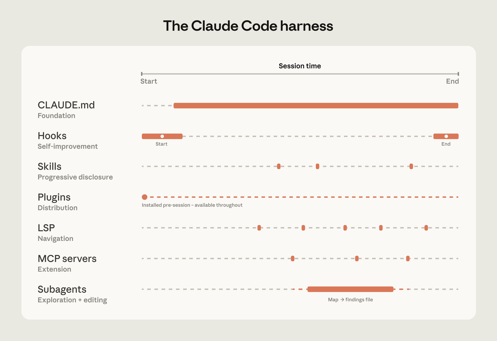
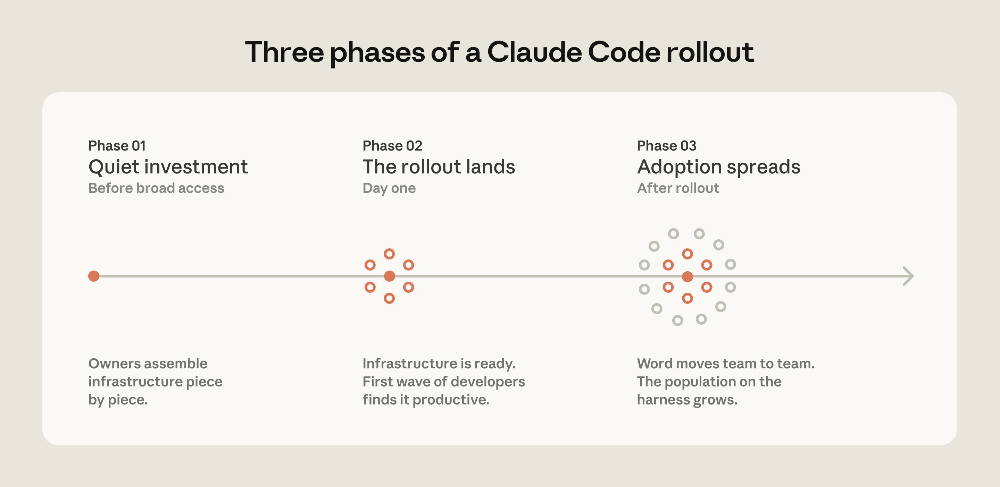
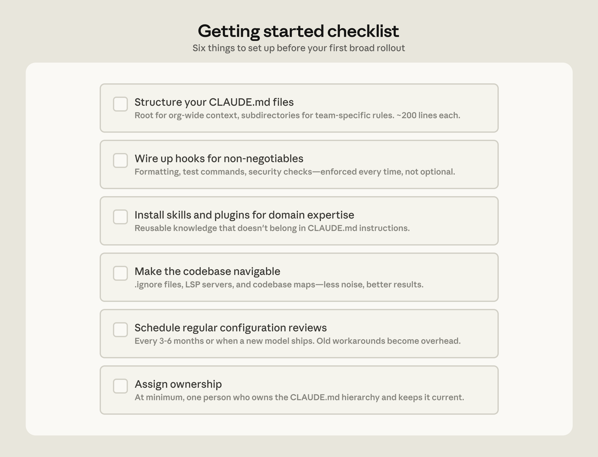

# 大規模コードベースで Claude Code はどう動くか：ベストプラクティスと始め方

> 原題: How Claude Code works in large codebases: Best practices and where to start
> 著者: Anthropic（Applied AI チームの知見に基づく。署名なし）
> 出典: Claude 公式サイト Resources（https://claude.com/resources/articles/how-claude-code-works-in-large-codebases-best-practices-and-where-to-start）, 2026-05-14。連載「Claude Code at scale」の 1 本

> **訳注**: 本訳は Obsidian Web Clipper によるクリップを底本とし、原ページ（英語版。クリップ元の `/ja/` の URL も本文は英語）と照合した。**本文・表に欠落はなかった**。(1) 本文画像 3 枚は原ページから取得してローカルに保存した。うちキャプションがあるのは 1 枚目だけで、2・3 枚目は原ページにもキャプションがない。3 枚目（導入チェックリスト）は文字だけの図なので、図の文言を英語原文のまま下に書き起こした。(2) 「Using `.`ignore files」の分かれた書式は原ページの HTML 自体がそうなっている（`.` と `ignore` が別々の `<code>`）ので、`.ignore` として訳した。除外: 末尾の「Get started with Claude Code for Enterprise」の誘導文と Acknowledgements（謝辞）。

Claude Code は、数百万行規模のモノレポ、何十年も前からのレガシーシステム、何十ものリポジトリにまたがる分散アーキテクチャ、そして数千人の開発者を抱える組織で、本番稼働している。こうした環境は、より小さく単純なコードベースにはない課題を突きつける。サブディレクトリごとにビルドコマンドが違うこともあれば、共通のルートを持たないフォルダ群にレガシーコードが散らばっていることもある。

本稿では、Claude Code の大規模な導入の成功につながったと我々が観察してきたパターンを扱う。「大規模コードベース」という語は、幅広い導入形態を指すものとして使う。数百万行のモノレポ、何十年もかけて築かれたレガシーシステム、別々のリポジトリに分かれた何十ものマイクロサービス、あるいはそれらの任意の組み合わせである。そこには、チームが AI コーディングツールと必ずしも結びつけて考えない言語、たとえば C、C++、C#、Java、PHP で動くコードベースも含まれる。（そうした場合でも、Claude Code は多くのチームの予想を上回る性能を出す。最近のモデルのリリース以降は特にそうである。）大規模コードベースへの導入はそれぞれ、固有のバージョン管理、チーム構成、積み重なった慣習によって形づくられるが、ここで示すパターンはそれらを越えて一般化でき、Claude Code の導入を検討しているチームにとってよい出発点になる。

## How Claude Code navigates large codebases（Claude Code は大規模コードベースをどう探索するか）

Claude Code は、ソフトウェアエンジニアと同じやり方でコードベースを探索する。ファイルシステムを辿り、ファイルを読み、grep を使って必要なものを正確に見つけ、コードベースをまたいで参照を追う。開発者のマシン上でローカルに動作し、コードベースの索引（インデックス）を構築・維持したり、サーバーにアップロードしたりする必要はない。

RAG を使った AI コーディングツールは、コードベース全体を埋め込み（embedding）にし、クエリの時点で関連するチャンクを検索することで動く。大規模になると、こうしたシステムは失敗しうる。埋め込みのパイプラインが、活発に開発を続けるエンジニアリングチームに追いつけないからである。開発者が索引に問い合わせる時点で、索引が反映しているのは、数週間前、数日前、あるいは数時間前の過去のコードベースである。すると検索は、チームが 2 週間前に名前を変えた関数を返したり、直近のスプリントで削除されたモジュールを参照したりし、しかもそのどちらについても古くなっているという兆候は示さない。

エージェント型検索（agentic search）は、こうした失敗モードを避ける。数千人のエンジニアが新しいコードをコミットしていく中で維持しなければならない埋め込みパイプラインも、集中管理の索引もない。各開発者のインスタンスは、生きている（最新の）コードベースから作業する。

しかし、この方式にはトレードオフがある。Claude がどこを見ればよいかを知るのに十分な初期コンテキストを持っているときに、最もよく機能するのである。つまり、Claude の探索の質は、コードベースがどれだけうまく整えられているか、すなわち CLAUDE.md ファイルとスキルによってコンテキストがどう層状に積まれているかによって左右される。10 億行のコードベース全体で曖昧なパターンの出現箇所をすべて探せと頼めば、作業が始まる前にコンテキストウィンドウの限界に突き当たるだろう。コードベースの整備に投資したチームは、よりよい結果を得ている。

## The harness matters as much as the model（ハーネスはモデルと同じくらい重要である）

Claude Code について最もよくある誤解の 1 つは、その能力が使用するモデルだけで決まるというものである。チームはモデルのベンチマークや、テスト課題での出来に注目する。実際には、モデルの周りに構築されたエコシステム、すなわちハーネスが、モデル単体よりも Claude Code の性能を左右する。

ハーネスは 5 つの拡張ポイント、すなわち CLAUDE.md ファイル、フック（hooks）、スキル（skills）、プラグイン（plugins）、MCP サーバーから構成され、それぞれが異なる機能を担う。各層はそれ以前に作られたものの上に積み上がるので、チームがそれらを作る順序には意味がある。さらに 2 つの機能、LSP 連携とサブエージェントがセットアップを補完する。以下では、これらの構成要素と機能がそれぞれ何をするかを説明する。

**[CLAUDE.md](https://code.claude.com/docs/en/memory) ファイルが最初に来る**。これは Claude がすべてのセッションの開始時に自動的に読み込むコンテキストファイルである。ルートのファイルは全体像を、サブディレクトリのファイルはその場所固有の慣習を担う。これらは、Claude が何をするにもうまくやるために必要なコードベースの知識を与える。タスクに関係なくすべてのセッションで読み込まれるので、広く当てはまることに絞っておけば、性能の足かせになるのを防げる。

**[フック](https://code.claude.com/docs/en/hooks-guide)はセットアップを自己改善的にする**。多くのチームはフックを、Claude が誤ったことをするのを防ぐスクリプトとして考えているが、より価値のある使い方は継続的な改善である。stop フックは、セッション中に何が起きたかを振り返り、コンテキストが新鮮なうちに CLAUDE.md の更新を提案できる。start フックはチーム固有のコンテキストを動的に読み込めるので、すべての開発者が手動の設定なしに、自分のモジュールに合ったセットアップを得られる。リンティングやフォーマットのような自動チェックについては、フックがルールを決定論的に強制し、Claude が指示を覚えていることに頼るよりも一貫した結果を生む。

**[スキル](https://code.claude.com/docs/en/skills)は、すべてのセッションを肥大化させることなく、適切な専門知識を必要に応じて使えるようにする。** 何十ものタスクの種類がある大規模コードベースでは、すべての専門知識がすべてのセッションに存在する必要はない。スキルはこれを[段階的開示（progressive disclosure）](https://platform.claude.com/docs/en/agents-and-tools/agent-skills/best-practices)によって解決する。さもなければコンテキストの領域を奪い合うことになる専門的なワークフローやドメイン知識を外に出しておき、タスクが必要としたときにだけ読み込むのである。たとえば、セキュリティレビューのスキルは Claude がコードの脆弱性を評価しているときに読み込まれ、文書処理のスキルはコード変更が行われてドキュメントの更新が必要になったときに読み込まれる。

スキルは特定のパスにスコープを限定することもでき、そうすればコードベースの関連する部分でだけ有効になる。決済サービスを所有するチームは、自分たちのデプロイスキルをそのディレクトリに結びつけておけるので、誰かがモノレポの別の場所で作業しているときにそれが自動で読み込まれることはない。

**[プラグイン](https://code.claude.com/docs/en/plugins)はうまくいくものを配布する。** 大規模コードベースの課題の 1 つは、*よい*セットアップが一部の人だけの暗黙知にとどまりうることである。プラグインはスキル、フック、MCP の設定を 1 つのインストール可能なパッケージにまとめる。そのため、新しいエンジニアが初日にそのプラグインをインストールすれば、すでに Claude を使ってきた人たちと同じコンテキストと機能をすぐに手にできる。プラグインの更新は、[管理されたマーケットプレイス](https://support.claude.com/en/articles/13837433-manage-claude-cowork-plugins-for-your-organization)を通じて組織全体に配布できる。

たとえば、我々が協業しているある大手小売企業は、Claude を社内の分析プラットフォームに接続するスキルを構築し、ビジネスアナリストが自分のワークフローを離れずに業績データを引き出せるようにした。彼らはそれを、事業部門への広範な展開の前にプラグインとして配布した。

**言語サーバープロトコル（LSP）連携は、開発者が IDE で使っているのと同じ探索手段を Claude に与える。** 大規模コードベースの IDE の多くでは、すでに LSP が動いていて、「定義へ移動」や「すべての参照を検索」を支えている。これを Claude に開放すると、シンボル単位の精度が得られる。関数呼び出しをその定義まで追い、ファイルをまたいで参照を辿り、異なる言語にある同名の関数を区別できる。それがなければ、Claude はテキストでパターンマッチングを行い、誤ったシンボルにたどり着くことがある。我々が協業したあるエンタープライズソフトウェア企業は、まさに C と C++ の探索を大規模でも信頼できるものにするために、Claude Code の展開の前に LSP 連携を全社に配備した。多言語のコードベースでは、これは最も価値の高い投資の 1 つである。

**MCP サーバーはあらゆるものを拡張する。** MCP サーバーは、Claude が他の方法では届かない社内ツール、データソース、API に接続する手段である。最も洗練されたチームは、構造化検索を Claude が直接呼び出せるツールとして公開する MCP サーバーを構築した。他のチームは、Claude を社内ドキュメント、チケット管理システム、分析プラットフォームに接続している。

**[サブエージェント](https://code.claude.com/docs/en/sub-agents)は探索と編集を分ける。** サブエージェントとは、独自のコンテキストウィンドウを持つ隔離された Claude のインスタンスであり、タスクを受け取り、作業を行い、最終結果だけを親に返す。ハーネスが整ったあと、一部のチームは読み取り専用のサブエージェントを立ち上げてサブシステムの地図を作らせ、その発見をファイルに書き出させ、それからメインのエージェントに全体像を踏まえて編集させている。

<figure>

<figcaption>Claude Code の拡張層の概観。（訳注: 図の題は「The Claude Code harness」。横軸はセッションの時間（Start〜End）で、各部品がいつ働くかを示す。CLAUDE.md（Foundation）は開始直後から終了まで、Hooks（Self-improvement）は開始時と終了時、Skills（Progressive disclosure）・LSP（Navigation）・MCP servers（Extension）は途中の点々で、Plugins（Distribution）は「Installed pre-session – available throughout」、Subagents（Exploration + editing）は途中の一区間で「Map → findings file」。）</figcaption>
</figure>

下の表は、各構成要素が何をするのか、いつ読み込まれるのか、そしてそれぞれについて我々が目にする最もよくある誤りをまとめたものである。

| 構成要素 | 何であるか | いつ読み込まれるか | 最適な用途 | よくある取り違え |
| --- | --- | --- | --- | --- |
| CLAUDE.md | Claude が自動的に読み込むコンテキストファイル | すべてのセッション | プロジェクト固有の慣習、コードベースの知識 | スキルに属する再利用可能な専門知識に使ってしまう |
| フック | 要所で実行されるスクリプト | イベントによって起動 | 一貫した振る舞いの自動化、セッションで得た学びの捕捉 | 自動で実行されるべきことにプロンプトを使ってしまう |
| スキル | 特定の種類のタスク向けにパッケージ化された指示 | 必要に応じて、関連するとき | セッションやプロジェクトをまたいで再利用できる専門知識 | 代わりにすべてを CLAUDE.md に詰め込む |
| プラグイン | スキル、フック、MCP 設定の束 | 一度設定すれば常に利用可能 | うまくいくセットアップを組織全体に配布する | よいセットアップを一部の人の暗黙知にとどめてしまう |
| 言語サーバープロトコル（LSP）\* | 言語固有のサーバーによるリアルタイムのコードインテリジェンス | 一度設定すれば常に利用可能 | 型付き言語でのシンボル単位の探索と自動のエラー検出 | 自動で有効になっていると思い込む |
| MCP サーバー | 外部のツールやデータへの接続 | 一度設定すれば常に利用可能 | 他の方法では届かない社内ツールへのアクセスを Claude に与える | 基本が機能する前に MCP 接続を作ってしまう |
| サブエージェント\* | 特定のタスクのための別個の Claude インスタンス | 呼び出されたとき | 探索と編集の分離、並列作業 | 探索と編集を同じセッションで行う |

\*LSP はプラグインの層を通じて利用する。サブエージェントは、設定される拡張ポイントというより委任の機能である。

## Three configuration patterns from successful deployments（成功した導入に見られる 3 つの設定パターン）

大規模コードベース向けに Claude Code をどう設定するかは、そのコードベースがどう構成されているかに大きく依存する。それでも、我々が観察した導入には 3 つのパターンが一貫して現れた。

### Making the codebase navigable at scale（大規模でもコードベースを探索しやすくする）

大規模コードベースで Claude が役に立てるかどうかは、適切なコンテキストを見つけられるかどうかで上限が決まる。すべてのセッションに読み込むコンテキストが多すぎれば性能が落ち、少なすぎれば Claude は手探りで探索することになる。最も効果的な導入は、コードベースを Claude にとって読み取りやすいものにするために先行投資をしている。いくつかのパターンが一貫して現れる。

- **CLAUDE.md ファイルを簡潔かつ階層的に保つ。** Claude はコードベースの中を移動するにつれて、それらを加算的に読み込む。ルートのファイルは全体像を、サブディレクトリのファイルはその場所固有の慣習を担う。ルートのファイルは、ポインタと致命的な落とし穴だけにすべきである。それ以外はすべて、やがてノイズになっていく。
- **リポジトリのルートではなく、サブディレクトリで起動する。** Claude は、タスクに実際に関係するコードベースの部分にスコープを絞ったときに最もよく機能する。モノレポでは、ツール類がルートへのアクセスを前提にしていることが多いので直感に反するように感じられるかもしれないが、Claude はディレクトリツリーを自動的に上へ辿り、途中で見つけたすべての CLAUDE.md ファイルを読み込むので、ルート階層のコンテキストが失われることはない。
- **テストとリントのコマンドをサブディレクトリごとにスコープする。** Claude が 1 つのサービスを変更しただけなのにスイート全体を実行すると、タイムアウトを引き起こし、無関係な出力でコンテキストを浪費する。サブディレクトリ階層の CLAUDE.md ファイルには、コードベースのその部分に当てはまるコマンドを明記すべきである。これは、各ディレクトリが独自のテストコマンドとビルドコマンドを持つサービス指向のコードベースでうまく機能する。ディレクトリをまたぐ依存が深いコンパイル言語のモノレポでは、サブディレクトリごとのスコープは実現しにくく、プロジェクト固有のビルド設定が必要になることがある。
- **`.ignore` ファイルを使って、生成ファイル、ビルド成果物、サードパーティのコードを除外する。** `.claude/settings.json` に `permissions.deny` ルールをコミットしておけば、除外設定がバージョン管理されるので、チームのすべての開発者が自分で設定しなくても同じようにノイズを減らせる。コードベースによっては、生成ファイルそのものが開発作業の対象になっている。コードジェネレータに取り組む開発者は、チームの他のメンバーに影響を与えずに、ローカルの設定でプロジェクト階層の除外を上書きできる。
- **ディレクトリ構造がその役目を果たさない場合は、コードベースの地図を作る。** コードが慣習的なディレクトリ構造にまとまっていない組織では、リポジトリのルートに軽量な markdown ファイルを置き、各トップレベルフォルダとそこに何があるかの 1 行の説明を並べておけば、Claude はファイルを開く前に目を通せる目次を得られる。トップレベルフォルダが数百あるコードベースでは、これは階層的なアプローチにすると最もうまくいく。ルートのファイルは最上位の構造だけを記述し、サブディレクトリの CLAUDE.md ファイルが次の階層の詳細を提供して、Claude がツリーを移動するにつれて必要に応じて読み込まれる。より単純なケースでは、Claude が参照すべき特定のファイルやディレクトリを @ でメンションすることで同じ役目を果たせる。
- **LSP サーバーを動かし、Claude が文字列ではなくシンボルで検索するようにする。** 大規模コードベースでよくある関数名を grep すると何千ものヒットが返り、Claude はどれが重要かを見極めるためにファイルを開いてコンテキストを消費する。LSP は同じシンボルを指す参照だけを返すので、Claude が何かを読む前に絞り込みが行われる。これを設定するには、自分の言語用の[コードインテリジェンスプラグイン](https://code.claude.com/docs/en/discover-plugins#code-intelligence)と、対応する言語サーバーのバイナリをインストールする必要がある。利用できるプラグインとトラブルシューティングは Claude Code のドキュメントで扱っている。

**1 つ注意点がある**。階層的な CLAUDE.md の方式でさえ破綻するエッジケースがある。たとえば、数十万のフォルダと数百万のファイルを持つコードベースや、git 以外のバージョン管理を使うレガシーシステムである。それらの課題は、本連載の今後の回で扱う。レガシー資産については、AI がいかに [*COBOL モダナイゼーションのコストの壁を破っているか*](https://claude.com/resources/articles/how-ai-helps-break-cost-barrier-cobol-modernization)を参照されたい。

### Actively maintaining CLAUDE.md files as model intelligence evolves（モデルの知能の進化に合わせて CLAUDE.md ファイルを能動的に保守する）

モデルが進化するにつれて、現在のモデルのために書いた指示が、将来のモデルにとって逆効果になりうる。Claude がかつて苦手だったパターンを乗り越えさせるために書かれた CLAUDE.md ファイルは、次のモデルが出荷されたとき、不要になるか、積極的な制約になるかのどちらかである。たとえば、すべてのリファクタリングを単一ファイルの変更に分割するよう Claude に指示する CLAUDE.md のルールは、以前のモデルが軌道を外れないようにするのには役立ったかもしれないが、新しいモデルが得意とする、ファイルをまたいだ協調的な編集を妨げてしまうだろう。

モデルの推論においてであれ、Claude Code 自体のツール類においてであれ、特定の限界を補うために作られたスキルやフックは、その限界がなくなれば負担になる。たとえば、Perforce のコードベースで p4 edit を強制するためにファイル書き込みを横取りしていたフックは、Claude Code がネイティブの Perforce モードを追加した時点で冗長になった。

チームは 3〜6 か月ごとに本格的な設定の見直しを行うことを想定しておくべきだが、大きなモデルのリリースのあとに性能が頭打ちになったと感じたときにも、見直しを行う価値がある。

### Assigning ownership for Claude Code management and adoption（Claude Code の管理と普及の担当者を決める）

技術的な設定だけでは普及は進まない。うまくやった組織は、組織の層にも投資していた。

最も速く広がった展開では、広範なアクセスの前に専任のインフラ投資があった。小さなチーム、ときにはたった 1 人が、ツール類を配線しておき、開発者が初めて触れたときにはもう Claude が開発者のワークフローに収まっているようにした。ある企業では、数人のエンジニアがプラグインと MCP の一式を構築し、それが初日から利用可能だった。別の企業では、AI コーディングツールの管理に専念するチームがまるごと、展開の開始前にインフラを整えていた。どちらの場合も、開発者の最初の体験は、苛立たしいものではなく生産的なものであり、普及はそこから広がっていった。

<figure>

<figcaption>（訳注: 原ページにキャプションなし。図の題は「Three phases of a Claude Code rollout」。Phase 01「Quiet investment」（Before broad access）: Owners assemble infrastructure piece by piece. / Phase 02「The rollout lands」（Day one）: Infrastructure is ready. First wave of developers finds it productive. / Phase 03「Adoption spreads」（After rollout）: Word moves team to team. The population on the harness grows.）</figcaption>
</figure>

今日この仕事をしているチームは、開発者体験（developer experience）や開発者生産性（developer productivity）の部門の下に置かれていることが多い。これは通常、新しいエンジニアのオンボーディングと開発者向けツールの構築を担う部門である。いくつかの組織で現れつつある役割が、エージェントマネージャーである。これは PM とエンジニアを兼ねた職能で、Claude Code のエコシステムの管理に専念する。専任のチームを持たない組織にとっての最小限の形は DRI（直接責任者）である。すなわち、Claude Code の設定に対する所有権を持ち、設定、権限ポリシー、プラグインのマーケットプレイス、CLAUDE.md の慣習について決定を下す権限を持ち、それらを最新に保つ責任を負う 1 人の人物である。

ボトムアップの普及は熱意を生むが、うまくいくものを集約する人がいなければ断片化しうる。適切な Claude Code の慣習（標準化された CLAUDE.md の階層や、厳選されたスキルとプラグインの一式など）をまとめ上げ、広めていく個人またはチームが必要である。その仕事がなければ、知識は一部の人の暗黙知にとどまり、普及は頭打ちになる。

大規模な組織、とりわけ規制産業の組織では、ガバナンスに関する問いが早い段階で持ち上がる。たとえば、どのスキルやプラグインを利用可能にするかを誰が管理するのか、何千人ものエンジニアがそれぞれ同じものを作り直すのをどう防ぐのか、AI が生成したコードが人間の書いたコードと同じレビュープロセスを通ることをどう確保するのか、といった問いである。これらに早い段階で対処するために、我々は、承認済みのスキルの限定されたセット、必須のコードレビュープロセス、限定的な初期アクセスから始め、確信が深まるにつれて拡大していくことを勧める。

最も円滑な導入を我々が観察してきたのは、エンジニアリング、情報セキュリティ、ガバナンスの代表者を集めて共に要件を定め、展開のロードマップを作る部門横断のワーキンググループを早期に立ち上げた組織である。

## Applying these patterns to your organization（これらのパターンを自分の組織に適用する）

Claude Code は、エンジニアがコードベースへの主な貢献者であり、リポジトリが Git を使い、コードが標準的なディレクトリ構造に従う、という慣習的なソフトウェアエンジニアリング環境を前提に設計されている。大規模コードベースの多くはこの型に当てはまるが、大きなバイナリアセットを抱えるゲームエンジン、慣習的でないバージョン管理を使う環境、エンジニア以外の人がコードベースに貢献する環境のような非伝統的な構成では、追加の設定作業が必要になる。我々の指針は慣習的な構成を前提としており、ここで述べたパターンは我々の多くの顧客で機能してきた。残りの複雑さには、あなたのコードベース、ツール類、組織に固有の判断が必要である。そこでは、Anthropic の Applied AI チームがエンジニアリングチームと直接協働し、これらのパターンをあなたの組織の固有の要件に落とし込む。

<figure>

<figcaption>（訳注: 原ページにキャプションなし。図の題は「Getting started checklist」。文言は下に書き起こした。）</figcaption>
</figure>

> **訳注（図の文言の書き起こし。原文のまま）**:
>
> **Getting started checklist** — Six things to set up before your first broad rollout
>
> - **Structure your CLAUDE.md files** — Root for org-wide context, subdirectories for team-specific rules. ~200 lines each.
> - **Wire up hooks for non-negotiables** — Formatting, test commands, security checks—enforced every time, not optional.
> - **Install skills and plugins for domain expertise** — Reusable knowledge that doesn't belong in CLAUDE.md instructions.
> - **Make the codebase navigable** — .ignore files, LSP servers, and codebase maps—less noise, better results.
> - **Schedule regular configuration reviews** — Every 3-6 months or when a new model ships. Old workarounds become overhead.
> - **Assign ownership** — At minimum, one person who owns the CLAUDE.md hierarchy and keeps it current.
