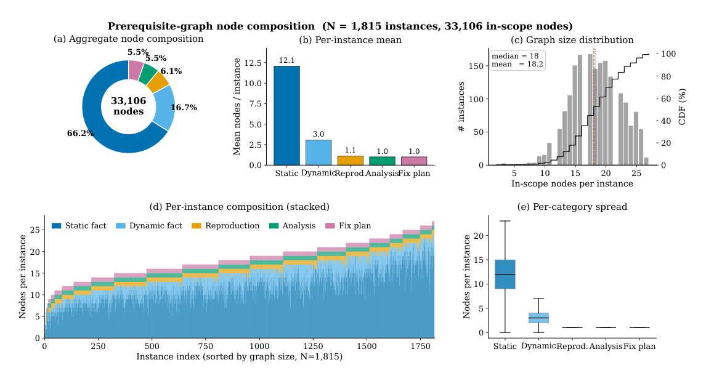
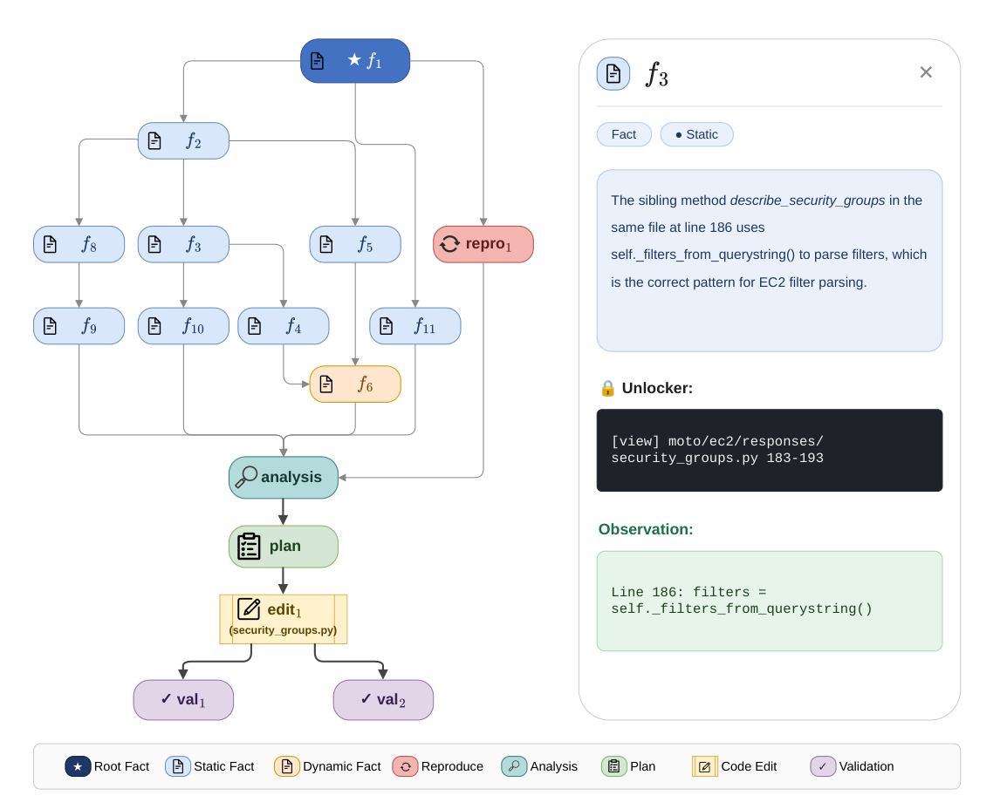
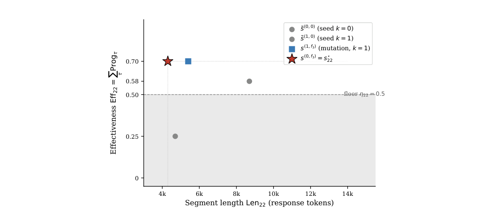
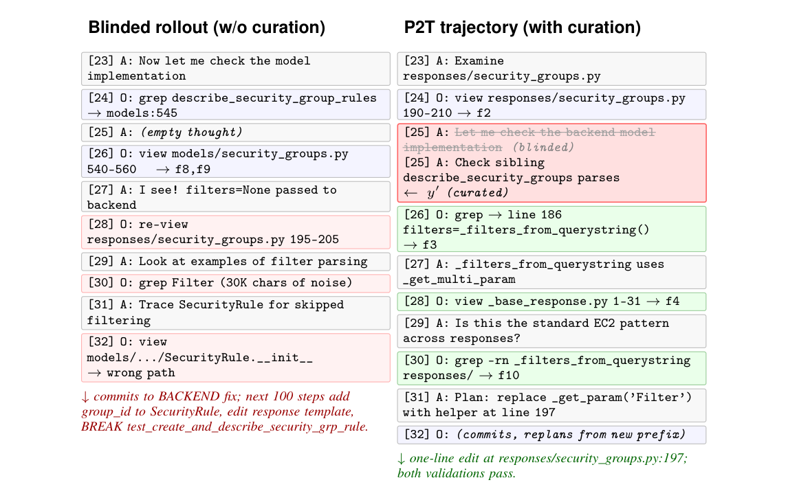

# パッチから軌跡へ: ソフトウェアエンジニアリングエージェントのための特権的なプロセス監督

> 原題: From Patches to Trajectories: Privileged Process Supervision for Software-Engineering Agents
> 著者: Murong Ma¹（Microsoft Research でのインターン中の研究）, Tianyu Chen²†, Yun Lin³†, Shuai Lu², Qinglin Zhu⁴, Yeyun Gong²†, Zhiyong Huang¹, Peng Cheng², Yan Lu², Jin Song Dong¹（¹National University of Singapore（シンガポール国立大学）、²Microsoft Research Asia、³Shanghai Jiao Tong University（上海交通大学）、⁴King's College London。† 連絡先著者）
> 出典: arXiv:2605.21996 v1（2026-05-21 投稿）

> 訳注（底本）: クリップ（`raw/papers/` の ar5iv 由来の markdown）は、図 1〜7 のうち図 5 しか画像を含んでいなかった。そこで arXiv の HTML 版 v1 を底本にし、PDF v1 と照合した。図 1〜7 は PDF のベクタ図を、キャプションの位置を境界にして切り出した。表 1 は HTML で列が崩れていたので、PDF と照らして組み直した。Algorithm 1、エンティティ抽出の正規表現、付録 I のイシューとパッチも、PDF と照合して組み直した。付録のプロンプト 5 つ、表 2〜4 のノードの主張、図 7 の対話ログ、変異させたステップの箱は、原文の英語のまま収録した。参考文献は訳していない。
>
> 訳注（原典内の食い違い）: 原典の中で次の食い違いを確認した。本文は原文どおりに訳した。
>
> - 5.3 節は、学習データの軌跡が「$-9.3\%$ 短い（66.3 → 57 ステップ）」と書く。66.3 → 57 は −14.0% にあたり、図 2(a) の Δμ も −14.1% である。
> - 表 1 では、32B・GLM-5-FP8 教師の Lite のコストの行（0.92 / 0.95 (+0.03) / 0.85 ($-$0.07) / 0.78 ($-$0.14)）が、32B・Qwen3-C-480B 教師の Verified のコストの行と 4 つとも同じ値である。転記の誤りの可能性がある。
> - 5.2 節は、SWE-Lego のマスクは「コストを決して下げない」と書く。表 1 では 32B・GLM-5 の Verified（0.93 ($-$0.01)）と 14B・GLM-5 の Lite（0.92 ($-$0.01)）で下がっている。
> - 5.2 節は、GLM-5-FP8 教師での改善幅が Qwen3-C-480B 教師と「Pass@1 で 0.2 ポイント以内、コストで 0.01 ドル以内」と書く。これが成り立つのは 32B の Verified だけで、14B の Verified は 7.2 対 8.0、14B の Lite のコストは $-$0.11 対 $-$0.13 である。同じ節は GLM-5-FP8 を「より弱い教師」と呼ぶが、教師が一度も解けないインスタンスの割合（1 節。Qwen3 70.2%、GLM-5 64.7%）、付録 C のイシューだけの解決率（29% 対 35%）、表 1 の Lite のベースラインはいずれも GLM-5 のほうがよい。
> - 5.3 節の「表 1 の $-\$0.13$–$\$0.14$ の推論コストの差」は、14B・Qwen3 の Lite（$-$0.11）を含まない。
> - 付録 C は、事実を加えると解決率が「2 倍以上の 65%（61%）」になると書くが、GLM-5 は 35% → 61% で約 1.74 倍である。最後の段階は、本文では「修正計画と検証のスタブ」、情報の束 $B^{(4)}$ の定義では修正計画だけ、図 4(a) の横軸では「+Edits & Validation Plan」と、3 か所で表記が異なる。
> - 付録 B と図 3 のキャプションは、すべてのインスタンスに静的な事実が少なくとも 1 つあるとするが、図 3(e) の Static の箱ひげの下端は 0 である。図 3(b) のキャプションが述べる「右軸」の系列は図にない。4.1 節は解決のマイルストーンに編集と検証を含めるが、図 3 のカテゴリには編集と検証がない。
> - 6 節は「surprisal trust region」に触れるが、4 節の手法には出てこない。
> - ウィンドウの重なりと下限の定義が節によって異なる。コミットホライズン δ は 4.2 節と付録 H で 5（ウィンドウの半分）、付録 I.3 の例で 4 である。付録 E の証明はウィンドウが重ならないことを前提にしている。ウィンドウごとの下限 $\eta_t$ は、付録 E で $\eta_i/W^{\star}$ の一定値、付録 H で $\max(1,|\mathcal{A}_{t-1}|)\cdot 0.5$（$|\mathcal{A}_{22}|=4$ なら 2.0）、付録 I.3 で $\sum_t\eta_t\approx|V|$ となるよう較正した約 0.5 である。3.3 節は有効性を $[0,1]$ の値とするが、4.2 節の $\mathrm{Eff}_t$ は Prog の和なので 1 を超えうる。
> - 付録 H と I.3 は変異を「シードあたり最大 1 回、プールあたり候補 4 個以下」とするが、Algorithm 1 はすべての位置 $j$ とすべての目標 $v$ について変種を作る。付録 D と Critic のプロンプトでは Critic は $p^{\star}$ を受け取るが、Algorithm 1 の Critic の呼び出しには $p^{\star}$ がない。
> - 付録 I.3 の例の中の食い違い:
>   - 本文と図 6 のキャプションは「両方の純粋なシードが下限のはるか下」と書くが、表 4 と図 6 ではシード $\tilde{s}^{(1,0)}$ の Eff は 0.58 で、下限 0.50 を上回る。
>   - 本文は 2 つの変異の候補が局所的な非劣解集合をなすと書くが、表 4 の値では $s^{(1,f_3)}$（0.70, 5.4k）は $s^{(0,f_3)}$（0.70, 4.3k）に支配される。また、図 5 のグラフで $s^{(1,f_3)}$ の Eff を同じ方法で計算すると 1/4 + 1/5 + 1/5 = 0.65 で、表の 0.70 にならない。
>   - 変異させたステップの箱の題は $y'_{22+2}$（ステップ 24）だが、本文と図 7 では変異はステップ 25 にある。引き直すサフィックスの長さは、付録 F の式では $n-j=8$ ステップ、I.3 と図 7 では 7 ステップである。
>   - 図 7 の右列（P2T）のステップ 23〜24 は、コミットしたシード $k=0$ の最初のステップのはずだが、左列（元のロールアウト）と内容が異なる。右列の [24] は $f_2$ を実現しているが、$f_2$ はすでに $U_{22}$ に入っており、本文の「ステップ 23〜24 は新しいノードを実現しない」とも合わない。右列 [25] の元の発話は「Let me check the backend model implementation」だが、本文では「空の思考」である。本文は P2T の軌跡を「ステップ 23–37」とするが、図 7 にあるのは 23〜32 である。
>   - 表 2 では $f_7$ が欠番である（事実ノードは 10 個で、数とは合う）。図 5 のキャプションは成果物の層を「緑／灰／赤／紫」とするが、図には灰色がなく、黄（edit）と青緑（analysis）がある。$f_3$ の閲覧範囲は図 5 で 183〜193 行目、キュレーターのプロンプトの例で 183〜197 行目である。
> - 図 1 では、Critic が「Minimality pruning」、辺を引く役が「Routing Agent」と書かれている。本文では Critic の役割は漏洩の防止で、辺は最後の整理のステップ（付録 D では決定的な後処理）で引く。図中の「Groundness」「Neural Casual Closure」は誤記と思われる。
> - 文献 [17] と [18] は同じ OpenHands の論文で、1 節と 5.1 節は [17]、2 節は [18] を引いている。記号の重なりとして、$E_i$ は実行環境とグラフの辺の集合、$\eta$ は下限とノードの型タグ、$\mathcal{T}$ はテストスイートと軌跡の集合、$\tau$ は軌跡とステップの添字の両方に使われている。付録 C の $V_F^{\star}$・$V_A^{\star}$ は本文で定義されていない（事実ノードと成果物ノードの集合を指すと読める）。
> - 付録 I.3 の原文「the $v\!=\!f_{3}$ has is chosen」は文が崩れているので、意味を取って訳した。DOTTED_MODULE の正規表現の `{1,}` は HTML と PDF の両方で落ちていたので、意味から補った。

## Abstract（要旨）

長い教師の軌跡（trajectory）に対する教師ありファインチューニング（supervised fine-tuning, SFT）は、オープンなソフトウェアエンジニアリング（SWE）エージェントに調査と推論の能力を身につけさせるための支配的な手法である。
SFT のもとでは、保持されたすべての応答が模倣の対象となるため、生徒（student）は軌跡の結果だけでなく、根拠のない飛躍や冗長なループを含め、その中間ステップのあらゆる欠陥も受け継ぐ。
したがって、高品質な訓練データは、*有効*（effective：各ステップが根拠を持ち、正しい修正に対するエージェントの認識上のギャップを狭める）であると同時に、*効率的*（efficient：各ステップが冗長でもループでもなく、情報を担っている）でなければならない。
既存のレシピは、二値の終端検証器（terminal verifier）のみを用いて教師のロールアウト（rollout）をフィルタリングまたは再ラベル付けするが、この検証器はこれらの軸を直接の対象とせず、教師が失敗するインスタンスについては何の監督も与えない。

実際のイシュー（issue）にはどれも、開発者が書いた参照パッチ（reference patch）$p^{\star}$ が付いており、それは修正が前提とするファイルパス、実行時の振る舞い、規約を暗黙のうちに証言しているが、標準的なパイプラインはこれを捨ててしまう。
我々は **P2T**（Patches-to-Trajectories）を提案する。P2T は、キュレーション（curation）の際に $p^{\star}$ を*特権情報*（privileged information）として用い、軌跡の構築を、ステップごとの有効性（effectiveness）と軌跡の長さについての二目的計画（bi-objective program）として定式化する。
*逆向き*フェーズ（reverse phase）は、$p^{\star}$ を文脈的事実（contextual fact）と解決のマイルストーン（solution milestone）からなる潜在的な*プロセスグラフ*（process graph）$G^{\star}$ へと蒸留し、密な中間アンカーを構成的な順序で符号化する。
*順向き*フェーズ（forward phase）は、ブラインドの（blinded）教師による継続から軌跡をキュレーションする。その際、漏洩（leakage）を遮断する根拠づけ（groundedness）のチェックのもとでステップごとの進捗を $G^{\star}$ に照らして採点し、有効性を保つ最短のセグメント（segment）をコミットする。

キュレーションした SWE-Gym のインスタンスをわずか $1.8$k 件用いるだけで、P2T は、結果でフィルタリングした（outcome-filtered）SFT とそのツールエラーをマスクする変種に対して、両方の軸を同時に改善する。SWE-bench Verified では、インスタンスあたりの推論コストを $\sim\!15\%$ 削減しながら Pass@1 を最大 $+10.8$ ポイント引き上げ、SWE-bench Lite でも、2 つの教師にわたっても一貫した改善を示す。
サイズを揃えたアブレーションと定性分析により、さらに、軌跡ごとの品質の効果をデータ規模の効果から切り分ける。

## 1 Introduction（はじめに）

大規模言語モデル（LLM）の上に構築された自律的なソフトウェアエンジニアリングエージェントは、今や実際の GitHub のイシュー解決ベンチマーク [5, 2, 29, 26] で日常的に競争力を示しており、リポジトリを探索し、障害の箇所を特定し、コードを編集し、修正を検証する [23, 17]。
有能なエージェントは、たまたま通る最終パッチを出力する以上のことをしなければならない。すなわち、*調査*し、*推論*し、*検証*することを学ばなければならない。これらは、終端での成功を偶然ではなく再現可能なものにする、ステップごとの能力である。
オープンなベースモデルにこれらの能力を身につけさせる支配的な経路は、強力な教師モデルによる長い軌跡に対する教師ありファインチューニング（SFT）[9, 10, 4, 28] であり、これは ReAct 型の対話 [25] のターン全体にわたって密なプロセス監督（process supervision）を与える。
逐次的意思決定問題に対する行動クローニング（behavior cloning）の目的関数である SFT [13] のもとでは、保持されたすべての応答が模倣の対象となるため、生徒は軌跡の結果だけでなく、その中間ステップのあらゆる欠陥も受け継ぐ。
したがって、各軌跡には 2 つの相補的な性質が必要である。
**有効性（Effectiveness）：** 各ステップは、修正が前提とする事実を明らかにすることで、正しい修正に対するエージェントの認識上のギャップを狭める。その際、ステップは可視のプレフィックス（visible prefix）に根拠を持ち、裏付けのない飛躍や早まった結論を含まない。
**効率性（Efficiency）：** 各ステップは情報を担っており、すでに確立された事実を導き直したり、情報のない行動でループしたり、冗長な探索で水増ししたりするのではなく、軌跡を前進させる。
この 2 つは真っ向から対立する。慎重な探索は軌跡を長くし、積極的な短縮は裏付けのない近道を招く。
このトレードオフの正しい側にある軌跡を構築することが、SWE エージェントの SFT における中心的なデータの問題である。

既存のレシピは、これらの軸を直接の対象としていない。
標準的なパイプラインは、教師のロールアウトをサンプリングし、最終パッチがイシューのテストを通過したものだけを保持する [10]。その変種は、実行可能なイシューを手続き的に合成することでインスタンスのプールを拡大する [24, 4, 28]。
いずれも同じ二値の終端検証器を受け継いでいる。これは、中間の推論ステップではなく最終結果についてのみフィードバックを与える、結果監督（outcome supervision）の信号である [7]。
したがって、この検証器は構造的に、どちらの軸にも無関心である。
SWE-Gym の訓練プールでは、保持された軌跡が正常な終了に達しないまま $100$ イテレーションの予算を使い果たし、偶然テストスイートを通ってしまうことが多い（Qwen3-Coder-480B の教師では $7.6\%$、GLM-5-FP8 では $9.3\%$）。また、そのファイル閲覧行動の $6.8\%$/$8.6\%$ は軌跡の中ですでに閲覧した内容を再訪しており、インスタンスの $70.2\%$/$64.7\%$ は、教師が通過するパッチを一度も生成しないため、*何の*監督も提供しない。
さらに独立した監査は、「通過した」パッチの無視できない割合が、正しさではなく弱いテストや解答の漏洩を反映していることを示している [1]。より広く言えば、テストスイートに基づくプログラム修復が、もっともらしいが誤った、あるいは過剰適合したパッチを許してしまうことは、以前から知られている [12, 14]。
したがって、この検証器は自らの軸においてさえ厳密ではない。
それゆえ残る問いは、*より多くの*タスクをいかに獲得するかではなく、実際のタスクから軌跡ごとに*より良い*監督をいかに引き出すかである。

両方の軸に対処する信号はすでに手元にあるが、使われていない。それは、実際のイシューに基づく SWE ベンチマーク [5] において各イシューとプルリクエストの組のインスタンスに付随する、開発者が書いた*参照パッチ* $p^{\star}$ であり、標準的なパイプラインには捨てられる正解（ground truth）としてしか入ってこない。
プロセス監督として、$p^{\star}$ は他にない好位置にある。なぜなら、その各行は、編集が導出可能になる前にソルバーが明らかにしていなければならなかったはずのファイルパス、実行時の振る舞い、規約を暗黙のうちに証言しているからである。
そこで我々は、キュレーションの際に $p^{\star}$ を*特権情報* [16] として用いることを提案する。特権情報とは、データ構築の手続きが軌跡を採点し形づくるために参照してよいが、生徒は決して見ることのない量である。
$p^{\star}$ を視野に入れることで、キュレーターは、修正が前提とする前提条件に照らしてステップごとの進捗を採点し（有効性）、情報を担うステップのみを残し（効率性）、通常の教師のロールアウトが失敗するまさにその難しいインスタンスで監督を回復することができる。

課題は、軌跡の生成を $p^{\star}$ に直接条件づけると答えが漏洩することである。$p^{\star}$ を視野に入れて構築されたプレフィックスはどれも、誠実な調査ではまだ裏付けられないような編集、主張、ファイル参照を継ぎ込んでしまう危険があり、そのような痕跡を模倣する生徒は、同じ正当化されない飛躍を内面化してしまう。
そこで我々は **P2T**（*Patches-to-Trajectories*）を提案する。P2T は、軌跡のキュレーションをステップごとの有効性と軌跡の長さについての*二目的計画*として定式化し、$p^{\star}$ から蒸留した潜在的な*プロセスグラフ* $G^{\star}$ を介して $p^{\star}$ を間接的に用いる。これにより、キュレーターは $p^{\star}$ を生徒に一度もさらすことなく、両方の軸に沿って軌跡を形づくることができる。
実験的には、P2T は結果でフィルタリングした SFT とそのツールエラーをマスクする変種に対して両方の軸を同時に改善する。SWE-bench Verified では、インスタンスあたりの推論コストを $\sim\!15\%$ 削減しながら Pass@1 を最大 $+10.8$ ポイント引き上げ、サイズを揃えた対照条件でもすでに両方のベースラインを両方の軸で上回っており、軌跡ごとの品質の効果をデータ規模の効果から切り分けている。
本研究の貢献は以下のとおりである。

- 我々は、SWE エージェントの SFT データの構築を、ステップごとの有効性と軌跡の長さについての*二目的*計画として定式化し、結果でフィルタリングした棄却サンプリング（rejection sampling）がステップごとの信号も長さの信号も与えないことを示す。
- 我々は、$p^{\star}$ を*特権情報*として用いるキュレーションのフレームワーク P2T を提案する。逆向きフェーズは $p^{\star}$ を文脈的事実と解決のマイルストーンからなるプロセスグラフ $G^{\star}$ へと蒸留し、順向きフェーズは短く、根拠があり、$G^{\star}$ によって舵取りされた軌跡を実現する。
- キュレーションした SWE-Gym の軌跡をわずか $1.8$k 件用いるだけで、P2T は、SWE-bench Verified と Lite において 2 つの生徒と 2 つの教師にわたり、結果でフィルタリングした SFT に対して、インスタンスあたりの推論コストを $\sim\!15\%$ 削減しながら Pass@1 を最大 $+10.8$ ポイント改善する。

## 2 Related Work（関連研究）

**SWE エージェントとベンチマーク（SWE agents and benchmarks）。** SWE-bench [5] は、リポジトリレベルのイシュー解決のための一連の推論時システムを生み出すきっかけとなった。ReAct 型のツール使用 [25]、SWE-agent のエージェント–コンピュータ・インターフェース [23]、OpenHands プラットフォーム [18]、AutoCodeRover における構造を考慮した検索 [30]、そして Agentless [20] のより単純な「特定–修復–検証」のパイプラインである。
監査によれば、テストが弱い場合やイシューが解答を漏らしている場合、終端での合否は正しさを過大に評価しうる [1, 19]。
本研究はこれらの scaffold とは直交する。我々は、そうしたエージェントの訓練に用いられる SFT の軌跡の、ステップごとの*品質*を改善する。

**オープンな SWE エージェントのための軌跡データ（Trajectory data for open SWE agents）。** 既存のレシピは、実行可能なタスクを拡大し、終端の検証器を通過する軌跡を保持する。実際の Python のイシューを用いる SWE-Gym [10]、手続き的な構築とハイブリッドな検証器を用いる R2E-Gym [4]、テストを壊す合成による SWE-smith [24]、大規模なキュレーションと軌跡のスケーリングを行う Skywork-SWE [28] である。
いずれも成功したロールアウトを丸ごと保持するため、その回り道、冗長な観測、裏付けのない推論を受け継ぐ。
これに対して P2T は、$p^{\star}$ をキュレーションのための特権情報として扱い、修正が前提とする前提条件だけを露出させるように $G^{\star}$ へと蒸留する一方で、$p^{\star}$ を生徒に見せることは決してない。

**LLM エージェントのための軌跡と文脈の削減（Trajectory and context reduction for LLM agents）。** 相補的な研究の流れは、長いエージェント履歴の推論時のコストに取り組んでいる。AgentDiet はコーディングエージェントの軌跡から無用な、冗長な、あるいは期限切れのエントリを実行時に刈り込み [21]、ACON は長期的なエージェントのために観測と対話履歴を圧縮することを学習する [6]。
これらの手法は基盤となる方策を固定したまま、方策が消費するものを短くする。これに対して P2T は、方策が*生成する*ものを訓練時に短くするため、得られる生徒は本質的に効率的であり、そうした推論時の圧縮器とも引き続き併用できる。

## 3 Problem Setting（問題設定）

我々は、自律的なソフトウェアエンジニアリングエージェントの教師ありファインチューニング（SFT）のためのプロセス監督データの構築を研究する。
SFT のもとでは、訓練用の軌跡に含まれるすべての応答が模倣の対象となるため、軌跡の訓練上の価値はその最も弱いステップによって上限が決まる。終端で通過するパッチがあっても、幻覚による推論、冗長な探索、進捗のない行動ループ、情報のないツール呼び出しを含むプレフィックスは帳消しにならない。
したがって、データ構築では各軌跡の 2 つの相補的な性質を制御しなければならない。すなわち、*プロセスの有効性*（すべてのステップが、プレフィックスに根拠を持つ形で参照の修正に向けて進捗する）と、*プロセスの効率性*（生徒の推論コストを抑え、模倣ノイズの表面積を減らすために、軌跡が短い）である。
この 2 つは真っ向から対立する。慎重で十分に根拠のある探索は軌跡を長くし、積極的な短縮は裏付けのない飛躍を招く。
我々は、軌跡のキュレーションを、これら 2 つの基準についての*二目的最適化*問題として定式化する。

### 3.1 Trajectories and the SFT Objective（軌跡と SFT の目的関数）

タスクのインスタンスは組 $\mathcal{I}_{i}=(d_{i},\,R_{i},\,E_{i},\,\mathcal{T}_{i},\,p_{i}^{\star})$ である。ここで、$d_{i}$ はイシューの記述、$R_{i}$ は修正前のコミットにおけるリポジトリ、$E_{i}$ は固定されたツール群（ファイル閲覧、シェル実行、コード編集）を提供するサンドボックス化された実行環境、$\mathcal{T}_{i}$ はイシューのテストスイート、$p_{i}^{\star}$ は参照の修正パッチである。
我々は $\mathcal{I}_{i}$ の構成要素を、任意のソルバーが利用してよい*非オラクル・バンドル* $x_{i}:=(d_{i},R_{i},E_{i})$ と、データ構築の手続きが軌跡の評価に用いてよい*オラクル・バンドル* $(p_{i}^{\star},\mathcal{T}_{i})$ とに分ける。

エージェントは $E_{i}$ を通じて $R_{i}$ と対話する。
ターン $t$ において、エージェントは可視のプレフィックス $h_{t}=(d_{i},y_{1},o_{1},\ldots,y_{t-1},o_{t-1})$ を観測し、推論 $c_{t}$ と行動 $a_{t}$ からなる ReAct 型の応答 $y_{t}=(c_{t},a_{t})$ を出力する。$E_{i}$ で $a_{t}$ を実行すると観測 $o_{t}$ が返る。
軌跡はその結果得られる系列 $\tau_{i}=(d_{i},\,y_{1},o_{1},\,\ldots,\,y_{T},o_{T})$ であり、構築された軌跡の集まりは SFT データセット $\mathcal{D}=\{(h_{t},y_{t}):(h_{t},y_{t})\in\tau_{i}\}$ を誘導する。
生徒 $\pi_{\theta}$ は、次の行動クローニングによって訓練される。

$$
\mathcal{L}_{\mathrm{SFT}}(\theta)\;=\;-\,\mathbb{E}_{(h_{t},y_{t})\sim\mathcal{D}}\bigl[\log\pi_{\theta}(y_{t}\mid h_{t})\bigr].
$$

保持されたすべての応答が訓練の対象となるため、データ構築では、最終パッチが正しいかどうかだけでなく、中間のプロセスそれ自体が模倣に値するかどうかも制御しなければならない。

### 3.2 Outcome-Filtered Trajectory Collection（結果でフィルタリングした軌跡の収集）

支配的なパラダイムは、$\mathcal{T}_{i}$ を純粋に終端の検証器として用い、$p_{i}^{\star}$ を捨てる。
教師の方策 $\pi_{T}$ が与えられたとき、インスタンスごとに $K$ 本の軌跡 $\tau_{i}^{(k)}\sim\pi_{T}(\cdot\mid x_{i})$ をサンプリングし、そこから導かれるパッチ $\hat{p}_{i}^{(k)}=\mathrm{patch}(\tau_{i}^{(k)})$ がテストスイートを通過するものを保持する。

$$
\mathcal{D}_{\mathrm{OF}}\;=\;\bigl\{\,(h_{t},y_{t})\in\tau_{i}^{(k)}\;:\;\mathcal{T}_{i}\bigl(\hat{p}_{i}^{(k)}\bigr)=1\,\bigr\}.
$$

この手続きは、終端での成功を唯一の監督信号として扱う。
その結果、保持されたデータには低品質な軌跡が含まれうる。すなわち、簡潔で証拠に基づく解決と、冗長な探索、裏付けのない主張、偶然の編集を経て成功した解決とを区別できない。

### 3.3 Patch-Oracled Bi-objective Trajectory Construction（パッチをオラクルとする二目的の軌跡構築）

そのような低品質な軌跡を避けるため、本論文では、有能な開発者がイシューをどのように解決するかを正確に符号化している参照パッチ $p_{i}^{\star}$ を、プロセス監督の源として活用することを提案する。
具体的には、$p_{i}^{\star}$ をプロセスのオラクルとする。すなわち、軌跡は、そのステップが $p_{i}^{\star}$ と等価な修正を導くのに必要な証拠（ファイルとシンボルの位置の特定、実行時の振る舞い、実装上の選択）を明らかにしているかどうかによって判定される。
これにより、正しい中間的な証拠を確立する軌跡はどれも受け入れられ、パッチがたまたま通過しただけの軌跡は棄却される。

**二目的の軌跡の目標（Bi-objective trajectory target）。** 我々は各軌跡を 2 つの軸に沿って採点する。
*プロセスの有効性* $\mathrm{Eff}_{i}(\tau)\in[0,1]$ は、プレフィックスが裏付ける範囲を飛び越えることなく修正に関係する証拠を明らかにするステップに報酬を与える。ここではこれを抽象的なままにしておき、4 節で $p_{i}^{\star}$ から蒸留した*プロセスグラフ* $G_{i}^{\star}$ を介して具体化する。
*プロセスの効率性*は、生成された応答トークン数で測った軌跡の長さ $\mathrm{Len}_{i}(\tau)$ である。
タスク $\mathcal{I}_{i}$ 上の軌跡の集合 $\mathcal{T}(\mathcal{I}_{i})$ が与えられたとき、我々は*下限超えの最短*（shortest-above-floor）ルールによって目標とする軌跡を選ぶ。すなわち、有効性が較正された下限 $\eta_{i}$ を超える軌跡のうち最短のものを取る（二目的計画の標準的な $\varepsilon$ 制約法によるスカラー化 [8]）。選ばれた軌跡は、その最終パッチがテストスイート $\mathcal{T}_{i}$ を通過する場合にのみ SFT データセットに採用される。

$$
\tau_{i}^{\star}\;=\;\arg\min_{\tau\in\mathcal{T}(\mathcal{I}_{i})}\mathrm{Len}_{i}(\tau)\quad\text{s.t.}\quad\mathrm{Eff}_{i}(\tau)\geq\eta_{i},\qquad\mathcal{D}_{\mathrm{ours}}\;=\;\{(h_{t},y_{t})\in\tau_{i}^{\star}\}_{i=1}^{N}.
$$

**未解決の課題（Open challenges）。** この定式化は、4 節に向けて 2 つの問いを残す。(i) *プロセスの有効性*を、修正に関係する進捗を捉え、根拠のない飛躍に敏感であり、それ自体が $p_{i}^{\star}$ の漏洩経路とならないように、どのように固定するか。(ii) $\mathcal{T}(\mathcal{I}_{i})$ を網羅的に探索できないことを踏まえ、得られた二目的計画をどのように扱いやすく運用するか。

## 4 Method（手法）

<figure>


<figcaption>図1: P2T の概要。フェーズ 1（4.1 節）は、参照パッチ pᵢ* を、どのソルバーも明らかにする必要があるであろう文脈的事実と解決のマイルストーン（最終的な編集と検証を含む）からなる最小の潜在的なプロセスグラフ Gᵢ* へと蒸留する。フェーズ 2（4.2 節）は、ブラインドの継続をサンプリングし、それらを現時点で利用可能なグラフのノードに向けて局所的に変異させ、有効性と効率性（3.3 節で定義）の両方を達成するセグメントをコミットすることで、軌跡を実現する。</figcaption>
</figure>

我々は、3.3 節の二目的計画を、その 2 つの未解決の課題を順に解決する 2 フェーズのパイプラインによって具体化する。

- **フェーズ 1：プロセスグラフの蒸留（Phase 1: Process Graph Distillation、4.1 節）。** 我々は $p_{i}^{\star}$ を潜在的な*プロセスグラフ* $G_{i}^{\star}$ へと蒸留する。そのノードは、修正が導出可能になる前に確立されなければならない中間的な文脈的事実と解決のマイルストーンを指す。さらに $G_{i}^{\star}$ の上に、軌跡がグラフのうちどれだけを正当に明らかにしたかを測る*進捗*（progress）スコアを定義する。これが課題 (i) を解決する。
- **フェーズ 2：後退ホライズン（receding-horizon）による二目的の軌跡の実現（Phase 2: Receding-Horizon Bi-Objective Trajectory Realization、4.2 節）。** 我々はスライディングウィンドウによって軌跡を 1 セグメントずつ伸ばしていく。各ウィンドウ（window）の中で候補セグメントの集合をサンプリングし、3.3 節と同じ下限超えの最短ルールを局所的に適用し、その後、延長されたプレフィックス上で同じことを繰り返す。これが課題 (ii) を解決する。

図 1 はこのパイプラインを示している。

### 4.1 Phase 1: Process Graph Distillation（フェーズ 1：プロセスグラフの蒸留）

参照パッチ $p_{i}^{\star}$ はリポジトリの*目標状態*を定めるが、それ自体は妥当な*発見のプロセス*を記述していない。軌跡の生成を $p_{i}^{\star}$ に直接条件づけると、エージェントがそれらを正当化する証拠を何も持たないうちに、編集や裏付けのない飛躍がプレフィックスに現れてしまう。
そこで我々は、$p_{i}^{\star}$ を次の潜在的なプロセスグラフに変換する。

$$
G_{i}^{\star}\;=\;(V_{i},\,E_{i}),
$$

ここで各ノード $v\in V_{i}$ は、修正が導出可能になる前にどのソルバーも確立する必要があるであろう中間的な文脈的事実または解決のマイルストーンを指し、各エッジは前提条件の関係を符号化する。
$G_{i}^{\star}$ は、ステップごとの有効性の信号が定義される構造である。

**ノードの形式（Node format）。** 各ノードは $v=(s_{v},\,\eta_{v},\,u_{v})$ として表される。ここで、$s_{v}$ は自然言語の言明、$\eta_{v}$ は型タグ、$u_{v}$ は明示的な *unlocker*、すなわち $s_{v}$ を発見するために必要な環境との相互作用である。
我々は 2 種類のノードを用いる。
*文脈的事実ノード*（contextual-fact node）は、リポジトリやその実行時の振る舞いについての主張のうち、その発見がイシューを修正するための前提条件となるものを記録する。その unlocker は、*静的*（static：実行を必要としない。例えば、ファイルを読む、クラス階層を調べる、リポジトリ全体に対する `grep`）か、*動的*（dynamic：実行を必要とする。例えば、テストを実行する、プローブスクリプトを評価する、実行時の値を調べる）かのいずれかである。
*解決のマイルストーンノード*（solution-milestone node）は、エージェントが修正に至る途中で構築しなければならない中間生成物（再現スクリプト、根本原因の分析、修正計画、コードの編集、検証の実行）を記録し、その unlocker は対応するツール呼び出し（スクリプトを書く、分析や計画を起草する、編集を適用する、テストスイートを実行する）である。

**$G_{i}^{\star}$ に対する 3 つの要件（Three desiderata for $G_{i}^{\star}$）。** 我々は $G_{i}^{\star}$ が次の 3 つを同時に満たすことを求める。
(i) *十分であること*（sufficient）：イシュー、リポジトリ、グラフのノードがあわさって $p_{i}^{\star}$ をもっともらしく導出可能にし、位置の特定、振る舞い、実装に関する本質的な事実が一つも欠けていないこと。
(ii) *漏洩しないこと*（non-leaking）：各ノードの unlocker が、イシュー、リポジトリ、そのノードの先行ノードだけから思いつけるものであり、unlocker を提案することが $p_{i}^{\star}$ の知識を前提としないこと（例えば、編集ノードは、その動機となる根本原因の分析ノードと修正計画ノードより前に現れてはならない）。
(iii) *実行可能な順序を持つこと*（feasibly ordered）：グラフが通常の環境との相互作用を通じて実現可能なトポロジカル順序を許し、各ノードはその前提条件が確立された後にのみ発見可能であること。

**具体化（Instantiation）。** 我々は、2 つの専門化された LLM エージェントで実装した反復的な *Proposer–Critic* の手続きによって $G_{i}^{\star}$ を構築する。
$V_{i}^{(0)}=\varnothing$ から始め、Proposer は $p_{i}^{\star}$ までに残る論理的なギャップを埋める候補ノードを追加し、それぞれに候補の unlocker を注記する。これは要件 (i) の*十分性*を狙ったものである。
次に Critic は、宣言された unlocker が $V_{i}^{(t)}$ にすでにあるノードによって動機づけられていない候補（例えば、根本原因の分析ノードや修正計画ノードより前に導入された編集ノード）を刈り込み、どの側面がまだ十分に定まっていないかを示すフィードバックを出力する。これは要件 (ii) の*非漏洩性*を強制する。
このループは、ノード集合が安定した時点で終了する。
その後、最後の整理ステップが、$v$ の unlocker を適用できるようになる前に $u$ が確立されていなければならない場合には常に $u$ から $v$ へ前提条件のエッジを引くことで、生き残ったノードを DAG $G_{i}^{\star}$ へと結びつけ、要件 (iii) の*実行可能な順序*を強制する。
プロンプトの全文は付録 D に回し、実際の SWE-Gym のインスタンスでの具体例は付録 I に示す。

**ノードの確立（Node establishment）。** ノード $v$ が軌跡のプレフィックス $h_{t}$ によって*確立される*（$\mathrm{Est}(v,h_{t})=1$ と書く）とは、次の両方が成り立つことをいう。(a) $h_{t}$ のいずれかの行動が $u_{v}$ の指定する要件に合致する（例えば、`grep` 行動を要求する unlocker に対して、リポジトリ全体に対する `grep` を行う）。(b) $h_{t}$ のテキストのみを条件とする LLM の検証器が、得られた観測が言明 $s_{v}$ を含意すると判定する。
検証器が自らリポジトリを探ることを許さず $h_{t}$ に限定することで、確立が、原理的に知りうることではなく、軌跡が実際に表に出したことを反映するようになる。
ステップ $t$ における確立済みの集合を $U_{t}=\{v\in V_{i}:\mathrm{Est}(v,h_{t})=1\}$ と書く。
検証器のプロンプトは付録 H に回す。

**グラフを考慮した進捗（Graph-aware progress）。** 我々は、軌跡の各ステップが $G_{i}^{\star}$ の*カバレッジ*（coverage）を前進させること、すなわち依存関係を尊重した順序でより多くのノードを確立することを望む。ただし、解決のマイルストーンにあたる動き（修正計画、編集、検証）へと、それが前提とする文脈的事実が確立される前に飛躍してはならない。
我々はこの両方の要件を、新たなカバレッジに報酬を与え、ノードが早まって確立された瞬間にゼロになる、単一のステップごとのスコア $\mathrm{Prog}_{t}\in[0,1]$ で捉える。
形式的には、ステップ $t$ において

$$
\mathcal{A}_{t-1}(G_{i}^{\star})\;=\;\bigl\{\,v\in V_{i}\setminus U_{t-1}\;:\;\mathrm{Pred}_{G_{i}^{\star}}(v)\subseteq U_{t-1}\,\bigr\}
$$

を*利用可能なフロンティア*（available frontier）、すなわち $h_{t-1}$ から正当に発見可能なノードとする。
そのうえで、次のように定義する。

$$
\mathrm{Prog}_{t}\;=\;\frac{|U_{t}\setminus U_{t-1}|}{\max(|\mathcal{A}_{t-1}(G_{i}^{\star})|,\,1)}\;\cdot\;\mathbb{1}\!\bigl[\,U_{t}\setminus U_{t-1}\subseteq\mathcal{A}_{t-1}(G_{i}^{\star})\,\bigr]\;\in\;[0,1].
$$

分子は新たに確立されたノードを数え、分母は確立される資格のあったものによって正規化し、指示関数は、新たに確立されたノードのいずれかが $h_{t-1}$ から発見可能でない場合にスコアを強制的にゼロにする。
$\mathrm{Prog}_{t}$ はステップごとの骨格であり、フェーズ 2 はその上に、セグメントのステップ全体で集約し、相補的な根拠づけのゲートと組み合わせることで、セグメント単位の有効性 $\mathrm{Eff}_{t}$ を構築する（4.2 節）。

### 4.2 Phase 2: Receding-Horizon Bi-Objective Trajectory Realization（フェーズ 2：後退ホライズンによる二目的の軌跡の実現）

フェーズ 1 は $G_{i}^{\star}$ とステップごとの骨格 $\mathrm{Prog}_{t}$ を提供し、フェーズ 2 はそれらを実行可能な軌跡に変える。
我々は軌跡を 1 セグメントずつ伸ばし（図 1）、3.3 節の二目的ルールをセグメントごとに適用する。すなわち、各ステップ $t$ において長さ $n$ の候補セグメントからなる小さなプールを作り、有効性が局所的な下限 $\eta_{t}$ を超えるもののうち最短のものをコミットし、更新されたプレフィックスから計画し直す。
$\mathrm{Eff}$ と $\mathrm{Len}$ はいずれもセグメントへの分割について加法的であるため、それに合わせた下限の較正（$\sum_{t}\eta_{t}=\eta_{i}$）のもとでは、これらの貪欲なコミットは、ウィンドウごとのプールが誘導するロールアウトの族の上で、軌跡レベルの下限超えの最短ルールを実現する（証明の概略は付録 E を参照）。

**候補の生成：ブラインドのシードと単一の変異（Candidate generation: blind seed plus single mutation）。** 各ウィンドウにおいて、ブラインドのソルバーから長さ $n$ のシード（seed）を $K$ 本引く（$\tilde{s}_{t}^{(k,0)}\sim\pi_{\mathrm{blind}}^{(n)}(\cdot\mid h_{t})$）。したがって、どのシードもプレフィックスに沿っており（on-prefix）、分布に沿っている（on-distribution）。
純粋なシードは $G_{i}^{\star}$ の次の利用可能なフロンティアのノードを取りこぼすかもしれない。そこでキュレーターは、そのステップのうち高々 1 つを摂動させることを許される。すなわち、位置 $t+j$ と目標 $v\in\mathcal{A}_{t+j}(G_{i}^{\star})$ を選び、プレフィックス $h_{t+j}$ のもとで置き換えの応答 $y^{\prime}_{t+j}$ を提案し、$\pi_{\mathrm{blind}}$ にその後の部分を生成し直させる。
ウィンドウ $t$ の候補プール $\mathcal{S}_{t}$ は、$K$ 本の純粋なシードと、それらに 1 か所だけ編集を加えたグラフを考慮した変種との和集合である（付録 F）。
どの候補も、高々 1 か所の局所的な書き換えを除けばブラインドの継続であるため、プールは生徒の分布に近いまま $G_{i}^{\star}$ によって舵取り可能であり、シードとその変種の一つとの間の $(\mathrm{Eff}_{t},\mathrm{Len}_{t})$ の差は、その単一の編集に帰することができる。

**セグメントごとの有効性（Per-segment effectiveness）。** 我々は、3.3 節が求めるセグメントごとの有効性 $\mathrm{Eff}_{t}$ を、セグメントにわたってステップごとの進捗を集約し、二値の根拠づけのゲートと組み合わせることで組み立てる。

$$
\mathrm{Eff}_{t}(s;\,G_{i}^{\star})\;=\;(\sum_{\tau\in s}\mathrm{Prog}_{\tau})\;\cdot\;\mathrm{Ground}_{t}(s),\qquad\mathrm{Ground}_{t}\in\{0,1\}.
$$

このゲートはキュレーターが導入した編集にのみ適用される。ブラインドのシードは構成上プレフィックスに沿っているため、$\mathrm{Ground}_{t}(s)=1$ とおく。
ゲートに失敗すると $\mathrm{Eff}_{t}(s)$ はゼロになり、その候補は、見かけ上どれだけ進捗していても競争から外される。
$\mathrm{Prog}_{t}$ の中の二値の漏洩の棄却は、セグメント内で早まった確立を伴うステップをすべてゼロにする一方、ゲートは変異させたステップそのものだけを検査するため、両者は 1 つの候補の中で互いに重ならない範囲に作用する。

*根拠づけ（Groundedness）。* プレフィックス $h$ のもとで変異させたステップ $y$ について、$\mathrm{Ents}(y)$ をそれが参照するリポジトリのエンティティ（ファイルパス、識別子、関数名とクラス名）とし、$\mathrm{Obs}(h)$ を $h$ の中の観測に現れたエンティティとする。記号的な参照整合性チェックは $\mathrm{Ents}(y)\subseteq\mathrm{Obs}(h)$ のときに通過し、まだ見ていないエンティティへの参照を遮断する。
相補的な LLM ジャッジは、$y$ の推論が $h$ の中の観測によって含意されるかどうかについて $\mathrm{Claim}(y,h)\in\{0,1\}$ を返し、早まった根本原因の断定や裏付けのない飛躍を排除する。
位置 $t+j$ に編集を持つ変異した候補については、次のとおりである。

$$
\mathrm{Ground}_{t}(s)\;=\;\mathbb{1}\bigl[\mathrm{Ents}(y^{\prime}_{t+j})\subseteq\mathrm{Obs}(h_{t+j})\bigr]\,\cdot\,\mathrm{Claim}(y^{\prime}_{t+j},\,h_{t+j}),
$$

すなわち、変異させたステップは、記号的なチェック（安価で、具体的なエンティティの漏洩を捕らえる）とニューラルなジャッジ（構文上は根拠があるが論理的には裏付けのない意味上の飛躍を捕らえる）の両方を通過しなければならない。
エンティティ抽出器のパターンと LLM ジャッジのプロンプトは付録 H に回す。

**選択とコミット（Selection and commit）。** セグメントの長さは、応答トークンの総量 $\mathrm{Len}_{t}(s)=\sum_{y\in s}|y|$ か、ステップ数 $\mathrm{Len}_{t}(s)=|s|$ のいずれかで測る。
有効性が局所的な閾値 $\eta_{t}$ を超えるすべての候補セグメントのうち、最短のものをコミットする（3.3 節の下限超えの最短ルールに従う）。

$$
s_{t}^{\star}\;=\;\arg\min_{s\in\mathcal{S}_{t}}\mathrm{Len}_{t}(s)\quad\text{s.t.}\quad\mathrm{Eff}_{t}(s;\,G_{i}^{\star})\geq\eta_{t},
$$

下限を超える候補が一つもない場合は、有効性が最大のセグメントで代替する。
古くなった後続部分に固定されてしまうのを避けるため、我々は半セグメントのストライドを採用する。すなわち、手続きが計画し直す前に $s_{t}^{\star}$ の前半だけをプレフィックスに追加するため、連続する Critic のウィンドウは長さの半分だけ重なる（例えば、ステップ $1\text{--}10$ にわたるウィンドウの次は、$6\text{--}15$ にわたるウィンドウになる）。
手続きはエージェントがパッチを提出した時点で終了し、パッチがテストスイート $\mathcal{T}_{i}$ に失敗した軌跡は捨てられる。
エンドツーエンドのパイプラインは Algorithm 1（付録 G）にまとめる。

## 5 Experiments（実験）

### 5.1 Experimental Setup（実験設定）

**訓練インスタンス（Training instances）。** 我々は訓練プールを SWE-Gym [10]（$11$ のリポジトリにわたる $2{,}438$ 件の実際の Python のイシュー解決インスタンス）から取り、動作する Docker 環境があり、参照パッチがそのテストを通過する（$\mathcal{T}_{i}(p_{i}^{\star})=1$。P2T は $p_{i}^{\star}$ を特権情報として消費するため、これが必要となる）$1.8$k 件のインスタンスを残す。
$p_{i}^{\star}$ を一切参照しない棄却サンプリングのベースラインは、実行可能な $2{,}126$ 件のインスタンス全体で実行する。
逆向きフェーズは $33{,}106$ 個のグラフのノード（インスタンスあたりの中央値 $18$）を生み出し、その大半は静的な事実と動的な事実である。詳細な内訳は付録 B に示す。

**キュレーター、scaffold、生徒、ベースライン（Curators, scaffold, students, baselines）。** 我々は、2 つの教師、Qwen3-Coder-480B-A35B-Instruct [22]（表では Qwen3-C-480B）と GLM-5-FP8 [27] を用いて、$100$ イテレーションの ReAct の予算を持つ OpenHands [17] の scaffold のもとで軌跡をキュレーションする。
P2T の順向きフェーズは、重なり $k=5$ の $n=10$ ステップのスライディングウィンドウを用いる。
我々は 2 つの生徒のバックボーン、Qwen2.5-Coder-14B/32B-Instruct [3]（表では Qwen2.5-C-14B/32B）をファインチューニングする。
ベースラインには 2 つの先行レシピを用いる。最終パッチが $\mathcal{T}_{i}$ を通過するロールアウトを丸ごと保持する*テスト通過による棄却サンプリング*（Test-pass rejection sampling、SWE-Gym）[10] と、ツールエラーの観測が続くアシスタントのターンで SFT の損失をマスクする *SWE-Lego* [15] である。

**評価（Evaluation）。** 我々は、同じ OpenHands の scaffold と $100$ イテレーションの予算のもとで、SWE-bench Verified（$500$ インスタンス）と SWE-bench Lite（$300$）[5] で評価する。
3.3 節の二目的の目標に従い、（生徒、教師）のセルごとに 2 つの指標を報告する。インスタンスごとに 1 回の貪欲なロールアウトのもとでの解決率（resolve rate。Pass@1、$\uparrow$）としての*有効性*と、Qwen2.5-Coder-14B/32B-Instruct に対する Alibaba Cloud Model Studio の公式の定価でプロンプトトークンと補完トークンを計量した、米ドル建てのインスタンスあたりの平均推論コスト（$\downarrow$）としての*効率性*である。[^fn1]
コストは評価セット全体で平均しており、ロールアウトがイシューを解決するか否かにかかわらず下流のユーザーが負う推論の負担を捉えている。
SFT のハイパーパラメータの全容、並列化、コンテキストウィンドウの拡張については付録 J に回す。

[^fn1]: トークン単価は `https://www.alibabacloud.com/help/en/model-studio/model-pricing` による。すべての条件に同じ単価を適用しているため、コストの差は軌跡の長さのみを反映する。

### 5.2 Overall Effectiveness and Efficiency（全体的な有効性と効率性）

我々は、教師、scaffold、生徒の訓練パイプラインを同一にしたうえで、4 つの軌跡構築のレシピを比較する。(i) SWE-Gym のテスト通過による棄却サンプリングのベースライン、(ii) SWE-Lego のプロセスレベルでエラーをマスクするベースライン、(iii) データ規模の影響を制御するために、キュレーションした軌跡を棄却サンプリングのプールのサイズまで無作為にサブサンプリングする *P2T（size-matched）*、(iv) $1.8$k インスタンスの訓練プールからキュレーションしたすべての軌跡を用いる *P2T（full）* である。
3.3 節の二目的の軌跡の目標に従い、表 1 は、2 つの生徒のバックボーン（Qwen2.5-C-14B/32B）と 2 つの教師のキュレーター（Qwen3-C-480B と GLM-5-FP8）について、SWE-bench Verified と SWE-bench Lite における各（生徒、教師）の組の両方の軸、すなわち Pass@1 の解決率としての*有効性*（高いほど良い）と、米ドル建てのインスタンスあたりの平均推論コストとしての*効率性*（低いほど良い）を報告する。

**表1**: SWE-bench Verified と SWE-bench Lite における主な評価結果。各（生徒、教師）の組について 2 つの指標を報告する。解決率（Pass@1、%、$\uparrow$）としての*有効性*と、インスタンスあたりの平均推論コスト（Cost、米ドル、$\downarrow$）としての*効率性*である。太字は各行の最良の結果を表す。(+X.X) はテスト通過による棄却サンプリングのベースラインに対する Pass@1 の絶対的な改善幅を、($-$X.X) はコストの絶対的な削減幅を示す。

| 生徒（Student） | 教師（キュレーター）（Teacher (Curator)） | 指標（Metric） | Verified: Test-Pass RS（ベースライン） | Verified: SWE-Lego（ベースライン） | Verified: Size-Matched（本研究） | Verified: Full（本研究） | Lite: Test-Pass RS（ベースライン） | Lite: SWE-Lego（ベースライン） | Lite: Size-Matched（本研究） | Lite: Full（本研究） |
|---|---|---|---|---|---|---|---|---|---|---|
| **Qwen2.5-C-32B** | Qwen3-C-480B | Pass@1 (%) $\uparrow$ | 39.6 | 40.6 (+1.0) | 42.4 (+2.8) | **50.4 (+10.8)** | 28.7 | 28.7 (+0.0) | 29.3 (+0.6) | **36.0 (+7.3)** |
| **Qwen2.5-C-32B** | Qwen3-C-480B | Cost (\$) $\downarrow$ | 0.92 | 0.95 (+0.03) | 0.85 ($-$0.07) | **0.78 ($-$0.14)** | 0.93 | 0.93 | 0.88 ($-$0.05) | **0.80 ($-$0.13)** |
| **Qwen2.5-C-32B** | GLM-5-FP8 | Pass@1 (%) $\uparrow$ | 38.4 | 38.8 (+0.4) | 39.2 (+0.8) | **49.0 (+10.6)** | 31.6 | 32.3 (+0.7) | 33.6 (+2.0) | **38.6 (+7.0)** |
| **Qwen2.5-C-32B** | GLM-5-FP8 | Cost (\$) $\downarrow$ | 0.94 | 0.93 ($-$0.01) | 0.89 ($-$0.05) | **0.81 ($-$0.13)** | 0.92 | 0.95 (+0.03) | 0.85 ($-$0.07) | **0.78 ($-$0.14)** |
| **Qwen2.5-C-14B** | Qwen3-C-480B | Pass@1 (%) $\uparrow$ | 36.0 | 36.2 (+0.2) | 37.6 (+1.6) | **43.2 (+7.2)** | 22.0 | 22.7 (+0.7) | 23.3 (+1.3) | **30.0 (+8.0)** |
| **Qwen2.5-C-14B** | Qwen3-C-480B | Cost (\$) $\downarrow$ | 0.92 | 0.93 (+0.01) | 0.87 ($-$0.05) | **0.78 ($-$0.14)** | 0.94 | 0.95 (+0.01) | 0.90 ($-$0.04) | **0.83 ($-$0.11)** |
| **Qwen2.5-C-14B** | GLM-5-FP8 | Pass@1 (%) $\uparrow$ | 34.8 | 35.4 (+0.6) | 36.6 (+1.8) | **42.8 (+8.0)** | 24.3 | 25.3 (+1.0) | 26.3 (+2.0) | **32.0 (+7.7)** |
| **Qwen2.5-C-14B** | GLM-5-FP8 | Cost (\$) $\downarrow$ | 0.93 | 0.94 (+0.01) | 0.86 ($-$0.07) | **0.80 ($-$0.13)** | 0.93 | 0.92 ($-$0.01) | 0.89 ($-$0.04) | **0.80 ($-$0.13)** |

**結果（Results）。** 表 1 のすべての（生徒、教師、ベンチマーク）のセルにわたって、P2T（full）は両方のベースラインより有効かつ効率的であり、インスタンスあたりのコストを $\sim\!15\%$ 削減しながら Pass@1 を最大 $+10.8$ ポイント引き上げる（Verified における Qwen3-C-480B のもとでの Qwen2.5-C-32B）。一方、SWE-Lego のツールエラーのマスクは、Pass@1 をせいぜいわずかに改善するだけで、コストを削減することは一度もない。これは、同じ棄却サンプリングのロールアウトを軌跡の長さを変えずに再ラベル付けするだけだからである。
2 つの対照条件が、改善がどこから来るのかを説明する。
第一に、サイズを揃えた構成がすでに両方の軸で両方のベースラインを上回っている（32B/Qwen3-C-480B のセルの Verified で Pass@1 が $+2.8$、コストが $-\$0.07$）ので、改善はデータ規模ではなく軌跡ごとの*品質*によるものである。
第二に、P2T（full）に移るとさらに Pass@1 が $+8.0$ 加わり、*それでもなお*コストは下がる。追加された軌跡は、ブラインドの教師のロールアウトであれば失敗していたであろうインスタンスから来ているため、この差分は、棄却サンプリングが黙って捨ててしまう難しいイシューから回復された監督であり、コストが同時に下がっていることは冗長さによる交絡を排除する。
相補的な*計算量を揃えた*対照条件（付録 K）はさらに、P2T のキュレーションに費やす GPU 時間を $4\times$ の追加の教師のロールアウトに振り向けても差は縮まらないことを確認しており、改善をデータ規模からだけでなく生の計算量からも切り分けている。
この改善は頑健である。より弱い GLM-5-FP8 の教師のもとでも、Pass@1 の絶対的な改善幅は Qwen3-C-480B のもとでの値と $0.2$ ポイント以内、コストの削減幅は 0.01 ドル以内であり、生の教師の能力ではなく特権情報による分解が改善をもたらしていることを示している。また、同じパターンは 32B から 14B の生徒にも移転する。

### 5.3 Trajectory Quality（軌跡の品質）

5.2 節の改善は、P2T が解決率を上げると同時に推論コストを下げることを立証しているが、その節約が*どこから*来るのかはまだ説明していない。
我々は、この同時の改善を単一のメカニズムにたどる。すなわち、キュレーションした軌跡は、*イシューが前提とする修正に関係する事実をより多くカバーしながら*、より短く、冗長さが少なく、この性質は監督データにも、訓練された生徒が出力するロールアウトにも生じる。
以下では、長さと冗長さの集団レベルでの変化を報告する。`getmoto/moto` #6041 におけるエンドツーエンドの具体例（このインスタンスで P2T の両フェーズをたどり、キュレーションした軌跡をブラインドのロールアウトと対比するもの）は、紙幅の都合で付録 I（図 7）に回す。

**キュレーションの定量的な効果（Quantitative effect of curation）。** 我々は 2 つの指標を測る。*対話の長さ*（interaction length。エージェントのステップ数）と、*冗長な探索*（redundant exploration。ファイル閲覧行動のうち、表示範囲が同じ軌跡内のそれ以前の閲覧によって完全に覆われているものの割合）である。
すべての比較はロールアウトが解決したインスタンスに限定し、パイプラインの 2 つの段階で測定する。GLM-5-FP8 の教師のもとで、同じ SWE-Gym のインスタンスについて、棄却サンプリングによる各ロールアウトをそれに対応する P2T でキュレーションした軌跡と組にする *SFT データの視点*（図 2 a, b）と、各監督源で訓練した Qwen2.5-C-32B の生徒のロールアウトを SWE-bench Verified 上で比較する*生徒の評価の視点*（図 2 c, d）である。
SFT の段階では、P2T の軌跡は $-9.3\%$ 短く（$66.3\!\to\!57$ ステップ）、冗長さが $-31.0\%$ 少なく（$6.7\%\!\to\!4.7\%$）、$100$ イテレーションの予算を使い果たすロールアウトの重い上側の裾はほぼ消える（図 2 a）。
どちらの変化も対応のある Mann–Whitney 検定で有意であり（$p\!<\!10^{-4}$、$\delta=+0.29/+0.33$）、設計と整合する。後退ホライズンのルールは局所的な有効性の下限を超える最短のセグメントをコミットし、根拠づけの Critic は、誘導のないロールアウトに典型的な憶測による再検査のループを抑制する。
決定的なのは、キュレーターもオラクルもループに入っていない評価時にも同じ変化が再び現れることである。P2T で訓練した生徒は、棄却サンプリングで訓練した対応する生徒より $-10.3\%$ 短く、冗長さが $-19.5\%$ 少ないロールアウトを出力する（$p\!<\!10^{-4}$、$\delta\approx 0.20$）。
したがって、行動クローニングは単なるトークンレベルの分布ではなく構造的な性質を伝達しており、これが表 1 における $-\$0.13$–$\$0.14$ の推論コストの差の背後にあるメカニズムである。

<figure>


<figcaption>図2: 監督（a, b）から評価（c, d）までたどった、P2T が軌跡の品質に与える効果。各パネルは、対応のある Mann–Whitney 検定の p 値、平均の相対的な変化（Δμ）、Cliff の δ を報告する。ひし形は平均を示す。</figcaption>
</figure>

### 5.4 Component Ablation（構成要素のアブレーション）

我々は、二目的計画が拠って立つ 2 つの設計上の選択を切り分ける。有効性の側で漏洩をゲートする根拠づけのチェックと、効率性の側で長さを制御する下限超えの最短のコミットルールである。
それぞれを完全なパイプラインから順に取り除き、他の設定（Qwen3-C-480B の教師、OpenHands の scaffold、$1.8$k インスタンスのプール、SFT のレシピ）はすべて固定する。

**有効性：根拠づけのチェック（Effectiveness: groundedness check）。** 根拠づけのチェックがなければ、フロンティアを前進させる編集はどれもそのままコミットされるため、キュレーションした軌跡は、可視のプレフィックスがまだ裏付けていないエンティティや主張を参照しうる。
Qwen2.5-C-32B では、これを取り除くと Pass@1 は $50.4\%$ から $43.2\%$ に下がり（$-7.2$ ポイント）、Qwen2.5-C-14B でも同様に $-8.2$ ポイント下がる。
生徒はテスト時に同じ正当化されない飛躍を内面化しており、これはまさにこのチェックが遮断するように設計された失敗モードである。

**効率性：下限超えの最短のコミット（Efficiency: shortest-above-floor commit）。** 下限超えの最短ルールを、等しく有効なセグメントの候補プールからの一様ランダムな選択に置き換えると、軌跡を短くするよう圧力をかける唯一の項が取り除かれる。
それに応じてキュレーションした軌跡は長くなる。平均ステップ数は $72.5$ から $77.8$ に（$+7.3\%$）、軌跡あたりのトークン長は $64$k から $72$k に（$+12.5\%$）増える。
Qwen2.5-C-32B では Pass@1 も $50.4\%$ から $48.8\%$ に下がり、短い軌跡は安価であるだけでなく模倣ノイズも少ないことを示している。行動クローニングは、このルールであれば刈り込んでいたであろう情報量の少ないステップを増幅してしまう。
あわせて、2 つのアブレーションは、二目的ルールが 2 つの軸を交換しているのではなく、両方の軸を同時に支えていることを示している。

**$G^{\star}$ は役割を果たしているか（Is $G^{\star}$ doing the work?）。** 情報の価値（value of information）の研究（付録 C）は、改善が順向きフェーズの仕組み（scaffolding）ではなく $G^{\star}$ そのものに連動していることを確かめている。$G^{\star}$ をブラインドの参照ソルバーに段階的に開示（disclosure）すると、両方の教師のもとでその Pass@1 は $29$–$35\%$ から $94$–$97\%$ に上がり、誘導のないロールアウトにおける $G^{\star}$ の偶発的なカバレッジは成功と強く相関する（$r\!\approx\!0.36$）。
どちらも、$G^{\star}$ が $p^{\star}$ の事後的な語り直しではなく、実質的な前提条件を符号化していることを示している。

## 6 Conclusion（結論）

我々は、生徒に示す軌跡の中でパッチを一度もさらすことなく、参照パッチをソフトウェアエンジニアリングエージェントのためのステップごとのプロセス監督に変換するフレームワーク、P2T を提示した。
このパイプラインはキュレーションを、$p^{\star}$ から十分でありながら漏洩しない前提条件グラフ（prerequisite graph）$G^{\star}$ を蒸留する逆向きの分解と、ハイブリッドな根拠づけの Critic とサプライザル（surprisal）の信頼領域のもとで通常のツール呼び出しを通じて $G^{\star}$ を明らかにする、根拠のある順向きの実現とに分解する。
SWE-bench Verified では、キュレーションした $1.8$k 件の SWE-Gym のインスタンスで訓練することで、結果でフィルタリングしたベースラインに対して Qwen2.5-Coder-32B/14B-Instruct の Pass@1 が $+10.8$/$+7.2$ ポイント改善し、SWE-bench Lite でも、構造的に異なる 2 つの教師のキュレーターにわたっても一貫した改善が得られた。
制御されたサブサンプリング、$G^{\star}$ の段階的な開示による情報の価値の研究、観察的なカバレッジの分析、軌跡の品質の定量的な比較、構成要素のアブレーションは、あわせて、改善がデータ規模や単一の安全装置ではなく、前提条件グラフによる分解そのものに帰せられることを示している。
限界と展望は付録 L で論じる。

## Appendix A Technical appendices and supplementary material（技術的付録と補足資料）

この付録は本論文を補完する資料を提供する。前提条件グラフの統計（付録 B）、$G^{\star}$ に関する情報の価値の研究（付録 C）、逆向きフェーズのエージェントのプロンプト（付録 D）、セグメントごとのコミットの分析（付録 E）、候補生成の詳細（付録 F）、キュレーションの完全なアルゴリズム（付録 G）、順向きフェーズのエージェントのプロンプト（付録 H）、エンドツーエンドの具体例（付録 I）、訓練の詳細（付録 J）、計算量を揃えた RS ベースライン（付録 K）、限界と展望（付録 L）である。

## Appendix B Prerequisite-graph node distribution（前提条件グラフのノードの分布）

図 3 は、P2T の軌跡のキュレーションに用いた $N\!=\!1{,}815$ 件の SWE-Gym の訓練インスタンスについて逆向きフェーズが生成した前提条件グラフ $\{G_{i}^{\star}\}$ の特徴を示しており、対象範囲内（in-scope）のノードは合計 $33{,}106$ 個である。
パネル (a) は、ノード全体のうち*静的な事実*（$66.2\%$。例えば、$h$ の時点でリポジトリから読み取れるファイルやシンボルの位置、型シグネチャ）が大半を占め、次いで*動的な事実*（$16.7\%$。コードの実行を必要とする観測）が続き、3 つの成果物（artifact）のカテゴリ（再現、分析、修正計画）がそれぞれおよそ $5$–$6\%$ を占めることを示している。
パネル (b) は、インスタンスあたりの平均個数と、各カテゴリのノードを少なくとも 1 つ含むインスタンスの割合を報告している。すべてのインスタンスが少なくとも 1 つの静的な事実と修正計画を持ち（$100\%$ のカバレッジ）、再現と分析の成果物も実質的にすべてのインスタンスに現れる。一方、動的な事実はインスタンスあたりの量が少ない（平均 $3.0$ ノード）が、イシューの振る舞いが実行時に意味のある形で依存する場合には必ず現れる。
パネル (c) は、対象範囲内のグラフの総サイズの分布を示す。最頻値は $15$–$20$ ノード付近に集中しており（中央値 $18$、平均 $18.2$）、細い右裾が $25$ を超えて伸びている。
パネル (d, e) はインスタンス間のばらつきを調べている。
インスタンスをグラフの総サイズで並べた (d) の積み上げ構成は、静的な事実の割合がグラフのサイズにほぼ線形に増える一方で、成果物の個数（ほぼすべてのインスタンスでカテゴリあたり $\leq\!2$）は著しく安定していることを示している。(e) のカテゴリごとの広がりはこれを裏付けており、成果物のカテゴリは中央値の近くに密に集中しているのに対し、静的な事実と動的な事実がインスタンス間の分散のほぼすべてを担っている。

我々の手法にとって、3 つの帰結が導かれる。
第一に、静的な事実が大半を占めるため、キュレーターがフロンティアを前進させる作業の大部分は、根拠のある読み取り専用の検査行動（ファイルの読み込み、シンボルの検索、ripgrep）からなり、これらは安価であり、特権を持たないソルバーにとって自然に方策に沿った（on-policy）ものである。
第二に、インスタンスあたりの成果物の予算が小さく安定していること（再現・分析・計画のそれぞれについて $\sim\!1$–$3$ ノード）は、順向きフェーズが注入しなければならない合成された中間ステップの数を制限し、キュレーションした軌跡の長さを自然なロールアウトに近く保つ。
第三に、パネル (c) の長い裾は、グラフが大きい（$>\!25$ ノード）インスタンスの部分集団を特定する。これらはまさに、1 回の貪欲なブラインドのロールアウトが必要な前提条件を偶然カバーする可能性が最も低いインスタンスであるため、キュレーションした軌跡と棄却サンプリングによる軌跡の差が最も大きくなる（付録 C を参照）。

<figure>



<figcaption>図3: N = 1,815 件の SWE-Gym の訓練インスタンス（対象範囲内のノード 33,106 個）にわたる前提条件グラフ {Gᵢ*} の構成。(a) ノードの型の全体での内訳：静的な事実が大半を占め（66.2%）、動的な事実（16.7%）と 3 つの成果物のカテゴリ（再現、分析、修正計画）がそれぞれ 5–6% である。(b) カテゴリごとのインスタンスあたりの平均個数（棒）と、そのカテゴリのノードを少なくとも 1 つ含むインスタンスの割合（右軸）：すべてのインスタンスが少なくとも 1 つの静的な事実と修正計画を持ち、動的な事実は平均すると少ないが、それでも大半のインスタンスに存在する。(c) インスタンス間での対象範囲内のグラフの総サイズの分布（中央値 18、平均 18.2）とその CDF。(d) インスタンスをグラフのサイズで並べた、インスタンスごとの積み上げ構成。サイズとともに静的な事実の割合が増える一方、成果物の個数は安定していることを示す。(e) カテゴリごとの広がり：成果物のカテゴリは密に集中しているのに対し、静的な事実と動的な事実がインスタンス間の分散のほぼすべてを占める。</figcaption>
</figure>

## Appendix C Value of information in the prerequisite graph（前提条件グラフにおける情報の価値）

5.2 節の改善は、P2T の軌跡が*生徒*の役に立つことを立証しているが、それだけでは前提条件グラフ $G^{\star}$ そのものが正しい情報を担っていることは示していない。改善はすべて順向きフェーズの仕組み（セグメントレベルの二目的最適化による選択、根拠づけによるゲート）から来ており、$G^{\star}$ は $p^{\star}$ の事後的な正当化にすぎないのではないか、と懸念する人もいるだろう。
この付録では、2 つの相補的なプロトコルを通じて、この対立仮説を直接検証する。
第一に、*介入的な*開示の研究では、$G^{\star}$ のノードをブラインドの参照ソルバーに段階的に明かし、その結果として得られるエンドツーエンドの解決率を測定する。
第二に、*観察的な*カバレッジの研究では、$G^{\star}$ が一度もさらされない場合でも、$G^{\star}$ の偶発的なカバレッジが最も高いブラインドのロールアウトが、最も成功しやすいロールアウトでもあることを検証する。
両方の方向は同じ結論に収束する。

#### Protocol (interventional disclosure)（プロトコル（介入的な開示））

我々は入れ子になった情報バンドルの連鎖 $B^{(0)}\subset B^{(1)}\subset B^{(2)}\subset B^{(3)}\subset B^{(4)}$ を定義する。それぞれのバンドルは、エピソードの開始時に可視のプレフィックスを拡張する。

- $B^{(0)}$：イシュー $x$ のみ。
- $B^{(1)}$：$B^{(0)}+$ $V_{F}^{\star}$ に含まれるすべての事実（文脈）。
- $B^{(2)}$：$B^{(1)}+$ 再現スクリプトの成果物。
- $B^{(3)}$：$B^{(2)}+$ 根本原因の分析の成果物。
- $B^{(4)}$：$B^{(3)}+$ 修正計画の成果物。

重要なのは、$p^{\star}$ はどの段階でも一度も開示されないことであり、したがって各バンドルは、特権を持たないソルバーが原理的には自分で構築できたはずのものである。
解決率のばらつきが壊れた評価環境ではなくバンドルに帰せられるように、研究の対象を $p_{i}^{\star}$ が $\mathcal{T}_{i}$ を通過する $1.8$k 件の訓練インスタンス（キュレーションした軌跡に用いたのと同じプール）に限定する。
そのうえで、各バンドルと各教師について、同じ教師モデルを、標準の $100$ イテレーションの予算を持つ OpenHands の scaffold のもとで参照ソルバーとして用い、インスタンスごとに 1 回のロールアウトで平均した Pass@1 を測定する。

#### Results (interventional)（結果（介入的））

図 4 は、両方の教師のもとで、$G^{\star}$ がより多く明かされるにつれて解決率が単調に増加することを示している。
イシューのみの文脈では、参照ソルバーは、Qwen3-Coder-480B（GLM-5-FP8）のキュレーターのもとでインスタンスの $29\%$（$35\%$）を解決する。
事実の言明だけを加えると（スクリプトも計画もなしで）、これは 2 倍以上の $65\%$（$61\%$）になる。
再現スクリプトを明かすと単独で最大の跳躍が生じて $84\%$（$89\%$）になり、根本原因の分析はさらに $+2$（$+1$）ポイントを加え、修正計画と検証のスタブによって性能は $94\%$（$97\%$）に達する。
どの追加の限界的な効果も、両方の教師について非負である。

<figure>


<figcaption>図4: G* における情報の価値。(a) ブラインドのソルバーへの G* の段階的な開示。前提条件グラフの要素を段階的に明かしていったときの、1.8k 件の訓練インスタンスにおけるブラインドの参照ソルバーの解決率。オラクルのパッチ p* は一度もさらされない。両方の教師のもとで、各追加は非負の限界的な改善をもたらし、改善の大部分は事実と再現スクリプトによる。(b) ブラインドのロールアウトにおける G* の観察的なカバレッジと解決率。グラフが開示されない場合、ブラインドのロールアウトが G* のノードを偶然より多くカバーしたインスタンスは、大幅に高い割合で解決される。カバレッジが上位の五分位に入るロールアウトは 53–66% で成功するのに対し、下位の五分位では 10–19% であり、両方の教師のもとで一貫した正の相関が見られる（r ≈ 0.36、ρ ≈ 0.35）。</figcaption>
</figure>

3 つの所見が得られる。
第一に、図 4 における $B^{(0)}$ から $B^{(4)}$ への改善の大きさ（およそ $+65$ パーセントポイント）は、見かけだけの語りとして片づけるにはあまりにも大きい。キュレーションしたグラフは、実質的で行動に関係する知識を符号化している。
第二に、改善の大部分は事実（$+\!\!\sim\!\!30$ ポイント）と再現スクリプト（$+\!\!\sim\!\!20$ ポイント）から来ており、逆向きフェーズの 2 つの柱である原子的な事実の蒸留と具体的な成果物の足場づくり（scaffolding）が、まさに特権を持たないソルバーにとって情報を担う構成要素であることを裏付けている。
第三に、構造的に異なる 2 つの教師にわたって傾向が一貫していることは、情報の価値をもたらしているのが、教師に固有の文体上の偏りではなく、前提条件グラフの構造であることを示している。

#### Observational coverage predicts success without disclosure（開示なしでも観察的なカバレッジが成功を予測する）

開示のプロトコルに対する自然な懸念は、構造化されたテキストをプロンプトの前に付け加えることが、$G^{\star}$ の*内容*とは無関係な理由（例えば、フレーミング効果やアンカリング効果）で役立っているのではないか、というものである。
そこで我々は、グラフがソルバーに一度もさらされない*観察的な*テストで図 4 を補完する。
$1.8$k 件の各インスタンスについて、各教師のもとで完全にブラインドのロールアウト（イシューのみで、$G^{\star}$ も $p^{\star}$ もなし）を 1 本取り、キュレーターが順向きの実現の際に用いるのと同じ解錠（unlock）の基準を適用する。すなわち、unlocker の行動（または等価な行動）が実行され、かつ対応する言明（または等価な概念）が軌跡の中に符号化されている場合に、そのノードはカバーされたとみなす。
そのうえで、インスタンスの総カバレッジは、$V_{F}^{\star}\cup V_{A}^{\star}$ に含まれるノードのうちカバーされたものの割合とする。
このカバレッジによってインスタンスを同じサイズの五分位に分け、各ビンの解決率を図 4 に報告する。

両方の教師のもとで、解決率はカバレッジとともに単調に増加し、カバレッジが最も低い五分位の $10\%$/$19\%$ から最も高い五分位の $53\%$/$66\%$ まで上昇し、Pearson の $r\!\approx\!0.36$、Spearman の $\rho\!\approx\!0.35$ である。
この分析ではソルバーに特権情報を一切与えていないため、この相関がプロンプトの拡張による見かけのもの（artifact）であることはありえない。この相関は、逆向きの分解が特定したまさにその前提条件が、ブラインドのソルバーが実際に*解決する*イシューにおいて、ソルバーが自ら確立する傾向にあるものであることを示している。
こうして図 4 の 2 つのパネルは、反対の方向から同じ結論を三角測量する。すなわち、$G^{\star}$ を開示することは役立ち、$G^{\star}$ を独立に確立することは成功と相関する。これは、$G^{\star}$ が $p^{\star}$ の事後的な語り直しではなく、イシューを解くのに真に必要な情報を追跡していることを示す収束的な証拠となり、4.2 節で $G^{\star}$ をステップごとの有効性の信号として用いることを正当化する。

## Appendix D Reverse-phase agent prompts and implementation details（逆向きフェーズのエージェントのプロンプトと実装の詳細）

我々は 4.1 節の Proposer–Critic ループを、リポジトリに対するツールを介したビュー（ファイルビューア、ripgrep、サンドボックス化された `python`/`pytest`）を共有し、JSON のノード集合をやり取りする 2 つの LLM エージェントでインスタンス化する。
両エージェントはイシュー $d_{i}$、リポジトリ $R_{i}$、参照パッチ（reference patch）$p_{i}^{\star}$、テストスイート $\mathcal{T}_{i}$ を見る。新しいノードを導入できるのは Proposer だけであり、ノードを削除または修正できるのは Critic だけである。
DAG を組織化するステップは決定的な後処理である。$v$ の unlocker の行動が、$u$ の unlocker の観測によって初めて表面化したエンティティ（ファイル、シンボル、行範囲、実行時の値）を参照する場合、または $v$ が成果物（artifact）であって、その種類が正準の順序 $\text{repro}\!\to\!\text{analysis}\!\to\!\text{plan}\!\to\!\text{edit}\!\to\!\text{validation}$ において $u$ の種類より厳密に後にある場合、かつその場合に限り、$u$ から $v$ へ辺が引かれる。

#### Unlocker taxonomy（unlocker の分類）

各ノードは、固定された分類から引かれる *unlocker* $u_{v}=(\textsc{action},\,\textsc{observation})$ を持つ。(i) 静的な読み取りには view$\langle\text{file},\text{lines}\rangle$、(ii) イシューに由来する事実には view `problem_statement`、(iii) grep、実行時の探査、テストの実行（動的な事実）には bash$\langle\text{command}\rangle$、(iv) 再現スクリプトと編集には create$\langle\text{path},\text{content}\rangle$ と str_replace$\langle\text{file},\text{old},\text{new}\rangle$、(v) 分析と修正計画の成果物には think$\langle\text{text}\rangle$ である。
すべての行動文字列はコピー＆ペーストでそのまま使えるものでなければならない。`...` のような省略は、Critic によって見た瞬間に却下される。

#### Stopping criterion（停止基準）

Critic のラウンド $t$ の後のノード集合を $V^{(t)}$ と書くと、ループは次のいずれかで終了する。(a) $V^{(t)}=V^{(t-1)}$（ハッシュ化された正準のステートメントのもとでの集合レベルの不動点）、(b) Proposer が 2 ラウンド連続で $\Delta V=\varnothing$ を返す、(c) $T_{\max}=6$ ラウンドという固定の上限に達する。
我々の実行では、インスタンスの $96\%$ がラウンド 3 までに収束する。

#### LLM and decoding（LLM とデコーディング）

両エージェントは、ブラインドの（blinded）ロールアウトに用いるのと同じ教師のバックボーン（Qwen3-Coder-480B または GLM-5-FP8）で実行し、温度 $0.4$、top-$p$ $0.95$、最大出力 $8$k トークン、JSON モードの制約付きデコーディング、ラウンドあたり $40$ ステップのツール呼び出し予算を用いる。
出力は JSON スキーマに照らして検証される。スキーマ違反の場合は、そのラウンドを破棄する前に、検証器のエラーを添えてエージェントに最大 2 回まで再プロンプトする。

以下の 2 つのプロンプトテンプレートは、本番のプロンプトを*抽象化した*版である。役割、入力、厳格な規則、出力スキーマは原文どおりに保持しているが、読みやすさのために、エンジニアリング上の定型部分（ツール API の仕様、出力形式の例、再試行の指示、リポジトリ固有の除外リスト）は省略している。

**Proposer prompt (reverse phase, Sec. 4.1)（Proposer のプロンプト（逆向きフェーズ、4.1 節））**

> **Role.** You are the *Proposer*. Working backwards from a known-correct reference patch $p^{\star}$, your job is to enumerate the contextual facts and solution milestones a non-privileged developer would need to discover before $p^{\star}$ becomes derivable. You are NOT producing a description of $p^{\star}$ — you are producing the prerequisite knowledge that motivates $p^{\star}$.
>
> **Inputs.** Issue $d_{i}$; repository $R_{i}$ (read/grep/exec via tools); reference patch $p_{i}^{\star}$; failing-to-passing tests; current node set $V^{(t)}$ with critic feedback $\phi^{(t)}$.
>
> **Task.** Emit $\Delta V^{(t+1)}$: a JSON list of new candidate nodes that close the largest remaining gap to $p^{\star}$. Each node has `id`, `node_type` $\in\{\text{fact},\text{reproduce\_script},\text{issue\_analysis},\text{fix\_plan},\text{code\_edit},\text{validation}\}$, a one-claim `statement`, and a fully-specified `unlocker`. Cover *every* logically distinct change in $p^{\star}$: imports, registration entries, exception classes, parameter additions, helper reuse, schema/template updates.
>
> **Hard rules.**
>
> (R1) One claim per fact; split compounds.
>
> (R2) The unlocker action is restricted to the taxonomy above; no `[view] golden patch`, `[view] hints`, or any reference to $p^{\star}$.
>
> (R3) Action strings are complete and replayable — no `...`, no prose placeholders.
>
> (R4) Observations are the actual tool output you obtained when you executed the action — do not paraphrase from $p^{\star}$.
>
> (R5) For every `reproduce_script` and `validation` node, you must execute the script in the sandbox and record `output_before_fix`/`actual_output`; nodes without recorded execution are rejected.
>
> (R6) For every `code_edit`, `old_str` must match the current pre-fix source byte-for-byte.
>
> **Investigation protocol.** (i) Index every distinct change in $p^{\star}$. (ii) For each change, trace the call chain backwards to the user-facing symptom and forwards to the user-facing effect. (iii) Search the repository for *analogous implementations* and cite at least one concrete location (file + line range) when $p^{\star}$ follows an existing pattern. (iv) Probe runtime behavior with `python -c` or `pytest` when types, dispatch, or values are not statically obvious. (v) Narrow the bug: test the failing case AND the working case to confirm the fix scope is minimal. (vi) Apply the critic feedback $\phi^{(t)}$ and address each cited gap.
>
> **Output.** A JSON object $\{\text{instance\_id},\,\text{nodes}:[\,\ldots\,]\}$ written via `create_file` to the designated path. Nothing else.

**Critic prompt (reverse phase, Sec. 4.1)（Critic のプロンプト（逆向きフェーズ、4.1 節））**

> **Role.** You are the *Critic*. Your job is to enforce desideratum (ii), *non-leakage*: every surviving node’s unlocker must be conceivable from the issue, the repository, and the node’s predecessors — never from $p^{\star}$. You also enforce minimality and discoverability.
>
> **Inputs.** $d_{i},\,R_{i},\,p_{i}^{\star},\,V^{(t)}\cup\Delta V$ (the proposer’s latest output).
>
> **Per-node verdict.** For each candidate $v$, assign exactly one of: keep (passes all checks); prune (fails at least one hard check); revise (salvageable with the noted edit). Output a JSON list with `id`, `verdict`, `reasons[]`, and (for revise) `patched_node`.
>
> **Hard checks (any failure $\Rightarrow$ prune).**
>
> (H1) Patch leakage. The statement describes what $p^{\star}$ does (e.g. “the patch adds X”, “the fix is to call Y”) rather than a property of the pre-fix codebase or runtime.
>
> (H2) Forbidden unlocker. Action references $p^{\star}$, the test patch, or hidden hints; uses a tool outside the taxonomy; or contains an abbreviation that prevents replay.
>
> (H3) Unverified observation. The recorded `observation` cannot be reproduced by re-executing `action` on the pre-fix repository.
>
> (H4) Premature artifact. A `code_edit` node appears without an upstream `fix_plan`; a `fix_plan` appears without an upstream `issue_analysis`; a `validation` appears without the `code_edit` it validates.
>
> (H5) Compound claim. A fact bundles two or more distinct propositions.
>
> (H6) Edit drift. A `code_edit` node’s `old_str` does not match the current source byte-for-byte, or the union of all edits does not reproduce $p^{\star}$.
>
> **Soft checks (issue `revise`).**
>
> (S1) Two facts state the same claim with different evidence $\Rightarrow$ merge, keeping the stronger evidence.
>
> (S2) An action is replayable but unnecessarily wide (e.g. `view 1–500`) when 10 lines suffice $\Rightarrow$ tighten the line range.
>
> (S3) A static fact whose statement obviously requires execution to verify $\Rightarrow$ re-tag as dynamic and provide a probe.
>
> **Feedback to proposer.** For every cited gap, append a one-sentence $\phi$-entry naming (a) the missing fact category, and (b) a concrete next investigation (e.g. “add a fact identifying the analogous handler in the same file”). The feedback is consumed verbatim by the next proposer round.
>
> **Output.** A JSON object $\{\text{instance\_id},\,\text{verdicts}:[\,\ldots\,],\,\text{feedback}:[\,\ldots\,]\}$ written via `create_file`. The next proposer round receives $V^{(t+1)}=V^{(t)}\cup\{v:\text{verdict}(v)=\text{keep}\}\cup\{\text{patched}(v):\text{verdict}(v)=\text{revise}\}$ together with the feedback list.

## Appendix E Segment-wise commits and the trajectory-level objective（セグメントごとのコミットと軌跡レベルの目的）

4.2 節は軌跡を 1 セグメントずつコミットする。各ウィンドウ $t$ で候補プール $\mathcal{S}_{t}$ を作り、$(\mathrm{Eff}_{t},\mathrm{Len}_{t})$ のもとでの局所的な非劣解集合（non-dominated set）$\mathcal{P}_{t}=\mathrm{ND}(\mathcal{S}_{t})$ に絞り込み、次をコミットする。
$s_{t}^{\star}=\arg\min_{s\in\mathcal{P}_{t}}\mathrm{Len}_{t}(s)\;\text{s.t.}\;\mathrm{Eff}_{t}(s;G_{i}^{\star})\geq\eta_{t}.$
対照的に 3.3 節は、$\mathrm{Eff}_{i}(\tau)\geq\eta_{i}$ を満たす軌跡のうち最短のものを選ぶという、*軌跡レベル*の規則を定式化している。
以下では、ウィンドウごとのプールが誘導する軌跡の族の上で、セグメントごとのコミットがなぜ軌跡レベルの規則を実現するのかを概説する。

#### Setup（設定）

この手続きで構築される軌跡は、互いに素なウィンドウ $\tau=s_{1}\oplus\cdots\oplus s_{W}$ に分解される。ここで $\oplus$ はプレフィックスに沿った連結を表す。
両方の目的は、この分割に関して加法的である。

$$
\mathrm{Len}_{i}(\tau)\;=\;\sum_{t=1}^{W}\mathrm{Len}_{t}(s_{t}),\qquad\mathrm{Eff}_{i}(\tau)\;=\;\sum_{t=1}^{W}\mathrm{Eff}_{t}(s_{t}),
$$

ここで $\mathrm{Len}$ は応答トークン量（またはステップ数）であり、根拠づけ（groundedness）のゲートを通過したセグメントについて $\mathrm{Eff}_{t}(s_{t})=\sum_{\tau\in s_{t}}\mathrm{Prog}_{\tau}$ である。
加法性が成り立つのは、ウィンドウが重ならず、$\mathrm{Prog}_{\tau}$ がそのステップ自身のプレフィックスにおける実現済みノード集合 $U_{\tau-1}$ に対して計算され、さらに $\mathrm{Prog}_{\tau}$ の内部での漏洩（leakage）の棄却と根拠づけのゲート $\mathrm{Ground}_{t}$ が、セグメント内の互いに素な範囲で作用するからである（4.2 節）。

#### Floor calibration（下限の較正）

ウィンドウごとの下限（floor）が $\sum_{t=1}^{W}\eta_{t}=\eta_{i}$ となるように較正されているとする。
実際には、想定するホライズン $W^{\star}$ に対して一定の $\eta_{t}=\eta_{i}/W^{\star}$ を設定し、確率的な揺らぎは 4.2 節のフォールバック規則（どの候補も下限を超えないときは、有効性が最大のセグメントをコミットする）で吸収する。以下の主張は、すべてのウィンドウで下限が満たされる決定的な場合に関するものである。

#### Greedy feasible set（貪欲な実行可能集合）

それまでのコミットが生み出したプレフィックスを条件として、各ウィンドウは候補プール $\mathcal{S}_{t}$ と、許容可能な部分集合 $\mathcal{F}_{t}=\{s\in\mathcal{P}_{t}\mid\mathrm{Eff}_{t}(s)\geq\eta_{t}\}$ を誘導する。
*貪欲な実行可能族*（greedy feasible family）は次のとおりである。

$$
\mathcal{T}_{\mathrm{greedy}}\;=\;\bigl\{\,s_{1}\oplus\cdots\oplus s_{W}\,:\,s_{t}\in\mathcal{F}_{t}\text{ under prefix }s_{1}\oplus\cdots\oplus s_{t-1}\,\bigr\},
$$

すなわち、手続きが実際に遭遇するプールから、ウィンドウごとに許容可能なセグメントを 1 つずつ選んで作れるすべての軌跡である。

#### Claim（主張）

セグメントごとの手続きが返す軌跡 $\tau^{\star}=s_{1}^{\star}\oplus\cdots\oplus s_{W}^{\star}$ は次を満たし、

$$
\mathrm{Eff}_{i}(\tau^{\star})\;\geq\;\eta_{i},\qquad\mathrm{Len}_{i}(\tau^{\star})\;=\;\min_{\tau\in\mathcal{T}_{\mathrm{greedy}}}\mathrm{Len}_{i}(\tau),
$$

したがって $\mathcal{T}_{\mathrm{greedy}}$ における下限超えの最短（shortest-above-floor）の軌跡である。

#### Proof sketch（証明の概略）

*(i) 下限。* 各ウィンドウ $t$ について、コミット規則は $\mathrm{Eff}_{t}(s_{t}^{\star})\geq\eta_{t}$ を強制する。
ウィンドウにわたって和をとり、$\mathrm{Eff}$ の加法性を用いると、$\mathrm{Eff}_{i}(\tau^{\star})=\sum_{t}\mathrm{Eff}_{t}(s_{t}^{\star})\geq\sum_{t}\eta_{t}=\eta_{i}$ を得る。
*(ii) 長さの最適性。* 任意の $\tau=s_{1}\oplus\cdots\oplus s_{W}\in\mathcal{T}_{\mathrm{greedy}}$ を固定する。
$\mathcal{F}_{t}$ の中での $s_{t}^{\star}$ の点ごとの最小性から、すべての $t$ で $\mathrm{Len}_{t}(s_{t}^{\star})\leq\mathrm{Len}_{t}(s_{t})$ が成り立ち、和をとって $\mathrm{Len}$ の加法性を用いると $\mathrm{Len}_{i}(\tau^{\star})\leq\mathrm{Len}_{i}(\tau)$ が得られる。
(i) と合わせると、$\tau^{\star}$ は $\mathcal{T}_{\mathrm{greedy}}$ において実行可能かつ長さ最小であり、これはその族に制限した軌跡レベルの下限超えの最短規則にほかならない。

#### Scope（適用範囲）

この証明が示すのは *$\mathcal{T}_{\mathrm{greedy}}$ の中ではパレート後悔（Pareto regret）がないこと*であって、3.3 節の軌跡空間全体 $\mathcal{T}(\mathcal{I}_{i})$ にわたる大域的な最適性ではない。貪欲なコミットはプレフィックスを変えるので、序盤で別のコミットをしていれば、厳密により良いセグメントを含む下流のプールが開けた可能性がある。
このギャップは 2 つの選択によって制御される。
第一に、再計画（4.2 節の後退ホライズン（receding-horizon）の $\delta<n$ での実行）は、1 回のコミットが固定してしまうプレフィックスを短くし、貪欲さによる損失を減らす。
第二に、シード（seed）を $\pi_{\mathrm{blind}}$ から引き、キュレーター（curator）の介入をセグメントあたり 1 回の編集に制限することで、ウィンドウごとのプールが妥当な継続にわたってよく分散したものに保たれ、貪欲な族は軌跡空間の退化した片隅ではなく、軌跡空間を代表する一断面となる。
5 節における棄却サンプリング（rejection sampling）との実証的な比較とアブレーションは、この制限が実際にどれだけのコストをもたらすかを測定している。

## Appendix F Candidate generation in detail（候補生成の詳細）

この付録では、4.2 節で概略を示した候補プールの構築を詳しく述べる。

#### Blinded seeds（ブラインドのシード）

ウィンドウ $t$ において、長さ $n$ の継続を $K$ 個引く。

$$
\tilde{s}_{t}^{(k,0)}\sim\pi_{\mathrm{blind}}^{(n)}(\cdot\mid h_{t}),\qquad k=1,\dots,K,
$$

それぞれは環境のサンドボックス化されたコピーの中で実行され、$R_{i}$ への副作用（ファイルの編集、テストの実行、パッケージのインストール）が候補間で漏れないようにする。

#### Single-mutation variants（単一変異の変種）

各シード $\tilde{s}_{t}^{(k,0)}$ について、キュレーターはさらに、位置 $t+j$（$0\leq j<n$）と、シミュレートされたプレフィックス $h_{t+j}^{(k)}$ のもとで利用可能な目標ノード $v\in\mathcal{A}_{t+j}(G_{i}^{\star})$ を選び、次の行動を $v$ の unlocker に向ける 1 ステップの置換応答を引くことができる。

$$
y^{\prime}_{t+j}\sim q_{\mathrm{mut}}(\cdot\mid h_{t+j}^{(k)},\,v)
$$

サンドボックスはステップ $t+j$ まで巻き戻され、$y^{\prime}_{t+j}$ が実行され、サフィックスの残りの $n-j$ ステップが新しいプレフィックスのもとで $\pi_{\mathrm{blind}}$ から再生成される。
得られた変種をその目標 $m$ で添字づけると、ウィンドウ $t$ のプールは次のとおりである。

$$
\mathcal{S}_{t}\;=\;\{\tilde{s}_{t}^{(k,0)}\}_{k=1}^{K}\;\cup\;\{s_{t}^{(k,m)}\}_{k,m}.
$$

#### Why one edit per segment（なぜセグメントあたり 1 回の編集なのか）

キュレーターの介入をセグメントあたり 1 ステップに限定することは、2 つの役割を果たす。
第一に、局所的なパレート問題の中で因果を切り分ける。すべての変種は、ある純粋なシードとちょうど 1 か所の局所的な書き換えだけで異なるので、両者の間の $(\mathrm{Eff}_{t},\mathrm{Len}_{t})$ の差はその編集に帰属させることができ、これにより 4.2 節のセグメントごとの選択規則が適切に定義され（well-posed）、根拠づけのゲートの評価も安価になる（ゲートは $y^{\prime}_{t+j}$ だけを検査する）。
第二に、コミットされる各行動を、1 回の書き換えを除けばブラインドの行動のままに保つ。これにより、生徒が直面する分布からの軌跡の逸脱が抑えられ、得られるトークンが SFT のもとで安全な模倣対象であり続けることが保証される。

## Appendix G Full curation algorithm（キュレーションの完全なアルゴリズム）

Algorithm 1 は、4.1 節のプロセスグラフの蒸留と、4.2 節の後退ホライズン型の二目的の軌跡実現とを組み合わせた、P2T のエンドツーエンドの疑似コードを示す。
記法は 4 節と一致する。$G_{i}^{\star}=(V_{i},E_{i})$ は蒸留されたプロセスグラフ、$U_{t}$ は実現済みノード集合、$\mathcal{A}_{t}$ は利用可能なフロンティア、$\mathrm{Prog}_{\tau}$ はステップごとの進捗スコア、$\mathrm{Ground}_{t}$ は二値の根拠づけのゲート、$(\eta_{t},n,K,\delta)$ はそれぞれウィンドウごとの下限、セグメント長、シード数、コミットホライズンである。

**Algorithm 1**: P2T: オラクルに導かれたプロセスグラフの蒸留と軌跡の実現

```text
Require: Task instance ℐ_i = (d_i, R_i, E_i, 𝒯_i, p_i*); blinded solver π_blind; window length n;
         seeds per window K; commit horizon δ ≤ n; per-window floor η_t
Ensure:  Curated trajectory τ_i* admitted into 𝒟_ours, or ⊥
    Phase 1: Process Graph Distillation (Sec. 4.1)
 1: V ← ∅
 2: repeat                                                    ▷ proposer–critic loop
 3:     ΔV ← Proposer(d_i, R_i, V, p_i*)                      ▷ (i) sufficiency: close logical gap to p_i*
 4:     V ← Critic(V ∪ ΔV, d_i, R_i)                          ▷ (ii) non-leakage: prune nodes whose unlocker presupposes p_i*
 5: until V stabilizes
 6: E ← {(u, v) : u must be realized before v's unlocker applies}   ▷ (iii) feasible ordering
 7: G_i* ← (V, E)
    Phase 2: Receding-Horizon Bi-Objective Realization (Sec. 4.2)
 8: h ← d_i;  U ← ∅;  τ ← ();  t ← 0
 9: while agent has not call finish tool do
10:     𝒜 ← {v ∈ V \ U : Pred_{G_i*}(v) ⊆ U}                  ▷ available frontier
11:     𝒮_t ← ∅
12:     for k = 1, …, K do                                    ▷ K blinded seeds, sandboxed
13:         s̃^(k,0) ~ π_blind^(n)(· | h);  add to 𝒮_t with Ground = 1
14:         for each position j ∈ {0, …, n−1} and target v ∈ 𝒜_{t+j}(G_i*) under s̃^(k,0) do
15:             Roll back sandbox to step t + j; draw y′_{t+j} ~ q_mut(· | h_{t+j}^(k), v)   ▷ single-mutation variant
16:             Execute y′_{t+j}; regenerate suffix from π_blind ⇒ s^(k,v)
17:             Ground_t(s^(k,v)) ← 𝟙[Ents(y′_{t+j}) ⊆ Obs(h_{t+j})] · Claim(y′_{t+j}, h_{t+j})
18:             Add s^(k,v) to 𝒮_t
19:         end for
20:     end for
21:     for each s ∈ 𝒮_t do                                   ▷ score under (Eff_t, Len_t)
22:         Simulate s on h; for each step τ ∈ s compute U_τ, 𝒜_{τ−1}, Δ_τ = U_τ \ U_{τ−1}
23:         Prog_τ ← |Δ_τ| / max(|𝒜_{τ−1}|, 1) · 𝟙[Δ_τ ⊆ 𝒜_{τ−1}]   ▷ indicator hard-zeros leaky steps
24:         Eff_t(s) ← Ground_t(s) · Σ_{τ∈s} Prog_τ;  Len_t(s) ← Σ_{y∈s} |y|  (or |s|)
25:     end for
26:     𝒫_t ← ND(𝒮_t) under (Eff_t, Len_t);  ℱ_t ← {s ∈ 𝒫_t : Eff_t(s) ≥ η_t}
27:     if ℱ_t ≠ ∅ then
28:         s_t* ← argmin_{s∈ℱ_t} Len_t(s)                    ▷ shortest-above-floor
29:     else
30:         s_t* ← argmax_{s∈𝒫_t} Eff_t(s)                    ▷ fallback
31:     end if
32:     s_t^commit ← first δ steps of s_t*
33:     Execute s_t^commit on the live environment; append (y, o) pairs to τ and h; update U
34:     t ← t + δ
35: end while
36: p̂ ← patch(τ)
37: if 𝒯_i(p̂) = 1 then return τ_i* ← τ
38: else return ⊥
39: end if
```

## Appendix H Forward-phase agent prompts and implementation details（順向きフェーズのエージェントのプロンプトと実装の詳細）

順向きフェーズ（4.2 節）は、それぞれ固定のプロンプトテンプレートを持つ 4 つの専門化されたコンポーネントをインスタンス化する。利用可能なフロンティアのノードへ向けた単一ステップの変異（mutation）を提案する*キュレーター*、$\mathrm{Ground}_{t}$ のうち参照整合性の半分を実装する記号的な*エンティティ抽出器*（entity extractor）、$\mathrm{Ground}_{t}$ のうち含意の半分を実装するニューラルな*主張の根拠づけの判定器*（claim-grounding judge）、そしてステップごとの進捗スコア $\mathrm{Prog}_{t}$ のために $\mathrm{Est}(v,h_{t})$ を判定するノードの*確立の検証器*（establishment verifier）である（4.1 節）。
4 つのコンポーネントはいずれも、可視のプレフィックス $h_{t}$、イシュー $d_{i}$、そして（キュレーターと検証器については）関連するグラフのノードしか見ず、$p_{i}^{\star}$ やテストスイートを見ることは決してない。
以下のプロンプトのパネルは、本番のプロンプトを*抽象化した*版である。役割、入力、厳格な規則、出力スキーマは原文どおりに保持し、ツール API の仕様、出力形式の例、エンジニアリング上の定型部分は読みやすさのために省略している。
本番の完全なプロンプトはコードとともに公開する予定である。
キュレーターはさらに、変異させることを選んだ位置における利用可能なフロンティア $\mathcal{A}_{t+j}$ と実現済み集合 $U_{t+j}$ を受け取る。

#### Sliding-window and hyperparameter settings（スライディングウィンドウとハイパーパラメータの設定）

ウィンドウ長は $n=10$ ReAct ステップ、ストライドはセグメントの半分（コミットホライズン $\delta=5$ で、連続するウィンドウは $5$ ステップ重なる）とし、ウィンドウあたり $K=2$ 個のブラインドのシードに加えて、シードあたり最大 1 回の変異を用いる（プールあたりの候補は $\leq 4$）。
ウィンドウごとの下限は $\eta_{t}=\max(1,\,|\mathcal{A}_{t-1}|)\cdot 0.5$（すなわち、現在利用可能なフロンティアの少なくとも半分を実現する）であり、どの候補も下限を超えないときは 4.2 節のフォールバック規則を用いる。
シードは $\pi_{\mathrm{blind}}$ から温度 $0.6$（top-$p$ $0.95$、ステップあたりの最大出力 $2$k トークン）で引き、シードごとのサンドボックスのスナップショットはスコア付けの後に巻き戻す。
キュレーターと判定器は、シードと同じ教師のバックボーンで温度 $0.2$ で動作する。エンティティ抽出器は、以下に挙げる正規表現の集合に対する決定的な Python の処理である。

#### Entity-extractor pattern set (symbolic check)（エンティティ抽出器のパターン集合（記号的なチェック））

$\mathrm{Ents}(y)$ と $\mathrm{Obs}(h)$ は、以下の Python の正規表現の族にマッチする文字列の和集合として定義され、$y$ のアシスタントメッセージとツール呼び出しの引数に（$h$ についてはすべての観測とアシスタントメッセージに）適用される。

**Entity regex set (case-sensitive; flags re.MULTILINE)（エンティティの正規表現の集合（大文字小文字を区別、フラグ re.MULTILINE））**

```text
FILE_PATH_REL    :=  (?:[\w.\-]+/)+[\w.\-]+\.(?:py|pyx|pyi|c|cpp|h|js|ts|json|yaml|yml|toml|cfg|md|txt|sh)
FILE_PATH_ABS    :=  /(?:workspace|testbed|opt|usr|home)/[\w./\-]+
DOTTED_MODULE    :=  (?:[a-z_][a-z0-9_]*\.){1,}[a-zA-Z_][a-zA-Z0-9_]*
QUALIFIED_NAME   :=  \b[A-Z][A-Za-z0-9_]*(?:\.[A-Za-z_][A-Za-z0-9_]*)+\b
IDENTIFIER_DEF   :=  (?:def|class|async\ def)\s+([A-Za-z_][A-Za-z0-9_]*)
IDENTIFIER_REF   :=  \b[_a-zA-Z][_a-zA-Z0-9]{2,}\b   (filtered by stop-list of Python keywords + 200 most common English words)
LINE_REF         :=  (?:line|lines|L)\s#?\d+(?:\s*[-–]\s*\d+)?
ERROR_TYPE       :=  \b[A-Z][A-Za-z]*(?:Error|Exception|Warning)\b
SHELL_FLAG       :=  (?<=\s)--?[a-zA-Z][a-zA-Z_\-]+
NUMERIC_LITERAL  :=  \b\d{3,}\b   (e.g., issue numbers, large constants; small ints are excluded as non-discriminative)
```

記号的なチェックは、$y$ の中のすべてのマッチが $h$ の中のマッチでもある場合、かつその場合に限り通過する。ただし、ワークスペースのプレフィックスを取り除くパスの正規化ステップと、入れ子の属性アクセスに対する末尾の接尾辞の畳み込み（`a.b.c` は、`a.b.c` か `b.c` のどちらかが $h$ に現れればマッチする）を法とする。
誤った失敗を避けるため、3 文字より短い単一トークンの英語の識別子と、キーワードの除外リストの要素は $\mathrm{Ents}(y)$ から除外する。
経験的には、記号的なゲートは変異させた候補の $13.4\%$ で発火し、そのうち $91\%$ は下流のニューラルな判定器によっても棄却される。

#### Curator prompt（キュレーターのプロンプト）

サンドボックス化されたシード $\tilde{s}_{t}^{(k,0)}$ が与えられると、キュレーターは位置 $j$ と目標 $v\in\mathcal{A}_{t+j}$ を選び、$v$ の unlocker へ向けて前進することを意図した 1 ステップの置換 $y^{\prime}_{t+j}$ を書く。
キュレーターは $p^{\star}$ を受け取らない。キュレーターが見るのは、イシュー、位置 $t+j$ における可視のプレフィックス、そして目標とするグラフノードの自然言語のステートメントと unlocker の行動だけである。

**Curator prompt (forward phase, Sec. 4.2)（キュレーターのプロンプト（順向きフェーズ、4.2 節））**

> **Role.** You are guiding a blinded coding agent. The agent’s next ReAct step is currently `candidate`, but you believe a small redirection would unlock more useful evidence. You may rewrite *at most one* step.
>
> **Visible to you.** (a) The issue description $d_{i}$. (b) The full prefix $h_{t+j}$ including all prior assistant messages, tool calls, and observations. (c) The target node $v$: a single statement and its unlocker action (e.g., “read `responses/security_groups.py` lines 183–197 to compare with sibling `describe_security_groups`”). (d) The candidate step `candidate` the blinded agent originally produced.
>
> **Hidden from you.** The reference patch, the test suite, the rest of the graph, and any future steps. Do not speculate about them.
>
> **Task.** Produce $y^{\prime}_{t+j}=(c^{\prime}_{t+j},\,a^{\prime}_{t+j})$, a single ReAct response whose action moves the trajectory toward $v$’s unlocker.
>
> **Hard rules.**
>
> (C1) The reasoning $c^{\prime}_{t+j}$ must be entailed by what is visible in $h_{t+j}$ — no claim that requires evidence the prefix has not yet produced. Frame the redirection as a natural next thought (“before going deeper into X, let me first check Y”).
>
> (C2) Every entity (file path, identifier, line number) you mention must already appear somewhere in $h_{t+j}$, either via the issue text or via earlier observations. If $v$’s unlocker mentions an entity not yet observed, choose a smaller approach action that surfaces that entity first.
>
> (C3) The action $a^{\prime}_{t+j}$ is a single tool call from the agent’s tool ontology (`str_replace_editor view`, `execute_bash`, `think`, `create_file`, `str_replace`); arguments must be fully specified.
>
> (C4) Do not write or refer to any meta-concept (“oracle”, “graph”, “target node”, “reference patch”). Your output must read as if a skilled developer wrote it from scratch.
>
> (C5) Stay within one step. Do not stack multiple tool calls; do not pre-announce future steps in detail.
>
> **Output.** JSON: $\{\text{response\_content}:c^{\prime}_{t+j},\,\text{response\_tool\_calls}:[a^{\prime}_{t+j}]\}$. Nothing else.

#### Claim-grounding judge prompt（主張の根拠づけの判定器のプロンプト）

判定器は $\mathrm{Claim}(y^{\prime}_{t+j},h_{t+j})\in\{0,1\}$ を実装し、キュレーターが変異させたステップに対してのみ呼び出される。
判定器は記号的なチェックの後に実行され、構成上、$p^{\star}$ と目標ノードに対してブラインドである。

**Claim-grounding judge prompt (forward phase, Sec. 4.2)（主張の根拠づけの判定器のプロンプト（順向きフェーズ、4.2 節））**

> **Role.** You are an independent reviewer. You decide whether a single proposed assistant step is *grounded* in the prior interaction history — meaning every claim it makes and every entity it references is either stated in the issue, visible in earlier tool outputs, or trivially derivable from them.
>
> **Inputs.** (i) Issue $d_{i}$. (ii) Full untruncated prefix $h_{t+j}$ (every assistant message and every observation). (iii) Proposed step $y^{\prime}_{t+j}$ (its reasoning text and its tool call).
>
> **Hidden.** You do not have access to the reference patch, the test suite, or any oracle. Judge solely from (i)–(iii).
>
> **Decision criteria (all must hold).**
>
> (J1) Reasoning entailment. Every assertion in the reasoning text is either present in $d_{i}$ / $h_{t+j}$ verbatim, or is an immediate one-step inference from content that is. Disallowed: identifying a root cause whose symptom has not yet been observed; asserting that a method “probably” does X without having read its body.
>
> (J2) Argument reachability. Every argument of the tool call (file paths, line numbers, symbol names, shell flags) appears in $h_{t+j}$ or $d_{i}$, or is a transparent transformation thereof (e.g. widening a previously viewed line range by a few lines).
>
> (J3) No oracle artifacts. The text contains no reference to “oracle”, “golden patch”, “reference solution”, “ground truth”, or any meta-concept about being guided.
>
> (J4) Continuity. The step is a natural incremental continuation of $h_{t+j}$; there is no sudden jump in knowledge or unexplained change of focus.
>
> **Output.** JSON: $\{\text{valid}:\text{true}\,|\,\text{false},\ \text{reasons}:[\ldots]\}$, where `reasons` cites the violated criterion and the offending span when `valid`=false. Return `valid`=true iff (J1)–(J4) all hold.

#### Establishment verifier prompt（確立の検証器のプロンプト）

各候補ウィンドウについて、検証器は、$v$ がまだ $U_{\tau-1}$ に含まれないノードであり、$h_{\tau}$ が $h_{\tau-1}$ をちょうど 1 ステップ延長したものであるような、すべての $(v,h_{\tau})$ の組に対して呼び出される。
検証器は $\mathrm{Est}(v,h_{\tau})\in\{0,1\}$ を返し、その値は $U_{\tau}$、$\mathcal{A}_{\tau-1}$、$\mathrm{Prog}_{\tau}$ に直接入力される（4.1 節）。

**Establishment verifier prompt (Sec. 4.1)（確立の検証器のプロンプト（4.1 節））**

> **Role.** Decide whether the trajectory prefix $h_{\tau}$ has *established* the graph node $v=(s_{v},\eta_{v},u_{v})$, where $s_{v}$ is a natural-language statement and $u_{v}$ is a required interaction (e.g., a file view, a grep, a script execution).
>
> **Two-part criterion.** Establishment requires both:
>
> (E1) Action match. Some action in $h_{\tau}$ matches the requirement specified by $u_{v}$. Equivalence is judged by intent, not by string match: a `view` of a wider line range that includes the target lines counts; an `execute_bash python -c '…'` that exercises the same code path as a probe script counts; a `grep` over a superset of the requested directory counts.
>
> (E2) Statement entailment. The observation produced by the matching action, conditioned only on $h_{\tau}$, entails $s_{v}$. You may NOT consult the repository directly — restrict the judgment to what the trajectory has actually surfaced. If the observation is consistent with $s_{v}$ but does not entail it (e.g., a function name appears but its body is not shown), return false.
>
> **Inputs.** $d_{i}$; the full prefix $h_{\tau}$; the node $v$. You do NOT see $p^{\star}$, the test suite, or other graph nodes.
>
> **Output.** JSON: $\{\text{established}:\text{true}\,|\,\text{false},\ \text{matched\_action}:\text{(step index or null)},\ \text{evidence}:\text{(short quote from the matching observation)},\ \text{reason}:\text{(one sentence; required when false)}\}$.

#### Termination, retries, and trajectory acceptance（終了、再試行、軌跡の受理）

$\mathrm{Ground}_{t}$ のどちらかの半分に失敗した候補は、再プロンプトなしに $\mathcal{S}_{t}$ から除外される。キュレーターは、1 つのウィンドウの中で同じ $(j,v)$ の組について再試行することはできない。無制限の再試行を許すと、本質的に漏洩を含む主張について、漏洩のない言い回しをキュレーターが探し回れてしまうからである。
変異させた候補がすべて失敗し、どの純粋なシードも $\eta_{t}$ を超えない場合は、4.2 節のフォールバック規則が、有効性が最大の純粋なシードをコミットする。
順向きのループは、エージェントが `finish` 行動を出力したときに終了する。そして得られたパッチが $\mathcal{T}_{i}$ に対して実行され、対象のテストがすべて通過する場合、かつその場合に限り、軌跡が $\mathcal{D}_{\mathrm{ours}}$ に受理される。

## Appendix I End-to-end worked example（エンドツーエンドの具体例）

この付録では、1 つの SWE-Gym のインスタンス `getmoto/moto#6041`（*「ec2.describe_security_group_rules does not use filter」*）を、P2T のパイプラインに通して最初から最後まで追跡する。
このインスタンスが代表的であるのは、(i) オラクルパッチ（oracle patch）が 1 行であり、さまよい歩くブラインドのロールアウトとキュレーションされた軌跡との明確な対比が得られるからであり、(ii) ブラインドの教師がモデル層で修正を作り込みすぎて既存のテストを壊すため、キュレーションは長い回り道を*取り除く*ことと小さな修正を*挿入する*ことの両方をしなければならないからであり、(iii) 蒸留されたグラフ $G^{\star}$ がすべてのノードの種類（静的な事実、動的な事実、再現、分析、計画、編集、検証）を含むため、1 つのインスタンスでレシピ全体を例示できるからである。

### I.1 Issue $x$ and oracle patch $p^{\star}$（イシュー $x$ とオラクルパッチ $p^{\star}$）

**Issue $x$（イシュー $x$）**

> `ec2.describe_security_group_rules` does not use filter. Calling it with `Filters=[{"Name":"group-id","Values":[sg_id]}]` returns rules for *all* security groups (default + dummy) instead of only the dummy SG. The user’s repro uses `boto3` + `moto.mock_ec2` and expects exactly the default egress rule for the new SG; actually gets two.

**Oracle patch $p^{\star}$ (one line)（オラクルパッチ $p^{\star}$（1 行））**

```diff
--- a/moto/ec2/responses/security_groups.py
+++ b/moto/ec2/responses/security_groups.py
@@ class SecurityGroups(EC2BaseResponse):
  def describe_security_group_rules(self) -> str:
    group_id = self._get_param("GroupId")
-  filters = self._get_param("Filter")
+  filters = self._filters_from_querystring()
    rules = self.ec2_backend.describe_security_group_rules(group_id, filters)
```

この修正は、フラットな `_get_param("Filter")`（クエリ文字列の中からリテラルの `"Filter"` キーを探し、何も見つけられずに `None` を返す）を、同じファイルの他のすべての `describe_*` ハンドラが使っている EC2 のヘルパーに置き換える。

### I.2 Phase 1 — Process graph distillation（フェーズ 1 — プロセスグラフの蒸留）

逆向きフェーズは $p^{\star}$ を、**10 個の文脈的事実（contextual fact）のノード**と **6 個の解決のマイルストーン（solution milestone）のノード**（再現 1、分析 1、計画 1、編集 1、検証 2）を持つ潜在的なプロセスグラフ $G^{\star}=(V,E)$ に変換する。
収束した事実の集合 $V_{F}^{\star}$ を表 2 にまとめ、DAG の全体を図 5 に示す。

**表2**: `moto#6041` について収束した事実の集合 $V_{F}^{\star}$。各ノードは、自然言語のステートメント、種類のタグ、明示的な unlocker を持つ（unlocker は簡潔さのためにこの表では省略している。図 5 を参照）。

| id | 種類 | ステートメント |
|---|---|---|
| $f_{1}$ | static | Repro shows `describe_security_group_rules` returning rules for *all* SGs when a `group-id` filter is passed. |
| $f_{2}$ | static | Line 197 of the response handler uses `self._get_param('Filter')` to parse filters. |
| $f_{3}$ | static | Sibling `describe_security_groups` (line 186) uses `self._filters_from_querystring()` – the standard EC2 pattern. |
| $f_{4}$ | static | `_filters_from_querystring` in `EC2BaseResponse` parses the numbered `Filter.N.*` querystring into a `{name: values}` dict. |
| $f_{5}$ | static | `_get_param(p)` does an *exact* key lookup; for `p='Filter'` it never matches `Filter.1.Name` and returns `None`. |
| $f_{6}$ | dynamic | At runtime the querystring contains `Filter.1.Name`/`Filter.1.Value.1`; `_get_param('Filter')→None`, helper → correct dict. |
| $f_{8}$ | static | Backend `describe_security_group_rules` delegates to `describe_security_groups(group_ids, filters)`. |
| $f_{9}$ | static | Backend filter step (line 540: `if filters:`) is *skipped* when `filters` is `None`, so all groups match. |
| $f_{10}$ | static | `_filters_from_querystring` is the standard pattern across *all* other EC2 `describe_*` handlers (`instances.py`, `hosts.py`, …). |
| $f_{11}$ | static | The existing test masks the bug – it iterates *all* returned rules looking for an id match, never asserts the count. |

<figure>



<figcaption>図5: moto#6041 について蒸留された前提条件グラフ（prerequisite graph）G*。静的な事実（青）が文脈の層を形成し、動的な事実 f₆（オレンジ）は実行を必要とする。成果物の層（緑／灰／赤／紫）は、再現、分析、計画、編集、検証のマイルストーンを表す。辺は、蒸留の過程で Critic が強制する前提条件の関係を表す。</figcaption>
</figure>

#### One iteration of the proposer–critic loop（Proposer–Critic ループの 1 回の反復）

1 つのラウンドで、非漏洩の強制を例示する。
$V^{(0)}=\{f_{1}\}$ から始め、Proposer は $p^{\star}$ を読んで $\Delta V_{F}^{(1)}=\{c_{1},\ldots,c_{5}\}$ を提案する（表 3）。

**表3**: `moto#6041` に対する Proposer のラウンド 1 の候補。

| 候補 | 提案されたステートメント | Critic の判定 |
|---|---|---|
| $c_{1}$ | Buggy line 197 uses `_get_param('Filter')`. | keep ($\to f_{2}$) |
| $c_{2}$ | *The fix is to call `_filters_from_querystring()` at line 197.* | **prune (leaks $p^{\star}$)** |
| $c_{3}$ | Sibling `describe_security_groups` uses the correct helper. | keep ($\to f_{3}$) |
| $c_{4}$ | At runtime the querystring uses `Filter.N.*` keys, not `Filter`. | keep ($\to f_{6}$) |
| $c_{5}$ | Backend silently skips filtering when `filters is None`. | keep ($\to f_{9}$) |

Critic から Proposer へのフィードバックは次のとおりである。

> $\phi$: *“$c_{2}$ is the patch itself; its unlocker presupposes knowledge of $p^{\star}$. Decompose into (a) a fact identifying the bug location, (b) a fact identifying the correct alternative pattern observed elsewhere in the repo, and (c) a plan node that conjoins them.”*

2 回目の反復では、残ったギャップ（ヘルパーの定義、`_get_param` の意味論、バックエンドへの委譲、パターンのファイル横断的な普及、バグを覆い隠しているテスト）を埋めるために $\Delta V_{F}^{(2)}=\{f_{4},f_{5},f_{8},f_{10},f_{11}\}$ が追加され、ループは収束する。
続く ScaffoldArtifactDAG の処理が $V_{A}^{\star}=\{\text{repro}_{1},\text{analysis},\text{plan},\text{edit}_{1},\text{val}_{1},\text{val}_{2}\}$ を追加し、すべてのノードを図 5 の DAG に結びつける。

### I.3 Phase 2 — Receding-horizon trajectory realization（フェーズ 2 — 後退ホライズン型の軌跡の実現）

1 つのスライディングウィンドウを詳しく追跡する。
設定：ウィンドウ長 $n=10$、コミットホライズン $\delta=4$、$K=2$ 個のブラインドのシードに加えてそれぞれ最大 1 回のグラフを考慮した変異（ウィンドウあたりの候補は $\leq 4$）、ウィンドウごとの下限 $\eta_{t}$ は $\sum_{t}\eta_{t}\!\approx\!|V|$ となるように較正する。

#### State at window start（ウィンドウ開始時の状態）

追跡するウィンドウは、元のブラインドのロールアウトのプレフィックス終端ステップ $t=22$ から始まる。
実現済みノード集合と利用可能なフロンティア（available frontier）は次のとおりである。

$$
U_{22}=\{f_{1},\,\text{repro}_{1},\,f_{2}\},\qquad\mathcal{A}_{22}=\{f_{3},\,f_{5},\,f_{8},\,f_{11}\}
$$

（$f_{3},f_{5},f_{8}$ は $f_{2}\in U_{22}$ を唯一の先行ノードとして持ち、$f_{11}$ は $f_{1}\in U_{22}$ を持つ。）
このウィンドウはまさに、ブラインドの教師が道を誤る場所である。教師は $f_{3}$（兄弟メソッドとの比較）を見落とし、そのためにレスポンスハンドラではなくバックエンドを「修正」する方向に偏る。

#### Two blinded seeds（2 つのブラインドのシード）

どちらのシードも、$\pi_{\mathrm{blind}}(\cdot\mid h_{22})$ からの長さ 10 の継続である。

**表4**: ウィンドウ 22 の候補プール（それぞれ $n{=}10$ ステップ）。$\mathrm{Eff}_{22}=\sum_{\tau}\mathrm{Prog}_{\tau}$ はステップごとの比率 $\mathrm{Prog}_{\tau}=|\Delta_{\tau}|/|\mathcal{A}_{\tau-1}|\in[0,1]$ を集計したものであり、$\mathrm{Len}_{22}$ は応答トークン量である。2 つの変異した変種はどちらも下限 $\eta_{22}\!\approx\!0.5$ を上回る $\mathrm{Eff}_{22}=0.70$ で並び、$s^{(0,f_{3})}$ が長さによるタイブレークに勝って $s_{22}^{\star}$ としてコミットされる。

| 候補 | 実現した $\Delta$ | $\|\Delta\|$ | $\mathrm{Ground}$ | $\mathrm{Eff}_{22}$ | $\mathrm{Len}_{22}$ |
|---|---|---|---|---|---|
| $\tilde{s}^{(0,0)}$（シード、モデル優先） | $\{f_{8}\}$ | 1 | 1（編集なし） | 0.25 | 4.7k |
| $\tilde{s}^{(1,0)}$（シード、テスト優先） | $\{f_{11},f_{5}\}$ | 2 | 1（編集なし） | 0.58 | 8.7k |
| $s^{(1,f_{3})}$（シード 1 へのキュレーション） | $\{f_{3},f_{8},f_{9}\}$ | 3 | 1 | 0.70 | 5.4k |
| $s^{(0,f_{3})}=s_{22}^{\star}$（シード 0 へのキュレーション） | $\{f_{3},f_{4},f_{10}\}$ | 3 | 1 | **0.70** | **4.3k** |

$\mathrm{Eff}$ の計算の具体例として、$s^{(0,f_{3})}$ をとる。
初期のフロンティアは $\mathcal{A}_{22}=\{f_{3},f_{5},f_{8},f_{11}\}$（$|\mathcal{A}|=4$）である。
*変異ステップ*自体が実現するのは $f_{3}$ だけである（$\mathrm{Prog}=1/4=0.25$）。
7 ステップの引き直されたサフィックスでは、ブラインドのモデルは――兄弟のハンドラが `_filters_from_querystring` を使っていることを今や目にしているので――ヘルパーが何をするのかを知るために自然に `_base_response.py` を開いて $f_{4}$ を実現し（$f_{3}$ の後にフロンティアは $|\mathcal{A}|=5$ に増えたので $1/5=0.20$）、続いてパターンを `moto/ec2/responses/` 全体で探す `grep -rn` が $f_{10}$ を実現する（$1/4=0.25$）。
3 つのステップごとの比率を合計すると $\mathrm{Eff}_{22}\!\approx\!0.70$ となる。
漏洩の規則は、$\tilde{s}^{(0,0)}$ における $f_{9}$ を棄却する。ステップ 26 でのモデルファイルの閲覧は $f_{8}$ と同じ観測の中で $f_{9}$ を露出させるが、$f_{9}$ の前提条件（$f_{8}$）はまだ $U_{\tau-1}$ に含まれていないので、$f_{9}$ の寄与は 0 であり、後のウィンドウでしか実現できない。

#### Single-curation construction（単一キュレーションの構築）

キュレーターはシード $k\!=\!0$ に沿って位置 $j\!=\!0,\ldots,9$ を走査し、$j\!=\!2$ を選ぶ（これは最初の自明でない分岐点である。このシードはステップ 25 を空のアシスタントの思考で浪費している）。
$\mathcal{A}_{24}=\mathcal{A}_{22}=\{f_{3},f_{5},f_{8},f_{11}\}$ のうちから（シード $k\!=\!0$ のステップ $23$–$24$ は新しいノードを実現しない。$f_{8}$ は、変異させていないシードではステップ 26 のモデルファイルの閲覧によって初めて実現されるので、$j\!=\!2$ の時点ではまだフロンティア上にある）、$v\!=\!f_{3}$ がキュレーションの目標ノードとして選ばれる。
置換された応答と、それに対する判定は次のとおりである。

**Mutated step $y^{\prime}_{22+2}$ (curator-authored, target $f_{3}$)（変異させたステップ $y^{\prime}_{22+2}$（キュレーターが作成、目標 $f_{3}$））**

> Assistant: “Before diving deeper into the model, let me first check how the nearby `describe_security_groups` method in the same response file parses its filters — it’s the closest sibling and should reveal the standard pattern.”
>
> Tool call: `execute_bash cmd="grep -n 'def describe_security_groups\|filters' moto/ec2/responses/security_groups.py | head -20"`

**記号的な参照整合性チェック（symbolic referential-integrity check）.** $y^{\prime}$ で言及されたエンティティ――`describe_security_groups`、`filters`、`moto/ec2/responses/security_groups.py`、`grep` のフラグ `-n`――はすべて $\mathrm{Obs}(h_{24})$（イシューのテキストと、ステップ 22 と 24 の閲覧）に現れる。
**✓ PASS.**

**ニューラルな主張の根拠づけの判定器（neural claim-grounding judge）.** 「兄弟メソッドは同じファイルにあり、類似した操作である」という主張は、ステップ 22 の閲覧（190–210 行目）によって含意される。そこでは、バグのあるメソッドのすぐ上に `describe_security_groups` の末尾が見えている。
**✓ PASS.**
したがって $\mathrm{Ground}_{22}(s)=1$ である。
「`_get_param` は完全一致のキー照合を行うので、`Filter` が失敗する」という主張で $f_{5}$ を目標とする反実仮想の変異は、ニューラルな判定器で **✗ FAIL** となり――その意味論はまだ観測されていない――、$\mathrm{Eff}$ をゼロにするだろう。

#### Selection and commit（選択とコミット）

2 つの変異した変種はどちらも 3 つの新しいノードを実現し、下限 $\eta_{22}\!\approx\!0.5$ を十分に上回る $\mathrm{Eff}_{22}=0.70$ で並ぶが、グラフの*異なる*部分を実現する。$s^{(0,f_{3})}$ はレスポンスハンドラの連鎖に沿って伸びる（$\{f_{3},f_{4},f_{10}\}$。$f_{3}$ からヘルパーの定義とそのファイル横断的な普及へと分岐する）のに対し、$s^{(1,f_{3})}$ はモデル層の連鎖に沿って伸びる（$\{f_{3},f_{8},f_{9}\}$。シード 1 のプレフィックスがすでにエージェントをバックエンドの方へ向けていたためである）。
どちらの純粋なシードも下限を下回る。
したがって、2 つの変異した変種が $\mathrm{Eff}$ 軸上の局所的な非劣解集合を形成し、長さによるタイブレークが、より短いプレフィックス（$\mathrm{Len}=4.3$k 対 $5.4$k トークン）を持つシード 0 の変異を選ぶ。
$s^{(0,f_{3})}$ が $s_{22}^{\star}$ としてコミットされる（図 6）。
最初の $\delta=4$ ステップが軌跡に追加され、残りのサフィックスは新しいプレフィックスから再計画される。
選ばれなかった候補は巻き戻され、軌跡に入ることはない。

<figure>



<figcaption>図6: (Len₂₂, Eff₂₂) 空間におけるウィンドウ 22 の候補プール。Len₂₂ は応答トークン（アシスタントメッセージとその観測）で測っている。2 つの純粋なシード（灰色の円）はどちらも下限 η₂₂ = 0.50（網掛けの帯、破線）のはるか下にある。2 つの変異した変種は Eff = 0.70 で並び、長さによるタイブレークがシード 0 の変異（赤い星）を選び、それが s*₂₂ としてコミットされる。</figcaption>
</figure>

#### Side-by-side comparison（並べての比較）

図 7 は、同じウィンドウにおける、変更されていないブラインドのロールアウト（ステップ 23–32）と P2T の軌跡（ステップ 23–37）を対比する。
コミットされたプレフィックスは $s_{22}^{\star}$ の最初の $\delta=4$ ステップ――ステップ 23、ステップ 24、ステップ 25 の変異した $y^{\prime}$、そして $y^{\prime}$ の恩恵をすぐに受ける引き直されたステップ 26――であり、キュレーターが作成したのはステップ 25 のアシスタントメッセージだけで、コミットされた他のトークンはすべてブラインドの継続である。
その後のウィンドウは新しいプレフィックスから再計画し、1 行のレスポンスハンドラの修正に収束する。一方、変更されていないロールアウトは、`SecurityRule` とレスポンスのテンプレートを編集して既存のテストを壊す、100 ステップに及ぶバックエンドの作り込みすぎのループにはまり込む。

**Blinded rollout (w/o curation)（ブラインドのロールアウト（キュレーションなし））**

```text
[23] A: Now let me check the model implementation
[24] O: grep describe_security_group_rules → models:545
[25] A: (empty thought)
[26] O: view models/security_groups.py 540-560  → f8,f9
[27] A: I see! filters=None passed to backend
[28] O: re-view responses/security_groups.py 195-205
[29] A: Look at examples of filter parsing
[30] O: grep Filter (30K chars of noise)
[31] A: Trace SecurityRule for skipped filtering
[32] O: view models/.../SecurityRule.__init__  → wrong path
↓ commits to BACKEND fix; next 100 steps add group_id to SecurityRule, edit response template, BREAK test_create_and_describe_security_grp_rule.
```

**P2T trajectory (with curation)（P2T の軌跡（キュレーションあり））**

```text
[23] A: Examine responses/security_groups.py
[24] O: view responses/security_groups.py 190-210 → f2
[25] A: Let me check the backend model implementation  (blinded)
[25] A: Check sibling describe_security_groups parses  ← y′ (curated)
[26] O: grep → line 186 filters=_filters_from_querystring() → f3
[27] A: _filters_from_querystring uses _get_multi_param
[28] O: view _base_response.py 1-31 → f4
[29] A: Is this the standard EC2 pattern across responses?
[30] O: grep -rn _filters_from_querystring responses/ → f10
[31] A: Plan: replace _get_param('Filter') with helper at line 197
[32] O: (commits, replans from new prefix)
↓ one-line edit at responses/security_groups.py:197; both validations pass.
```

<figure>



<figcaption>図7: 同じウィンドウの π_blind（左）と P2T（右）における断片を並べたもの。A とラベルづけされた行はアシスタントの応答であり、O とラベルづけされた行は環境の観測である。キュレーターが作成した唯一のステップ（赤、j=2 における y′）は、空のアシスタントの思考を、兄弟の describe_security_groups メソッドをフロンティアを意識して調べるものに置き換え、f₃ を解放する。続いて 7 ステップの引き直されたブラインドのサフィックスは、その観測から自然に導かれる 2 つの事実（f₄、f₁₀、緑のステップ）だけを有機的に実現する。一方、変更されていないロールアウト（赤のステップ）はモデル層にさまよい込み、既存のテストを壊す。</figcaption>
</figure>

## Appendix J Training details（訓練の詳細）

#### Student SFT（生徒の SFT）

Qwen2.5-Coder-14B/32B-Instruct [3] を、**ms-swift** の Megatron-LM バックエンド [31] でファインチューニングする。
全パラメータの SFT は、Adam（lr $2\!\times\!10^{-5}$、$\beta_{1}=0.9$、$\beta_{2}=0.999$、weight decay $0.01$、勾配クリッピング $1.0$）で $3$ エポック実行し、グローバルバッチサイズ $4$ で最大 $131{,}072$ トークンまでのシーケンスパッキングを行い、最初の $5\%$ のステップで線形ウォームアップした後に $0$ までコサイン減衰させ、BF16 の混合精度を用いる。
損失はアシスタントのトークンに対してのみ計算する。

#### Context window and parallelism（文脈ウィンドウと並列化）

キュレーションされた軌跡は Qwen2.5-Coder の基本の $32{,}768$ トークンのウィンドウをしばしば超えるので、訓練と推論の両方で、YaRN の位置補間 [11]（係数 $4$）によって実効的な文脈を $131{,}072$ トークンに拡張する。
訓練では、テンソル並列 $2$、コンテキスト並列 $4$、Megatron 方式のシーケンス並列を用いる。

#### Compute resources（計算資源）

すべての実験――キュレーション、SFT の訓練、SWE-bench の評価――は、$8\times$ NVIDIA H200（141 GB）GPU を備えた単一のノードで実行する。
教師のロールアウトと生徒の推論は同じノード上で vLLM によって提供され、キュレーションのパイプライン（逆向きフェーズのグラフ蒸留と順向きフェーズの軌跡構築）も同じハードウェアで実行される。

## Appendix K Compute-matched rejection-sampling baseline（計算量をそろえた棄却サンプリングのベースライン）

5.2 節のサイズをそろえた対照は、キュレーションされた軌跡の数を固定するが、P2T がグラフの蒸留、ブラインドのシード生成、変異、ゲーティングに費やす GPU 時間を無視している。
懐疑的な読者は、同じ計算量を追加の素のロールアウトに振り向ければ差が埋まるのではないかと問うかもしれない。
この付録では、同じハードウェア（単一の $8\times$H200 ノード、vLLM で提供する Qwen3-Coder-480B の教師、OpenHands の scaffold、$100$ 反復の ReAct 予算）で、厳密な計算量同等のプロトコルのもとでその実験を行う。

#### Compute accounting（計算量の勘定）

$1.8$k 件の SWE-Gym のインスタンスにわたるエンドツーエンドの P2T のキュレーションには、$\approx\!226$ GPU 時間がかかる（逆向きフェーズの Proposer/Critic ＋ 順向きフェーズのブラインドのシード、変異、巻き戻し、ステップごとの LLM によるゲーティング）。
同じ SWE-Gym のプールに対する素の教師のロールアウトの 1 回の完全な通過には、$\approx\!68$ GPU 時間がかかる。
そこで、棄却サンプリングのベースラインに $4$ 回のロールアウトの通過分の予算（$\approx\!272$ GPU 時間、P2T より $\sim\!20\%$ *多い*）を割り当て、通過をまたいで解決した軌跡を集約し（インスタンスごとに、通過した最短の軌跡を残して重複を除く）、その結果で Qwen2.5-Coder-32B-Instruct を 5.1 節と同じレシピで SFT する。
$4$ 回実行のベースラインが原理的に収穫できる教師信号の上限として、SWE-Gym の訓練プールに対する $4$ 回のロールアウトの通過にわたる累積の解決率（Pass@4）は $34.3\%$ に達し、1 回の実行あたりの Pass@1 は $\sim\!29\%$ である。したがって、追加の通過は、すべての軌跡を一様に改善するのではなく、新たなインスタンスの一部を回収するにとどまる。

#### Results（結果）

表 5 は、計算量をそろえた RS のベースラインと P2T (full) を SWE-bench Verified で比較し、Pass@1、インスタンスあたりの推論コスト、キュレーションの総 GPU 時間を報告する。

**表5**: SWE-bench Verified における計算量をそろえた比較（教師は Qwen3-C-480B、生徒は Qwen2.5-C-32B）。RS のベースラインには $4$ 回のロールアウトの通過分（$\approx\!272$ GPU 時間、P2T のキュレーション予算より $\sim\!20\%$ 多い）を割り当てている。解決した軌跡は通過をまたいで集約され（インスタンスごとに通過した最短のものを残す）、5.1 節と同じレシピのもとで SFT のデータとして用いられる。太字は優れているほうのセルを示す。

| **レシピ** | **Pass@1 (%) $\uparrow$** | **コスト ($) $\downarrow$** | **キュレーションの GPU 時間 $\downarrow$** |
|---|---|---|---|
| Test-Pass RS ($4\!\times$ ロールアウト) | 43.2 | 0.86 | $\approx 272$ |
| P2T (full) | **50.4** | **0.78** | $\approx\mathbf{226}$ |

キュレーションの計算量が $\sim\!20\%$ 多くても、棄却サンプリングのベースラインはそれ自身の天井に縛られたままである。追加のロールアウトの通過が教師信号を回収できるのは、教師が $4$ 回の試行のうち少なくとも 1 回はたまたま解けるインスタンスについてだけであり、保持された軌跡のステップごとの質には何も寄与しない。
P2T は同程度の GPU 時間を使うが、その配分が異なり――$G^{\star}$ の蒸留と、保持する各軌跡を $(\mathrm{Eff},\mathrm{Len})$ に沿って形作ることに充てる――、これこそが表 1 における Pass@1 の向上とインスタンスあたりの推論コストの削減を同時に可能にしているものである。

## Appendix L Limitations and outlook（限界と展望）

#### Limitations（限界）

P2T は、指摘しておくべき 4 つの制約を抱えている。
(i) *特権シグナルの利用可能性（privileged-signal availability）。* 逆向きフェーズは、インスタンスごとに参照パッチ $p^{\star}$ と実行可能なテストスイートを必要とする。
どちらも SWE-Gym と SWE-bench では満たされるが、保守された CI を持たないイシューは除外される。そうしたイシューにレシピを拡張するには、代理の検証器（たとえば、自己一貫性やプロパティベースのテストでゲートした、教師が生成したパッチ）が必要になるだろう。
(ii) *LLM を介した保証（LLM-mediated guarantees）。* フェーズ 1 の非漏洩の Critic と、フェーズ 2 の根拠づけ／確立の判定器は、いずれも LLM によってインスタンス化されている。
我々の情報の価値（value-of-information）の分析とコンポーネントのアブレーション（付録 C、5.4 節）は、得られるグラフとゲートが総体としては正しい信号を担っていることを示しているが、インスタンスごとの正しさは形式的ではなく経験的なものであり、最小性と根拠づけについての、より厳密でモデルに依存しない証明書は未解決の課題として残っている。
(iii) *キュレーションの計算量（curation compute）。* 蒸留と順向きの実現には、$1.8$k 件のインスタンスに対して $10^{2}$ GPU 時間のオーダーのコストがかかる（付録 K）。ロールアウトのスケーリングと計算量をそろえてはいるものの、これは無視できない量であり、グラフのサイズに応じて増える。
(iv) *scaffold と生徒の範囲（scaffold and student scope）。* 実験では scaffold を OpenHands に、生徒を Qwen2.5-Coder ファミリーに固定している。agentless なパイプライン、ブラウザで拡張されたエージェント、Qwen 以外の生徒への転移はまだ検証されていない。

#### Outlook（展望）

自然に導かれる拡張が 2 つある。
第一に、$G^{\star}$ はプロセスの教師信号（process supervision）の汎用的な潜在表現である。$G^{\star}$ へのステップごとの準拠をスコア付けするプロセス報酬モデル（process reward model）を訓練すれば、非漏洩を保ったまま信号を行動クローニングからオンライン RL へ引き上げることができ、分布シフトのもとでの SFT の既知の弱点に対処できるだろう。
第二に、特権シグナル → 潜在構造 → ブラインドの実現という分解はコードに固有のものではなく、検証可能な最終成果物と、部分観測的でツールを介した解決過程を持つタスク（定理証明、科学的プロトコルの実行、多段階のデータ分析）であれば、どれも同じレシピを受け入れる。
これらの方向性を合わせると、有能なエージェントにとっての教師信号の正しい単位は、軌跡でも最終成果物でもそれ単独のものではなく、それらを結びつける構造であることが示唆される。
