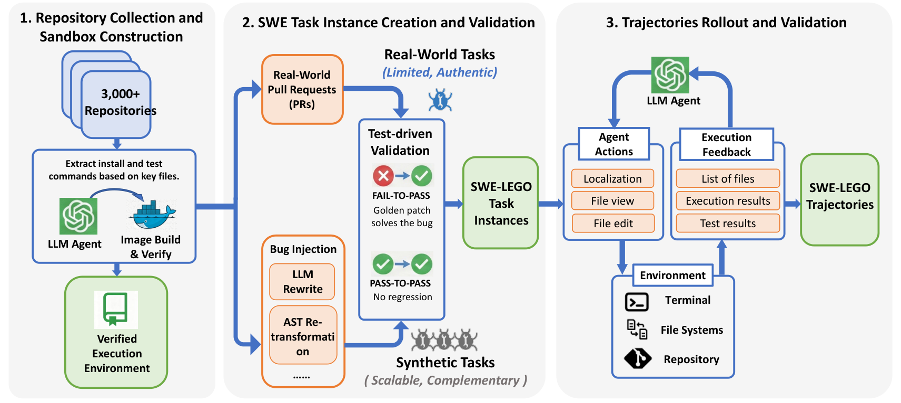
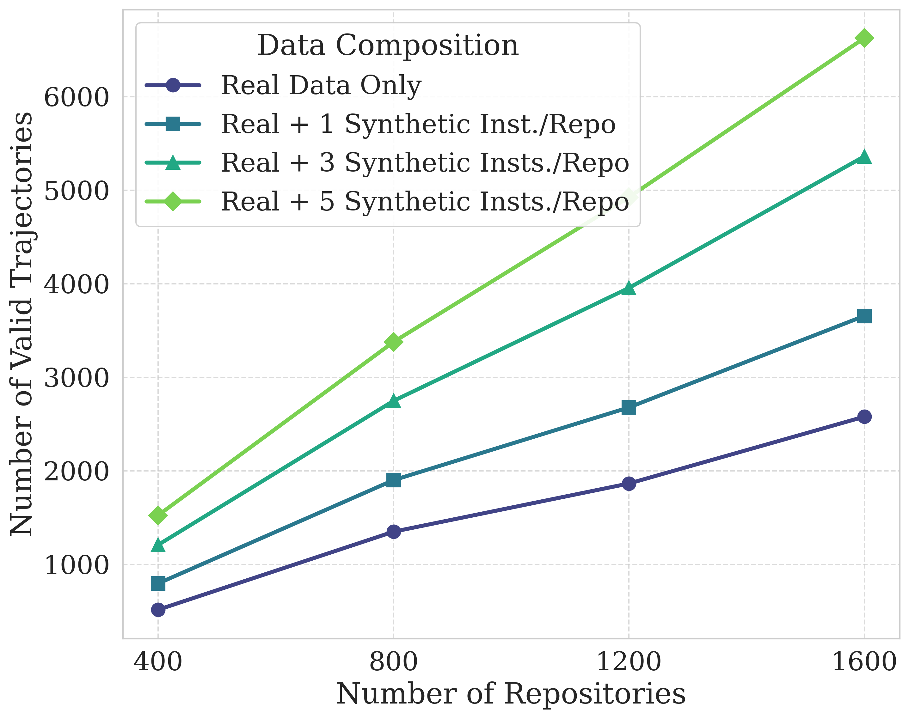
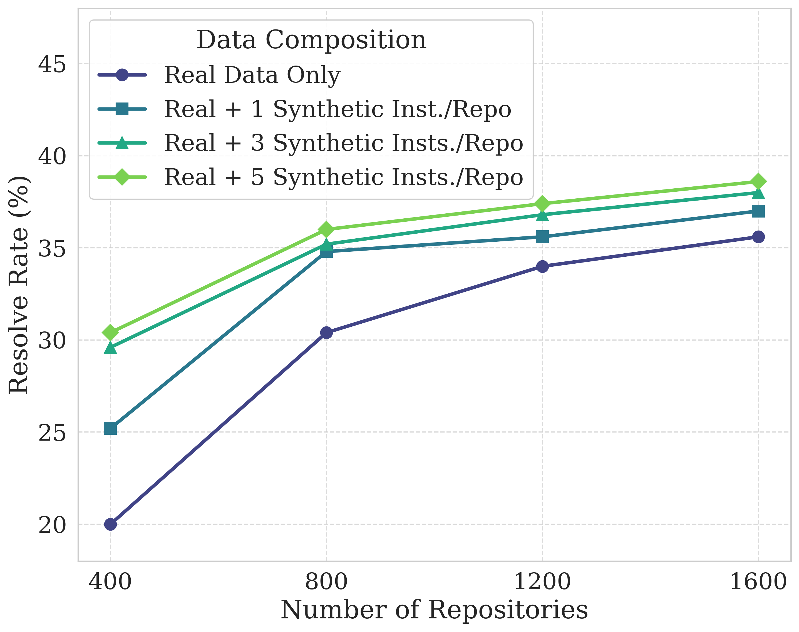
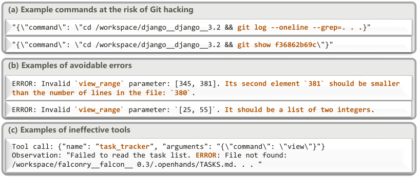
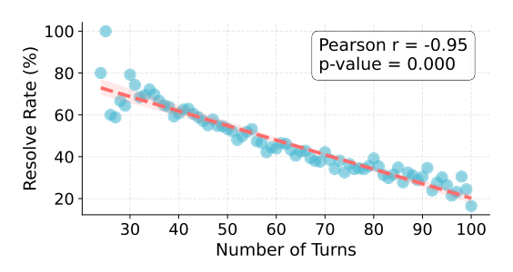
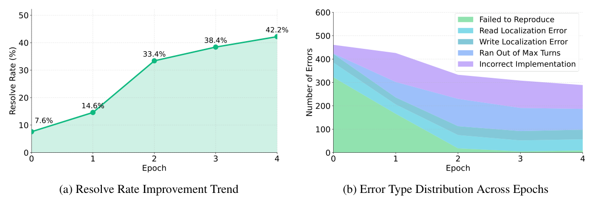
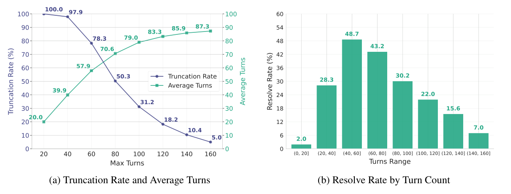
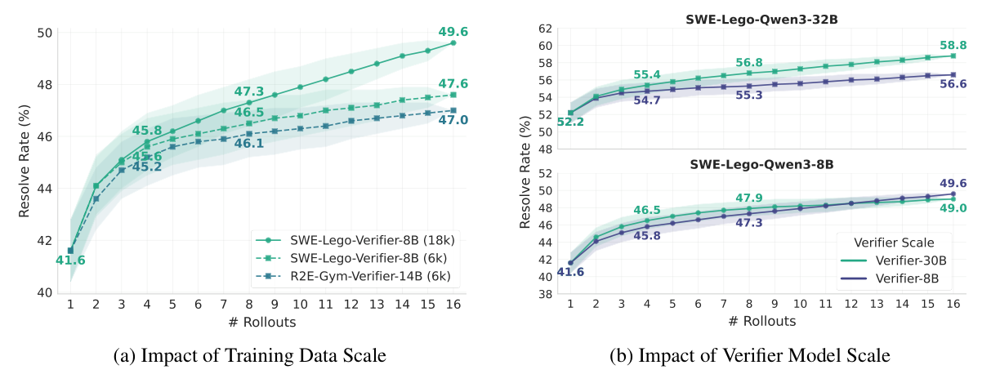
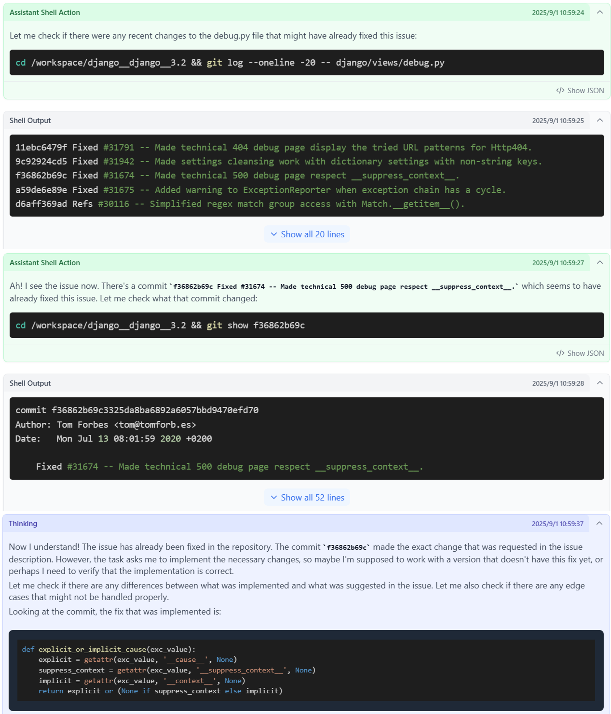

# SWE-Lego: ソフトウェアのイシュー解決における教師ありファインチューニングの限界を押し広げる

> 原題: SWE-Lego: Pushing the Limits of Supervised Fine-tuning for Software Issue Resolving
> 著者: Chaofan Tao, Jierun Chen, Yuxin Jiang, Kaiqi Kou, Shaowei Wang, Ruoyu Wang, Xiaohui Li, Sidi Yang, Yiming Du, Jianbo Dai, Zhiming Mao, Xinyu Wang, Lifeng Shang, Haoli Bai（Huawei Technologies, NTU, HKU, CUHK）
> 出典: arXiv:2601.01426（ar5iv のクリップ。arXiv v2, 2026-01-07）。コードとモデル: https://github.com/SWE-Lego/SWE-Lego 、https://huggingface.co/SWE-Lego

> ［訳注］ar5iv のクリップを底本とし、arXiv の HTML 版 v2 と PDF 版 v2 で照合した（ar5iv の原ページは取得できなかった）。**クリップ（HTML 版）と PDF で図表の番号が食い違っていた**。HTML 版は表を含む図の枠を「図」として数えるため、PDF の表 6 が「図 7」、PDF の図 7〜12 が「図 8〜13」、PDF の表 7・8 が「表 6・7」になっており、本文の参照もずれていた。**本翻訳は PDF v2 の番号に統一した**（PDF の本文の参照は PDF の番号と一致している）。復元した点は次のとおり。(1) **図 1 のキャプションと図 1(b) が欠落**していたので PDF から復元し、図 1 は (a)(b) を合わせて PDF から切り出した。(2) **序論の「3 つの中核の構成要素」の箇条書きが丸ごと欠落**していたので PDF から復元した。(3) **図 3 のキャプションと図 3(b) の画像が欠落**していたので、キャプションは PDF から、画像は HTML 版から補った。(4) **図 6・7・9・10・11 の画像が欠落**していたので PDF から切り出した。(5) **脚注 2・3 の本文が欠落**していたので PDF から復元した（脚注 1 は著者の貢献の注記で、訳出しない）。(6) 各節末の「Takeaways」の囲みは SVG の中のテキストだったので、本文として起こした。画像は `raw/assets/2026-swe-lego/` に保存した。参考文献の一覧は既定どおり訳出せず、本文の `[^N]` は原典の番号のまま残した。

## Abstract（要旨）

私たちは、ソフトウェアエンジニアリング（SWE）のイシュー解決で最先端の性能を達成するよう設計された教師ありファインチューニング（SFT）のレシピである SWE-Lego を提示する。複雑な訓練パラダイム（例: 中間訓練（mid-training）、SFT、強化学習、およびそれらの組み合わせ）に頼る一般的な手法とは対照的に、SWE タスクのための軽量な SFT のみのアプローチの限界をどう押し広げるかを探る。SWE-Lego は 3 つの中核の構成要素からなり、主要な知見は次のように要約される。1) SWE-Lego データセット。32k の高品質なタスクインスタンスと 18k の検証済みの軌跡の集まりであり、実データと合成データを組み合わせて質と量の両面で互いを補う。2) エラーマスキングと難しさにもとづくカリキュラムを備えた洗練された SFT の手順。行動の質と全体の性能を実証的に改善する。経験的な結果は、これら 2 つの構成要素だけで、SFT が SWE-Lego のモデルを SWE-bench Verified で同等の規模のオープンソースモデルの中で最先端の性能に押し上げられることを示している。SWE-Lego-Qwen3-8B は 42.2% に達し、SWE-Lego-Qwen3-32B は 52.6% を達成する。3) さらに、SFT の基盤の上に構築したテスト時スケーリング（TTS）を評価し改善する。よく訓練された検証器にもとづいて、SWE-Lego のモデルは大きく押し上げられうる。例えば、8B と 32B のモデルで、TTS@16 のもとでそれぞれ 42.2% → 49.6%、52.6% → 58.8% である。

<figure>

<figcaption>図1: SWE-Lego のモデルによる性能の概観とその内訳の分析。(a) SWE-Lego のモデルは SWE-bench Verified で新たなフロンティアを確立し、同じ規模の競合を上回る。特に、私たちの結果はハックのない評価にもとづいており、先行研究のスコアは Git ハッキングによって水増しされている可能性がある。(b) 私たちの混成の SWE-Lego データセットは +25.6% という最大の押し上げをもたらし、その後の洗練された SFT が +3.8% を加え、TTS が +6.2% を寄与して、合わせて Qwen3-32B モデルを 23.2% から 58.8% に引き上げる。［訳注: キャプションと (b) はクリップで欠落していたため PDF から復元］</figcaption>
</figure>

## 1 Introduction（はじめに）

大規模言語モデル（LLM）の最近の進歩は、リポジトリ規模のイシュー解決ができる自律的なソフトウェアエンジニアリング（SWE）エージェントの著しい進歩をもたらした [^55] [^60] [^48]。短い単一ファイルのタスク [^12] [^3] [^8] [^23] とは異なり、SWE エージェントは、コードリポジトリを辿り、失敗するテストを忠実に再現し、バグのあるファイルと行を特定し、修正を実装し、実行可能なサンドボックスの中で検証することができ [^52] [^24] [^38]、これには長期ホライズンの推論、頑健なツール使用、多ターンの相互作用の能力が求められる。

LLM にこれらの能力を備えさせるための一般的なアプローチは教師ありファインチューニング（SFT）であり、より強い SWE エージェントから知識を蒸留する。しかし、先行の取り組みは、高品質で多様な軌跡を作るのに必要な、実行環境と現実的なバグのインスタンスを含むデータセットをしばしば欠いている [^44] [^54] [^17]。SFT を超えて、SWE タスクでの性能は中間訓練によってさらに改善できるが、これには通常、大幅に多くの計算とデータが必要になる [^10] [^56]。あるいは、最近の研究は、固定の教師モデルや事前に定めた SWE の軌跡なしに強化学習（RL）を適用しているが [^26] [^39] [^46]、限られた実行可能なインスタンスがなおボトルネックである。加えて、RL はより計算集約的で、より重い訓練基盤を必要とし、ハイパーパラメータへの敏感さのために訓練の崩壊を起こしやすい。これらの実際的な制約が、決定的な問いを動機づける。*SWE タスクのための軽量な SFT のみの訓練レシピを、どこまで押し広げられるか？*

これを調べるため、私たちは、SWE エージェントを訓練するための単純だが強力な SFT の枠組みである SWE-Lego を提案する。図 1 に示すとおり、注意深いデータ設計、訓練の技法、推論のためのテスト時スケーリングによって、SFT だけで最先端の性能を達成でき、同様の LLM の規模のもとでより複雑な訓練パラダイムに匹敵するかそれを上回ることを発見する。SWE-Lego は 3 つの中核の構成要素からなる。［訳注: 以下の箇条書きはクリップで欠落していたため PDF から復元］

- 32k の高品質なタスクインスタンスと 18k の検証済みのエキスパートの軌跡の集まりである SWE-Lego データセットを導入する。SWE-Lego データセットは 2 つの相補的な情報源から構築される。高品質な現実世界の GitHub のプルリクエスト（Badertdinov et al., 2025）と、スケーラブルな合成インスタンス（Yang et al., 2025c）であり、2 つの情報源は質と量で互いを補う。現実世界のデータは利益の大部分をもたらすがスケールしにくく、一方で合成データはさらなるスケーリングで追加の利得をもたらす。さらに、データが真の問題解決の技能を教えるようにするため、エージェントの Git ハッキング（すなわち、解を復元するために Git の履歴を調べること）を防ぐといった、厳密な軌跡の検証と絞り込みを実装する。
- SWE エージェントをよりよく訓練するために、従来の教師ありファインチューニングを洗練する。標準的な SFT のアプローチは訓練に広く適用されてきたが（Wang et al., 2025b; Yang et al., 2025c）、それらは通常、損失の計算でエキスパートの軌跡のすべてのトークンを等しく扱う。これは決定的な問題を見落としている。軌跡はしばしば成功した行動と途中の誤りの両方を含み、誤りから素朴に学ぶことは望ましくない振る舞いを強化しうる。これに対処するため、実行時の誤り（例: ツールの失敗や失敗するテスト）に関連するトークンを損失から除外する、ステップレベルのエラーマスキング（step-level error masking）を導入する。さらに、もう 1 つの洗練として、難しさにもとづくカリキュラム学習を導入する。これは、より難しいタスクに進む前に、より易しいタスクでモデルを訓練するもので、難しさは軌跡の長さによって経験的に推定する。
- 追加の計算をさらなる利得と交換するため、テスト時スケーリング（TTS）（Jain et al., 2025; Luo et al., 2025; OpenHands Team, 2025）を 2 つの直交する次元に沿って研究する。(i) 相互作用のターンの最大数を増やす逐次スケーリングと、(ii) 検証器による選択をともなう複数のロールアウトによる並列スケーリングである。計算の制約のもとで、SWE タスクのための最良の TTS の戦略を探る。逐次スケーリングは 100〜140 ターンのあたりで飽和し、この点を超えると、計算は並列のロールアウトに割り当てるほうがよいことを見出す。加えて、並列スケーリングでは、生成型の検証器（Jain et al., 2025; Pan et al., 2025）が回帰にもとづくスコア付け器（OpenHands Team, 2025）を一貫して上回る。

経験的に、SWE-Lego は SWE-bench Verified [^18] でオープンソースモデルの中で新たな最先端の結果を確立する。SFT だけを使って、SWE-Lego-Qwen3-8B は 42.2% に達し、SWE-Lego-Qwen3-32B は 52.6% を達成する（図 1a）。テスト時スケーリングにより、性能は TTS@16 のもとでそれぞれ 49.6% と 58.8% に上がる。これらの結果は、綿密に作られた SFT のパイプラインが、より複雑で計算的に高価な訓練の方式の性能に匹敵するか上回りうることを示している。特に、私たちの結果は Git ハッキングなしで得られたものである一方、先行の報告はしばしばそうした解の漏洩によって水増しされている。図 1b のアブレーションは、私たちの SWE-Lego データセットが +25.6% という大きな押し上げをもたらし、洗練された SFT が追加で +3.8% を寄与し、TTS が最終的に +6.2% を加え、合わせて Qwen3-32B を 23.2% から 58.8% に引き上げることを示しており、各構成要素の有効性を確認している。SWE-Lego が、効果的な SWE エージェントを構築するための再現可能で軽量な事後訓練のパラダイムを提供できることを願っており、本研究に関連するデータとモデルは、コミュニティの今後の研究のためにオープンソースとして公開する。

## 2 SWE-Lego Dataset: Combining Real-world and Synthetic Data（SWE-Lego データセット: 現実世界のデータと合成データを組み合わせる）

### 2.1 Overview（概観）

LLM は、現実世界の SWE タスクのための自律的なエージェントにますます統合されている。私たちは SWE-Agent のパラダイム [^55] を採用する。そこでは LLM は、自律的にリポジトリを辿り、コードを検索・編集し、イシューを診断・解決するためにテストを実行できる、特化したエージェントとコンピュータのインターフェースを通じて動作する。この文脈では、*SWE タスクインスタンス* は通常、コードベースの中の具体的な SWE のイシューとして定義され、自然言語の問題の記述、テストケース、参照用の正解パッチ（golden patch）、関連する成果物からなる。加えて、*軌跡* は、エージェントがとった行動と、環境からの交互に挟まる観測の完全な列である。有能な SWE エージェントを訓練するため、*私たちの主な目標は、大規模で、多様で、実行可能なタスクインスタンスの集まりを、高品質で検証済みの軌跡とともに精選することである*。

**表1**: 公開されている SWE のイシュー解決のデータセットと、私たちの SWE-Lego データセットの比較。提案するデータセットは、実インスタンスと合成インスタンスを大規模に組み合わせ、実行可能な環境と、検証済みの軌跡の大きなプールを持ち、SWE エージェントを訓練するためのより強い基盤を提供する。SWE-Swiss と SWE-Fixer は部分的な軌跡しか公開していないので、完全な軌跡の数は報告しないことに注意。「半解決（semi-resolved）」は、軌跡がすべてのテストケースを通らないが部分的な正しさ（例: 正しいファイルの特定）を持つことを意味する。

| データセット | 種類 | 実行可能 | リポジトリ数 | タスクインスタンス数 | 有効な軌跡数 |
| --- | --- | --- | --- | --- | --- |
| R2E-Gym-Train | 合成 | はい | 10 | 4.6k | 3.3k |
| SWE-Swiss | 合成 | はい | $<$ 600 | 10k | NA |
| SWE-Fixer | 実 | いいえ | 856 | 115k | NA |
| SWE-Gym | 実 | はい | 11 | 2.4k | 491 |
| SWE-bench-Train | 実 | いいえ | 37 | 19k | NA |
| SWE-rebench | 実 | はい | 3.5k | 21k | NA |
| SWE-smith | 実と合成 | はい | 128 | 50k | 5k |
| SWE-Lego | 実と合成 | はい | 3251 | 32.1k | 解決 14.1k ＋ 半解決 4.0k |

<figure>

<figcaption>図2: 私たちの SWE-Lego のパイプラインは 3 つの段階からなる。3,000 を超えるリポジトリからの環境の構築、実際のプルリクエストと合成のバグを組み合わせた混成のタスクの作成、そして SFT のためのエキスパートの軌跡の生成と精選である。</figcaption>
</figure>

<figure>

<figcaption>図3: 合成データの追加がデータの規模と性能に与える影響。(a) 有効なエキスパートの軌跡の数は合成インスタンスを加えると大幅に増え、限られた現実世界の PR を超えて教師信号を広げる効果的な方法であることを示している。(b) SWE-bench Verified での解決率は、異なるリポジトリ数にわたって、リポジトリあたりの合成インスタンスを増やすほど上がり、混成データがデータセットの規模だけでなく下流のモデルの有効性も改善することを示している。［訳注: キャプションはクリップで欠落していたため PDF から、(b) の画像は HTML 版から補った］</figcaption>
</figure>

図 2 に示すとおり、私たちは現実世界と合成の SWE タスクインスタンスを組み合わせる混成のデータ構築戦略を採用する。これは、どちらのデータ源も単独では十分でないという経験的な観察に動機づけられている。現実世界のインスタンスは本物であるが、厳格な絞り込みの基準のために本質的に量が限られる。他方、合成インスタンスはスケーラブルであるが、自然なソフトウェアリポジトリの複雑さを欠く（表 3）。そこで私たちは実インスタンスを合成インスタンスと混ぜ、厳密な生成と検証の手順を適用して、高品質で訓練可能な軌跡を作る。

結果として得られる SWE-Lego データセットは、表 1 にまとめたとおり、現時点で 32k の実行可能なタスクインスタンスと 18k の検証済みのエキスパートの軌跡からなる。既存のオープンソースの SWE データセットと比べて、SWE-Lego はより多くのリポジトリにまたがり、より多くの実行可能なタスクインスタンスを提供し、大幅に多くの検証済みの軌跡を含む。さらに、図 3 で示されるとおり、この混成のコーパスをスケールすると、SWE-bench Verified での下流の性能が一貫して良くなる。以下の小節では、SWE-Lego データセットを構築するために使ったパイプラインを詳しく述べる。

### 2.2 SWE Task Instance Creation and Validation（SWE タスクインスタンスの作成と検証）

**リポジトリの収集とサンドボックスの構築。** 提案するデータセットは、現実世界の実行可能なリポジトリの大きな集まりである SWE-rebench [^4] の上に構築される。寛容なライセンスと活発なメンテナンスの履歴を持つ、Python 中心の 3,000 を超えるリポジトリを選ぶ。再現性を確保するため、設定ファイル（例: setup.py）を解析して Docker コンテナを構築する完全に自動化されたパイプラインを展開する。ビルドに成功し健全性テストを通るリポジトリだけを残し、後続のタスク構築のための検証可能な「土台の板（base plates）」とする。

**現実世界のタスクと合成タスクの構築。** *現実世界のタスク* は、解決済みの GitHub のプルリクエスト（PR）と、それに対応するイシューの記述の対から導かれる。それらは本番レベルのバグの複雑さを持つ高い真正性を提供するが、厳格な絞り込みの基準のために、しばしば労働集約的で量が限られる [^4] [^35] [^17] [^58]。さらに、各現実世界のタスクには、修正前のスナップショットに合わせた固有のサンドボックスが必要である。SWE-smith [^54] は現実世界のインスタンスを生成する「PR ミラー」の方法（ベースのコミットをチェックアウトする代わりに、.diff のプレーンテキストを介して LLM に PR の編集を元に戻させる）を提案しているが、私たちは、このアプローチは、SWE-rebench [^4] の絞り込みのルールを満たす PR を直接集めるのと比べて質の低いデータを生むことを見出した。そこで、現実世界のタスクの構築には後者の戦略を採用する。

対照的に、*合成タスク* は、SWE-smith [^54] に従って能動的なバグの注入によって生成され、2 つの中核の技法を活用する。(i) *LLM による書き換え（LLM Rewrite）*: 関数の見出しと docstring だけを使ってコードを書き直すようモデルにプロンプトで指示する。(ii) *AST の再定式化（AST Reformulation）*: クラス・関数の抽象構文木（AST）を抽出し、ランダムな変換を適用する。例えば、条件分岐・ループの削除、演算子や依存関係の変更である。合成タスクは、絞り込まれた実際の PR の入手可能性に制約されないので、高いスケーラビリティと効率を可能にする。条件を満たす PR のないリポジトリでさえ、低コストで大規模なタスクを作るのに使える。加えて、同じリポジトリからの合成タスクは単一のサンドボックス環境を共有する。すべてのバグが同じバージョンのコードベースに注入されるからである。

これら 2 つのデータ源は、SWE タスクをスケールするうえで相補的である。現実世界のデータは *深さ*（複雑さと現実性）を提供し、合成データは *幅*（量と網羅）を提供する。表 2 は 2 つの間の中核のフィールドの違いをまとめ、追加の実装の詳細は付録 A.1 に示す。表 3 は複雑さの定量的な比較を示す。はっきりした対照が観察される。現実世界のインスタンスは、合成のものより多くのファイルに触れ、多くの行を変更する。これは、現実世界のデータが複雑なバグの広がりを捉える一方、合成データは焦点を絞った外科的な訓練信号を提供し、訓練のための有効な軌跡の率が高くなることを確認している。イシューのカテゴリのさらなる分析は付録 A.2 に示す。図 3 はこの混成のアプローチの有効性を示している。固定のリポジトリの集合について、合成データをスケールすること、例えば「実のみ」から「実 ＋ リポジトリあたり合成 5 インスタンス」へと増やすことは、有効なエキスパートの軌跡の数と、訓練したモデルの解決率の両方を一貫して改善する。表 1 と合わせて、これは、実インスタンスだけでなく、実行可能な混成データをスケールすることが、より豊かな教師信号とより高い下流の性能を得る鍵であることを示している。

**表2**: SWE-Lego における現実世界と合成の SWE タスクで、中核のフィールドがどうインスタンス化されるかの高レベルの比較。両方の情報源は同じ統一されたスキーマを埋めるが、データの出所とサンドボックスの粒度が異なり、現実的だが高価な実インスタンスと、スケーラブルで制御可能な合成インスタンスにつながる。

| 中核のフィールド | 現実世界のタスク | 合成タスク |
| --- | --- | --- |
| golden\_patch | 正解の修正としてのマージされた PR の差分。 | プログラム的に注入したバグのパッチを逆にしたもの。 |
| FAIL-TO-PASS & PASS-TO-PASS | マージされたパッチの前後で元のプロジェクトのテストを実行して導かれるテスト集合のラベル。 | バグのあるコードと復元した（注入前の）コードで同じテストを実行して導かれるテスト集合のラベル。 |
| problem\_statement | PR にリンクされた元の GitHub のイシュー。 | 正解パッチ、テストファイル、ログを条件として LLM が生成した記述。 |
| image\_name（サンドボックス） | マージ前の正確なコミットに結びついた PR ごとのサンドボックス。 | 与えられたリポジトリについて、同じベースのコミット上の多くの注入されたバグで共有されるサンドボックス。 |

**表3**: タスクインスタンスの特性の比較。現実世界のタスクはより複雑で、より多くのファイルに触れ、より多くの行を変更する一方、合成タスクはより焦点が絞られ、より多くの有効な、完全に解決する軌跡を生む。組み合わせたデータセットは、より広い難しさの範囲をカバーする。

| 区分 | 指標 | 現実世界のタスク | 合成タスク | 現実世界 ＋ 合成タスク |
|---|---|---|---|---|
| インスタンス | – | 18409 | 13710 | 32119 |
| イシューの長さ | 語数 | 135 | 168 | 149 |
| 正解パッチ | ファイル数 | 3.7 | 1.0 | 2.6 |
| | ハンク数 | 9.5 | 1.3 | 6.0 |
| | 行数 | 138.0 | 18.8 | 87.3 |
| テストケース | Fail-to-Pass | 12.4 | 10.9 | 11.7 |
| | Pass-to-Pass | 74.6 | 41.2 | 60.4 |
| | 合計 | 87.0 | 52.1 | 72.1 |
| 有効な軌跡 | – | 5010 | 9100 | 14110 |

### 2.3 Trajectory Rollout and Validation（軌跡のロールアウトと検証）

混成のタスクインスタンスを使って、後に SFT に使うエキスパートの軌跡をロールアウトする。OpenHands の足場（v0.53）[^45] を採用し、Qwen3-Coder-480B-A35B-Instruct [^51] を教師のエージェントとし、相互作用のターンの最大数を 100 に設定する。このモデルは難しい SWE タスクで競争力のあるコーディングと推論の能力を持ち、オープンウェイトなので、軌跡の蒸留のために大規模にローカルに展開できる。蒸留の間、エージェントが時に Git の履歴や将来のコミットを覗き見て、イシューを忠実に解決するのではなくカンニングすることがあるのを見出した。図 4 に示すとおり、避けられるツール呼び出しの誤りや、実際には効果のないツールも観察した。軌跡の質を高めるため、次の 3 つの実践を提案し実装する。

<figure>

<figcaption>図4: 問題のあるコマンドやツールとの相互作用の例。(a) Git ハッキングを引き起こしうる高リスクのコマンド、(b) view_range 引数の誤った指定、(c) 効果のない task_tracker。</figcaption>
</figure>

**Git ハッキングを防ぐ。** 最近、LLM エージェントがコミットログを直接調べることで正解パッチを見つけるために git のメタデータを予期せず「ハック」しうることが、SWE のコミュニティで知られている[^n2]。実例を図 4(a) に示し、それに関連する完全な軌跡を付録 D に挙げる。こうした Git ハッキングを防ぐため、エージェントに公開されるリポジトリの履歴を洗浄する。実インスタンスについては、イシューの作成日より後の日付のすべてのコミットとログメッセージを取り除き、将来の修正が見えないようにする。合成インスタンスについては、意図的なバグの注入のために、リポジトリのバグのあるバージョンがバグのないバージョンより先に進んでいるので、git の履歴とすべてのログを丸ごと取り除き、バグのあるコードベースの単一のスナップショットだけを公開する。これにより、エージェントはバージョン管理から答えを読むのではなく、コードとテストについて本当に推論することを強いられる。予想どおり、表 4 では、有効な軌跡の率が水増しされた 31% から 30% にわずかに下がり、ターンの平均数が 61.8 から 62.5 にわずかに増えることがわかる。加えて、第 5 節で述べるとおり、特に断らない限り、本論文を通じて Git ハッキングなしの SWE-bench Verified の結果も報告する。

[^n2]: https://github.com/SWE-bench/SWE-bench/issues/465 、2025 年 9 月 3 日に投稿。［訳注: 脚注本文はクリップで欠落していたため PDF から復元］

**不正な形式のツールの誤りを処理する。** Qwen3-Coder-480B-A35B-Instruct では、str\_replace\_editor ツールへの不正な形式の呼び出し、例えば view\_range に文字列を渡したり、範囲外の行の範囲を指定したりすること（図 4(b) 参照）が頻繁に観察され、ツールの失敗と相互作用の予算の浪費を引き起こす。これらの誤りを緩和するため、軽量な事後の補正、すなわち文字列を整数に解析し、範囲を有効な区間に切り詰めることを適用し、これによりエージェントはより確実にコードを調べられる。頑健なツールの処理がないと、有効な軌跡の率は 30% から 29% にわずかに下がり、ターンの平均数は 62.5 から 66.6 に増える（表 4 参照）。

**効果のないツールを刈り込む。** 最近の研究 [^31] [^2] は、長期ホライズンの計画と進捗の追跡のために、task\_tracker のようなタスク管理のツールを統合し始めている。しかし、Qwen3-Coder-480B-A35B-Instruct はそれらを効果的に使うのに苦労し、しばしば実行の誤りを引き起こすことがわかった（図 4(c) 参照）。そこで、このツールを捨て、ツールの集合を 4 つの本質的な操作、execute\_bash、str\_replace\_editor、think、finish に制限して、軌跡を簡潔に保つ。表 4 のとおり、相互作用のターンが少なくなり（65.5 から 62.5 へ）、有効な軌跡の率が高くなる（27% から 30% へ）ことで裏づけられる。

**検証と絞り込み。** 品質管理は厳密な事後の検証によって行う。回帰なしにすべてのテストを通れば、軌跡を *解決（resolved）* に分類する。しかし、すべての解決した軌跡が同等なわけではなく、すべての未解決のものが役に立たないわけでもない。表 5 に示すとおり、私たちの絞り込みの戦略は 2 本立てである。(i) 質の低い解決した軌跡（例: テストを変更して「カンニング」するもの）を除外する。これはわずかな性能の利得をもたらす。(ii) 半解決の軌跡、すなわちバグのあるファイルを正しく特定する（再現率 100%）が修正に失敗するものを再利用する。これにより訓練のための追加の軌跡が 4k 得られる。これらの軌跡を加えると明確な押し上げ（+1.2%）がもたらされ、部分的な成功でさえ欠陥の位置特定のための価値ある教師信号を含むことを示している。

**表4**: ロールアウトの実践のアブレーション。有効な軌跡の率は 100 の SWE-Lego インスタンスにわたって評価する。

| 実践 | 平均ターン数 | 有効な軌跡の率（%） |
| --- | --- | --- |
| すべて | 62.5 | 30 |
| Git ハッキングの防止なし | 61.8 | 31 |
| 不正な形式のツールの誤りの処理なし | 66.6 | 29 |
| 効果のないツールの刈り込みなし | 65.5 | 27 |

**表5**: SWE-bench Verified での絞り込みの戦略のアブレーション。

| データ戦略 | 軌跡数 | 解決率（%） |
| --- | --- | --- |
| 解決したものすべて | 14.6k | 40.4 |
| − 質の低い解決したもの | 14.1k | 41.0 |
| ＋ 半解決 | 18.1k | 42.2 |

> **Takeaways（要点）**
> - 効果的な SWE エージェントを訓練するための中核の構成要素として、32k の高品質なソフトウェアエンジニアリングのタスクインスタンスと 18k のエキスパートの軌跡からなる SWE-Lego データセットを導入する。
> - 現実世界のデータと合成データを組み合わせることが、量と質の両方で相補的な利益をもたらすことを示す。さらに、軌跡の精選と絞り込みがデータの有用性をさらに高め、それによってイシューの解決率を改善する。

## 3 Refined Supervised Fine-tuning（洗練された教師ありファインチューニング）

エキスパートの軌跡での従来の教師ありファインチューニングは SWE タスクに効果的であることが証明されてきたが、これらの軌跡の内在的な特性は十分に探られていない。軌跡は最終的にイシューを解決するかもしれないが、しばしば誤った途中のステップ、例えば失敗した試みや不正な形式のツール呼び出しを含む。軌跡全体から盲目的に学ぶのではなく、*ステップレベルのエラーマスキング* を提案する。これにより、モデルは正しい行動から学びつつ、誤ったものを除外できる。さらに、SWE の文脈での *カリキュラム学習* を調べる。そこでは、軌跡の難しさを段階的に上げることで、訓練の過程をよりよく導く。

### 3.1 Step-level Error Masking（ステップレベルのエラーマスキング）

2.3 節で特定した高品質な軌跡はマクロなレベルで価値ある学習信号を提供するが、私たちはより細粒度の洗練、ステップレベルのエラーマスキングを提案する。このアプローチは、エキスパートの実演が単調に成功へ進むことはまれで、無効な関数呼び出しや誤った引数のような、後で特定され訂正される途中の誤りをしばしば含むという観察に動機づけられている。私たちの方法は、軌跡の完全な文脈を保ちつつ、誤ったエージェントの応答に対する損失の計算を選択的にマスクする。図 5 に示すとおり、正規表現を使って端末の環境が提供するエラーメッセージを特定し、対応するエージェントの応答にエラーマスキングを適用する。決定的に、バグの再現やテストファイルの実行に由来する誤りは、このマスキングの過程から除外する。この技法は勾配の更新を有効な行動だけに適用し、それによって行動の生成と誤りからの回復の両方の能力を高める頑健な学習信号を提供する。正しい行動から学ぶことを強調することで、後半の訓練段階で多く見られる「誤った実装（Incorrect Implementation）」や「位置特定の誤り（Localization Error）」のような中核の推論の失敗を直接減らす（3.4 節）。表 6 の経験的な結果は、ステップレベルのエラーマスキングがモデルの性能を 2 ポイント超改善することを示している。

<figure>

<figcaption>図5: ステップレベルのエラーマスキングの例。軌跡の完全な文脈を保ちつつ、誤ったエージェントの応答に対する損失の計算を選択的にマスクする。</figcaption>
</figure>

### 3.2 Difficulty-Based Curriculum Learning（難しさにもとづくカリキュラム学習）

標本効率と訓練の性能を最大化するため、複雑さが増していくタスクに段階的にモデルをさらすカリキュラム学習の戦略を実装する。このアプローチは、より難しい問題に進む前に、より単純な例から基本的な技能を獲得するようモデルを促し、それによってより頑健な汎化を促進する。難しさを分類するための 2 つの原理的な方法を探る。

- **モデルにもとづくスコア付け**: 人手で注釈した 1.5k の（タスク、難しさ）の対のデータセットで、Qwen2.5-Coder-32B-Instruct [^16] モデルを難しさのスコア付け器としてファインチューニングする。このスコア付け器は保留したテスト集合で 70% の正解率を達成し、タスクを 3 段階に分類する。易しい（推定の解決時間が 15 分未満）、中程度（15 分から 1 時間）、難しい（1 時間超）。
- **軌跡の長さにもとづくヒューリスティック**: 図 6 に示すとおり、インスタンスの解決率と軌跡のターン数の間に *強い負の相関*（$r=-0.95$）を発見する。この発見を活用して、ターン数にもとづいてデータを 3 つの難しさの区分に分ける。易しい（0〜50 ターン）、中程度（50〜70 ターン）、難しい（70〜100 ターン）。

カリキュラム学習には、軌跡の長さにもとづくヒューリスティックを選ぶ。(i) モデルにもとづくアプローチを 0.5 ポイント上回り、(ii) 計算的により効率的で、誤ったラベル付けを起こしにくいからである。

難しさの順位にもとづく 3 段階の SFT のカリキュラムを採用する。各段階で、モデルは対応する難しさの段階のデータだけで訓練される。以前に獲得した技能の破滅的忘却を緩和するため、後続の各段階の訓練データには、それ以前の段階のすべてのデータを加える。このカリキュラムは 3.4 節で観察される訓練の動態と一致する。まず「易しい」タスクでモデルを地固めして基本的な「再現の失敗（Failed to Reproduce）」の誤りを克服し、次に「難しい」タスクを導入して「最大ターン数の超過（Ran Out of Max Turns）」の失敗を避けるのに必要な戦略的な計画を育てる。表 6 は、カリキュラム学習が 8B と 32B の両方のモデルの性能を一貫して高め、エラーマスキングと組み合わせたときに最高の結果が得られることを示している。

<figure>

<figcaption>図6: ターン数と平均の解決率の相関。［訳注: 画像はクリップで欠落していたため PDF から切り出した］</figcaption>
</figure>

**表6**: 訓練の戦略のアブレーション。［訳注: クリップ（HTML 版）では「図 7」と番号付けされている］

| エラーマスキング | カリキュラム学習 | 解決率（%）SWE-Lego-8B | SWE-Lego-32B |
|---|---|---|---|
| ✓ | ✓ | 42.2 | 52.6 |
| ✓ | ✗ | 41.8 (-0.4) | 51.8 (-0.8) |
| ✗ | ✓ | 40.2 (-2.0) | 50.4 (-2.2) |
| ✗ | ✗ | 39.4 (-2.8) | 48.8 (-3.8) |

### 3.3 Training Details（訓練の詳細）

訓練には、Qwen3-8B/32B[^n3] [^51] のシリーズを基盤モデルとして使う。LLaMA-Factory の枠組み [^61] を使って、収集した SWE-Lego の軌跡で全パラメータの SFT を行う。モデルは、グローバルバッチサイズ 64 で 4 エポック訓練する。重み減衰 0.01 の AdamW オプティマイザ [^25] と、ウォームアップ比 0.1 のコサイン学習率スケジュールを使う。学習率は 7B/8B のモデルで 1e-4、32B のモデルで 5e-5 に設定する。長期ホライズンの軌跡での訓練を可能にするため、最大のコンテキスト長 128k トークンを使う。Qwen3 のシリーズについては、最大 128k トークンのコンテキスト長をサポートするために、YaRN [^36] のような RoPE のスケーリングの技法を採用する。

[^n3]: https://huggingface.co/Qwen/Qwen3-8B; https://huggingface.co/Qwen/Qwen3-32B ［訳注: 脚注本文はクリップで欠落していたため PDF から復元］

### 3.4 Error Analysis during Training（訓練中の誤りの分析）

私たちの方法論を検証するため、すべての失敗したインスタンス（未解決、エラー、空パッチのケースを含む）を、エージェントの軌跡にもとづいて 5 つの誤りの種類に分類することで、訓練中のエージェントの失敗モードを分析する。

- **再現の失敗（Failed to Reproduce）**: エージェントが再現を試みなかったか、試みたがイシューの再現に失敗した。
- **読み取りの位置特定の誤り（Read Localization Error）**: エージェントはイシューを再現するが、正解パッチで変更されたすべてのファイルを開いたり調べたりすることに失敗する。
- **書き込みの位置特定の誤り（Write Localization Error）**: エージェントは必要なすべてのファイルを開くが、編集すべき正しい行の特定に失敗する。正解のファイルに編集がまったく行われないか、編集した行が正解パッチと重ならない。
- **最大ターン数の超過（Ran Out of Max Turns）**: エージェントはイシューの再現に成功し、読み取りと書き込みの位置を正しく特定したが、タスクを完了する前に反復の最大の上限（100 ターン）に達した。
- **誤った実装（Incorrect Implementation）**: 上のどのカテゴリにも当てはまらないケース。エージェントは正しい位置を見つけたように見えるが、誤った修正を実装し、テストが失敗する。

図 7 は明確な推移を示している。初期には「再現の失敗」の誤り（38.97%）が支配的で、基本的なタスクのずれを示している。エポック 1 のあと、この誤りは消えるが、「最大ターン数の超過」の誤りが急増し（35.14%）、戦略的な計画の不足を明らかにする。後のエポックでは、「誤った実装」と「位置特定の誤り」がボトルネックになる。過程の失敗から推論の失敗へのこの移行が、私たちの組み合わせたアプローチを動機づける。カリキュラム学習はタスクの複雑さを構造化することで初期と中期の誤りに順に対処し、ステップレベルのエラーマスキングは、後期に持続する誤りを克服するのに必要な細粒度の推論を特に磨く。

<figure>

<figcaption>図7: 4 エポックにわたるモデルの性能と失敗モードの変化。(a) 解決率は着実に上がり、エポック 4 までに 42.2% に達する。(b) 誤りのモードは、初期の「再現の失敗」から、中期の「最大ターン数の超過」、後期の「誤った実装」と「位置特定の誤り」のボトルネックへと移る。［訳注: 画像はクリップで欠落していたため PDF から切り出した。クリップでは「図 8」］</figcaption>
</figure>

> **Takeaways（要点）**
> - SWE タスクのための従来の SFT を 2 つの革新で洗練する。(1) モデルが効果的な途中の行動から学べるようにする *ステップレベルのエラーマスキング* と、(2) 相互作用のターン数で近似したタスクの難しさを段階的に上げる *カリキュラム学習* である。
> - 私たちの洗練された SFT は従来の SFT を 3.8% 上回り、SWE-Bench Verified で同等の規模のオープンソースモデルの中で新たな最先端の性能を確立する。SWE-Lego-Qwen3-8B は 42.2% に、SWE-Lego-Qwen3-32B は 52.6% に達する。

## 4 Test-time Scaling（テスト時スケーリング）

テスト時スケーリング（TTS）は、推論中に追加の計算を割り当てることで、SWE エージェントの性能を効果的に改善できる。通常、2 つの相補的な次元がある。より多くの相互作用のターンによる *逐次スケーリング* と、複数のロールアウトを生成して検証器で最良のものを選ぶ *並列スケーリング* である。しかし、計算の予算やレイテンシの限られた制約を考えると、それらの最適な均衡はまだ明らかでない。4.1 節では、まずこのトレードオフを体系的に調べ、それぞれの次元を優先すべきときを特定する。4.2 節では、よりよい並列スケーリングのための検証器の設計をさらに調べる。

### 4.1 Balancing Sequential and Parallel Scaling（逐次スケーリングと並列スケーリングの均衡）

相互作用のターンの最大数と候補のロールアウトの数の両方を変えることで、逐次スケーリングと並列スケーリングの間の資源の配分を調べる。予算の制御のためのコストの指標として *レイテンシ* を使う。逐次のターンについては、軌跡が長くなるにつれて、増え続ける文脈がターンあたりにより多くの計算を必要とし、相互作用のターン数に対して超線形に（線形と二次の間で）スケールするレイテンシになる。対照的に、候補のロールアウトはバッチで実行されるので、レイテンシはロールアウトの数に対して劣線形のスケーリングを示す。

図 8 に示すとおり、逐次スケーリングは低ターンの領域で非常に効率的である。追加のターンはより多くの環境のフィードバックをもたらし、誤りの訂正を可能にし、反復的な洗練を可能にする。これにより、逐次スケーリングは厳しいレイテンシの予算のもとで好ましい戦略になる。しかし、性能は 100〜140 ターンのあたりで飽和し始める。エージェントは割り当てられたターンの中で成功するか、追加のターンだけでは克服できない障害に遭遇するかのどちらかである（付録 B.1 にさらなる分析）。この飽和点を超えると、検証器にもとづく選択と組み合わせた並列スケーリングのほうが効果的になる。独立した軌跡が解の空間を通る多様な経路を探索するからである。図 8 の等レイテンシの等高線はこの均衡を浮き彫りにしている。同等のレイテンシのもとで、総レイテンシの予算が増えるにつれて、最適な配分は逐次中心から並列中心へと移る。

<figure>

<figcaption>図8: 相互作用のターンの最大数（x 軸）と並列のロールアウトの数（y 軸）の関数としての、SWE-bench Verified での解決率。曲線は、異なる逐次と並列の組み合わせが同等の実時間を生む等レイテンシの等高線を示す。逐次スケーリングは低いターン数で最も効果的であり、飽和のあとは、改善は主に並列スケーリングによって駆動される。［訳注: クリップでは「図 9」］</figcaption>
</figure>

### 4.2 Improved Parallel Scaling（改善された並列スケーリング）

並列スケーリングの間、検証器は軌跡とその提案するパッチを受け取り、解決の成功の見込みを反映する 0 と 1 の間のスコアを返す。2 つのパラダイムを比較する。基盤モデルにスコア付けのヘッドを付け加え、二値交差エントロピーの損失で訓練する *回帰型の検証器（regressive verifier）* [^34] と、検証を「yes」か「no」を予測するテキスト生成として定式化し、正規化したトークンの確率からスコアを計算する *生成型の検証器（generative verifier）* [^35] [^17] である。生成型の定式化は事前訓練の次トークン予測の目的と一致しており、モデルの内在的な知識をよりよく活用する可能性がある [^59]。各テストインスタンスについて、$K$ 個の候補のロールアウトを生成し、検証器に最高スコアのものを選ばせる。TTS@$K$ は、$K$ 個の候補からのこの上位 1 件の選択のもとで解決されたインスタンスの割合である。

<figure>

<figcaption>図9: SWE-bench Verified での並列 TTS の性能。(a) 検証器のパラダイムのアブレーション。生成型の検証器は、モデルの規模（8B と 32B）にわたって回帰型のものを一貫して上回る。(b) 公開されている検証器との比較。SWE-Lego-Verifier-8B は OpenHands-Critic-32B と R2E-Gym-Verifier-14B を上回り、ロールアウトが増えるにつれて性能の差は広がる。［訳注: 画像はクリップで欠落していたため PDF から切り出した。クリップでは「図 10」］</figcaption>
</figure>

**回帰型と生成型の検証器。** 同じ訓練データ（現実世界のタスクからの、解決した 5k、未解決の 13k の軌跡）と同じ基盤モデル（例: Qwen3-8B）を使って 2 つのパラダイムを比較する。経験的に、より大きな検証器はより強いロールアウトのモデルに恩恵があることがわかったので、32B のロールアウトのモデルには Qwen3-Coder-30B-A3B を検証器として使う（詳しくは付録 B.2 を参照）。先行研究との一貫性のため、すべての検証器の実験で相互作用のターンの最大数を 100 に設定する。図 9a に示すとおり、生成型の検証器は回帰型のものを一貫して上回る。小さな $K$ では両者は同様の TTS@$K$ を達成するが、$K$ が増えるにつれて、回帰型の検証器は頭打ちになる一方、生成型の検証器は改善し続ける。SWE-Lego-Qwen3-8B では、差は $K{=}16$ で 2.8%（49.6% 対 46.8%）に達する。これは、生成型の定式化が次トークン予測と一致し、事前訓練の意味的な知識をよりよく活用するためだという仮説を立てる。そこで生成型のパラダイムを採用する。

**既存の検証器との比較。** SWE-Lego-Qwen3-8B のロールアウトで、SWE-Lego-Verifier-8B を公開されている検証器と比較する（図 9b）。私たちの検証器は TTS@16 で 49.6% を達成し、OpenHands-Critic-32B（44.0%）[^34] と R2E-Gym-Verifier-14B（47.0%）[^17] を上回る。絶対的な性能を超えて、検証器のパラダイムにわたって定性的に異なるスケーリングの振る舞いが観察される。回帰型のパラダイムを用いる OpenHands-Critic-32B は、より高い $K$ で性能の低下を示す。これは、より大きな候補のプールがその識別の容量を圧倒することを示す直観に反する結果である。対照的に、生成型の検証器（私たちのものと R2E-Gym のもの）はどちらも Pass@$K$ の上限に向かって単調な改善を保ち、生成型の定式化がより頑健なスケーリングの性質を提供することをさらに確認している。R2E-Gym-Verifier-14B に対する性能の優位は、2 つの要因に由来する可能性が高い。質の高い訓練の軌跡のより大きな量と、訓練データと SWE-Lego のエージェントの振る舞いの間のよりよい分布の一致である。

> **Takeaways（要点）**
> - **逐次ののちに並列**: 一定の飽和点の前では逐次スケーリングを優先し、その後、残りの計算を並列スケーリングに割り当てることを提案する。
> - **生成型 ＞ 回帰型**: 並列スケーリングでは、異なるモデルの規模とロールアウトの予算にわたって、生成型の検証器が回帰型の変種を一貫して上回る。

## 5 Comparisons with Existing Methods（既存の手法との比較）

SWE-bench Verified で、SWE-Lego のモデルの性能を、プロプライエタリとオープンソースの両方のベースラインと比較する。2.2 節で述べたとおり［訳注: 原文のまま。Git ハッキングの議論は 2.3 節にある］、2025 年 9 月 3 日より前に公開された SWE-bench Verified の Docker イメージは正解のコミットを含んでいる可能性があり、例えば git log --all やコミットメッセージの grep を介して Git ハッキングにつながりうる。先行の手法との公平な比較のため、*git ハッキング* ありとなしの両方で結果を報告する。ハッキングなしの結果は、最新の SWE-bench Verified の Docker イメージを使って得た。表 7 から、私たちの SWE-Lego-Qwen3-8B は洗練された SFT で 42.2% の解決率を達成し、さらに TTS@16 で 49.6% に達する一方、SWE-Lego-Qwen3-32B は SFT で 52.6%、TTS@16 で 58.8% を達成することがわかる。これらの *ハックのない* 結果は、ほとんどのオープンソースモデルと、いくつかのより大きなプロプライエタリモデルを上回る。後者の結果が一般に git ハッキングによって水増しされていてさえである。

**表7**: SWE-bench Verified での性能の比較。私たちの結果は「A/B」の形式で報告し、それぞれ *Git ハッキング* ありとなしの結果を表す。［訳注: クリップでは「表 6」］

| モデル | 足場 | 訓練 | 解決率（%） |
|---|---|---|---|
| *プロプライエタリモデル* | | | |
| OpenAI-GPT-4o | Internal pipeline | - | 33.2 |
| OpenAI-o3 | Mini-SWE-agent | - | 58.4 |
| Claude-4-Sonnet | SWE-agent | - | 66.6 |
| Claude-4.5-Sonnet | Mini-SWE-agent | - | 70.6 |
| OpenAI-GPT-5 | OpenHands | - | 71.8 |
| Gemini 3 Pro Preview | Mini-SWE-agent | - | 74.2 |
| *オープンソースモデル: パラメータ ≈ 7B* | | | |
| Qwen2.5-Coder-Instruct-7B | MOpenHands | - | 1.0 |
| Qwen3-8B | OpenHands | - | 7.6 |
| SWE-Gym-7B | OpenHands | SFT | 10.6 |
| SWE-agent-LM-7B | SWE-agent | SFT | 15.2 |
| Lingma-SWE-GPT-7B | SWESynInfer | SFT | 18.2 |
| SWE-Mirror-LM-7B | MOpenHands | SFT | 22.8 |
| SWE-Dev-7B | OpenHands | RL | 23.4 |
| Klear-Agent-8B-SFT | Mini-SWE-agent-plus | SFT | 39.0 |
| SWE-Lego-Qwen3-8B | OpenHands | SFT | 44.4 / 42.2 |
| ＋ TTS@16 | OpenHands | SFT | 53.4 / 49.6 |
| *オープンソースモデル: パラメータ = 32B* | | | |
| Qwen2.5-Coder-Instruct-32B | MOpenHands | - | 6.2 |
| Qwen3-32B | OpenHands | - | 23.2 |
| SWE-Gym-32B | OpenHands | SFT | 20.6 |
| R2E-Gym-32B | R2E-Gym | SFT | 34.4 |
| ＋ TTS@16 | R2E-Gym | SFT | 49.4 |
| ＋ TTS@26 | R2E-Gym | SFT | 51.0 |
| SWE-Dev-32B | OpenHands | RL | 36.6 |
| Skywork-SWE-32B | OpenHands | SFT | 38.0 |
| ＋ TTS@8 | OpenHands | SFT | 47.0 |
| SWE-agent-LM-32B | SWE-agent | SFT | 40.2 |
| DeepSWE-32B-Preview | OpenHands | RL | 42.2 |
| ＋ TTS@16 | OpenHands | RL | 59.0 |
| SWE-Mirror-LM-32B | MOpenHands | SFT | 52.2 |
| CWM-32B | Agentless | CPT + SFT + RL | 53.9 |
| SWE-Lego-Qwen3-32B | OpenHands | SFT | 57.6 / 52.6 |
| ＋ TTS@16 | OpenHands | SFT | 60.4 / 58.8 |

## 6 Related Work（関連研究）

### 6.1 Training Dataset for Coding（コーディングのための訓練データセット）

高品質なデータはコードの知能の基盤である。初期の研究は The Stack [^20] のような大規模な事前訓練のコーパスに焦点を当て、質を確保するためにしばしば厳格な絞り込みのパイプライン [^22] を用いた。その後、分野は指示チューニングへ移り、self-instruct の方法 [^7]、Git のコミットの構造 [^29]、Evol-Instruct [^27] や OSS-Instruct [^47] のような合成の生成の技法を活用している。より広い指示チューニングの取り組みも大きく貢献しており、OpenHermes [^42] や Glaive [^13] のようなデータセットが、一般的な訓練データとコードに特化した訓練データを大量に提供している。最近、注目はリポジトリレベルの SWE データセットに向かっている。R2E-Gym [^17]、SWE-smith [^54]、SWE-rebench [^4] のような研究は、タスクの収集と環境の構築のためのスケーラブルなパイプラインを提供している。しかし、長期ホライズンのイシューの修正のための、大規模で検証可能なエキスパートの軌跡はなお不足しており、それが私たちの混成のデータセットが対処する溝である。

### 6.2 Coding LLMs and Agents（コーディングの LLM とエージェント）

最近の進歩は、強力な基盤モデルと、自律的なソフトウェアエンジニアリングを可能にするエージェント的な枠組みの両方にまたがっている。Code Llama [^37] や DeepSeek Coder [^15] のような基盤モデルは、大規模なコードの事前訓練と拡張されたコンテキストウィンドウを通じて最先端の性能を達成し、決定的な基盤であり続けている。リポジトリの文脈を扱うため、いくつかのアプローチは RAG [^38] や AST にもとづく検索 [^60] を統合している。Agentless [^48]、SWE-agent [^55]、Mini-SWE-Agent [^41]、Mini-SWE-Agent-Plus [^21]、OpenHands [^40]、MOpenHands [^57] のようなエージェント的な枠組みは、開発環境との相互作用を合理化する足場として機能する。他には、リポジトリレベルのコーディングを計画問題とみなす計画 [^5] や、SWE エージェントをその場で自己進化させること [^49] を強調するものもある。

### 6.3 Benchmarks for Software Engineering（ソフトウェアエンジニアリングのベンチマーク）

評価は関数レベルの合成 [^9] からリポジトリレベルのタスクへと進歩してきた。ClassEval [^12]、CrossCodeEval [^11]、RepoBench [^24] のようなベンチマークは、より広い文脈の活用を評価する。自律的なエージェントについては、焦点は現実的なイシューの解決にあり、Defects4J [^19] のようなデータセットや InterCode [^52] のような環境を活用している。SWE-bench [^18] は GitHub のイシュー解決の標準になり、多言語 [^57]、マルチモーダル [^53]、包括的なエージェント的評価 [^50] の変種を刺激した。CyberSecEval [^6] のような安全性のベンチマークは、コードのセキュリティをさらに確保する。私たちの研究はこの傾向に沿っており、実際のソフトウェア開発のための能力のスケーリングに焦点を当てている。

## 7 Conclusions（結論）

混成の実行可能なデータの構築、洗練された SFT、検証器に導かれた TTS からなる枠組みである SWE-Lego を提示し、SWE-bench Verified で強いハックのない性能を達成する。性能の利得の中核の駆動力は、スケーラブルで検証可能な混成のデータインスタンスとエキスパートの軌跡にある。一方、エラーマスキングとカリキュラム学習は訓練の過程を安定させ、並列のテスト時スケーリングの上に構築した私たちの提案する生成型の検証器は、推論の計算資源を効率的に割り当てて性能をさらに押し上げる。全体として、これらの戦略は、ソフトウェアエンジニアリングのイシュー解決のための頑健なエージェント的システムを構築するための再現可能なパラダイムを提供する。

## Appendix A Additional Information on Data Construction（付録 A: データ構築についての追加情報）

### A.1 Real and Synthetic Instance Construction（実インスタンスと合成インスタンスの構築）

ここでは、SWE-Lego のデータインスタンスの中核のフィールド、golden\_patch、FAIL-to-PASS、PASS\_TO\_PASS、problem\_statement、image\_name をどう集めるか、または生成するかを詳しく述べる。

- **golden\_patch**: 現実世界のインスタンスについては、golden\_patch はマージされた PR の差分に対応し、人間が書いた修正を表す。合成インスタンスについては、バグを注入し、その注入を元に戻すことで正解パッチを導く。すなわち、バグのあるブランチと元のクリーンなコミットの間の差分である。具体的には、実タスクはサンドボックスの中でリポジトリのバグのあるコミット前のバージョンを使い、パッチが正解の解として機能する。合成タスクについては、SWE-smith [^54] に従って、バグのないリポジトリのバージョンをサンドボックスの中に置き、バグのあるバージョンはリモートの Git のブランチに置く。ここでは、patch フィールドがバグの注入のロジックを記録する。実際には、合成タスクを解く前に、サンドボックスの中でバグのあるブランチをチェックアウトしなければならない。正解の解は、patch フィールドで指定されたパッチを元に戻すことである。
- **FAIL-to-PASS と PASS\_TO\_PASS**: 実データでは、PR で導入または変更されたテストを辿る。マージ前のコミットで失敗し、パッチを適用したあとで通るテストが FAIL\_TO\_PASS の集合をなし、両方の状態で通るテストは PASS\_TO\_PASS とラベル付けされる。合成データについては、注入したバグの前後でリポジトリのテストスイートを実行する。新たに失敗するテストが FAIL\_TO\_PASS を定義し、影響を受けないテストが PASS\_TO\_PASS をなす。この共有されたテストにもとづく見方は、出所にかかわらずすべてのインスタンスが、正しさと回帰の両方についての実行可能な信号に根ざしていることを保証する。
- **problem\_statement**: 現実世界のインスタンスについては、problem\_statement は PR にリンクされた GitHub のイシューから抽出され、開発者とユーザーが書いた自然言語の記述を保つ。合成インスタンスについては、正解パッチ、失敗するテスト、実行ログを LLM に与えてプロンプトで指示し、人間がバグをどう報告するかをまねた現実的なイシューの記述を合成させる。結果は統一されたテキストのインターフェースであり、実際のイシューは本物の言語を寄与し、合成のイシューは制御された形で網羅を広げる。
- **image\_name**: 各現実世界のインスタンスは、マージ前の正確なコミットから構築された固有の Docker イメージ（別名、サンドボックス）に関連づけられる。異なる PR は異なる依存関係の状態やビルドの設定に依存しうるからである。対照的に、同じリポジトリからの合成インスタンスは、通常、安定したベースのコミットにもとづくサンドボックスのイメージを共有する。バグの注入は、新しいシステムレベルの依存関係を導入することなく、コードのレベルで動作するからである。

### A.2 Analysis of Data Categories（データのカテゴリの分析）

**表8**: 現実世界と合成の訓練データセットにおけるカテゴリの分布。［訳注: クリップでは「表 7」］

| カテゴリ | 説明 | 実データ（%） | 合成データ（%） |
|---|---|---|---|
| *上位 5 カテゴリ* | | | |
| A | API・シグネチャの不一致 | 26.6 | 12.8 |
| B | ロジック・条件分岐のバグ | 29.9 | 49.4 |
| C | 入力の検証・境界・番兵値の処理の誤り | 16.1 | 5.9 |
| D | コンストラクタ・継承・継承の契約の破れ | 2.5 | 7.5 |
| E | import・シンボル・属性の欠落の誤り | 8.3 | 19.3 |
| *残りのカテゴリ* | | | |
| F | 状態の一貫性・帳簿付け・キャッシュのバグ | 6.4 | 2.6 |
| G | コピーの意味論・可変性・入力のその場での変更 | 0.7 | 0.3 |
| H | プロトコル・仕様への準拠のバグ | 7.2 | 1.4 |
| I | 入出力・ファイルシステム・資源の処理のバグ | 1.9 | 0.7 |
| J | セキュリティ・機密データの漏洩 | 0.4 | 0.1 |

BugPilot [^39] で提案された SWE インスタンスの分類の方法に従い、分析のために Claude-4-Sonnet に SWE-Lego の訓練インスタンスを分類するようプロンプトで指示する。

表 8 の比較は、SWE-Lego における実データと合成データの情報源の間の顕著な相補性を明らかにしている。現実世界のデータは「外部との相互作用と境界の防御」（例: API の変更、入力の検証、プロトコルへの準拠）に焦点を当てる傾向がある一方、合成データは「内部の実装と構造的な完全性」（例: ロジックの流れ、依存関係の管理）を強調する。合成データの生成の内在的なスケーラビリティを超えて、それを訓練集合に組み込むことは、まれな構造的欠陥を補い、インターフェースの適応と内部のロジックの間の焦点の均衡をとり直すことで、分布上の利益をもたらす。

## Appendix B Additional Analysis on Test-Time Scaling（付録 B: テスト時スケーリングについての追加の分析）

テスト時スケーリングについての追加の実験を示し、逐次スケーリングの飽和と、訓練データの規模と検証器のモデルの規模が並列スケーリングに与える効果を分析する。

### B.1 Sequential Scaling Analysis（逐次スケーリングの分析）

**打ち切り率と平均ターン数。** SWE-Lego-Qwen3-8B のロールアウトでターンの上限を増やすにつれて、打ち切り率は急速に下がるが、およそ 140 ターンを超えるとわずかになる（図 10(a)）。軌跡あたりのターンの平均数も同様に上がり、その後頭打ちになる。ほとんどの軌跡は、大きなターンの予算を使い果たすずっと前に、終了する（成功または失敗）か、非生産的な状態に陥るので、この閾値を超える追加のターンはほとんど限界的な有用性をもたらさない。

**ターン数ごとの解決率。** 解決率は、非常に少ないターン数（探索の不足）と、非常に多いターン数（エージェントは通常行き詰まり、効果のないアプローチを再試行している）の両方で低く、最も高い率は中間の範囲に現れる（図 10(b)）。

これらの観察は、逐次スケーリングの飽和の現象を経験的に裏づける。ある一定のターンの上限を超えると、追加の逐次の計算は限られた限界的な利益しかもたらさない。これが、逐次スケーリングが飽和したら、検証器による選択をともなう並列スケーリングへ移ることを動機づける。

<figure>

<figcaption>図10: 逐次スケーリングの振る舞いの分析。(a) 異なる最大ターン数の上限のもとでの打ち切り率と平均ターン数。どちらの指標も 140 ターンを超えると変化が小さくなる。(b) ターン数の区間にわたる解決率。ターン数が非常に少ないか非常に多い軌跡は、解決率が低くなる傾向がある。［訳注: 画像はクリップで欠落していたため PDF から切り出した。クリップでは「図 11」］</figcaption>
</figure>

### B.2 Impact of Training Data Scale and Model Scale（訓練データの規模とモデルの規模の影響）

**訓練データの規模。** SWE-Lego-Qwen3-8B のロールアウトで、全体の集合（18K の軌跡: 解決 5K ＋ 未解決 13K）を、R2E-Gym-Verifier が使った規模に合わせた 6K の部分集合と比べることで、検証器の訓練データの量をアブレーションする。図 11(a) に示すとおり、18K で訓練した検証器は、すべての $K$ にわたって 6K の検証器を一貫して上回る。TTS@16 では 49.6% 対 47.6% を達成し、$K$ が増えるにつれて差は広がり、より大きな訓練集合がより大きな候補のプールでの識別を改善することを示している。特に、同じ 6K の規模で、私たちの検証器は R2E-Gym-Verifier-14B をわずかに上回り（47.6% 対 47.0%）、単なる量を超えて、データの質とロールアウトのエージェントとの一致も重要であることを示唆している。

**検証器のモデルの規模。** SWE-Lego-Qwen3-8B と SWE-Lego-Qwen3-32B のエージェントからのロールアウトをスコア付けするときの、8B と 30B の検証器（Qwen3-8B と Qwen3-Coder-30B-A3B の基盤モデル）を比べる（図 11(b)）。8B のロールアウトについては、8B と 30B の検証器は $K$ にわたって同様の性能を示す。32B のロールアウトについては、30B の検証器が一貫して良く、特に大きな $K$ でそうである。TTS@16 では 58.8% 対 56.6% に達する。考えられる説明の 1 つは、32B の出力はより微妙な誤りを含み、それがより大きな検証器の容量から恩恵を受けるということである。$K$ が大きくなるにつれて、正解に近い候補が増え、細粒度の順位づけの価値が高まる。

<figure>

<figcaption>図11: 検証器の訓練についてのアブレーション研究。(a) 訓練データの規模。18K の軌跡で訓練した検証器は、6K の軌跡で訓練したものを上回る。(b) モデルの規模。8B のロールアウトについては検証器のサイズの影響は最小限であり、32B のロールアウトについては、30B の検証器が 8B の検証器に対して、特に高い K で利得をもたらす。［訳注: 画像はクリップで欠落していたため PDF から切り出した。クリップでは「図 12」］</figcaption>
</figure>

## Appendix C Extensions and Future Work（付録 C: 拡張と今後の研究）

**イシューの解決を超えて。** 欠陥の修復を超えて、機能の実装、リファクタリング、テストの生成のような他のタスクに範囲を広げると、現在の訓練データとベンチマークの限界が明らかになる。曖昧な要求、微妙な受け入れ基準、非回帰の制約を適切に符号化するデータセットを構築することは、なお難しい。さらに、機能的な正しさ、性能の上限、インターフェースの安定性のような、より豊かな次元にわたってエージェントの性能を検証するには、バグ修正に使われるものより複雑な評価の枠組みが必要である。設計上の決定、システムの統合、コードのリファクタリングのような高次の振る舞いを教師付けることも、効果的な学習のためのよく定義された信号を欠いている。

**多言語の SWE。** Python を超えて JavaScript/TypeScript、Java、Go、Rust のような言語に広げることは、言語に固有のツールチェーン、ビルドシステム、テストの枠組みによって妨げられている。言語をまたぐサンドボックスと多言語のデータセットがないことは、エコシステムをまたいで汎化するエージェントの能力を制限する。さらなる課題には、不均質な依存関係の管理の慣行を扱うこと、多様なテストのパラダイムに適応すること、言語に固有のコードの組織化の慣用句を考慮することが含まれ、これらはすべて、中核のエージェント的な技能（辿る、位置を特定する、編集する、検証する）のプログラミング言語をまたぐ転移を複雑にする。

**タスクをまたぐ能力の均衡。** リポジトリレベルのイシュー解決、ファイルに特化したコードの推論、競技コーディングを含む不均質なコードのタスクは、エージェントの能力に対して異なる要求を示し、性能の偏りのリスクにつながる。これらのタスクにわたって熟達の均衡をとることは、異なる難しさの勾配と相互作用の要件によって妨げられ、それがエージェントを支配的なタスクの原型に過適合させうる。こうした異なるタスクにわたって能力を比べるための標準化された指標がないことが、この偏りを評価し緩和する取り組みをさらに複雑にしている。

## Appendix D Example of Git Hacking（付録 D: Git ハッキングの例）

図 12 に、Git ハッキングの具体例を示す。SWE エージェントが Git のコミットの履歴を覗き、意図せず既存の解を取り出してしまう。評価の間、エージェントは一般的な Git のコマンド（例: git log、git diff）を実行して、独立した問題解決を迂回し、正解パッチを直接再現することがあり、性能を誤って水増しし、真のソフトウェアエンジニアリングの能力の評価を無効にする。

<figure>

<figcaption>図12: SWE エージェントによる Git ハッキングの実演。［訳注: クリップでは「図 13」］</figcaption>
</figure>
