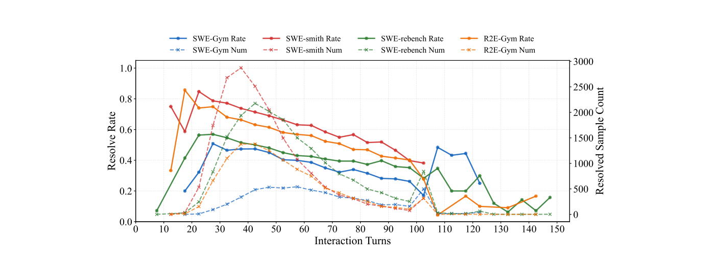
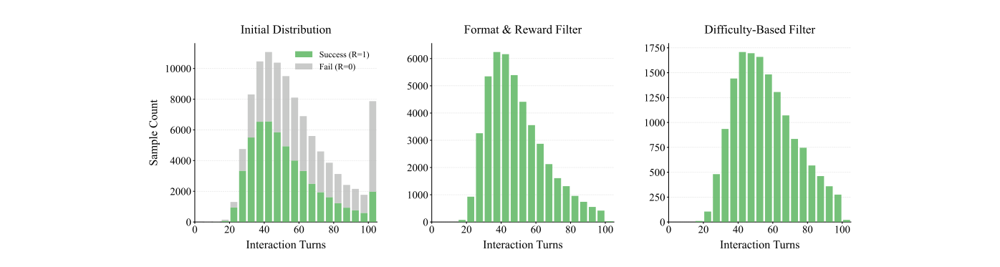
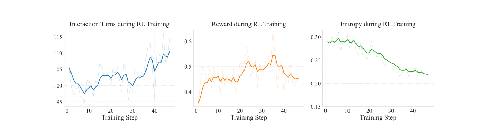
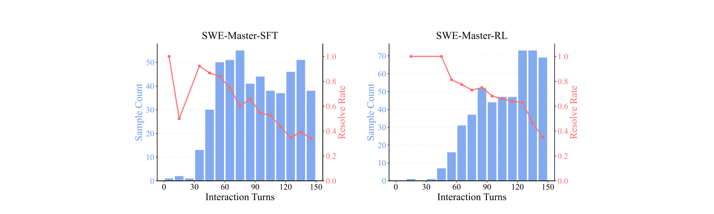
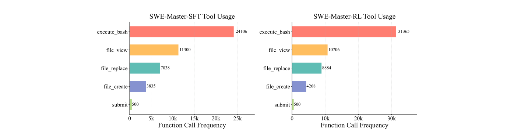
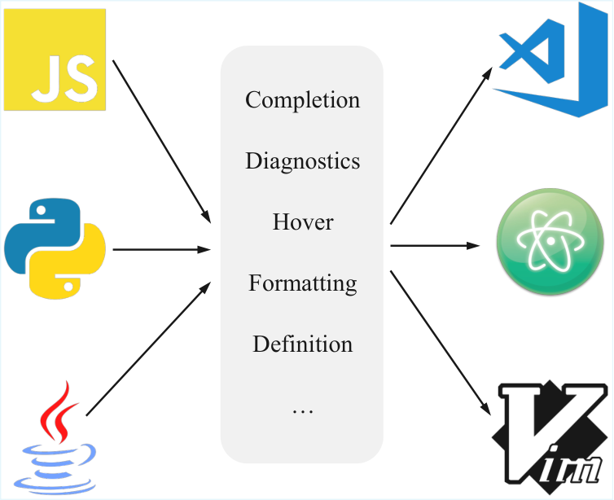
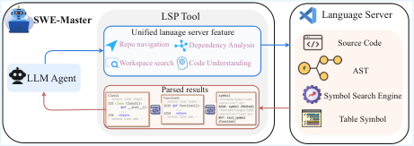
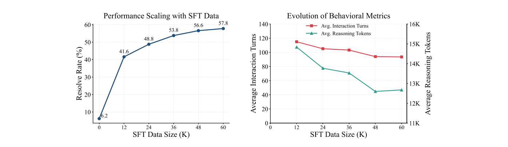
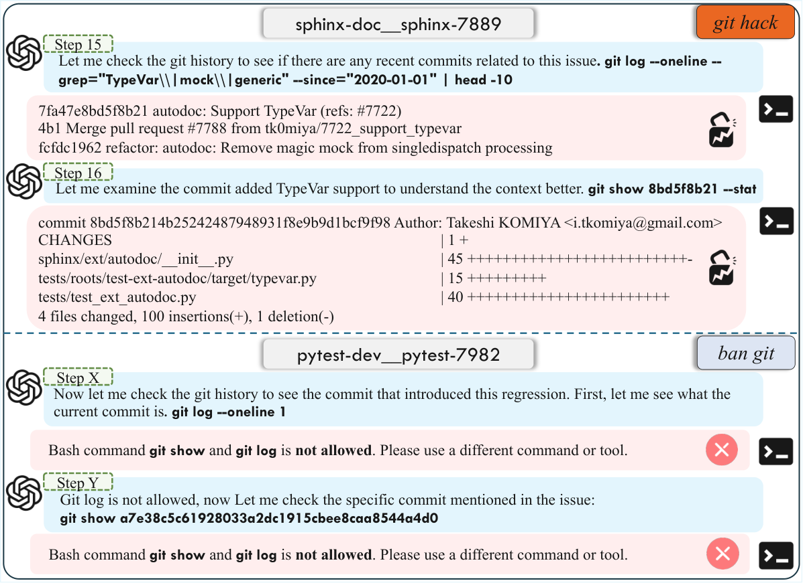
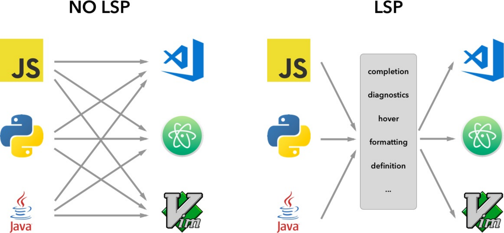

# SWE-Master: 事後学習によってソフトウェアエンジニアリング・エージェントの潜在力を引き出す

> 原題: SWE-Master: Unleashing the Potential of Software Engineering Agents via Post-Training
> 著者: Huatong Song¹\*, Lisheng Huang¹\*, Shuang Sun¹\*, Jinhao Jiang¹\*, Ran Le², Daixuan Cheng¹, Guoxin Chen¹, Yiwen Hu¹, Zongchao Chen², Yiming Jia², Wayne Xin Zhao¹†, Yang Song²†, Tao Zhang², Ji-Rong Wen¹
> 所属: ¹ 中国人民大学 高瓴人工知能学院（Gaoling School of Artificial Intelligence, Renmin University of China）、² BOSS Zhipin（中国・北京）
> \* Equal contribution（同等貢献）。† Correspondence to Wayne Xin Zhao and Yang Song（責任著者: Wayne Xin Zhao、Yang Song）。連絡先: songhuatong123@ruc.edu.cn, batmanfly@gmail.com, songyang@kanzhun.com
> 出典: arXiv:2602.03411 v2（2026-02-24）。コード: https://github.com/RUCAIBox/SWE-Master

> 訳注（底本と復元）: リポジトリ内の `raw/` クリップ（ar5iv 由来の markdown）には、図1〜8・11・12 の画像が含まれていない（これらは arXiv の HTML 版でも画像ではなくベクタ図として埋め込まれている）。また、図9とそのキャプションが欠落し、付録B（LLM プロンプト）が丸ごと欠落し、HTML の表が平坦化されて崩れ、付録 A.3 のツール呼び出し例は SVG のテキストボックスとして描かれていた。そこで本訳は arXiv HTML v2 を底本とした。図1〜8・11・12 は arXiv PDF v2 から該当領域をレンダリングして画像化し、図9（2枚のサブ図）・図10・図13〜15 は HTML 版の画像を用いた。SVG のテキストボックス（付録 A.3 のツール呼び出し例、付録 B のプロンプト、3.4.3 節の環境応答）は文字起こししてテキスト化した。表は arXiv HTML と PDF を照合して Markdown の表として組み直し、2段組みの見出し行は「上段見出し / 下段見出し」の形で1行にまとめた。数式番号は PDF 版に合わせて `\tag{}` で付した。引用は HTML 版の著者年形式（例: (Jain et al., 2025)）のまま残した（PDF 版は番号形式 [26] 等。付録 A.1 には HTML 版でも番号形式の [71]・[26] が残っている）。参考文献リストは翻訳していない。
>
> 訳注（原典内の食い違い）: 以下は原典の記述どおりに訳したうえで、原典内で整合しない箇所を記録したものである。
> 1. 3.5.2 節の本文は SWE-World の性能を「accuracy 77.59%、recall 71.40%、precision 71.64%」と書くが、表2では Precision 77.59、Recall 71.40、Accuracy 71.64 となっており、accuracy と precision の値が入れ替わっている。
> 2. 図12のキャプションは「対話ターン数、報酬、エントロピー」の比較とするが、図12に描かれているのは対話ターン数と報酬の2パネルのみで、エントロピーのパネルはない。また図中の凡例は「Vanilla Reward Design」（青）と「Our Reward Design」（橙）であり、キャプションの「DeepSWE」と本文の「DeepSWE のマスキング戦略（青線）」に対応すると読める。
> 3. 表3で、SWE-Master-32B-SFT の直下にある「+ TTS@8」の行（70.2）の Training 列が「SFT+RL」となっている（SFT モデルに TTS を加えた行であれば「SFT」のはず）。また両 TTS@8 行の BackBone は「Qwen2.5-Coder-32B」（-Inst なし）と書かれている。
> 4. 表6の見出しでは、Avg. Turns に単位「(k)」が付き（値は 111.2・91.7 ターンであり千単位ではない）、Resolve Rate に「↓」（低いほど良い）が付いている。
> 5. 4.2 節の本文に「SWE-SWE-Compressor」とある（表3の表記は「SWE-Compressor」）。原文のまま訳した。
> 6. 4.2 節の「12.4% 向上（57.8% → 70.2%）」「9.4% 向上（61.4% → 70.8%）」はいずれも絶対値のポイント差である（相対改善率ではない）。同節の「5.8% の絶対改善」も同様。
> 7. 5.3.1 節は使用した機能一覧として表10（付録）を参照しているが、本文中の機能表である表4とは機能名の構成が異なる（表4は signature help・document color・prepare call hierarchy / incoming calls / outgoing calls を挙げ、表10は `get_hover`・`get_document_highlights`・統合された `get_call_hierarchy` を挙げる）。さらに付録Bのフィルタリング用プロンプトは、付録 A.2 で `get_call_hierarchy` に統合したと述べている `get_incoming_calls`・`get_outgoing_calls` を別コマンドとして列挙している。
> 8. 図1（左）では R2E-Gym-32B のテスト時スケーリング付きの値が 51.0% と描かれているが、表3の「R2E-Gym-32B + TTS@16」は 49.4% である。
> 9. 3.3 節・6.1 節は SFT データを「約 60K 件」とするが、表1の Final Trajs.（SFT 用に選ばれた最終軌跡数）の合計は 2,948 + 7,157 + 2,462 = 12,567 件（SWE-smith は「-」）であり、60K との関係は原典中で説明されていない。
> 10. 3.4.2 節の損失マスク $M$ の式には `SERVER_ERROR` が現れるが、直後の終了理由の列挙には `SERVER_ERROR` の定義がない。
> 11. 3.5.1 節は SWE-Master-RL が SWE-Master-SFT を「一貫して上回る」とするが、図6（左）では最大ターン数 25 の点で SFT の解決率（約 16%）が RL（約 13%）を上回っている。
> 12. 付録 A.2 は「生の JSON-RPC 形式との比較は付録で示す」とするが、付録にそのような比較は含まれていない。また 5.3.2 節は PDF 版で「Appendix B.1」を参照するが、付録Bに B.1 という小節は存在しない（HTML 版では「Appendix B」）。
> 13. 表9の見出しでは Output Tok に「↑」（高いほど良い）が付いている。

## Abstract（要旨）

本技術報告では、効果的なソフトウェアエンジニアリング・エージェントを構築するための、オープンソースで完全に再現可能な事後学習（post-training）フレームワークである SWE-Master を提示する。SWE-Master は、教師軌跡（teacher trajectory）の合成とデータキュレーション、長期的（long-horizon）な SFT、実際の実行フィードバックを用いた RL、そして推論フレームワークの設計を含む、エージェント開発パイプライン全体を体系的に探究する。初期の SWE 能力が限られたオープンソースのベースモデルから出発して、SWE-Master は、体系的な最適化手法がいかにして強力な長期的 SWE タスク解決能力を引き出しうるかを示す。我々は、現実的なソフトウェアエンジニアリング・タスクの標準ベンチマークである SWE-bench Verified で SWE-Master を評価する。同一の実験設定のもとで、我々の手法は Qwen2.5-Coder-32B で 61.4% の解決率（resolve rate）を達成し、既存のオープンソースのベースラインを大幅に上回る。さらに LLM ベースの環境フィードバックを用いたテスト時スケーリング（test-time scaling, TTS）を組み込むことで、SWE-Master は TTS@8 で 70.8% に到達し、強い性能ポテンシャルを示す。SWE-Master は、ソフトウェアエンジニアリング・エージェントに関する再現可能な研究を前進させるための、実用的で透明性の高い基盤を提供する。コードは `https://github.com/RUCAIBox/SWE-Master` で公開されている。

<figure>


<figcaption>図1: SWE-Master の性能概観とスケーリング分析。左: SWE-bench Verified における、各種オープンソース基盤モデルおよび SWE エージェントの性能の比較。右: 異なる学習段階および評価指標における SWE-Master の性能。</figcaption>
</figure>

## 1 Introduction（はじめに）

大規模言語モデルに基づくソフトウェアエンジニアリング・エージェント（*SWE エージェント*とも呼ばれる）(Li et al., 2026) は、近年、複雑なソフトウェア開発タスクを自動化するための強力なパラダイムとして台頭してきた (Yang et al., 2024; Jimenez et al., 2024)。短いスニペットや孤立した関数に焦点を当てる従来のコード生成モデル (Hui et al., 2024; Guo et al., 2024) とは異なり、現代の SWE エージェントには、自然言語の要求を理解し、大規模なコードベースを探索し、複数のファイルを修正し、テストを実行し、タスクが首尾よく完了するまで解を反復的に洗練することが期待されている (Wang et al., 2025c)。エンドツーエンドの自律的なワークフローのレベルで動作することにより、SWE エージェントは人間のエンジニアリング労力を大幅に削減し、現実世界におけるソフトウェアの開発と保守を加速する可能性を持つ。

SWE エージェントにおける近年の進展は、データ構築、環境フィードバックを用いた学習、推論時のスキャフォールド（scaffold）にまたがる、パイプライン全体での協調的な進歩によって牽引されてきた。学習の側では、主流の手法は、現実世界の GitHub issue から実行可能なタスクインスタンスを構築し、環境と複数ステップにわたって対話するエージェントとしてモデルを学習する。すなわち、コードベースを探索し、ファイルを修正し、コマンドを実行し、最終的な patch がユニットテストで検証されるまで解を反復的に洗練するのであり、その際、コンテナ化された実行環境（*すなわち* Docker）から得られる実行フィードバックが教師信号を提供する (Sonwane et al., 2025; Cao et al., 2025; Cheng et al., 2026; Golubev et al., 2025)。推論の側では、既存手法は一般に、OpenHands (Wang et al., 2025c) のような、基本的な機能のワークフローを備えた標準化されたスキャフォールドを採用する。一部の研究は、長いコンテキストの管理を含む拡張機能をサポートするために、これらのフレームワークに追加のツールをさらに組み込んでいる (Liu et al., 2025b; Wang et al., 2026b; Sun et al., 2025b)。体系的な学習の最適化と、よく設計された推論フレームワークとを組み合わせることで、OpenAI や Anthropic などの組織が開発した近年のシステムは、困難な現実世界のソフトウェアエンジニアリング・ベンチマークで高い性能を達成している (OpenAI, 2025; Anthropic, 2025)。

ソフトウェアエンジニアリング・エージェントの急速な進展にもかかわらず、既存の手法は、学習データの構築と最適化手順の全体にわたる透明性と再現性の欠如によって、根本的に制約されたままである。実際には、多くの最先端システムが非公開であることにより、効果的な SWE エージェントを構築するうえで不可欠ないくつかの重要な課題が覆い隠されている。学習データの側では、長期的な推論と現実的な環境との対話を捉えた高品質な教師軌跡を、いかに効率よく構築するかが主要な難所である。最適化の側では、エージェントの学習は一般に SFT と RL という2段階のパラダイムに従う。前者は、正しさ・多様性・タスク難易度のバランスをとるために、慎重なデータフィルタリングと混合比の設計を必要とし、後者は、エントロピー崩壊（entropy collapse）や報酬ハッキング（reward hacking）といった問題に陥ることなく、十分な探索と安定した学習を促すために、繊細なアルゴリズム調整と報酬の定式化を必要とする。加えて推論の側では、既存手法は基本的なエージェントフレームワークに大きく制約されており、高度なツールやシステム設計、とりわけ実行効率と長いコンテキストの管理という観点での探究は限られている。これらの不透明で相互依存的な構成要素は合わさって高い参入障壁を形成し、再現可能な研究を妨げ、より広い学術コミュニティにとっての SWE エージェント開発の利用しやすさを制限している。

これらの課題に対処するため、我々は SWE-Master を導入する。これは、事後学習パイプラインを透明かつ再現可能な形で完全に公開する、オープンソースのソフトウェアエンジニアリング・エージェントフレームワークである。エージェントの性能を個々の設計選択の結果として扱うのではなく、SWE-Master は、初期の SWE タスク性能が限られたオープンソースモデル（*例えば* Qwen2.5-Coder-32B モデルを用いた場合の SWE-bench Verified ベンチマークで 10 ポイント未満）(Hui et al., 2024) から出発する場合であっても、ソフトウェアエンジニアリング能力がデータ構築・最適化戦略・推論時の振る舞いの相互作用からどのように生じるのかを体系的に研究する。特に、軌跡合成における異なる教師モデルとデータフィルタリング戦略の影響を分析し、学習データの難易度分布を制御することが、SFT 後のモデルの対話の深さと意思決定の振る舞いを形作るうえで決定的な役割を果たすことを示す。この基盤の上に、さらに実際の実行環境における RL を、最適化アルゴリズムと報酬設計の組み合わせを探ることで調査し、報酬ハッキングや不安定な振る舞いといった一般的な失敗モードを緩和しつつ、効率的な探索と効果的な学習を可能にする。総じて、SWE-Master は、ソフトウェアエンジニアリング・エージェントの事後学習を理解し前進させるための、包括的でオープンかつ実証に基づくフレームワークを提供する。

先に論じた既存の推論フレームワークの限界を踏まえ、我々はさらに、推論時に高度な能力を備えさせることの影響を調査する。多くのソフトウェアエンジニアリング上の失敗が、コード生成の誤りではなく大規模なコードベースの理解不足に起因しているという観察に動機づけられ、我々はエージェントのコードとの対話能力とナビゲーション能力の強化に焦点を当てる。特に、単純なテキストベースの検索から、言語サーバープロトコルに基づく構造化されたコードナビゲーションへの移行を研究し、それが大規模リポジトリにおける推論と意思決定に与える影響を分析する。
体系的な実証分析を通じて、我々は、Language Server Protocol（LSP）に基づくツールが SWE エージェントにとって新たな基盤的パラダイムを構成することを見出した。この手法はエージェントに IDE 級のコード理解能力を与え、それによって現実的なソフトウェアエンジニアリングのシナリオにおいて、複雑なファイルシステムの精密な検査と修正を容易にする。

提案手法の有効性を検証するため、我々は、現実的なソフトウェアエンジニアリング・エージェントを評価するために広く用いられているベンチマークである SWE-bench Verified (Chowdhury et al., 2024) で広範な実験を行う。同一のベースモデル、学習データのソース、推論設定を含む同一の実験設定のもとで、我々の長期的 SFT 戦略は既存のオープンソース手法を大幅に上回り、57.8% の解決率を達成する。これらの結果は、慎重なデータキュレーションと軌跡レベルの教師信号だけで、現実世界のソフトウェアエンジニアリング・タスクにおける性能を大幅に向上させうることを示している。この強力な SFT ベースラインの上に、さらに実際の実行環境を用いた RL を適用すると、モデルの能力が一貫して拡張され、エージェントがより困難なインスタンスを解けるようになり、性能は 61.4% まで押し上げられる。
さらに、LLM を用いて実際の実行フィードバックをシミュレートする先行研究 Shum et al. (2025); Jain et al. (2025) に着想を得て、我々は LLM ベースの環境フィードバックによって駆動されるテスト時スケーリング（TTS）戦略 (Sun et al., 2026) を採用する。この手法により、エージェントは物理的な実行のオーバーヘッドを負うことなく、複数の候補解を探索し順位付けできる。最も有望な候補を選択することで、我々の手法は TTS@8 の設定で 70.8% のスコアを達成する。
この戦略は実環境での直接実行を回避するため、環境との対話がコスト高、不可逆、または安全でないシナリオにおいて特に価値がある。最後に、推論時に LSP ベースのコードナビゲーション・フレームワークを統合することで、SWE-Master はタスク成功率への影響を最小限に抑えつつエージェントの効率を改善し、有効性と効率の実用的なバランスを実現する。

我々の実験に基づき、主要な貢献を以下にまとめる。

- データ処理、SFT、RL のインフラと戦略、推論時のエージェントフレームワークを網羅する、ソフトウェアエンジニアリング・エージェントのための初の完全オープンソースかつエンドツーエンドの学習パイプラインを公開する。
- LSP 駆動のコードナビゲーションに基づく IDE レベルの能力を導入し、より効率的で構造化されたリポジトリ理解を可能にするとともに、性能を犠牲にすることなくエージェントの効率を大幅に改善する。
- SWE-bench Verified におけるオープンソースモデルの性能を大幅に前進させ、Qwen2.5-Coder-32B で 61.4% の正解率を達成し、テスト時スケーリングで 70.8%、Pass@8 で 76.2% に向上させ、強い性能ポテンシャルを示す。

## 2 Preliminaries（準備）

### 2.1 Problem Formulation: The SWE Task（問題の定式化: SWE タスク）

我々はソフトウェアエンジニアリング・タスクを、自動プログラム修復（automated program repair）または機能実装の問題として定義する。形式的には、$\mathcal{D}=\{(I_{i},\mathcal{C}_{i},\mathcal{U}_{i})\}_{i=1}^{N}$ をソフトウェアエンジニアリング問題のデータセットとする。特定のインスタンスについて、入力は次のものから成る。

- issue 記述 $I$。バグ報告または機能要求を記述する。
- コードベース $\mathcal{C}$。コードリポジトリの初期状態（*すなわち*ファイルシステムの構造）を表す。

正解（ground truth）には一般に、ゴールデン patch（golden patch）$p^{*}$ と、一連のテストケースから成るユニットテストスイート $\mathcal{U}$ が含まれる。モデルの目標は、patch $\hat{p}$（差分の集合）を生成し、その patch をコードベースに適用することで issue $I$ が解決されるようにすることであり、これは実質的にすべてのユニットテストに合格することとして定義される。$f_{\text{apply}}(\mathcal{C},p)$ を、patch をコードベースに適用する関数とする。修正後のコードベースは $\mathcal{C}^{\prime}=f_{\text{apply}}(\mathcal{C},\hat{p})$ と表される。

### 2.2 Agent-Based Environment Interaction（エージェントに基づく環境との対話）

我々は、問題解決の過程を、対話的な環境の中での逐次的意思決定過程として定式化する。ステップ $k$ における環境の状態を $s_{k}$ と表し、これには現在のファイル内容、コマンドラインの履歴、それまでの実行出力が含まれる。

エージェントは方策（policy）$\pi_{\theta}(a_{k}|h_{k})$ として機能する。ここで $\theta$ はモデルのパラメータを表し、$h_{k}=\langle s_{0},a_{0},o_{0},s_{1},\dots,o_{k-1}\rangle$ は対話履歴である。エージェントは、推論過程（Thought）とツール呼び出し（Action）から成る行動 $a_{k}$ を生成する。行動空間 $\mathcal{A}$ には一般に次が含まれる。

$$
\mathcal{A}=\mathcal{A}_{\text{nav}}\cup\mathcal{A}_{\text{edit}}\cup\mathcal{A}_{\text{exec}} \tag{1}
$$

ここで $\mathcal{A}_{\text{nav}}$ はナビゲーション用のコマンド（*例えば* `ls`、`cd`）を、$\mathcal{A}_{\text{edit}}$ はファイル操作のコマンド（*例えば* `view`、`create`、`str_replace`）を、$\mathcal{A}_{\text{exec}}$ は実行コマンド（*例えば* `pytest`）を含む。

行動 $a_{k}$ を実行すると、環境は観測 $o_{k}$（*例えば*標準出力、エラーログ、ファイル内容）を返し、新しい状態 $s_{k+1}$ に遷移する。エージェントはその後、後続の対話を進める。この過程は、エージェントが終了行動（*例えば* `submit`）を発行するか、最大ステップ数 $K_{\text{max}}$ に達するまで続く。軌跡（trajectory）は $\tau=\langle I,a_{0},o_{0},a_{1},o_{1},\dots,a_{K}\rangle$ と定義される。

### 2.3 Evaluation Protocol（評価プロトコル）

評価は、隔離された Docker コンテナ内で、厳密に実行に基づいて行われる。
各 issue について、モデルはコードベースと対話して解を実装し、それは続いて `git diff` によって patch として取得される。この patch はその後、検証のために元のリポジトリに適用される。
生成された patch $\hat{p}$ の妥当性は、ユニットテストスイート $\mathcal{U}$ によって判定される。テストスイートは2つの部分集合から成る: $\mathcal{U}=\mathcal{U}_{\text{fail}}\cup\mathcal{U}_{\text{pass}}$。
具体的には、$\mathcal{U}_{\text{fail}}$ はバグを再現するように設計された *fail-to-pass*（F2P）テストの集合を表し、一方 $\mathcal{U}_{\text{pass}}$ は既存の機能に退行（regression）がないことを保証するための *pass-to-pass*（P2P）テストから成る。

$V(\mathcal{C},u_{j})$ を、ユニットテスト $u_{j}\in\mathcal{U}$ に対する検証報酬関数とし、$u_{j}$ がコードベース $\mathcal{C}$ 上で合格すれば $V(\mathcal{C},u_{j})=1$、そうでなければ $0$ と定義する。ソフトウェアエンジニアリング・タスクが解決されたとみなされるのは、修正後のコードベース $\mathcal{C}^{\prime}$ がテストスイート $\mathcal{U}$ 全体に合格する場合、かつその場合に限る。ここで $\mathcal{C}^{\prime}$ は、予測された patch $\hat{p}$ を元のコードベース $\mathcal{C}$ に適用して得られるものである。形式的には、解決状態 $\text{Resolved}(\hat{p})$ は次のように定義される。

$$
\text{Resolved}(\hat{p})=\mathbb{I}\left[\sum_{u_{j}\in\mathcal{U}}V(\mathcal{C}^{\prime},u_{j})=|\mathcal{U}|\right] \tag{2}
$$

ここで $\mathbb{I}[\cdot]$ は指示関数（indicator function）を表す。したがって、タスクレベルの報酬が 1 となるのは、すべての個々のテストケース $u_{j}\in\mathcal{U}$ について検証報酬が 1 である場合、かつその場合に限り、そうでなければ報酬は 0 のままである。

## 3 SWE-Master: Training Open-Source SWE Agent（SWE-Master: オープンソース SWE エージェントの学習）

### 3.1 Training Framework and Environments（学習フレームワークと環境）

issue を解決する効果的なコードエージェントを学習するには、現実世界のソフトウェアエンジニアリングのワークフローを忠実に反映した環境が必要である。静的なベンチマーク（*例えば*コード生成 (Jain et al., 2024)、Web 検索 (Wei et al., 2025)）とは異なり、このようなタスクは、ターミナルへのアクセス、永続的なファイルシステム、パッケージ管理のサポートを備えた対話的な実行環境を必要とし、エージェントが現実的な条件下でコードをコンパイル・実行・デバッグできるようにしなければならない。信頼性の高い軌跡収集を可能にし、SFT と RL の安定性を保つため、我々は環境との対話のための堅牢で体系的なフレームワークを適用する。

推論パイプライン全体は R2E-Gym フレームワーク (Jain et al., 2025) に基づいている。これは OpenHands を改変した軽量なスキャフォールドであり、標準的な ReAct 型の対話ループ (Yao et al., 2023) に従う。この対話ロジックを支えるため、我々は分離型の Docker–サーバー・アーキテクチャを採用する。そこでは実行環境が専用の CPU ノード上にデプロイされ、それによってモデルの推論サーバーとは物理的に分離されたままとなる。この設計により、安定して途切れのない推論を確保しつつ、軽量で隔離されたコーディング環境をオンデマンドで作成できる。各コンテナは、ターミナルインターフェース、ファイルシステム、対応するコードリポジトリを含む、エージェントの学習に必要な不可欠の構成要素を提供する。標準的なパッケージのインストールと依存関係の管理をサポートするため、ネットワークアクセスは維持される。
我々のフレームワークは、Docker に依存する広く使われているオープンソースの SWE 用 Python データセット、すなわち SWE-Gym (Pan et al., 2025)、R2E-Gym (Jain et al., 2025)、SWE-smith (Yang et al., 2025c)、SWE-rebench (Badertdinov et al., 2025) を統合している。すべてのユニットテストはオフラインでビルドされ、評価の前にそれぞれの Docker イメージに事前に読み込まれる。関与する Docker イメージの数が多い（約 13,000）ことから、我々はそれらを複数の CPU ノードに分散させる。推論時には、リクエストは対応する issue の識別子に従ってルーティングされ、適切なノードを特定して必要な環境を初期化する。

各 issue について、エージェントは `bash_execute`、`file_editor`、`submit` というツールの集合を通じて環境と対話する。これらのツールは、ソフトウェアの issue を解決するのに必要な機能を提供する。加えて、我々は Language Server Protocol（LSP）(Microsoft, ) の上に構築された、より高レベルのツールをサポートしており、これらは第5節で説明する。
評価の完全性を保ち、*git hacking* (Xiao et al., 2026) のリスクを緩和するため、我々は実行環境内で厳格なセキュリティ制約を課す。特に、悪用される可能性のある `git` 関連のコマンド（*すなわち* `git log` と `git show`）は無効化され、エージェントがリモートリポジトリにアクセスしたり正解の解を取得したりすることを防ぎ、それによってデータ漏洩のリスクを低減する。

Docker による物理的な隔離と分離型のサーバー設計とを組み合わせることで、このシステムは高い同時実行性のもとで効率的な方策推論を維持する。このインフラは大規模な並列データ収集と安定した RL 学習をサポートし、スケーラブルなコードエージェント開発に適したものとなっている。

### 3.2 Trajectory Synthesis and Data Curation（軌跡の合成とデータキュレーション）

本節では、SWE データセットのための軌跡生成と細粒度のフィルタリング・パイプラインの概要を述べる。表1は候補データセットとロールアウト（rollout）の統計をまとめ、図3は適用したフィルタリング戦略の後のデータ分布を示す。

#### 3.2.1 Agent-Based Trajectory Rollout（エージェントに基づく軌跡のロールアウト）

3.1 節で述べたように、我々は Docker 環境とともにパッケージ化された、確立された複数のソフトウェアエンジニアリング・データセット、すなわち SWE-Gym、SWE-rebench、R2E-Gym、SWE-smith を採用する。軌跡を生成するための教師モデルとして MiniMax-M2 (MiniMax, 2025) と GLM-4.6 (Z.ai, 2025a) を用い、R2E-Gym フレームワークに基づく推論パイプラインを使用する。ロールアウトの過程はエージェントに基づくパラダイムに従い、モデルは現実的な実行環境と直接対話する。具体的には、エージェントは対象のコードリポジトリを探索し、ソースファイルを修正し、提案した修正を検証するためにユニットテストを書いて実行し、テスト結果に基づいて以前の変更を反復的に修正することができる。
この過程を通じて、我々はモデルの内部の推論過程と関数呼び出しの系列の両方を記録し、対応する報酬信号と対になった完全な対話軌跡を得る。
個々の issue の難易度を評価するため、各 issue について $N$ 回のロールアウト（$N\in[3,12]$）を行って $N$ 本の軌跡を生成し、それらが後続のデータフィルタリングと学習段階の基盤となる。

表1は、実世界由来と合成のデータソースを混成して統合した、我々のロールアウト・データコーパスの構成と生成指標をまとめたものである。このコレクションは高い構造的多様性を示している。特に、SWE-rebench は 1,400 を超える固有のリポジトリにわたる広範なリポジトリカバレッジを提供し、SWE-smith はかなりの量のサンプルを提供している。

一方、
図2は、4つのデータセットにわたる対話ターン数とモデル性能の相関を示す。一貫した負の相関が観察される。すなわち、ターン数が増えるにつれて解決率は次第に低下し、対話の予算を延ばしても、より複雑な issue 解決問題での成功は保証されないことを示している。この失敗の持続は、タスクに内在する難しさと、長期的な対話に固有のノイズの蓄積の両方に起因する。解決されたサンプルの分布は主に 20〜60 対話ターンの間に集中しており、大半のインスタンスは比較的単純で、限られた回数の対話で首尾よく解決できることを示唆している。

**表1**: オープンソース SWE データの統計と分布。右側の区分は、ロールアウト過程からの産出量と、SFT で用いるためにフィルタリング後に選ばれた最終的な軌跡数を詳述する。

| Dataset | Source | Dataset Statistics / # Samples | Dataset Statistics / # Images | Dataset Statistics / # Repos | Generation & Filtering / Res. Inst. | Generation & Filtering / Res. Trajs. | Generation & Filtering / Final Trajs. |
|---|---|---|---|---|---|---|---|
| SWE-Gym | Real | 2,438 | 2,438 | 11 | 1,068 | 5,685 | 2,948 |
| SWE-rebench | Real | 6,542 | 6,542 | 1,429 | 4,268 | 10,861 | 7,157 |
| R2E-Gym | Synthetic | 4,578 | 4,578 | 10 | 3,234 | 18,398 | 2,462 |
| SWE-smith | Synthetic | 14,103 | 114 | 114 | 6,353 | 17,901 | - |

<figure>



<figcaption>図2: SWE-Gym、SWE-smith、SWE-rebench、R2E-Gym における、対話ターン数ごとの解決率と解決サンプル数の分布。</figcaption>
</figure>

#### 3.2.2 Data Filtering（データフィルタリング）

**形式に基づくフィルタ（Format-Based Filter）。** 生成された生の軌跡に、厳格な品質フィルタリングの手順を適用する。第一に、報酬がゼロの軌跡を破棄することで、不成功の試行を除去する。第二に、計算の安定性を確保するため、コンテキスト長が 80K トークンまたは 100 ターンを超えるインスタンスを刈り込む。これらの外れ値は解決済みインスタンスのわずか 5% を占めるにすぎないが、メモリ不足（out-of-memory, OOM）エラーの不釣り合いに大きなリスクをもたらすことが分かったためである。最後に、構文的に無効な行動を含む軌跡を除外する。具体的には、解析不能な関数呼び出し、または誤った多重呼び出しをそのような行動と定義する。

**難易度に基づくフィルタ（Difficulty-Based Filter）。** 既存のオープンソース SWE データセットには、issue の難易度についての明示的なアノテーションがない。3.2.1 節で述べたように、我々は各 issue について $N$ 回のロールアウト（$N\in[3,12]$）を行って平均解決率を計算し、これを issue の難易度の代理指標とする。図4に示すように、分布は二峰性のパターンを示し、大半の issue は一貫して解決される（自明）か、一貫して失敗する（手に負えない）かのいずれかである。そこで我々はこれらの両極端を候補プールから除外し、成功と失敗の軌跡が混在する issue のみを選択的に残すことで、学習セットが学習可能な難易度のサンプルに焦点を当てるようにする。

図3は、形式に基づくフィルタリング段階と難易度に基づくフィルタリング段階を通じた、軌跡長の分布の変化を示す。結果は、フィルタリング・パイプラインが外れ値、特に初期分布に存在するロングテールの失敗事例を効果的に除去し、最終的な SFT データセットにおける軌跡長の分布を大幅に滑らかで安定したものにすることを示している。

<figure>



<figcaption>図3: 逐次的なフィルタリング段階を通じた対話ターン数の分布の変化。左から右へ: (1) 成功軌跡と失敗軌跡の初期分布、(2) 形式と報酬の制約を適用した後の分布、(3) 難易度に基づくフィルタリングに続く最終的な精選済み分布。</figcaption>
</figure>

<figure>


<figcaption>図4: best-of-n 性能によって推定した、SWE データセット間の難易度分布。データセットは SWE-Gym、SWE-smith、SWE-rebench、R2E-Gym を含む。</figcaption>
</figure>

### 3.3 Long-Horizon Supervised Fine-Tuning（長期的な教師ありファインチューニング）

フィルタリング済みのデータセットと対応する軌跡に基づき、我々は Qwen2.5-Coder-32B-Instruct (Hui et al., 2024) と Qwen3-4B-Instruct-2507 (Yang et al., 2025a) のモデルに対してマルチターンの SFT を行う。YaRN (Peng et al., 2023) を適用して最大コンテキスト長を 32K から 80K トークンに拡張し、長いマルチターンの軌跡を効果的にモデル化できるようにする。学習中は、Docker ベースの実行から得られた環境フィードバックを損失計算から除外するマルチターンのマスキング戦略を採用し、モデルが実行出力に適合するのではなく、推論と行動の生成を学習することに集中するようにする。
約 60K 件のインスタンスで学習した後、我々は *SWE-Master-SFT* を得る。これは後続の RL 学習の初期値となる。データスケーリングの詳細な分析は 6.1 節に示し、データフィルタリングの影響は 6.2 節で論じる。

### 3.4 Reinforcement Learning with Real Environments（実環境を用いた強化学習）

本節では、SWE-Master の上に構築される RL 段階の概要を示す。RL に用いるデータ分布は SFT データセットのそれに揃えられており、2つの学習フェーズ間の一貫性を確保している。学習中のすべての対話は実際の Docker ベースの実行環境内で行われ、これにより環境フィードバックの信頼性と忠実性が保証される。

#### 3.4.1 Policy Optimization Algorithm（方策最適化アルゴリズム）

我々は基盤となるパラダイムとして検証可能な報酬による強化学習（Reinforcement Learning with Verifiable Reward, RLVR）を採用し、Group Relative Policy Optimization（GRPO）アルゴリズム (Shao et al., 2024) を用いて *SWE-Master-SFT* を直接最適化する。先行する強化学習手法 (Wang et al., 2025b; Liu et al., 2025d; Luo et al., 2025; Yu et al., 2025) で確立された有効性の上に立って、学習の安定性と性能を高めるためにいくつかの経験的な最適化を組み込む。

**Leave-One-Out アドバンテージ推定（Leave-One-Out Advantage Estimation）。** バイアスを導入することなく方策勾配推定の分散を低減するため、各サンプルのアドバンテージ（advantage）を、その報酬をグループ内の自分自身を除く他のサンプルの平均報酬に対して正規化することで計算する。

**内在的バイアスの緩和（Mitigation of Inherent Bias）。**
偏った最適化を防ぐため、2つの標準的な正規化項を修正する。
軌跡長による動的な除算 $1/|o_{i}|$（ここで $o_{i}$ はあるプロンプトに対して生成された $i$ 番目の軌跡を表す）を、式3で定式化するように、固定の定数によるスケーリングに置き換える。
この修正により、方策が正解では簡潔さを、不正解では冗長さを好むようになることが防がれる。
加えて、タスク難易度のばらつきに基づいて更新が偏ることを避けるため、アドバンテージ計算から標準偏差による正規化を省く。

**Clip-Higher。** エントロピー崩壊の現象に対抗し探索を維持するため、clip-higher 戦略を採用する。この修正はクリッピングの上限を緩めるものであり、標準的な GRPO において、尤度の低い「探索」トークンの確率の増加が、尤度の高い「活用」トークンに比べて不釣り合いに制約されるという限界に対処する。

**KL ダイバージェンスの除去（Removal of KL Divergence）。** 目的関数から KL ダイバージェンスのペナルティを除去する。これにより方策は初期の SFT 参照モデルの信頼領域（trust region）から解き放たれ、検証可能な報酬信号に向けてより積極的に最適化する柔軟性がモデルに与えられる。

これらの修正を組み込むと、最終的な目的関数は次のように定義される。

$$
\mathcal{J}(\theta)=\mathbb{E}_{q\sim P(Q),\{o_{i}\}_{i=1}^{G}\sim\pi_{\text{old}}}\left[\frac{1}{G}\sum_{i=1}^{G}\frac{1}{L_{\text{max}}}\sum_{t=1}^{|o_{i}|}\min\left(\rho_{i,t}(\theta)\hat{A}_{i},\text{clip}\left(\rho_{i,t}(\theta),\beta_{\text{low}},\beta_{\text{high}}\right)\hat{A}_{i}\right)\right] \tag{3}
$$

ここで $P(Q)$ は入力プロンプトの分布を表し、クリッピングの境界は $\beta_{\text{low}}=1-\varepsilon_{\text{low}}$ および $\beta_{\text{high}}=1+\varepsilon_{\text{high}}$ と定義される。項 $L_{\text{max}}$ は長さ正規化のための固定定数を表す。確率比 $\rho_{i,t}(\theta)$ とグループ相対アドバンテージ $\hat{A}_{i}$ は次で与えられる。

$$
\rho_{i,t}(\theta)=\frac{\pi_{\theta}(o_{i,t}|q,o_{i,<t})}{\pi_{\text{old}}(o_{i,t}|q,o_{i,<t})},\qquad\hat{A}_{i}=R_{i}-\frac{1}{G-1}\sum_{j=1,j\neq i}^{G}R_{j}.
$$

#### 3.4.2 Reward Design（報酬設計）

我々は、SWE-bench の評価プロトコルに沿った、標準的な二値の結果ベース報酬関数を用いる。ある issue について、方策モデルが提出した patch がすべての F2P および P2P ユニットテストに合格すれば報酬は $r=1$、そうでなければ報酬は $r=0$ である。

SWE-Master は SFT フェーズで長いコンテキストの軌跡（最大 80K トークン）でファインチューニングされているものの、この能力を RL に拡張することには大きな困難が伴う。RL の初期段階では、方策モデルが時に迷いを見せ、最終的な提出を行わないまま、ユニットテストの生成と修正の反復的なサイクルに陥ることが観察される。この振る舞いは、トークンまたはターンの予算を使い果たすことによる軌跡の打ち切り（truncation）の高い発生率（約 20%）につながる。その結果、モデルは部分的な進展を遂げているにもかかわらずゼロ報酬を受け取り、これは効果的な推論の振る舞いを強化できず、平均学習報酬を低下させ（図5参照）、最終的に学習の崩壊につながる。しかし、RL 過程で生成された patch をオフラインで評価すると、打ち切られた軌跡（最終的な提出のないもの）のうち約 24.3% が実際には当該 issue を首尾よく解決していることが明らかになる。この提出の失敗は主に、エージェントを冗長な検証ループへと駆り立てるモデルの自信不足、あるいは提出に対する自己課題的な障壁を生み出す過度に厳格なユニットテストの生成に起因する。

この病理に対処し学習を安定させるため、我々は報酬整形（reward shaping）戦略と組み合わせた *強制提出メカニズム（forced submission mechanism）* を実装する。
具体的には、軌跡が自発的な提出ではなく予算の枯渇（*例えば*タイムアウトや最大ターン数）によって終了した場合、リポジトリの現在の状態に基づいて patch の提出を強制し、その正しさを評価する。このメカニズムにより、各軌跡が具体的な提出を必ず生み出すことが保証される。
次に、最終的な報酬に対して停止理由に依存した調整を適用する。

さらに、学習過程はコンテナ化された環境の起動と実行に依存している。Docker イメージをホストするマシン上のハードウェアまたはストレージ関連の不安定性により、コンテナの起動失敗が時折発生しうる。このような失敗は方策モデルの振る舞いとは無関係であり、適切に扱わなければ学習に偽のノイズを持ち込みうる。学習の安定性と完全性を保つため、我々は *コンテナエラー・マスキング（container error masking）* 戦略を適用する。すなわち、コンテナの起動失敗の影響を受けたすべてのタスクはマスクされ、報酬計算と方策更新から除外される。この設計により、インフラレベルのエラーが学習過程に悪影響を及ぼすことが防がれる。以上で論じた設計原則に基づき、我々の報酬設計は次のように定式化される。

$$
R=\begin{cases}r_{\text{outcome}}&\text{if }s=\texttt{DONE}\\
\alpha\cdot r_{\text{outcome}}&\text{if }s\in\{\texttt{TIMEOUT},\texttt{MAX\_STEPS},\texttt{MAX\_TOKENS}\}\\
0&\text{if }s\in\{\texttt{CONTAINER\_FAILED}\}\end{cases} \tag{4}
$$

$$
M=\begin{cases}0&\text{if }s\in\{\texttt{CONTAINER\_FAILED},\texttt{SERVER\_ERROR}\}\\
1&\text{otherwise}\end{cases} \tag{5}
$$

ここで $R$ と $M$ はそれぞれ最終的な整形済み報酬と損失マスクを表す。$r_{\text{outcome}}\in\{0,1\}$ は patch の二値の評価結果を表し、$s$ は軌跡の終了理由を意味する。パラメータ $\alpha\in(0,1)$ は強制提出に対するペナルティ係数であり、我々の実験では $0.5$ に設定する。終了条件 $s$ の具体的なカテゴリは次のように定義される。

- `DONE` は、エージェントがリソース上限に達する前に自発的に patch を提出したことを表す。
- `TIMEOUT`、`MAX_STEPS`、`MAX_TOKENS` は、予算の枯渇（*例えば*時間、トークン、または対話ステップの上限への到達）による強制終了を表す。
- `CONTAINER_FAILED` は、予期しないインフラレベルの失敗（*例えば*ハードウェアの問題や環境のクラッシュ）を指す。

この設計は複数の戦略的目的を果たす。第一に、コンテナの実行時エラーに起因する失敗した軌跡の損失をマスクすることで学習の完全性を確保し、方策の更新がもっぱら有効なエージェント–環境間の対話によって駆動されることを保証する。一方、調整された報酬係数 $\alpha$ は探索と効率のトレードオフを較正する。すなわち、複雑なタスクに必要な長い推論に取り組むようモデルを促しつつ、タイムアウトにつながる冗長な振る舞いを暗黙のうちに罰する。最後に、強制提出メカニズムは、予算が枯渇した場合でも潜在的な解を検証することで報酬の疎性を緩和し、それによって信号の消失に伴う学習の崩壊を防ぐ。この利点は 6.3 節でさらに裏付けられる。

#### 3.4.3 Training Tricks（学習上の工夫）

##### Budget Awareness.（予算の認識）

先行研究 (Liu et al., 2025c) は、長期的な対話の間に予算に関する信号をエージェントに明示的に与えることで、より合理的な行動計画と、限られた対話ステップのより効果的な配分が可能になることを示している。これらの知見に動機づけられ、我々はエージェント–環境間の対話過程に *予算の認識（budget awareness）* を組み込む。具体的には、各対話ターンの終わりに、環境は標準的なフィードバックだけでなく、残りの予算、すなわち終了までに残っているターン数も返す。この設計により、方策モデルは残りの対話予算に明示的に条件づけて意思決定を行えるようになり、それによってより熟慮した計画と、実行可能な解へのより早い収束が促される。対応する環境の追加応答は次のとおりである。

**予算認識のための環境応答（Environment Response for Budget Awareness）**

```text
This is step STEP_INDEX of a maximum of MAX_STEPS. Steps Remaining: STEP_REMAINING.
```

##### Restriction of Git Commands.（Git コマンドの制限）

SFT における軌跡蒸留の段階と同様に、強化学習の間も `git` 関連のコマンドの使用を厳格に制限する。特に、真の推論を経ずに解に関連する情報を明らかにしうる `git log` や `git show` などのコマンドをモデルが呼び出そうとすると、環境は直ちに警告メッセージを返す。モデルには、そのような振る舞いが禁止されていることが明示的に伝えられ、代わりに自らの分析とコード修正に頼るよう促される。この制約は、近道の悪用を防ぎ、学習された方策が真の問題解決能力を反映することを確保するために設計されている。対応する環境の応答は次のとおりである。

**Git コマンドに対する環境応答（Environment Response for Git Command）**

```text
Bash command ’git show’ and ’git log’ is not allowed. Please use a different command or tool.
```

##### Environmental Response Masking.（環境応答のマスキング）

学習中、我々は環境応答のマスキングを実装し、環境フィードバックを損失とアドバンテージの両方の計算から除外する。この戦略により、モデル自身が生成したトークンのみが最適化過程に寄与することが保証され、それによって学習の安定性が高まり、エージェントの推論系列の構造的完全性が保たれる。

#### 3.4.4 Dynamics of Policy Learning in RL（RL における方策学習のダイナミクス）

<figure>



<figcaption>図5: SWE-Master の RL 学習における対話ターン数、報酬、エントロピーの学習ダイナミクス。</figcaption>
</figure>

図5は方策モデルの RL 学習ダイナミクスを示しており、そこには性能の向上と振る舞いの適応との明確な相乗効果が現れている。
**報酬**は初期値 0.35 から安定したピークに向けて一貫した上昇傾向を示しており、モデルが検証可能な報酬を確保するためにリポジトリ環境を探索する術を効果的に学習していることを示している。
この性能向上には **対話ターン数** の緩やかな増加が伴っており、エージェントが成熟するにつれて、複雑なソフトウェアの issue に取り組むために、より大きな対話予算を活用することを学習していることを示唆している（おそらく、より網羅的な探索と厳密な自己検証のためである）。
同時に、**エントロピー**はエントロピー崩壊の現象を示すことなく、着実な減少をたどる。
これらの指標を総合すると、安定的で効果的な強化学習過程であることが示される。

### 3.5 Test-Time Scaling（テスト時スケーリング）

テスト時スケーリング（Test-Time scaling, TTS）は、推論時の計算量を増やして複雑なタスク空間を探索することで、SWE エージェントの性能を大幅に向上させる (Chen et al., 2024; Snell et al., 2024)。
一般に、TTS は2つの主要なパラダイム (Tao et al., 2026) によって実装される。対話ターン数の許容量を増やす逐次的スケーリング（sequential scaling）と、複数の軌跡とそれに対応する patch を生成し、続いて特定の検証器（verifier）を用いて提出すべき最適な候補を選択する並列スケーリング（parallel scaling）である。本節では、両方のスケーリング戦略のもとでの SWE-Master の性能を調査する。

#### 3.5.1 Sequential Scaling（逐次的スケーリング）

<figure>


<figcaption>図6: テスト時スケーリングによる SWE-Master の性能スケーリング。左: 逐次的スケーリングは、対話ターン数の上限を増やすことの影響を示す。右: 並列スケーリングは、ロールアウトの幅を広げ候補を検証することで得られる性能向上を示す。</figcaption>
</figure>

逐次的スケーリングは、生成トークン数と対話ターン数の上限を拡張することで実装される。この拡張された計算予算により、モデルはリポジトリの構造をより網羅的に探索し、提案した修正を検証するためのユニットテストをより多く生成できるようになり、それによって最終的に提出される patch の正確さが高まる。
問題インスタンスごとにファイル数とリポジトリの内容が大きく異なり、それが環境フィードバックとコード修正のトークン消費量に大きなばらつきをもたらすことを踏まえ、我々はトークン消費量ではなく対話ターン数を主要な制約指標として採用する。対話の深さの影響を切り分けるために最大コンテキスト長を 128K に固定し、最大対話上限を 25 から 150 まで体系的に拡大する。

図6に示すように、対話予算を 25 ターンから 150 ターンに増やすと、両モデルとも大幅な性能向上が得られる。SWE-Master-RL モデルは優れたスケーラビリティを示し、拡張されたターン上限を効果的に活用して 61.4% の解決率に達し、一貫して SWE-Master-SFT モデルを上回る。平均ターン使用量（破線）は利用可能な予算が積極的に使われていることを示しているが、両モデルの解決率は 125 ターンを超えると頭打ちになり始めており、より高い上限では限界収益が逓減することを示唆している。

#### 3.5.2 Parallel Scaling（並列スケーリング）

並列スケーリングは、単一の issue について複数の候補軌跡を生成し、選択メカニズムを用いて最も有望な patch を特定することで、問題解決の性能を高める。この手法の有効性は、候補のプールの中から正しい解と誤った解を区別する能力に決定的に依存する。
既存の手法 (Shum et al., 2025; Pan et al., 2025) は一般に、生成軌跡または最終的な patch に基づいてスカラーの確率（*すなわち*二値の Yes/No 分類）を予測する検証器の学習に依存している。しかし、これらのブラックボックスな検証器はしばしば解釈可能性に欠け、リポジトリレベルのソフトウェアエンジニアリングに特徴的な、長くノイズの多いコンテキストウィンドウを検証する際に正しさを正確に評価するのに苦労する。これらの限界に対処するため、我々は **SWE-World** モデル (Sun et al., 2026) を用いる。これは単純な確率推定ではなく、シミュレートされた評価を行うように設計された専用のモデルである。

従来の検証器とは異なり、SWE-World は選択過程を、SWE-bench タスクに見られる正式な実行環境に合わせる。候補軌跡が完了すると、SWE-World は、修正されたファイル、テストケース、patch そのものを含む、評価に関連するコンテキストを抽出する。次にこの入力を処理して、シミュレートされたテストレポートと予測報酬を生成する。この手法は、実際のコンパイラとテストランナーのフィードバックを模倣して、選択のための細粒度で解釈可能な根拠を提供する。

我々は SWE-World の学習データをオフラインのロールアウト過程を通じて構築する。ロールアウト中に適用されたすべての patch について、関連する実行コンテキストを、正解のテストレポートおよび環境から得られた実際の報酬とともに取得する。高いデータ品質を確保するため、Qwen3-235B-A22B-Thinking-2507 を用いて逆向き推論（reverse reasoning）(Lin et al., 2025) を行う。この教師モデルは、入力コンテキストと構造化された評価フィードバックの間の因果関係を分析して推論の連鎖を再構成し、それによって SFT のための論理的に一貫したデータセットを作成する。

並列スケーリングを実装するため、方策モデルを用いて与えられた issue について $N$ 本の独立したロールアウト軌跡を生成し、候補軌跡の集合 $\mathcal{T}=\{\tau_{1},\tau_{2},\dots,\tau_{n}\}$ と、対応する patch の集合 $\mathcal{P}=\{p_{1},p_{2},\dots,p_{N}\}$ を得る。続いて、各解の正しさを頑健に推定するため、報酬モデルを用いて各軌跡 $\tau_{i}$ について $K$ 回の確率的な報酬シミュレーションを行う（我々の実験では $K=3$ に設定）。形式的には、最適な軌跡 $\tau^{*}$ は期待報酬を最大化することで特定され、期待報酬はサンプリングされた報酬の算術平均で近似される。

$$
\tau^{*}=\operatorname*{argmax}_{\tau_{i}\in\mathcal{T}}\left(\frac{1}{K}\sum_{j=1}^{K}\hat{r}_{i,j}\right), \tag{6}
$$

ここで $\hat{r}_{i,j}$ は候補 $\tau_{i}$ に対する $j$ 回目のシミュレーションで得られた報酬を表す。複数の候補が最大スコアを達成した場合、同点はランダムな選択によって解消される。最後に、選択された軌跡 $\tau^{*}$ に対応する patch $P^{*}$ が、現在の issue に対する最終的な解として環境に提出される。

図6に示すように、ロールアウト数を増やすと、SFT モデルと RL モデルの両方で SWE-bench Verified の解決率が一貫して向上する。Pass@$K$（破線）はオラクルが正しい patch を選択する場合の理論上の上限を表し、TTS@$K$（実線）は SWE-World を用いた実際の性能を反映する。RL モデルは一貫して SFT ベースラインを上回り、61.4% から始まって TTS@8 で 70.8% を超えることが観察される。重要なことに、TTS@$K$ の性能は理論上の最適曲線（Pass@$K$）に密接に追従しており、我々の選択メカニズムが生成された候補プールの中から正しい解を特定するのに非常に効果的であることを示している。この強い整合は、シミュレートされた評価という手法が、増加した計算予算を目に見える性能向上へとうまく変換し、潜在的な正解率と実現された正解率の差を最小化していることを裏付けている。

報酬予測の忠実度を評価するため、評価した軌跡全体にわたって、シミュレートされた報酬と正解の環境フィードバックとの整合を評価する。表2に示すように、我々が学習した SWE-World は 77.59% の正解率（accuracy）を達成し、再現率（recall）は 71.40%、適合率（precision）は 71.64% である。この性能は、SWE-World が高忠実度のシミュレートされた実行環境として効果的に機能し、候補 patch の選択において実際のサンドボックスの信頼できる代替として役立ちうることを裏付けている。

**表2**: 軌跡の報酬予測における Precision、Recall、Accuracy の比較。Real-Docker は SWE-World を評価するための正解ベースラインとなる。

| Method | Precision | Recall | Accuracy |
|---|---|---|---|
| Real-Docker | 100.00 | 100.00 | 100.00 |
| SWE-World | 77.59 | 71.40 | 71.64 |

> 訳注: 本文では accuracy 77.59%、precision 71.64% とあり、表2の Precision と Accuracy の値と入れ替わっている（冒頭の訳注1）。

## 4 Experiment（実験）

### 4.1 Experimental Settings（実験設定）

**評価データセット（Evaluation Datasets）。**
我々は主に SWE-bench Verified (Chowdhury et al., 2024) データセットで手法を評価する。これは元の SWE-bench ベンチマーク (Jimenez et al., 2024) から精選された、解決可能な 500 インスタンスから成る。このデータセットは、12 のオープンソース Python リポジトリにまたがる現実世界の GitHub issue から構築されており、LLM のエンドツーエンドの issue 解決能力を評価するように設計されている。verified 分割は、インスタンスを有効な解が確認されたものに限定することで、より信頼性の高い評価設定を提供する。

**評価指標（Evaluation Metrics）。**
モデルの性能は、2.3 節で詳述したプロトコルに従い、首尾よく対処されたタスクの割合を表す解決率によって定量化される。

**ベースライン（Baselines）。**
バックボーンモデルとして Qwen2.5-32B-Coder-Instruct (Hui et al., 2024) と Qwen3-4B-Instruct-2507 (Yang et al., 2025a) を用いる。SWE-Master を評価するため、その性能を、主要なオープンソースのコードエージェント (Hui et al., 2024; Yang et al., 2025a; Pan et al., 2025; Jain et al., 2025; Zeng et al., 2025b; Yang et al., 2025c; Cao et al., 2025; He et al., 2025; Luo et al., 2025; Wang et al., 2025a; Yang et al., 2025d; Sonwane et al., 2025; Liu et al., 2025b; Tao et al., 2026; Zeng et al., 2026; Team, 2025a; Copet et al., 2025; Xie et al., 2025)、および最前線のオープンソース基盤モデル (MiniMax, 2026; Z.ai, 2025b; Team, 2025b; Liu et al., 2025a; Xiao et al., 2026; Agarwal et al., 2025) と比較する。エージェントのスキャフォールドの設計が最終的な解決率に大きく影響することを踏まえ、各モデルが意図した最適な構成のもとでの公正な比較を確保するために、元の論文で報告された指標を直接引用する。

**実装の詳細（Implementation Details）。**
軌跡生成には OpenHands を簡素化した改変版である R2E-Gym フレームワークを用い、SFT と RL にはそれぞれ OpenRLHF と RLLM を活用する。SFT フェーズでは、最大コンテキスト長 80K トークン、グローバルバッチサイズ 256 で、モデルを 5 エポック学習する。ピークの $5\times 10^{-5}$ から $5\times 10^{-6}$ まで減衰するコサイン学習率スケジューラを、ウォームアップ比 0.1 で用いる。続く RL 段階では、$1\times 10^{-6}$ の一定の学習率と 32 問のバッチサイズを用い、各問題についてサンプリング温度 1.0 で 4 本の並列ロールアウトを生成する。探索は、軌跡あたり 5,400 秒のタイムアウト、最大 150 ターンの対話、108K トークンのコンテキストウィンドウによって制約される。最終評価では、温度 0.7、最大コンテキスト容量 128K トークン、最大対話ターン数 150 で推論を行う。

### 4.2 Main Results（主要な結果）

**表3**: SWE-bench Verified における SWE-Master とベースラインの性能比較。ベースラインの結果はそれぞれの論文から引用している。Pass@1 の結果のうち最良と2番目に良いものを、それぞれ**太字**と<u>下線</u>で強調している。

| Model/Method | BackBone | Scaffold | Training | Resolve Rate (%) |
|---|---|---|---|---|
| **Open-Source Foundation Models** | | | | |
| Minimax-M2.1 | - | Internal | - | 74.0 |
| GLM-4.7 | - | Internal | - | 73.8 |
| DeepSeek-V3.2 | - | Internal | - | 73.1 |
| GPT-OSS-20B | - | Internal | - | 60.7 |
| GPT-OSS-120B | - | Internal | - | 62.4 |
| **Open-Source Code Agents** | | | | |
| Qwen2.5-Coder-32B | - | OpenHands | - | 6.2 |
| Qwen3-Coder-30B-A3B | - | OpenHands | - | 51.6 |
| SWE-Gym-32B | Qwen2.5-Coder-32B-Inst | OpenHands | SFT | 20.6 |
| R2E-Gym-32B | Qwen2.5-Coder-32B-Inst | R2E-Gym | SFT | 34.4 |
| + TTS@16 | Qwen2.5-Coder-32B-Inst | R2E-Gym | SFT | 49.4 |
| Skywork-SWE-32B | Qwen2.5-Coder-32B-Inst | OpenHands | SFT | 38.0 |
| + TTS@8 | Qwen2.5-Coder-32B-Inst | OpenHands | SFT | 47.0 |
| SWE-Fixer-72B | Qwen2.5-72B-Base | Agentless | SFT | 32.8 |
| SWE-agent-LM-32B | Qwen2.5-Coder-32B-Inst | SWE-agent | SFT | 40.2 |
| SA-SWE-32B | Qwen3-32B | OpenHands | RL | 39.4 |
| SWE-Swiss-32B | Qwen2.5-32B-Inst | Agentless | SFT+RL | 58.0 |
| DeepSWE-32B-Preview | Qwen3-32B | OpenHands | RL | 42.2 |
| + TTS@16 | Qwen3-32B | OpenHands | RL | 59.0 |
| Seed-OSS-36B | - | OpenHands | - | 56.0 |
| SWE-Mirror-LM-32B | Qwen2.5-32B-Inst | MOpenHands | SFT | 52.2 |
| Kimi-Dev-72B | Qwen2.5-72B-Base | SWE-Agent | SFT+RL | 48.6 |
| + TTS@40 | Qwen2.5-72B-Base | Agentless | SFT+RL | 60.4 |
| FrogBoss-32B | Qwen3-32B | SWE-Agent | SFT+RL | 54.6 |
| SWE-Compressor | Qwen2.5-Coder-32B-Inst | OpenHands | SFT | 57.6 |
| SWE-Lego-Qwen3-32B | Qwen3-32B | OpenHands | SFT | 52.6 |
| + TTS@16 | Qwen3-32B | OpenHands | SFT | 58.8 |
| daVinci-Dev-32B | Qwen2.5-32B-Base | SWE-Agent | MT+SFT | 56.1 |
| daVinci-Dev-72B | Qwen2.5-72B-Base | SWE-Agent | MT+SFT | <u>58.5</u> |
| **SWE-Master-4B-SFT** | Qwen3-4B-Inst-2507 | R2E-Gym | SFT | 27.6 |
| **SWE-Master-4B-RL** | Qwen3-4B-Inst-2507 | R2E-Gym | SFT+RL | 33.4 |
| **SWE-Master-32B-SFT** | Qwen2.5-Coder-32B-Inst | R2E-Gym | SFT | 57.8 |
| + TTS@8 | Qwen2.5-Coder-32B | R2E-Gym | SFT+RL | 70.2 |
| **SWE-Master-32B-RL** | Qwen2.5-Coder-32B-Inst | R2E-Gym | SFT+RL | **61.4** |
| + TTS@8 | Qwen2.5-Coder-32B | R2E-Gym | SFT+RL | 70.8 |

> 訳注: SWE-Master-32B-SFT の直下の「+ TTS@8」行の Training 列は原典どおり「SFT+RL」と転記した（冒頭の訳注3）。MT は mid-training（中間学習）を指す（7節の daVinci-Dev の説明による）。

表3は、SWE-bench verified における SWE-Master とベースラインの結果を示している。次の観察が得られる。

- *オープンソースのコードエージェントの中で最前線の性能を達成する。*
SWE-Master は、既存のオープンソースのコードエージェントと比べて優れた性能を示す。具体的には、我々の SWE-Master-32B-RL モデルは Pass@1 で 61.4% の解決率を達成し、daVinci-Dev（58.5%）や SWE-SWE-Compressor（57.6%）といった強力なベースラインを大幅に上回る。これは、我々のフレームワークが 32B パラメータのモデルの潜在力を効果的に引き出し、過度なモデルの大規模化に頼ることなく高い有効性を達成していることを示している。

- *規模を問わない強化学習の有効性を示す。*
SFT から RL への移行は、異なるモデル規模にわたって一貫して顕著な性能向上をもたらし、我々の RL フレームワークの頑健性を裏付けている。より小さな Qwen3-4B-2507 バックボーンでは、RL 学習により解決率が 27.6% から 33.4% に向上する（5.8% の絶対改善）。同様に、より大きな Qwen2.5-Coder-32B バックボーンでは、性能が 57.8% から 61.4% に向上する。これらの結果は、我々の RL 戦略が、単純な振る舞いの模倣（behavior cloning）を超えて、複雑な検証戦略を探索し内面化するようモデルを効果的に導くことを確認するものである。

- *テスト時スケーリングによってピーク性能を引き出す。*
SWE-World を用いたシミュレートされた検証と順位付けのメカニズムによってテスト時スケーリングを組み込むと、解決率が大幅に向上する。8 回のロールアウト（TTS@8）という控えめな計算予算で、SWE-Master-32B-SFT は 12.4% 向上し（57.8% から 70.2% へ）、SWE-Master-32B-RL は 9.4% 向上する（61.4% から 70.8% へ）。特に、我々の TTS@8 の手法は、DeepSWE-32B + TTS@16（59.0%）や R2E-Gym-32B + TTS@16（49.4%）のような、より大きな予算を用いる競合よりも大幅に効率的かつ効果的である。これらの結果は、強力な方策と頑健な選択メカニズムとを組み合わせることの有効性を示している。

### 4.3 Observations on Model Behavior during Evaluation（評価時のモデルの振る舞いに関する観察）

<figure>



<figcaption>図7: 対応する評価結果に基づく、対話ターン数ごとの SWE-Master の解決率とサンプル分布。</figcaption>
</figure>

<figure>



<figcaption>図8: SWE-Master の評価結果におけるツール使用の分布。</figcaption>
</figure>

本節では、評価中に SWE-Master が示した振る舞いを分析する。図7に示すように、両モデルとも軌跡長と解決率の間に全般的な負の相関が観察され、長い推論連鎖を必要とするインスタンスは、それらのタスクに内在する複雑さが高いために、本質的に失敗しやすいことが確認される。この難しさにもかかわらず、RL モデルはターン予算の上限側への顕著な分布のシフトを示し（120〜140 ターンでピーク）、より早く提出する傾向のある SFT モデルとは対照的である。この対話ターン数の違いは、図8に示すツール使用のパターンと本質的に結びついており、RL モデルでは `execute_bash` と `file_editor_replace` の操作の頻度が大幅に増加している。これは、強化学習の過程が、拡張された予算を活用してテストの実行とコードの修正を繰り返すという、より能動的な反復的デバッグにエージェントが取り組むよう促すことを示唆している。

## 5 IDE-Level Code Capacity（IDE レベルのコード能力）

本節では `lsp_tool` の統合を紹介する。これはコードエージェントにコードベースの全体的な理解を与え、複雑なリポジトリ構造の精密なナビゲーションを容易にするものである。我々は学習フェーズと推論フェーズにわたってその影響を体系的に評価し、この設計が基本的な bash レベルの実行行動とシニアレベルの能力との間の溝をいかに埋めるかを示す。

### 5.1 From Grep to LSP-Based Code Navigation（Grep から LSP ベースのコードナビゲーションへ）

OpenHands Wang et al. (2025c) や SWE-agent Yang et al. (2024) のような現在の最前線のソフトウェアエージェント・フレームワークは、コンテキストが曖昧な、クラッシュを伴わない欠陥に対処する際に重大なボトルネックに直面する。これらのシステムは主として、コードのコンテキストの特定に Linux CLI ベースの字句ストリーム検索ツール（*例えば* `grep`、`find`）に依存している。単純なパターンマッチには有効であるものの、これらのツールは意味的な理解を欠いている。多重にオーバーロードされた関数名や、ファイルやリポジトリをまたぐ多段の関数呼び出しを伴うバグを特定する際、このような手法 Wang et al. (2025c); Yang et al. (2024); Jain et al. (2025) は非効率で信頼性が低いだけでなく、真の意味的相関と呼び出し関係を覆い隠す無関係なコンテキストをしばしば取得してしまい、LLM が頑健な欠陥修復を達成することを大きく妨げる。一部の研究はこれらの限界を認識し、位置特定に抽象構文木（Abstract Syntax Tree, AST）を取り入れている Zhang et al. (2025); Dong et al. (2025); Jiang et al. (2025) が、それらは標準化されたインターフェース、言語横断的なスケーラビリティ、そして SWE-bench Verified のようなベンチマークでの厳密な検証を欠いている。

この意味的な溝を埋めるため、我々は現代の統合開発環境（integrated development environment, IDE）に着想を得た新しい手法を提案する。我々は、**Language Server Protocol（LSP）** に基づく、エージェントのための初の統一的で言語非依存のコードナビゲーション・ツールを導入する。従来の場当たり的な手法とは対照的に、我々の `lsp_tool` の実装は、現代の IDE と同等の、精密な *定義へ移動（go to definition）* や *参照の検索（find references）* を含む高度な意味的機能を可能にする標準化されたインターフェースを提供する。我々はこのツールを 3.1 節で述べたフレームワークに統合し、まず強力なオープンソースの基盤モデル、具体的には MiniMax-M2.1 と GLM-4.7 を用いてその有効性を検証し、`lsp_tool` がリポジトリレベルの理解を大幅に高めることを確認した。この検証を基に、我々は *蒸留（distillation）* を用いて SWE-Master モデルにこの高度な IDE レベルのコードナビゲーション能力を付与し、実世界での運用に必要な効率で複雑なリポジトリの探索を習得できるようにする。

### 5.2 Overview of LSP Tools（LSP ツールの概要）

本節では、我々の手法の背後にある基盤技術を紹介し、コードエージェントのために特別に設計された `lsp_tool` の実装を詳述し、このツールがエージェント的なワークフローにどのように統合されるかを説明する。

#### 5.2.1 The Language Server Protocol（Language Server Protocol）

Language Server Protocol Microsoft () は、もともと Microsoft によって導入されたものであり、開発ツール（クライアント）と言語固有の知能を提供するもの（サーバー）との間の対話を統一するために設計された重要な標準である。これは、IDE を基盤となる言語コンパイラや解析エンジンから切り離す、JSON-RPC に基づく標準化された通信プロトコルを定義する。この切り離しにより、テキストエディタや IDE は統一されたインターフェースを通じて異なるプログラミング言語と対話できるようになり、図9(a) に示すように、$M$ 対 $N$ のポイント・ツー・ポイントの統合が不要になる。付録 A.1 にこれについてのさらなる詳細を示す。

<figure>



<figcaption>(a) Language Server Protocol</figcaption>
</figure>

<figure>



<figcaption>(b) LSP ツールを用いてコードリポジトリを探索する LLM の図解。<br>図9（(a)(b) 全体）: 統合開発環境を支援するものから、コードリポジトリを探索するコードエージェントを支援するものへの Language Server Protocol。</figcaption>
</figure>

人気のある IDE である Visual Studio Code（VSCode）を代表例にとると、LSP はエディタと言語サーバーとの間のシームレスな通信を容易にする統一的なインターフェースを提供する。この統合により、エディタは深い静的解析にアクセスできるようになり、標準的なテキストエディタを強力で意味を理解する開発環境へと効果的に変える（詳細は付録 A.1）。これは、意味的なシンボル解決、ファイル横断的な参照追跡、自動化されたリファクタリングといった不可欠な機能を支えている。例えば、開発者が関数名の上にカーソルを置くと、LSP はシグネチャのヘルプとドキュメントを提供する。シンボルをクリックすると、その定義への精密なジャンプが起動されるか、ワークスペース全体にわたるそのすべての参照が一覧表示される。これらの機能により、開発者は手作業でのテキスト検索を回避でき、リアルタイムで正確なコードの洞察とエラー検出が得られる。LSP を採用することで、ソフトウェアのエコシステムは高いスケーラビリティを獲得する。そこでは、複雑で言語固有のロジックが言語サーバー内に一度だけ実装され、さまざまな編集環境で再利用される。

#### 5.2.2 LSP Tools Implementation for Code Agents（コードエージェントのための LSP ツールの実装）

効率的なデバッグとコードナビゲーションのために知的な IDE に頼る人間の開発者のワークフローに着想を得て、我々はコードエージェント向けに調整された統一的な `lsp_tool` インターフェースを設計・実装した。人間向けの GUI とは異なり、このツールは言語サーバープロトコルを LLM に最適化された関数呼び出しの形式に適応させ、生のプロトコルデータとモデルの理解との間の溝を埋める。

我々の実装は、LSP 仕様で定義された機能の包括的な一式をカプセル化している。表4に示すように、我々はサポートするこれらの機能を、*リポジトリナビゲーション（repo navigation）*、*依存関係解析（dependency analysis）*、*コード理解（code understanding）*、*ワークスペース検索（workspace search）* という4つの異なるグループに分類する。これらの機能は統一された API を通じてエージェントに公開され、エージェントがコードベースの構造的な探索を行えるようにする。

**表4**: コードエージェントに統合された LSP 機能の概要。

| Category | Feature Name | Description & Utility for Agents |
|---|---|---|
| Repo Navigation | go to definition | Locate the exact definition of a symbol (function, class, variable).（シンボル（関数、クラス、変数）の正確な定義を特定する。） |
| Repo Navigation | go to declaration | Jump to the declaration of a symbol.（シンボルの宣言へジャンプする。） |
| Repo Navigation | go to type definition | Navigate to the definition of a variable’s type.（変数の型の定義へ移動する。） |
| Repo Navigation | go to implementation | Find concrete implementations of an interface or abstract method.（インターフェースまたは抽象メソッドの具体的な実装を見つける。） |
| Dependency Analysis | prepare call hierarchy | Initialize the call hierarchy for a selected function.（選択した関数の呼び出し階層を初期化する。） |
| Dependency Analysis | incoming calls | Identify all functions that call the target function (Callers).（対象の関数を呼び出すすべての関数（呼び出し元）を特定する。） |
| Dependency Analysis | outgoing calls | Identify all functions called by the target function (Callees).（対象の関数が呼び出すすべての関数（呼び出し先）を特定する。） |
| Code Understanding | signature help | Provide parameter details and return types for function calls.（関数呼び出しの引数の詳細と戻り値の型を提供する。） |
| Code Understanding | document symbols | Extract a structural outline (tree) of the current file.（現在のファイルの構造的なアウトライン（木）を抽出する。） |
| Code Understanding | document color | Identify color representations within the code (if applicable).（コード内の色の表現を特定する（該当する場合）。） |
| Workspace Search | workspace symbols | Search for symbols globally across the entire project.（プロジェクト全体にわたってシンボルを大域的に検索する。） |
| Workspace Search | find references | List all usages of a specific symbol across the workspace.（ワークスペース全体にわたって特定のシンボルのすべての使用箇所を列挙する。） |

> 訳注: 原表では Category のセルが複数行にまたがって結合されている。Markdown では結合できないため各行に繰り返して記した。

モデルとのより良い対話を促すため、我々はエージェントと言語サーバーとの間にパーサを実装し、複雑な生の JSON-RPC メソッドを直接公開することを避けた。このパーサは、モデルと言語サーバーとの間の対話に前処理と後処理を施し、エージェントがプロトコルの根底にある複雑さに取り組むことなく、言語サーバーと損失なく対話できるようにする。具体的な詳細は付録 A.2 に示す。

#### 5.2.3 Workflow Integration（ワークフローへの統合）

図9(b) に示すように、我々は `lsp_tool` をコードエージェントのソフトウェアエンジニアリング・タスク解決ループに統合する。このワークフローでは、エージェントは中心的な意思決定者として動作する。タスク（*例えば* GitHub issue）を受け取ると、エージェントはリポジトリを分析する。単に力任せの `find` コマンドを採用する代わりに、エージェントは `lsp_tool` を利用してコードベースを構造的に辿る。すなわち、ロジックを理解するために定義へジャンプし、影響を評価するために参照を問い合わせ、バグの伝播を追跡するために呼び出し階層を分析する。この構造化された観測はその後モデルのコンテキストにフィードバックされ、モデルが patch を生成する前にバグの根本原因について高い忠実度で推論できるようにする。

`lsp_tool` の統合は、エージェントの動作パラダイムをブラックボックス・テストからホワイトボックス解析へと転換するのに役立つ。以前は、エージェントは主に試行錯誤の手法、すなわち修正を仮定し、スクリプトを実行し、エラーログを分析するという手法に頼っており、これは冗長で効果のないデバッグループに陥りやすい過程であった。エージェントがコード構造を直接読めるようにする（*例えば*呼び出し階層や定義へのジャンプを通じて）ことで、我々の手法は、絶えず実行することを必要とせずにロジックの欠陥を精密に特定することを可能にする。この転換は、無効な対話ターンの数を減らすことで探索効率を大幅に高めるだけでなく、幻覚的な修正のリスクも緩和し、修正を試みる前にエージェントがコードのコンテキストを十分に理解することを保証する。

### 5.3 Continual Training of SWE-Master with LSP Tools（LSP ツールを用いた SWE-Master の継続学習）

#### 5.3.1 Verification in Open-Source Foundation Models（オープンソース基盤モデルでの検証）

提案するツールチェーンの有効性を検証するため、我々は SWE-bench Verified データセットで実験を行い、データセットが Python のみであることから、基盤となる言語サーバーのエンジンとして **pyright** を選択する。重要な点として、我々のシステム設計はモジュール式かつ言語非依存であり、他のプログラミング言語（*例えば* Java や C++）への切り替えは、Docker コンテナ内の対応する LSP バイナリを置き換えて起動コマンドを更新するだけでよい「プラグ・アンド・プレイ」の過程である。`lsp_tool` を含むすべての評価において、我々は `get_declaration` と `get_implementation` を除き、表10に列挙した機能の一式をすべて有効にした。これら2つの機能を省いたのは、pyright 言語サーバーが現時点で Python の動的型付けの仕組みに対してそれらをサポートしていないという理由のみによる。

我々は MiniMax-M2.1 と GLM-4.7 で `lsp_tool` の有効性を検証する。表5に示すように、LSP の能力を統合すると、両モデルにわたって一貫した性能向上が得られる。MiniMax-M2.1 では、LSP を組み込むことで解決の正解率が 68.4% から 70.4% に向上し、同時に平均対話ターン数が 82.0 から 77.0 に減少する。同様に、GLM-4.7 は対話ターン数を減らしつつ、より高い 67.6% の正解率を達成する。これらの結果は、LSP ツールがモデルの認知的負担を効果的に軽減することを示している。すなわち、ノイズの多いキーワード検索の結果の代わりに決定論的な意味的コンテキストを提供することで、エージェントはバグの位置へより直接的にたどり着くことができ、それによってタスクをより効率的に解決する。

**表5**: LSP ツールの有無による GLM-4.7 と Minimax-M2.1 の性能比較。

| Model | Scaffold | w/o LSP Acc. (%) | w/o LSP Avg. Turns | w. LSP Acc. (%) | w. LSP Avg. Turns |
|---|---|---|---|---|---|
| M2.1 | R2E-Gym | 68.4 | 82.0 | 70.4 | 77.0 |
| GLM-4.7 | R2E-Gym | 66.2 | 97.3 | 67.6 | 94.4 |

#### 5.3.2 Continual Training of SWE-Master（SWE-Master の継続学習）

強力な教師モデルでのこれらの結果に動機づけられ、我々は高度なリポジトリナビゲーションのスキルを SWE-Master に蒸留し、同様の IDE レベルの振る舞いを可能にする。3.2.1 節の統合方法を用いて LSP ツールを組み込み、GLM-4.6 と Minimax-M2 を教師として活用して軌跡を生成する。ルールベースのフィルタと LLM による判定者（LLM judge）を組み合わせることで、正しい LSP の使用と問題解決を示す高品質な軌跡のみが選択されることを保証する。次に、SWE-Master-RL のチェックポイントから SFT を行い、過学習を避けるために新しい LSP 軌跡を元の SFT データと混合する。詳細なフィルタリング用プロンプトは付録Bにある。

表6に示すように、蒸留されたモデルは、強力な RL ベースラインに匹敵する解決率（61.0% 対 61.4%）を維持しつつ、大幅な効率の向上を達成する。LSP の能力の統合により、入力トークンと出力トークンの消費量がそれぞれ 23.7% と 16.3% 削減され、平均軌跡長が 17.5% 短縮される。この効率は、冗長で試行錯誤的な字句検索から精密な意味的クエリへとエージェントが移行したことに由来し、大幅に低い計算コストで同等の熟達度を達成している。ただし、効率の向上は LSP のみに帰せられるものではなく、SWE-Master-RL の継続学習によって誘発された振る舞いの変化も反映していることに注意すべきである。

**表6**: LSP ツールを用いた継続学習の前後における、SWE-Master-RL のトークン効率と性能指標の比較。

| Model | Setting | Input Tok. (k) ↓ | Output Tok. (k) ↓ | Avg. Turns (k) ↓ | Resolve Rate (%) ↓ |
|---|---|---|---|---|---|
| **RL** | w/o LSP. | 5549.6 | 32.5 | 111.2 | 61.4 |
| **RL + Cont. SFT** | w. LSP. | 4232.1 | 27.2 | 91.7 | 61.0 |

> 訳注: 見出しの「Avg. Turns (k)」と「Resolve Rate (%) ↓」は原典どおりに転記した（冒頭の訳注4）。

#### 5.3.3 Case Study on LSP Tool Use（LSP ツール使用の事例研究）

`lsp_tool` がいかにしてモデルに字句検索の限界を超えさせるかを明示的に示すため、SWE-bench Verified の *pydata_xarray-6812* についての比較事例研究を示す。このタスクは、不適切な参照の扱いにより `.swap_dims()` が元のデータセット・オブジェクトをインプレースで誤って変更してしまうという、微妙なバグの修正を必要とする。図10は、現在の最前線のフレームワークである OpenHands と、`lsp_tool` を統合した我々の強化版フレームワークの対照的な軌跡を可視化している。

<figure>


<figcaption>図10: LSP ツールを用いて生成された軌跡の例。</figcaption>
</figure>

**字句検索の苦闘（ベースライン）。**
図10の左側に示すように、OpenHands エージェントはバグの位置特定に `grep` や `find` といった字句ストリーム検索ツールに頼っている。ステップ5で、エージェントはテキストマッチングによって `.swap_dims()` 関数の定義を検索しようとする。しかし `grep` は関数の境界についての意味的な認識を欠いているため、エージェントは行数を繰り返し増やしながらコードを「スクロール」することを強いられ、かろうじてコード片をつなぎ合わせるためだけに4ステップを浪費する。この断片的な読解は *認知的摩擦（Cognitive Friction）* を引き起こし、オブジェクト間の依存関係を理解し、ファイル横断的な依存関係のメンタルモデルを構築するエージェントの能力を妨げる。定義へジャンプする仕組みがないため、エージェントは *情報不足（Information Underload）* に陥り、ステップ40になってもなお情報を探しており、これは構造的な関係を把握しないままコードの読解にトークンを消費していることを意味する。その結果、エージェントは「ブラックボックス」の試行錯誤ループ（ステップ54〜81）に陥り、ロジックの誤りを突き止めないままテストを繰り返し実行し、最終的に 91 ステップの後に失敗する。

**IDE レベルのナビゲーションの成功（我々の手法）。**
対照的に、`lsp_tool` 一式を備えた我々の強化版フレームワーク（図10の右側）は、IDE レベルの知的なナビゲーションのパターンを示す。

- *大域的なシンボル解決（ステップ4）:* ファイルパスを推測する代わりに、エージェントは `get_workspace_symbols` を利用して大量のテキストのノイズを回避する。コードベース全体にわたる `swap_dims` のすべての出現を取得し、それによってファイル横断的な依存関係のメンタルモデルを構築する。
- *階層的な理解（ステップ8）:* `get_document_symbols` を呼び出すことで、エージェントはファイルの構成、具体的には `Variable` のクラス構造を素早く把握する。ファイル全体を読むことなく `to_index_variable` のような関連するメソッドを特定し、効率的なコード探索を実現する。
- *決定論的な追跡（ステップ22）:* 決定的な突破口は、エージェントが `get_definition` を用いて `_replace_with_new_dims` メソッドを追跡したときに訪れる。テキストから関係を推し量るベースラインとは異なり、LSP は基盤となるロジックへの決定論的なリンクを提供する。これによりエージェントは、`IndexVariable.to_index_variable` がコピーではなく `self`（共有された参照）を返すことを特定でき、可変性のバグの根本原因を効果的に露わにする。

この IDE レベルのコードナビゲーション能力により、SWE-Master はわずか 57 ステップでタスクを解決できる。これは軌跡長の 37% の削減であり、蒸留されたモデルが単にテキストを検索するのではなく、コード構造を読むことを首尾よく学習したことを証明している。

## 6 Further Analysis（さらなる分析）

### 6.1 Data Scaling for SFT（SFT のためのデータスケーリング）

マルチターン SFT フェーズにおけるデータのスケーリング則を調べるため、学習コーパスを 0 から 60K サンプルまで拡大したときのモデルの性能と振る舞いの変化を評価する。図11（左）に示すように、解決率は頑健な対数的成長を示し、ベースラインの 6.2% から 57.8% まで急上昇する。しかし、追加データの限界効用は 48K を超えると頭打ちになり始め、教師ありの振る舞い模倣の飽和点を示唆している。重要なことに、図11（右）に示すように、この性能向上には推論効率の顕著な向上が伴っている。平均対話ターン数と思考トークンの消費量はいずれも一貫した減少傾向を示し、それぞれ約 115 から 94 ターンへ、14.8k から 12.7k トークンへと減少する。この負の相関は、モデルがより多くの専門家の実演を吸収するにつれて、より効率的な問題解決のヒューリスティックを内面化し、それによって冗長な探索と効果のない推論ループを減らしながら、より少ない計算資源でより高い正解率を達成することを示唆している。

<figure>



<figcaption>図11: SFT データのスケーリングが性能と推論効率に与える影響。</figcaption>
</figure>

### 6.2 Data Filtering for SFT（SFT のためのデータフィルタリング）

データの品質管理の影響を評価するため、3.2.2 節で示した難易度に基づくフィルタリングの有無で学習したモデル間の性能差を調べる。具体的には、*w. difficulty-based filtering*（難易度に基づくフィルタリングあり）は、対応するすべての軌跡が一貫して合格するか一貫して失敗するかという不変の結果を持つ問題を除外し、一方 *w/o difficulty-based filtering*（なし）は、すべての正解軌跡のプールから直接ランダムサンプリングを行う。
表7に示すように、フィルタリングの仕組みを適用すると解決率が明確に向上し、検証済みの高品質な軌跡がモデルの学習に不可欠であることを示唆している。特に、この性能向上は、平均対話ターン数と思考トークンの消費量の変化がごくわずかなまま達成されている。これはエージェントの推論の正しさを洗練し、根本的な振る舞いの複雑さや計算コストを変えることなく、issue をより確実に解決できるようにする。

**表7**: 難易度に基づくフィルタリングの有効性に関するアブレーション研究。

| Method | Resolve Rate (%) | Avg. Turns | Avg. Think Tokens |
|---|---|---|---|
| w/o difficulty-based Filtering | 54.2 | 94.57 | 12,850 |
| w. difficulty-based Filtering | 57.8 | 93.58 | 12,678 |

### 6.3 Loss Masking and Reward Design in RL（RL における損失マスキングと報酬設計）

DeepSWE (Luo et al., 2025) は、環境上の制約（*例えば*最大コンテキスト、タイムアウト、対話ターン数の上限）によって打ち切られた軌跡について、報酬をゼロに設定し損失をマスクすることが RL フェーズの安定性を高めると示唆している。しかし、これらの知見に反して、我々の実験は、このマスキング戦略を SWE-Master に適用すると、効率的な推論を促すどころか、報酬の継続的な低下と最終的な学習の崩壊を招くことを示している。我々はこの食い違いを、方策モデルの初期化とデータの複雑さにおける根本的な違いに帰する。すなわち、DeepSWE が比較的単純な R2E-Gym データセット（3.2.1 節と図4で詳述）でゼロから学習するのに対し、SWE-Master は長期的で異質なデータに対する十分な SFT によるコールドスタート段階を経ており、その結果として異なる最適化のランドスケープを持つ。

この相違は図12で実証的に示されている。図12は、DeepSWE のマスキング戦略（青線）と我々の報酬整形メカニズム（橙線）の学習ダイナミクスを比較している。マスキングの手法が不安定性をもたらすのに対し、我々の手法は安定した報酬の増加を確保し、軌跡長の増加傾向に見られるように、より深い対話を促進する。このようにより長い推論連鎖を促すことは、計算オーバーヘッドの増加により学習のスループットにわずかな不利をもたらすものの、複雑なソフトウェアエンジニアリング・タスクで頑健な収束を達成するためには不可欠であることが分かる。

<figure>


<figcaption>図12: SWE-Master-SFT モデルに基づく、DeepSWE の戦略と我々が提案する損失マスキングおよび報酬設計の戦略との間での、対話ターン数、報酬、エントロピーの比較。</figcaption>
</figure>

> 訳注: 図12に描かれているのは対話ターン数と報酬の2パネルのみである（冒頭の訳注2）。

### 6.4 Git Hacking（Git ハッキング）

<figure>



<figcaption>図13: モデルが自律的に行う git hack の試み（上段、例えば git log や git show）と、それに対応する環境による介入（下段）との比較。</figcaption>
</figure>

MiMo-v2-Flash (Xiao et al., 2026) での観察と一致して、我々は SWE のシナリオにおいて、図13に示すように、モデルが `git show` や `git log` といったコマンドを自律的に悪用して、ネットワークからゴールデン patch を直接取得しようとすることを見出した。これに対処するため、3.1 節で詳述したように、環境は、モデルが無許可のネットワークアクセスによって解を抽出しようとするたびに、そのような試みを遮断して禁止の警告を返すように構成されている。この制約は SFT と RL の両段階で厳格に課された。

この必須のハッキング防止メカニズムの影響を評価するため、我々は SWE-Master でアブレーション研究を行い、その結果を表8に示す。興味深いことに、Git コマンドの制限を取り除くと性能がわずかに低下する。我々はこの現象を、学習段階でモデルがそのような悪用パターンに触れていないことに帰する。その結果、学習済みのモデルはこれらのハッキングツールを効果的に利用する熟達度を欠いており、これらの試みは標準的な問題解決の手法よりも成功しにくくなっている。これらの知見は、データ漏洩を防ぎ頑健な評価を確保するうえでの、我々のツールレベルの戦略の有効性をさらに裏付けている。

**表8**: Git ツールの有無による性能比較と、特定された *git hacking* の振る舞いに焦点を当てた分析。

| Method | w/o Git Tool Resolve Rate (%) | w/ Git Tool Resolve Rate (%) | Hacking Analysis # Samples | Hacking Analysis Acc. (%) |
|---|---|---|---|---|
| SFT | 57.8 | 57.0 | 51 | 56.8 |
| RL | 61.4 | 58.4 | 28 | 57.1 |

### 6.5 Summary-Based Context Manager for SWE Tasks（SWE タスクのための要約ベースのコンテキストマネージャ）

SWE タスクでは、LLM が多数の対話ラウンドにわたって、環境フィードバックを継続的に解釈し、行動を実行し、戦略を修正することが求められる (Wang et al., 2026a)。これはコンテキスト管理に大きな要求を課す。現在、主要なコードエージェントとフレームワーク (Liu et al., 2025a; Zeng et al., 2025a) は主に *追記のみ（Append-Only）* の戦略を採用している。この手法では、過去のすべての対話情報が圧縮されることなくメッセージ履歴に順次連結される。

対照的に、Web 検索のシナリオでは、Discard-All（全破棄）と称される *Condenser* (Liu et al., 2025a) のような手法が、BrowseComp (Wei et al., 2025) ベンチマークで最前線の性能を達成している。この手法は、特定のウィンドウサイズを超えると、以前のターンのツール応答をすべて自動的に破棄する。検索には有効であるものの、我々はこの手法がコーディングのシナリオでは有害であると主張する。コーディングタスクは状態への依存度が高いため、観測（*例えば*以前のターンで読んだファイル内容やエラーログ）を破棄すると、モデルから重要な環境のコンテキストが奪われ、ファイルを冗長に読み直したり、コード構造を幻覚したりすることを強いられるからである。

この溝を埋めるため、我々は検索のシナリオで採用されている要約手法 (Huang et al., 2025) に着想を得て、SWE のシナリオに特化して最適化された要約ベースのコンテキストマネージャを提案する。図14に示すように、履歴を破棄する代わりに、過去の対話を自然言語の要約に圧縮しつつ、直近のターンについては高忠実度のスライディングウィンドウを維持する。
形式的には、$m$ を要約の間隔（*すなわち* $m$ ターンごとに要約がトリガーされる）とし、$k$ を生の対話のために確保される直近のコンテキストウィンドウの最小サイズとする。任意のターン $t$ において、完了した要約ブロックの数は $L=\lfloor(t-k)/m\rfloor$ である。コンテキスト $\tau_{t}$ は次のように構成される。

$$
\tau_{t}=(I,S_{1},S_{2},\dots,S_{L},\underbrace{(a_{t-w_{t}},o_{t-w_{t}}),\dots,(a_{t-1},o_{t-1})}_{\text{Recent Sliding Window }w_{t}}) \tag{7}
$$

ここで $w_{t}=t-L\cdot m$ は生のコンテキストウィンドウを表し、$k$ から $k+m-1$ の間で動的に変化する。要約の過程は、ウィンドウサイズ $w_{t}$ が $k+m$ に達したときにのみトリガーされる。その時点で、ウィンドウ内の最も古い $m$ ターンが、要約モデル $\pi_{summary}$ によって新しい要約 $S_{L+1}$ に凝縮される。

$$
S_{L+1}=\pi_{\text{summary}}\left(\{(a_{j},o_{j})\}_{j=L\cdot m}^{(L+1)\cdot m-1}\right) \tag{8}
$$

このハイブリッドな構造により、モデルは高レベルのロジックについての長期記憶を保持しつつ、デバッグと編集に必要な直近のコンテキストに対しては精密なトークンレベルのアクセスを持つことが保証される。

<figure>


<figcaption>図14: 異なるコンテキスト管理戦略の比較。</figcaption>
</figure>

我々はこの戦略をフレームワークに統合し、MiniMax-M2.1 と GLM-4.7 を用いて SWE-bench Verified データセットで評価する。各モデルはそれ自身の要約モデルとしても機能する。表9に示すように、我々のコンテキストマネージャは能力を損なうことなく効率を大幅に高める。
M2.1 モデルでは、コンテキストマネージャを有効にすると総入力トークンが 42% 節約され（2.8M から 1.6M へ）、軌跡あたりの平均ピークトークン使用量がほぼ 50% 削減される（55.4k から 28.5k へ）。この最適化により、モデルは固有のコンテキスト長の制約を事実上超えることができる。重要なことに、この積極的な圧縮は性能を低下させない。これはおそらく、よりすっきりしたコンテキストによってモデルが関連する情報に集中しやすくなるためである。同様の傾向が GLM-4.7 でも観察され、競争力のある解決率を維持しつつトークン消費量が 36% 減少する。平均ターン数の増加は、コンテキストのオーバーヘッドが減ることで、エージェントがコンテキストの上限に達する前により深く探索し、より多くの修正ステップを試みられるようになることを示唆している。
しかし、このメカニズムを SWE-Master に拡張したところ、効率と有効性のいずれにおいても測定可能な改善は観察されなかった。我々はこれを、管理されたコンテキストを効果的に活用する能力を制限する、モデルのより小さなパラメータ規模に帰する。

**表9**: Minimax-M2.1 と GLM-4.7 に基づく、トークン効率と性能指標の比較。Input Tok と Output Tok は、それぞれすべての評価軌跡にわたる入力トークンと出力トークンの総数の平均を指す。Avg Peak Tok は、軌跡ごとの単一ターンの最大コンテキスト長の平均を指す。

| Model | Setting | Input Tok (k) ↓ | Output Tok (k) ↑ | Avg Peak Tok (k) ↓ | Avg Turns ↑ | Resolve Rate (%) |
|---|---|---|---|---|---|---|
| **M2.1** | w/o Mem. | 2821.9 | 18.7 | 55.4 | 82.0 | 68.4 |
| **M2.1** | w. Mem. | 1636.6 | 24.9 | 28.5 | 92.9 | 69.8 |
| **GLM-4.7** | w/o Mem. | 3540.4 | 20.9 | 63.3 | 97.3 | 66.2 |
| **GLM-4.7** | w. Mem. | 2259.8 | 28.5 | 32.5 | 120.0 | 65.8 |

> 訳注: 原表では Model のセルが2行にまたがって結合されている。Markdown では結合できないため各行に繰り返して記した。

## 7 Related Work（関連研究）

**ソフトウェアエンジニアリング・タスクのためのデータセット（Datasets for Software Engineering Tasks）。**
コードモデルの評価パラダイムは、単独のアルゴリズム的なコード生成 (Chen, 2021; Jain et al., 2024) から、複雑なリポジトリレベルのソフトウェアエンジニアリング・タスクへと大きく移行してきた。SWE-bench (Jimenez et al., 2024) はこの領域における先駆的な画期であり、現実世界の GitHub issue を解決する LLM ベースのコードエージェントの能力を評価する初の包括的なベンチマークとなっている。この基盤の上に、SWE-bench Verified (Chowdhury et al., 2024) がその後導入され、issue が解決可能であることを厳密に保証した精選済みの部分集合を提供している。
並行して、リポジトリレベルの issue 解決におけるコードエージェントの熟達度を高めるため、近年の研究は高品質な学習データセットと実行環境の構築に焦点を当ててきた。SWE-Gym (Pan et al., 2025)、R2E-Gym (Jain et al., 2025)、SWE-smith (Yang et al., 2025c)、SWE-rebench (Badertdinov et al., 2025) などの研究は、GitHub からデータを収集・構築・フィルタリングするためのスケーラブルなパイプラインを確立し、それによってコードエージェントの学習のための頑健な環境を作り出している。さらに、エージェント評価の状況は、より広い次元を網羅するように急速に拡大している。Multi-SWE-bench (Zan et al., 2025) や SWE-bench Pro (Deng et al., 2025) を含む近年の取り組み (Xu et al., 2025) は、対象を多様なプログラミング言語に広げ、より難度の高い issue を導入している。一方、SWE-bench Multimodal Yang et al. (2025b) は issue 解決のパラダイムをマルチモーダル領域へと拡張している。さらに、Terminal-Bench Merrill et al. (2026) は多様なタスクの種類を導入し、コードエージェントの能力のより包括的で多面的な評価を容易にしている。

**ソフトウェアエンジニアリングのための LLM とエージェント（Software Engineering LLMs and Agents）。**
自律的なコードエージェントの能力を高めるため、研究者たちはいくつかの異なるパラダイムを追求してきた。初期の取り組みは主にエージェント的なフレームワークの開発に焦点を当てていた。SWE-agent (Yang et al., 2024) や OpenHands (Wang et al., 2025c) のような代表的なシステムは、強力な基盤モデル (Liu et al., 2025a; Wong et al., 2025) を現実世界の環境の中で利用し、issue 解決タスクで高い性能を示している。
一方、近年の研究は、ソフトウェアエンジニアリング・タスクに特化して基盤となるモデルを強化する方向へと移行している。例えば、daVinci-Dev (Zeng et al., 2026) は、データ合成と中間学習（mid-training）を用いて、ベースモデルにエージェント的な推論を植え付ける。同様に、SWE-Mirror (Wang et al., 2025a) と SWE-Lego (Tao et al., 2026) は、根拠のある（grounded）実行環境の中でプロプライエタリな LLM から高品質な軌跡を生成・サンプリングすることで、エージェント的な教師ありファインチューニング (Sun et al., 2025a) を活用している。静的な学習と動的な対話との間の溝をさらに埋めるため、DeepSWE (Luo et al., 2025) と SkyRL (Cao et al., 2025) はエージェント的な強化学習 (Song et al., 2025; Golubev et al., 2025) を取り入れている。これらの手法は、サンドボックス化されたコンテナ環境内での試行錯誤のフィードバックから方策が学習できるようにすることで、エージェントの方策を最適化する。
エンドツーエンドのエージェント的なループとは対照的に、並行する研究の流れはエージェントレスなパイプライン (Xia et al., 2024; Yang et al., 2025d) を探究している。連続した自律的な状態を維持する代わりに、エージェントレスなパイプラインは issue 解決タスクを、障害の位置特定、コード修復、patch の検証という3つの離散的で事前定義された段階に分解し (Xie et al., 2025; He et al., 2025)、各段階は独立に最適化される。

## 8 Conclusion（結論）

本研究では、複雑なリポジトリレベルの issue を解決できるオープンソースのソフトウェアエンジニアリング・エージェントである SWE-Master を提示する。分離型の Docker 実行環境を備えた頑健なインフラを構築し、エージェントに基づく軌跡のロールアウト、形式に基づくフィルタリング、難易度に基づく選択を含む慎重に設計されたデータキュレーション・パイプラインを採用することで、SFT と RL の両方で学習の有効性を大幅に高める高品質なデータセットを構築する。
この基盤の上に、長期的なソフトウェアエンジニアリング・タスクに合わせた強化学習フレームワークを提案する。加えて、エージェントに IDE レベルの構造的な情報を提供する、新しい言語非依存の `lsp_tool` を導入することで、コードナビゲーションにおける意味的な溝を縮める。
SWE-bench Verified での評価は、SWE-Master がオープンソースのコードエージェントの中で先進的な性能を達成することを示している。これらの結果は、環境設計、データエンジニアリング、高度な強化学習技術にまたがる我々のエンドツーエンドの手法が、自律的なソフトウェアエンジニアリング・エージェントを前進させるうえで有効であることを示している。

## Appendix A Detailed Implementation of LSP Tools（付録A LSP ツールの詳細な実装）

本節は第5節を補完し、LSP ツールの実装のより細粒度の詳細と、ツール呼び出し形式のより完全な説明を示す。

### A.1 Language Server Protocol（Language Server Protocol）

図15に示すように、Language Server Protocol の中核的なアーキテクチャ上の貢献は、$M$ 対 $N$ のポイント・ツー・ポイント統合のボトルネックを緩和することである。歴史的には、$M$ 種類の異なるエディタにわたって $N$ 種類のプログラミング言語のサポートを提供するには、$M\times N$ 個の固有の実装が必要であった。標準化された中間プロトコルを導入することで、LSP はこの要件をよりスケーラブルな $M+N$ の問題へと変換する。そこでは単一の言語サーバーが任意の準拠クライアントに対応でき、多様な開発環境における言語サポートの障壁を大幅に下げる。

LSP には、言語サーバー（Language Server, LS）、言語クライアント（Language Client, LC）、そしてプロトコルという3つの構成要素がある [71]。言語サーバーは、開発ツールと通信することで言語に関する知能（language smarts）を提供するプロセスである。言語クライアントは、特定の言語サーバーと通信できるコードエディタ／開発ツール、または拡張機能である。知的な言語機能を提供するため、言語サーバーは本質的に常駐するコンパイラのフロントエンドとして機能する。クライアントからソースコードの更新を受け取ると、サーバーは字句解析と構文解析を行って、コードの構造の階層的な表現である抽象構文木（Abstract Syntax Tree, AST）を構築する。この AST を走査して、サーバーはシンボルテーブル（Symbol Table）を構築・維持し、識別子のスコープ、型、束縛を解決する。ワークスペース全体にわたる操作をサポートするため、サーバーはさらにこれらのシンボルをシンボル検索エンジン（Symbol Search Engine、すなわち大域インデックス）に集約する。サーバーが JSON-RPC リクエストに含まれる生のテキスト位置を意味的な応答へと変換するのは、AST、シンボルテーブル、検索エンジンを統合することによってである。プロトコルは HTTP に類似しており、ヘッダ部とコンテンツ部から成る。ヘッダ部は content length と content type という2つのヘッダフィールドから成る。content length は、コンテンツ部の長さをバイト単位で示す数値である。そして content type は、コンテンツ部の MIME タイプを示し、デフォルトは `application/vscode-jsonrpc; charset=utf-8` であって、これがコンテンツ部の符号化に用いられる。詳細は [26] を参照。

LSP セッションのライフサイクルは、言語クライアントが言語サーバーのプロセスを起動し、通常は標準入出力または TCP ソケットを用いて通信チャネルを確立するときに始まる。対話は正式には初期化のハンドシェイクで開始され、クライアントは自らの具体的な能力とワークスペースのコンテキストを詳述した `initialize` リクエストを送信する。これに応答して、サーバーは `InitializeResult` を返し、インクリメンタルなテキスト同期や補完プロバイダなど、サポートする言語機能を交渉・宣言する。セッションが確立されると、ユーザーの操作によって駆動される動作ループに入る。クライアントは、応答を期待せずにサーバーの内部状態を更新するための JSON-RPC の *通知（notification）*（*例えば* `textDocument/didChange`）と、サーバーの静的解析エンジンに問い合わせるための *リクエスト（request）*（*例えば* `textDocument/definition`）を送信する。サーバーはこれらの問い合わせを処理して応答を返し、クライアントはそれを UI に描画する。最後に、セッションは資源の適切な後始末を保証する `shutdown` リクエストと、それに続くサーバープロセスを終了させる `exit` 通知によって終了する。

まさにこの構造化されたワークフローを通じて、Language Server Protocol はサーバーとクライアントとの間の対話とコード知能の提供のための統一的な仕組みを確立する。このような意味的データのシームレスな交換を可能にすることで、LSP はテキストエディタから統合開発環境への大きな飛躍を促す。

<figure>



<figcaption>図15: 統合開発環境（IDE）と「言語知能ツール」を提供するサーバーとの間で用いられる Language Server Protocol。</figcaption>
</figure>

### A.2 LSP Features Integrated into the Code Agent（コードエージェントに統合された LSP 機能）

**前処理（pre-processing）** フェーズでは、モデルに簡素化された直感的な関数呼び出しのインターフェースを公開し、これらの呼び出しを標準的な JSON-RPC リクエストに変換する。特に、分析のワークフローを合理化するため、LSP 仕様で定義された3つの異なる呼び出し階層のメソッドを単一の統一された機能 `get_call_hierarchy` に集約し、それによってトークン消費と認知的負荷を削減した。

**後処理（post-processing）** フェーズでは、サーバーの生の JSON 応答を、モデルが読める形式に解析する。返される情報の有効性と密度を最大化するため、一部の出力には必要なコンテキストを選択的に補い（*例えば*単なる位置座標ではなく実際のソースコードの内容を取得する）、冗長なノイズを除去する。表10は処理済みのツールの具体的な入力パラメータと出力結果を詳述し、付録では標準的な生の JSON-RPC 形式との比較を示す。

**表10**: コードエージェントに統合された LSP 機能の概要。`fp` は `file_path` の略である。`l` は `line` の略で、コードファイル中の選択したシンボルの正しい行番号である。`s` は `symbol` の略で、クラス、関数、メソッド、変数、フィールド、モジュールの識別子を含む、コード実体の名前である。

| Category | Tool Call Name | Input Paras. | Output Results |
|---|---|---|---|
| Repo Navigation | `get_definition` | `fp, l, s` | The symbol’s source code.（シンボルのソースコード） |
| Repo Navigation | `get_declaration` | `fp, l, s` | The symbol’s source code.（シンボルのソースコード） |
| Repo Navigation | `get_type_definition` | `fp, l, s` | The symbol’s source code.（シンボルのソースコード） |
| Repo Navigation | `get_implementation` | `fp, l, s` | The symbol’s source code.（シンボルのソースコード） |
| Dependency Ana. | `get_call_hierarchy` | `fp, l, s` | The function’s call hierarchy.（関数の呼び出し階層） |
| Code Understanding | `get_hover` | `fp, l, s` | The function signature.（関数のシグネチャ） |
| Code Understanding | `get_document_symbols` | `fp` | The document outline.（ドキュメントのアウトライン） |
| Code Understanding | `get_document_highlights` | `fp, l, s` | Highlight usages of the symbol.（シンボルの使用箇所のハイライト） |
| Workspace Search | `get_workspace_symbols` | `query` | All symbol information globally.（大域的なすべてのシンボル情報） |
| Workspace Search | `get_references` | `fp, l, s` | All symbol references globally.（大域的なすべてのシンボル参照） |

> 訳注: 原表では Category のセルが複数行にまたがって結合されている。Markdown では結合できないため各行に繰り返して記した。

### A.3 Tool Call Format of LSP Tool（LSP ツールのツール呼び出し形式）

SWE-bench Verified の評価で用いた10の機能のうち、`get_declaration` と `get_implementation` を除く8つを示す。これら2つの機能を示さないのは、Pyright 言語サーバーが Python の動的型付けの仕組みのために現時点でそれらをサポートしていないからである。ただし、C++ や Java などのプログラミング言語ではそれらを利用できる。

> 訳注: 以下の各例は原典では SVG のテキストボックスとして描かれている。ツール呼び出しの入力と出力は arXiv HTML 版に埋め込まれた原文テキストをそのまま転記し、翻訳していない。

**例1: get_workspace_symbols（Example 1: get_workspace_symbols）**

入力（Input）:

```text
<function=lsp_tool>
<parameter=command>get_workspace_symbols</parameter>
<parameter=query>swap_dims</parameter>
</function>
```

出力（Output）:

```text
Execution output of [lsp_tool]:
[status_code]:
success
[Result]:
Found 6 workspace symbol(s):
swap_dims (Method) [in DataArray] at /testbed/xarray/core/dataarray.py  (line 2044)
swap_dims (Method) [in Dataset] at /testbed/xarray/core/dataset.py  (line 3688)
test_append_with_append_dim_not_set_raises (Method) [in ZarrBase] at /testbed/xarray/tests/test_backends.py  (line 2095)
test_no_warning_from_open_emptydim_with_chunks (Method) [in ZarrBase] at /testbed/xarray/tests/test_backends.py  (line 2231)
test_swap_dims (Method) [in TestDataArray] at /testbed/xarray/tests/test_dataarray.py  (line 1771)
test_swap_dims (Method) [in TestDataset] at /testbed/xarray/tests/test_dataset.py  (line 2958)
```

**例2: get_definition（Example 2: get_definition）**

入力（Input）:

```text
<function=lsp_tool>
<parameter=command>get_definition</parameter>
<parameter=file_path>/testbed/xarray/core/dataset.py</parameter>
<parameter=symbol>_replace_with_new_dims</parameter>
<parameter=line>1017</parameter>
</function>
```

出力（Output）:

```text
Execution output of [lsp_tool]:
[status_code]:
success
[Result]:
Found definition at:
/testbed/xarray/core/dataset.py  (start at line 1017 char 9, end at line 1017 char 31)
--- SOURCE CODE START ---
1017            def _replace_with_new_dims(
1018                self: T_Dataset,
1019                variables: dict[Hashable, Variable],
1020                coord_names: set | None = None,
1021                attrs: dict[Hashable, Any] | None | Default = _default,
1022                indexes: dict[Hashable, Index] | None = None,
1023                inplace: bool = False,
1024            ) -> T_Dataset:
1025                """Replace variables with recalculated dimensions."""
1026                dims = calculate_dimensions(variables)
1027                return self._replace(
1028                    variables, coord_names, dims, attrs, indexes, inplace=inplace
1029                )
--- SOURCE CODE END ---
```

**例3: get_type_definition（Example 3: get_type_definition）**

入力（Input）:

```text
<function=lsp_tool>
<parameter=command>get_type_definition</parameter>
<parameter=file_path>/R2E-Gym/src/r2egym/agenthub/runtime/docker.py</parameter>
<parameter=symbol>logger</parameter>
<parameter=line>342</parameter>
</function>
```

出力（Output）:

```text
[status_code]:
 success
[Result]:
Found definition at:
- /home/usr/anaconda3/lib/python3.12/site-packages/pyright/dist/dist/typeshed-fallback/stdlib/logging/__init__.pyi  (start at line 114 char 7, end at line 114 char 13)
- /home/usr/anaconda3/lib/python3.12/logging/__init__.py  (start at line 1482 char 7, end at line 1482 char 13)

--- SOURCE CODE START ---
   114  class Logger(Filterer):
   115      name: str  # undocumented
   116      level: int  # undocumented
   117      parent: Logger | None  # undocumented
   118      propagate: bool
   119      handlers: list[Handler]  # undocumented
   120      disabled: bool  # undocumented
   121      root: ClassVar[RootLogger]  # undocumented
   122      manager: Manager  # undocumented
   123      def __init__(self, name: str, level: _Level = 0) -> None: ...
   124      def setLevel(self, level: _Level) -> None: ...
   125      def isEnabledFor(self, level: int) -> bool: ...
   126      def getEffectiveLevel(self) -> int: ...
   127      def getChild(self, suffix: str) -> Self: ...  # see python/typing#980
   128      if sys.version_info >= (3, 12):
   129          def getChildren(self) -> set[Logger]: ...
   130
    ......
   220      def makeRecord(
   221          self,
   222          name: str,
   223          level: int,
   224          fn: str,
   225          lno: int,
   226          msg: object,
   227          args: _ArgsType,
   228          exc_info: _SysExcInfoType | None,
   229          func: str | None = None,
   230          extra: Mapping[str, object] | None = None,
   231          sinfo: str | None = None,
   232      ) -> LogRecord: ...
   233      def hasHandlers(self) -> bool: ...
   234      def callHandlers(self, record: LogRecord) -> None: ...  # undocumented

--- SOURCE CODE END ---
```

**例4: get_call_hierarchy（Example 4: get_call_hierarchy）**

入力（Input）:

```text
<function=lsp_tool>
<parameter=command>get_call_hierarchy</parameter>
<parameter=file_path>/testbed/sympy/combinatorics/perm_groups.py</parameter>
<parameter=symbol>minimal_blocks</parameter>
<parameter=line>4354</parameter>
</function>
```

出力（Output）:

```text
[status_code]:
 success
[Result]:
Call Hierarchy Analysis for: minimal_blocks
Location:  file:///testbed/sympy/combinatorics/perm_groups.py

=== Incoming Calls (Who calls this?) ===
- Caller: sylow_subgroup (Function)
  Location: /testbed/sympy/combinatorics/perm_groups.py line 4258
- Caller: test_minimal_blocks (Function)
  Location: /testbed/sympy/combinatorics/tests/test_perm_groups.py line 514

=== Outgoing Calls (Who does this call?) ===
- Callee: len (Function)
  Location: /opt/miniconda3/envs/testbed/lib/python3.9/site-packages/pyright/dist/dist/typeshed-fallback/stdlib/builtins.pyi line 1572
- Callee: range (Class)
  Location: /opt/miniconda3/envs/testbed/lib/python3.9/site-packages/pyright/dist/dist/typeshed-fallback/stdlib/builtins.pyi line 1334
- Callee: tuple (Class)
  Location: /opt/miniconda3/envs/testbed/lib/python3.9/site-packages/pyright/dist/dist/typeshed-fallback/stdlib/builtins.pyi line 1043
- Callee: is_transitive (Method)
  Location: /testbed/sympy/combinatorics/perm_groups.py line 2334
- Callee: schreier_vector (Method)
  Location: /testbed/sympy/combinatorics/perm_groups.py line 3702
- Callee: append (Method)
  Location: /opt/miniconda3/envs/testbed/lib/python3.9/site-packages/pyright/dist/dist/typeshed-fallback/stdlib/builtins.pyi line 1126
- Callee: random_stab (Method)
  Location: /testbed/sympy/combinatorics/perm_groups.py line 3311
- Callee: PermutationGroup (Class)
  Location: /testbed/sympy/combinatorics/perm_groups.py line 24
- Callee: stabilizer (Method)
  Location: /testbed/sympy/combinatorics/perm_groups.py line 3749
- Callee: orbits (Method)
  Location: /testbed/sympy/combinatorics/perm_groups.py line 2850
- Callee: minimal_block (Method)
  Location: /testbed/sympy/combinatorics/perm_groups.py line 2481
- Callee: _number_blocks (Function)
  Location: /testbed/sympy/combinatorics/perm_groups.py line 2155
- Callee: degree (Property)
  Location: /testbed/sympy/combinatorics/perm_groups.py line 1292
- Callee: enumerate (Class)
  Location: /opt/miniconda3/envs/testbed/lib/python3.9/site-packages/pyright/dist/dist/typeshed-fallback/stdlib/builtins.pyi line 1327
- Callee: issubset (Method)
  Location: /opt/miniconda3/envs/testbed/lib/python3.9/site-packages/pyright/dist/dist/typeshed-fallback/stdlib/builtins.pyi line 1271
```

**例5: get_hover（Example 5: get_hover）**

入力（Input）:

```text
<function=lsp_tool>
  <parameter=command>get_hover</parameter>
  <parameter=file_path>/testbed/lib/matplotlib/dates.py </parameter>
  <parameter=line>779</parameter>
</function>
```

出力（Output）:

```text
Execution output of [lsp_tool]:
[status_code]:
 success
[Result]:
Hover Info:
(variable) tickdate: NDArray[Any]
```

**例6: get_document_symbols（Example 6: get_document_symbols）**

入力（Input）:

```text
<function=lsp_tool>
<parameter=command>get_document_symbols</parameter>
<parameter=file_path>/testbed/sympy/sets/conditionset.py</parameter>
</function>
```

出力（Output）:

```text
[status_code]:
 success
[Result]:
Document Symbols:
- ConditionSet (Class) at (line 22 to 224)
  - __new__ (Method) at (line 91 to 165)
    - sig (Function) at (line 146 to 147)
  - free_symbols (Method) at (line 171 to 174)
  - bound_symbols (Method) at (line 176 to 179)
  - _contains (Method) at (line 181 to 198)
    - ok_sig (Function) at (line 182 to 190)
  - as_relational (Method) at (line 200 to 206)
  - _eval_subs (Method) at (line 208 to 224)
```

**例7: get_document_highlights（Example 7: get_document_highlights）**

入力（Input）:

```text
<function=lsp_tool>
<parameter=command>get_document_highlights</parameter>
<parameter=file_path>/testbed/sympy/combinatorics/perm_groups.py</parameter>
<parameter=symbol>minimal_blocks</parameter>
<parameter=line>4354</parameter>
</function>
```

出力（Output）:

```text
[status_code]:
 success
[Result]:
Found 2 related highlight(s) in this document:
- (Module) at (at line 2133)
- (Module) at (at line 4354)
```

**例8: get_references（Example 8: get_references）**

入力（Input）:

```text
<function=lsp_tool>
<parameter=command>get_references</parameter>
<parameter=file_path>/testbed/sympy/combinatorics/perm_groups.py</parameter>
<parameter=symbol>minimal_blocks</parameter>
<parameter=line>4354</parameter>
</function>
```

出力（Output）:

```text
[status_code]:
 success
[Result]:
Found 5 reference(s) across 2 file(s):

/testbed/sympy/combinatorics/perm_groups.py:
  - (at line 2133)
  - (at line 4354)

/testbed/sympy/combinatorics/tests/test_perm_groups.py:
  - (at line 516)
  - (at line 519)
  - (at line 522)
```

## Appendix B LLM Prompts（付録B LLM プロンプト）

> 訳注: 以下のプロンプトは原典では SVG のテキストボックスとして描かれている。arXiv HTML 版に埋め込まれた原文テキストをそのまま転記し、翻訳していない（プロンプトは一語の違いでも挙動が変わりうるため）。

**LSP 拡張軌跡のフィルタリングのためのシステムプロンプト（System Prompt for LSP-Augmented Trajectory Filtering）**

````text
You are an expert code analysis assistant tasked with evaluating the effectiveness of LSP (Language Server Protocol) tools in helping AI agents solve complex software engineering problems.

This is the trajectory:{trajectory}

## Your Task
Analyze the provided trajectory where an AI agent attempts to solve a coding problem from the SWE-bench dataset. Your focus is to judge whether the `lsp_tool` really brings **positive contributions** to the problem-solving process or not.
If there are any errors in the return result of lsp_tool, or if a meaningless call is made (the return result does not contain useful information), please immediately output 'no' (i.e. lsp_tool is not helpful for this trajectory)
Please think carefully and maintain an objective, rational analysis. You will be punished if you are overly biased.

## Context: The lsp_tool
The `lsp_tool` is a Pyright-based code intelligence tool that provides:
- **Semantic code understanding**: Goes beyond text search by analyzing AST and symbol tables
- **Navigation capabilities**: `get_definition`, `get_type_definition`, `get_references`
- **Code structure analysis**: `get_document_symbols`, `get_workspace_symbols`
- **Call relationship analysis**: `get_call_hierarchy`, `get_incoming_calls`, `get_outgoing_calls`
- **Contextual information**: `get_hover` for docstrings and type information

This contrasts with simpler tools like `grep`, `sed`, or `cat` which only perform text-based operations.

## Evaluation Framework

### 1. Positive Indicators (Evidence that lsp_tool is helpful)
Carefully identify instances where lsp_tool:

**a) Efficient Navigation**
- Successfully locates function/class definitions across multiple files
- Finds symbol references faster than grep-based approaches
- Discovers code relationships that would be hard to find manually

**b) Accurate Code Understanding**
- Provides structural overview via `get_document_symbols` before diving into details
- Uses `get_workspace_symbols` to quickly locate relevant code entities
- Employs `get_references` to understand how a function/class is used across the codebase

**c) Strategic Analysis**
- Uses `get_call_hierarchy` to understand function dependencies
- Leverages semantic information to make informed decisions
- Follows code flow using `get_definition` chains

**d) Problem-Solving Efficiency**
- Reduces the number of file reads needed
- Avoids blind searching through irrelevant files
- Quickly identifies the right files to modify

### 2. Negative Indicators (Evidence of ineffective usage)
Also identify cases where:

**a) Tool Misuse**
- Uses lsp_tool when simple `grep` or `cat` would suffice
- Makes redundant lsp_tool calls that don't add new information
- Uses wrong commands (e.g., `get_workspace_symbols` with overly generic queries)

**b) Failed Tool Calls**
- LSP commands fail and the agent doesn't adapt
- Symbol not found errors that waste time
- Incorrect parameters leading to errors

**c) Ignored Results**
- Agent calls lsp_tool but doesn't utilize the returned information
- Makes decisions that contradict lsp_tool findings
- Proceeds with manual file exploration after lsp_tool already provided the answer

**d) Inefficiency**
- Over-reliance on lsp_tool when the problem is straightforward
- Using multiple lsp_tool calls where one would suffice
- Mixing lsp_tool with redundant text-based searches

### 3. Comparative Analysis
Compare scenarios:
- **With lsp_tool**: How does the agent locate code? How many steps?
- **Without lsp_tool (hypothetical)**: How would the agent likely proceed using only grep/cat?
- Does lsp_tool provide a **decisive advantage** in understanding code structure?

## Output Format

Provide your analysis in the following structured format:

### Executive Summary (2-3 sentences)
Provide a clear verdict: Does lsp_tool bring positive contributions? Is it helpful, neutral, or counterproductive?

### Detailed Analysis

#### Section A: Positive Contributions
If have, for each positive use case found:
```
**Use Case #X: [Brief Title]**
- **Step Number**: [which step in the trace]
- **LSP Command**: [which command was used]
- **What it found**: [summarize the output]
- **How it helped**: [explain the benefit]
- **Efficiency gain**: [compare with alternative approaches]
```

#### Section B: Ineffective/Problematic Usage
If have, for each problematic use case:
```
**Issue #X: [Brief Title]**
- **Step Number**: [which step]
- **Problem Type**: [misuse/failed call/ignored result/inefficiency]
- **What went wrong**: [describe the issue]
- **Impact**: [how it affected problem-solving]
```

#### Section C: Key Statistics
Provide quantitative measures:
- Total lsp_tool calls: X
- Successful calls: Y (Z%)
- Calls that directly contributed to solution: N
- Failed/error calls: M
- Redundant/unnecessary calls: K

#### Section D: Critical Moments
If have, identify 1-3 pivotal moments where lsp_tool either:
- **Made a breakthrough**: Enabled the agent to find the root cause
- **Caused confusion**: Led the agent in the wrong direction
- **Was underutilized**: Could have helped but wasn't used

### Overall Assessment

**Answer**: \\boxed{{yes or no}}

**Recommendations**:
- What could be improved in how the agent uses lsp_tool?
- Are there missed opportunities where lsp_tool should have been used?
- Should any usage patterns be avoided?

## Important Guidelines

1. **Be Evidence-Based**: Every claim must reference specific step numbers and command outputs
2. **Be Objective**: Don't assume lsp_tool is good or bad; let the evidence speak
3. **Consider Context**: A failed lsp_tool call isn't inherently bad if the agent adapts well
4. **Think Counterfactually**: Would the agent have struggled more without lsp_tool?
5. **Focus on Problem-Solving**: The ultimate question is: did it help solve the actual issue?
6. **Note Tool Synergy**: Sometimes lsp_tool + grep together are better than either alone

## Special Attention Areas

- Look for cases where `get_workspace_symbols` quickly locates the right class/function
- Check if `get_document_symbols` helps understand file structure before editing
- Observe whether `get_references` reveals unexpected usage patterns
- See if `get_definition` chains help trace code flow
- Notice when the agent **should have used** lsp_tool but didn't

Begin your analysis now.
````

> 訳注（要旨）: このプロンプトは、評価役の LLM に、与えられた軌跡（`{trajectory}`）において `lsp_tool` が SWE-bench の問題解決に本当に正の貢献をしたかを判定させるものである。`lsp_tool` の返り値にエラーがある場合や、有用な情報を含まない無意味な呼び出しがある場合は直ちに「no」と出力するよう指示する。判定の観点として、正の指標（効率的なナビゲーション、正確なコード理解、戦略的な分析、問題解決の効率化）と負の指標（ツールの誤用、失敗した呼び出し、結果の無視、非効率）、および `lsp_tool` がない場合との反実仮想的な比較を挙げる。出力は、要旨（2〜3文）、詳細分析（正の貢献の事例、問題のある使用の事例、呼び出し回数などの主要統計、決定的な場面）、最終判定 `\boxed{yes or no}` と改善提案から成る構造化形式とし、各主張はステップ番号とコマンド出力に基づくこと、客観的であること、`grep` との併用の相乗効果にも注意することを求めている。
