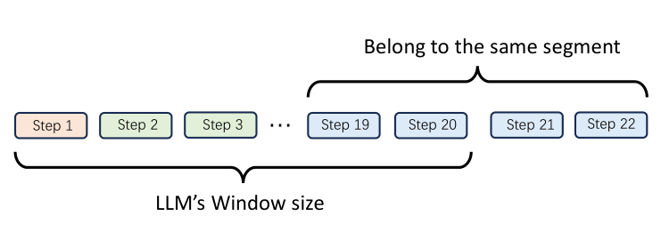
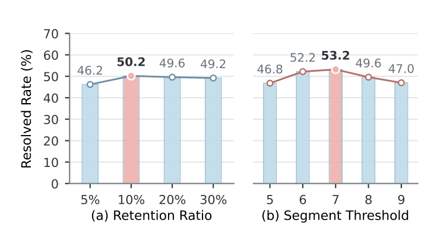

# SWE-Prime：より少ない軌跡で、より良い性能を

> 原題: SWE-Prime: Fewer Trajectories, Better Performance
> 著者: Dewu Zheng, Ruizhe Ye, Yanlin Wang（責任著者）, Yang Ye, Hongyu Zhang, Ensheng Shi, Xilin Liu, Yuchi Ma, Jianxing Yu, Zibin Zheng
> 所属: 中山大学（Sun Yat-sen University）、Huawei Cloud Computing Technologies Co., Ltd.、重慶大学（Chongqing University）
> 出典: arXiv:2608.27449 v1（2026-08-27）。9 ページ、図 5 点。

> **訳注（底本と復元）**
> - 底本は `raw/` のクリップ（ar5iv 経由の v1。arXiv には v1 しかない）。クリップでは、1 節の「軌跡の観点」の説明に続く 5 項目の箇条書き（問題解決のパターン、ツール呼び出しの成功率、連続した冗長、Git ハッキング、結果の質）が丸ごと欠けていたので、arXiv の HTML 版（`https://arxiv.org/html/2608.27449v1`）から復元した。
> - 図 3・4・5 は HTML 版にも画像がなかったため、arXiv の PDF からキャプションの位置を手がかりに切り出した。図 1・2 は HTML 版から保存した。
> - 脚注 1〜5（データセットとモデルの URL）は HTML 版から復元した。
> - 引用は HTML 版の表記（著者 年）で残した。参考文献一覧は訳していない。
> - 式 $S_{\mathrm{traj}}$ と選択的な SFT の目的関数は、原文では改行と位置揃えのための LaTeX の配列で書かれているが、1 行の式に整えた（式の中身は変えていない）。

## Abstract（要旨）

現実世界のソフトウェアのイシューを解決する大規模言語モデルの能力を改善するため、先行研究は、大規模なエージェントの軌跡のデータセットを構築し、成功した軌跡で教師ありファインチューニング（SFT）を行うことに焦点を当ててきた。しかし、タスクの成功は質の高い教師信号を保証しない。成功した軌跡にも、効果のない、冗長な、あるいは危険なステップが含まれうる。そのような軌跡を SFT に直接使うと、ノイズのある教師信号を持ち込み、望ましくない問題解決の振る舞いをモデルにまねさせることを促しうる。そこで私たちは、軌跡と区間（segment）のレベルで訓練データを段階的に絞り込む、多粒度の 2 段階の SFT データ選別の手法である SWE-Prime を提案する。具体的には、第 1 段階は、過程の質、結果の質、データの代表性にもとづいて軌跡レベルのふるい分けを行い、成功した軌跡の、質が高く代表的な部分集合を選ぶ。第 2 段階は、連続するステップを意味的な区間にまとめ、最終的な解への寄与、学習しやすさ、潜在的な危険にもとづいて各区間を評価することで、区間レベルの選別を行う。SFT の間、文脈を保つためにすべての区間は系列の中に残し、選ばれた区間だけが損失の計算に寄与する。SWE-Bench Pro と SWE-Bench Verified での実験は、SWE-Prime が選んだ 10% の軌跡の部分集合で訓練すると、解決したデータセット全体で訓練するのを上回り、それぞれ最大 12.2% と 24.2% の相対的な性能向上をもたらすことを示している。

## Introduction（はじめに）

現実世界のリポジトリにおけるソフトウェアのイシューの解決は、近年ますます注目を集めている（Jimenez et al. 2024; Pan et al. 2024; Yang et al. 2025b; Li et al. 2026）。この長い視野のタスクでのコーディングエージェントの性能を改善するため、最近の研究は、教師ありファインチューニング（SFT）のための大規模なソフトウェアエンジニアリングのデータセットを構築してきた（Pan et al. 2024; Yang et al. 2025b; Jain et al. 2025; Guo et al. 2025; Zheng et al. 2023）。たとえば、SWE-Gym は現実世界の GitHub のイシューから実行可能なタスクを導き、SWE-smith と R2E-Gym は合成のデータ生成を使ってタスクと軌跡の収集をスケールさせる。これらのアプローチは次に、実行にもとづく検証で特定した成功した軌跡で SFT を行う。

しかし、タスクの成功だけでは質の高い教師信号は保証されない（Uesato et al. 2022; Lightman et al. 2023; Xiong et al. 2024; Wang, Pradel, and Liu 2026）。成功した軌跡にも、SFT の教師信号として使うべきでない、効果のない、冗長な、あるいは危険な振る舞いが含まれうる（Chen et al. 2025b; Chen et al. 2025a; Wang et al. 2025a）。図 1 は、この問題を 3 つの観点から示している。

<figure>

<figcaption>図1: 結果だけ、軌跡レベル、区間レベルのデータ選別を比較する動機づけの例。</figcaption>
</figure>

結果の観点（Outcome View）。既存の研究は結果にもとづく観点をとり、そのため成功した軌跡を両方とも残す（Pan et al. 2024; Yang et al. 2025b; Jain et al. 2025; Guo et al. 2025）。

軌跡の観点（Trajectory View）。軌跡の観点は、次の質の側面を通じて、軌跡 B が SFT に適さない理由を示す。

1. 問題解決のパターン: 標準的な問題解決の過程は、モデルが SFT の間に体系的なイシュー解決の振る舞いを学ぶのを助ける（Chen, Ma, and Jiang 2026）。軌跡 A は観察・編集・検証（observe-edit-verify）のワークフローに従うが、軌跡 B は事前の探索なしにコードを変更する。
2. ツール呼び出しの成功率: 頻繁なツールの失敗は、信頼できないツール使用のパターンを SFT の教師信号に持ち込む（Yang et al. 2025a）。軌跡 B はそのような失敗を多く含むが、軌跡 A は安定したツール使用を示す。
3. 連続した冗長: 以前の行動を見失うことによる長い文脈での繰り返しは、望ましくない SFT の教師信号を持ち込む（Xiao et al. 2025）。したがって、軌跡 B は新しい情報を得ずに同じ位置特定の行動を繰り返すので、除外すべきである。
4. Git ハッキング: 漏洩にもとづく近道は、不正な振る舞いを SFT の教師信号に持ち込む（Song et al. 2026; Tao et al. 2026）。軌跡 B はバージョン履歴から目標の修正の情報を取り出すので、SFT に適さない。
5. 結果の質: SFT は、回帰の危険を減らすため、最小限かつ十分なパッチを好むべきである（Chen and Jiang 2025）。軌跡 A はこの原則に従うが、軌跡 B は不要な追加のファイルを変更する。

区間の観点（Segment View）。軌跡レベルで質が高いと評価された軌跡でも、SFT にとって価値の限られた区間を含むことがある（Xiong et al. 2024; Wang et al. 2025a; Deng et al. 2025b）。区間 2 はそのような価値の低い振る舞いの例である。そのステップは成功裏に実行されるが、区間は最終的な修正に寄与せず、教師信号に適さない。個々のステップではなく意味的な区間を評価するのは、問題解決の振る舞いがしばしば複数の行動と観測にまたがり、その意図、結果、寄与を判断するにはそれらを合わせて評価すべきだからである。

これらの観察は、質の高い SFT データは、モデルが確実に学べる実演を提供する、コンパクトでノイズの少ないものであるべきことを示唆している（Chen et al. 2024; Liu et al. 2024）。この目的のため、私たちは、軌跡レベルから意味的な区間レベルへと訓練データを段階的に絞り込む、多粒度の 2 段階のデータ選別の手法である SWE-Prime を提案する。具体的には、第 1 段階は軌跡レベルで動作し、成功した軌跡の、質が高く代表的な部分集合を選ぶ。第 2 段階は意味的な区間のレベルで動作し、残った軌跡の中の価値の高い振る舞いを特定する。SFT の間、文脈を保つためにすべての区間は系列の中に残し、選ばれた区間だけが損失に寄与する。

SWE-Prime を 2 つの代表的なベンチマーク、SWE-Bench Pro と SWE-Bench Verified で評価する。SWE-Prime が選んだ 10% の部分集合で訓練したモデルは、すべての成功した軌跡で訓練したモデルに対して、それぞれ最大 12.2% と 24.2% の相対的な向上を達成する。

主な貢献は次のようにまとめられる。

- 先行研究が、成功した軌跡の間のデータの質の違いを大きく見落としていることを指摘する。
- 長い視野の軌跡における細かい教師信号の質の評価の単位として、孤立したステップではなく、振る舞いとして一貫した意味的な区間を導入する。
- コーディングエージェントの SFT に、コンパクトでノイズが少なく情報の多い教師信号を提供するよう設計された、多粒度の 2 段階の手法 SWE-Prime を提案する。
- 3 つのモデルと 2 つのベンチマークにわたる広範な実験を通じて、SWE-Prime が軌跡の 10% だけを使って、データセット全体での SFT を大きく上回ることを実証する。

<figure>

<figcaption>図2: 多粒度の 2 段階の SFT データ選別のフレームワーク SWE-Prime の概要。</figcaption>
</figure>

## Related Work（関連研究）

### Software Issue Resolution（ソフトウェアのイシューの解決）

ソフトウェアのイシューの解決では、コーディングエージェントが、自然言語で記述されたリポジトリレベルのイシューに対する修復のパッチを生成することが求められる。そのようなイシューに取り組むには、リポジトリの文脈を理解し、関連するコードの位置を特定し、変更を実装し、得られたパッチが既存の機能を後退させずにイシューを解決することを検証する、という作業を反復的に行う必要がある（Jimenez et al. 2024; Yang et al. 2024; Tao et al. 2024; Zheng et al. 2025; Zhang et al. 2024; Xia et al. 2025; Jiang et al. 2026）。

### Training Data for Coding Agents（コーディングエージェントのための訓練データ）

コーディングエージェントの SFT は、コードのリポジトリ、ツールのフィードバック、実行のシグナルに根ざした、長い視野の相互作用の軌跡に依存している。そのため、既存の研究は、実行可能なタスクの構築と、テストで検証された軌跡の収集をスケールさせることに焦点を当ててきた。実行可能なタスクは一般に、現実世界のイシュー、合成のバグ、コードのコミットから構築される（Yang et al. 2025b; Jain et al. 2025）。たとえば SWE-Gym は、GitHub のイシューから実行可能な環境を構築し、テストで検証された軌跡を集める（Pan et al. 2024）。成功した軌跡は、実行による検証、ソフトな検証のシグナル、あるいは実行結果と軌跡の属性にもとづくフィルタを通じて特定され、残される（Shen et al. 2026; Song et al. 2026; Liang et al. 2026）。たとえば SWE-Factory は、複数のプログラミング言語にわたって環境の構築とタスクの検証を自動化する（Guo et al. 2025）。これらの取り組みの中で、SWE-Lego は、失敗したツール呼び出しを含むステップを訓練の損失から除外することで、データの構築後に追加の絞り込みを適用している（Tao et al. 2026）。

しかし、タスクの成功と明示的なエラーのシグナルだけでは、質の高い教師信号を特定するのに不十分である。軌跡レベルでは、成功した実演でも信頼できない過程や焦点の定まらないパッチを示すことがある。区間レベルでは、明示的なエラーのない振る舞いでも、冗長、無関係、あるいは危険なことがある（Xiong et al. 2024; Chen et al. 2025b; Chen et al. 2025a; Wang et al. 2025a; He et al. 2026）。これらの溝を埋めるため、SWE-Prime は軌跡と意味的な区間の両方のレベルで質を考慮した選別を適用し、焦点をタスクの成功だけから、完全な軌跡とその中の振る舞いの教師信号としての価値へと移す。

## SWE-Prime

### Overview（概要）

図 2 に示すように、SWE-Prime は、成功したソフトウェアのイシュー解決の軌跡から SFT の教師信号を段階的に選ぶ、多粒度の 2 段階の手法である。第 1 段階は質が高く代表的な軌跡を選び、第 2 段階はその中の価値の高い意味的な区間を特定する。SFT の間、完全な軌跡は文脈として残し、選ばれた区間だけが損失に寄与する。

### Stage 1: Trajectory-Level Selection（第 1 段階：軌跡レベルの選別）

第 1 段階は、過程の質、結果の質、データの代表性の 3 つの次元を合わせて考慮することで、軌跡レベルの選別を行う。

#### Process Quality Assessment.（過程の質の評価）

過程の質の評価は、成功した軌跡が健全な問題解決の実演を提供しているかどうかを調べる。相互作用のログから観測できる 4 つの補完的なシグナルを使ってこれを運用する。観察・編集・検証によるワークフローの根拠づけ、ツール呼び出しの成功による実行の信頼性、連続した冗長の検出による相互作用の効率、Git ハッキングの検出による振る舞いの正当性である。これらのシグナルは合わせて、過程の質の補完的な層を扱い、個々の行動の妥当性を問題解決の軌跡全体の一貫性に結びつけて、SFT の教師信号としての適性を評価する。

観察・編集・検証の問題解決のパターン。観察・編集・検証のワークフローは、コードの変更をリポジトリの証拠と実行のフィードバックに根ざさせ、モデルが SFT の間に体系的なイシュー解決の振る舞いを学ぶのを助ける（Chen, Ma, and Jiang 2026）。軌跡が最初の編集の前にリポジトリを調べ、最後の編集のあとにテストや確認でパッチを検証していれば $S_{\mathrm{workflow}}=1$ とし、そうでなければ 0 とする。

ツール呼び出しの成功率。頻繁なツールの失敗は、信頼できないツール使用のパターンを SFT の教師信号に持ち込みうる（Yang et al. 2025a）。各軌跡のツール呼び出しの成功率を計算し、そのツールの信頼性のスコア $S_{\mathrm{tool}}$ を、軌跡のプールの中でのこの率のパーセンタイル順位として定義する。スコアが高いほど、他の軌跡と比べてツールの使用が信頼できることを示す。

連続した冗長の制御。長い視野の相互作用の間、エージェントは以前の行動を見失い、隣り合うステップで同じツール呼び出しを引数を変えずに繰り返すことがあり、SFT の間に非効率な相互作用のパターンをモデルに教えてしまう可能性がある（Xiao et al. 2025）。隣り合う呼び出しのツール名と引数を比べ、隣り合う組のどれかが一致すれば $S_{\mathrm{redundancy}}=0$、そうでなければ 1 とする。

Git ハッキングの防止。Git ハッキングは、エージェントがリポジトリの履歴にある将来の修正の情報を使ってコードの変更を導くときに起き、漏洩にもとづく近道を SFT の教師信号に持ち込む（Song et al. 2026; Tao et al. 2026）。そのような漏洩を検出するため、SWE-Prime は、エージェントがコードを変更する前に、Git の履歴の操作が参照パッチの内容を露わにしているかどうかを調べる。そのような漏洩が検出されたときは $S_{\mathrm{git}}=0$ とし、そうでなければ 1 とする。

#### Result Quality Evaluation.（結果の質の評価）

質の高いパッチは、回帰の危険を高める不要な変更を避け、最小限かつ十分な変更でイシューを解決すべきである（Mockus and Weiss 2000; Kamei et al. 2013; Chen and Jiang 2025）。過度に広いパッチで訓練すると、SFT の間にモデルが編集しすぎることを促すこともある。そこで、参照パッチは適切な変更の範囲を見積もるためだけに使う。この範囲をファイルと行の両方のレベルで評価し、それぞれパッチの広さと大きさを捉える。

$F_{\mathrm{model}}$ と $F_{\mathrm{gold}}$ を、それぞれ生成されたパッチと参照パッチが変更したファイルの数とし、$L_{\mathrm{model}}$ と $L_{\mathrm{gold}}$ をそれらの変更した行の数とする。ファイルと行のレベルの範囲のスコアを次のように定義する。

$$
S_{\mathrm{file}}=\min\left(\frac{F_{\mathrm{gold}}}{F_{\mathrm{model}}},1\right),\qquad S_{\mathrm{line}}=\min\left(\frac{L_{\mathrm{gold}}}{L_{\mathrm{model}}},1\right).
$$

各スコアは、生成されたパッチが対応する参照の範囲を超えないときは 1 のままで、変更の範囲が広がるにつれて下がる。2 つのスコアを掛け合わせて次を得る。

$$
S_{\mathrm{result}}=S_{\mathrm{file}}\times S_{\mathrm{line}}.
$$

掛け算を使うのは、ファイルと行の両方の範囲が絞られているときにだけ、パッチが高い結果のスコアを得るようにするためである。結果の質を評価したあと、それを 4 つの過程の質のスコアと組み合わせる。

$$
S_{\mathrm{traj}}=\frac{1}{5}\left(S_{\mathrm{workflow}}+S_{\mathrm{tool}}+S_{\mathrm{redundancy}}+S_{\mathrm{git}}+S_{\mathrm{result}}\right).
$$

$S_{\mathrm{traj}}$ が高いほど、信頼できる問題解決の過程と焦点を絞った修復の両方を持つ軌跡であることを示す。

#### Data Representativeness Assessment.（データの代表性の評価）

質のスコアだけで軌跡を選ぶと、選別が少数の似たイシューの種類に偏り、冗長な教師信号と限られた網羅性につながりうる（Liu et al. 2024; Abbas et al. 2023; Zhang et al. 2025a）。そこで、HDBSCAN（McInnes, Healy, and Astels 2017）を適用して意味的に似たイシューをグループにまとめ、冗長を減らしイシューの種類にわたる網羅性を改善する、クラスタごとの選別を可能にする。

具体的には、まず各軌跡に関連するイシューの記述を取り出し、Qwen3-Embedding-8B（Zhang et al. 2025b）を使って符号化する。次に、得られた埋め込みに HDBSCAN を適用して意味的に似たイシューをグループにまとめ、どのクラスタにも入らないイシューは選別の際にそれぞれ別に扱う。最後に、各イシューのグループの中で軌跡を $S_{\mathrm{traj}}$ で順位づけし、目標の予算のもとで最も順位の高い候補を選ぶ。選ばれた軌跡が第 2 段階の候補の集合となる。

### Stage 2: Segment-Level Selection（第 2 段階：区間レベルの選別）

第 2 段階は、第 1 段階で残った軌跡の中で、3 つの構成要素、区間への分割（Segment Chunking）、区間の採点（Segment Scoring）、区間の絞り込み（Segment Filtering）を通じて区間レベルの選別を行う。

#### Segment Chunking.（区間への分割）

個々のステップは、振る舞いのレベルの質の評価には範囲が狭すぎる。単一のステップは、しばしば行動か観測だけを捉え、その意図と結果を判断するのに十分な文脈を持たない。そこで、共通の意図を共有する連続したステップを意味的な区間にまとめる。各区間は、リポジトリ全体にわたってあるシンボルの使われ方をたどる、といった一貫した局所的な振る舞いを捉える。

<figure>

<figcaption>図3: 固定の大きさのウィンドウにおける意味的な境界の切断。訳注: 原ページ（HTML 版）には画像がないため、PDF から切り出した。</figcaption>
</figure>

長い軌跡は LLM のコンテキストウィンドウを超えることがあるので、スライディングウィンドウを使って段階的に処理する（Wang et al. 2026）。しかし、固定の大きさのウィンドウは、進行中の振る舞いをその境界で分断し、最後の区間に、その終点を判断するのに十分な後続の文脈を残さないことがある。図 3 に示すように、そのような境界の切断は、誤った分割と信頼できない区間の採点につながりうる。

この問題に対処するため、SWE-Prime は境界を意識した分割の仕組みを用いる。各ウィンドウを処理したあと、SWE-Prime は、境界で未完了かもしれない最後のものを除くすべての区間を確定する。次に、この区間を次のウィンドウに持ち越し、後続のステップと合わせて再評価して、その意味的な境界を決める。さらに、ウィンドウをまたいで一貫した分割を保つため、LLM は前のウィンドウからの、タスクの目的、確定した事実、特定した危険のコンパクトな要約を受け取る。これらの仕組みが合わさって、後続の質の評価のための意味的に一貫した区間を作る。

#### Segment Scoring.（区間の採点）

意味的に一貫した区間を得たあと、SWE-Prime はさらに、各振る舞いが SFT の教師信号として使う価値があるかどうかを評価する（Song et al. 2024; Xiong et al. 2024; Wang et al. 2025a）。区間の価値を、最終的な修正への寄与、局所的な学習しやすさ、振る舞いの危険の 3 つの基準に従って定義する。

- 最終的な修正への寄与。区間は、イシューの位置の特定、文脈の収集、変更、検証、またはエラーからの回復を前進させるとき、最終的な修正に寄与する。
- 局所的な学習しやすさ。その時点で利用できる情報にもとづいて、その振る舞いが、明確で学習可能な「証拠・行動・フィードバック」のパターンを提供しているかどうかを評価する。
- 振る舞いの危険。振る舞いの危険は、無関係な探索、情報のない失敗、安全でない操作、ハードコードされた解のような、望ましくない振る舞いを捉える。

これら 3 つの基準に導かれて、LLM はイシューの記述、軌跡の文脈、参照パッチを使って各区間を評価する。次に、各区間 $s_{i,j}$ に、根拠とともに質のスコア $q_{i,j}\in[0,10]$ を割り当てる。

#### Segment Filtering.（区間の絞り込み）

質のスコアに従って各区間に二値の選択マスクを割り当てることで、区間レベルの訓練の目標を構築する。具体的には、$q_{i,j}\geq\delta$ ならば $m_{i,j}=1$ とし、$s_{i,j}$ が学習の目標として選ばれることを示す。そうでなければ $m_{i,j}=0$ とする。

すべての区間は後続の振る舞いのための文脈として残し、訓練の損失は選ばれた区間のアシスタントの応答のトークンにだけ適用する（Chen et al. 2025b; Chen et al. 2025a; He et al. 2026）。したがって、$y_{i}$ を軌跡 $i$ の完全なトークン列とし、$\mathcal{A}(s_{i,j})$ を区間 $s_{i,j}$ の中のアシスタントの応答のトークンの位置とする。選択的な SFT の目的関数は次のとおりである。

$$
\mathcal{L}_{\mathrm{SFT}}=-\frac{1}{N_{\mathrm{sel}}}\sum_{i}\sum_{j}m_{i,j}\sum_{t\in\mathcal{A}(s_{i,j})}\log p_{\theta}(y_{i,t}\mid y_{i,<t}),\qquad N_{\mathrm{sel}}=\sum_{i}\sum_{j}m_{i,j}\left|\mathcal{A}(s_{i,j})\right|.
$$

ここで $N_{\mathrm{sel}}$ は選ばれた区間の中のアシスタントの応答のトークンの総数を表し、目的関数をトークンレベルの平均の損失に正規化する。マスク $m_{i,j}$ は選ばれなかった区間が損失に寄与するのを防ぐ一方、それらのトークンは後続の予測のための文脈として $y_{i,<t}$ の中に残る。

**表1**: SWE-Bench Verified と SWE-Bench Pro での主な結果。Rel. Imp.（相対的な改善）は素のモデルに対するもの。Turns は平均の相互作用のターン数を表す。

| 手法 | データの割合 | Verified 全体 | Verified 相対改善 | Verified ターン | Pro Python | Pro JS | Pro TS | Pro Go | Pro 全体 | Pro 相対改善 | Pro ターン |
|---|---|---|---|---|---|---|---|---|---|---|---|
| **Qwen3-30B-A3B-Instruct-2507**（総 30.5B ／活性 3.3B） | | | | | | | | | | | |
| 素のモデル | – | 25.2 | – | 47.1 | 12.78 | 4.55 | 12.06 | 2.50 | 8.21 | – | 35.4 |
| 解決した軌跡での SFT | 100% | 36.8 | +46.0% | 65.2 | 25.19 | 6.82 | 21.99 | 7.86 | 16.83 | +105.0% | 68.3 |
| ランダム 10% での SFT | 10% | 26.6 | +5.6% | 69.8 | 13.53 | 6.82 | 13.48 | 3.21 | 9.17 | +11.7% | 74.6 |
| SWE-Prime | 10% | 39.6 | +57.1% | 61.1 | 27.44 | 9.09 | 23.40 | 10.00 | 18.88 | +130.0% | 62.2 |
| 第 2 段階なし | 10% | 34.6 | +37.3% | 64.7 | 25.56 | 6.82 | 21.99 | 8.21 | 17.10 | +108.3% | 64.6 |
| **GLM-4.7-Flash**（総 30B ／活性 3B） | | | | | | | | | | | |
| 素のモデル | – | 40.4 | – | 68.3 | 12.78 | 6.82 | 17.02 | 7.50 | 11.22 | – | 35.9 |
| 解決した軌跡での SFT | 100% | 41.4 | +2.5% | 67.9 | 29.32 | 20.45 | 26.24 | 20.00 | 24.62 | +119.5% | 79.7 |
| ランダム 10% での SFT | 10% | 39.6 | -2.0% | 63.4 | 12.41 | 6.82 | 16.31 | 7.14 | 10.81 | -3.7% | 84.3 |
| SWE-Prime | 10% | 51.4 | +27.2% | 56.0 | 33.08 | 29.55 | 27.66 | 20.36 | 26.95 | +140.2% | 70.8 |
| 第 2 段階なし | 10% | 43.6 | +7.9% | 61.7 | 27.82 | 27.27 | 26.24 | 16.07 | 22.98 | +104.9% | 76.4 |
| **Qwen3-Coder-30B-A3B-Instruct**（総 30.5B ／活性 3.3B） | | | | | | | | | | | |
| 素のモデル | – | 44.8 | – | 50.1 | 39.10 | 25.00 | 30.50 | 20.71 | 29.55 | – | 54.4 |
| 解決した軌跡での SFT | 100% | 51.0 | +13.8% | 75.6 | 39.10 | 29.55 | 31.91 | 23.21 | 31.05 | +5.1% | 83.6 |
| ランダム 10% での SFT | 10% | 41.2 | -8.0% | 77.5 | 36.09 | 22.73 | 28.37 | 18.93 | 27.22 | -7.9% | 86.1 |
| SWE-Prime | 10% | 53.2 | +18.8% | 70.9 | 43.61 | 38.64 | 33.33 | 26.43 | 34.75 | +17.6% | 70.9 |
| 第 2 段階なし | 10% | 50.2 | +12.1% | 74.2 | 41.73 | 31.82 | 30.50 | 20.71 | 30.92 | +4.6% | 79.7 |

## Experimental Setup（実験設定）

### Research Questions（研究課題）

RQ1（有効性）: SWE-Prime は、LLM のソフトウェアのイシュー解決の能力をどれだけ効果的に改善するか。

RQ2（ハイパーパラメータの分析）: SWE-Prime はハイパーパラメータにどれだけ敏感で、選んだ設定は設定をまたいで汎化するか。

RQ3（振る舞いの分析）: SWE-Prime の性能向上は、モデルの振る舞いにどう反映されるか。

### Training Data, Models, and Benchmarks（訓練データ、モデル、ベンチマーク）

#### Training Data.（訓練データ）

Nebius が公開した SWE-rebench OpenHands Trajectories データセット¹を使う。これは、SWE-rebench のイシュー（Badertdinov et al. 2025）について、Qwen3-Coder-480B-A35B-Instruct が OpenHands（Wang et al. 2025b）で生成した 67,074 本の軌跡を含む。そのうち 32,161 本の軌跡が、対応するイシューの解決に成功している。本研究は成功した軌跡の間の教師信号の質に焦点を当てるので、これらの解決した軌跡を初期の候補のプールとして使う。

¹ https://huggingface.co/datasets/nebius/SWE-rebench-openhands-trajectories

#### Base Models and Evaluation Benchmarks.（基盤モデルと評価のベンチマーク）

SWE-Prime を 3 つの基盤モデルで評価する。GLM-4.7-Flash²（GLM-4.5 Team 2025）、Qwen3-30B-A3B-Instruct-2507³（Qwen Team 2025）、Qwen3-Coder-30B-A3B-Instruct⁴（Qwen Team 2025）である。すべてのモデルを、2 つのソフトウェアのイシュー解決のベンチマーク、SWE-Bench Verified と SWE-Bench Pro で評価する。SWE-Bench Verified は人手で検証された 500 のタスクを含み⁵、SWE-Bench Pro は 731 タスクの公開分割（Deng et al. 2025a）を使う。

² https://huggingface.co/zai-org/GLM-4.7-Flash
³ https://huggingface.co/Qwen/Qwen3-30B-A3B-Instruct-2507
⁴ https://huggingface.co/Qwen/Qwen3-Coder-30B-A3B-Instruct
⁵ https://openai.com/index/introducing-swe-bench-verified/

### Baselines（ベースライン）

- 素のモデル（Raw Model）。軌跡の SFT を行わない元のモデルを評価し、SFT 前の性能を測る。
- 解決した軌跡での SFT（Resolved-Trajectory SFT）。タスクレベルの実行結果にもとづいて成功した軌跡を残す先行研究（Pan et al. 2024; Jain et al. 2025; Guo et al. 2025）に従い、さらなる質の絞り込みなしに、解決した 32,161 本の軌跡すべてで訓練する。
- ランダム 10%（Random-10%）。同じ軌跡の予算のもとで狙いを定めた選別の価値を評価するため、解決した完全な軌跡からランダムに選んだ 10% の部分集合で訓練する。

### Implementation Details（実装の詳細）

#### Training Configuration.（訓練の設定）

SWE-rebench OpenHands Trajectories とともに公開された訓練レシピに従い、最大系列長を 131,072、バッチサイズを 32 に設定する。AdamW（Loshchilov and Hutter 2019）を、コサインの学習率スケジュールとピーク学習率 $4\times 10^{-6}$ で使う。すべての設定は交差エントロピーの目的関数を最適化し、SWE-Prime は選ばれた区間のアシスタントのトークンにだけ損失を適用する。訓練データと損失マスクを除き、すべての設定は同じ訓練の設定を使う。

#### Evaluation Setting.（評価の設定）

各タスクには、最大系列長 131,072 で、最大 100 の相互作用のターンを許す。サンプリングのパラメータは各モデルの公式の既定値に従う。最終的なパッチは、各ベンチマークが提供する実行環境で検証する。

## Results（結果）

### RQ1: Effectiveness（有効性）

全体の有効性。表 1 に示すように、SWE-Prime は 3 つのモデルと両方のベンチマークのすべてで、一貫して最も高い解決率を達成する。Rel. Imp. の列は対応する素のモデルを基準とする。SWE-Prime は、SWE-Bench Verified で 18.8%〜57.1%、SWE-Bench Pro で 17.6%〜140.2% の相対的な改善をもたらす。初期の能力が異なるモデルにわたるこれらの一貫した向上は、SWE-Prime が評価したモデルとベンチマークの設定にわたって効果的であることを示している。

データの効率。SWE-Prime は解決した軌跡の 10% しか残さないが、評価したすべての設定で解決した軌跡での SFT を上回る。解決した軌跡での SFT に対する向上はモデルによって異なり、SWE-Bench Verified で最大 24.2%、SWE-Bench Pro で最大 12.2% に達する。これらの結果は教師信号の質の重要性を浮き彫りにしている。成功した軌跡をより多く残しても下流の性能が必ずしも改善するわけではなく、一方で、より小さく注意深く選んだ部分集合がより効果的な教師信号を提供しうる。SWE-Prime はランダム 10% も大きく上回り、同じ軌跡の予算のもとでの質を考慮した選別の利点をさらに示している。

区間レベルの選別の寄与。区間レベルの選別の寄与を評価するため、SWE-Prime を、区間レベルの選別なしに軌跡レベルの選別だけを行う第 1 段階のみの変種と比べる。この変種と比べて、SWE-Prime は評価したすべての設定で一貫してより高い解決率を達成し、軌跡レベルの絞り込みだけでは、それ以外の点では質の高い軌跡の中の価値の低い振る舞いに十分に対処できないことを示唆している。したがって、区間レベルの選別は、より価値の高い振る舞いに教師信号を集中させることで補完的な利点をもたらす。

プログラミング言語をまたいだ汎化。SWE-Prime の有効性がプログラミング言語をまたいで汎化するかを調べるため、SWE-Bench Pro の言語別の部分集合での性能を比べる。3 つの基盤モデルすべてで、SWE-Prime は Python、JavaScript、TypeScript、Go で最良の結果を達成する。この一貫性は、選ばれた訓練の部分集合において、多様なイシューの種類と広い教師信号の網羅性を保ちながら冗長を減らす、という、クラスタにもとづく代表的な選別の目標と合致する。

### RQ2: Hyperparameter Analysis（ハイパーパラメータの分析）

<figure>

<figcaption>図4: SWE-Bench Verified での Qwen3-Coder-30B-A3B-Instruct のハイパーパラメータの感度。(a) 軌跡の保持率、(b) 区間のしきい値。訳注: 原ページ（HTML 版）には画像がないため、PDF から切り出した。</figcaption>
</figure>

<figure>

<figcaption>図5: 素のモデル、解決した軌跡での SFT、SWE-Prime の振る舞いの比較。矢印は望ましい方向を示す。上段は SWE-Bench Pro、下段は SWE-Bench Verified。左から冗長（↓）、編集前の観察の率（↑）、ツールの成功率（↑）、平均ターン数（↓）。訳注: 原ページ（HTML 版）には画像がないため、PDF から切り出した。</figcaption>
</figure>

分析の手順。軌跡のプールの中の質の高い教師信号の割合は事前には分からないので、RQ1 の主な評価を行う前に、まず SWE-Prime の選別の設定を決める。2 つのハイパーパラメータを調べる。第 1 段階の軌跡の保持率は残す軌跡の数を制御し、第 2 段階の区間のスコアのしきい値は訓練の損失への区間の算入を決める。この探索的な分析を、Qwen3-Coder-30B-A3B-Instruct で SWE-Bench Verified について行い、まず軌跡の保持率を調べ、次にそれを固定して区間のスコアのしきい値を分析する。いったん選ばれると、得られた設定は凍結され、RQ1 で報告するすべての実験に適用される。

軌跡の保持率。軌跡レベルの選別の効果を切り分けるため、第 2 段階を無効にし、第 1 段階で残した完全な軌跡で、すべてのアシスタントのトークンを訓練の損失に寄与させる標準の SFT を直接行う。保持率を 5%、10%、20%、30% の間で変える。図 4(a) に示すように、解決率は 5% の保持での 46.2% から 10% での 50.2% のピークまで上がり、その後 20% と 30% ではそれぞれ 49.6% と 49.2% にわずかに下がる。このパターンは、残す軌跡が少なすぎるとデータの網羅性が制限されうる一方、10% を超えて軌跡を追加してもそれ以上の利点はなく、質の低い、あるいは冗長な教師信号を再び持ち込みうることを示唆している。そこで、軌跡の保持率として 10% を選ぶ。

区間のスコアのしきい値。10% の保持率を選んだあと、それを固定し、第 2 段階の区間のスコアのしきい値の効果を調べる。文脈を保つためにすべての区間は元の軌跡の中に残し、しきい値を満たす区間だけが訓練の損失に寄与する。図 4(b) に示すように、しきい値を 5 から 7 に上げると、解決率は 46.8% から 53.2% に改善する。しきい値をさらに 8 と 9 に上げると、性能はそれぞれ 49.6% と 47.0% に下がる。しきい値が低いと価値の低い教師信号をより多く残しうる一方、制限が厳しすぎるしきい値は有用な区間を除外しうる。そこで、区間のスコアのしきい値を 7 に設定する。

選んだ設定の汎化。上の分析にもとづき、軌跡の保持率 10% と区間のスコアのしきい値 7 を選び、この設定を RQ1 全体を通じて変えずに適用する。表 1 に示すように、SWE-Prime は 3 つの基盤モデルと両方のベンチマークのすべてで一貫して性能を改善し、選んだ設定がそれを決めるのに使ったモデルとベンチマークを超えて効果的であり続けることを示唆している。与えられたプールの中のどれだけの軌跡が質の高い教師信号を提供するかを事前に知ることはできないが、この一貫性は、選んだ設定が、評価した設定にわたって教師信号の質と網羅性の間の効果的な均衡を達成していることを示唆している。

### RQ3: Behavioral Analysis（振る舞いの分析）

分析の手順。SWE-Prime の性能向上がモデルの振る舞いにどう反映されるかを調べるため、過程の質と相互作用の効率という 2 つの補完的な観点から相互作用の軌跡を分析する。RQ1 は解決率の改善を確立するが、この結果の指標は、モデルがどうやって解にたどり着くかを明らかにしない。そこで、評価のタスクについて、素のモデル、解決した軌跡での SFT、SWE-Prime が生成した軌跡を比べる。主に、同じ候補のプールと訓練の設定を使う解決した軌跡での SFT に焦点を当て、素のモデルは SFT 前の参照として扱う。図 5 に示すように、過程の質は冗長、編集前の観察の率、ツールの成功率で測り、相互作用の効率は平均の相互作用のターン数で測る。

過程の質。SWE-Prime で訓練したモデルは、評価したモデルとベンチマークにわたって、3 つの過程の質の指標すべてを一貫して改善する。解決した軌跡での SFT と比べて、SWE-Prime は冗長を最大 0.188 減らし、編集前の観察の率を最大 9.6 パーセントポイント上げ、ツールの成功率を最大 0.094 改善する。これらの変化は、新しい情報をもたらさない繰り返しの行動の減少、コードの変更の前のより頻繁な文脈の収集、より信頼できるツールの使用に対応する。指標をまたいだその一貫性は、SWE-Prime の性能向上が、より信頼でき構造化された問題解決の振る舞いを伴っていることを示唆している。

相互作用の効率。図 5 に示すように、SWE-Prime は 6 つの評価の設定すべてで、解決した軌跡での SFT と比べて平均の相互作用のターン数を減らし、その減少は 4.1 から 12.7 ターンにわたる。これらの減少は一貫してより高い解決率を伴っているので、早すぎる終了の結果である可能性は低い。むしろ、このパターンは区間レベルの選別の役割を反映している。価値の低い振る舞いが SFT の損失に寄与するのを防ぐことで、SWE-Prime は、モデルがより焦点の絞られた効率的なイシュー解決のパターンを学ぶのを助ける。

## Conclusion（結論）

本研究は、タスクの成功だけでは記録された過程が学習に適しているかどうかを判断できないことから、成功したコーディングエージェントの軌跡から質の高い SFT の教師信号をどう選ぶかを研究する。過程の質、結果の質、データの代表性にもとづいて質が高く代表的な軌跡の部分集合を選び、次に寄与、学習しやすさ、潜在的な危険にもとづいて価値のある意味的な区間を特定する、多粒度の 2 段階の手法 SWE-Prime を導入する。SWE-Bench Pro と SWE-Bench Verified で、SWE-Prime が選んだ軌跡のわずか 10% で訓練したモデルは、解決した軌跡のプール全体で訓練したモデルを上回り、それぞれ最大 12.2% と 24.2% の相対的な性能向上を示す。これらの結果は、効果的なコーディングエージェントの SFT が、成功したタスクの結果だけでなく、得られる教師信号の質、代表性、学習しやすさにも依存することを示唆している。
